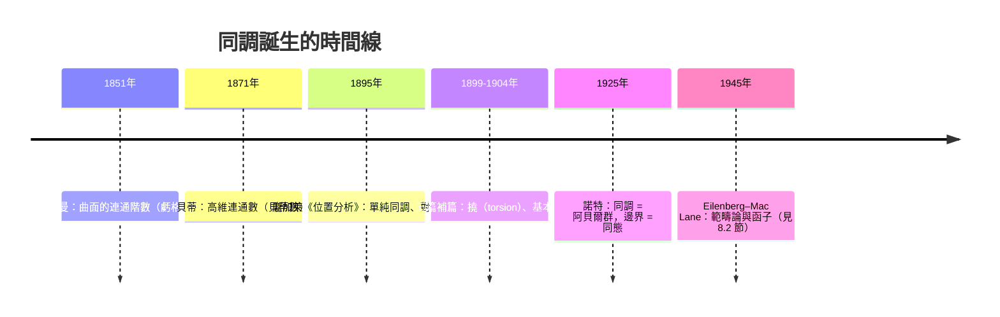
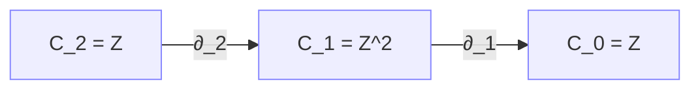

# 8.1 拓撲的驅動：龐加萊（1895）與同調的誕生

## 學習目標

1. 了解龐加萊在 1895 年《位置分析》（*Analysis Situs*）中為研究多面體與流形而發明同調的歷史動機。
2. 掌握鏈複形（chain complex）、邊界算子 $`\partial`$ 與同調群 $`H_n = \ker \partial_n / \operatorname{im} \partial_{n+1}`$ 的嚴格定義，並會證明 $`\partial^2 = 0`$ 。
3. 會對具體的單純複形（圓、球面、環面、射影平面）計算整係數同調群。
4. 理解同調群與有限交換群結構定理（[5.6 節](05.6-主理想環上的模：有限交換群的結構定理.md)）的深刻關聯：同調群的不變因子正是矩陣的 Smith 標準形對角元。
5. 會用 SymPy（含 `sympy.matrices.normalforms.smith_normal_form`）實作整數鏈複形並計算同調群。

## 歷史背景

### 為什麼要發明同調？

19 世紀中葉，數學家面對一個樸素但頑固的問題：**如何在不依賴度量（長度、角度）的情況下，區分不同的幾何圖形？**

- **黎曼（Riemann，1851、1857）** 在研究阿貝爾積分與代數函數時，發現曲面上的「連通階數」（连通性 / *Geschlecht*，即虧格）決定了積分的行為。這是「拓撲不變量控制分析」的第一個訊號。
- **貝蒂（Enrico Betti，1871）** 受黎曼啟發，把「連通階數」推廣到高維，定義了後世所稱的**貝蒂數**（Betti numbers）。但貝蒂的定義是直觀的、缺乏嚴格代數機制的。
- **龐加萊（Henri Poincaré，1895）** 為了研究天體力學中軌道的定性性質，以及多面體、流形的分類問題，發表了 108 頁的巨著《位置分析》（*Analysis Situs*），並在 1899–1904 年間寫了五篇補篇。他引進了**單純複形**、**鏈**、**邊界算子**與**同調**的計算機制——同調從此從直觀變成**可計算的代數**。
- **諾特（Emmy Noether，1925）** 在海德堡與哥廷根的討論班上指出：同調不該被想成「數」或「形式和」，而應該被想成**阿貝爾群**，邊界算子是群同態。這個觀點把同調變成了純代數對象，也直接催生了同調代數（見 [8.2 節](08.2-正合序列與蛇引理.md)）。



這是「技術與理論互相驅動」的又一個範例：**龐加萊想計算多面體的洞，於是被迫發明鏈複形；而鏈複形一旦變成純代數（諾特），立刻被抽象成同調代數，反過來成為 20 世紀代數、拓撲、幾何的通用語言。**

## 鏈複形與同調群

### 單純複形

**定義 8.1.1（單純複形）** 一個（抽象）單純複形 $`K`$ 是一組有限集合（稱為**單形**，simplex），滿足：若 $`\sigma \in K`$ 且 $`\tau \subseteq \sigma`$ ，則 $`\tau \in K`$ 。 $`q`$ 維單形是有 $`q+1`$ 個頂點的集合。記 $`K`$ 的 $`q`$ 維單形全體為 $`K_q`$ 。

例如：三角形（2 維單形）的邊（1 維）與頂點（0 維）自動屬於複形。

### 鏈群與邊界算子

**定義 8.1.2（鏈群）** 對交換群係數 $`G`$ （通常取 $`G = \mathbb{Z}`$ ）， $`q`$ 維鏈群是自由阿貝爾群

$$
C_q(K; G) = \bigoplus_{\sigma \in K_q} G \cdot \sigma ,
$$

元素稱為 $`q`$ 維**鏈**，形式上是 $`q`$ 維單形的整係數線性組合。

**定義 8.1.3（邊界算子）** 邊界算子 $`\partial_q : C_q \to C_{q-1}`$ 在 $`q`$ 維單形 $`\sigma = [v_0, v_1, \ldots, v_q]`$ 上定義為交錯和：

$$
\partial_q [v_0, \ldots, v_q] = \sum_{i=0}^{q} (-1)^i [v_0, \ldots, \widehat{v_i}, \ldots, v_q],
$$

其中 $`\widehat{v_i}`$ 表示刪去該頂點，再線性擴張到整條鏈。

**定理 8.1.4（關鍵恆等式）** $`\partial_{q-1} \circ \partial_q = 0`$ ，即 $`\partial^2 = 0`$ 。

*證明*：對 $`2`$ 維情形直接驗證（一般情形同理，每個頂點被刪兩次、符號相反）：

$$
\partial^2 [v_0, v_1, v_2] = \partial([v_1, v_2] - [v_0, v_2] + [v_0, v_1])
= (v_2 - v_1) - (v_2 - v_0) + (v_1 - v_0) = 0 . \qquad \blacksquare
$$

這個看似簡單的恆等式是整個同調代數的引擎：「**邊界的邊界是空的**」。它保證了下面的定義有意義。

### 同調群

**定義 8.1.5（鏈複形與同調）** 一個**鏈複形**是一列阿貝爾群與同態

$$
\cdots \xrightarrow{\partial_{q+2}} C_{q+1} \xrightarrow{\partial_{q+1}} C_q \xrightarrow{\partial_q} C_{q-1} \xrightarrow{\partial_{q-1}} \cdots , \qquad \partial^2 = 0 .
$$

因為 $`\operatorname{im} \partial_{q+1} \subseteq \ker \partial_q`$ ，可定義 $`q`$ 維**同調群**：

$$
H_q(K; \mathbb{Z}) = \frac{\ker \partial_q}{\operatorname{im} \partial_{q+1}} .
$$

- $`\ker \partial_q`$ 的元素稱為**閉鏈**（cycles）——沒有邊界的鏈，幾何上是「洞」的候選。
- $`\operatorname{im} \partial_{q+1}`$ 的元素稱為**邊界鏈**（boundaries）——本身是更高維區域的邊界，不算洞。
- 同調群衡量「是閉鏈但不是邊界」的鏈，也就是真正的**洞**。

注意 $`H_q`$ 是兩個阿貝爾群的商群，由有限交換群結構定理（[5.6 節](05.6-主理想環上的模：有限交換群的結構定理.md)），它必同構於

$$
H_q \cong \mathbb{Z}^{\beta_q} \oplus \mathbb{Z}/d_1 \oplus \cdots \oplus \mathbb{Z}/d_k, \qquad d_1 \mid d_2 \mid \cdots \mid d_k ,
$$

其中 $`\beta_q`$ 稱為 $`q`$ 維**貝蒂數**， $`d_i`$ 稱為**撓係數**（torsion coefficients，龐加萊在 1899 年的第二補篇中發現，例如射影平面）。

### 歐拉–龐加萊公式

**定理 8.1.6（Euler–Poincaré，1895）** 對有限單純複形 $`K`$ ，

$$
\chi(K) = \sum_q (-1)^q \#\{K_q\} = \sum_q (-1)^q \beta_q .
$$

歐拉 1752 年的多面體公式 $`V - E + F = 2`$ 是其在球面上的特例；龐加萊證明了它對任意複形成立，且右邊只依賴同調——拓撲不變量第一次以代數方式現身。

## 基本例子

用標準 $`\Delta`$ -複形結構（允許單形被同一頂點的排列黏合）計算：

| 空間 | $`H_0`$ | $`H_1`$ | $`H_2`$ | 解讀 |
|---|---|---|---|---|
| 一點 | $`\mathbb{Z}`$ | $`0`$ | $`0`$ | 無洞 |
| 圓 $`S^1`$ | $`\mathbb{Z}`$ | $`\mathbb{Z}`$ | $`0`$ | 一個一維洞 |
| 球面 $`S^2`$ | $`\mathbb{Z}`$ | $`0`$ | $`\mathbb{Z}`$ | 一個二維洞 |
| 環面 $`T^2`$ | $`\mathbb{Z}`$ | $`\mathbb{Z}^2`$ | $`\mathbb{Z}`$ | 兩個一維洞＋一個二維洞 |
| 克萊因瓶 | $`\mathbb{Z}`$ | $`\mathbb{Z} \oplus \mathbb{Z}/2`$ | $`0`$ | 有撓！不可定向 |
| 射影平面 $`\mathbb{R}P^2`$ | $`\mathbb{Z}`$ | $`\mathbb{Z}/2`$ | $`0`$ | 純撓，貝蒂數看不見 |

最後兩列說明：**只算貝蒂數不夠**，必須計算整個同調群（含撓），而撓的偵測正是 Smith 標準形（[5.6 節](05.6-主理想環上的模：有限交換群的結構定理.md)）的工作。環面的兩個一維洞即「經圈」與「緯圈」，龐加萊當年正是為了研究環面上的積分與軌道而行此事。



上圖是環面的鏈複形片段。同調的計算本質上就是：對整數矩陣 $`\partial`$ 做**Smith 標準形**（整數版的對角化），讀出核與像的商群結構。

## SymPy 實作：整數鏈複形的同調

### 核心工具：含基底變換追蹤的 Smith 標準形

SymPy 內建 `sympy.matrices.normalforms.smith_normal_form` 可以算不變因子，但**不回傳基底變換矩陣**，而計算核 $`\ker \partial`$ 需要變換矩陣。因此我們先手寫一個帶追蹤的版本（`U A V = D`， $`U, V`$ 為么模矩陣），之後各節都會用到：

```python
import sympy as sp

def snf_tracked(A):
    """整數矩陣 A 的 Smith 標準形，含么模變換追蹤。
    回傳 (D, U, V)：D = U * A * V，U、V 皆么模（行列式 ±1）。"""
    if isinstance(A, sp.MatrixBase):
        m, n = A.shape                       # 保留形狀（0 列的矩陣也要記得欄數）
        A = A.tolist()
    else:
        m = len(A)
        n = len(A[0]) if m > 0 else 0
    a = [[int(x) for x in row] for row in A]
    A0 = sp.Matrix(m, n, lambda i, j: a[i][j])   # 原始矩陣（保留形狀）
    U = [[1 if i == j else 0 for j in range(m)] for i in range(m)]
    V = [[1 if i == j else 0 for j in range(n)] for i in range(n)]

    def rowop(E):                       # a <- E a, U <- E U
        nonlocal a, U
        a = [[sum(E[i][k]*a[k][j] for k in range(m)) for j in range(n)] for i in range(m)]
        U = [[sum(E[i][k]*U[k][j] for k in range(m)) for j in range(m)] for i in range(m)]

    def colop(F):                       # a <- a F, V <- V F
        nonlocal a, V
        a = [[sum(a[i][k]*F[k][j] for k in range(n)) for j in range(n)] for i in range(m)]
        V = [[sum(V[i][k]*F[k][j] for k in range(n)) for j in range(n)] for i in range(n)]

    def swapmat(n_, i, j):
        E = [[1 if (r == c and r != i and r != j) else 0 for c in range(n_)] for r in range(n_)]
        E[i][j] = E[j][i] = 1
        return E

    def rowswap(i, j):
        rowop(swapmat(m, i, j))

    def colswap(i, j):
        colop(swapmat(n, i, j))

    def rowcomb(i, j, q):               # row_i <- row_i + q*row_j
        E = sp.eye(m).tolist(); E[i][j] = q
        rowop(E)

    def colcomb(i, j, q):               # col_i <- col_i + q*col_j
        F = sp.eye(n).tolist(); F[j][i] = q
        colop(F)

    for k in range(min(m, n)):
        while True:
            piv = pr = pc = None
            for i in range(k, m):       # 找絕對值最小的非零元當軸心
                for j in range(k, n):
                    if a[i][j] != 0 and (piv is None or abs(a[i][j]) < abs(piv)):
                        piv, pr, pc = a[i][j], i, j
            if piv is None:
                break
            if pr != k: rowswap(k, pr)
            if pc != k: colswap(k, pc)
            piv = a[k][k]; ok = True
            for j in range(k+1, n):     # 消去第 k 列其餘元素
                if a[k][j] % piv != 0: ok = False
                colcomb(j, k, -(a[k][j] // piv))
            for i in range(k+1, m):     # 消去第 k 行其餘元素
                if a[i][k] % piv != 0: ok = False
                rowcomb(i, k, -(a[i][k] // piv))
            if ok:                      # 軸心整除整列整行，收工
                break
        if a[k][k] < 0:                 # 對角元取非負
            for j in range(n): a[k][j] = -a[k][j]
            for j in range(n): V[j][k] = -V[j][k]
    D = sp.Matrix(m, n, lambda i, j: a[i][j])
    Um, Vm = sp.Matrix(U), sp.Matrix(V)
    assert Um.det() in (1, -1) and Vm.det() in (1, -1)
    assert (Um * A0 * Vm - D).is_zero_matrix
    return D, Um, Vm
```

### 由鏈複形算同調

給 $`\partial_{q+1} : C_{q+1} \to C_q`$ 與 $`\partial_q : C_q \to C_{q-1}`$ （皆整數矩陣，且 $`\partial_q \partial_{q+1} = 0`$ ），計算 $`H_q = \ker \partial_q / \operatorname{im} \partial_{q+1}`$ 的步驟：

1. 用 Smith 標準形的變換矩陣 $`V`$ 求出 $`\ker \partial_q`$ 的**整數**基底（行向量）。
2. 把 $`\operatorname{im} \partial_{q+1}`$ 的每個生成元用該基底表出（解線性方程，係數必為整數，因為 $`\operatorname{im} \partial_{q+1} \subseteq \ker \partial_q`$ ）。
3. 對表出矩陣再做一次 Smith 標準形，讀出商群 $`\mathbb{Z}^d / \operatorname{im}`$ 的自由秩與不變因子。

```python
import sympy as sp

def kernel_basis(B):
    """B: Z^k -> Z^m 的整數核基底（回傳 k x d 矩陣，每一欄是一個基底向量）。"""
    B = sp.Matrix(B)
    m, k = B.shape
    D, U, V = snf_tracked(B)
    # D y = 0 的整數解由「零對角元所在的座標」生成；x = V y
    free_cols = [j for j in range(k) if j >= min(m, k) or D[j, j] == 0]
    return sp.Matrix([[V[i, j] for j in free_cols] for i in range(k)])

def coker_structure(A):
    """Z^m / im A 的結構：回傳 (自由秩, [不變因子])。"""
    A = sp.Matrix(A)
    m, n = A.shape
    D, U, V = snf_tracked(A)
    invars = [int(D[i, i]) for i in range(min(m, n)) if D[i, i] > 1]
    rank = sum(1 for i in range(min(m, n)) if D[i, i] != 0)
    return m - rank, invars

def homology(d_higher, d_lower):
    """H = ker d_lower / im d_higher（兩者的餘域都是 C_q = Z^m）。
    回傳 (自由秩 beta_q, [撓不變因子])。"""
    d_lower = sp.Matrix(d_lower)
    d_higher = sp.Matrix(d_higher)
    K = kernel_basis(d_lower)              # m x d，核基底（欄為基底向量）
    d = K.shape[1]
    if d == 0:
        return 0, []
    C = sp.zeros(d, d_higher.shape[1])     # 像(d_higher) 在核基底下的座標
    for j in range(d_higher.shape[1]):
        sol, _ = K.gauss_jordan_solve(d_higher[:, j])
        assert all(x.is_Integer for x in sol)   # 座標必為整數
        C[:, j] = sol
    return coker_structure(C)
```

### 例一：環面 $`T^2`$

呼叫 `homology(d_higher, d_lower)` 時，兩個矩陣必須有**相同的餘域** $`C_q = \mathbb{Z}^m`$ （因為 $`H_q = \ker \partial_q / \operatorname{im} \partial_{q+1}`$ 的分子分母都是 $`C_q`$ 的子群），每個維度一次算一個。

環面採用 Hatcher 的標準 $`\Delta`$ -複形：一個頂點 $`v`$ 、三條閉邊 $`a, b, c`$ 、兩個三角形 $`U, L`$ ，其中 $`\partial U = a + b - c`$ 、 $`\partial L = c - a - b`$ ，所以 $`\partial_1 = 0`$ （每條邊兩端都是 $`v`$ ）。

```python
import sympy as sp
# ---- 前置：snf_tracked / kernel_basis / coker_structure（見上文定義） ----

# 環面 T^2：C_2 = Z^2, C_1 = Z^3, C_0 = Z^1
d2 = sp.Matrix([[ 1, -1],      # a 分量
                [ 1, -1],      # b 分量
                [-1,  1]])     # c 分量
d1 = sp.zeros(1, 3)            # ∂_1 : Z^3 -> Z^1
assert (d1 * d2).is_zero_matrix    # 驗證 ∂² = 0

print("H_2 =", homology(sp.zeros(3, 0), d2))   # H_2 = ker d2 / 0
print("H_1 =", homology(d2, d1))               # H_1 = ker 0 / im d2
print("H_0 =", homology(d1, sp.zeros(0, 1)))   # H_0 = ker 0 / im d1
```

輸出：

```text
H_2 = (1, [])
H_1 = (2, [])
H_0 = (1, [])
```

即 $`H_2(T^2) = \mathbb{Z}`$ 、 $`H_1(T^2) = \mathbb{Z}^2`$ （經圈與緯圈兩個洞）、 $`H_0(T^2) = \mathbb{Z}`$ （連通）。

與 8.1 節的表完全一致：環面有兩個獨立的一維洞與一個二維洞，且無撓。

### 例二：射影平面 $`\mathbb{R}P^2`$ ——撓的現身

 $`\mathbb{R}P^2`$ 用最簡的 CW 結構：一個 $`0`$ 維胞腔、一個 $`1`$ 維胞腔 $`a`$ 、一個 $`2`$ 維胞腔沿映射 $`a \mapsto 2a`$ （度數 $`2`$ ）貼上。於是 $`C_2 = \mathbb{Z}`$ 、 $`C_1 = \mathbb{Z}`$ 、 $`C_0 = \mathbb{Z}`$ ，邊界矩陣 $`\partial_2 = [2]`$ 、 $`\partial_1 = [0]`$ ：

```python
import sympy as sp
# ---- 前置：snf_tracked / kernel_basis / coker_structure（見上文定義） ----

# RP^2：C_2 = Z, C_1 = Z, C_0 = Z
d2 = sp.Matrix([[2]])          # ∂_2 : Z -> Z，度數 2 的貼映射
d1 = sp.Matrix([[0]])          # ∂_1 : Z -> Z
assert (d1 * d2).is_zero_matrix

print("H_2 =", homology(sp.zeros(1, 0), d2))
print("H_1 =", homology(d2, d1))
```

輸出：

```text
H_2 = (0, [])
H_1 = (0, [2])
```

即 $`H_2(\mathbb{R}P^2) = 0`$ 、 $`H_1(\mathbb{R}P^2) = \mathbb{Z}/2`$ 。

撓不變因子 $`2`$ 被找出來了！若只看貝蒂數 $`\beta_1 = 0`$ ，會誤以為射影平面沒有一維洞——這正是龐加萊 1899 年在第二補篇中引進撓的理由。同樣的 CW 手法可算克萊因瓶： $`\partial_2 = [0, 2]^T : \mathbb{Z} \to \mathbb{Z}^2`$ 、 $`\partial_1 = 0`$ ，讀者可驗證得到 $`H_1 = \mathbb{Z} \oplus \mathbb{Z}/2`$ （見習題 3）。

### 對照：SymPy 內建的 `smith_normal_form`

當我們只需要**不變因子**（例如判斷餘核結構）而不需要基底變換時，可直接用 SymPy 內建工具，記得指定整數域 `ZZ`：

```python
import sympy as sp
from sympy.matrices.normalforms import smith_normal_form
from sympy import ZZ

M = sp.Matrix([[2, 4, 4],
               [6, 6, 12]])            # 例：某個 ∂_1 的表現矩陣
D = smith_normal_form(M, domain=ZZ)
print(D)
# 解讀：Z^2 / im M  =  Z/2 ⊕ Z/6 （無自由部分）
```

```text
Matrix([[2, 0, 0], [0, 6, 0]])
```

這驗證了 `coker_structure` 的輸出：不變因子 $`2, 6`$ ，滿足整除鏈 $`2 \mid 6`$ 。

## SymPy 要點回顧

- `sympy.matrices.normalforms.smith_normal_form(M, domain=ZZ)`：計算整數矩陣的不變因子（Smith 標準形對角元），但**不回傳**么模變換矩陣；計算核需要變換矩陣，故本節手寫 `snf_tracked`。
- 么模（unimodular）變換：行列式為 $`\pm 1`$ 的整數矩陣，其逆仍是整數矩陣，對應鏈群的**基底變換**，不影響同調。
- 同調計算三部曲：`kernel_basis`（整數核）→ 座標轉換（`gauss_jordan_solve`）→ `coker_structure`（商群結構）。
- 核心定理 $`\partial^2 = 0`$ 使 $`\operatorname{im} \subseteq \ker`$ ，商群才有定義——程式中的 `assert (d1 * d2).is_zero_matrix` 就是在驗證這件事。
- 有限交換群的結構定理（[5.6 節](05.6-主理想環上的模：有限交換群的結構定理.md)）保證輸出 $`(\beta_q, [d_1, \ldots, d_k])`$ 唯一（ $`d_1 \mid \cdots \mid d_k`$ ）。

## 習題

1. **（∂² = 0）** 寫出 $`\partial^2`$ 在 $`3`$ 維單形 $`[v_0, v_1, v_2, v_3]`$ 上的完整展開，驗證每一項兩兩抵消。（提示：每對 $`(i, j)`$ ， $`i < j`$ ，貢獻 $`[v_i, v_j]`$ 兩次、符號相反。）
2. **（圓的同調）** 取 $`S^1`$ 的一個頂點、一條邊的複形： $`C_1 = \mathbb{Z}`$ 、 $`C_0 = \mathbb{Z}`$ 、 $`\partial_1 = [0]`$ 。用本節程式碼計算 $`H_0`$ 與 $`H_1`$ ，確認得到 $`\mathbb{Z}`$ 與 $`\mathbb{Z}`$ 。
3. **（克萊因瓶）** 用邊界矩陣 $`\partial_2 = [0, 2]^T`$ （一個 2 維胞腔）、 $`\partial_1 = 0`$ （兩條邊都閉合）計算克萊因瓶的 $`H_1`$ ，確認得到 $`\mathbb{Z} \oplus \mathbb{Z}/2`$ 。
4. **（歐拉示性數）** 用環面的邊界矩陣驗證： $`\chi = \#\{K_0\} - \#\{K_1\} + \#\{K_2\} = 2 - 3 + 2 = 1`$ ？這與 $`\beta_0 - \beta_1 + \beta_2 = 1 - 2 + 1 = 0`$ 矛盾嗎？（提示： $`\Delta`$ -複形的 $`0`$ 維胞腔數為 $`2`$ 而非 $`1`$ ；檢查你的計數，並用 `coker_structure` 找出 $`H_0 = \mathbb{Z}`$ 時 $`\chi = 0`$ 的正確胞腔數。）
5. **（模 $`2`$ 係數的陷阱）** 把 $`\mathbb{R}P^2`$ 的 $`\partial_2`$ 對 $`2`$ 取模（係數變成 $`\mathbb{Z}/2`$ ），計算「同調」，觀察撓 $`\mathbb{Z}/2`$ 如何消失。這說明為什麼整係數計算不可取代。
6. **（挑戰：莫比烏斯帶）** 建構莫比烏斯帶的單純複形（可用 $`5`$ 個頂點、 $`10`$ 個三角形），用程式計算 $`H_0, H_1, H_2`$ ，並與「可帶邊曲面」的預期 $`H_1 = \mathbb{Z}`$ 比對。

下一節 [8.2 正合序列與蛇引理](08.2-正合序列與蛇引理.md)將把「核、像、商」的計算語言公理化，展示同調代數如何從拓撲的計算工具蛻變為獨立的代數理論。
