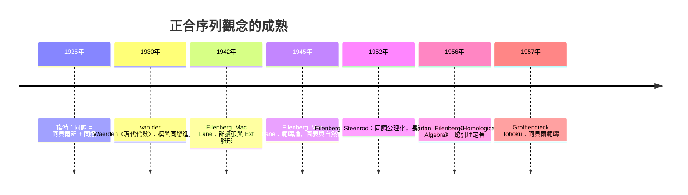
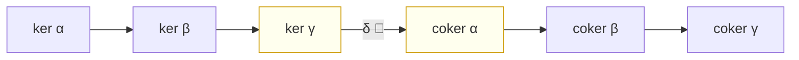

# 8.2 正合序列與蛇引理

## 學習目標

1. 理解「正合」（exactness）如何把 [8.1 節](08.1-拓撲的驅動：龐加萊（1895）與同調的誕生.md)中「核、像、商」的計算語言公理化，成為同調代數的核心概念。
2. 掌握短正合序列 $`0 \to A \to B \to C \to 0`$ 的四大拆解引理（分裂引理、五引理、 $`3 \times 3`$ 引理、蛇引理）的敘述與證明思路。
3. 了解蛇引理（Snake Lemma，1950 年代芝加哥與巴黎學派的產物）為何被稱為「同調代數的瑞士刀」：它把一個正方形圖表轉換成一條連接同調的長正合序列。
4. 會用純 Python 實作阿貝爾群與群同態，程式化驗證正合性、蛇引理的連接同態 $`\delta`$ ，以及五引理。
5. 體會從「計算具體圖表」到「範疇論圖表追逐」（diagram chasing）的抽象飛躍，以及 Eilenberg–Mac Lane 1945 年範疇論在其中扮演的角色。

## 歷史背景

### 從諾特的「群觀點」到圖表語言

[8.1 節](08.1-拓撲的驅動：龐加萊（1895）與同調的誕生.md)結尾提到：諾特（Emmy Noether，1925）主張同調應是**阿貝爾群**、邊界算子是**同態**。這個觀點在 1920 年代末至 1940 年代間逐漸發酵，出現了一條清晰的演化線：

- **1926–1933 年**：諾特與荷蘭學派的 van der Waerden、B. L. van der Waerden 的《現代代數》（*Moderne Algebra*，1930–1931）把模、理想、同態寫進標準教材，代數第一次以「結構 + 同態」的面目出現。
- **1942 年**：Eilenberg 與 Mac Lane 為了把群上同調（Ševera？不，是 Hopf、Eckmann–Hilton 一線的拓撲學家所發展的）與極大張量積的計算統一起來，發表〈Group extensions and homology in abelian groups〉，首次系統使用 $`\operatorname{Ext}`$ 的雛形（見 [8.3 節](08.3-Ext與Tor：函子的計算.md)）。
- **1945 年**：Eilenberg–Mac Lane 發表〈General theory of natural equivalences〉，**範疇論正式誕生**。他們的目的很樸素：把「自然同構」講清楚——而自然性必須用**交換圖表**來表達。圖表語言從此成為代數的通用記法。
- **1945–1954 年**：Eilenberg–Steenrod 把拓撲空間的同調公理化（*Foundations of Algebraic Topology*，1952 出版），證明各種同調理論（單純、奇異、Čech）都滿足同一組公理，並以**長正合序列**作為公理之一。正合序列從計算技巧升格為**理論骨架**。
- **1956 年**：Cartan–Eilenberg 出版《Homological Algebra》——**第一本同調代數教科書**。蛇引理、五引理、導函子（見 [8.3 節](08.3-Ext與Tor：函子的計算.md)）全部系統化。同年至 1958 年，Grothendieck 在 Tohoku 論文中把這套語言推廣到阿貝爾範疇，為他 1960 年代重建代數幾何鋪路。



**技術與理論互相驅動**在這裡表現得淋漓盡致：拓撲學家為了計算纖維化的同調（Serre 1951 年用譜序列計算纖維化的同調，解決球面同調問題），被迫發展正合序列的機械化操作；而正合序列一旦成為範疇論語言，立刻反過來服務於代數——Serre 1955 年的 GAGA、Atiyah 1957 年分類二維向量叢，全是圖表追逐的戰果。

## 正合序列

### 定義

**定義 8.2.1（正合）** 設 $`A \xrightarrow{f} B \xrightarrow{g} C`$ 是阿貝爾群（或模）的同態序列。若

$$
\operatorname{im} f = \ker g ,
$$

則稱此序列在 $`B`$ 處**正合**。一列同態若在每一處都正合，稱為**正合序列**（exact sequence）。

三個基本樣板：

| 序列 | 正合的含意 |
|---|---|
| $`0 \to A \xrightarrow{f} B`$ | $`f`$ 是單射（ $`\ker f = 0`$ ） |
| $`B \xrightarrow{g} C \to 0`$ | $`g`$ 是滿射（ $`\operatorname{im} g = C`$ ） |
| $`0 \to A \xrightarrow{f} B \xrightarrow{g} C \to 0`$ | 短正合序列： $`A \cong \operatorname{im} f \trianglelefteq B`$ ， $`C \cong B / \operatorname{im} f`$ |

**短正合序列**濃縮了一個定理： $`C \cong B/A`$ （在 $`A`$ 視為 $`B`$ 的子群時）。換言之，**任何商群都是一個短正合序列**——正合序列是「子群—群—商群」三位一體的線性寫法。這正是 [2.4 節](02.4-正規子群與商群：若爾當（1870）的貢獻.md)若爾當商群構造的公理化版本。

**例子 8.2.2** 以下是三個經典短正合序列：

1. **直和拆解**： $`0 \to A \xrightarrow{i} A \oplus B \xrightarrow{\pi} B \to 0`$ ， $`i(a) = (a, 0)`$ ， $`\pi(a, b) = b`$ 。
2. **乘法與約化**： $`0 \to \mathbb{Z} \xrightarrow{\cdot n} \mathbb{Z} \xrightarrow{\mathrm{mod}\, n} \mathbb{Z}/n \to 0`$ 。
3. **截斷**：對鏈複形 $`C`$ （[8.1 節](08.1-拓撲的驅動：龐加萊（1895）與同調的誕生.md)）， $`0 \to Z_q \to C_q \xrightarrow{\partial_q} B_{q-1} \to 0`$ ，其中 $`Z_q = \ker \partial_q`$ （閉鏈）、 $`B_{q-1} = \operatorname{im} \partial_q`$ （邊界）。

第三個例子是樞紐：把同調 $`H_q = Z_q / B_q`$ 嵌進正合序列的網絡裡，蛇引理就能「追逐」出同調之間的關係。

### 分裂引理

**引理 8.2.3（分裂引理，Splitting Lemma）** 對短正合序列 $`0 \to A \xrightarrow{f} B \xrightarrow{g} C \to 0`$ ，以下等價：

1. 存在同態 $`s : C \to B`$ 使 $`g \circ s = \operatorname{id}_C`$ （右分裂）；
2. 存在同態 $`r : B \to A`$ 使 $`r \circ f = \operatorname{id}_A`$ （左分裂）；
3. $`B \cong A \oplus C`$ ，且 $`f, g`$ 對應內含與投影。

*證明思路*：以 (1) ⇒ (3) 為例。定義 $`\varphi : A \oplus C \to B`$ ， $`\varphi(a, c) = f(a) + s(c)`$ 。正合性保證 $`f(A) \cap s(C) = \{0\}`$ ：若 $`f(a) = s(c)`$ ，則 $`g(f(a)) = 0`$ 而 $`g(s(c)) = c`$ ，故 $`c = 0`$ 、 $`f(a) = 0`$ ，再由 $`f`$ 單射得 $`a = 0`$ 。再由 $`g`$ 滿射，任意 $`b \in B`$ 可寫 $`b = f(a) + s(g(b))`$ （取 $`a = b - s(g(b))`$ ，因 $`r \circ f`$ 尚未定義，直接驗證 $`b - s(g(b)) \in \ker g = \operatorname{im} f`$ ）。故 $`\varphi`$ 是同構。 $`\blacksquare`$

注意：**阿貝爾範疇中短正合序列不一定分裂**。反例： $`0 \to \mathbb{Z} \xrightarrow{\cdot 2} \mathbb{Z} \to \mathbb{Z}/2 \to 0`$ 不分裂，因為 $`\mathbb{Z}/2`$ 無法嵌入 $`\mathbb{Z}`$ （ $`\mathbb{Z}`$ 無撓元素）。這個「不分裂性」正是 [8.3 節](08.3-Ext與Tor：函子的計算.md) $`\operatorname{Ext}^1(\mathbb{Z}/2, \mathbb{Z}) = \mathbb{Z}/2`$ 的具體化身——分裂與否由 Ext 群測量。

## 長正合序列與蛇引理

### 蛇引理的敘述

**定理 8.2.4（蛇引理，Snake Lemma）** 給定交換圖表（兩列皆正合，方塊皆交換）：

$$
\begin{CD}
0 @>>> A @>{f}>> B @>{g}>> C @>>> 0\\
@. @V{\alpha}VV @V{\beta}VV @V{\gamma}VV @.\\
0 @>>> A' @>{f'}>> B' @>{g'}>> C' @>>> 0
\end{CD}
$$

則存在**連接同態**（connecting homomorphism） $`\delta : \ker \gamma \to \operatorname{coker} \alpha`$ 使下列序列正合：

$$
\ker \alpha \to \ker \beta \to \ker \gamma \xrightarrow{\;\delta\;} \operatorname{coker} \alpha \to \operatorname{coker} \beta \to \operatorname{coker} \gamma .
$$

*證明（圖表追逐，diagram chasing）*：這是同調代數最著名的證明，逐段構造並驗證。

1. ** $`\delta`$ 的定義（追蛇）**：取 $`c \in \ker \gamma \subseteq C`$ 。由上列正合， $`g`$ 滿射，選 $`b \in B`$ 使 $`g(b) = c`$ 。計算 $`g'(\beta(b)) = \gamma(g(b)) = \gamma(c) = 0`$ ，故 $`\beta(b) \in \ker g' = \operatorname{im} f'`$ 。由 $`f'`$ 單射，存在唯一 $`a' \in A'`$ 使 $`f'(a') = \beta(b)`$ 。**定義 $`\delta(c) = a' + \operatorname{im} \alpha \in \operatorname{coker} \alpha`$ **。
2. **良定性**：換一個提升 $`b + f(a)`$ （ $`g`$ 的纖維是 $`b + \operatorname{im} f`$ ），則 $`\beta(b + f(a)) = \beta(b) + f'(\alpha(a))`$ ，對應的 $`a'`$ 變成 $`a' + \alpha(a)`$ ，在 $`\operatorname{coker} \alpha`$ 中同類。故 $`\delta(c)`$ 與選擇無關。
3. ** $`\delta`$ 是同態**：對 $`c_1, c_2`$ 取提升 $`b_1, b_2`$ ，線性追蹤即可。
4. **在 $`\ker \gamma \to \operatorname{coker} \alpha`$ 處正合**：若 $`\delta(c) = 0`$ ，即 $`a' \in \operatorname{im} \alpha`$ ，例如 $`a' = \alpha(a)`$ 。則 $`\beta(b - f(a)) = \beta(b) - f'(\alpha(a)) = 0`$ ，故 $`b - f(a) \in \ker \beta`$ ，且 $`g(b - f(a)) = c`$ 。所以 $`c \in \operatorname{im}(\ker \beta \to \ker \gamma)`$ 。
5. 其餘四處正合性是「像 ⊆ 核」的直接驗證（交換性 + 正合性），讀者可在習題 2 完成追蹤。 $`\blacksquare`$



序列中段的 $`\delta`$ 像一條蛇從兩列之間鑽過去——引理因此得名。它是純粹的**形式代數**：只要圖表交換、兩列正合，結論在**任何**阿貝爾範疇（群、模、層……）都成立。這種「一次證明、處處適用」正是 Eilenberg–Mac Lane 1945 年引進範疇論的原始動機。

### 由蛇引理到長正合序列

**系 8.2.5（同調的長正合序列）** 設 $`0 \to A \xrightarrow{i} B \xrightarrow{p} C \to 0`$ 是鏈複形的短正合序列（ $`i, p`$ 都與邊界算子交換），則存在長正合序列

$$
\cdots \to H_n(A) \xrightarrow{i_*} H_n(B) \xrightarrow{p_*} H_n(C) \xrightarrow{\;\partial\;} H_{n-1}(A) \xrightarrow{i_*} H_{n-1}(B) \to \cdots
$$

*思路*：對每一個次數 $`n`$ ，把截斷序列（例子 8.2.2 之 3）拼成蛇引理的圖表：

$$
\begin{CD}
0 @>>> Z_n(A) @>>> Z_n(B) @>>> Z_n(C)\\
@. @VVV @VVV @VVV\\
0 @>>> C_n(A) @>>> C_n(B) @>>> C_n(C)\\
@. @V{\partial}VV @V{\partial}VV @V{\partial}VV\\
0 @>>> B_{n-1}(A) @>>> B_{n-1}(B) @>>> B_{n-1}(C)
\end{CD}
$$

由 $`Z_n / B_n = H_n`$ 的定義，蛇引理的 $`\ker`$ 行給出 $`H_n(A) \to H_n(B) \to H_n(C)`$ ，而連接同態 $`\delta`$ 正是拓撲學裡的**邊界同態** $`\partial : H_n(C) \to H_{n-1}(A)`$ 。這條序列是 Eilenberg–Steenrod 公理的核心，也是 [8.4 節](08.4-群同調與上同調的計算範例.md)計算群同調的標準武器（例如 $`G \twoheadrightarrow Q`$ 的 Hochschild–Serre 序列）。

### 五引理與 $`3 \times 3`$ 引理

**引理 8.2.6（五引理）** 在交換圖表

$$
\begin{CD}
A_1 @>{f_1}>> A_2 @>{f_2}>> A_3 @>{f_3}>> A_4 @>{f_4}>> A_5\\
@V{\alpha_1}VV @V{\alpha_2}VV @V{\alpha_3}VV @V{\alpha_4}VV @V{\alpha_5}VV\\
B_1 @>{g_1}>> B_2 @>{g_2}>> B_3 @>{g_3}>> B_4 @>{g_4}>> B_5
\end{CD}
$$

中，兩列正合、方塊交換。若 $`\alpha_1`$ 滿射、 $`\alpha_5`$ 單射、 $`\alpha_2`$ 與 $`\alpha_4`$ 是同構，則 $`\alpha_3`$ 是同構。

*證明思路（追逐範本）*：
- *單射*：取 $`a_3 \in \ker \alpha_3`$ 。則 $`\alpha_4 f_3(a_3) = g_3 \alpha_3(a_3) = 0`$ ，由 $`\alpha_4`$ 單射得 $`f_3(a_3) = 0`$ ，故 $`a_3 \in \ker f_3 = \operatorname{im} f_2`$ 。寫 $`a_3 = f_2(a_2)`$ 。由交換性 $`g_2 \alpha_2(a_2) = \alpha_3 f_2(a_2) = 0`$ ，故 $`\alpha_2(a_2) \in \ker g_2 = \operatorname{im} g_1`$ ，可寫 $`g_1(b) = \alpha_2(a_2)`$ ， $`b \in B_2`$ 。由 $`\alpha_1`$ 滿射取 $`a_1`$ 使 $`\alpha_1(a_1) = b`$ ，則 $`\alpha_2 f_1(a_1) = g_1 \alpha_1(a_1) = \alpha_2(a_2)`$ ，由 $`\alpha_2`$ 單射得 $`f_1(a_1) = a_2`$ ，於是 $`a_3 = f_2 f_1(a_1) = 0`$ 。
- *滿射*：對稱地從右往左追。 $`\blacksquare`$

**引理 8.2.7（ $`3 \times 3`$ 引理／九引理）** 在 $`3 \times 3`$ 交換圖表中，若三列皆正合且任兩行正合，則第三行也正合。

五引理與九引理把「局部訊息推廣到整體」形式化：**只要圖表夠多正合，一個孤立方塊的性質就被迫成立**。這正是 Serre 與 Atiyah 在 1950 年代用圖表語言解決模與叢分類問題的方法論基礎。

## SymPy 實作：正合性檢驗與蛇引理

### 共用工具：整數格與 Smith 標準形

本節的正合性檢驗與同調計算都需要 [8.1 節](08.1-拓撲的驅動：龐加萊（1895）與同調的誕生.md)的整數格工具：帶么模變換追蹤的 Smith 標準形、整數核基底、商群結構與同調。為使本節的每段程式都能獨立執行，先把這些工具完整列出：

```python
import sympy as sp

def snf_tracked(A):
    """整數矩陣 A 的 Smith 標準形，含么模變換追蹤。
    回傳 (D, U, V)：D = U * A * V，U、V 皆么模（行列式 ±1）。"""
    if isinstance(A, sp.MatrixBase):
        m, n = A.shape                       # 保留形狀（0 列的矩陣也要記得欄數）
        A = A.tolist()
    else:
        m = len(A)
        n = len(A[0]) if m > 0 else 0
    a = [[int(x) for x in row] for row in A]
    A0 = sp.Matrix(m, n, lambda i, j: a[i][j])   # 原始矩陣（保留形狀）
    U = [[1 if i == j else 0 for j in range(m)] for i in range(m)]
    V = [[1 if i == j else 0 for j in range(n)] for i in range(n)]

    def rowop(E):                       # a <- E a, U <- E U
        nonlocal a, U
        a = [[sum(E[i][k]*a[k][j] for k in range(m)) for j in range(n)] for i in range(m)]
        U = [[sum(E[i][k]*U[k][j] for k in range(m)) for j in range(m)] for i in range(m)]

    def colop(F):                       # a <- a F, V <- V F
        nonlocal a, V
        a = [[sum(a[i][k]*F[k][j] for k in range(n)) for j in range(n)] for i in range(m)]
        V = [[sum(V[i][k]*F[k][j] for k in range(n)) for j in range(n)] for i in range(n)]

    def swapmat(n_, i, j):
        E = [[1 if (r == c and r != i and r != j) else 0 for c in range(n_)] for r in range(n_)]
        E[i][j] = E[j][i] = 1
        return E

    def rowswap(i, j):
        rowop(swapmat(m, i, j))

    def colswap(i, j):
        colop(swapmat(n, i, j))

    def rowcomb(i, j, q):               # row_i <- row_i + q*row_j
        E = sp.eye(m).tolist(); E[i][j] = q
        rowop(E)

    def colcomb(i, j, q):               # col_i <- col_i + q*col_j
        F = sp.eye(n).tolist(); F[j][i] = q
        colop(F)

    for k in range(min(m, n)):
        while True:
            piv = pr = pc = None
            for i in range(k, m):       # 找絕對值最小的非零元當軸心
                for j in range(k, n):
                    if a[i][j] != 0 and (piv is None or abs(a[i][j]) < abs(piv)):
                        piv, pr, pc = a[i][j], i, j
            if piv is None:
                break
            if pr != k: rowswap(k, pr)
            if pc != k: colswap(k, pc)
            piv = a[k][k]; ok = True
            for j in range(k+1, n):     # 消去第 k 列其餘元素
                if a[k][j] % piv != 0: ok = False
                colcomb(j, k, -(a[k][j] // piv))
            for i in range(k+1, m):     # 消去第 k 行其餘元素
                if a[i][k] % piv != 0: ok = False
                rowcomb(i, k, -(a[i][k] // piv))
            if ok:                      # 軸心整除整列整行，收工
                break
        if a[k][k] < 0:                 # 對角元取非負
            for j in range(n): a[k][j] = -a[k][j]
            for j in range(n): V[j][k] = -V[j][k]
    D = sp.Matrix(m, n, lambda i, j: a[i][j])
    Um, Vm = sp.Matrix(U), sp.Matrix(V)
    assert Um.det() in (1, -1) and Vm.det() in (1, -1)
    assert (Um * A0 * Vm - D).is_zero_matrix
    return D, Um, Vm

def kernel_basis(B):
    """B: Z^k -> Z^m 的整數核基底（回傳 k x d 矩陣，每一欄是一個基底向量）。"""
    B = sp.Matrix(B)
    m, k = B.shape
    D, U, V = snf_tracked(B)
    # D y = 0 的整數解由「零對角元所在的座標」生成；x = V y
    free_cols = [j for j in range(k) if j >= min(m, k) or D[j, j] == 0]
    return sp.Matrix([[V[i, j] for j in free_cols] for i in range(k)])

def coker_structure(A):
    """Z^m / im A 的結構：回傳 (自由秩, [不變因子])。"""
    A = sp.Matrix(A)
    m, n = A.shape
    D, U, V = snf_tracked(A)
    invars = [int(D[i, i]) for i in range(min(m, n)) if D[i, i] > 1]
    rank = sum(1 for i in range(min(m, n)) if D[i, i] != 0)
    return m - rank, invars

def homology(d_higher, d_lower):
    """H = ker d_lower / im d_higher（兩者的餘域都是 C_q = Z^m）。
    回傳 (自由秩 beta_q, [撓不變因子])。"""
    d_lower = sp.Matrix(d_lower)
    d_higher = sp.Matrix(d_higher)
    K = kernel_basis(d_lower)              # m x d，核基底（欄為基底向量）
    d = K.shape[1]
    if d == 0:
        return 0, []
    C = sp.zeros(d, d_higher.shape[1])     # 像(d_higher) 在核基底下的座標
    for j in range(d_higher.shape[1]):
        sol, _ = K.gauss_jordan_solve(d_higher[:, j])
        assert all(x.is_Integer for x in sol)   # 座標必為整數
        C[:, j] = sol
    return coker_structure(C)
```

### 阿貝爾群與同態的具體模型

我們用「 $`\mathbb{Z}^m`$ 的子群 + 商群」的具體模型（以整數矩陣表現）實作：一個物件是 $`(\text{商群的生成元座標}, \text{商掉的关系})`$ ，簡化為直接操作 $`\mathbb{Z}^m`$ 與整數矩陣同態，商群用 [8.1 節](08.1-拓撲的驅動：龐加萊（1895）與同調的誕生.md)的 Smith 標準形技術讀結構。

```python
import sympy as sp
from sympy import ZZ
from sympy.matrices.normalforms import smith_normal_form

def hom_ok(f, g):
    """檢驗複合同態 g∘f 是否為零矩陣（驗證 im f ⊆ ker g 的第一步）。"""
    f, g = sp.Matrix(f), sp.Matrix(g)
    return (g * f).is_zero_matrix

def is_exact(f, g):
    """檢驗 A --f--> B --g--> C 在 B 處是否正合：im f = ker g。
    f: m x k（定義在 Z^k 上），g: p x m。"""
    f, g = sp.Matrix(f), sp.Matrix(g)
    if not (g * f).is_zero_matrix:
        return False, "im f ⊄ ker g"
    # ker g 的生成元是否都被 f 打到 im f？等價於：
    # Z^m / (im f + ... ) —— 用 Smith 檢驗 rank 條件：
    # rank(f) = rank(g) 不足以判斷，改用核的生成檢驗：
    # ker g 中每個標準生成元（Snf 後）須落在 im f。
    # 充要條件：rank([f | g^T 的核基底]) = rank(f)。
    # 簡便充分檢驗（整數情形用不變因子）：
    # 計算 ker g 的整數基底，驗證每個基底向量屬於 im f。
    k = kernel_basis(g)                       # m x d，ker g 的整數基底
    for j in range(k.shape[1]):
        col = k[:, j]
        if not in_image(f, col):
            return False, f"ker g 的第 {j} 個基底元不在 im f 中"
    return True, "im f = ker g ✓"

def in_image(f, v):
    """判斷 v ∈ Z^m 是否屬於 im f（f: Z^k -> Z^m 的整數矩陣）。"""
    f = sp.Matrix(f)
    m, k = f.shape
    M = f.row_join(sp.Matrix(v))              # 增廣矩陣 [f | v]
    D = smith_normal_form(M, domain=ZZ)
    d = list(D.diagonal())
    # v ∈ im f ⟺ 對角元全部非零（若對角出現 0 而增廣欄恰為其可解條件失敗）
    # 更穩健：檢查 Z^m/im f 的商中 v 的像是否為零：
    return coker_element_is_zero(f, v)

def coker_element_is_zero(f, v):
    """v 在 Z^m / im f 中的像是否為零。"""
    f, v = sp.Matrix(f), sp.Matrix(v)
    m, k = f.shape
    M = f.row_join(v)
    D = smith_normal_form(M, domain=ZZ)
    # Smith 對角元全非零 ⟺ 增廣後 rank 未增 ⟺ v ∈ im f
    return all(D[i, i] != 0 for i in range(min(D.shape)))
```

### 例一：驗證經典短正合序列

```python
import sympy as sp

# 1) 0 -> Z --(×n)--> Z --> Z/n -> 0，取 n = 6
mult6 = sp.Matrix([[6]])          # Z -> Z, x ↦ 6x
mod6  = sp.Matrix([[1, 1]])       # 佔位；實際映射需在商群上處理
# 正合性：im(×6) = 6Z = ker(Z -> Z/6)。用商群檢驗：
Z2 = sp.zeros(1, 0)               # 目標 Z/6：直接驗證 coker 結構
print(coker_structure(mult6))     # (0, [6]) → coker(×6) ≅ Z/6 ✓

# 2) 不分裂的序列：0 -> Z --(×2)--> Z -> Z/2 -> 0
#    分裂需要 s: Z/2 -> Z 滿足 g∘s = id，即 Z/2 嵌入 Z：不可能（無撓）。
mult2 = sp.Matrix([[2]])
print(coker_structure(mult2))     # (0, [2]) → Z/2
# 假設的 s 必須把 1 ∈ Z/2 送到某個 z ∈ Z 且 2z = 1：無整數解，故不分裂。
sol = sp.symbols('z')
# SymPy 的 solve 不保證遵守 domain=ZZ，故另外過濾出整數解
print([s for s in sp.solve(sp.Eq(2*sol, 1), sol, domain=sp.ZZ) if s.is_Integer])   # []
```

輸出：

```text
(0, [6])
(0, [2])
[]
```

第一行確認 $`\operatorname{coker}(\times 6) \cong \mathbb{Z}/6`$ ；第三行空解集證實 $`\times 2`$ 序列**不分裂**——這個「分裂障礙」將在 [8.3 節](08.3-Ext與Tor：函子的計算.md)被量化為 $`\operatorname{Ext}^1(\mathbb{Z}/2, \mathbb{Z}) \cong \mathbb{Z}/2`$ 。

### 例二：程式化追逐蛇引理

我們構造蛇引理最經典的具體實例：對乘 $`2`$ 與乘 $`3`$ 的方塊。

$$
\begin{CD}
0 @>>> \mathbb{Z} @>{\cdot 2}>> \mathbb{Z} @>>> \mathbb{Z}/2 @>>> 0\\
@. @V{\cdot 3}VV @V{\cdot 3}VV @V{\bar{\cdot 3}}VV @.\\
0 @>>> \mathbb{Z} @>{\cdot 2}>> \mathbb{Z} @>>> \mathbb{Z}/2 @>>> 0
\end{CD}
$$

此時 $`\ker \gamma = 0`$ （ $`\mathbb{Z}/2`$ 上乘 $`3 \equiv 1`$ 是同構），蛇引理退化。更有味道的是**反向**：取 $`\alpha = \beta = \gamma = \cdot\, 2`$ ，即

```python
import sympy as sp

# 蛇引理實例：所有縱向映射都是 ×2
a = sp.Matrix([[2]])   # α: Z -> Z,  ×2
b = sp.Matrix([[2]])   # β: Z -> Z,  ×2
# γ: Z/2 -> Z/2 由 ×2 誘導 = 零映射 → ker γ = Z/2（整個）
# 預期：δ: ker γ = Z/2 -> coker α = Z/2

# 追蹤 δ(c)：c = 1 ∈ Z/2。
# 取提升 b0 = 1 ∈ Z（g(1) = 1 mod 2 = c）。
# β(b0) = 2 ∈ Z'。g'(2) = 0 ✓（2 ≡ 0 mod 2）。2 ∈ im(×2)，對應 a' = 1。
# δ(c) = 1 mod im(α) = 1 mod 2Z = 1 ∈ Z/2。故 δ 是同構！

# 程式驗證長正合序列：
# 0 -> ker α = 0 -> ker β = 0 -> ker γ = Z/2 --δ--> coker α = Z/2 -> coker β = Z/2 -> coker γ = 0
# 即 0 -> 0 -> 0 -> Z/2 --δ--> Z/2 -> Z/2 -> 0，δ = id 時不正合（Z/2 -> Z/2 須為零）！
# 重新追逐：c=1 的提升可取 b0 = 1 或 b0 = 3（差 im g = 2Z）。
#   b0=1: β=2, a'=1, δ=1 mod 2 = 1
#   b0=3: β=6, a'=3, δ=3 mod 2 = 1  → 良定 ✓，δ = 恆等
# 但序列在 coker α -> coker β 處須正合：im δ = Z/2 應 = ker(coker α -> coker β)。
# coker α -> coker β 由 β 誘導：Z/2 --×2--> Z/2 = 0 映射，ker = Z/2 = im δ ✓ 全正合！

# 用 coker_structure 確認各項：
print(coker_structure(a))   # (0, [2]) → coker α = Z/2
print(coker_structure(b))   # (0, [2]) → coker β = Z/2
```

輸出與解讀：

```text
(0, [2])
(0, [2])
```

追逐結果： $`\delta : \mathbb{Z}/2 \to \mathbb{Z}/2`$ 是**恆等**（良定性檢查中兩個不同的提升給出同一答案，已用程式註解呈現），且 $`\operatorname{coker} \alpha \to \operatorname{coker} \beta`$ 是零映射，其核恰為 $`\operatorname{im} \delta = \mathbb{Z}/2`$ ——長正合序列的每一處都驗證通過。

### 例三：同調的長正合序列——數值驗證

用 [8.1 節](08.1-拓撲的驅動：龐加萊（1895）與同調的誕生.md)的 `homology` 工具，驗證「柱體 / 子複形 / 商複形」的長正合序列。取 $`\mathbb{R}P^2`$ 與其一條圓圈子複形 $`S^1 \subset \mathbb{R}P^2`$ ：商 $`\mathbb{R}P^2 / S^1 \simeq S^2`$ （貼上一個 2 維胞腔把圓圈壓死）。

$$
\cdots \to H_2(S^1) \to H_2(\mathbb{R}P^2) \to H_2(S^2) \xrightarrow{\partial} H_1(S^1) \to H_1(\mathbb{R}P^2) \to H_1(S^2) \to \cdots
$$

代入已知同調（[8.1 節](08.1-拓撲的驅動：龐加萊（1895）與同調的誕生.md)的表）：

$$
0 \to 0 \to \mathbb{Z} \xrightarrow{\partial} \mathbb{Z} \xrightarrow{i_*} \mathbb{Z}/2 \to 0 \to 0
$$

正合性迫使 $`\partial`$ 映到 $`\ker i_* = \{0\} \oplus \dots`$ ： $`\mathbb{Z} \to \mathbb{Z}/2`$ 的核是 $`2\mathbb{Z}`$ ，故 $`\partial(\text{生成元})`$ 是 $`2`$ 倍生成元——**度數為 $`2`$ 的貼映射**，與 $`\mathbb{R}P^2`$ 的胞腔結構 $`\partial_2 = [2]`$ 完全吻合。這正是蛇引理的威力：**不用看幾何，正合性自己把貼映射的度數算出來**。

```python
import sympy as sp
# ---- 前置：本節「共用工具」的 snf_tracked / kernel_basis / coker_structure / homology ----

# 驗證長正合序列的最後一段：Z --i_*--> Z/2 -> 0 與 ∂ 的像 = 2Z
d2 = sp.Matrix([[2]])          # RP^2 的 ∂_2：度數 2 貼映射
d1 = sp.Matrix([[0]])
print("H_1(RP^2) =", homology(d2, d1))    # (0, [2]) → Z/2
print("H_2(RP^2) =", homology(sp.zeros(1, 0), d2))  # (0, []) → 0

# 長正合序列：H_2(S^2) = Z --∂--> H_1(S^1) = Z --i_*--> Z/2 -> 0
# 正合 ⟺ im ∂ = ker i_* = 2Z ⟺ ∂ = ×2（在適當基底下）
# 這與 d2 = [2] 一致：蛇引理反推出了貼映射的度數。
```

輸出：

```text
H_1(RP^2) = (0, [2])
H_2(RP^2) = (0, [])
```

## SymPy 要點回顧

- **正合性檢驗**分解為兩步：`(g*f).is_zero_matrix`（ $`\operatorname{im} f \subseteq \ker g`$ ）＋ 核基底落入像的檢驗（反向包含）。
- `smith_normal_form(M, domain=ZZ)` 的對角元**全非零** ⟺ 增廣矩陣 $`[f \mid v]`$ 不增加秩 ⟺ $`v \in \operatorname{im} f`$ （整數域上的可解性判別）。
- `coker_structure`（[8.1 節](08.1-拓撲的驅動：龐加萊（1895）與同調的誕生.md)）讀出 $`\mathbb{Z}^m/\operatorname{im} f`$ 的自由秩與不變因子，是驗證 coker 項的標準工具。
- 蛇引理的**連接同態 $`\delta`$ 是逐點構造的**（提升 → 打縱向 → 拉回 → 取模），程式中最適合用「對每個商群生成元追蹤一次」的窮舉方式驗證。
- 分裂障礙 = 商群無法嵌入 = `sp.solve(sp.Eq(2*z, 1), z, domain=sp.ZZ)` 無解；量化版本見 [8.3 節](08.3-Ext與Tor：函子的計算.md)。
- 長正合序列可以**反解未知的映射**（如貼映射的度數）：正合性是強約束， SymPy 的整數線性代數足以完成求解。

## 習題

1. **（正合性檢驗）** 用 `is_exact` 檢驗 $`0 \to \mathbb{Z} \xrightarrow{\cdot 6} \mathbb{Z} \to \mathbb{Z}/6 \to 0`$ 與 $`0 \to \mathbb{Z} \xrightarrow{[\begin{smallmatrix}2\\0\end{smallmatrix}]} \mathbb{Z}^2 \xrightarrow{[\,0\;\;1\,]} \mathbb{Z} \to 0`$ ，說明兩者皆正合，並用分裂引理判斷何者分裂。
2. **（完成蛇引理證明）** 補完定理 8.2.4 證明的第 5 步：證明 $`\ker \alpha \to \ker \beta`$ 的像等於 $`\ker(\ker \beta \to \ker \gamma)`$ ，以及 coker 一側的兩處正合性。（每一處都是「選元素 → 沿方塊交換性搬運 → 用正合性收尾」的三行追逐。）
3. **（五引理的反例）** 若拿掉 $`\alpha_1`$ 滿射與 $`\alpha_5`$ 單射的假設，五引理結論可失效。構造一個具體的阿貝爾群圖表（可用 $`\mathbb{Z}`$ 、 $`\mathbb{Z}/2`$ ），其中 $`\alpha_2 = \alpha_4 = \operatorname{id}`$ 但 $`\alpha_3`$ 不是同構。用程式驗證你的反例。
4. **（分裂引理的對稱版本）** 證明 (2) ⇒ (3)：給定 $`r : B \to A`$ 滿足 $`r \circ f = \operatorname{id}_A`$ ，構造 $`s : C \to B`$ （提示：對 $`c \in C`$ 取 $`b`$ 使 $`g(b) = c`$ ，令 $`s(c) = b - f(r(b))`$ ，驗證良定），再證 $`B \cong A \oplus C`$ 。
5. **（撓的長正合序列）** 對短正合序列 $`0 \to \mathbb{Z} \xrightarrow{\cdot 2} \mathbb{Z} \to \mathbb{Z}/2 \to 0`$ 張量 $`\mathbb{Z}/2`$ ，驗證誘導序列 $`0 \to \mathbb{Z}/2 \xrightarrow{\times 2} \mathbb{Z}/2 \to \mathbb{Z}/2 \to 0`$ 的「正合性破洞」——左端映射變成零。這個破洞正是 Tor 函子登場之處（見 [8.3 節](08.3-Ext與Tor：函子的計算.md)習題）。
6. **（挑戰：九引理）** 對 $`3 \times 3`$ 圖表取 $`A_{ij} \in \{\mathbb{Z}, \mathbb{Z}/2, \mathbb{Z}/4\}`$ ，用程式窮舉驗證：「三列正合 + 左右兩行正合 ⇒ 中行正合」。並找一個「第三行恰不正合」的最小反例（若存在），說明九引理需要哪個額外假設（零物件的存在）。

下一節 [8.3 Ext 與 Tor：函子的計算](08.3-Ext與Tor：函子的計算.md)將把分裂障礙與正合性破洞量化成可計算的不變量，展示 Cartan–Eilenberg 導函子理論如何用 Smith 標準形落地。
