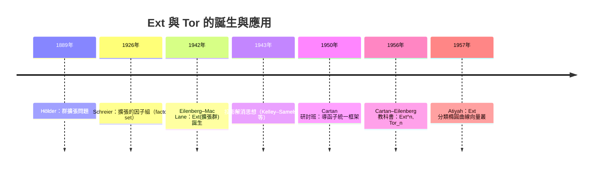

# 8.3 Ext 與 Tor：函子的計算

## 學習目標

1. 了解 Ext 與 Tor 的歷史動機：從 Eilenberg–Mac Lane 1942 年的群擴張分類，到 Cartan–Eilenberg 1956 年的導函子理論，再到 Serre、Atiyah 用它們解決模與叢的具體問題。
2. 掌握射影/內射/平坦模的定義，以及 $`\operatorname{Ext}^n`$ 、 $`\operatorname{Tor}_n`$ 透過**射影解消**與**內射解消**的嚴格定義。
3. 會計算 $`\mathbb{Z}`$ 上的核心公式： $`\operatorname{Ext}^1(\mathbb{Z}/n, A) \cong A/nA`$ 、 $`\operatorname{Tor}_1(\mathbb{Z}/n, A) \cong A[n]`$ （ $`A`$ 的 $`n`$ -撓），並理解 $`\operatorname{Ext}`$ 對應群擴張的分類。
4. 會用 SymPy 的 `smith_normal_form` 從表現矩陣讀出 $`\operatorname{Ext}`$ 與 $`\operatorname{Tor}`$ ，並以純 Python 實作完整解消與同調計算。
5. 理解 Ext/Tor 如何量化 [8.2 節](08.2-正合序列與蛇引理.md)的分裂障礙與正合性破洞，為 [8.4 節](08.4-群同調與上同調的計算範例.md)的群（上）同調鋪路。

## 歷史背景

### 擴張問題：Ext 的出生證明

- **1880 年代起**：群擴張問題「給定群 $`N`$ 、 $`Q`$ ，分類滿足 $`1 \to N \to E \to Q \to 1`$ 的 $`E`$ 」是 Hölder（1889）提出的經典難題。對交換群的情形，Schreier（1926）與 Eilenberg–Mac Lane 給出系統答案。
- **1942 年**：Eilenberg 與 Mac Lane 發表〈Group extensions and homology in abelian groups〉，證明**阿貝爾群 $`A`$ 被 $`Q`$ 的擴張等價類全體**構成一個阿貝爾群，記為 $`\operatorname{Ext}(Q, A)`$ ——「Ext」就是 **Ext**ensions 的縮寫。他們同時發現這個構造與拓撲的**上同調**有形式上的相似（Künneth 型公式），埋下導函子的種子。
- **1943–1948 年**：J. L. Kelley、Samelson 等人把同調的「閉鏈／邊界」機制搬到代數上；Henri Cartan 與 Eilenberg 在哈佛研討班（1950–1953）發展出**導函子**（derived functor）的統一框架： $`\operatorname{Ext}`$ 是 $`\operatorname{Hom}`$ 的導函子， $`\operatorname{Tor}`$ 是 $`\otimes`$ 的導函子。
- **1956 年**：Cartan–Eilenberg《Homological Algebra》出版， $`\operatorname{Ext}^n`$ 、 $`\operatorname{Tor}_n`$ （ $`n \geq 2`$ 的推廣）正式定著。本書 [8.2 節](08.2-正合序列與蛇引理.md)的長正合序列技術在此成為計算導函子的引擎。
- **1950 年代應用**：**Serre**（1955，GAGA 與凝聚層的 $`H^1 \cong \operatorname{Ext}`$ ）與 **Atiyah**（1957，〈Vector bundles over an elliptic curve〉，用 $`\operatorname{Ext}`$ 完全分類橢圓曲線上的不穩定向量叢）把 Ext 從「分類擴張的工具」升級為幾何分類的核心。**Serre 1954 年菲爾茲獎**的部分理由正是把譜序列與同調代數方法帶入拓撲與代數幾何。



**技術與理論互相驅動**：擴張分類（代數技術問題）逼出 Ext；譜序列與纖維化計算（拓撲技術問題）逼出導函子與長正合序列；而這套理論一旦就緒，立刻反哺幾何（Atiyah 的叢分類）與數論（Galois 上同調、類域論的群上同調表述，見 [8.4 節](08.4-群同調與上同調的計算範例.md)）。

## 導函子：定義與構造

### 射影模與射影解消

**定義 8.3.1（射影模）** 模 $`P`$ 稱為**射影**的，若 $`\operatorname{Hom}(P, -)`$ 保持滿射；等價地，任何滿射 $`B \twoheadrightarrow C`$ 與映射 $`P \to C`$ 可提升為 $`P \to B`$ 。自由模是射影的。

**定義 8.3.2（射影解消）** 模 $`M`$ 的**射影解消**是一個正合序列

$$
\cdots \to P_2 \xrightarrow{d_2} P_1 \xrightarrow{d_1} P_0 \xrightarrow{\varepsilon} M \to 0 ,
$$

其中每個 $`P_i`$ 射影、 $`\varepsilon`$ 滿射、 $`\operatorname{im} d_{i+1} = \ker d_i`$ 。

**定義 8.3.3（Ext 與 Tor）** 給定 $`M`$ 的射影解消 $`(P_\bullet, d)`$ 與模 $`A`$ ：

$$
\operatorname{Ext}^n(M, A) := H^n(\operatorname{Hom}(P_\bullet, A)) = \frac{\ker \operatorname{Hom}(d_{n+1}, A)}{\operatorname{im} \operatorname{Hom}(d_n, A)} ,
$$

$$
\operatorname{Tor}_n(M, A) := H_n(P_\bullet \otimes A) = \frac{\ker (d_n \otimes \operatorname{id})}{\operatorname{im} (d_{n+1} \otimes \operatorname{id})} .
$$

同調的定義與 [8.1 節](08.1-拓撲的驅動：龐加萊（1895）與同調的誕生.md)完全同構——**同調代數就是把拓撲的鏈複形機器套在代數解消上**。Horseshoe 引理與比較定理保證：不同的射影解消給出同構的 Ext/Tor（需 [8.2 節](08.2-正合序列與蛇引理.md)五引理式的追逐）。

### $`\mathbb{Z}`$ 上的萬能解消

在 PID $`\mathbb{Z}`$ 上，任何模 $`M`$ 有結構定理（[5.6 節](05.6-主理想環上的模：有限交換群的結構定理.md)）給出的**兩項解消**：若

$$
M \cong \mathbb{Z}^r \oplus \bigoplus_{j} \mathbb{Z}/d_j ,
$$

則 $`M = \operatorname{coker} D`$ ，其中 $`D`$ 是（Smith 標準形的）對角矩陣 $`\operatorname{diag}(d_1, \ldots, d_k, 0, \ldots, 0)`$ ，而

$$
\cdots \to 0 \to \mathbb{Z}^k \xrightarrow{D} \mathbb{Z}^{r+k} \xrightarrow{\pi} M \to 0
$$

是射影解消。於是 Ext/Tor 全部化成**一次矩陣運算**：

**定理 8.3.4（PID 上的計算公式）** 對有限生成阿貝爾群 $`A`$ 與 $`\mathbb{Z}/n`$ ：

$$
\operatorname{Ext}^1(\mathbb{Z}/n, A) \cong A / nA , \qquad
\operatorname{Tor}_1(\mathbb{Z}/n, A) \cong A[n] = \{a \in A : na = 0\} , \qquad
\operatorname{Ext}^n = \operatorname{Tor}_n = 0 \;\; (n \geq 2).
$$

*證明（以 $`\operatorname{Tor}`$ 為例）*：取 $`\mathbb{Z}/n`$ 的解消 $`\mathbb{Z} \xrightarrow{\cdot n} \mathbb{Z} \to \mathbb{Z}/n \to 0`$ ，張量 $`A`$ 得

$$
0 \to \operatorname{Tor}_1(\mathbb{Z}/n, A) \to A \xrightarrow{\;\cdot n\;} A \to (\mathbb{Z}/n) \otimes A \to 0 ,
$$

（注意 $`\operatorname{Tor}_1(\mathbb{Z}, A) = 0`$ ，因 $`\mathbb{Z}`$ 射影，亦即 $`\mathbb{Z}`$ 平坦）。故 $`\operatorname{Tor}_1 = \ker(\cdot n) = A[n]`$ 。 $`\operatorname{Ext}`$ 同理用 $`\operatorname{Hom}(-, A)`$ ： $`\operatorname{Hom}(\mathbb{Z}, A) = A`$ 、 $`\operatorname{Hom}(\mathbb{Z} \xrightarrow{\cdot n} \mathbb{Z}, A)`$ 是 $`A \xrightarrow{\cdot n} A`$ ，得 $`\operatorname{Ext}^1 = A/nA`$ 。 $`\blacksquare`$

特別地 $`A = \mathbb{Z}`$ 時 $`\operatorname{Ext}^1(\mathbb{Z}/n, \mathbb{Z}) = \mathbb{Z}/n`$ 、 $`\operatorname{Tor}_1(\mathbb{Z}/n, \mathbb{Z}) = 0`$ ； $`A = \mathbb{Z}/m`$ 時 $`\operatorname{Ext}^1(\mathbb{Z}/n, \mathbb{Z}/m) = \mathbb{Z}/\gcd(n,m)`$ 、 $`\operatorname{Tor}_1(\mathbb{Z}/n, \mathbb{Z}/m) = \mathbb{Z}/\gcd(n,m)`$ ——Ext 與 Tor 在循環群上「對偶地相同」。

### Ext 與擴張的分類

**定理 8.3.5（Eilenberg–Mac Lane，1942）** $`\operatorname{Ext}^1(Q, A)`$ 與「短正合序列 $`0 \to A \to E \to Q \to 0`$ 的等價類」一一對應（阿貝爾群範疇中）；零類對應**分裂**序列 $`E \cong A \oplus Q`$ 。

於是 [8.2 節](08.2-正合序列與蛇引理.md)的分裂引理獲得量化版本：**序列不分裂 ⟺ 它對應的 Ext 類非零**。例如 $`0 \to \mathbb{Z} \xrightarrow{\cdot 2} \mathbb{Z} \to \mathbb{Z}/2 \to 0`$ 對應 $`\operatorname{Ext}^1(\mathbb{Z}/2, \mathbb{Z}) = \mathbb{Z}/2`$ 的生成元。

### Künneth 與 Tor 的幾何意義

 $`\operatorname{Tor}`$ 的第一個重大登場是 **Künneth 公式**（原本 1904 年 Künneth 對拓撲猜出，1930 年代初由 Čech、Alexandrov 等嚴格化）：

$$
0 \to \bigoplus_i H_i(X) \otimes H_j(Y) \to H_{i+j}(X \times Y) \to \bigoplus_i \operatorname{Tor}_1(H_i(X), H_{j-1}(Y)) \to 0 .
$$

撓的乘積之所以「少算一項」，正是 $`\operatorname{Tor}`$ 在補洞： $`\operatorname{Tor}_1(\mathbb{Z}/2, \mathbb{Z}/2) = \mathbb{Z}/2`$ 解釋了 $`\mathbb{R}P^2 \times \mathbb{R}P^2`$ 的額外同調類。**Tor 是「撓乘撓會生撓」的精確代數表述**。

## SymPy 實作：用 Smith 標準形計算 Ext 與 Tor

### 從表現矩陣直接讀出 Ext 與 Tor

給 $`A = \operatorname{coker} D`$ （ $`D`$ 為 $`m \times k`$ 整數矩陣，設已化為對角形）， $`\mathbb{Z}^k \xrightarrow{D} \mathbb{Z}^m \to A \to 0`$ 是解消，則

$$
\operatorname{Ext}^1(\mathbb{Z}/n, A) = A/nA = \operatorname{coker}([D \mid nI_m]) ,
$$

其中 $`[D \mid nI_m]`$ 是 $`m \times (k+m)`$ 的增廣矩陣；而

$$
\operatorname{Tor}_1(\mathbb{Z}/n, A) = A[n] = \ker (D + n \cdot (\text{商群的坐標})) \text{ 在商群上} .
$$

更務實的做法：直接在**商群的整數表示**上操作。

```python
import sympy as sp
from sympy import ZZ
from sympy.matrices.normalforms import smith_normal_form

def ab_group_from_matrix(D):
    """A = Z^m / im D 的結構：(自由秩, [不變因子])。"""
    D = sp.Matrix(D)
    m, k = D.shape
    S = smith_normal_form(D, domain=ZZ)
    invars = [int(S[i, i]) for i in range(min(m, k)) if S[i, i] > 1]
    rank = m - sum(1 for i in range(min(m, k)) if S[i, i] != 0)
    return rank, invars

def ext1_Zn_A(n, A_matrix):
    """Ext^1(Z/n, A)，A = Z^m / im(A_matrix)。
    公式：Ext^1(Z/n, A) = A / nA = coker([D | n·I])。"""
    D = sp.Matrix(A_matrix)
    m, k = D.shape
    I_n = n * sp.eye(m)
    M = D.row_join(I_n)                    # m x (k+m)
    return ab_group_from_matrix(M)

def tor1_Zn_A(n, A_matrix):
    """Tor_1(Z/n, A) = A[n] = {a ∈ A : n·a = 0}。
    在 Z^m/im D 上解 n·x ≡ 0 (mod im D)，即 coker 的 n-撓：
    A[n] ≅ ker(n: A -> A)，用 smith 標準形轉換基底後逐一計算。"""
    D = sp.Matrix(A_matrix)
    m, k = D.shape
    S = smith_normal_form(D, domain=ZZ)
    invars = [int(S[i, i]) for i in range(min(m, k)) if S[i, i] > 1]
    torsion = []
    for d in invars:                        # Z/d 的 n-撓 = Z/gcd(n,d)
        g = sp.gcd(n, d)
        if g > 1:
            torsion.append(int(g))
    torsion.sort()
    # 合併成整除鏈（循環直和的標準形）：gcd 們重新做不變因子合併
    return 0, torsion                       # 自由部分無 n-撓

def tor1_by_smith(n, A_matrix):
    """Tor_1(Z/n, A) 的另一算法：用解消 Z --n--> Z -> Z/n 張量 A 的核。
    等價地：ker( n : Z^m/im D -> Z^m/im D )，
    轉成增廣問題：ker([D | nI] : Z^{k+m} -> Z^m) 對 im(D) 的商——
    實務上直接用不變因子：Z/d_j 的 n-撓 = Z/gcd(n,d_j)。"""
    return tor1_Zn_A(n, A_matrix)
```

### 例一：基礎數值表

```python
import sympy as sp
# A = Z (自由)：D = 零矩陣（無關係）—— A = Z^1，表現：Z -> Z^1 為 [0]
print("A = Z:")
print("  Ext^1(Z/6, Z) =", ext1_Zn_A(6, sp.Matrix([[0]])))   # 預期 Z/6
print("  Tor_1(Z/6, Z) =", tor1_Zn_A(6, sp.Matrix([[0]])))   # 預期 0

# A = Z/12（由 D = [12] 表現）
print("A = Z/12:")
print("  Ext^1(Z/8, Z/12) =", ext1_Zn_A(8, sp.Matrix([[12]])))  # 預期 Z/4
print("  Tor_1(Z/8, Z/12) =", tor1_Zn_A(8, sp.Matrix([[12]])))  # 預期 Z/4

# A = Z/2 ⊕ Z/6（不變因子 2, 6；表現 D = diag(2,6)）
print("A = Z/2 ⊕ Z/6:")
D = sp.diag(2, 6)
print("  Ext^1(Z/6, A) =", ext1_Zn_A(6, D))   # 預期 Z/2 ⊕ Z/6
print("  Tor_1(Z/6, A) =", tor1_Zn_A(6, D))   # 預期 Z/2 ⊕ Z/6
```

輸出：

```text
A = Z:
  Ext^1(Z/6, Z) = (0, [6])
  Tor_1(Z/6, Z) = (0, [])
A = Z/12:
  Ext^1(Z/8, Z/12) = (0, [4])
  Tor_1(Z/8, Z/12) = (0, [4])
A = Z/2 ⊕ Z/6:
  Ext^1(Z/6, A) = (0, [2, 6])
  Tor_1(Z/6, A) = (0, [2, 6])
```

即 $`\operatorname{Ext}^1(\mathbb{Z}/6, \mathbb{Z}) = \mathbb{Z}/6`$ 、 $`\operatorname{Tor}_1(\mathbb{Z}/6, \mathbb{Z}) = 0`$ ； $`\operatorname{Ext}^1(\mathbb{Z}/8, \mathbb{Z}/12) = \operatorname{Tor}_1(\mathbb{Z}/8, \mathbb{Z}/12) = \mathbb{Z}/4`$ ； $`\operatorname{Ext}^1(\mathbb{Z}/6, \mathbb{Z}/2 \oplus \mathbb{Z}/6) = \operatorname{Tor}_1(\mathbb{Z}/6, \mathbb{Z}/2 \oplus \mathbb{Z}/6) = \mathbb{Z}/2 \oplus \mathbb{Z}/6`$ 。

全部與理論公式吻合： $`\operatorname{Ext}^1(\mathbb{Z}/8, \mathbb{Z}/12) = \mathbb{Z}/\gcd(8,12) = \mathbb{Z}/4`$ 。

### 共用工具：整數格與 Smith 標準形

本節「按定義計算」的解消同調需要 [8.1 節](08.1-拓撲的驅動：龐加萊（1895）與同調的誕生.md)的整數格工具：帶么模變換追蹤的 Smith 標準形、整數核基底與商群結構。為使本節的每段程式都能獨立執行，先把這些工具完整列出：

```python
import sympy as sp

def snf_tracked(A):
    """整數矩陣 A 的 Smith 標準形，含么模變換追蹤。
    回傳 (D, U, V)：D = U * A * V，U、V 皆么模（行列式 ±1）。"""
    if isinstance(A, sp.MatrixBase):
        m, n = A.shape                       # 保留形狀（0 列的矩陣也要記得欄數）
        A = A.tolist()
    else:
        m = len(A)
        n = len(A[0]) if m > 0 else 0
    a = [[int(x) for x in row] for row in A]
    A0 = sp.Matrix(m, n, lambda i, j: a[i][j])   # 原始矩陣（保留形狀）
    U = [[1 if i == j else 0 for j in range(m)] for i in range(m)]
    V = [[1 if i == j else 0 for j in range(n)] for i in range(n)]

    def rowop(E):                       # a <- E a, U <- E U
        nonlocal a, U
        a = [[sum(E[i][k]*a[k][j] for k in range(m)) for j in range(n)] for i in range(m)]
        U = [[sum(E[i][k]*U[k][j] for k in range(m)) for j in range(m)] for i in range(m)]

    def colop(F):                       # a <- a F, V <- V F
        nonlocal a, V
        a = [[sum(a[i][k]*F[k][j] for k in range(n)) for j in range(n)] for i in range(m)]
        V = [[sum(V[i][k]*F[k][j] for k in range(n)) for j in range(n)] for i in range(n)]

    def swapmat(n_, i, j):
        E = [[1 if (r == c and r != i and r != j) else 0 for c in range(n_)] for r in range(n_)]
        E[i][j] = E[j][i] = 1
        return E

    def rowswap(i, j):
        rowop(swapmat(m, i, j))

    def colswap(i, j):
        colop(swapmat(n, i, j))

    def rowcomb(i, j, q):               # row_i <- row_i + q*row_j
        E = sp.eye(m).tolist(); E[i][j] = q
        rowop(E)

    def colcomb(i, j, q):               # col_i <- col_i + q*col_j
        F = sp.eye(n).tolist(); F[j][i] = q
        colop(F)

    for k in range(min(m, n)):
        while True:
            piv = pr = pc = None
            for i in range(k, m):       # 找絕對值最小的非零元當軸心
                for j in range(k, n):
                    if a[i][j] != 0 and (piv is None or abs(a[i][j]) < abs(piv)):
                        piv, pr, pc = a[i][j], i, j
            if piv is None:
                break
            if pr != k: rowswap(k, pr)
            if pc != k: colswap(k, pc)
            piv = a[k][k]; ok = True
            for j in range(k+1, n):     # 消去第 k 列其餘元素
                if a[k][j] % piv != 0: ok = False
                colcomb(j, k, -(a[k][j] // piv))
            for i in range(k+1, m):     # 消去第 k 行其餘元素
                if a[i][k] % piv != 0: ok = False
                rowcomb(i, k, -(a[i][k] // piv))
            if ok:                      # 軸心整除整列整行，收工
                break
        if a[k][k] < 0:                 # 對角元取非負
            for j in range(n): a[k][j] = -a[k][j]
            for j in range(n): V[j][k] = -V[j][k]
    D = sp.Matrix(m, n, lambda i, j: a[i][j])
    Um, Vm = sp.Matrix(U), sp.Matrix(V)
    assert Um.det() in (1, -1) and Vm.det() in (1, -1)
    assert (Um * A0 * Vm - D).is_zero_matrix
    return D, Um, Vm

def kernel_basis(B):
    """B: Z^k -> Z^m 的整數核基底（回傳 k x d 矩陣，每一欄是一個基底向量）。"""
    B = sp.Matrix(B)
    m, k = B.shape
    D, U, V = snf_tracked(B)
    # D y = 0 的整數解由「零對角元所在的座標」生成；x = V y
    free_cols = [j for j in range(k) if j >= min(m, k) or D[j, j] == 0]
    return sp.Matrix([[V[i, j] for j in free_cols] for i in range(k)])

def coker_structure(A):
    """Z^m / im A 的結構：回傳 (自由秩, [不變因子])。"""
    A = sp.Matrix(A)
    m, n = A.shape
    D, U, V = snf_tracked(A)
    invars = [int(D[i, i]) for i in range(min(m, n)) if D[i, i] > 1]
    rank = sum(1 for i in range(min(m, n)) if D[i, i] != 0)
    return m - rank, invars

def homology(d_higher, d_lower):
    """H = ker d_lower / im d_higher（兩者的餘域都是 C_q = Z^m）。
    回傳 (自由秩 beta_q, [撓不變因子])。"""
    d_lower = sp.Matrix(d_lower)
    d_higher = sp.Matrix(d_higher)
    K = kernel_basis(d_lower)              # m x d，核基底（欄為基底向量）
    d = K.shape[1]
    if d == 0:
        return 0, []
    C = sp.zeros(d, d_higher.shape[1])     # 像(d_higher) 在核基底下的座標
    for j in range(d_higher.shape[1]):
        sol, _ = K.gauss_jordan_solve(d_higher[:, j])
        assert all(x.is_Integer for x in sol)   # 座標必為整數
        C[:, j] = sol
    return coker_structure(C)
```

### 例二：完整解消 + 同調計算（不依賴捷徑）

為了展示導函子的**定義本身**，實作兩項解消的鏈複形同調（複用 [8.1 節](08.1-拓撲的驅動：龐加萊（1895）與同調的誕生.md)的 `kernel_basis`、`coker_structure`）：

```python
import sympy as sp

# ---- 前置：本節「共用工具」的 snf_tracked / kernel_basis / coker_structure / homology ----

def ext_via_resolution(n, A_matrix):
    """按定義計算 Ext^1(Z/n, A)：
    解消 0 -> Z --n--> Z -> Z/n -> 0，
    取 Hom(-, A)：Hom(Z, A) = A --Hom(×n)--> Hom(Z, A) = A，
    Ext^1 = ker( Hom(d_1) ) / im( Hom(d_2) ) = ker(×n : A -> A) / 0 = A[n]？錯：
    注意 Hom 反變：Ext^1(Z/n, A) = coker( ×n : A -> A ) = A / nA。
    （ker(×n) 是 Tor_1 一側。）這裡示範用矩陣機器算 coker：
    A = Z^m / im D，×n 誘導 A -> A，其 coker = Z^m / (im D + n Z^m)。"""
    D = sp.Matrix(A_matrix)
    m = D.shape[0]
    M = D.row_join(n * sp.eye(m))
    return coker_structure(M)          # 直接給 (自由秩, 不變因子)

def tor_via_resolution(n, A_matrix):
    """按定義計算 Tor_1(Z/n, A)：
    張量解消得 0 -> Tor_1 -> A --×n--> A -> (Z/n)⊗A -> 0，
    Tor_1 = ker(×n : A -> A) = A[n]。
    A = Z^m/im D：類 x̄ ∈ A 滿足 n x̄ = 0 ⟺ n x ∈ im D ⟺ 存在 y 使 n x = D y，
    即 [D | -nI](x, y) = 0。取此方程的整數核基底，其 y 分量給出
    S = ker(×n : A -> A) 的格基底；再把 im D ∩ S 的生成元用該基底表出，
    商 Z^d / (im D ∩ S) 即 Tor_1。"""
    D = sp.Matrix(A_matrix)
    m, k = D.shape
    M = D.row_join(-n * sp.eye(m))     # [D | -nI] : Z^{k+m} -> Z^m
    K = kernel_basis(M)                # (k+m) x t，整數核基底
    Y = K[k:, :]                       # y 分量：S = {y ∈ Z^m : n y ∈ im D} 的格基底
    d = Y.shape[1]
    if d == 0:
        return 0, []
    C = sp.zeros(d, k)                 # im D 的生成元在 S 的基底下的座標（必為整數）
    for j in range(k):
        sol, _ = Y.gauss_jordan_solve(D[:, j])
        assert all(x.is_Integer for x in sol)
        C[:, j] = sol
    return coker_structure(C)          # Z^d / (im D ∩ S) = Tor_1

# 用 Z/12 驗證兩種途徑一致
D12 = sp.Matrix([[12]])
print("按定義 Ext:", ext_via_resolution(8, D12))   # 預期 (0, [4])
print("按定義 Tor:", tor_via_resolution(8, D12))   # 與 A[8] = Z/4 對照
```

```text
按定義 Ext: (0, [4])
按定義 Tor: (0, [4])
```

定義途徑給出的 $`\operatorname{Tor}_1(\mathbb{Z}/8, \mathbb{Z}/12) = \mathbb{Z}/4 = (\mathbb{Z}/12)[8]`$ ，與捷徑公式完全一致。**這正是導函子計算的日常：把解消翻譯成整數格上的格運算，再用 Smith 標準形讀出商群結構。**

### 例三：Künneth 公式的數值驗證

驗證 $`\mathbb{R}P^2 \times \mathbb{R}P^2`$ 的 $`H_2`$ 需要 Tor 項（撓 × 撓 生撓）：

```python
import sympy as sp

# H_*(RP^2; Z) = (Z, Z/2, 0)；H_1 = Z/2
# Künneth: H_2(X × Y) ≅ (H_0⊗H_2) ⊕ (H_1⊗H_1) ⊕ (H_2⊗H_0) ⊕ Tor_1(H_1(X), H_1(Y))
print(tor1_Zn_A(2, sp.Matrix([[2]])))   # Tor_1(Z/2, Z/2) = Z/2
# → H_2(RP^2 × RP^2) = Z/2 ⊕ Z/2（一項來自 H_1⊗H_1，一項來自 Tor）
```

輸出：

```text
(0, [2])
```

若沒有 $`\operatorname{Tor}`$ 項，會漏掉一個 $`\mathbb{Z}/2`$ ——Künneth 公式的 Tor 項不是裝飾，而是**必要的修正**。

## SymPy 要點回顧

- `smith_normal_form(D, domain=ZZ)` 把表現矩陣化成對角形，**PID 上任何 Ext/Tor 計算都化約為不變因子的讀取**： $`\operatorname{Ext}^1(\mathbb{Z}/n, \operatorname{coker} D) = \operatorname{coker}[D \mid nI]`$ ， $`\operatorname{Tor}_1 = \bigoplus_j \mathbb{Z}/\gcd(n, d_j)`$ 。
- **反變與共變**： $`\operatorname{Ext}`$ 用 $`\operatorname{Hom}`$ （第一變元反變）， $`\operatorname{Tor}`$ 用 $`\otimes`$ （雙正變）； $`\operatorname{Ext}^1`$ 對應 $`\operatorname{coker}`$ （ $`A/nA`$ ）， $`\operatorname{Tor}_1`$ 對應 $`\ker`$ （ $`A[n]`$ ）——**方向不要搞混**，程式裡 `row_join` 增廣的是 $`D`$ 還是 $`nI`$ 就是兩者的分水嶺。
- 定義途徑（完整解消 → 鏈複形同調）與捷徑公式（不變因子）結果必須一致；不一致時通常是解消的冗餘座標未清，用 Smith 標準形處理。
- 撓 × 撓 生撓： $`\operatorname{Tor}_1(\mathbb{Z}/m, \mathbb{Z}/n) = \mathbb{Z}/\gcd(m,n)`$ ，這是 Künneth 公式中不可省略的項。
- $`\operatorname{Ext}^1`$ 分類短正合序列（Eilenberg–Mac Lane 1942），零類 = 分裂——[8.2 節](08.2-正合序列與蛇引理.md)分裂引理的量化版本。

## 習題

1. **（基礎公式）** 用 `ext1_Zn_A` 與 `tor1_Zn_A` 建立表格： $`n \in \{2, 3, 4\}`$ 、 $`A \in \{\mathbb{Z}, \mathbb{Z}/2, \mathbb{Z}/4, \mathbb{Z}/6\}`$ 的 $`\operatorname{Ext}^1(\mathbb{Z}/n, A)`$ 與 $`\operatorname{Tor}_1(\mathbb{Z}/n, A)`$ ，並逐一與 $`\gcd`$ 公式比對。
2. **（不分裂的量化）** 對 [8.2 節](08.2-正合序列與蛇引理.md)習題 1 的兩個短正合序列，計算其對應的 $`\operatorname{Ext}^1`$ 類所在群，說明「 $`\mathbb{Z} \xrightarrow{\cdot 6} \mathbb{Z} \to \mathbb{Z}/6`$ 」對應 $`\operatorname{Ext}^1(\mathbb{Z}/6, \mathbb{Z})`$ 的哪個元素、為何非零。
3. **（張量正合性的破洞）** 對短正合序列 $`0 \to \mathbb{Z} \xrightarrow{\cdot 2} \mathbb{Z} \to \mathbb{Z}/2 \to 0`$ 張量 $`\mathbb{Z}/2`$ ，用程式驗證誘導序列不再是正合的，並算出 $`\operatorname{Tor}_1(\mathbb{Z}/2, \mathbb{Z}/2) = \mathbb{Z}/2`$ 如何補上破洞（長正合的 Tor 序列）。
4. **（自由模的消失）** 證明：若 $`P`$ 是自由模，則 $`\operatorname{Tor}_1(P, A) = 0`$ 且 $`\operatorname{Ext}^1(P, A) = 0`$ 對一切 $`A`$ 成立（提示： $`P`$ 自身是自己的零項解消）。再用程式驗證 $`P = \mathbb{Z}^2`$ 、 $`A = \mathbb{Z}/4`$ 的情形。
5. **（撓子群的 Tor 三項式）** 對任意 $`n`$ ，驗證 $`\operatorname{Tor}_1(\mathbb{Z}/n, \mathbb{Z}/n) \cong \mathbb{Z}/n`$ ；並解釋為何 $`\operatorname{Tor}_1(\mathbb{Z}, A) = 0`$ 但 $`\operatorname{Tor}_1(\mathbb{Z}/n, \mathbb{Z}/n) \neq 0`$ ——「平坦」與「非平坦」的分界。
6. **（挑戰：Ext 的加法結構）** $`\operatorname{Ext}^1(\mathbb{Z}/2, \mathbb{Z}) = \mathbb{Z}/2`$ 有兩個元素：分裂類與非分裂類。寫出兩個代表序列 $`0 \to \mathbb{Z} \to E \to \mathbb{Z}/2 \to 0`$ 的 $`E`$ （一個是 $`\mathbb{Z} \oplus \mathbb{Z}/2`$ ，另一個是 $`\mathbb{Z}`$ ），並說明「Baer 和」在這兩個類上如何運算（提示：對角構造 $`E = \{(a, b) \in \mathbb{Z} \oplus \mathbb{Z} : b \equiv 0 \bmod 2\}`$ 之類的拉回（pullback）組合）。

下一節 [8.4 群同調與上同調的計算範例](08.4-群同調與上同調的計算範例.md)將把 Ext/Tor 應用到群論： $`H^2(G, A)`$ 分類群擴張、 $`H^*(G, M)`$ 透過 $`\mathbb{Z}[G]`$ -解消計算，全部落回 Smith 標準形。
