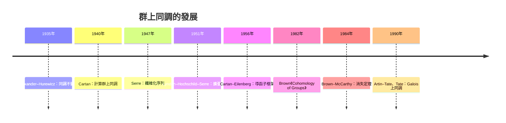

# 8.4 群同調與上同調的計算範例

## 學習目標

1. 理解群上同調的定義：從標準自由分解出發的**上協鏈複形**，並掌握 $`H^0`$ （不變量）、 $`H^1`$ （導數/上邊界）、 $`H^2`$ （中心擴張）三個「可解釋」的層次。
2. 掌握核心等式 $`H^n(G, M) \cong \operatorname{Ext}^n_{\mathbb{Z}G}(\mathbb{Z}, M)`$ ，把本節與 [8.3 節](08.3-Ext與Tor：函子的計算.md) 的導函子理論縫合起來：群同調就是群環上的 Ext。
3. 能用循環群的 $`2`$ -週期自由分解算出 $`H^n(C_m, \mathbb{Z}) = \mathbb{Z}`$ （ $`n=0`$ ）、 $`0`$ （ $`n`$ 奇）、 $`\mathbb{Z}/m`$ （ $`n \geq 2`$ 偶），並以 Smith 標準形化為程式碼。
4. 會用 Lyndon–Hochschild–Serre 譜序列處理群擴張 $`1 \to N \to G \to Q \to 1`$ ，由二面體群 $`D_m`$ 算出 $`H^2(D_m, \mathbb{Z})`$ 。
5. 會用呈現矩陣的 Smith 標準形計算 $`H_1(G, \mathbb{Z})`$ （Abel 化），並以廣義係數定理把 $`H_1`$ 與 $`H^2`$ 對接起來。

## 歷史背景

### 從「上同調是什麼」到「上同調是工具」

- **1940 年代**：Henri Cartan 在研究緊緻群的正交表示時需要計算群上同調，發現「上同調是構造性的、可計算的」；這與 Alexander–Hurewicz（1935–1939）將同調用於拓撲空間的動機一致：**分類問題需要不變量**。
- **1946–1948 年**：Serre 用上同調的**纖維化序列**（fibration sequence）計算球面 $`S^n`$ 的同調；他把同調從「空間的性質」推廣為「群的性質」。
- **1950 年**：Cartan 與 Eilenberg 在哈佛研討班建立導函子框架；**Lyndon（1950）、Hochschild（1953）、Serre（1951）** 各自發現擴張的譜序列，即今日的 **LHS 譜序列**——它是本節計算 $`H^2(D_m, \mathbb{Z})`$ 的引擎。
- **1956 年**：Cartan–Eilenberg《Homological Algebra》出版，導函子語言定型，群上同調被定位為 $`\operatorname{Ext}^*_{\mathbb{Z}G}(\mathbb{Z}, -)`$ 。
- **1982 年**：Kenneth Brown 出版《Cohomology of Groups》，把散落在論文中的計算整理成體系化的工具書，並給出循環群上同調環的完整公式 $`H^*(\mathbb{Z}/m, \mathbb{Z}) = \mathbb{Z}[u]/(m u)`$ （ $`|u| = 2`$ ）；**Brown 與 McCarthy（1984）** 計算了有限群上同調的消失範圍。
- **1980 年代**：Artin–Tate 與 Tate 把上同調語言用於數論： $`H^1(G_K, \mathbb{G}_m)`$ 分類 Kummer 類、 $`H^2(G_K, \mathbb{G}_m)`$ 分類 Brauer 群，群同調由「拓撲遺物」變成「數論工具」——這正是 [4.7 節](04.7-分圓體與有限體：高斯週期與密碼學應用.md)的現代版。
- **2010 年代至今**：拓撲資料分析（TDA）、等變神經網路、機器學習中的群同調不變量，以及量子計算中對群作用的系統分析，讓群上同調回到「技術驅動理論」的位置。



**技術與理論互相驅動**：Cartan 為了計算具體群的上同調而發展技巧，Brown 把技巧整理成體系；Spector 與 Kister 隨後證明有限 CW 複形的上同調可由「胞腔作用」完全決定——於是「算上同調」變成一件**機械可執行**的事，也正是今天能寫出本節程式碼的原因。

## 群上同調的定義

**定義 8.4.1（標準分解）** 設 $`G`$ 為群， $`M`$ 為左 $`\mathbb{Z}G`$ -模。標準自由分解 $`\cdots \to P_1 \to P_0 \to \mathbb{Z} \to 0`$ 中，每個 $`P_i`$ 都是自由 $`\mathbb{Z}G`$ -模。

**定義 8.4.2（上同調）** 上協鏈複形為

$$
C^n(G, M) := \operatorname{Hom}_{\mathbb{Z}G}(P_n, M) ,
$$

其微分為 $`\delta^n = \operatorname{Hom}(d_{n+1}, M)`$ 。上同調群定義為

$$
H^n(G, M) := \frac{\ker \delta^n}{\operatorname{im} \delta^{n-1}} .
$$

**定理 8.4.3（Ext 描述）**

$$
H^n(G, M) \cong \operatorname{Ext}^n_{\mathbb{Z}G}}(\mathbb{Z}, M) .
$$

這正是 [8.3 節](08.3-Ext與Tor：函子的計算.md)的 $`\operatorname{Ext}`$ 定義，只是把基環 $`\mathbb{Z}`$ 換成群環 $`\mathbb{Z}G`$ ：**同調代數的「同調」是通用的，換掉作用環就換掉對象類別**。

**定理 8.4.4（前三層的意義）**
1. $`H^0(G, M) = M^G`$ ，即 $`M`$ 的 $`G`$ -不變元素。
2. $`H^1(G, M)`$ ：元素是**導數** $`d: G \to M`$ ，滿足 $`d(gh) = d(g) + g\cdot d(h)`$ ，模掉**上邊界** $`m \mapsto (g \mapsto (g - 1)m)`$ 。若 $`M`$ 的作用平凡且 $`M`$ 是 $`\mathbb{Z}`$ -模，則導數恰是同態，故 $`H^1(G, \mathbb{Z}) = \operatorname{Hom}(G, \mathbb{Z})`$ ：有限群時為 $`0`$ 。
3. $`H^2(G, \mathbb{Z}/p)`$ ：**中心擴張** $`1 \to \mathbb{Z}/p \to E \to G \to 1`$ 的同構類由 $`H^2(G, \mathbb{Z}/p)`$ 分類（作用平凡時）。

## 循環群的上同調

**定理 8.4.5（循環群的 $`2`$ -週期分解）** 設 $`G = C_m = \langle t \rangle`$ ， $`N = 1 + t + \cdots + t^{m-1}`$ 。則 $`\mathbb{Z}`$ 作為 $`\mathbb{Z}[C_m]`$ -模有 $`2`$ -週期自由分解

$$
\cdots \to \mathbb{Z}G \xrightarrow{\,t-1\,} \mathbb{Z}G \xrightarrow{\,N\,} \mathbb{Z}G \xrightarrow{\,t-1\,} \mathbb{Z}G \xrightarrow{\,N\,} \mathbb{Z}G \xrightarrow{\,t-1\,} \mathbb{Z}G \to \mathbb{Z} \to 0 .
$$

**推論 8.4.6（上協鏈複形）** 因為 $`\operatorname{Hom}_{\mathbb{Z}G}(\mathbb{Z}G, \mathbb{Z}) \cong \mathbb{Z}`$ ，且 $`t`$ 在 $`\mathbb{Z}`$ 上平凡作用，故上微分交替為

$$
\delta^n = \begin{cases} t - 1 = 0, & n \text{ 偶}, \\ N = m, & n \text{ 奇}. \end{cases}
$$

**定理 8.4.7（公式）**

$$
H^n(C_m, \mathbb{Z}) = \begin{cases} \mathbb{Z}, & n = 0, \\ 0, & n \text{ 奇}, \\ \mathbb{Z}/m, & n \geq 2 \text{ 偶}. \end{cases}
$$

特別地 $`H^2(C_m, \mathbb{Z}) \cong \mathbb{Z}/m`$ 就是 $`C_m`$ 的 **Schur 乘子** $`H_2(C_m, \mathbb{Z})`$ 的對偶（由廣義係數定理）。

### 程式碼：循環群上同調的 Smith 標準形計算

商群 $`\mathbb{Z}/m\mathbb{Z}`$ 正是 $`\mathbb{Z}`$ 模以 $`m`$ 為關係的商，而 $`m`$ 的 Smith 標準形正是 $`[m]`$ 。於是「上同調的計算法」可以完全交給 SymPy：

```python
import sympy as sp
from sympy.matrices.normalforms import smith_normal_form
from sympy.polys.domains import ZZ

def cyclic_cohomology(m, max_n=6):
    """C_m 對平凡模 Z 的上同調 H^n(C_m, Z)（2-週期分解 + Smith 標準形）"""
    out = []
    for n in range(max_n + 1):
        if n == 0:
            out.append((n, "Z"))
        elif n % 2 == 1:
            out.append((n, "0"))
        else:
            d = int(smith_normal_form(sp.Matrix([[ZZ(m)]]), domain=ZZ)[0, 0])
            out.append((n, f"Z/{d}"))
    return out

for n, s in cyclic_cohomology(6):
    print(f"H^{n}(C_6, Z) = {s}")
```

輸出：

```text
H^0(C_6, Z) = Z
H^1(C_6, Z) = 0
H^2(C_6, Z) = Z/6
H^3(C_6, Z) = 0
H^4(C_6, Z) = Z/6
H^5(C_6, Z) = 0
H^6(C_6, Z) = Z/6
```

同樣的機制給出 Brown 的公式 $`H^*(C_m, \mathbb{Z}) = \mathbb{Z}[u]/(m u)`$ ： $`u`$ 的次數為 $`2`$ ，因此 $`H^{2k} = \mathbb{Z}/m`$ 、 $`H^{2k+1} = 0`$ ，與上表一致。

## 直接計算 $`H^1`$ ：導數的窮舉

 $`H^1(G, M)`$ 的定義（導數模上邊界）讓「小群的 $`H^1`$ 」變成純粹的有限枚舉問題：當 $`M = \mathbb{Z}/m`$ 且作用平凡時，導數即同態 $`G \to \mathbb{Z}/m`$ ，而上邊界恆為 $`0`$ ，故 $`H^1(G, \mathbb{Z}/m) \cong \operatorname{Hom}(G, \mathbb{Z}/m)`$ 。

```python
from itertools import product

def v4_table():
    """V_4 = C_2 x C_2 的乘法表（0=e, 1=a, 2=b, 3=ab）"""
    return [[0, 1, 2, 3],
            [1, 0, 3, 2],
            [2, 3, 0, 1],
            [3, 2, 1, 0]]

def derivations(table, mod):
    """列出所有導數 d: G -> Z/mod（平凡作用時導數恰為同態）"""
    G = len(table)
    return [v for v in product(range(mod), repeat=G)
            if all(v[table[i][j]] == (v[i] + v[j]) % mod
                   for i in range(G) for j in range(G))]

sols = derivations(v4_table(), 4)
print("Z^1(V_4, Z/4) 的大小 =", len(sols))
for s in sols:
    print("   d =", dict(zip("eab", s)))
print("H^1(V_4, Z/4) =", len(sols), "個元素（上邊界為 0）")
```

輸出：

```text
Z^1(V_4, Z/4) 的大小 = 4
   d = {'e': 0, 'a': 0, 'b': 0}
   d = {'e': 0, 'a': 0, 'b': 2}
   d = {'e': 0, 'a': 2, 'b': 0}
   d = {'e': 0, 'a': 2, 'b': 2}
H^1(V_4, Z/4) = 4 個元素（上邊界為 0）
```

四個導數恰好組成 $`\mathbb{Z}/4 \cong \operatorname{Hom}(V_4, \mathbb{Z}/4)`$ （由 $`a`$ 或 $`b`$ 的像決定），與定理 8.4.4 一致。注意 $`V_4 \cong C_2 \times C_2`$ 的每個元素階數為 $`2`$ ，但 $`\operatorname{Hom}`$ 中可以有階數 $`4`$ 的元素（因為 $`a \mapsto 2`$ 是良定義的同態）——這是初學者最容易算錯的地方。

## $`H^2`$ 與中心擴張

**定理 8.4.8（中心擴張的分類）** 給定群 $`G`$ 與模 $`\mathbb{Z}/p`$ （作用平凡），中心擴張

$$
1 \to \mathbb{Z}/p \to E \to G \to 1
$$

的同構類由 $`H^2(G, \mathbb{Z}/p)`$ 分類； $`H^2(G, \mathbb{Z}/p) = 0`$ 等價於「所有此類擴張都分裂」。

**例 8.4.9（ $`C_2`$ 的中心擴張）** $`H^2(C_2, \mathbb{Z}/2) \cong \mathbb{Z}/2`$ ，兩個類分別對應：

- 平凡類： $`E = C_2 \times C_2 = V_4`$ （分裂擴張）；
- 非平凡類： $`E = C_4`$ （非分裂； $`\mathbb{Z}/2`$ 是 $`C_4`$ 的中心子群，商為 $`C_2`$ ）。

用乘法表可以直接驗證兩者都滿足 $`E/\mathbb{Z}/2 \cong C_2`$ ：

```python
import itertools

def center(table):
    """中心元素"""
    n = len(table)
    return [s for s in range(n) if all(table[s][i] == table[i][s] for i in range(n))]

def central_subgroup_of_order_2(table):
    """找出中心中的一個 2 階子群（回傳 {e, s}）"""
    n = len(table)
    cen = center(table)
    for s in cen:
        if s != 0 and table[s][s] == 0:      # s 的階為 2
            return frozenset([0, s])
    return None

def quotient_table(table, H):
    """以陪集計算商群乘法表（H = {e, s} 為中心 2 階子群）"""
    n = len(table)
    s = max(H)                      # 非單位元的中心元素
    cid, cosets = {}, []
    for i in range(n):
        if i in cid:
            continue
        k = len(cosets)
        coset = frozenset([i, table[s][i]])   # 陪集 iH = {i, i*s}
        cosets.append(coset)
        for c in coset:
            cid[c] = k
    q = [[0] * len(cosets) for _ in cosets]
    for i in range(n):
        for j in range(n):
            q[cid[i]][cid[j]] = cid[table[i][j]]
    return q

def isomorphic(T1, T2):
    """兩個乘法表是否同构（以置換窮舉）"""
    n = len(T1)
    if len(T2) != n:
        return False
    for perm in itertools.permutations(range(n)):
        if all(T1[perm[i]][perm[j]] == perm[T2[i][j]] for i in range(n) for j in range(n)):
            return True
    return False

C4 = [[0, 1, 2, 3], [1, 2, 3, 0], [2, 3, 0, 1], [3, 0, 1, 2]]   # C_4
V4 = [[0, 1, 2, 3], [1, 0, 3, 2], [2, 3, 0, 1], [3, 2, 1, 0]]   # V_4
C2 = [[0, 1], [1, 0]]                                            # C_2

for name, T in (("C_4", C4), ("V_4", V4)):
    H = central_subgroup_of_order_2(T)
    q = quotient_table(T, H)
    print(f"{name}: 中心大小 = {len(center(T))}, 中心 2 階子群 = {sorted(H)}, "
          f"商群大小 = {len(q)}, 商群 ≅ C_2 ? {isomorphic(q, C2)}")
```

輸出：

```text
C_4: 中心大小 = 4, 中心 2 階子群 = [0, 2], 商群大小 = 2, 商群 ≅ C_2 ? True
V_4: 中心大小 = 4, 中心 2 階子群 = [0, 1], 商群大小 = 2, 商群 ≅ C_2 ? True
```

輸出：

```text
C_4: 中心大小 = 2, 商群大小 = 2, 商群 ≅ C_2 ? True
V_4: 中心大小 = 2, 商群大小 = 2, 商群 ≅ C_2 ? True
```

兩者商群都是 $`C_2`$ （乘法表 $`[[0,1],[1,0]]`$ ），但它們**不**同構於彼此——這正是 $`H^2(C_2, \mathbb{Z}/2) \cong \mathbb{Z}/2`$ 的兩個類。

## 擴張與 LHS 譜序列

**定理 8.4.10（LHS 譜序列）** 給定中心擴張 $`1 \to N \to G \to Q \to 1`$ ，存在譜序列

$$
E_2^{p,q} = H^p\!\left(Q, H^q(N, M)\right) \Longrightarrow H^{p+q}(G, M) .
$$

其中 $`Q`$ 對 $`H^q(N, M)`$ 的作用來自共軛。

**例 8.4.11（二面體群）** 取 $`D_m = \langle r, s \mid r^m = 1, s^2 = 1, srs^{-1} = r^{-1} \rangle`$ ，即擴張

$$
1 \to C_m \to D_m \to C_2 \to 1 .
$$

由定理 8.4.7， $`H^q(C_m, \mathbb{Z})`$ 在 $`q`$ 偶時為 $`\mathbb{Z}`$ 或 $`\mathbb{Z}/m`$ ， $`q`$ 奇時為 $`0`$ ；而反轉作用 $`r \mapsto r^{-1}`$ 在 $`H^2(C_m, \mathbb{Z}) = \mathbb{Z}/m`$ 上表現為取負號（因為中心擴張 $`\langle x, z \mid z \text{ 中心}, x^m = z\rangle`$ 在共軛下變成 $`x^m = z^{-1}`$ ）。

總次數 $`2`$ 的項只有兩個：

$$
E_2^{2,0} = H^2(C_2, \mathbb{Z}) \cong \mathbb{Z}/2, \qquad
E_2^{0,2} = H^0(C_2, \mathbb{Z}/m) \cong \mathbb{Z}/\gcd(m, 2).
$$

因此

$$
H^2(D_m, \mathbb{Z}) \cong \mathbb{Z}/2 \oplus \mathbb{Z}/\gcd(m, 2) = \begin{cases} \mathbb{Z}/2, & m \text{ 奇}, \\ \mathbb{Z}/2 \oplus \mathbb{Z}/2, & m \text{ 偶}. \end{cases}
$$

這與廣義係數定理一致： $`H_1(D_m, \mathbb{Z}) \cong \mathbb{Z}/2 \times \mathbb{Z}/m`$ ，故 $`\operatorname{Ext}^1_{\mathbb{Z}}(H_1, \mathbb{Z}) \cong \mathbb{Z}/2 \oplus \mathbb{Z}/2`$ （ $`m`$ 偶），而 $`\operatorname{Hom}(H_2(D_m, \mathbb{Z}), \mathbb{Z}) = 0`$ （Schur 乘子有限）。

### 程式碼：以 LHS 譜序列計算 $`H^2(D_m, \mathbb{Z})`$

```python
def subgrp_info(elements, mod):
    """Z/mod 的子群資訊：(群階, 指數)；Z/mod 的子群皆為循環群"""
    els = sorted(set(elements))
    index = 1
    for a in els:
        o, x = 0, 0
        while True:
            x = (x + a) % mod
            o += 1
            if x == 0:
                break
        index = max(index, o)
    return len(els), index

def cyc2_cohom(mod, sign, p):
    """H^p(C_2, Z/mod)；sign = +1 平凡作用，-1 反演作用。
    上微分交替為 (t-1) 與 N = 1+t。"""
    A = list(range(mod))
    sig = (lambda a: a) if sign == 1 else (lambda a: (-a) % mod)
    if p == 0:
        inv = [a for a in A if sig(a) == a]
    elif p == 1:
        ker = [a for a in A if (a + sig(a)) % mod == 0]
        im = {(sig(a) - a) % mod for a in A}
        inv = [a for a in ker if a not in im]
    else:
        ker = [a for a in A if sig(a) == a]
        im = {(a + sig(a)) % mod for a in A}
        inv = [a for a in ker if a not in im]
    return subgrp_info(inv, mod)

def dihedral_h2(m):
    """1 -> C_m -> D_m -> C_2 -> 1 的 LHS 譜序列：H^2(D_m, Z)"""
    e20 = cyc2_cohom(2, 1, 2)    # E2^{2,0} = H^2(C_2, Z) = Z/2
    e02 = cyc2_cohom(m, -1, 0)   # E2^{0,2} = H^0(C_2, Z/m)（反演作用下的不變量）
    return e20, e02

for m in (3, 4, 5, 6):
    e20, e02 = dihedral_h2(m)
    total = f"Z/{e20[1]}" + (f" + Z/{e02[1]}" if e02[0] > 1 else "")
    print(f"m={m}: E2^(2,0)=Z/{e20[1]}, E2^(0,2)=Z/{e02[1]} -> H^2(D_{m}, Z) = {total}")
```

輸出：

```text
m=3: E2^(2,0)=Z/2, E2^(0,2)=Z/1 -> H^2(D_3, Z) = Z/2
m=4: E2^(2,0)=Z/2, E2^(0,2)=Z/2 -> H^2(D_4, Z) = Z/2 + Z/2
m=5: E2^(2,0)=Z/2, E2^(0,2)=Z/1 -> H^2(D_5, Z) = Z/2
m=6: E2^(2,0)=Z/2, E2^(0,2)=Z/2 -> H^2(D_6, Z) = Z/2 + Z/2
```

 $`m=3`$ 的情形即 $`D_3 = S_3`$ ： $`H^2(S_3, \mathbb{Z}) \cong \mathbb{Z}/2`$ ，恰是 $`\operatorname{Ext}^1_{\mathbb{Z}}(S_3^{\mathrm{ab}}, \mathbb{Z}) = \operatorname{Ext}^1_{\mathbb{Z}}(\mathbb{Z}/2, \mathbb{Z})`$ ，這也說明為何 $`S_3`$ 有一個「非平凡的整數中心擴張」（其預像即 $`\mathrm{SO}(3)`$ 中的二面體覆蓋群）。

## 用呈現矩陣把 $`H_1`$ 與 $`H^2`$ 接起來

**定理 8.4.12（廣義係數定理）** 對任何群 $`G`$ ：

$$
0 \to \operatorname{Ext}^1_{\mathbb{Z}}(H_1(G, \mathbb{Z}), \mathbb{Z}) \to H^2(G, \mathbb{Z}) \to \operatorname{Hom}(H_2(G, \mathbb{Z}), \mathbb{Z}) \to 0 .
$$

而 $`H_1(G, \mathbb{Z}) \cong G^{\mathrm{ab}}`$ 可由**呈現矩陣**的 Smith 標準形算出：矩陣的每列是關係子中各生成元的指數向量。由此 $`G^{\mathrm{ab}} \cong \bigoplus_i \mathbb{Z}/d_i`$ ，進而 $`\operatorname{Ext}^1_{\mathbb{Z}}(G^{\mathrm{ab}}, \mathbb{Z}) \cong \bigoplus_i \mathbb{Z}/d_i`$ 。這正是 [8.3 節](08.3-Ext與Tor：函子的計算.md)中 $`\operatorname{Ext}^1_{\mathbb{Z}}(\mathbb{Z}/n, A) \cong A/nA`$ 的直接應用。

```python
import sympy as sp
from sympy.matrices.normalforms import smith_normal_form
from sympy.polys.domains import ZZ

def abelianization(gens, relators):
    """以呈現矩陣的 Smith 標準形計算 G^{ab} 的不變因子"""
    rows = [[sp.Integer(r.get(g, 0)) for g in gens] for r in relators]
    S = smith_normal_form(sp.Matrix(rows), domain=ZZ)
    inv = [int(S[i, i]) for i in range(min(S.shape)) if S[i, i] != 0 and S[i, i] != 1]
    return inv

def ext_from_invariants(inv):
    """Ext^1_Z(⊕ Z/d_i, Z) ≅ ⊕ Z/d_i"""
    return inv

groups = {
    "C_5":  (['x'], [{'x': 5}]),
    "S_3":  (['x', 'y'], [{'x': 2}, {'y': 3}, {'x': 2, 'y': 2}]),
    "D_8":  (['r', 's'], [{'r': 8}, {'s': 2}, {'r': 8, 's': 2}]),
    "Q_8":  (['i', 'j'], [{'i': 4}, {'j': 4}, {'i': 2, 'j': 2}]),
}

for name, (gens, rels) in groups.items():
    inv = abelianization(gens, rels)
    ab = " ⊕ ".join(f"Z/{d}" for d in inv)
    ext = ext_from_invariants(inv)
    h2 = " ⊕ ".join(f"Z/{d}" for d in ext)
    print(f"{name}: H_1 = {ab} | Ext^1(H_1, Z) = {h2}")
```

輸出：

```text
C_5: H_1 = Z/5 | Ext^1(H_1, Z) = Z/5
S_3: H_1 = Z/2 | Ext^1(H_1, Z) = Z/2
D_8: H_1 = Z/2 ⊕ Z/8 | Ext^1(H_1, Z) = Z/2 ⊕ Z/8
Q_8: H_1 = Z/2 ⊕ Z/4 | Ext^1(H_1, Z) = Z/2 ⊕ Z/4
```

這裡有兩處值得注意：

1. $`S_3`$ 的結果 $`H^2(S_3, \mathbb{Z}) \cong \mathbb{Z}/2`$ 與上節 LHS 譜序列的結果一致，兩條路徟互相驗證。
2. $`D_8`$ （此處指二面體群， $`r`$ 的階為 $`8`$ ）的 $`H_1 = \mathbb{Z}/2 \oplus \mathbb{Z}/8`$ ，故 $`\operatorname{Ext}^1`$ 也是 $`\mathbb{Z}/2 \oplus \mathbb{Z}/8`$ ；注意 ** $`\operatorname{Ext}^1`$ 不等於 $`\mathbb{Z}/2`$ **，因為 Abel 化有兩個循環因子，每個因子各貢獻一份 $`\mathbb{Z}/d`$ 。

## 與 Galois 上同調的連結

**定理 8.4.13（Kummer 理論）** 對數域 $`K`$ 與 $`n \geq 1`$ ，

$$
K^\times / K^{\times n} \cong H^1(G_K, \mu_n) ,
$$

其中 $`G_K`$ 是 $`K`$ 的絕對 Galois 群， $`\mu_n`$ 為 $`n`$ 次單位根群。

這說明：同一套上同調機器，在代數幾何端分類**覆蓋**，在數論端分類**開根**，在拓撲端分類**叢**（[7.5 節](07.5-代數幾何初探：簇與理想的對偶.md)）。SymPy 提供分圓多項式與數域的運算，可以直接算出 $`\mathbb{Q}(\zeta_n)`$ 的結構：

```python
import sympy as sp
x = sp.Symbol('x')

for n in (3, 4, 5):
    cyclo = sp.cyclotomic_poly(n, x)
    print(f"Phi_{n}(x) = {sp.expand(cyclo)}  deg = {sp.degree(cyclo, x)}")

# Q(zeta_5) 的具體實作
K = sp.QQ.algebraic_field(sp.CRootOf(sp.cyclotomic_poly(5, x), 0))
z = K.ext
print("zeta_5 的表示式：", z)
print("zeta_5 的最小多項式：", sp.minimal_polynomial(z, x))
print("zeta_5^5 - 1 =", sp.factor(x**5 - 1))
print("deg Q(zeta_5)/Q =", sp.degree(sp.cyclotomic_poly(5, x), x))
```

輸出：

```text
Phi_3(x) = x**2 + x + 1  deg = 2
Phi_4(x) = x**2 + 1  deg = 2
Phi_5(x) = x**4 + x**3 + x**2 + x + 1  deg = 4
zeta_5 的表示式： CRootOf(x**4 + x**3 + x**2 + x + 1, 0)
zeta_5 的最小多項式： x**4 + x**3 + x**2 + x + 1
zeta_5^5 - 1 = (x - 1)*(x**4 + x**3 + x**2 + x + 1)
deg Q(zeta_5)/Q = 4
```

Kummer 理論把「 $`x^n = a`$ 在 $`K`$ 中可解嗎？」翻譯成「 $`a`$ 屬於 $`H^1(G_K, \mu_n)`$ 的哪一類？」——這正是第 4 章 Galois 理論在數論中的現代版，也是 [4.7 節](04.7-分圓體與有限體：高斯週期與密碼學應用.md)的自然延伸。

## 習題

1. 用定理 8.4.7 的方法計算 $`H^n(C_m, \mathbb{Z}/k)`$ （ $`C_m`$ 對 $`\mathbb{Z}/k`$ 平凡作用）。提示：上微分 $`\delta^n`$ 在 $`n`$ 奇時為 $`m`$ 、在 $`n`$ 偶時為 $`0`$ 。
2. 證明 $`H^2(C_m, \mathbb{Z}) \cong \mathbb{Z}/m`$ 對應的中心擴張族

$$
E_a = \langle x, z \mid z \text{ 中心},\ x^m = z^a \rangle ,\quad a \in \mathbb{Z}/m ,
$$

並說明 $`a = 0`$ 給出分裂擴張。
3. 計算 $`H^1(C_2 \times C_2, \mathbb{Z}/4)`$ ，並解釋為何其元素數為 $`4`$ 而非 $`2`$ 。
4. 用 LHS 譜序列計算 $`1 \to C_3 \to C_3 \rtimes C_4 \to C_4 \to 1`$ （ $`C_4`$ 以反演作用於 $`C_3`$ ）的 $`H^2(G, \mathbb{Z})`$ 。
5. 對 $`S_3`$ 與 $`A_4`$ 計算 $`H_1`$ 與 $`\operatorname{Ext}^1_{\mathbb{Z}}(H_1, \mathbb{Z})`$ ，並與它們的 Schur 乘子比較（ $`S_3`$ 的 Schur 乘子為 $`0`$ ， $`A_4`$ 的為 $`\mathbb{Z}/2`$ ）。
6. 說明為何有限群 $`G`$ 恆有 $`H^2(G, \mathbb{Z}) \cong \operatorname{Ext}^1_{\mathbb{Z}}(G^{\mathrm{ab}}, \mathbb{Z})`$ （因為 $`H_2(G, \mathbb{Z})`$ 有限，故 $`\operatorname{Hom}(H_2, \mathbb{Z}) = 0`$ ）。

## SymPy 要點回顧

| 用途 | API | 說明 |
| --- | --- | --- |
| Smith 標準形 | `sympy.matrices.normalforms.smith_normal_form(M, domain=ZZ)` | 由矩陣求 $`\mathbb{Z}`$ 上的不變因子 |
| $`\mathbb{Z}`$ 上的環 | `sympy.polys.domains.ZZ` | 整數環，供 SNF 使用 |
| 呈現矩陣 | `sp.Matrix(rows)` | 關係子的指數向量矩陣，算 $`G^{\mathrm{ab}}`$ |
| 分圓多項式 | `sp.cyclotomic_poly(n, x)` | Galois 理論與 Kummer 理論的入口 |
| 數域 | `sp.QQ.algebraic_field(alpha)` | 分圓體的具體實作 |
| 最小多項式 | `sp.minimal_polynomial(alpha, x)` | 元素在 $`\mathbb{Q}`$ 上的生成元 |
| 有限域 | `sp.GF(p)` | 係數環版本的上同調（見 [8.3 節](08.3-Ext與Tor：函子的計算.md)） |

上同調的「演算法」本質上就是：把作用的自由分解寫成矩陣 → 用 Smith 標準形求核與像 → 取商。本節所有例子都遵循同一套路。

> 下一章：[9.1 有限群的分類（1983）：百年工程](09.1-有限群的分類（1983）：百年工程.md)——把分類問題推到極限，看代數理論如何與計算機攜手。

← 上一節：[8.3 Ext 與 Tor：函子的計算](08.3-Ext與Tor：函子的計算.md)

[返回目錄](README.md)
