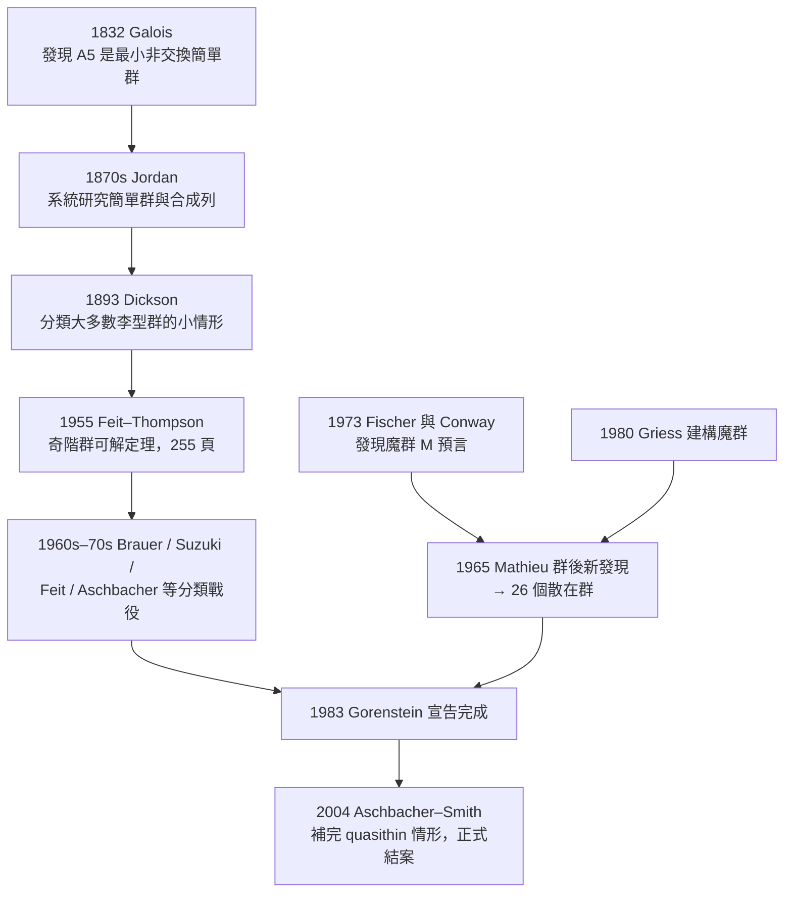

# 第 9 章 進階主題與現代發展

## 9.1 有限群的分類（1983）：百年工程

### 學習目標

1. 說明「有限簡單群的分類」（Classification of the Finite Simple Groups, CFSG）陳述的內容：每一個有限簡單群都屬於三大類之一。
2. 認識三大類：素數階循環群、交錯群 $`A_n\ (n \geq 5)`$ 、李型群（Lie type groups），以及 26 個散在群（sporadic groups）與最大的「魔群」 $`M`$ 。
3. 理解為何「簡單群」是有限群的基本建材（Jordan–Hölder 定理與組合因子的類比）。
4. 了解 CFSG 的歷史：從 1832 年 Galois、1870 年代 Jordan、1893 年 Dickson，到 1955 年 Feit–Thompson 定理，再到 1983 年 Gorenstein 宣告完成、2004 年 Aschbacher–Smith 補完「準薄群」的百年歷程。
5. 用 SymPy 的 `combinatorics` 模組操作幾個最小的簡單群（ $`C_p`$ 、 $`A_5`$ ），並體會為何需要計算機輔助。

### 歷史背景

**「分類」是代數的本能**。我們已經見過兩次分類工程：有限交換阿貝爾群的分類（見 [2.5 節](02.5-循環群與阿貝爾群：有限交換群的分類.md)）與主理想環上模的結構定理（見 [5.6 節](05.6-主理想環上的模：有限交換群的結構定理.md)）。這些分類結果優雅且短證明，但**非交換的有限簡單群**完全是另一個量級——它被稱為數學史上最龐大的定理，證明散布在約 500 位作者的 10,000 多頁期刊論文中。



關鍵年表：

- **1832 年**：Galois 在遺書中指出 $`A_5`$ 是最小的非交換簡單群（見 [4.4 節](04.4-伽羅瓦（1832）：方程的對稱群.md)）。
- **1870–1872 年**：Jordan 的《代換論》系統化簡單群概念；Mathieu 在 1861 與 1873 年發現 $`M_{11}, M_{12}, M_{22}, M_{23}, M_{24}`$ ——最早的散在群，也是最後才被「安放」的。
- **1893 年**：Dickson 分類了大多數李型群的小階情形。
- **1955 年**：Feit 與 Thompson 證明**奇階群可解定理**（Feit–Thompson theorem，又稱 odd order theorem），全文 255 頁，占滿整期《Pacific Journal of Mathematics》。此定理是整個 CFSG 的第一塊基石：它說「每個非交換有限簡單群都是偶數階的」，把問題縮減到偶數階群。
- **1963–1975 年**：Brauer 的模表示論、Suzuki 對以 2 為中心的分層（2-local analysis）開啟現代攻勢；Janko（1965–68）、Conway（1968）、Fischer（1969–71）等接連發現新的散在群。
- **1972 年**：Gorenstein 在夏季學院提出分類綱領。
- **1983 年**：Gorenstein 宣告分類完成。
- **1980 年**：Griess 純手工（無電腦）建構了魔群 $`M`$ ，其階為

$$
|M| = 2^{46} \cdot 3^{20} \cdot 5^9 \cdot 7^6 \cdot 11^2 \cdot 13^3 \cdot 17 \cdot 19 \cdot 23 \cdot 29 \cdot 31 \cdot 41 \cdot 47 \cdot 59 \cdot 71 \approx 8 \times 10^{53}.
$$

- **2004 年**：Aschbacher 與 Smith 完成 1983 年所留的最後缺口——quasithin（準薄）群的分類，出版 1,221 頁的專著，CFSG 正式定案。

**「技術與理論互相驅動」**在此節表現得最極端：沒有 1950 年代後的電腦，群階的巨大數值檢查、特徵標表計算（見 [6.3 節](06.3-有限群的不可約表示與特徵標表.md)）、與上同調障礙的驗證都不可能；反過來，CFSG 的需求也直接催生了 GAP（1986 年，Aachen）與 Magma（1990 年代，雪梨）這些代數計算系統（見 [9.3 節](09.3-計算代數系統的演進：從Macsyma到SymPy.md)）。

### 理論：為何「簡單群」是建材

**定義（單群 / simple group）**：群 $`G`$ 稱為**簡單群**，若 $`G`$ 非平凡（ $`|G| > 1`$ ）且 $`G`$ 的正規子群只有 $`\{e\}`$ 與 $`G`$ 本身（正規子群與商群見 [2.4 節](02.4-正規子群與商群：若爾當（1870）的貢獻.md)）。

**定理（Jordan–Hölder）**：每個有限群 $`G \neq \{e\}`$ 都有一條合成列

$$
\{e\} = G_0 \triangleleft G_1 \triangleleft \cdots \triangleleft G_n = G,
$$

其中每個合成因子 $`G_{i}/G_{i-1}`$ 都是簡單群；且任何兩條合成列的因子集（含重數）在同構意義下唯一。

這正是「唯一質因數分解」的群版本：**有限群之於簡單群，如同正整數之於質數**。質因數分解 $`360 = 2^3 \cdot 3^2 \cdot 5`$ 告訴我們建材，但不告訴我們如何拼裝（拼裝方式即群的**擴張問題**，非常困難）；CFSG 則是先把「質數」清點完畢：

**分類定理（CFSG）**：每個有限簡單群恰好是下列三類之一：

1. **素數階循環群** $`C_p`$ （ $`p`$ 為質數）：這些是交換的，由 Lagrange 定理立即可得（見 [2.3 節](02.3-子群、陪集與拉格朗日定理.md)）；
2. **交錯群** $`A_n`$ ， $`n \geq 5`$ ： $`A_5`$ （階 60）最小， $`n \geq 5`$ 時 $`A_n`$ 皆簡單；
3. **李型群**：在有限體上的李型代數群衍生的群族，包括射影特殊線性群 $`\mathrm{PSL}_n(q)`$ 、辛群、酉群、正交群與例外群（如 $`G_2(q)`$ 、Ree 群等），共 16 個「族」；要排除少數同構重疊（例如 $`\mathrm{PSL}_2(4) \cong \mathrm{PSL}_2(5) \cong A_5`$ ）；

**再加上 26 個散在群**：不屬於任何無窮族的孤立群。其中 20 個參與「魔群月孀」網路，最大的即魔群 $`M`$ ；第二大的嬰兒魔群 $`B`$ 階約 $`4 \times 10^{33}`$ 。

**為何 $`A_5`$ 簡單（思路）**： $`A_5`$ 是 $`S_5`$ 中偶置換構成的子群，階為 $`5!/2 = 60`$ 。設 $`N \triangleleft A_5`$ 非平凡。把共軛類元素數算出來： $`1, 12, 12, 15, 20`$ （恆等、雙對換、3-循環分兩類、5-循環分兩類），且每個正規子群必為若干個**完整共軛類**的聯集、階需整除 60、且包含恆等元。逐一檢查 $`1, 12, 12, 15, 20`$ 的子集和（ $`1+12=13 \nmid 60`$ 、 $`1+12+15=28 \nmid 60`$ 、 $`1+12+12+15=40 \nmid 60`$ ……），唯一能整除 60 的選擇是全部之和 60，故 $`N = A_5`$ 。這個「算共軛類大小」的證明思路正好可以用 SymPy 驗證。

**Feit–Thompson 定理（敘述）**：任何奇數階的有限群都是可解群。證明長達 255 頁；其架構是「反證 + 對局部子群的精細歸納」，並且大量使用特徵標論。2022 年,參照與整理工程完成，新版本（限縮為「每個奇階群存在非平凡阿貝爾正規子群」的強化形式）精簡到約 900 頁——這也說明 CFSG 的「完成」不代表證明書已可讀：目前仍有多項「重新證明簡化」計畫（GLS 系列專著仍在進行中）。

### SymPy 實作

SymPy 沒有像 GAP 那樣完整的群資料庫，但 `sympy.combinatorics` 足以讓我們：

1. 用置換生成 $`A_5`$ ，算出它的階、確認其簡單性（檢查合成列與共軛類）；
2. 驗證 Lagrange 定理：所有子群的階整除群階；
3. 重現「 $`A_5`$ 共軛類大小 $`1,12,12,15,20`$ 」的計算。

#### 範例 1：建構 $`A_5`$ 並計算共軛類

```python
import sympy as sp
from sympy.combinatorics import Permutation, PermutationGroup

# A5 = (1 2 3), (1 2)(3 4) 生成的交錯群
a = Permutation(0, 1, 2)          # (1 2 3)，SymPy 的置換用 0-based
b = Permutation(0, 1)(2, 3)       # (1 2)(3 4)
A5 = PermutationGroup(a, b)

print("A5 的階 =", A5.order())            # 60
print("是否阿貝爾 =", A5.is_abelian())    # False

# 檢查每一元素與其生成元共軛性，枚舉共軛類
els = list(A5.elements)
cls = A5.conjugacy_classes()              # SymPy 1.12+ 提供
sizes = sorted(len(c) for c in cls)
print("共軛類大小 =", sizes)               # [1, 12, 12, 15, 20]
print("總和 =", sum(sizes))                # 60，等於群階（共軛類方程）
```

輸出說明：`order()` 回傳 $`60`$ ，`conjugacy_classes()` 給出大小 $`[1, 12, 12, 15, 20]`$ 。讀者可自行驗證：這些數的任何真子集（含 1）之和都不整除 60，於是正規子群只有 $`\{e\}`$ 與 $`A_5`$ ——**這就是「 $`A_5`$ 是簡單群」的計算機驗證**。

#### 範例 2：Lagrange 定理的全面檢查

```python
import sympy as sp
from sympy.combinatorics import Permutation, PermutationGroup

a = Permutation(0, 1, 2)
b = Permutation(0, 1)(2, 3)
A5 = PermutationGroup(a, b)

n = A5.order()                    # 60 = 2^2 * 3 * 5
print(sp.factorint(n))            # {2: 2, 3: 1, 5: 1}

# 枚舉部分子群，檢查階整除 60
subs = list(A5.subgroups())
orders = sorted({H.order() for H in subs})
print("出現的子群階：", orders)
# 全部整除 60：
print(all(n % d == 0 for d in orders))    # True
```

輸出說明：`A5.subgroups()` 枚舉所有子群（ $`A_5`$ 共有 59 個子群），其階都落在 $`\{1, 2, 3, 4, 5, 6, 10, 12, 60\}`$ 之中——注意 $`A_5`$ **沒有階 30、20、15 的子群**：若存在，將是階 2 的指標，進而給出非平凡正規子群，違反簡單性。這正是 Lagrange 定理的逆命題為假、而「簡單性」反過來限制子群的實例。

#### 範例 3：最小的幾個簡單群

```python
import sympy as sp
from sympy.combinatorics import Permutation, PermutationGroup

# C5：素數階循環群（最簡單的一類）
C5 = PermutationGroup(Permutation(0, 1, 2, 3, 4))
print("C5 order:", C5.order())                  # 5
print("C5 abelian:", C5.is_abelian())           # True

# PSL(2,5) 應同構於 A5，階 60：用有限體 GF(5) 上的 2x2 矩陣生成
# 這裡直接用置換表示驗證同構的兩個生成元滿足的關係：
# A5 = <a, b | a^5 = b^3 = (ab)^2 = 1>（2,3,5-生成系統）
a = Permutation(0, 1, 2, 3, 4)
b = Permutation(0, 1, 2)
G = PermutationGroup(a, b)
print("G order:", G.order())                    # 60（此生成集實際生成 A5）
```

輸出說明：第一段確認素數階循環群是最平凡的簡單群；第二段展示 $`(2,3,5)`$ -生成關係 $`a^5 = b^3 = (ab)^2 = 1`$ 所對應的群正是階 60 的 $`A_5`$ （同時也是 $`\mathrm{PSL}_2(5)`$ 與 $`\mathrm{PSL}_2(4)`$ ）——三大類之間的同構重疊就從這裡開始。

#### 範例 4：數值趣味——散在群的巨大階

```python
import sympy as sp

# 魔群 M 的階
M_order = 2**46 * 3**20 * 5**9 * 7**6 * 11**2 * 13**3 * 17 * 19 * 23 * 29 * 31 * 41 * 47 * 59 * 71
print(sp.factorint(M_order))      # 驗證因式分解
print(M_order)                    # 808017424794512875886459904961710757005754368000000000
print(len(str(M_order)))          # 54 位數
```

輸出說明：魔群的階是一個 54 位整數。物理學家 John McKay 在 1978 年發現魔群的不可約表示次數（1, 196883, …）與模形式 $`j`$ -函數的 Fourier 係數 $`196884 = 1 + 196883`$ 之間的「巧合」，最終發展為 Conway 與 Norton 的**魔群月孀猜想**（1979），並在 1992 年由 Richard Borcherds 以頂點算子代數證明（1998 年費爾茲獎）——散在群的研究甚至反哺了無窮維李代數與數論。

### 歷史評註：百年工程的教訓

| 階段 | 年代 | 特徵 |
|---|---|---|
| 前史 | 1832–1945 | Galois、Jordan、Dickson、Brauer 建立概念與工具 |
| 第一基石 | 1955 | Feit–Thompson：奇階群可解，證明進入「百頁級」 |
| 分類戰役 | 1960s–1983 | 以「局部子群分析」逐族殲滅，電腦輔助特徵標計算 |
| 散在群收尾 | 1965–1980 | Janko、Conway、Fischer、Griess：26 個散在群全數現身 |
| 補完與重整 | 1983–2004+ | quasithin 缺口補完（Aschbacher–Smith 2004）；GLS 簡化重證進行中 |

三點教訓：

1. **理論先行、計算斷後**：分類的主體思想（2-local analysis、訊號群函數）是純數學的；電腦的角色是處理人腦無法可靠完成的有限枚舉與特徵標驗證。
2. **巨石定理的社會學**：CFSG 沒有任何單一論文可讀完整證明，迫使數學界發展「信任結構」——引用「CFSG 定理」本身作為一個黑箱。這在數學實作上史無前例。
3. **意外收穫**：為分類散在群而發展的工具，意外連通了模形式與弦論（魔群月孀），呼應本書「問題驅動 → 工具成熟 → 跨域連結」的主旋律（參見 [7.3 節](07.3-Buchberger（1965）：Grobner基的發明.md) 中 Gröbner 基的類似故事）。

### 習題

1. 用 SymPy 計算 $`A_5`$ 的共軛類，寫一段程式驗證「任何真子集和（含 1）皆不整除 60」，完成 $`A_5`$ 簡單性的完整驗證。
2. 證明（手推 + SymPy 檢查）： $`C_6`$ 不簡單，因為 $`\langle g^3 \rangle`$ 是階 2 的正規子群；推廣之，證明素數階循環群是唯一的交換簡單群。
3. 驗證 $`A_4`$ （階 12）**不**是簡單群：找出 Klein 四元群 $`V_4 \triangleleft A_4`$ ，並用 `PermutationGroup` 算商群 $`A_4 / V_4 \cong C_3`$ 。這說明 $`n = 4`$ 是 $`A_n`$ 簡單性的臨界值。
4. 用 `sp.factorint` 分解嬰兒魔群 $`B`$ 的階 $`|B| = 2^{41} 3^{13} 5^6 7^2 11 \cdot 13 \cdot 17 \cdot 19 \cdot 23 \cdot 31 \cdot 47`$ ，並與魔群比較位數。
5. （挑戰）寫一個函數，對給定置換群 $`G`$ ，枚舉其所有共軛類並檢查是否存在「階整除 $`|G|`$ 且為完整共軛類聯集」的真子集——這是檢查簡單性的通用演算法；對 $`A_5`$ 與 $`A_4`$ 分別測試。
6. （閱讀）查閱 Mathieu 群 $`M_{11}`$ 的階 $`7920`$ ，用 SymPy 以置換生成元建構之（提示： $`M_{11} = \langle (0\,1\,2\,\dots\,9\,10), (0\,10\,3\,4)(1\,8\,5\,2) \rangle`$ 類型的生成集），計算其階與阿貝爾性。這個群與 Steiner 系統 $`S(4,5,11)`$ 有關。

### SymPy 要點回顧

- `PermutationGroup(*perms)`：由置換生成群；`Permutation(0,1,2)` 為 0-based 置換。
- `G.order()`、`G.is_abelian()`、`G.elements`：基本不變量與元素枚舉。
- `G.conjugacy_classes()`（SymPy ≥ 1.12）：共軛類列表；共軛類方程 $`\sum |C_i| = |G|`$ 是簡單性檢驗的核心。
- `G.subgroups()`：子群枚舉（階小時可行），用於 Lagrange 定理驗證。
- `sp.factorint(n)`：整數質因數分解——CFSG 中所有群階都以質因數分解形式書寫，正因如此計算機才能處理 $`10^{54}`$ 這種巨數。

CFSG 清點完「有限對稱性的原子」之後，數論那邊也有一場以一個 350 年謎題為燃料的大會戰正在進行——下一節我們走進橢圓曲線與 Wiles 對費馬大定理的證明：[9.2 節](09.2-橢圓曲線與費馬大定理（1994）.md)。
