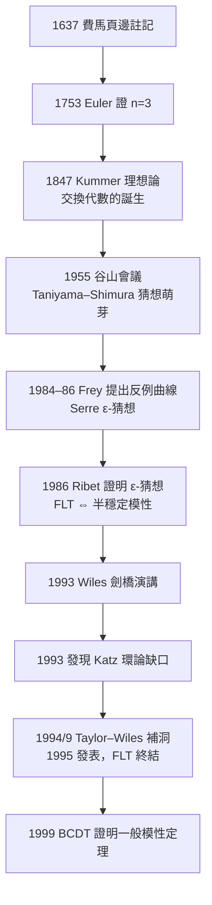

# 第 9 章 進階主題與現代發展

## 9.2 橢圓曲線與費馬大定理（1994）：350 年謎題的終結

### 學習目標

1. 定義橢圓曲線：Weierstrass 方程 $`y^2 = x^3 + ax + b`$ 、判別式非零，並理解其上的群法則（點加法、無窮遠點 $`\mathcal{O}`$ 為單位元）。
2. 能用手算與 SymPy 程式完成有限體上橢圓曲線的點加法與純量乘法。
3. 敘述費馬大定理（FLT）與 Frey 曲線的聯繫：若 FLT 有反例，則 Frey 曲線會是「太不模性」的橢圓曲線。
4. 說明 Taniyama–Shimura（谷山–志村）猜想的內容（每條有理數上橢圓曲線都是模性的）、1955 年的起源、1986 年 Ribet 證明 $`\varepsilon`$ -猜想，與 1995 年 Wiles–Taylor 完成證明。
5. 用 SymPy 做一個小型 FLT 數值實驗，並畫出實橢圓曲線的圖形，體會「代數曲線 + 群結構」的威力。

### 歷史背景

**費馬的頁邊（約 1637 年）**。費馬在 Bachet 校訂的 Diophantus《算術》頁邊寫下：對 $`n \geq 3`$ ， $`x^n + y^n = z^n`$ 沒有正整數解，「我發現了一個絕妙的證明，可惜頁邊太窄寫不下。」此後 350 年：

- Euler（1753 年）證 $`n=3`$ ；Fermat 自己對 $`n=4`$ 的下降法；
- Sophie Germain（1810s）處理一類素指數；
- Kummer（1847–）發展**理想**理論以攻 $`n`$ 為一般素數的情形（理想論的誕生見 [3.2 節](03.2-理想與商環：諾特（1921）的理想理論.md)）——FLT 直接催生了交換代數；
- 到 1980 年代，電腦輔助驗證了 $`n`$ 到 400 萬，但這離無窮遠仍無限遠。

**轉折：把問題變成幾何**。1984–86 年，Gerhard Frey 提出驚人想法：若 $`a^n + b^n = c^n`$ 有正整數解，考慮半穩定橢圓曲線

$$
E_{a,b}: \quad y^2 = x(x - a^n)(x + b^n),
$$

這條曲線的判別式為 $`2^8 (abc)^{6n}`$ 且在 $`(0,0)`$ 處的行為極端怪異。Frey 猜想這條曲線「不可能是模性的」。1986 年 Ken Ribet 證明了 Serre 的 $`\varepsilon`$ -猜想，從而確立：

$$
\text{Frey 曲線是模的} \implies \text{Frey 曲線不存在} \implies \text{FLT 成立}.
$$

於是 350 年的整數問題被「等價轉碼」為一條關於橢圓曲線的結構性猜想。

**Taniyama–Shimura 猜想（1955→1999）**。1955 年 9 月，東京–日光數學會議上，谷山豐提出關於 Hasse $`L`$ -函數的觀察；經 Weil（1967）與志村五郎（1971）精煉後成為：**每條 $`\mathbb{Q}`$ 上的橢圓曲線都是模性的**——即存在權 2 的模形式（cusp form）其 Hecke $`L`$ -函數與 $`E`$ 的 $`L`$ -函數相同。1995 年 Andrew Wiles（含與 Richard Taylor 合作的 1995 年補洞論文）證明了**半穩定**情形，足以涵蓋 Frey 曲線；1999 年 Breuil–Conrad–Diamond–Taylor 完成一般情形，即今之**模性定理**。



注意這個歷史模式和 CFSG（[9.1 節](09.1-有限群的分類（1983）：百年工程.md)）一樣是「**長期工程**」：猜想（1955）→ 等價轉碼（1986）→ 核心突破（1993）→ 補洞（1994–95）→ 推廣（1999）。而且工具是徹頭徹尾的現代代數：Galois 表示、Hecke 代數、形變理論、 $`\Gamma_0(N)`$ 的模曲線——全部建基於本書第 2、3、4 章的基礎。

### 理論：橢圓曲線與其群法則

**定義（橢圓曲線）**：設 $`K`$ 為體（char $`K \neq 2,3`$ ）。橢圓曲線是由 Weierstrass 方程

$$
E: \quad y^2 = x^3 + ax + b, \qquad \Delta = -16(4a^3 + 27b^2) \neq 0
$$

定義的曲線，外加一個無窮遠點 $`\mathcal{O}`$ 。 $`\Delta \neq 0`$ 保證右邊三次式無重根（曲線光滑）。 $`4a^3 + 27b^2 = 0`$ 時三次式有重根，曲線出現尖點或結點——那不是橢圓曲線，只是虧格 0 的奇異曲線。

**為何叫「橢圓」**：計算橢圓弧長時出現積分 $`\int \frac{dx}{\sqrt{x^3 + ax + b}}`$ （「橢圓積分」），其反函數定義在這條曲線上，故名。19 世紀 Abel 與 Jacobi 發現橢圓積分的**反函數**（橢圓函數）有豐富的雙週期結構；19 世紀末 Clebsch 把焦點從積分轉到曲線本身，才發現曲線上的點天然構成一個**群**——幾何與代數再次互驅。

**定理（Mordell–Weil，1922/1928）**：有理數體上的橢圓曲線 $`E(\mathbb{Q})`$ 是有限生成阿貝爾群：

$$
E(\mathbb{Q}) \cong \mathbb{Z}^r \oplus T,
$$

其中 $`r`$ 稱為秩（rank）， $`T`$ 是撓子群（torsion subgroup）。秩是否可以任意大（目前紀錄 $`r \geq 28`$ ）至今未解。

**定理（Mazur，1977）**： $`E(\mathbb{Q})`$ 的撓子群只有 15 種可能：

$$
T \cong \mathbb{Z}/n\mathbb{Z}\ (1 \leq n \leq 10, n = 12) \quad \text{或} \quad \mathbb{Z}/2\mathbb{Z} \times \mathbb{Z}/2n\mathbb{Z}\ (1 \leq n \leq 4).
$$

**定理（群法則）**：在 $`E`$ 上定義加法：

- **單位元**： $`\mathcal{O}`$ ；
- **反元素**： $`-(x, y) = (x, -y)`$ ；
- **加法**（幾何定義）：過 $`P, Q`$ 的直線交曲線於第三點 $`R`$ ，定義 $`P + Q = -R`$ 。直線斜率

$$
m = \frac{y_2 - y_1}{x_2 - x_1} \quad (\text{當 } P \neq Q), \qquad m = \frac{3x_1^2 + a}{2y_1} \quad (\text{倍點，當 } P = Q),
$$

則

$$
x_3 = m^2 - x_1 - x_2, \qquad y_3 = m(x_1 - x_3) - y_1.
$$

特別情形：若 $`y_1 = 0`$ （二階點）則 $`2P = \mathcal{O}`$ ；若 $`x_1 = x_2`$ 且 $`y_1 = -y_2 \neq 0`$ 則 $`P + Q = \mathcal{O}`$ 。

**證明思路**：要驗證這是阿貝爾群，逐條檢查公理即可，唯一不顯然的是**結合律** $`(P+Q)+R = P+(Q+R)`$ 。幾何證明用 Cayley–Bacharach 定理（兩條三次曲線若交於 9 點，則過其中 8 點的任何三次曲線也過第 9 點）；代數證明則把曲線嵌入其 Picard 群 $`\mathrm{Pic}^0(E)`$ ，在 Picard 群裡加法顯然可結合。這個「把幾何加法搬進一個天然群結構」的手法正是代數幾何的核心思想（參見 [7.5 節](07.5-代數幾何初探：簇與理想的對偶.md)）。

**Hasse 定理（1933）**：有限體 $`\mathbb{F}_q`$ 上的橢圓曲線滿足

$$
\bigl| |E(\mathbb{F}_q)| - (q+1) \bigr| \leq 2\sqrt{q}.
$$

即點數大約是 $`q+1`$ ，偏差由一個「跡」 $`t`$ 控制： $`|E(\mathbb{F}_q)| = q + 1 - t`$ 。這個跡正是 $`L`$ -函數局部因子的來源，也是「模性」所比較的對象：模性就是說這些跡 $`a_p = t`$ 恰是某個權 2 模形式的 Fourier 係數。點計數本身就是現代密碼學（ECC）的核心演算法（Schoof 1985 年的多項式時間點計數演算法用 Galois 理論與除法多項式——見 [4.7 節](04.7-分圓體與有限體：高斯週期與密碼學應用.md) 的有限體背景）。

**FLT 的最後一里（思路）**：Wiles 證明（半穩定）橢圓曲線是模性的策略是**Galois 表示的形變理論**：

1. 對每條橢圓曲線 $`E/\mathbb{Q}`$ 與素數 $`\ell`$ ，Tate 模 $`T_\ell(E) = \varprojlim E[\ell^n]`$ 給出 Galois 表示 $`\rho_{E,\ell}: \mathrm{Gal}(\overline{\mathbb{Q}}/\mathbb{Q}) \to \mathrm{GL}_2(\mathbb{Z}_\ell)`$ ；模性等價於 $`\rho_{E,\ell}`$ 來自模形式。
2. 對 Frey 曲線的 $`\rho_3`$ （ $`\ell = 3`$ ），用 Langlands–Tunnell 定理（1981）證明它「模性 mod 3」。
3. 建立 3-與 5-表示之間的「levelling」（Taylor–Wiles 1994 補洞的核心），把 mod 3 模性提升為整個形變環的模性。
4. R = T 定理：形變環等於 Hecke 代數，模性成立。

證明總長（兩篇論文）約 130 頁，用的是本書第 2 章的 Galois 群、第 3 章的環與理想、第 6 章的表示論的現代後裔——這正是「基礎代數 → 現代研究」的活見證。

### SymPy 實作

#### 範例 1：有限體上的點加法（ECC 的核心運算）

```python
import sympy as sp

def ec_add(P, Q, a, p):
    """橢圓曲線 y^2 = x^3 + a x + b 在 GF(p) 上的點加法。
    點以 None 表示無窮遠點 O。"""
    if P is None: return Q
    if Q is None: return P
    x1, y1 = P
    x2, y2 = Q
    if x1 == x2 and (y1 + y2) % p == 0:
        return None                      # P + (-P) = O
    if P == Q:
        m = (3 * x1**2 + a) * pow(2 * y1, -1, p) % p   # 倍點
    else:
        m = (y2 - y1) * pow(x2 - x1, -1, p) % p        # 一般加法
    x3 = (m**2 - x1 - x2) % p
    y3 = (m * (x1 - x3) - y1) % p
    return (x3, y3)

def ec_mul(k, P, a, p):
    """純量乘法：平方-相乘法"""
    R, base = None, P
    while k:
        if k & 1:
            R = ec_add(R, base, a, p)
        base = ec_add(base, base, a, p)
        k >>= 1
    return R

# 曲線 y^2 = x^3 + 2x + 3 over GF(97)（是密碼學教科書的標準小例子）
a, b, p = 2, 3, 97
P = (3, 6)
assert (6**2 - (3**3 + 2*3 + 3)) % p == 0    # 確認 P 在曲線上

print("5P  =", ec_mul(5, P, a, p))     # (85, 68)
print("10P =", ec_mul(10, P, a, p))    # (48, 47)
print("20P =", ec_mul(20, P, a, p))    # (61, 29)
```

輸出說明：所有座標都對 97 取模；`pow(2*y1, -1, p)` 是 Python 3.8+ 的模反元素（等價於 `sp.invert(2*y1, p)`）。純量乘法用平方-相乘只需 $`O(\log k)`$ 次加法——這與 Shor 演算法（[9.4 節](09.4-量子計算中的代數：群論與Shor演算法.md)）中的模冪完全同構，都是循環群的冪運算。

#### 範例 2：點數與 Hasse 界

```python
import sympy as sp

a, b, p = 2, 3, 97
# 枚舉 E(GF(97)) 的所有點
pts = [(x, y) for x in range(p)
              for y in range(p) if (y**2 - (x**3 + a*x + b)) % p == 0]
N = len(pts) + 1          # 加上無窮遠點
t = p + 1 - N             # 跡
print("|E(F_97)| =", N)           # 92
print("跡 t =", t)                 # 6
print("Hasse 界:", abs(t) <= 2*sp.isqrt(p))   # True（2*sqrt(97)≈19.7）
print("群結構檢查：N 的因數 =", sp.factorint(N))   # {2: 2, 23: 1}
```

輸出說明： $`|E(\mathbb{F}_{97})| = 92 = 97 + 1 - 6`$ ，滿足 Hasse 定理。再用 Lagrange 定理（[2.3 節](02.3-子群、陪集與拉格朗日定理.md)）的觀點：點群的階 92 意味著任何點的階只能是 $`\{1, 2, 4, 23, 46, 92\}`$ 之一——有限體上橢圓曲線點群是阿貝爾群，其結構由有限交換群分類（[2.5 節](02.5-循環群與阿貝爾群：有限交換群的分類.md)）給出。

#### 範例 3：Frey 曲線與 FLT 的數值實驗

```python
import sympy as sp

# FLT：對 n>=3，x^n + y^n = z^n 無正整數解。
# 小規模驗證：對每個 n in [3, 10]，在 x,y,z <= 30 內搜尋反例。
for n in range(3, 11):
    found = False
    for x in range(1, 31):
        for y in range(1, 31):
            s = x**n + y**n
            z = round(s ** (1/n))
            for zz in (z - 1, z, z + 1):
                if zz > 0 and zz**n == s:
                    print(f"反例！{x}^{n} + {y}^{n} = {zz}^{n}")
                    found = True
    if not found:
        print(f"n = {n}: 30 以內無反例（與 FLT 一致）")
```

輸出說明：對每個 $`n \in \{3, \dots, 10\}`$ 都找不到反例。當然這不能證明 FLT——Wiles 的貢獻正是把「無窮多指數、無窮多解」壓縮成一條關於**所有半穩定橢圓曲線**的結構定理。

#### 範例 4：實橢圓曲線的圖形與奇異對照

```python
import sympy as sp
from sympy.plotting import plot_implicit

x, y = sp.symbols('x y')
# 光滑橢圓曲線：y^2 = x^3 - 2x + 1（判別式 4*(-2)^3+27 = 11 != 0）
p1 = plot_implicit(y**2 - (x**3 - 2*x + 1), (x, -2, 3), (y, -3, 3),
                   show=False, title='y^2 = x^3 - 2x + 1 (smooth)')
# 奇異曲線：y^2 = x^3 - 3x + 2（判別式 0，在 (1,0) 有結點）
p2 = plot_implicit(y**2 - (x**3 - 3*x + 2), (x, -2, 3), (y, -3, 3),
                   show=False, title='y^2 = x^3 - 3x + 2 (singular, node)')
p1.append(p2[0])
p1.show()
```

輸出說明：左圖是一條光滑的「甜甜圈剖面」形曲線（虧格 1）；右圖在 $`(1, 0)`$ 處自交成結點——兩條曲線差之毫釐（ $`\Delta`$ 由非零變零），代數性質天差地別：奇異曲線可以參數化（虧格 0），光滑橢圓曲線不能，這正是群結構與模性的棲身之所。

### 歷史評註：技術與理論的互相驅動

| 年代 | 事件 | 驅動關係 |
|---|---|---|
| 1850s | 橢圓積分→橢圓函數（Abel、Jacobi） | 分析問題逼出曲線結構 |
| 1922/1928 | Mordell 猜想、Mordell–Weil 定理 | Diophantus 傳統與群論合流 |
| 1955 | 谷山會議，Taniyum–Shimura 猜想萌芽 | 戰後日本學派以 Langlands 綱領為背景 |
| 1977 | Mazur 撓點定理 | 模曲線的拓撲計算，早期即需計算機 |
| 1984–86 | Frey 曲線、Ribet 定理 | 「把數論問題轉碼成幾何」的典範 |
| 1985 | Schoof 點計數演算法 | 密碼學需求反過來推動計算數論 |
| 1993–95 | Wiles 證明、Taylor–Wiles 補洞 | 形變理論+電腦代數輔助的數值實驗 |
| 1999 | BCDT 完成模性定理 | 猜想全面定案 |

兩點總結：

1. **理論驅動技術**：模性定理確立後，橢圓曲線密碼學（ECC，Koblitz 與 Miller 於 1985 年獨立提出）獲得了點群結構的深刻理解，今日 TLS 握手大量使用曲線如 secp256k1（Bitcoin）與 Curve25519。
2. **技術驅動理論**：Wiles 在 1993 年演講前後的數值檢查、Hecke 代數的計算實驗，離不開電腦代數系統（見 [9.3 節](09.3-計算代數系統的演進：從Macsyma到SymPy.md)）；而 SymPy 中 `sp.elliptic_curve` 這類介面的存在，正是計算代數系統 40 年演進的成果。

### 習題

1. 用 `ec_add` 手算並驗證：在 $`E: y^2 = x^3 + 2x + 3`$ （ $`\bmod\ 97`$ ）上， $`P = (3, 6)`$ 的階是多少？（用 `ec_mul` 逐一測 $`k = 1, 2, 5, 10, \dots`$ 直到回傳 `None`。）
2. 證明（思路）：若三次式 $`x^3 + ax + b`$ 有重根，則 $`4a^3 + 27b^2 = 0`$ ；用 SymPy 的 `sp.factor(sp.discriminant(x**3 + a*x + b, x))` 驗證判別式恰差常數倍。
3. 把範例 1 的 `ec_add` 改寫為處理一般 Weierstrass 方程 $`y^2 = x^3 + a_2x^2 + a_4x + a_6`$ 的版本，並在 $`p = 2`$ 的情形討論為何公式失效（除以 $`2`$ 的問題——體特徵 2 的特殊論證，呼應 [3.3 節](03.3-整環、體與體的特徵.md)）。
4. 對 $`E: y^2 = x^3 - x + 1`$ over $`\mathbb{F}_{13}`$ ，枚舉所有點，畫出跡 $`t`$ ，並驗證 Hasse 界。再多取幾個素數 $`p`$ ，觀察 $`a_p = t`$ 序列——若你查得到 CREMONA 資料庫，比對這條曲線的導子（conductor）與對應的模形式係數（這是「模性」的可視化）。
5. Mazur 定理說 $`E(\mathbb{Q})`$ 的撓子群最多是 $`\mathbb{Z}/12\mathbb{Z}`$ 或 $`\mathbb{Z}/2 \times \mathbb{Z}/8\mathbb{Z}`$ 。用 `sp.ntheory` 尋找 $`E: y^2 = x^3 + x`$ over $`\mathbb{Q}`$ 上的撓點（提示：檢查 $`x`$ 為小整數時 $`y`$ 是否為整數），確定其撓子群類型。
6. （挑戰）寫一個函數 `ec_order(p)`：給定曲線參數與素數 $`p`$ ，回傳 $`|E(\mathbb{F}_p)|`$ 並與 $`p + 1 \pm 2\sqrt{p}`$ 比較。對 $`p`$ 在 $`[11, 200]`$ 的所有素數列出跡 $`a_p`$ ；觀察 $`a_p`$ 的符號與 $`p \bmod 4`$ 的關係（CM 曲線 $`y^2 = x^3 - x`$ 在 $`p \equiv 3 \pmod 4`$ 時超奇異， $`a_p = 0`$ ）。

### SymPy 要點回顧

- `sp.discriminant(f, x)`：多項式判別式； $`\Delta \neq 0`$ 是橢圓曲線光滑性條件。
- `sp.invert(a, p)`：模反元素（Python 內建 `pow(a, -1, p)` 亦可）；點加法公式中的「除法」本質是模反元素。
- `sp.isqrt(n)`：整數平方根，用於 Hasse 界檢查。
- `sp.factorint(n)`：把點群階質因數分解，結合 Lagrange 定理推導每個點的可能階。
- `plot_implicit`：畫隱函數曲線，直觀呈現光滑 vs. 奇異的差異。
- SymPy 亦有 `sympy.elliptic_curve(a, b)` 介面可建立曲線物件並做點運算（版本相依，建議自寫實作以掌握原理，參見 [9.5 節](09.5-專題實作：用SymPy建構自己的小代數系統.md) 的自建代數結構精神）。

下一節我們暫時放下純數學，回頭問一個工程問題：這 350 年的理論累積是如何被**軟體**接住的？Macsyma（1968）、Reduce、Mathematica、GAP、Magma 到 SymPy（2006）——[9.3 節](09.3-計算代數系統的演進：從Macsyma到SymPy.md)。
