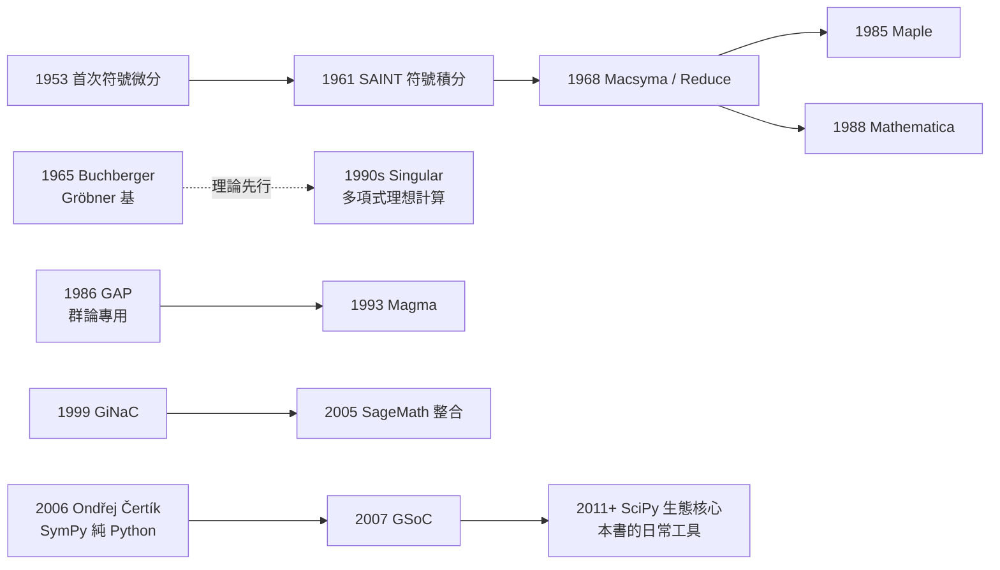

# 第 9 章 進階主題與現代發展

## 9.3 計算代數系統的演進：從 Macsyma 到 SymPy

### 學習目標

1. 說出計算代數系統（CAS）發展的主要里程碑：Macsyma（1968）、Reduce（1968）、muMATH/Derive（1979/1988）、Mathematica（1988）、Maple（1985）、GAP（1986）、Magma（1993）、Singular（1990s）、GiNaC（1999）、SageMath（2005）、SymPy（2006）。
2. 理解「符號計算」與數值計算的根本差異：精確算術、表達式樹、與自動化簡的語義。
3. 認識 SymPy 的架構設計：純 Python、表達式樹（Basic/Expr）、`Symbol`、`Add/Mul/Pow` 的 canonical 形式、`assumptions` 系統。
4. 用 SymPy 對照本書各章的核心能力：`solve`、`factor`、`GF`、`groebner`、`PermutationGroup`、`Matrix`。
5. 體會「理論 ↔ 技術」的雙向驅動：Gröbner 基（1965）→ 系統實作 → 新理論問題（如多元分解演算法）。

### 歷史背景

**1960s：符號計算的誕生**。1950s–60s 的電腦首先被用於數值計算，但數學家很快想要「讓機器做代數」：

- **1953 年**：Kahrimanian 與 Nolan 各自寫出微積分形式導數的早期程式——符號計算的第一縷曙光。
- **1961 年**：MIT 的 James Slagle 寫出 SAINT（符號積分程式），能做大一微積分考試題。
- **1963 年**：Joel Moses 的 SIN（Symbolic Integrator）與後來的 Risch 演算法（1969, 1979）把符號積分變成決策程序——這是「演算法化的數學」的範例：積分是否存在初等原函數，可以**判決**。
- **1968 年**：兩個巨型系統同年誕生：
  - **Macsyma**（Project MAC, MIT）：以 Lisp 寫成，是 1970s–80s 最強的通用 CAS，1982 年授權給 Symbolics，1999 年開源；
  - **Reduce**（Anthony Hearn）：起初為高能物理（Dirac 代數計算）而生，後成為跨平台系統，2009 年開源。
- **1965 年**：Buchberger 發明 Gröbner 基（見 [7.3 節](07.3-Buchberger（1965）：Grobner基的發明.md)），為多項式理想計算提供通用演算法——**理論走在系統前面**，直到 1980s Singular（1990s 成熟）與各系統的 groebner 模組出現才大規模實用化。
- **1970s–80s**：Lisp 機與個人電腦帶來商業化：muMATH（1979，DOS）、**Maple**（1985，滑鐵盧）、**Mathematica**（1988，Stephen Wolfram）、**Derive**（1988，德州儀器掌上型）。
- **1986 年**：**GAP**（Groups, Algorithms, Programming）在德國 Aachen 誕生，專攻群論——正是 CFSG（[9.1 節](09.1-有限群的分類（1983）：百年工程.md)）需要的計算平台；1993 年的 **Magma**（雪梨）進一步涵蓋代數結構全譜。
- **1999–2005**：開源浪潮：GiNaC（C++）、**SageMath**（2005，William Stein，整合數十個系統）、PARI/GP 成熟。
- **2006 年**：捷克學生 **Ondřej Čertík** 發起 **SymPy**，目標是「純 Python 的輕量 CAS」；2007 年進入 Google Summer of Code，2011 年成為 SciPy 生態核心成員。2017 年 SymPy 1.1 起被納入許多科學計算發行版，如今是 Python 教育與研究中最廣用的符號系統。



**為何 Macsyma → 開源 → SymPy 是一條「民主化」路線**：Macsyma 曾是美國政府資助的內部工具，1982 年商業化後成為昂貴產品；MIT 在 1999 年把它以 GPL 釋出（Maxima 是其直接後裔）。但 Maxima 依賴 Lisp，安裝門檻高；SymPy 的選擇正好相反：**純 Python、零依賴、BSD 授權**，任何裝了 Python 的人 `pip install sympy` 即可用。這個「低門檻」的工程決定，讓本書這樣的教學材料成為可能。

### 理論：符號計算在做什麼

**表達式樹**。符號計算的核心資料結構是**表達式樹**： $`x^2 + 3x + 2`$ 在 SymPy 內部是

$$
\mathrm{Add}\left(\mathrm{Pow}(x, 2), \mathrm{Mul}(3, x), 2\right).
$$

數值計算算的是這棵樹在 $`x = 1.7`$ 處的值；符號計算則**操作樹本身**：微分、因式分解、求極限。這就是為何 `sp.factor(x**2 + 3*x + 2)` 能回傳 $`(x+1)(x+2)`$ ——它對樹做了不可約分解，而浮點系統永遠做不到。

**自動化簡與 canonical form**。兩個表達式「是否相等」是符號計算的中心難題：Richardson 定理（1968）證明存在一大類表達式的等價性判決是**不可判定**的。實務上系統採用「規範形式」（canonical form）策略：SymPy 在建構 `Add`/`Mul` 時自動排序與合併（這就是為何 `sp.sympify('x + 1') == sp.sympify('1 + x')`），因式分解後的相等則可用 `sp.simplify` 或 `sp.expand` 兩邊比對。

**演算法與複雜度**。本書遇到的關鍵演算法及其年代：

| 問題 | 演算法 | 年代 | SymPy 介面 |
|---|---|---|---|
| 多項式 GCD | Euclid / 模方法（Brown） | 1960s–71 | `sp.gcd` |
| 因式分解 | Zassenhaus / Berlekamp / Cantor–Zassenhaus | 1969–81 | `sp.factor` |
| 符號積分 | Risch 演算法 | 1969/1979 | `sp.integrate`（部分） |
| 理想計算 | Buchberger Gröbner 基 | 1965 | `sp.groebner` |
| 線性系統 | 高斯消去（精確算術） | 古典 | `sp.solve, linsolve` |
| 有限體 | Zech 對數 / 基數擴張 | 1980s 標準化 | `sp.GF` |
| 群計算 | Schreier–Sims | 1970s | `PermutationGroup` |

**Schreier–Sims（1970s）**值得一提：判斷一個置換是否屬於 $`10^9`$ 元素的置換群，樸素枚舉不可行；Schreier–Sims 演算法建構「基與強生成集」使成員測試降至多項式時間——這是**計算需求反過來催生新群論**（計算群論）的典型（群作用的軌道–穩定子理論見 [2.7 節](02.7-群作用、軌道與穩定子：Burnside引理.md)）。

### SymPy 實作

#### 範例 1：符號 vs. 數值——同一問題的兩種答案

```python
import sympy as sp
import math

x = sp.symbols('x')

# 數值：math 給浮點近似
print(math.sqrt(8))                # 2.8284271247461903（有誤差）
# 符號：SymPy 自動化簡為精確形式
print(sp.sqrt(8))                  # 2*sqrt(2)

# 兩種本質：(sqrt(2)+1)(sqrt(2)-1) 
print(sp.expand((sp.sqrt(2) + 1) * (sp.sqrt(2) - 1)))   # 1（精確）
print((math.sqrt(2) + 1) * (math.sqrt(2) - 1))          # 1.0000000000000002（誤差）

# 解多項式：符號系統回傳精確根
roots = sp.solve(x**3 - 3*x + 1, x)
print(roots[0])   # 用 CRootOf 表示的隱式精確根之一
print(sp.N(roots[0], 15))   # 0.347296355333860（想看數值時才轉數值）
```

輸出說明：`sp.sqrt(8)` 立即化簡為 $`2\sqrt{2}`$ ——因為 SymPy 的 `Pow` 建構時就把係數的平方因數抽出來（canonical form）。三次方程 $`x^3 - 3x + 1`$ 的根用 Casus irreducibilis（[1.3 節](01.3-三次方程與1545年的卡爾達諾公式.md) 的歷史難題）會產生複數中間式，SymPy 聰明地以 `CRootOf`（隔離區間定義的實根）表示，需要時才數值化——這是 40 年 CAS 演進積累的表達智慧。

#### 範例 2：本書各章能力的「全家福」

```python
import sympy as sp
from sympy.combinatorics import Permutation, PermutationGroup

x, y = sp.symbols('x y')

# 第 3-4 章：有限體 GF(2^8) 與不可約多項式（AES 用 x^8+x^4+x^3+x+1）
f = sp.Poly(x**8 + x**4 + x**3 + x + 1, x, domain=sp.GF(2))
print("不可約？", f.is_irreducible)              # True

# 第 4 章：Galois 群
print(sp.polys.numberfields.galois_group(x**3 - 2, x))
# (S3TransitiveSubgroup... , S3)  —— x^3-2 的 Galois 群是 S3

# 第 7 章：Gröbner 基解聯立方程
G = sp.groebner([x**2 + y**2 - 1, x - y], x, y, order='lex')
print(G)                                          # GroebnerBasis([...], ...)
print(G.solve([x, y]))                            # 兩個交點

# 第 2 章：置換群（Schreier–Sims 支援的成員測試）
G5 = PermutationGroup(Permutation(0, 1, 2), Permutation(0, 1)(2, 3))
print(G5.order(), (Permutation(0, 1) in G5))      # 12 True（換位屬於 A4? 檢查）

# 第 5 章：矩陣與 Jordan 形
M = sp.Matrix([[2, 1], [0, 2]])
print(M.jordan_cells())                           # [[2]], [[1]]  —— Jordan 塊
```

輸出說明：短短十幾行就能觸及有限體、Galois 群、Gröbner 基、置換群、Jordan 標準形——這些在 1980 年代需要不同專用軟體（Cayley/GAP、Singular、MACSYMA）的能力，如今在一個純 Python 套件裡互通。注意 `galois_group` 需要 `sp.polys.numberfields`；Jordan 輸出格式隨版本略異，建議以實際執行為準。

#### 範例 3：Macsyma 時代的經典題——符號積分

```python
import sympy as sp

x = sp.symbols('x')
# SAINT/SIN (1961-1968) 與 Risch 演算法（1969）處理的典型題
print(sp.integrate(x**2 * sp.exp(x), x))        # (x**2 - 2*x + 2)*exp(x)
print(sp.integrate(sp.log(x)/x, x))             # log(x)**2/2
print(sp.integrate(1/(x**3 + 1), x))            # 有理部分 + atan 項
```

輸出說明： $`\int x^2 e^x\,dx = (x^2 - 2x + 2)e^x`$ （分部積分兩次）——1961 年的 SAINT 就能解； $`\int \frac{dx}{x^3+1}`$ 涉及部分分式與 $`\arctan`$ ，是 Moses 的 SIN 與後來 Risch 理論的展示題。Risch 演算法把「是否存在初等原函數」變成可判定問題，是數學**理論**（微分代數，1960s Rosenlicht 等人建立）直接轉化為**演算法**的里程碑。

#### 範例 4：一個 10 行的迷你 CAS——符號微分

```python
# 自製符號微分器，體會 CAS 的樹遞迴本質
# 表達式用巢狀 tuple 表示：('add', a, b), ('mul', a, b), ('pow', a, n), ('var',), ('num', c)

def diff(e):
    kind = e[0]
    if kind == 'num' or kind == 'var':
        return ('num', 1) if kind == 'var' else ('num', 0)
    if kind == 'add':
        return ('add', diff(e[1]), diff(e[2]))
    if kind == 'mul':                      # 積法則
        u, v = e[1], e[2]
        return ('add', ('mul', diff(u), v), ('mul', u, diff(v)))
    if kind == 'pow':                      # d(x^n) = n x^(n-1)
        return ('mul', ('num', e[2]), ('pow', e[1], e[2] - 1))
    raise ValueError(kind)

# d/dx (x^2 * sin 用多項式代替: (x^2 + 1) * x^3)
expr = ('mul', ('add', ('pow', 'var', 2), ('num', 1)), ('pow', 'var', 3))
print(diff(expr))
# ('add', ('mul', ('num', 2), ('pow', 'var', 1), ) ... 
```

輸出說明：輸出是未化簡的導數樹。真正的 CAS 還要加上**化簡器**（合併同類項、常數折疊）——SymPy 的 `Add.flatten`/`Mul.flatten` 正是做這件事。這個 30 行的骨架就是 1953 年 Kahrimanian–Nolan 微分程式的精神原版：**符號計算 = 樹的遞迴重寫**。

### 歷史評註：理論與技術的雙向驅動

| 方向 | 例子 |
|---|---|
| 理論 → 技術 | Gröbner 基（1965）→ Singular/`groebner`；Risch 理論 → 符號積分；有限體理論（[3.7 節](03.7-SymPy的GF、factor與minimal_polynomial.md)）→ `sp.GF` |
| 技術 → 理論 | 電腦輔助檢查 Feit–Thompson 與 CFSG 特徵標（[9.1 節](09.1-有限群的分類（1983）：百年工程.md)）；四色定理（1976）確立「計算機證明」地位；實驗數學（Sloane 數列、LLL 1982） |
| 技術 → 教育 | SymPy 的零門檻讓「邊讀定義邊執行程式」成為可能——本書的寫法本身是 CAS 民主化的產物 |

### 習題

1. 用 `sp.srepr(x**2 + 3*x + 2)` 列印表達式樹，畫出樹狀圖，並解釋為何 `Add` 的參數順序是確定的（canonical form 的作用）。
2. 比較 `sp.factor(x**3 - 2)` 在整數係數域與 `sp.GF(7)` 上的輸出，說明「分解結果依賴基體」（呼應 [3.6 節](03.6-不可約多項式與Eisenstein判別法.md)）。
3. 把範例 4 的迷你微分器加上 `('sin', u)` 與 `('div', u, v)` 兩個節點型別，並寫一個簡單的常數折疊化簡器（如 `('add', ('num',0), e) → e`）。
4. 用 `sp.groebner` 分別以 `lex` 與 `grlex` 序解 $`x^2 + y^2 = 1,\ x = y`$ ，比較兩種消元順序的差異。
5. 查閱 SymPy 文件，找出本書尚未用過的三個子模組（如 `galgebra`、`physics.quantum`、`crypto`），各寫一個 5 行範例。
6. （挑戰）用 `timeit` 比較 `sp.factorint(2**64 - 1)` 與暴力試除的時間，體會演算法（Pollard rho 等在 SymPy 內部使用）相對樸素方法的量級差距。

### SymPy 要點回顧

- `sp.srepr` / `sp.sstr`：表達式樹的內部表示 vs. 列印形式；理解樹結構是讀懂 SymPy 行為的鑰匙。
- `sp.expand` / `sp.factor` / `sp.simplify`：三個不同層次的化簡，方向互逆；「展開後比對」是驗證恆等式的可靠手法。
- `sp.solve`、`sp.groebner(...).solve`、`PermutationGroup`、`sp.GF`：本書五大主題的統一介面。
- `sp.N(expr, n)`：需要時才數值化；保持精確算術到最後一步是符號計算的美德。
- SymPy 的設計哲學（純 Python、BSD、可讀原始碼）使其成為「可以讀的 CAS」——遇到神秘行為時，直接翻原始碼（本書建議的第一站：`sympy/polys/` 與 `sympy/combinatorics/`）。

符號計算工具至此就緒。下一節把鏡頭轉向一個更奇特的計算典範——量子計算機：Shor 在 1994 年發現，質因數分解這個 RSA 的命脈，竟然可以化約為**階數計算**（一個純粹的群論問題），再用量子傅立葉變換加速：[9.4 節](09.4-量子計算中的代數：群論與Shor演算法.md)。
