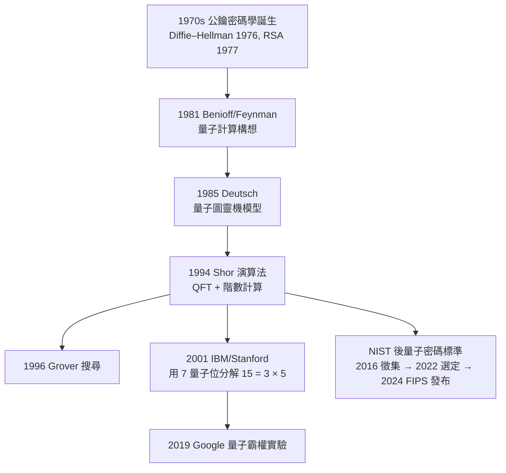

# 第 9 章 進階主題與現代發展

## 9.4 量子計算中的代數：群論與 Shor 演算法

### 學習目標

1. 理解 Shor 演算法（1994）的**數學骨架**：把質因數分解化約為模 $`N`$ 乘法群中的**階數計算**（order finding），再以連分數還原因數。
2. 認識量子部分：週期尋找如何用量子傅立葉變換（QFT）與測量機率分佈實現，以及為何只要 $`O((\log N)^3)`$ 時間。
3. 釐清量子電腦「能做」與「不能做」的邊界：它加速的是隱含**週期/隱子群**結構的問題（Shor 的隱子群問題框架）。
4. 用 SymPy 完整實作 Shor 的**經典部分**：`sp.ntheory` 的階數計算、連分數、模反元素，並模擬 QFT 後的測量機率。
5. 了解歷史：Diffie–Hellman（1976）、RSA（1977）建立公鑰密碼學 → Shor（1994）證明量子威脅 → 後量子密碼學（NIST 2022–2024 標準化）的攻防史。

### 歷史背景

**密碼學的現代轉折（1976–1977）**。1976 年 Diffie 與 Hellman 發表《New Directions in Cryptography》，提出公鑰概念；1977 年 Rivest、Shamir、Adleman 在 MIT 發明 **RSA**：其安全性基於「大整數質因數分解困難」。而分解困難性的數學核心，其實是一個群論事實—— $`\mathbb{Z}/N\mathbb{Z}`$ 的單位群 $`(\mathbb{Z}/N\mathbb{Z})^\times`$ 的**階**（Euler $`\varphi(N)`$ ，見 [2.5 節](02.5-循環群與阿貝爾群：有限交換群的分類.md)）難以從 $`N`$ 本身算出。

**Shor 的洞察（1994）**。AT&T 貝爾實驗室的 Peter Shor 在 1994 年 4 月的 Bellcore 研討會上宣布：量子電腦可以在多項式時間內分解大整數與解離散對數。這篇會議論文（後以 *SIAM J. Comput.* 1997 年正式發表）瞬間把量子計算從學術好奇變成國安級議題。Shor 演算法的架構驚人地「古典」：

$$
\text{分解 } N \;\Longrightarrow\; \text{找 } a^x \bmod N \text{ 的週期 } r \;\Longrightarrow\; \text{量子 QFT 求週期} \;\Longrightarrow\; \text{連分數還原 } r \;\Longrightarrow\; \gcd(a^{r/2} \pm 1, N).
$$

其中只有「求週期」需要量子加速，其餘全是本書前 8 章的古典代數。Shor 後來把此架構一般化為**隱子群問題**（Hidden Subgroup Problem, HSP）：阿貝爾群的 HSP 皆可用 QFT 多項式時間解——離散對數（ $`(\mathbb{Z}/p)^\times`$ ）、週期尋找（ $`\mathbb{Z}`$ ）都是特例；但非阿貝爾 HSP（如圖同構對應 $`S_n`$ ）至今無有效量子解法。



**歷史的弔詭**：密碼學（技術需求）先催生了計算數論的繁榮（Miller–Rabin 1976、AKS 2002 的素性測試、橢圓曲線密碼學見 [9.2 節](09.2-橢圓曲線與費馬大定理（1994）.md)）；而量子力學（物理理論）與傅立葉分析（數學工具）合流後，反過來威脅密碼學本身——「技術與理論互相驅動」在這裡完成了三段式循環。

### 理論：Shor 演算法的代數核心

**定義（階數問題）**：設 $`N`$ 為奇合數， $`a`$ 與 $`N`$ 互質。 $`a`$ 在 $`(\mathbb{Z}/N\mathbb{Z})^\times`$ 中的**階**是使

$$
a^r \equiv 1 \pmod N
$$

的最小正整數 $`r`$ 。（Lagrange 定理保證 $`r \mid |(\mathbb{Z}/N\mathbb{Z})^\times| = \varphi(N)`$ ，見 [2.3 節](02.3-子群、陪集與拉格朗日定理.md)；循環群結構見 [2.5 節](02.5-循環群與阿貝爾群：有限交換群的分類.md)。）

**定義（QFT）**： $`n`$ 量子位上的量子傅立葉變換是

$$
\mathrm{QFT}\,|x\rangle = \frac{1}{\sqrt{2^n}} \sum_{y=0}^{2^n - 1} e^{\,2\pi i x y / 2^n}\, |y\rangle,
$$

即經典離散傅立葉變換（DFT）的么正化版本。它把「時域中的週期性」轉成「頻域中的尖峰」——測量時，與週期 $`r`$ 相關的值以高機率出現。

**Shor 演算法的完整流程**：

1. **（古典）隨機取** $`1 < a < N`$ ；若 $`\gcd(a, N) > 1`$ ，直接分解成功。
2. **（量子）週期尋找**：
   - 準備疊加 $`\frac{1}{\sqrt{Q}} \sum_{x=0}^{Q-1} |x\rangle |0\rangle`$ （ $`Q = 2^n \approx N^2`$ 的冪）；
   - 計算 $`f(x) = a^x \bmod N`$ （模冪電路），得 $`\frac{1}{\sqrt{Q}} \sum_x |x\rangle |a^x \bmod N\rangle`$ ；
   - 測量第二暫存器得某值 $`c`$ ，第一暫存器塌縮為所有滿足 $`a^x \equiv c`$ 的 $`x`$ 之疊加——即一個**以 $`r`$ 為週期的等差級數**；
   - 對第一暫存器做 QFT 並測量，得 $`y \approx k \cdot \frac{Q}{r}`$ 。
3. **（古典）連分數還原**： $`\frac{y}{Q} \approx \frac{k}{r}`$ ，用**連分數展開**找出分母 $`r \leq N`$ 的最佳逼近（數論上由 Legendre 定理保證： $`|\frac{y}{Q} - \frac{k}{r}| < \frac{1}{2Q}`$ 且 $`r \le N`$ 時 $`\frac{k}{r}`$ 必為 $`y/Q`$ 的連分數收斂值）。
4. **（古典）因數還原**：若 $`r`$ 為偶數且 $`a^{r/2} \not\equiv -1 \pmod N`$ ，則

$$
a^r - 1 = (a^{r/2} - 1)(a^{r/2} + 1) \equiv 0 \pmod N \implies \gcd(a^{r/2} \pm 1, N) \text{ 給出非平凡因數}.
$$

否則換 $`a`$ 重來（成功機率每輪至少約 $`\frac{1}{2}`$ ）。

**為何 QFT 有效（思路）**：週期為 $`r`$ 的疊加態經 QFT 後，振幅集中在 $`y`$ 使 $`y \bmod r`$ 接近 0 的位置，測量得到 $`y = \lfloor kQ/r \rceil`$ 形式的值。連分數把「帶雜訊的比例」還原成精確分數 $`\frac{k}{r}`$ ——**量子電腦負責產生有雜訊的週期資訊，數論負責去雜訊**。這個分工是理解所有量子演算法的鑰匙：量子部分永遠是線性代數（么正矩陣）+ 干涉，數論部分是純古典。

**Grover 與群論**：Shor 之外，1996 年 Grover 的搜尋演算法本質是 $`O(\sqrt{N})`$ 次的「繞原點旋轉」（ $`\mathbb{R}^2`$ 中的 $`\mathrm{SO}(2)`$ 旋轉群的表示）；而以 Pealing 為名的 quantum walk 演算法則對應群上的隨機遊走。整個量子演算法版圖可以說是「**表示論 + 傅立葉分析**」的量子版（表示論基礎見第 6 章）。

**後量子密碼學**：由於 Shor 演算法威脅 RSA、Diffie–Hellman 與 ECC，NIST 自 2016 年徵集後量子標準，2022 年選定 CRYSTALS-Kyber（模格）、CRYSTALS-Dilithium、SPHINCS+、Falcon，2024 年發布 FIPS 203/204/205。有趣的是，這些新標準的數學基礎——**格（lattice）**——正是本書第 5 章線性代數中「整數基底」概念的推廣：攻防雙方仍在同一套代數語言中競逐。

### SymPy 實作

#### 範例 1：經典部分的完整實作（階數計算 + 連分數 + 因數還原）

```python
import sympy as sp
from fractions import Fraction

def shor_classical(N, a):
    """Shor 演算法的古典部分：給定 N 與互質的 a，
    計算階 r，並嘗試還原因數。"""
    assert sp.gcd(a, N) == 1
    # 步驟 2 的古典替代：直接算階（量子版用 QFT 估計，此處用精確階）
    r = sp.n_order(a, N)                # sp.ntheory 的階數函數
    print(f"a = {a}, 階 r = {r}, φ(N)/r = {sp.totient(N) // r}")
    if r % 2 == 1:
        return None                     # 需換 a
    x = pow(a, r // 2, N)
    if x == N - 1:                      # a^(r/2) ≡ -1 (mod N)
        return None
    f1 = sp.gcd(x - 1, N)
    f2 = sp.gcd(x + 1, N)
    return (f1, f2) if 1 < f1 < N else ((f2, N // f2) if 1 < f2 < N else None)

def shor(N, tries=20):
    for _ in range(tries):
        a = sp.randprime(2, N - 1) % N or 2   # 隨機取 a
        a = max(2, a)
        g = sp.gcd(a, N)
        if g > 1:
            return (g, N // g)                # 幸運命中
        res = shor_classical(N, a)
        if res:
            return res
    return None

print(shor(15))     # (3, 5)
print(shor(21))     # (3, 7) 或 (7, 3)
print(shor(91))     # (7, 13) 或 (13, 7)
```

輸出說明：`sp.n_order(a, N)` 正是階數計算的現成工具（內部用質因數分解 + 逐步檢驗）；`sp.totient(N)` 給 Euler 函數，驗證 Lagrange 定理 $`r \mid \varphi(N)`$ 。對 $`N = 15`$ ，取 $`a = 7`$ 時 $`7^4 \equiv 1 \pmod{15}`$ 且 $`r = 4`$ ， $`7^2 = 49 \equiv 4 \pmod{15}`$ ， $`\gcd(4 \pm 1, 15) = \gcd(3,15)=3,\ \gcd(5,15)=5`$ ——兩個因數一次到手。

#### 範例 2：連分數還原 $`r`$ （Shor 的「去雜訊」步驟）

```python
import sympy as sp

def cf_convergents(x, Q, maxden):
    """把 y/Q 以連分數展開，回傳分母 <= maxden 的所有收斂值。"""
    y_over_Q = sp.Rational(x, Q)
    conv = sp.continued_fraction_convergents(
        sp.continued_fraction_iterator(y_over_Q))
    return [c for c in conv if c.q <= maxden]

# 模擬 QFT 測量：N=21, a=2, r=6, Q=2^9=512
# 理想測量值 y 應近於 k*Q/r = k*512/6, k = 0..5
import random
N, a, Q = 21, 2, 512
r = sp.n_order(a, N)          # 6
print("真實週期 r =", r)

for k in range(1, r):
    y = round(k * Q / r)      # QFT 尖峰的理想位置（含捨入誤差）
    convs = cf_convergents(y, Q, N)
    cands = [c.q for c in convs if c.q > 1]
    print(f"k={k}, 測量 y={y}, 連分數候選分母 = {cands}")
    # 候選中會出現 6（真正的 r）或其因數
```

輸出說明：以 $`k = 2`$ 為例， $`y = \mathrm{round}(2 \cdot 512 / 6) = 171`$ ， $`\frac{171}{512}`$ 的連分數收斂值分母序列會出現 $`3`$ 與 $`6`$ ——即 $`r = 6`$ 。`sp.continued_fraction_iterator` 與 `continued_fraction_convergents` 是 SymPy 內建的連分數工具；Legendre 定理保證只要 $`r \leq N`$ 且 $`Q > N^2`$ ，正確的 $`k/r`$ 必在收斂值中。

#### 範例 3：QFT 測量機率的模擬（線性代數視角）

```python
import sympy as sp

def qft_matrix(n):
    """n 量子位 QFT 的 2^n × 2^n 么正矩陣（精確符號運算）"""
    Q = 2**n
    omega = sp.exp(2*sp.pi*sp.I / Q)
    return sp.Matrix(Q, Q, lambda y, x: omega**(x*y) / sp.sqrt(Q))

def period_state_amplitudes(n, r):
    """測量第二暫存器後，第一暫存器的等差疊加 |s0 + j r>"""
    Q = 2**n
    s0 = 1
    basis = [s0 + j*r for j in range(Q // r) if s0 + j*r < Q]
    psi = sp.Matrix([[1 if i in basis else 0] for i in range(Q)])
    psi = psi / sp.sqrt(len(basis))
    return psi

n, r = 4, 4          # Q = 16, 週期 4
F = qft_matrix(n)
psi = period_state_amplitudes(n, r)
probs = list(abs((F*psi)[i])**2 for i in range(2**n))
peaks = [(i, sp.nsimplify(sp.simplify(probs[i]))) for i in range(2**n)]
big = [(i, p) for i, p in enumerate(peaks) if p[1] > 0]
print("非零機率位置與機率：")
for i, (_, p) in big:
    print(f"  y = {i:2d}: {p}")
# 機率集中在 y = 0, 4, 8, 12（即 k*Q/r = k*4）
```

輸出說明：QFT 之後機率完全集中在 $`y \in \{0, 4, 8, 12\} = \{k \cdot 16/4\}`$ ，每個機率 $`\frac{1}{4}`$ ——這正是「時域週期 ⇔ 頻域尖峰」的精確代數陳述。這段程式用 SymPy 的**精確符號矩陣**（ $`\omega = e^{2\pi i/16}`$ 是 16 次單位根，分圓體的元素，見 [4.7 節](04.7-分圓體與有限體：高斯週期與密碼學應用.md)）直接驗證量子力學的線性代數本質：**量子計算 = 么正矩陣作用 + 基底測量**。

#### 範例 4：RSA 的階數結構（為何 φ(N) 是命門）

```python
import sympy as sp

p, q = 61, 53                  # RSA 教科書例
N = p * q
phi = (p - 1) * (q - 1)
e = 17                          # 公鑰指數
d = sp.invert(e, phi)           # 私鑰：e·d ≡ 1 (mod φ(N))
print("N =", N, "φ(N) =", phi, "d =", d)     # 3233 3120 2753

# 加解密：m^e mod N → c^d mod N
m = 65
c = pow(m, e, N)
print("密文 =", c)                          # 2790
print("解密 =", pow(c, d, N))               # 65

# 攻擊者若能求階，就能分解：任取 a，求 ord(a) 的倍數關係
a = 2
r = sp.n_order(a, N)
print(f"ord({a}) mod {N} = {r},  φ(N) 整除性：{phi} % {r} = {phi % r}")
# 已知足夠多個 ord(a)，可由 lcm 逼近 φ(N)，進而得 p+q → 分解
```

輸出說明：RSA 的私鑰 $`d`$ 不過是 $`e`$ 在 $`(\mathbb{Z}/\varphi(N))`$ 中的模反元素——整個系統建立在「 $`\varphi(N)`$ 難求」之上。而 Shor 演算法攻擊 RSA 的路徑正是**階數計算**：一旦量子週期尋找可行， $`r = \mathrm{ord}(a)`$ 導致分解， $`\varphi(N) = (p-1)(q-1)`$ 隨之而出。 $`r \mid \varphi(N)`$ 這個 Lagrange 定理推論，就是攻擊能收斂的原因。

### 歷史評註：一場攻防的時間線

| 年代 | 事件 | 意義 |
|---|---|---|
| 1976 | Diffie–Hellman 金鑰交換 | 公鑰概念誕生，離散對數成為核心困難問題 |
| 1977 | RSA | 質因數分解從純數論問題變成安全基礎設施 |
| 1981–85 | Benioff、Feynman、Deutsch | 量子計算模型確立 |
| 1994 | Shor 演算法 | 階數計算 + QFT：公鑰密碼的量子末日預言 |
| 2001 | 7 量子位分解 $`15 = 3 \times 5`$ | 概念驗證（IBM/Stanford NMR） |
| 2016–2024 | NIST 後量子標準化 | 格密碼（Kyber/Dilithium）接棒 |
| 2020s | 數百量子位含雜訊裝置 | 距離分解 RSA-2048 仍遠，但方向明確 |

值得強調：Shor 演算法**沒有**推翻「分解是困難的」這個古典事實，而是證明「困難」的標尺取決於**計算模型**。這提醒我們：複雜度理論與代數結構（這裡是 $`(\mathbb{Z}/N\mathbb{Z})^\times`$ 的循環結構與隱子群）是捆綁在一起評價的——這是本書從 [2.2 節](02.2-群的定義與凱萊（1854）的抽象化.md) 抽象化群一路鋪陳到量子計算的終極理由。

### 習題

1. 用 `sp.n_order` 列出 $`(\mathbb{Z}/21\mathbb{Z})^\times`$ 中所有元素的階，驗證每個階都整除 $`\varphi(21) = 12`$ （Lagrange 定理），並找出哪些元素的階是 6。
2. 對 $`N = 35`$ 與 $`a = 3`$ ：手算 $`r = \mathrm{ord}_{35}(3)`$ ，檢查 $`r`$ 是否偶數、 $`a^{r/2} \bmod 35`$ 是否為 $`-1`$ ，最後用 $`\gcd(a^{r/2} \pm 1, 35)`$ 分解 35。再用範例 1 的程式驗證。
3. 用範例 2 的連分數方法：設 $`N = 91`$ 、 $`a = 4`$ 、 $`Q = 2^{13}`$ ，對每個 $`k`$ 計算理想測量值 $`y = \mathrm{round}(kQ/r)`$ 並驗證連分數能還原 $`r`$ （先算 $`r = \mathrm{ord}_{91}(4)`$ ）。
4. 把範例 3 的 QFT 模擬改為 $`r = 3`$ 、 $`Q = 2^4 = 16`$ （ $`Q`$ 不整除 $`r`$ 的倍數），觀察機率尖峰「變寬」的現象——這就是真實 Shor 演算法需要 $`Q \gg N^2`$ 與連分數去雜訊的原因。
5. 用 SymPy 實作 Grover 演算法的 2 量子位版本：在 16 個基底態中搜尋標記態（Oracle 矩陣 + 擴散矩陣 $`\mathrm{Diag}(1, -1, \dots, 1) \cdot \dots`$ ），驗證 $`O(\sqrt{16}) = 4`$ 次迭代內機率超過 $`\frac{1}{2}`$ 。
6. （挑戰）查閱 `sympy.physics.quantum.qft` 模組，用它建構 QFT 電路並作用於基本態，與範例 3 的矩陣法比對結果；思考兩種表示（電路 vs. 矩陣）在 $`n = 1000`$ 時的可行性差異（矩陣是 $`2^{1000}`$ 維！）。

### SymPy 要點回顧

- `sp.n_order(a, N)`： $`a`$ 在 $`(\mathbb{Z}/N\mathbb{Z})^\times`$ 中的階——Shor 演算法古典核心的現成工具。
- `sp.totient(N)`、`sp.gcd`、`sp.invert(a, m)`：RSA 與因數還原的基礎件。
- `sp.continued_fraction_iterator` / `continued_fraction_convergents`：連分數展開與收斂值，QFT 測量值「去雜訊」的數論保證（Legendre 逼近定理）。
- `sp.Rational` + `sp.simplify` + `sp.exp(2*sp.pi*sp.I/Q)`：用精確分圓體元素建構 QFT 矩陣，機率 $`\left|\langle y|\mathrm{QFT}|\psi\rangle\right|^2`$ 可精確化簡。
- `sp.randprime`：隨機取互質基 $`a`$ ；`sp.factorint` 用於最後驗證因數正確。
- 心法：量子演算法 = 么正線性代數（矩陣）+ 測量機率 + **古典數論後處理**；SymPy 的精確算術讓三段都能在同一個腳本中驗證。

最後一節是全書的驗收：我們要自己動手，把本書的群、環、體一一用 Python 類別實作，包括在 GF $`(2^8)`$ 上玩 AES 的數學基礎——[9.5 節](09.5-專題實作：用SymPy建構自己的小代數系統.md)。
