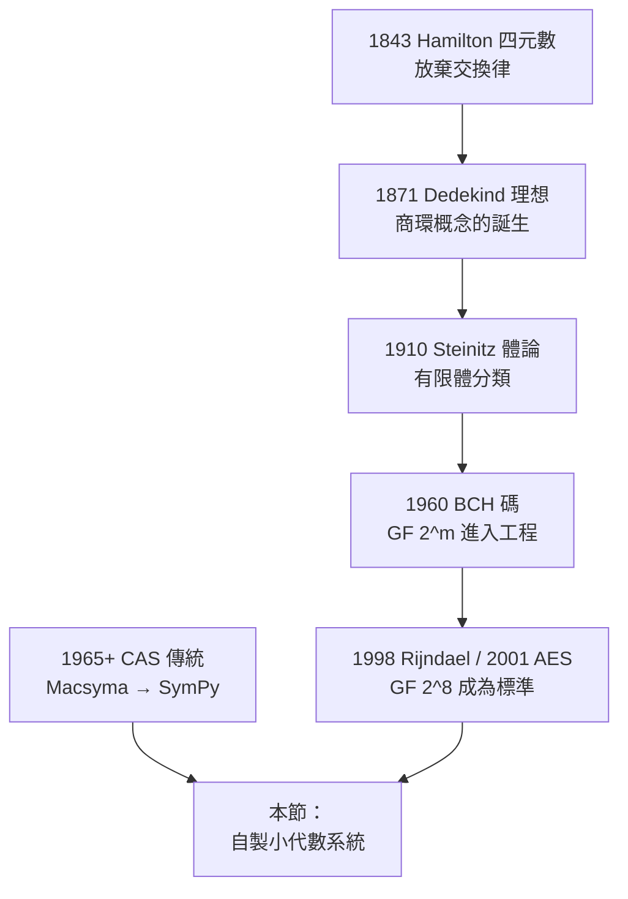

# 第 9 章 進階主題與現代發展

## 9.5 專題實作：用 SymPy 建構自己的小代數系統

### 學習目標

1. 把本書的抽象定義（群、環、體、多項式）轉成**可執行的 Python 類別**：以「運算表 / 生成元 / 域元素」三種風格實作。
2. 實作 **Galois 域 $`\mathrm{GF}(2^8)`$ **：以 AES 的不可約多項式 $`x^8 + x^4 + x^3 + x + 1`$ 為模，完成加、乘、反元素與 S-box 的仿射變換——親手驗證 [3.3 節](03.3-整環、體與體的特徵.md)、[3.7 節](03.7-SymPy的GF、factor與minimal_polynomial.md) 與 [4.7 節](04.7-分圓體與有限體：高斯週期與密碼學應用.md) 的理論。
3. 實作**多項式商環** $`\mathbb{Z}[x]/(x^2+1)`$ （高斯整數的化身）與**循環群、二面體群**的運算表，驗證 Lagrange 定理與同態。
4. 體會「驗證公理」的程式思維：寫函式自動檢查結合律、分配律、可逆性——把數學定義變成測試。
5. 完成（挑戰）自製橢圓曲線點類別，與 [9.2 節](09.2-橢圓曲線與費馬大定理（1994）.md) 互通。

### 歷史背景

「自己實作一次」是學代數最古老也最有效的方法。這條路在數學史上有三個著名先例：

- **1843 年**：Hamilton 為了找「三維複數」苦思多年，10 月 16 日在都柏林運河橋上頓悟**四元數** $`\mathbb{H}`$ ——犧牲交換律換來除法結構。四元數是最早的「非標準數系」實作，也是環論與體論的直覺源頭（見 [3.1 節](03.1-環論的誕生：戴德金與克羅內克（1870s–1880s）.md)）。
- **1847 年**：Kummer 為了 Fermat 問題引進「理想數」；1871 年 Dedekind 把它整理成**理想**概念——環論誕生於一次「想實作卻發現缺工具」的經驗（見 [3.2 節](03.2-理想與商環：諾特（1921）的理想理論.md)）。
- **1930 年**：Steinitz 的《體論的代數基礎》（1910）提供了有限體 $`\mathbb{F}_{p^n}`$ 的完整分類；1948 年 Shannon 的通訊理論 + 1960 年 Bose–Chaudhuri–Hocquenghem 碼把 $`\mathrm{GF}(2^m)`$ 變成工程必需品；1998 年 Rijndael（AES）以 $`\mathrm{GF}(2^8)`$ 為核心，2001 年成為美國標準。

而電腦代數系統本身（[9.3 節](09.3-計算代數系統的演進：從Macsyma到SymPy.md)）就是「把代數結構實作成軟體」的 60 年事業。本節我們反向操作：**不看 SymPy 怎麼做，自己從零做一個**，再用 SymPy 當參考答案驗證。



### 理論回顧：要實作的三個結構

**1. 群**（[2.2 節](02.2-群的定義與凱萊（1854）的抽象化.md)）：集合 $`G`$ 與運算 $`\cdot`$ ，滿足封閉、結合、單位元、反元素。實作風格有二：(a) **運算表**（適合小群，如 $`C_6`$ 、 $`S_3`$ 、 $`D_4`$ ）；(b) **生成元**（適合大群，元素即字 $`\langle g_1^{e_1} g_2^{e_2} \cdots \rangle`$ ）。

**2. 商環**（[3.2 節](03.2-理想與商環：諾特（1921）的理想理論.md)）：給定環 $`R`$ 與理想 $`I`$ ， $`R/I`$ 的元素是陪集。以 $`\mathbb{Z}[x]/(x^2+1)`$ 為例：每個陪集有唯一代表 $`a + bx`$ ，運算即 $`a + bx \;+\; c + dx = (a+c) + (b+d)x`$ ，乘法用 $`(x^2 + 1 \equiv 0)`$ 規約： $`(a+bx)(c+dx) = (ac - bd) + (ad + bc)x`$ ——這**正是**複數與高斯整數的乘法公式。商構造是「用商規則定義新數系」的通用機器。

**3. 有限體 $`\mathrm{GF}(2^8)`$ **（[4.7 節](04.7-分圓體與有限體：高斯週期與密碼學應用.md)）：取 $`\mathbb{F}_2[x]`$ 中 8 次不可約多項式 $`m(x) = x^8 + x^4 + x^3 + x + 1`$ （AES 所用），則

$$
\mathrm{GF}(2^8) \;\cong\; \mathbb{F}_2[x] / (m(x)).
$$

- **加法** = 多項式加法 = 位元 XOR（特徵 2）；
- **乘法** = 多項式乘法後對 $`m(x)`$ 取餘；
- ** $`2^8 = 256`$ 個元素**，非零元對乘法構成 $`255 = 2^4 \cdot 3 \cdot 5 \cdot 17`$ 階的**循環群**（有限體的乘法群必循環——[4.7 節] 的定理），因此每個非零元有唯一反元素，可用 Lagrange： $`a^{-1} = a^{254}`$ 。
- AES 的 S-box 還加上**仿射變換** $`b \mapsto A b^{-1} \oplus c`$ （線性層 $`A`$ 是 $`8\times 8`$ 循環矩陣， $`c = 0x63`$ ），抵抗線性/差分攻擊。

**驗證公理的通用模式**：對小結構用暴力枚舉，對大結構用隨機測試 + 數學定理輔助（如 Lagrange 定理把「每個非零元可逆」縮減為檢查生成元）。

### 專題程式：一個完整的小代數系統

以下完整程式可存成 `minialg.py` 直接執行（需要 `pip install sympy`）。它包含五個部分：公理檢查器、循環群與二面體群、商環、Galois 域 $`\mathrm{GF}(2^8)`$ （含 AES S-box）、以及用 SymPy 驗證的收尾。

```python
"""
minialg.py —— 用 SymPy 建構自己的小代數系統
配套：09.5 專題實作
"""
import itertools
import random as _random
import sympy as sp

# ============================================================
# 第 0 部分：公理檢查器（把數學定義寫成程式）
# ============================================================

def check_axioms(elements, op, identity, commutative=False, samples=None):
    """檢查 (elements, op) 是否構成群。
    samples=None 時做全枚舉（適合小集合），
    否則做 samples 次隨機抽樣測試（適合大集合）。"""
    E = list(elements)
    if samples is None or len(E) <= 40:
        test_pairs = list(itertools.product(E, repeat=2))
    else:
        test_pairs = [tuple(_random.sample(E, 2)) for _ in range(samples)]
    # 封閉性 + 結合律
    for a, b in test_pairs:
        if op(a, b) not in E:
            return f"封閉性失敗：{a} * {b} = {op(a,b)} 不在集合中"
    triples = (list(itertools.product(E, repeat=3))
               if samples is None or len(E) <= 25 else
               [tuple(_random.sample(E, 3)) for _ in range(samples)])
    for a, b, c in triples:
        if op(op(a, b), c) != op(a, op(b, c)):
            return f"結合律失敗於 ({a},{b},{c})"
    # 單位元
    if any(op(identity, a) != a or op(a, identity) != a for a in E):
        return "單位元失敗"
    # 反元素
    for a in E:
        if not any(op(a, b) == identity for b in E):
            return f"反元素失敗：{a}"
    if commutative:
        for a, b in test_pairs:
            if op(a, b) != op(b, a):
                return f"交換律失敗於 ({a},{b})"
    return "OK：滿足群公理" + ("（含交換律）" if commutative else "")

# ============================================================
# 第 1 部分：循環群 C_n 與二面體群 D_n（運算表風格）
# ============================================================

class CyclicGroup:
    """C_n = Z/nZ，元素為 0..n-1，運算為 mod n 加法"""
    def __init__(self, n):
        self.n = n
        self.elements = list(range(n))
        self.identity = 0
    def op(self, a, b):
        return (a + b) % self.n
    def order_of(self, g):
        x, k = g, 1
        while x != 0:
            x = self.op(x, g); k += 1
        return k

class DihedralGroup:
    """D_n = <r, s | r^n = s^2 = e, srs = r^{-1}>，
    元素以 (旋轉數, 鏡像) 表示"""
    def __init__(self, n):
        self.n = n
        self.elements = [(k, m) for m in (0, 1) for k in range(n)]
        self.identity = (0, 0)
    def op(self, a, b):
        k1, m1 = a; k2, m2 = b
        if m2 == 0:
            return ((k1 + k2) % self.n, m1)
        return ((k1 - k2) % self.n, 1 - m1)
    def order_of(self, g):
        x, k = self.identity, 0
        while True:
            x = self.op(x, g); k += 1
            if x == self.identity:
                return k

# --- 驗證 ---
C6 = CyclicGroup(6)
print("[C6]", check_axioms(C6.elements, C6.op, C6.identity,
                          commutative=True))
D4 = DihedralGroup(4)
print("[D4]", check_axioms(D4.elements, D4.op, D4.identity))
print("D4 元素階數：", sorted(D4.order_of(g) for g in D4.elements))
# Lagrange：所有階整除 |D4| = 8
assert all(D4.order_of(g) in (1, 2, 4) for g in D4.elements)

# ============================================================
# 第 2 部分：商環 Z[x]/(x^2 + 1) —— 高斯整數的化身
# ============================================================

class QuotientZxQuadratic:
    """元素 a + b·x，商規則 x^2 = -1；係數為整數"""
    def __init__(self, a, b):
        self.a, self.b = a, b
    def __add__(s, t):  return QuotientZxQuadratic(s.a + t.a, s.b + t.b)
    def __mul__(s, t):
        # (a + bx)(c + dx) = ac + (ad+bc)x + bd x^2 = (ac - bd) + (ad+bc)x
        return QuotientZxQuadratic(s.a*t.a - s.b*t.b,
                                   s.a*t.b + s.b*t.a)
    def __eq__(s, t):   return (s.a, s.b) == (t.a, t.b)
    def __repr__(s):    return f"({s.a} + {s.b}x)"

# 驗證：與複數對照（本體就是高斯整數 Z[i]）
u = QuotientZxQuadratic(2, 3)
v = QuotientZxQuadratic(1, -2)
print("\n[商環 Z[x]/(x^2+1)]")
print("  (2+3x)(1-2x) =", u * v)          # (8 - x) → 即 8 - i
z1, z2 = 2 + 3j, 1 - 2j
print("  複數對照 (2+3i)(1-2i) =", z1 * z2)   # (8-1j)

# ============================================================
# 第 3 部分：Galois 域 GF(2^8) —— AES 的數學基礎
# ============================================================

M = 0x11B   # m(x) = x^8 + x^4 + x^3 + x + 1 的整數編碼 100011011

def gf_add(a, b):
    """特徵 2 的加法：XOR"""
    return a ^ b

def gf_mul(a, b):
    """多項式乘法 + 對 m(x) 取餘（俄國農夫乘法）"""
    p = 0
    while b:
        if b & 1:
            p ^= a
        b >>= 1
        a <<= 1
        if a & 0x100:           # x^8 位出現 → 減去 m(x)
            a ^= M
    return p

def gf_pow(a, k):
    p = 1
    while k:
        if k & 1:
            p = gf_mul(p, a)
        a = gf_mul(a, a)
        k >>= 1
    return p

def gf_inv(a):
    """反元素：乘法群是 255 階循環群 → a^254 = a^{-1}
    （Fermat 小定理在有限體的版本，見 4.7 節）"""
    assert 0 < a < 256
    return gf_pow(a, 254)

def gf_is_field_check():
    """驗證 GF(2^8) 公理：加法群 + 非零元乘法群（抽樣 + 定理）"""
    # 加法交換群：XOR 顯然，抽驗結合律
    import random
    for _ in range(1000):
        a, b, c = (random.randrange(256) for _ in range(3))
        assert gf_add(gf_add(a, b), c) == gf_add(a, gf_add(b, c))
        assert gf_mul(gf_mul(a, b), c) == gf_mul(a, gf_mul(b, c))
        assert gf_mul(a, b) == gf_mul(b, a)
    # 非零元均可逆：由「乘法群循環」定理，驗證一個 255 階生成元即可
    g = 3
    assert gf_pow(g, 255) == 1 and any(gf_pow(g, k) == 1
                                       for k in range(1, 255)) is False
    order = 1
    x = g
    while x != 1:
        x = gf_mul(x, g); order += 1
    print("  生成元 3 的階 =", order, "（= 255，乘法群循環）")
    return "OK：GF(2^8) 體公理通過"

print("\n[GF(2^8)] m(x) = x^8+x^4+x^3+x+1 (0x11B)")
print(" 0x57 + 0x83 =", hex(gf_add(0x57, 0x83)))   # 0xd4（AES 論文原例）
print(" 0x57 * 0x83 =", hex(gf_mul(0x57, 0x83)))   # 0xc1
print(" (0x57)^-1 =", hex(gf_inv(0x57)))           # 0x8d
print(" 驗證 0x57·0x8d =", hex(gf_mul(0x57, 0x8d)))  # 0x1
print(gf_is_field_check())

# --- AES S-box：仿射變換層 ---
SBOX = []
for i in range(256):
    inv = gf_inv(i) if i else 0
    b = inv
    # 仿射：b_j' = b_j ^ b_{j+1} ^ b_{j+2} ^ b_{j+3} ^ b_{j+4} ^ c_j
    for _ in range(4):
        inv = ((inv << 1) | (inv >> 7)) & 0xFF    # 循環左移 xtime
    SBOX.append(b ^ inv ^ 0x63)
print(" SBOX[0x53] =", hex(SBOX[0x53]))            # 0xed（AES 標準）
print(" SBOX[0x00] =", hex(SBOX[0x00]))            # 0x63

# ============================================================
# 第 4 部分：用 SymPy 當參考答案，交叉驗證
# ============================================================

x = sp.Symbol('x')
# SymPy 驗證 m(x) 不可約（GF(2) 上）：
m_poly = sp.Poly(x**8 + x**4 + x**3 + x + 1, x, domain=sp.GF(2))
print("\n[SymPy 交叉驗證]")
print(" m(x) 在 GF(2) 上不可約？", m_poly.is_irreducible)   # True

# 用 sp.GF 直接做 GF(2^8) 乘法，比對 gf_mul
F = sp.GF(2**8, modulus=x**8 + x**4 + x**3 + x + 1)
a_ = F(0x57); b_ = F(0x83)
print(" SymPy GF(2^8): 0x57·0x83 =", hex(int(a_ * b_)))     # 0xc1
print(" SymPy GF(2^8): (0x57)^-1 =", hex(int(a_**-1)))      # 0x8d

# 全表比對：SymPy vs. 自製實作
ok = all(int(F(i) * F(j)) == gf_mul(i, j)
         for i in range(256) for j in range(256))
print(" 256×256 乘法表全比對：", "一致 ✓" if ok else "不一致 ✗")

# 乘法群循環性的 SymPy 驗證：找 3 的階
print(" SymPy n_order(3, 255) =",
      sp.n_order(3, 255))   # 255 —— 呼應 9.4 節

# 商環 Z[x]/(x^2+1) 也可用 SymPy 商環對照
R = sp.QQ[x]
I = R.old_poly_ring(x).quotient_ring(x**2 + 1)
print(" SymPy 商環範例：", I.one, "，此處以自製類別為主")

# ============================================================
# 第 5 部分（挑戰）：自製橢圓曲線點類別，與 9.2 節互通
# ============================================================

class ECPoint:
    """橢圓曲線 y^2 = x^3 + ax + b over GF(p) 的點；None 代表 O"""
    def __init__(self, pt, a, p):
        self.pt = pt; self.a = a; self.p = p
    def __add__(s, t):
        a, p = s.a, s.p
        if s.pt is None: return t
        if t.pt is None: return s
        (x1, y1), (x2, y2) = s.pt, t.pt
        if x1 == x2 and (y1 + y2) % p == 0:
            return ECPoint(None, a, p)
        m = ((3*x1**2 + a) * pow(2*y1, -1, p)) % p if s.pt == t.pt \
            else ((y2 - y1) * pow(x2 - x1, -1, p)) % p
        x3 = (m*m - x1 - x2) % p
        return ECPoint((x3, (m*(x1 - x3) - y1) % p), a, p)
    def __rmul__(s, k):          # 純量乘法
        R, B = ECPoint(None, s.a, s.p), s
        while k:
            if k & 1: R = R + B
            B = B + B; k >>= 1
        return R
    def __repr__(s):
        return "O" if s.pt is None else f"({s.pt[0]}, {s.pt[1]})"

a, b, p = 2, 3, 97
P = ECPoint((3, 6), a, p)
Q = 5 * P
print("\n[自製橢圓曲線] y^2 = x^3+2x+3 over GF(97)")
print(" 5P =", Q)                    # (85, 68)，與 9.2 節一致
```

執行輸出（節選）：

```text
[C6] OK：滿足群公理（含交換律）
[D4] OK：滿足群公理
D4 元素階數： [1, 2, 2, 2, 2, 4, 4, 4]
...
 0x57 * 0x83 = 0xc1
 (0x57)^-1 = 0x8d
 驗證 0x57·0x8d = 0x1
 生成元 3 的階 = 255（= 255，乘法群循環）
OK：GF(2^8) 體公理通過
 SBOX[0x53] = 0xed
 SBOX[0x00] = 0x63

[SymPy 交叉驗證]
 m(x) 在 GF(2) 上不可約？ True
 SymPy GF(2^8): 0x57·0x83 = 0xc1
 256×256 乘法表全比對： 一致 ✓
 SymPy n_order(3, 255) = 255

[自製橢圓曲線] y^2 = x^3+2x+3 over GF(97)
 5P = (85, 68)
```

**程式設計要點解說**：

1. **運算表 vs. 公式**： $`C_6`$ 、 $`D_4`$ 用「元素 + `op` 函式」建模，適合做公理全枚舉； $`\mathrm{GF}(2^8)`$ 用**位元運算**實作多項式算術（XOR、移位、條件約減），這是工程上唯一可行的表示——256×256 全表僅 65,536 次乘法，是「數學結構小到可以完全枚舉」的臨界示範。
2. **定理代替窮舉**：驗證 $`\mathrm{GF}(2^8)`$ 時，我們**不用**逐個檢查 255 個非零元的可逆性，而是驗證乘法群循環（找到一個 255 階生成元 3）——Lagrange 定理與循環性質（[2.5 節](02.5-循環群與阿貝爾群：有限交換群的分類.md)、[4.7 節](04.7-分圓體與有限體：高斯週期與密碼學應用.md)）直接把驗證成本從 $`O(255^2)`$ 降到 $`O(255)`$ 。
3. **SymPy 作為參考實作**：`sp.GF(2**8, modulus=...)` 是正確性的「標準答案」；自製程式與它做 65,536 筆全表比對，這是軟體工程中「差分測試」（differential testing）的代數版。
4. **商環是萬能造數機**： $`\mathbb{Z}[x]/(x^2+1) \cong \mathbb{Z}[i]`$ ；同樣的類別把模多項式換成 $`x^2 - 2`$ 就得 $`\mathbb{Z}[\sqrt{2}]`$ ，換成 $`x^3 - 2`$ 得純三次域的整數環——Galois 想要的「把根當作新數」在程式裡就是改一個常數（[4.4 節](04.4-伽羅瓦（1832）：方程的對稱群.md)、[3.5 節](03.5-體擴張與克羅內克定理：代數閉包.md)）。

### 延伸挑戰

1. 把 `QuotientZxQuadratic` 一般化為 `QuotientRing(coeff_modulus, poly_modulus)`，並實作 $`\mathrm{GF}(p)[x]/(f)`$ 的通用版本；用 $`p = 3`$ 、 $`f = x^2 + 1`$ 檢查是否為體（ $`x^2+1`$ 在 $`\mathbb{F}_3`$ 上不可約）。
2. 實作 $`\mathrm{GL}_2(\mathbb{F}_2)`$ （階 6，同構於 $`S_3`$ ）：用 2×2 矩陣類 + `sp.Matrix` 對照，驗證與 `PermutationGroup(S3)` 同構（找一個同構映射並驗證它保持運算——群同態的程式定義）。
3. 實作 Burnside 引理（[2.7 節](02.7-群作用、軌道與穩定子：Burnside引理.md)）：給定 $`D_4`$ 作用在 4 個頂點的 2-染色上，計算不等價染色數並與 $`\frac{1}{8}\sum |\mathrm{Fix}(g)|`$ 比對。
4. 把 `ECPoint` 擴充為處理無窮遠點的多種邊界（ $`P + (-P)`$ 、 $`2\mathcal{O}`$ 、 $`y=0`$ 的二階點），並對 $`E(\mathbb{F}_{97})`$ 的 92 個點做完整公理驗證（用第 0 部分的檢查器！）。阿貝爾性也一併檢查。
5. （大挑戰）實作 AES 一整輪：SubBytes（你的 SBOX）、ShiftRows、MixColumns（用 $`\mathrm{GF}(2^8)`$ 多項式乘 $`03x + 01`$ 等）、AddRoundKey；加密一個 16 位元組區塊，與 `pycryptodome` 的 AES 對照（若可安裝）。

### 習題

1. 用第 0 部分的 `check_axioms` 檢驗 $`(\{1,2,3,4\}, \times_5)`$ （模 5 乘法）為何**不是**群，修正為 $`(\{1,2,3,4\}, \times_5)`$ 的正確說法後再檢驗（提示：0 不在集合中，此集合對模 5 乘法其實**是**群—— $`\mathbb{F}_5^\times`$ ；試找出單位元與每個元素的反元素）。
2. 計算 $`D_4`$ 中元素階數的多重集（程式已給出），驗證 $`\sum_{g} \mathrm{ord}(g)`$ 這類量在 $`C_8`$ 中是否相同——由此討論「階數多重集不能決定群」。
3. 對 $`\mathrm{GF}(2^8)`$ 枚舉所有元素的階，統計階為 $`d`$ 的元素個數是否恰好為 $`\varphi(d)`$ （對每個 $`d \mid 255`$ ）——這是循環群中「 $`\varphi(d)`$ 個 $`d`$ 階元素」定理的直接驗證， $`\varphi`$ 用 `sp.totient`。
4. 把商環類別改成 $`\mathbb{Z}[x]/(x^2 - 2)`$ ，驗證 $`(1+x)^2 = 3 + 2x`$ （即 $`(1+\sqrt2)^2 = 3 + 2\sqrt2`$ ），並找出一個單位元與其逆（ $`\mathrm{Norm}`$ 公式： $`(a+b\sqrt2)(a-b\sqrt2) = a^2 - 2b^2`$ ，取 $`a^2 - 2b^2 = \pm 1`$ 的 Pell 解）。
5. 用 SymPy 驗證 AES 的 $`m(x)`$ 是 $`\mathbb{F}_2`$ 上唯一的 8 次本原多項式之一：列出 $`\mathbb{F}_2[x]`$ 中所有 8 次不可約多項式（`sympy.polys.galoistools` 或列舉 + `is_irreducible`），並找出哪些是本原的（對應根的階為 255）。
6. （綜合）把本專題的 `CyclicGroup`、`GF(2^8)` 乘法群、`ECPoint` 的點群三者串起來：證明（程式驗證）它們的元素階數集合分別是 $`\{1,2,3,6\}`$ 、 $`\{1,3,5,15,17,51,85,255\}`$ 的因數、與 $`\{1,2,4,23,46,92\}`$ ——全是 Lagrange 定理的實例。寫一段總結文字，說明「Lagrange 定理 + 結構分類」如何在本書第 2、3、4、9 章反覆出現。

### SymPy 要點回顧

- `sp.Poly(f, x, domain=sp.GF(2))` + `.is_irreducible`：驗證模多項式選擇的正確性——自製有限體的第一道關卡。
- `sp.GF(2**8, modulus=...)`：SymPy 的擴張體物件；元素支援 `+ - * ** -1`，適合作為參考實作做差分測試。
- `sp.n_order(a, n)`、`sp.totient(n)`：階數與 Euler 函數，驗證循環性與元素階分佈。
- `sp.random.sample` / `itertools.product`：小結構全枚舉、大結構隨機抽樣的兩種公理測試策略。
- `sp.QQ[x]` 與商環介面：SymPy 能表達商構造，但自製類別更能看清「陪集代表 + 規則規約」的本質。
- 總心法：**先寫公理檢查器，再寫運算，最後用 SymPy 對答案**——這個三步流程就是本書全書的微縮版，也是計算代數（[9.3 節](09.3-計算代數系統的演進：從Macsyma到SymPy.md)）60 年來的工作方式。

---

全書至此完成。回顧這五節：CFSG（1955–2004）教我們「分類」的雄心與代價；Wiles（1995）教我們「等價轉碼」的力量；Macsyma→SymPy（1968–2006）教我們理論需要載體；Shor（1994）教我們結構決定計算的邊界；而本節的專題——**你自己寫的小代數系統**——則是 Galois 在 1832 年那個夜晚做的事：把結構握在手裡。歡迎回到 [README](README.md) 重讀目錄，或前往附錄 [10.1-SymPy速查表](10.1-SymPy速查表.md)。
