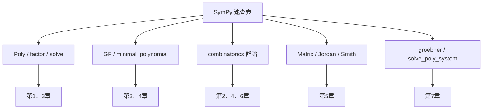

# 附錄A：SymPy 速查表

## 標題

本附錄彙整本書使用的 SymPy 代數 API。約定：

```python
import sympy as sp
x, y, z = sp.symbols('x y z')
```

## 多項式：Poly 與其方法（第 1、3 章）

| API | 說明 | 範例 |
|------|------|------|
| `sp.Poly(expr, x)` | 建立多項式物件 | `p = sp.Poly(x**3 - 2*x + 1, x)` |
| `p.all_coeffs()` | 由高次到低次的係數表 | `p.all_coeffs()` → `[1, 0, -2, 1]` |
| `p.degree()` | 次數 | `p.degree()` → `3` |
| `p.coeffs()` | 非零係數 | `sp.Poly(x**2 - 3, x).coeffs()` |
| `p.is_irreducible` | 在係數體上是否不可約 | `sp.Poly(x**2 + 1, x).is_irreducible` → `True` |
| `p.roots()` | 求根（回傳 dict） | `sp.Poly(x**2 - 1, x).roots()` |
| `p.div(q)` | 帶餘除法，回傳 (商, 餘) | `sp.Poly(x**2, x).div(x + 1)` |
| `p.gcd(q)`、`p.lcm(q)` | 最大公因式、最小公倍式 | `sp.Poly(x**2 - 1, x).gcd(x + 1)` |
| `p.subs(a)` | 求值 $`p(a)`$ | `p.subs(2)` |
| `p.set_domain('GF(p)')` | 改換係數域 | 見下文 GF |

## 因式分解與求根（第 1、3 章）

| API | 說明 | 範例 |
|------|------|------|
| `sp.factor(expr)` | 因式分解（預設在 $`\mathbb{Q}`$ 上） | `sp.factor(x**2 - 5*x + 6)` → `(x - 2)*(x - 3)` |
| `sp.factor(expr, modulus=p)` | 在 $`\mathbb{Z}_p`$ 上分解 | `sp.factor(x**2 + 1, modulus=2)` → `(x + 1)**2` |
| `sp.factor(expr, extension=sp.sqrt(2))` | 在擴張體上分解 | `sp.factor(x**2 - 2, extension=sp.sqrt(2))` |
| `sp.expand(expr)` | 展開合併同類項 | `sp.expand((x+1)**2)` |
| `sp.solve(eq, x)` | 解方程（`eq` 視為 $`= 0`$ ） | `sp.solve(x**2 - 5*x + 6, x)` → `[2, 3]` |
| `sp.roots(f, x)` | 根與重數的字典 | `sp.roots(x**3 - 1, x)` |
| `sp.solve([f1, f2], [x, y])` | 解聯立方程 | `sp.solve([x + y - 2, x - y], [x, y])` |
| `sp.checksol(eq, {x: val})` | 驗證解是否滿足方程 | `sp.checksol(x**2 - 4, {x: 2})` → `True` |
| `sp.nroots(f, n=15)` | 數值求根 | `sp.nroots(x**5 - x + 1, n=15)` |

## 有限體 GF 與多項式環（第 3、4 章）

| API | 說明 | 範例 |
|------|------|------|
| `sp.GF(p)` | 係數模 $`p`$ 的域 | `sp.Poly(x**2 + 1, x, domain=sp.GF(3))` |
| `domain=sp.GF(p, symmetric=False)` | 餘數取 $`0,\dots,p-1`$ | `sp.Poly(x + 4, x, domain=sp.GF(3, symmetric=False))` |
| `sp.Poly(f, x, modulus=p)` | 等價寫法 | `sp.Poly(x**2 + x + 1, x, modulus=2)` |
| `p.factor_list()` | 分解為 (領導係數, 因式串列) | `sp.Poly(x**3 + 1, x, modulus=2).factor_list()` |
| `sp.primitive_element(gens)` | 求本原元素（擴張體構造） | 見 4.7 節分圓體 |
| `sp.mod_inverse(a, p)` | 模反元素（ $`p`$ 質數即乘法逆） | `sp.mod_inverse(3, 7)` → `5` |
| `sp.is_primitive_root(a, p)` | 是否為模 $`p`$ 的本原根 | `sp.is_primitive_root(3, 7)` → `True` |

```python
# 有限體上的不可約性與分解
p = sp.Poly(x**3 + x + 1, x, domain=sp.GF(2))
p.is_irreducible          # True
```

## 極小多項式與代數數（第 3、4 章）

| API | 說明 | 範例 |
|------|------|------|
| `sp.minimal_polynomial(a, x)` | 代數數 $`\alpha`$ 的極小多項式 | `sp.minimal_polynomial(sp.sqrt(2), x)` → `x**2 - 2` |
| `sp.minimal_polynomial(a, x, domain=sp.QQ)` | 指定基礎體 | 同上 |
| `sp.minpoly` | 同義別名 | `sp.minpoly(sp.sqrt(2)+sp.sqrt(3), x)` → `x**4 - 10*x**2 + 1` |
| 乘法表矩陣 | SymPy 1.14 未提供內建函式，須以 `sp.Matrix` 配合 `sp.to_number_field` 自建 | 進階用法 |
| `sp.to_number_field(a, b)` | 把 $`\alpha`$ 表為 $`\mathbb{Q}(\beta)`$ 中的元素 | 見 4.2 節塔式定理 |
| `sp.is_algebraic_integer(a)` | 是否為代數整數 | `sp.is_algebraic_integer(sp.sqrt(2))` → `True` |
| `sp.totient(n)` | Euler $`\varphi`$ 函數（分圓多項式次數） | `sp.totient(5)` → `4` |
| `sp.cyclotomic_poly(n, x)` | 分圓多項式 $`\Phi_n`$ | `sp.cyclotomic_poly(5, x)` → `x**4 + x**3 + x**2 + x + 1` |

## Galois 群（第 4 章）

| API | 說明 | 範例 |
|------|------|------|
| `sp.polys.numberfields.galois_group(f, x)` | 求多項式（次數 $`\le 6`$ ）的 Galois 群 | 回傳一對 `(G, alt)` ， `alt` 為是否包含於 $`A_n`$ |
| `sp.Poly(f, x).galois_group()` | 等價的物件方法 | 同上 |
| `G.order()` | 群的階 | 範例見下 |

```python
from sympy.polys.numberfields import galois_group
f = x**3 - x - 1
G, alt = galois_group(f, x)
print(G.order())   # 6，此三次式的 Galois 群是 S_3
print(alt)         # False：S_3 不包含於 A_3
```

## 群論：sympy.combinatorics（第 2、4、6 章）

下表的 `sp.combinatorics.*` 需先 `import sympy.combinatorics` ，或直接 `from sympy.combinatorics import Permutation, PermutationGroup` 。

| API | 說明 | 範例 |
|------|------|------|
| `sp.combinatorics.Permutation` | 置換物件 | `Permutation(0 1 2)(3 4)` |
| `Permutation(list)` | 用像序列建構 | `Permutation([1, 2, 0])` 即 $`(0\,1\,2)`$ |
| `s.cycle_structure()` | 循環類型 | `Permutation(0 1 2).cycle_structure()` |
| `sp.combinatorics.PermutationGroup` | 置換群 | `PermutationGroup(Permutation(0 1), Permutation(1 2))` 即 $`S_3`$ |
| `G.order()` | 群的階（拉格朗日定理的計算基礎） | `G.order()` |
| `G.elements` | 全部元素 | 遍歷用 |
| `G.subgroup(gens)` | 生成子群 | `G.subgroup([g1, g2])` |
| `G.coset_transversal(H)` | 左陪集代表系 | 驗證 $`|G| = |H| \cdot [G:H]`$ |
| `G.orbits()` | 群作用的軌道（Burnside 引理） | 見 2.7 節 |
| `G.normal_closure(gens)` | 正規閉包 | Galois 理論中找正規子群 |
| `G.is_solvable` | 是否可解群 | 五次方程不可解性的驗證 |
| `G.derived_subgroup()` | 交換子群 $`[G, G]`$ | 可解性的塔式檢驗 |

內建群建構器（皆由 `sympy.combinatorics.named_groups` 匯入，回傳 `PermutationGroup` 物件）：

| API | 群 |
|------|------|
| `CyclicGroup(n)` | 循環群 $`C_n`$ |
| `DihedralGroup(n)` | 二面體群 $`D_n`$ （階 $`2n`$ ） |
| `SymmetricGroup(n)` | 對稱群 $`S_n`$ |
| `AlternatingGroup(n)` | 交代群 $`A_n`$ |
| `RubikGroup(n)` | 魔方群（有趣的例子， `RubikGroup(2)` 為 $`3\times3\times3`$ 魔方，階 $`3674160`$ ） |

```python
from sympy.combinatorics.named_groups import CyclicGroup
C3 = CyclicGroup(3)
[C3.order(), C3.is_abelian]   # [3, True]
```

## 矩陣與線性代數（第 5 章）

| API | 說明 | 範例 |
|------|------|------|
| `sp.Matrix([[1,2],[3,4]])` | 建立矩陣 | — |
| `A.det()` | 行列式 | — |
| `A.inv()` | 逆矩陣 | — |
| `A.rank()`、`A.rref()` | 秩、簡化列階梯形 | 解線性方程組 |
| `A.eigenvals()` | 特徵值與重數 | `A.eigenvals()` → `{2: 1, -1: 1}` |
| `A.eigenvects()` | 特徵值與特徵向量 | — |
| `A.charpoly(x)` | 特徵多項式（Cayley–Hamilton） | `A.charpoly(x).as_expr()` |
| `A.minimal_polynomial(x)` | 最小多項式（Frobenius 理論） | `A.minimal_polynomial().as_expr()` |
| `A.jordan_cells()` | Jordan 標準形的對角區塊 | 回傳 `(P, 區塊串列)` ，其中 $`A = P\,\mathrm{diag}(\text{區塊})\,P^{-1}`$ |
| `A.jordan_form()` | 同上（新版名稱） | 回傳 `(P, J)` 使 $`A = P J P^{-1}`$ |
| `A.diagonalize()` | 可對角化時回傳 `(P, D)` | — |
| `sp.linsolve((A, b), xs)` | 解 $`A\mathbf{x} = \mathbf{b}`$ | 無解回傳 `EmptySet` |
| `A.nullspace()`、`A.columnspace()` | 核空間、行空間基底 | 求同態的核與像 |

```python
A = sp.Matrix([[0, -1], [1, 0]])
P, cells = A.jordan_cells()
cells              # [Matrix([[-I]]), Matrix([[I]])]: 兩個 1×1 的 Jordan 區塊
P2, J = A.jordan_form()
J                  # Matrix([[-I, 0], [0, I]]): 拼裝後的 Jordan 矩陣
```

## 整數矩陣的不變量（第 5.6 節：主理想環上的模）

| API | 說明 | 範例 |
|------|------|------|
| `sp.matrices.normalforms.smith_normal_form(m)` | 整數矩陣的 Smith 標準形 | 有限交換群分解 |
| `sp.matrices.normalforms.invariant_factors(m)` | 不變量因子 | 直接給 $`\mathbb{Z}^n/\langle A \rangle`$ 的結構 |

```python
from sympy.matrices.normalforms import smith_normal_form, invariant_factors
A = sp.Matrix([[2, 0], [0, 3]])
smith_normal_form(A)      # diag(1, 6)
invariant_factors(A)      # (1, 6)：Z^2/<A> ≅ Z/6Z
```

有限交換群分類定理即由 Smith 標準形讀出： $`\mathbb{Z}^n / A\mathbb{Z}^n \cong \bigoplus_i \mathbb{Z}/d_i\mathbb{Z}`$ 。

## Groebner 基與交換代數（第 7 章）

| API | 說明 | 範例 |
|------|------|------|
| `sp.groebner(F, *gens, order='lex')` | 計算 Groebner 基 | 回傳 `GroebnerBasis` |
| `G.contains(f)` | $`f \in \langle F \rangle`$ ？ $`f`$ 須為 SymPy 物件（如 `sp.Integer(1)` ） | 理想成員問題 |
| `G.reduce(f)` | 以 $`G`$ 除 $`f`$ ，回傳 (商組, 餘式) | 餘式為 0 ⟺ 成員 |
| `G.polys` | Groebner 基的多項式串列（ `Poly` 形式） | 檢視結果 |
| `G.exprs` | Groebner 基的多項式（ `Expr` 形式） | 餵給 `solve_poly_system` |
| `G.gens` | 基底生成元 | `solve_poly_system` 的變數清單 |
| `G.is_zero_dimensional` | 是否零維（有限個解） | 判斷可否窮舉解 |
| `sp.solve_poly_system([f1, f2], x, y)` | 解多項式聯立方程 | 底層用 Groebner 基 |
| `sp.symmetrize(f, [x, y], formal=True)` | 對稱多項式表為基本對稱式 | 不變量環的生成元 |

```python
G = sp.groebner([x**2 - y, x*y - 1], x, y, order='lex')
[G.polys, sp.solve_poly_system(list(G.exprs), *G.gens)]   # 基與聯立解（3 組複數解）
```

## 特徵標與對稱函數（第 6 章）

| API | 說明 | 範例 |
|------|------|------|
| `sp.combinatorics.Partition` | 整數分割（楊圖） | `Partition([3, 1])` |
| `sp.functions.combinatorial.numbers.partition(n)` | 分割數 $`p(n)`$ | `partition(4)` → `5` |
| `sympy.utilities.iterables.partitions`、`sympy.polys.polytools.symmetric_poly` | 對稱函數基底（ $`s_\lambda`$ 等） | `S = sp.symmetrize` 進階見 6.5 節 |

## 數論小工具（全書通用）

| API | 說明 | 範例 |
|------|------|------|
| `sp.Rational(a, b)` | 精確有理數 | `sp.Rational(3, 4)` |
| `sp.prime(n)`、`sp.isprime(n)` | 質數表、質數判斷 | `sp.isprime(7)` → `True` |
| `sp.factorint(n)` | 質因數分解 | `sp.factorint(60)` → `{2: 2, 3: 1, 5: 1}` |
| `sp.divisor_count(n)` | 約數個數 | — |
| `sp.bernoulli(n)` | Bernoulli 數（正則質數檢驗） | `sp.bernoulli(10)` |
| `sp.sqrt(2)`、`sp.I`、`sp.E` | 常用常數 | — |

## mermaid：API 與章節對應總覽



## 常見陷阱

1. **浮點誤差**：一律用 `sp.Rational` 或整數，不要用 `0.5` 這類浮點字面值，否則 `factor`、`solve` 的精確性失效。
2. **`solve` vs `Poly.roots`**：`solve` 回傳串列（可能有重複根的表達式），`roots` 回傳「根: 重數」字典。
3. **`groebner` 的 order**：`lex` 適合消元求解，`grevlex` 通常計算最快。
4. **`jordan_cells` 回傳順序**：先 $`P`$ 後 $`J`$ ，且 $`A = P J P^{-1}`$ （不同教材約定可能相反）。
5. **GF 域**：`sp.GF(p)` 只支援 $`p`$ 質數； $`\mathbb{Z}_n`$ （ $`n`$ 合數）請用 `sp.Mod` 自行處理，或意識到那不是體。

---
[回到 README](README.md)
