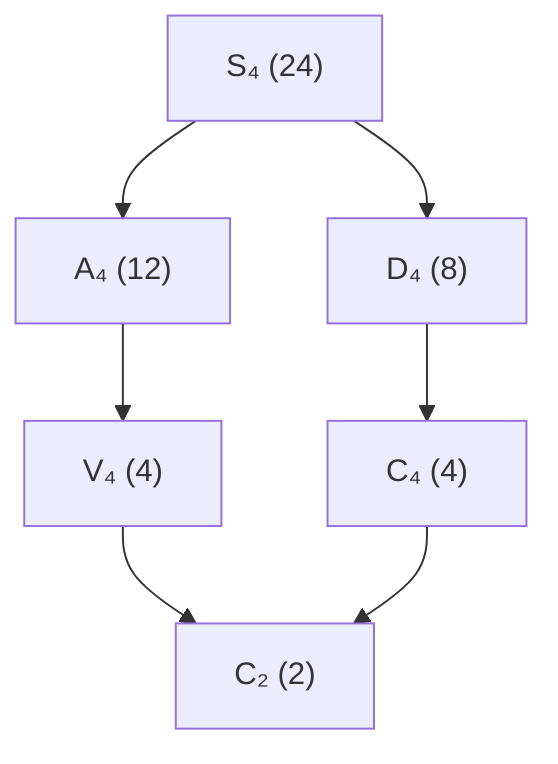

# 附錄B：群論常用群一覽

## 標題

本附錄彙整全書出現的常用群：階數、定義、重要性質與 SymPy 建構方式。以下 SymPy 建構均假定已執行：

```python
import sympy as sp
from sympy.combinatorics import Permutation, PermutationGroup
from sympy.combinatorics.named_groups import (CyclicGroup, DihedralGroup,
                                              SymmetricGroup, AlternatingGroup)
```

## 總覽表

| 群 | 記號 | 階 | 交換？ | 定義 | SymPy 建構 |
|------|------|------|------|------|------|
| 循環群 | $`C_n`$ | $`n`$ | ✓ | $`\mathbb{Z}/n\mathbb{Z}`$ 加法群 | `CyclicGroup(n)` |
| 二面體群 | $`D_n`$ | $`2n`$ | ✗ | 正 $`n`$ 邊形的對稱群 | `DihedralGroup(n)` |
| 對稱群 | $`S_n`$ | $`n!`$ | ✗ | $`n`$ 個元素的置換 | `SymmetricGroup(n)` |
| 交代群 | $`A_n`$ | $`n!/2`$ | ✓（ $`n \le 3`$ ），✗（ $`n \ge 4`$ ） | 偶置換 | `AlternatingGroup(n)` |
| 四元數群 | $`Q_8`$ | $`8`$ | ✗ | $`\{\pm1,\pm i,\pm j,\pm k\}`$ | `sp.Matrix` 表示或置換嵌入 |
| Klein 四元群 | $`V_4`$ | $`4`$ | ✓ | $`C_2 \times C_2`$ | `CyclicGroup(2)` 與自建 |
| 一般線性群 | $`GL(n, q)`$ | 見下 | ✗ | $`\mathbb{F}_q`$ 上可逆矩陣 | `sp.Matrix` + `sp.Mod` |
| 特殊線性群 | $`SL(n, q)`$ | 見下 | ✗ | 行列式為 $`1`$ 的矩陣 | 同上，過濾行列式 |
| 正交群 | $`O(n)`$ （實） | 無限 | ✗ | 保內積的實矩陣 | 象徵性建構（見 6.6 節） |
| 有限體加法群 | $`(\mathbb{F}_q, +)`$ | $`q`$ | ✓ | 向量空間加法 | $`q = p^n`$ ： $`C_p^n`$ |
| 有限體乘法群 | $`(\mathbb{F}_q^\times, \cdot)`$ | $`q-1`$ | ✓ | 非零元素的循環群 | 本原根生成 $`C_{q-1}`$ |
| 模 $`n`$ 乘法群 | $`(\mathbb{Z}/n\mathbb{Z})^\times`$ | $`\varphi(n)`$ | ✓ | 與 $`n`$ 互質的剩餘類 | 本原根 + 冪次 |
| 自由群 | $`F_r`$ | 無限 | ✗ | $`r`$ 個生成元、無關係 | 群同調（8.4 節）的範例 |
| 交錯特例 $`A_5`$ | $`A_5`$ | $`60`$ | ✗ | 最小非可解單群 | `AlternatingGroup(5)` |

上表的 `CyclicGroup`、`DihedralGroup`、`SymmetricGroup`、`AlternatingGroup` 皆是 `sympy.combinatorics.named_groups` 提供的類別，建構後即為 `PermutationGroup` 物件。

## 各群細節

### 循環群 $`C_n`$

- 定義： $`\langle g \mid g^n = 1 \rangle`$ ；同構於 $`\mathbb{Z}/n\mathbb{Z}`$ 。
- 性質：交換；唯一性質：每個子群皆為循環且階整除 $`n`$ （拉格朗日定理的最乾淨例子）； $`n`$ 為質數時是單群。
- 與方程的關聯： $`n`$ 次單位根 $`\{1, \zeta, \dots, \zeta^{n-1}\}`$ 在乘法下構成 $`C_n`$ （第 4 章分圓體）。

```python
C4 = CyclicGroup(4)
[C4.order(), C4.is_abelian]   # [4, True]
```

### 二面體群 $`D_n`$

- 定義：正 $`n`$ 邊形的對稱群， $`D_n = \langle r, s \mid r^n = s^2 = 1,\ srs = r^{-1} \rangle`$ ，階 $`2n`$ 。
- 性質：非交換（ $`n \ge 3`$ ）； $`C_n`$ 是其指數 $`2`$ 的正規子群； $`n = 3`$ 時 $`D_3 \cong S_3`$ 。
- SymPy 的置換表示取 $`r = (0\,1\,2\,\dots\,n-1)`$ 、 $`s = (0\,n-1)(1\,n-2)\cdots`$ 。

```python
D3 = DihedralGroup(3)
D3.order()        # 6
D3.is_abelian     # False
```

### 對稱群 $`S_n`$ 與交代群 $`A_n`$

- $`S_n`$ ：全體置換，階 $`n!`$ ；置換的循環類型決定共軛類（拉格朗日、第 2 章根的置換）。
- $`A_n`$ ：偶置換，階 $`n!/2`$ ，指數 $`2`$ 的正規子群。
- 關鍵事實： $`n \ge 5`$ 時 $`A_n`$ 是單群——這是五次方程無根式解的群論根源（第 4 章）。

```python
S4 = SymmetricGroup(4)
A4 = AlternatingGroup(4)
[S4.order(), A4.order(), A4.is_normal(S4)]   # [24, 12, True]
```

### 四元數群 $`Q_8`$

- 定義： $`\{\pm 1, \pm i, \pm j, \pm k\}`$ ，乘法 $`i^2 = j^2 = k^2 = ijk = -1`$ ，階 $`8`$ 。
- 性質：非交換；每個子群都正規（Hamilton 群的雛形）；無法嵌入 $`S_3`$ 等小置換群，常用 $`4\times 4`$ 複矩陣或 $`S_8`$ 中的置換嵌入表示。

```python
i, j = sp.I, sp.symbols('j')
# 用矩陣實現：i ↦ diag(i,-i), j ↦ [[0,1],[-1,0]]
I1 = sp.Matrix([[sp.I, 0], [0, -sp.I]])
J1 = sp.Matrix([[0, 1], [-1, 0]])
I1**2, J1**2, I1*J1   # 分別為 -I₂、-I₂、K = [[i,0],[0,-i]] 的負矩陣型元素
```

### Klein 四元群 $`V_4`$

- 定義： $`C_2 \times C_2`$ ，四個元素皆為 $`2`$ 階。
- 性質：最小非循環群； $`A_4`$ 的正規子群；特徵標群 $`\widehat{V_4} \cong V_4`$ （第 6 章習題）。

```python
from sympy.combinatorics import PermutationGroup
V4 = PermutationGroup(Permutation(0, 1)(2, 3), Permutation(0, 2)(1, 3))
V4.order()   # 4
```

### 矩陣群 $`GL(n, q)`$ 與 $`SL(n, q)`$

- $`GL(n, q)`$ ： $`\mathbb{F}_q`$ 上可逆 $`n \times n`$ 矩陣，階 $`|GL(n,q)| = (q^n - 1)(q^n - q)\cdots(q^n - q^{n-1})`$ 。
- $`SL(n, q)`$ ：行列式為 $`1`$ ； $`PSL(2, 7)`$ （階 $`168`$ ）是著名的最小非交錯單群之一。
- 有限體 $`\mathbb{F}_q`$ （ $`q = p^n`$ ）可用 $`\mathbb{Z}_p`$ 上的不可約多項式構造（3.7、4.7 節）。

```python
def GL2_q(q):
    elements = []
    for a in range(q):
        for b in range(q):
            for c in range(q):
                for d in range(q):
                    det = (a*d - b*c) % q
                    if det != 0:
                        elements.append(sp.Matrix([[a, b], [c, d]]))
    return elements

len(GL2_q(2))   # 6：GL(2,2) ≅ S_3
```

### 有限體加法群與乘法群

- $`(\mathbb{F}_q, +)`$ ： $`q`$ 階交換群； $`q = p^n`$ 時 $`\cong C_p^n`$ 。
- $`(\mathbb{F}_q^\times, \cdot)`$ ： $`q-1`$ 階**循環**群（有限體乘法群必循環），生成元即本原根。

```python
sp.is_primitive_root(3, 7)       # True，3 生成 F_7^×
[sp.Mod(3**k, 7) for k in range(1, 7)]   # 3, 2, 6, 4, 5, 1 —— 遍歷所有非零元
```

### 模 $`n`$ 乘法群 $`(\mathbb{Z}/n\mathbb{Z})^\times`$

- 階 $`\varphi(n)`$ ；交換；循環 ⟺ $`n = 1, 2, 4, p^k, 2p^k`$ 。
- RSA 密碼學的數學基礎（ $`e`$ 與 $`\varphi(n)`$ 互質保證可逆）。

```python
sp.totient(12)                    # 4
sorted(k for k in range(1, 12) if sp.gcd(k, 12) == 1)   # [1, 5, 7, 11]
```

## 群的包含關係與 Galois 對應視角



Galois 對應（4.5 節）把「子群鏈」與「中間體鏈」反轉對應： $`S_4 \supset A_4 \supset V_4 \supset C_2 \supset \{1\}`$ 對應四次方程的四層根式塔。上圖的反轉即體的塔式結構示意。

## 如何在 SymPy 中驗證群的性質

| 想驗證的性質 | 方法 |
|------|------|
| 封閉、結合 | 遍歷元素，檢查 `g*h` 仍在 `G.elements` |
| 單位元與逆元 | `G.identity`；`g ** -1` |
| 交換性 | `G.is_abelian` |
| 子群 | `H.is_subgroup(G)` |
| 正規性 | `H.is_normal(G)` |
| 陪集 | `G.coset_transversal(H)`，驗證 `|G| = |H| * [G:H]` |
| 商群階 | `$|G/H| = G.order() // H.order()` |
| 可解性 | `G.is_solvable` 或逐步取 `derived_subgroup()` |
| 共軛類 | `G.conjugacy_classes()`（特徵標表的行） |

## 階數與結構速查（小群）

| 階 | 群 | 備註 |
|------|------|------|
| 1 | $`\{1\}`$ | 平凡群 |
| 2 | $`C_2`$ | 質數階必循環 |
| 3 | $`C_3`$ | 同上 |
| 4 | $`C_4`$ 、 $`V_4`$ | 依結構定理唯一兩種 |
| 5 | $`C_5`$ | 質數階 |
| 6 | $`C_6`$ 、 $`S_3`$ | $`S_3`$ 是最小非交換群 |
| 7 | $`C_7`$ | 質數階 |
| 8 | $`C_8`$ 、 $`C_4 \times C_2`$ 、 $`C_2^3`$ 、 $`D_4`$ 、 $`Q_8`$ | 五種，三交換兩非交換 |
| 9 | $`C_9`$ 、 $`C_3 \times C_3`$ | 兩種皆交換 |
| 12 | $`C_{12}`$ 、 $`C_6 \times C_2`$ 、 $`D_6`$ 、 $`A_4`$ 、Dic $`_3`$ | $`A_4`$ 有正規 $`V_4`$ |
| 60 | $`C_{60}`$ 的多種、 $`A_5`$ | $`A_5`$ ：最小非可解單群 |

有限交換群的分類（2.5、5.6 節）由不變量因子給出：

```python
from sympy.matrices.normalforms import invariant_factors
invariant_factors(sp.Matrix([[2, 0], [0, 6]]))   # (2, 6) → Z/2 × Z/6
```

---
[回到 README](README.md)
