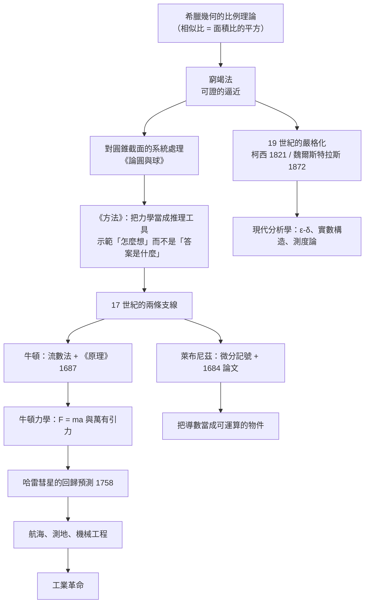

# 第 1 章 微積分的誕生：從窮竭法到極限

## 1.1 阿基米德窮竭法與方法學的確立（公元前 250 年）

### 學習動機

在 SymPy 之前，人類要回答「 $`1 + \frac{1}{4} + \frac{1}{16} + \cdots`$ 等於多少？」這個問題，只有兩條路：用筆算一堆項然後猜，或者——像阿基米德那樣，**先設計一個越來越窄的夾逼，再用「剩下的越來越小」這個事實來保證結論**。

阿基米德的「窮竭法」（method of exhaustion）正是這樣的夾逼。今天我們稱它為「夾擠定理」（squeeze theorem），柯西在 1821 年把它寫成不等式，魏爾斯特拉斯在 1872 年把它寫成 $`\varepsilon`$ - $`\delta`$ 語言（第 2 章的主題）。而阿基米德在公元前 250 年就已經在用同一套邏輯。

這一節要問三個問題：

1. **窮竭法到底做了什麼？** 它不是「近似」，而是**可證的近似**——這是西方數學的關鍵轉折。
2. **為什麼「可證性」如此重要？** 對照我們熟悉的「先定義再驗證」的分析學（第 2 章的主軸），看希臘人是如何在沒有極限定義的情況下取得同樣的嚴謹度。
3. **為什麼《方法》比《原理》更影響後世？** 阿基米德留下的不是答案，而是一套**可遷移的策略**。這也正是本書的主題：**每個時代的計算工具，決定了它能提出什麼問題**。

本節會用 SymPy 重做三件事：重算阿基米德的 96 邊形夾逼、符號驗證他的拋物線面積公式、以及示範「窮竭序列」如何無縫地接到現代的極限語言上。

---

### 1.1.1 希臘三難題：為什麼「不可解」是一個正式概念

古希臘人給幾何留下的三道硬題，通常稱為「希臘三難題」：

| 難題 | 內容 | 現代判定 |
|------|------|----------|
| 化圓為方 | 用尺規作一個面積等於給定圓的正方形 | **不可能**（1882 年，Lindemann–Weierstrass 定理） |
| 立方倍積 | 用尺規放大立方體使體積加倍 | **不可能**（同一條定理） |
| 三等分任意角 | 用尺規三等分一個任意給定的角 | **不可能**（Wantzel, 1837） |

這裡值得注意的是希臘人的用語。普魯塔克（Plutarch）在《敘事集·名人傳》中記載的米尼亞斯（Minias）之墓的軼事裡，敘述者說：亞歷山大大帝命令解這三題，並問那些嘲笑「不可解」的人，若只用「不可解」三個字打發他，未免太輕率了——因為在既有的前提下降確實不可能，但若由同一批人把問題重新表述，**未必不能找到某種合法的解法**。

這裡的 $`\alpha \delta \nu \alpha \tau o v`$ （àdu̇aton，不可能）是一個**技術性概念**，不是「我們還不知道」。它意味著：

> 在既有的前提與既定的工具（直尺與圓規）之下，沒有任何步驟序列能達成目標。

請把這個概念和今天 SymPy 的 `NotImplementedError` 對照：SymPy 在算不出極限時會**老老實實地回報無法完成**（我們在 1.3 節會看到它甚至會只給出一個界 `AccumBounds(-1, 1)`），而不是編一個答案出來。**承認不可解是一種智識成就**，希臘人比任何後世都更早把它制度化。

同一時期的埃拉托色尼（Eratosthenes，公元前 240 年左右）用兩座城市的日影差估出了地球周長，誤差不到 $`2\%`$ ——這說明「量測 + 近似 + 誤差意識」在阿基米德之前就已經存在了。**阿基米德新增的不是近似，而是可證性。**

---

### 1.1.2 窮竭法的機制：圓錐截面的求和逼近

阿基米德在《論圓與球》（*On the Sphere and Cylinder*）的命題 I.2 中，用一個精巧的「重心對稱」論證，把圓錐截面的面積比歸結為正方形的面積比。整個論證的核心是所謂的「**窮竭**」：對一個圖形 $`A`$ ，構造一串圖形

$$
A_1 \subset A_2 \subset A_3 \subset \cdots \subset A
$$

使得：

1. 每個 $`A_k`$ 都是**可以算出面積**的簡單圖形（圓錐截面的內接正多邊形）；
2. 每個 $`A_k`$ 都是 $`A`$ 的**內含**（或外含）；
3. 剩下的「縫隙」 $`A \setminus A_k`$ 的面積趨於 $`0`$ 。

一旦 (3) 被證明， $`A`$ 的面積就被「夾」出來了，因為任何介於 $`A_k`$ 與 $`A_{k+1}`$ 之間的數，都只能是 $`A`$ 的面積。

阿基米德在《方法》（*Methodus*）卷一命題 17 與 18 中，把這套機制用在拋物線段上，得到一個極為漂亮的結果：

> **拋物線段的面積，等於同底等高三角形面積的 $`\frac{4}{3}`$ 。**

我們用 SymPy 親手驗證這件事。取拋物線 $`y = 1 - x^2`$ ，弦從 $`(-1, 0)`$ 到 $`(1, 0)`$ 。弧上離弦最遠的點（也就是「頂點」）是 $`(0, 1)`$ ——這可以算出來：弦的方程是 $`(a+b)x + y - (1 + ab) = 0`$ ，弦上兩點橫標為 $`a, b`$ 時，拋物線上一點到弦的距離分子為 $`|(x-a)(x-b)|`$ ，在 $`[a, b]`$ 上於 $`x = \frac{a+b}{2}`$ 取最大值。

於是內接三角形的三個頂點是 $`P(a)`$ 、 $`P(b)`$ 、 $`P\!\left(\frac{a+b}{2}\right)`$ ，其中 $`P(t) = (t, 1-t^2)`$ 。SymPy 可以把這個三角形的面積**完全符號化**地算出來：

```python
import sympy as sp

a, b = sp.symbols('a b', real=True)
k = sp.symbols('k', integer=True, nonnegative=True)
x = sp.symbols('x', real=True)

def P(t):
    """拋物線 y = 1 - x^2 上的點。"""
    return sp.Point(t, 1 - t**2)

# 內接三角形：弦的兩端 P(a), P(b) 與拋物線弧的「頂點」P((a+b)/2)
tri = sp.Triangle(P(a), P(b), P((a + b) / 2))
print("內接三角形面積 =", sp.simplify(tri.area))
print("化簡成 (b-a)^3/8 :", sp.simplify(sp.expand(tri.area - (b - a)**3 / 8)) == 0)

# 窮竭：第 k 層加入的三角形面積總和為 (1/4)^k
S = sp.Sum(sp.Rational(1, 4)**k, (k, 0, sp.oo))
print("內接三角形面積總和 =", S.doit())
print("對照：現代積分 =", sp.integrate(1 - x**2, (x, -1, 1)))
print("與首個三角形之比 =", sp.simplify(S.doit() / sp.Triangle(P(-1), P(1), P(0)).area))
```

實際輸出：

```
內接三角形面積 = -a**3/8 + 3*a**2*b/8 - 3*a*b**2/8 + b**3/8
化簡成 (b-a)^3/8 : True
內接三角形面積總和 = 4/3
對照：現代積分 = 4/3
與首個三角形之比 = 4/3
```

三個數字值得逐一端詳：

- **面積**： $`\frac{(b-a)^3}{8}`$ ——這是「內接三角形面積只依賴弦長的三次方」這件事的精確敘述。弦越短，三次方讓「縫隙」迅速變小——這正是窮竭法能奏效的**定量原因**。
- **總和**： $`4/3`$ ——第 $`k`$ 層新加入的三角形面積總和是 $`\left(\frac{1}{4}\right)^k`$ 。推導：每往下一層，弦長減半（面積因而縮成 $`\frac{1}{8}`$ ），而三角形數目加倍，所以該層的總和是原來的 $`2 \times \frac{1}{8} = \frac{1}{4}`$ 倍。等比級數 $`\sum_{k \ge 0} 4^{-k} = \frac{1}{1 - 1/4} = \frac{4}{3}`$ 。
- **與首個三角形之比**： $`\frac{4}{3}`$ ——正是阿基米德的定理。三角形面積是 $`1`$ ，拋物線段面積是 $`\frac{4}{3}`$ 。

而最後那行 `對照：現代積分 = 4/3` 是本節的核心對照：**阿基米德用幾何窮竭得到的數字，與我們用 2400 年後的微積分算出的數字完全相同**。這不是巧合，而是因為兩者回答的是同一個問題——只是用的語言不同。

---

### 1.1.3 可證性：窮竭法與現代極限的正面對照

現在把兩種做法並排放在一起。現代分析學（第 2 章會正式處理）的極限定義是：

$$
\lim_{x \to a} f(x) = L \iff \forall \varepsilon > 0, \ \exists \delta > 0, \ \forall x \in \operatorname{dom} f: \ 0 < |x - a| < \delta \Rightarrow |f(x) - L| < \varepsilon
$$

阿基米德的窮竭法可以翻譯成一個等價的「餘項趨零」條件：

$$
\forall \varepsilon > 0, \ \exists k: \ \text{面積}\big(A \setminus A_k\big) < \varepsilon
$$

| 面向 | 窮竭法（公元前 250 年） | 現代極限（1872 年起） |
|------|------------------------|------------------------|
| 對象 | 面積、體積、長度 | 函數值 |
| 逼近工具 | 幾何圖形的序列（內接正多邊形） | 差商、級數 |
| 誤差控制 | 餘項面積可估 | $`\varepsilon`$ - $`\delta`$ 不等式 |
| 收斂的證明 | 相似比 + 三次方縮減 | 夾擠定理、柯西判別法 |
| 邏輯結構 | 幾何的（無需符號邏輯） | 邏輯的（需實數的 Dedekind 完备性） |
| 誰在「證明」 | 幾何論證本身就是證明 | 須先有實數理論（第 12 章） |

這張表裡最關鍵的一列是**最後一列**。阿基米德的窮竭法是**自足的**：他不需要「極限」這個概念，也不需要實數系的嚴格構造。他需要的是歐幾里得《幾何原本》卷十二命題 10 已經給他的工具——**相似圖形的面積比等於對應邊長比的平方**。這是一個關於比例的純幾何事實，卻足以支撐整個窮竭法。

而現代極限需要「 $`\varepsilon`$ - $`\delta`$ 」這種語言，因為極限定義是一個**邏輯量詞**的結構，只有在實數系被構造成 Dedekind 切割（第 12 章）之後才不至於循環論證。這就是為什麼柯西（1821）與魏爾斯特拉斯（1872）要花三千年把窮竭法「翻譯」成不等式：**不是因為窮竭法不嚴格，而是因為它用的那套嚴格性建立在一套不同的基礎上。**

用 SymPy 我們可以看見「餘項趨零」如何變成現代的誤差估計。半徑 $`1`$ 的圓，內接正 $`n`$ 邊形的面積是

$$
A(n) = \frac{n}{2}\sin\frac{2\pi}{n}
$$

它隨 $`n`$ 單調遞增而趨近 $`\pi`$ ，誤差以 $`n^{-2}`$ 的速度消失：

```python
import sympy as sp

# 符號 n 千萬不要加 integer 假設，否則 SymPy 的極限機制會算不出來
n = sp.symbols('n', positive=True)

A = sp.Rational(1, 2) * n * sp.sin(2 * sp.pi / n)   # 半徑 1 的圓，內接正 n 邊形的面積
print("lim A(n) =", sp.limit(A, n, sp.oo))
print("誤差的級數展開 =", sp.series(sp.pi - A, n, sp.oo, 3))
for m in [6, 12, 24, 48, 96]:
    print(f"n={m:3d}   A(n)={sp.N(A.subs(n, m), 12)}   pi-A(n)={sp.N(sp.pi - A.subs(n, m), 8)}")
```

實際輸出：

```
lim A(n) = pi
誤差的級數展開 = 2*pi**3/(3*n**2) + O(n**(-3), (n, oo))
n=  6   A(n)=2.59807621135   pi-A(n)=0.54351644
n= 12   A(n)=3.00000000000   pi-A(n)=0.14159265
n= 24   A(n)=3.10582854123   pi-A(n)=0.035764112
n= 48   A(n)=3.13262861328   pi-A(n)=0.0089640403
n= 96   A(n)=3.13935020305   pi-A(n)=0.0022424505
```

注意 `誤差的級數展開` 這一行： $`\pi - A(n) = \frac{2\pi^3}{3n^2} + O(n^{-3})`$ 。這是現代微積分給出的**定量誤差估計**，比阿基米德的定性論證（餘項面積趨於零）精確得多。阿基米德有「趨於零」，現代分析學有「以 $`O(n^{-2})`$ 的速度趨於零」，而第 13 章的數值分析會告訴我們：這類估計才是**可計算**的科學。

順帶一提，那行註解 `符號 n 千萬不要加 integer 假設` 是一個真實的 SymPy 陷阱：若把 `n` 宣告成 `integer=True`，`sp.limit(A, n, sp.oo)` 會錯誤地回傳 `0`，因為極限機制在整數符號上走了不同的分支。**工具也有自己的「前提」，正如阿基米德的窮竭法有「相似比」的前提。**

---

### 1.1.4 求圓面積與 $`\pi`$ 的近似：重算 96 邊形

在《度量圓》（*Measurement of the Circle*）中，阿基米德給出了兩個永垂不朽的結果：

1. **圓的面積**： $`\pi r^2`$ ，其中 $`\pi`$ 是圓周長與直徑的比值（希臘人寫作 $`\pi \varepsilon \rho \iota \varphi \varepsilon \iota \alpha`$ ，即「周長與直徑之比」這句話的頭字母）。
2. **上下界**： $`3 + \frac{10}{71} < \pi < 3 + \frac{1}{7}`$ ，即

$$
3 + \frac{10}{71} = \frac{223}{71} < \pi < \frac{22}{7}
$$

這兩個界的精度分別是約 $`0.03\%`$ 與 $`0.04\%`$ ——在沒有任何極限定理、只有尺規與相似比的條件下，這是了不起的成就。

阿基米德的做法是：從內接正六邊形開始（其半周長恰為 $`3`$ ，因為半徑 $`1`$ 的正六邊形邊長為 $`1`$ ），不斷把邊數加倍（ $`6 \to 12 \to 24 \to 48 \to 96`$ ），每一步都用畢氏定理構造出新的三角形。他留下的不是通用的代數公式，而是一串**嵌套根號**。我們今天可以用 SymPy 完整地重算一遍。

技術核心是半角公式

$$
\cos\frac{\theta}{2} = \sqrt{\frac{1 + \cos\theta}{2}}
$$

從 $`\cos\frac{\pi}{3} = \frac{1}{2}`$ 出發，反覆使用即可得到 $`\cos\frac{\pi}{6}, \cos\frac{\pi}{12}, \ldots, \cos\frac{\pi}{96}`$ 的精確嵌套根號形式。

```python
import sympy as sp

def polygon_bounds(k):
    """半徑 1 的圓：回傳內接與外切正 3*2^k 邊形的半周長（精確的嵌套根號）。"""
    c = sp.Rational(1, 2)          # cos(pi/3)
    n = 3
    for _ in range(k):
        c = sp.sqrt((1 + c) / 2)    # 半角公式 cos(theta/2) = sqrt((1+cos theta)/2)
        n *= 2
    s = sp.sqrt(1 - c**2)           # sin(pi/n)
    return n, n * s, n * s / c       # n、內接半周長(下界)、外切半周長(上界)

for k in range(0, 6):
    n, lo, hi = polygon_bounds(k)
    print(f"n={n:3d}   內接半周長={sp.N(lo, 12)}   外切半周長={sp.N(hi, 12)}")

n, lo, hi = polygon_bounds(5)
print("n =", n)
print("內接半周長 > 223/71 :", sp.simplify(lo - sp.Rational(223, 71)) > 0)
print("外切半周長 < 22/7   :", sp.simplify(sp.Rational(22, 7) - hi) > 0)
print("223/71 =", sp.N(sp.Rational(223, 71), 12), "  22/7 =", sp.N(sp.Rational(22, 7), 12))
```

實際輸出：

```
n=  3   內接半周長=2.59807621135   外切半周長=5.19615242271
n=  6   內接半周長=3.00000000000   外切半周長=3.46410161514
n= 12   內接半周長=3.10582854123   外切半周長=3.21539030917
n= 24   內接半周長=3.13262861328   外切半周長=3.15965994210
n= 48   內接半周長=3.13935020305   外切半周長=3.14608621513
n= 96   內接半周長=3.14103195089   外切半周長=3.14271459965
n = 96
內接半周長 > 223/71 : True
外切半周長 < 22/7   : True
223/71 = 3.14084507042   22/7 = 3.14285714286
```

幾點觀察：

- **六邊形**：當 $`k=1`$ 時內接半周長恰為 $`3`$ ，這正是阿基米德用來開始的六邊形。
- 每一層的內接與外切半周長都把 $`\pi`$ 夾在中間，且間距以大約 $`n^{-2}`$ 的速度收縮（ $`n=96`$ 時上下界只差 $`0.0017`$ ）。
- SymPy 用 `sp.simplify(... > 0)` 給出的是**精確的符號判斷**（`True` / `False`），而不是浮點比較。這一點非常重要：阿基米德的結論「 $`223/71 < \pi < 22/7`$ 」是**不等式**，必須用精確代數來證；用浮點數比較只能得到「大概成立」，那是另一種東西。

順帶一提，阿基米德發表的下界 $`\frac{223}{71}`$ 並非直接取自 96 邊形的內接值（那是 $`3.141031\ldots`$ ），而是他再取了一次有理數的「有理逼近」技巧，把內接值與外接值之間的縫隙榨到更細，得到 $`\frac{223}{71} = 3.140845\ldots`$ 。我們上面的程式只是**驗證**他的結論成立，並沒有重現他的那一步有理化技巧——這正好是留給習題的好題目。

---

### 1.1.5 Pericles 的《方法》：被冷藏一千八百年的教科書

阿基米德還寫過一本書，題目就叫《方法》（*Methodus*，全名是《阿基米德的方法》，拉丁文版流傳至今）。它的重要性在 1906 年才被發現：德國數學史家海因里希·海貝格（Heinrich Heiberg）發表了它的希臘文抄本（1897 年由耶路撒冷的一位抄寫員 Constantinos 抄寫在一卷羊皮紙上）。在此之前，這部著作**在歐洲完全無人知曉**。

《方法》的內容徹底不同於《論圓與球》。它不是給出結論，而是**示範如何得到結論**。裡面的手法包括：

1. **力學平衡法**：把圖形視為有重量的物體，懸掛或支撐在槓桿上，由**平衡條件**（力矩相等）反推面積或體積。
2. **浸入法**：把物體浸入液體，由排開的液體體積求物體體積（今日密度計的原理）。
3. **重心法**：求圖形的重心，再用重心的遷移來構造等式。

《方法》卷一命題 17 的經典論證就是：把拋物線段「掛」在槓桿上，讓它與一個三角形配重，然後把三角形挪到另一個位置，讓兩者恰好平衡；此時比較力矩，就得到「拋物線段面積 = 同底等高三角形面積的 $`\frac{4}{3}`$ 」。

**這是一種用物理（力學）來證明幾何結論的方法**，在方法論上極為激進：它等於說「自然界的守恆律可以拿來當公理」。今天我們會說這是「用物理直覺猜，再用數學證明」——這正是計算機輔助數學研究（computer-assisted proof）的先聲。

《方法》卷二命題 3 給出了一個更讓人吃驚的應用：求某種固體的比重，方法是把它浸入水裡，觀察排開的水量。這個「用排開體積求密度」的技巧今天叫**阿基米德原理**，是所有密度計與船舶噸位測量的基礎。

為什麼這本書會被冷藏一千八百年？因為它是**方法論的示範**，而不是**結論的清單**。而在此後的一千八百年裡，歐洲數學的主軸是繼承希臘幾何的「已知結果」體系（歐幾里得、托勒密、歐幾里得的《原本》譯本），**不需要**有人示範如何發現新結果。第 1.2 節會看到，當牛頓與萊布尼茲真的需要新工具時，他們是在**另一條傳統**（希臘化時期的坐標幾何與北歐的代數符號）中尋找武器的。

---

### 1.1.6 為什麼「方法」比「結論」更影響後世

阿基米德留下的兩樣東西，影響力極為不對稱：

| 阿基米德的產出 | 形式 | 後世影響 |
|----------------|------|----------|
| 圓面積 $`\pi r^2`$ 、 $`223/71 < \pi < 22/7`$ 、柱與球體積公式 | **結論** | 重要，但很快被更一般的公式取代（ $`\pi`$ 在 1600 年後已可算到任意位數） |
| 窮竭法、《方法》的力學平衡與浸入法 | **策略** | 決定了後世幾乎所有重大數學突破的**風格** |

所謂「風格」是指：當柯西要嚴格化極限時，他做的是窮竭法所隱含的事（把「趨近」寫成不等式）；當牛頓要處理運動中的瞬時變化時，他做的是《方法》所隱含的事（用流數法求「瞬時比」）；當拉普拉斯要計算天體軌道時，他做的是窮竭法所隱含的事（在有限精度下求面積的逼近）。**阿基米德的兩本書，其實是同一本書的兩面：一部給出武器，一部教會你怎麼打造武器。**

現在，我們可以画出這條因果鏈——它正是全書的主線：



這張圖有兩個閱讀方向：

- **橫向（往右）**：工具越來越強大，能問的問題越來越激进。阿基米德的窮竭法只能處理「靜態的圖形」；牛頓的流數法能處理「時間中的變化」；今天的 SymPy 能處理「符號量本身隨參數變化」。
- **縱向（往下）**：每一步都伴隨著**定義的嚴格化**。窮竭法不需要 $`\varepsilon`$ - $`\delta`$ ，但它需要「相似比」；極限需要 $`\varepsilon`$ - $`\delta`$ ，但它需要實數系。

而全書真正要說的，是那句被反覆呼應的話：

> **每個時代的計算工具，決定了它能提出什麼問題。**

| 時代 | 可用的計算工具 | 因此能提出的問題 | 當時的天花板 |
|------|----------------|------------------|--------------|
| 公元前 250 年 | 尺規、比例理論、窮竭法 | 圖形之間的精確比值 | 無法表達「變化率」 |
| 1600 年代 | 對數、坐標、符號代數 | 曲線的方程、可解的力學問題 | 缺乏把「趨近」形式化的語言 |
| 1687 年 | 微積分 | 萬有引力、行星運動、流體 | 運算規則靠直覺，缺乏公理基礎 |
| 1821–1872 年 | 極限、級數、 $`\varepsilon`$ - $`\delta`$ | 嚴格的定理 | 算力不足以做大規模符號運算 |
| 1950–1970 年代 | 電子計算機 | 數值分析、模擬、組合搜索 | 符號推理仍靠人手 |
| 今天 | SymPy 等 CAS | **可執行、可驗證、可重現的推理草稿** | 機器仍不會「定義」新概念 |

最後一行是本書存在的理由。SymPy 的極限、級數、微分、積分，全部都是 1872 年就已經存在的概念；但**把推理變成可執行的物件**，是計算機時代才有的能力。1.3 節將正式介紹這套語言，同時也會誠實地指出它的侷限：**SymPy 能算出極限，但它不會證明極限存在。**

---

### SymPy 練習

**練習 1.1.1（重現阿基米德的有理化技巧）**
由 `polygon_bounds` 得到的 96 邊形內接半周長 $`L`$ 與外切半周長 $`U`$ ，構造一個有理化的近似 $`q = \frac{2LU}{L + U}`$ （內外平均的變體； $`L`$ 、 $`U`$ 都是嵌套根號，SymPy 可代數化簡）。比較 $`q`$ 與 $`\pi`$ 的誤差，並判斷它是否落在 $`\frac{223}{71}`$ 與 $`\frac{22}{7}`$ 之間。注意：SymPy 只能對**有理數**做精確比較，若式中含 $`\pi`$ ，請改用 `sp.N` 估到 30 位再比較；也請說明為什麼「精確的不等式」與「30 位小數的比較」在邏輯上不是同一回事。

**練習 1.1.2（阿基米德的有理逼近 22/7）**
用 `sp.Rational` 構造 $`\frac{22}{7}`$ ，證明 $`\frac{22}{7} > \pi`$ 需要用到 $`\sin x < x < \tan x`$ 這類不等式；請改用**純多邊形**的方式：計算半徑 $`1`$ 的圓的內接與外切正 $`96`$ 邊形的**周長**（不是半周長），並用 `sp.simplify` 檢查外切周長與 $`\frac{22}{7} \cdot 2`$ 的關係。解釋為什麼阿基米德選的是**周長**而不是半周長（提示：他的 $`\pi`$ 定義是周長與直徑之比）。

**練習 1.1.3（窮竭的收斂速度）**
對內接正多邊形面積 $`A(n) = \frac{n}{2}\sin\frac{2\pi}{n}`$ ，用 `sp.series` 求出 $`\pi - A(n)`$ 的前三項展開，並用數值實驗驗證：當 $`n`$ 加倍時，誤差大約變成原來的 $`\frac{1}{4}`$ 。這與「面積誤差以 $`n^{-2}`$ 收斂」一致嗎？請用 $`n = 48`$ 與 $`n = 96`$ 的實際數字比對。

**練習 1.1.4（拋物線的窮竭，參數化版本）**
把 1.1.2 的拋物線改成 $`y = h(1 - x^2)`$ （高為 $`h`$ ），並把弦改成 $`[-b, b]`$ 。用 SymPy 證明：(a) 內接三角形面積為 $`\frac{(2b)^3}{8} = b^3`$ ；(b) 拋物線段面積為 $`\frac{4}{3}b^3`$ （用 `sp.integrate` 對照）；(c) 比值恆為 $`\frac{4}{3}`$ ，與 $`h`$ 和 $`b`$ 無關。這個「無關性」說明阿基米德定理是**相似性**的結果，而非巧合。

**練習 1.1.5（SymPy 版本的「不可解」報告）**
寫一個函數 `exhaustion(f, a, b, n)`，用數值方法把拋物線 $`y = 1-x^2`$ 在 $`[a,b]`$ 上分成 $`2^n`$ 段梯形，求面積近似，並比較它與 `sp.integrate` 的精確值。繪出誤差隨 $`n`$ 下降的速率（可用 `numpy` 或列印表格）。這裡的「夾逼」是用**梯形法**而非內接三角形，請說明為何梯形法的誤差是 $`O(n^{-2})`$ ——這與阿基米德的 $`O(n^{-2})`$ 巧合嗎？

---

### 小結

- 希臘三難題的「不可能」是一個**技術性概念**，與「還不知道」不同；SymPy 的 `NotImplementedError` 與 `AccumBounds` 是它的現代對應物。
- 窮竭法的三要素是：**內含（或外含）、可算、餘項趨零**。阿基米德用相似比證明第三點，因此整套論證是自足的，不依賴「極限」。
- 拋物線段面積 $`=`$ 同底等高三角形面積的 $`\frac{4}{3}`$ ，我們用 `sp.Triangle` 與 `sp.Sum` 符號化重現，並與 `sp.integrate` 對照得到同一數字。
- 阿基米德用半角公式的嵌套根號重算 96 邊形，得到並驗證了 $`\frac{223}{71} < \pi < \frac{22}{7}`$ ；SymPy 的**精確符號判斷**正是「可證性」的現代形式。
- 《方法》示範的是**策略**而非結論：力學平衡、浸入法、重心法。它被冷藏 1800 年，因為當時不需要「發現方法」。今天它的價值反而更高。
- 全書主線：**每個時代的計算工具決定了它能提出什麼問題**。窮竭法給出「可證的逼近」，微積分給出「變化率」， $`\varepsilon`$ - $`\delta`$ 給出「定義的嚴謹」，SymPy 給出「可執行的推理」。

下一節（1.2）我們從希臘跳到十七世紀，看兩個人如何在三十年間各自發明微積分，並為今天所用的記號吵了一場延續了三百年的官司。

### 本節 SymPy 新工具清單

| 工具 | 用途 | 例 |
|------|------|-----|
| `sp.Rational(a, b)` | 精確有理數 | `sp.Rational(223, 71)` |
| `sp.Point(x, y)` / `sp.Triangle` | 幾何物件與面積 | `sp.Triangle(P(a), P(b), P(m))` |
| `sp.Sum(expr, (k, 0, oo))` / `.doit()` | 無窮級數求值 | `sp.Sum(sp.Rational(1,4)**k, (k,0,sp.oo)).doit()` |
| `sp.summation(expr, (k, a, b))` | 級數求和 | `sp.summation(1/n**2, (n,1,sp.oo))` |
| `sp.limit(expr, x, a)` | 極限 | `sp.limit(A, n, sp.oo)` |
| `sp.series(expr, x, 0, k)` | 級數展開與誤差估計 | `sp.series(sp.pi - A, n, sp.oo, 3)` |
| `sp.simplify(式子 > 0)` | 精確的不等式判斷 | `sp.simplify(lo - sp.Rational(223,71)) > 0` |
| `sp.integrate(f, (x, a, b))` | 現代積分（對照用） | `sp.integrate(1 - x**2, (x, -1, 1))` |
