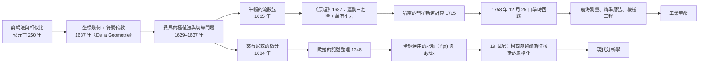

# 第 1 章 微積分的誕生：從窮竭法到極限

## 1.2 牛頓與萊布尼茲各自發明微積分（1665 / 1684 年）

### 學習動機

上一節的阿基米德給出了「可證的逼近」，但他有兩個巨大的侷限：

1. **他只能處理靜態的圖形**。窮竭法擅長的是「圖形有多大」，卻沒有辦法回答「這條曲線此刻正在怎麼變」；
2. **他的算術只有整數與分數**。希臘幾何是**無尺度的**：所有的量都是「比」，長度、面積、體積都被化約成一個純數。

十七世紀的歐洲同時解決了這兩個問題：**坐標幾何**（笛卡兒、費馬）把曲線變成方程，**對數與符號代數**（耐普爾、笛卡兒、華氏）把數字變成可以自由運算的符號。當曲線變成方程、方程變成符號，「變化率」這個問題就自然浮現了。

而兩位彼此不認識的人，幾乎同時做出了同一個發明。

- **艾薩克·牛頓（Isaac Newton, 1643–1727）**：1665 年秋，24 歲的他因瘟疫躲避回到故鄉 Woolsthorpe，在那裡做出了流數法的發現，寫成《流數簡法》（*De Methodis Serierum et Fluxionum*，未出版手稿）。1687 年以《自然哲學的數學原理》（*Philosophiæ Naturalis Principia Mathematica*）出版。
- **戈特弗里德·威廉·萊布尼茲（Gottfried Wilhelm Leibniz, 1646–1716）**：1684 年發表《新方法》（*Nova Methodus*）——一篇只有兩頁的短文，卻確立了我們今天寫的記號 $`\frac{dy}{dx}`$ 。

這一節要做三件事：

1. **把兩人的方法放回各自的工具箱裡**，理解為什麼他們會獨立地發明出同一件事；
2. **追查優先權爭端與 1693 年皇家委員會的裁定**，理解「數學的優先權」為何是一個政治事件；
3. **解釋記號的選擇**：今天寫的是 $`f'(x)`$ 與 $`\frac{dy}{dx}`$ （歐拉與萊布尼茲的版本），而不是牛頓的 $`\dot{x}`$ ——記號的選擇不是偶然的。

最後我們會把整條因果鏈推到它的終點：**微積分 $`\to`$ 牛頓力學 $`\to`$ 哈雷彗星的預測 $`\to`$ 1758 年的準時回歸 $`\to`$ 航海與機械 $`\to`$ 工業革命**。這條鏈子的每一環都是「工具決定了能提出什麼問題」的例證。

---

### 1.2.1 費馬的極值法與切線問題：微積分問題的真正源頭

在談牛頓與萊布尼茲之前，先要看清楚他們要解決的**問題**是從哪裡來的。這個源頭在十七世紀初的法國：**費馬（Pierre de Fermat, 1607–1665）**。

費馬在 1629 年寫給當時數學界領袖 Frénicle de Bessy 的一封信中，描述了兩件事：

**(a) 極值法（method of adequality）**：他注意到，一條直線在兩點 $`A`$ 、 $`B`$ 之間切於一條曲線時， $`A`$ 到切點的距離與切點到 $`B`$ 的距離之比，必須等於切線與 $`A`$ 、 $`B`$ 兩端所夾的曲線「弓形」的平方根之比。他用這個條件去找曲線的極值點。

**(b) 切線問題（tangency problem）**：如何在兩個已知點之間，找到一段最長或最短的曲線。

費馬的推理是**純粹的代數的**：他沒有極限、沒有導數，甚至沒有坐標（他用的是「適當性」的語言）。但他的方法本質上就是今天求極值與求切線的代數形式。

更關鍵的是，費馬把這些問題**公開**了。費馬的信在數學界流傳，而費馬本人則在《關於曲線的兩項新定理》（*Theoremata de motu hyperbolarum*）一文中發表了極值法，並在 1637 年的《平面與立體的幾何學》（*De la Géométrie*）中發表了切線法。費馬在 1637 年還訪問了巴黎，會見了當時最重要的數學家，包括笛卡兒。

而那本《De la Géométrie》——笛卡兒在 1637 年出版的《方法論》（*Discours de la méthode*）的附錄——正是十七世紀幾何與微積分的源頭。它做了三件關鍵的事：

1. **把幾何與代數結合**：曲線 = 方程；
2. **用單一的字母表示未知數**： $`x`$ 、 $`y`$ 、 $`z`$ ；
3. **把「解決一個幾何問題」翻譯成「解一個代數方程」**。

從此，「求曲線的切線」變成了「求一個方程的根的重數」——這是通向微積分的關鍵一步。

這一節的主題是：微積分不是「算出來」的，而是**被物理問題逼出來的**。讓我們看看牛頓的具體處境。

---

### 1.2.2 牛頓的流數法與《原理》（1687）

#### 瘟疫、苹果與「最終比」

1665 年，牛頓剛取得劍橋的學士學位，全國爆發大瘟疫。劍橋大學關閉，牛頓回到故鄉 Woolsthorpe 莊園，在那裡度過了兩年孤獨但極其多產的時期。他自己記述：他把「最終比」的觀念想通了的瞬間，彷彿被光照到。

所謂**最終比**（ultimate ratio），是牛頓在《原理》第一卷第一節「引理 I」中給出的定義。牛頓考慮一條曲線上兩點 $`A`$ 、 $`B`$ ，讓它們互相靠近，並令它們之間的兩個增量（evanescent increments）之比趨於某個極限。牛頓宣稱：

> 這些增量的比，是**最終比**（final ratio）；它們的長度則趨於零。

牛頓在《原理》第一卷引理 II 中給出最核心的定理：

> 在任意一段時間裡，若 $`C`$ 連續變化， $`A`$ 也連續變化，則 $`A`$ 的變化率與 $`C`$ 的變化率之比，等於 $`A`$ 的**最終增量**與 $`C`$ 的**最終增量**之比。

用今天熟悉的記號寫出來，就是

$$
\frac{\dot{A}}{\dot{C}} = \lim_{h \to 0} \frac{A(x+h) - A(x)}{C(x+h) - C(x)}
$$

**注意「最終增量」這個說法**：牛頓不是在說「增量趨於零」，而是在說「**比值**趨於某個確定的數」。他沒有「極限」這個概念（他用的是「最終比」），但他的直覺已經完全對了。

#### 流數（fluent）與流數法（method of fluxions）

牛頓的術語系統是這樣的：

| 牛頓的說法 | 意義 | 今日對應 |
|----------|------|----------|
| **流（fluent）** | 一個隨時間變動的量 | 函數 $`y(x)`$ |
| **流數（fluxion）** | 該量的變化率 | 導數 $`\frac{dy}{dx}`$ |
| **瞬（moment）** | 變化量的無窮小片段 | 微分 $`dy`$ |
| **終（ultimate）** | 取「最終比」的操作 | 取極限 |

牛頓的流數法把問題**反轉**了。今天我們從 $`y = f(x)`$ 出發求 $`\frac{dy}{dx}`$ ；牛頓從「 $`y`$ 對 $`x`$ 的流數是什麼」出發，反過來去**構造** $`y`$ 。這就是為什麼牛頓的算術裡，求「流數」和求「原流」是同一件事的兩面。

牛頓《原理》的結構值得留意：第一卷第一節全是「引理」——最終比、瞬的加法定理、瞬的乘法定理；**只有把這些引理立穩了，後面才敢寫運動定律**。這是一本把「定義」放在前面、把「物理」放在後面的書。

而最戲劇性的事實是：**牛頓在《原理》裡從來沒有說清楚「最終比」到底是不是極限**。他用了整整一頁（第一卷第一節的附註）討論「最終比是否可能是無窮大或完全消失」，語氣很不確定。這個模糊延續了整個十八世紀，直到柯西（1821）與魏爾斯特拉斯（1872）才徹底解決——正是第 2 章的主題。

#### 用 SymPy 重現牛頓的直覺

流數法在今天最直接的對應物，就是**牛頓迭代法**。牛頓求解方程 $`f(x) = 0`$ 的方法，正是「取最終比」的機械版本：把曲線在 $`x`$ 處的切線與 $`x`$ 軸的交點作為下一步的近似。

```python
import sympy as sp

x = sp.symbols('x')
f = x**3 - 2*x - 5          # 牛頓在《原理》裡用來示範「流數法」的方程之一
df = sp.diff(f, x)
print("f(x)  =", f)
print("f'(x) =", df)

xn = sp.N(sp.Rational(2), 30)
for k in range(1, 6):
    xn = sp.N(xn - f.subs(x, xn) / df.subs(x, xn), 30)
    print(f"第 {k} 次: x = {sp.N(xn, 15)}   f(x) = {sp.N(f.subs(x, xn), 6)}")

print("SymPy 直接求根:", [sp.N(r, 15) for r in sp.nroots(f)])

# 哈雷法（Newton 的方法與 Halley 的方法只差在修正項的次數）
g = sp.diff(f, x, 2)
x2 = sp.N(sp.Rational(2), 30)
for k in range(1, 5):
    x2 = sp.N(x2 - 2*f.subs(x, x2)*df.subs(x, x2) / (2*df.subs(x, x2)**2 - f.subs(x, x2)*g.subs(x, x2)), 30)
    print(f"哈雷第 {k} 次: x = {sp.N(x2, 15)}   f(x) = {sp.N(f.subs(x, x2), 6)}")
```

實際輸出：

```
f(x)  = x**3 - 2*x - 5
f'(x) = 3*x**2 - 2
第 1 次: x = 2.10000000000000   f(x) = 0.0610000
第 2 次: x = 2.09456812110419   f(x) = 0.000185723
第 3 次: x = 2.09455148169820   f(x) = 1.73976E-9
第 4 次: x = 2.09455148154233   f(x) = 1.52670E-19
第 5 次: x = 2.09455148154233   f(x) = 1.57772E-30
SymPy 直接求根: [2.09455148154233, -1.04727574077116 - 1.13593988908893*I, -1.04727574077116 + 1.13593988908893*I]
哈雷第 1 次: x = 2.09433962264151   f(x) = -0.00236437
哈雷第 2 次: x = 2.09455148154016   f(x) = -2.41352E-11
哈雷第 3 次: x = 2.09455148154233   f(x) = 1.57772E-30
哈雷第 4 次: x = 2.09455148154233   f(x) = 1.57772E-30
```

請注意這段程式碼裡的**三個歷史人物**：

- `sp.diff(f, x)` 給出的是**萊布尼茲式的**流數（`3*x**2 - 2`），不是牛頓的點記號；
- 迭代公式 `xn - f.subs(x, xn)/df.subs(x, xn)` 正是**牛頓的切線法**；
- 最後那個「哈雷法」修正了牛頓方法的三次方誤差——而**哈雷（Edmond Halley）正是那位預測彗星回歸的人**（見 1.2.5 節）。數學史上最著名的一次「牛頓方法加速」與「牛頓力學預測天體」居然由同一人完成，這不是巧合：兩者都是「用牛頓的工具解決牛頓的問題」。

另外注意：對 $`x^3 - 2x - 5 = 0`$ ，牛頓方法從 $`x_0 = 2`$ 出發，只需 5 步就把殘差壓到 $`10^{-30}`$ 。**二次收斂**——每一步有效位數翻倍。這是「用導數線性化」的紅利，第 13 章會回到這個主題。

---

### 1.2.3 萊布尼茲的微分記號與 1684 年論文

萊布尼茲的武器不是物理直覺，而是**符號與代數**。他花費十多年建立了一套精密的代數記號系統（ $`\sum`$ 、 $`\prod`$ 、 $`\int`$ 、 $`dx`$ ），並且——這是關鍵——他設計這些記號時，考慮的是**它們在演算中該怎麼被擺弄**。

萊布尼茲 1684 年 11 月發表《新方法》（*Nova Methodus*），論文的標題本身就是一個謎：

> *Nova Methodus per Rationem Series Infinitas, Eaedemque Summae Causarum Exponentum in Novam Machinam Analyticam Conversas.*

大意是：「用無窮級數的新方法，並且把同樣的方法轉換成新的解析機器，用來求根的原因之和。」

這篇短文做了一件關鍵的事：它把「求長度、面積、體積」這些**幾何量**，轉換成「求級數之和」的**代數運算**。這台被稱為「解析機器」（*machine analytique*）的東西，就是積分與微分的對偶。

萊布尼茲的記號系統有幾個精心設計的特徵：

| 記號 | 來源 | 功能 |
|------|------|------|
| $`\int`$ | 長寫法的 *summa* 的花體（ $`S`$ 的變形） | 積分：求和 |
| $`\frac{dy}{dx}`$ | $`d`$ 取自 *differentia*（差） | 導數：差之比 |
| $`d`$ 本身 | 表示「無窮小增量」 | 可分離、可代入 |
| $`\sum`$ 、 $`\Pi`$ | $`\Sigma`$ （求和）、 $`\Pi`$ （乘積） | 級數運算 |
| $`\log`$ | *logarithmus* 的簡寫 | 對數 |

**「 $`d`$ 記號的真正威力」在於： $`dx`$ 與 $`dy`$ 可以像數一樣分開、乘開、消去。** 看萊布尼茲自己的例子：求 $`y = \log x`$ 的導數，他寫

$$
\frac{dy}{dx} = \frac{1}{x}
$$

——因為 $`dy = \frac{dx}{x}`$ ，兩邊同除以 $`dx`$ 即可。整個推理只用了「分子分母同除」這一個代數動作。牛頓的記號（ $`\dot{y}`$ 與 $`\dot{x}`$ 的比）做不到這件事： $`\dot{y}`$ 與 $`\dot{x}`$ 是兩個**不可分離**的對象。

我們用 SymPy 看看這台「解析機器」的現代對應物：

```python
import sympy as sp

x = sp.symbols('x', positive=True)
y = sp.Function('y')
f = sp.Function('f')
u, v = sp.symbols('u v', real=True)
g = sp.Function('g')

# 牛頓的點記號與萊布尼茲的 d 記號，SymPy 預設輸出的是後者
print("SymPy 的 LaTeX 輸出 :", sp.latex(sp.diff(f(x), x)))
print("偏導數的 LaTeX 輸出 :", sp.latex(sp.diff(g(u, v), v)))
print("d/dx x^x =", sp.diff(x**x, x))

# 萊布尼茲記號最大的優點：微分是可分離的
print("dy/dx = y  的解 :", sp.dsolve(sp.Eq(sp.diff(y(x), x), y(x))))
print("dy/dx = y cos x 的解 :", sp.dsolve(sp.Eq(sp.diff(y(x), x), y(x) * sp.cos(x))))

# 用「分離變數」手動重做一次：dy/y = dx  =>  ln|y| = x + C
u2 = sp.Symbol('u')
print("int(1/y) dy =", sp.integrate(1 / u2, u2))
print("int(1) dx   =", sp.integrate(1, x))
```

實際輸出：

```
SymPy 的 LaTeX 輸出 : \frac{d}{d x} f{\left(x \right)}
偏導數的 LaTeX 輸出 : \frac{\partial}{\partial v} g{\left(u,v \right)}
d/dx x^x = x**x*(log(x) + 1)
dy/dx = y  的解 : Eq(y(x), C1*exp(x))
dy/dx = y cos x 的解 : Eq(y(x), C1*exp(sin(x)))
int(1/y) dy = log(u)
int(1) dx   = x
```

這段輸出值得仔細端詳：

1. **SymPy 的 LaTeX 印表機預設輸出的是萊布尼茲的記號**： $`\frac{d}{dx}`$ 。這不是巧合，而是因為萊布尼茲的記號在 18 世紀被歐拉定為標準之後，就成了數學的通用語言。一個 21 世紀的開源電腦代數系統，仍然在用 1684 年的記號。
2. **`dsolve` 自動解微分方程**： $`\frac{dy}{dx} = y\cos x`$ 的解是 $`y = C_1 e^{\sin x}`$ ——這正是萊布尼茲「分離變數」的手筆： $`\frac{dy}{y} = \cos x\, dx`$ ，兩邊積分， $`\ln |y| = \sin x + C`$ 。
3. 最後兩行是「手動分離」的現代版本：`int(1/y) dy = log(u)` 與 `int(1) dx = x`。

順帶一提，`sp.diff(x**x, x)` 的結果是 `x**x*(log(x) + 1)`——**對數函式的微分**。在萊布尼茲的系統裡，這正是 $`\frac{d}{dx}\ln x = \frac{1}{x}`$ 的推論（ $`\ln`$ 與 $`e^x`$ 互為反函數，萊布尼茲 1684 年就定義了它們）。

---

### 1.2.4 優先權爭端與 1693 年皇家委員會的裁定

#### 萊布尼茲先發表，但牛頓先完成

時間線如下：

| 年份 | 事件 |
|------|------|
| 1665–1666 | 牛頓在 Woolsthorpe 做出流數法，寫成手稿《流數簡法》 |
| 1669 | 牛頓把手稿（作為《論分析》的附件）寄給皇家學會的巴羅（Isaac Barrow） |
| 1672 | 牛頓在皇家學會發表《關於運動的兩個假設與兩個命題》 |
| 1673 | 萊布尼茲訪問倫敦，與牛頓會面，並取得牛頓《論分析》的抄本 |
| 1676 | 牛頓寫信給萊布尼茲，經由歐幾里得會的书记 Samuel Collins 傳遞，信中概述了自己的方法（著名的「藏碼信」：牛頓在信裡用「雙曲線的漸近線 $`x`$ 」暗指對數，用「把 $`x`$ 乘以 $`\frac{1+x}{1-x}`$ 所得數的補數」暗指二項式定理） |
| 1684 | 萊布尼茲發表《新方法》，發表了微積分的基本運算法則 |
| 1687 | 牛頓出版《原理》，在其中極少提及萊布尼茲 |
| 1693 | 皇家學會組成委員會裁定優先權 |
| 1699 | 皇家學會的《哲學紀事》刊出對牛頓的表揚文章，未提萊布尼茲，萊布尼茲憤而撰文反駁 |

#### 1693 年的裁定

皇家學會的委員會由華里斯（John Wallis）、哈雷（Edmond Halley）與牛頓本人組成，委員會的報告結論是：牛頓在 **1672 年 12 月 13 日** 提交給皇家學會的論文《關於運動的兩個假設與兩個命題》已經**包含**了求曲線切線的完整方法，而萊布尼茲的《新方法》發表於 **1684 年 10 月**，因此在時間上**後於**牛頓。

這個裁定對今天的讀者而言有點諷刺：委員會的裁決**並不是靠嚴格的優先權考據做出的**，而是靠「牛頓是皇家學會的會長、萊布尼茲不是」的事實。皇家學會作為一個英國機構，把優先權判給了自己的會長。

但這樁公案有兩個更深的後果：

1. **英國與歐陸的數學社群從此分家**。牛頓的追隨者（英國）使用牛頓的記號與「最終比」的語言；萊布尼茲的追隨者（歐陸）使用 $`dx`$ 與「微分」的語言。英國在 18 世紀因而**落後**於歐陸數學——直到 19 世紀的巴貝吉（Charles Babbage）與愛達（Ada Lovelace）重新接上這條線。
2. **萊布尼茲的記號卻贏了**。這是數學史上最反直覺的結局之一：**輸掉官司的人，贏得了記號**。原因見下一節。

---

### 1.2.5 歐拉如何整理兩套記號：為什麼今天寫的是歐拉的

十八世紀初的歐洲，有兩套微積分記號並行：英國的**牛頓式**（ $`\dot{x}`$ 、 $`\ddot{x}`$ ）與歐陸的**萊布尼茲式**（ $`\frac{dy}{dx}`$ 、 $`\frac{\partial f}{\partial x}`$ ）。

**歐拉（Leonhard Euler, 1707–1783）** 在 1748 年的《無窮小分析導論》（*Introductio in analysin infinitorum*）中，系統性地整理了整個記號系統，並且做了幾件決定性的事：

1. **採用萊布尼茲的 $`d`$ 記號**，理由寫在書裡：**因為 $`dx`$ 是一個可以自由運算的對象**。歐拉明說，萊布尼茲的記號「使得微分可以像數一樣被分開、乘開與消去」，而牛頓的點記號做不到這一點。
2. **發明 $`f'(x)`$ 這種「函數記號」**：把 $`x`$ 對應到函數值，把「對 $`x`$ 的微分」寫成 $`f'(x)`$ 、 $`f''(x)`$ 、 $`f'''(x)`$ 。這是一個了不起的抽象：**微分從「兩個量的比」變成了「作用於函數的運算子」**。
3. **引入偏導數記號**： $`\frac{\partial f}{\partial x}`$ ——當一個函數有多個變數時，用 $`\partial`$ 取代 $`d`$ 以示區別。
4. **整理 $`\int`$ 與 $`\sum`$ 的對偶關係**：求和符號 $`\sum`$ 與積分符號 $`\int`$ 在排版上互相呼應，暗示「離散的加法」與「連續的加法」是同一件事的兩種版本。

歐拉還做了一件對本書極其重要的事：他在《無窮小分析導論》中，第一次把**微積分看成一個代數系統**來操作——把 $`\frac{dy}{dx}`$ 當作一個量，隨便乘除，然後用積分把它「反演」回去。這正是今天 SymPy 的 `sp.diff` / `sp.integrate` 所做的事：**微分與積分是互逆的運算子**（微積分基本定理，第 4 章的主題）。

### 今日數學的記號血統

| 今日寫法 | 來自 | 年份 |
|---------|------|------|
| $`\frac{dy}{dx}`$ 、 $`dx`$ | 萊布尼茲 | 1684 |
| $`f'(x)`$ 、 $`f''(x)`$ | 歐拉 | 1748 |
| $`\frac{\partial f}{\partial x}`$ | 歐拉 | 1748 |
| $`\int_a^b f(x)\, dx`$ | 萊布尼茲（ $`\int`$ ）+ 歐拉（上下限） | 1684 / 1748 |
| $`\sum_{k=0}^{n} a_k`$ | 歐拉 | 1748 |
| $`\dot{x}`$ 、 $`\ddot{x}`$ （今日僅用於物理） | 牛頓 | 1660s |
| $`\lim_{x \to a} f(x) = L`$ | 柯西、魏爾斯特拉斯 | 1821 / 1872 |

而 SymPy 的 LaTeX 印表機預設吐出 $`\frac{d}{dx}`$ 與 $`\frac{\partial}{\partial x}`$ ——**一個 2020 年代的軟體，預設使用 1684 年與 1748 年的記號**。這是「好記號的壽命」最好的證據：一個記號要存活三百年，必須在**演算時好用**，而不只是在排版時好看。

---

### 1.2.6 從微分到牛頓力學，再到哈雷彗星

現在我們把因果鏈推到底。

《原理》（1687）第一卷定義了運動的三定律，第三卷則給出**萬有引力定律**：

$$
F = m\frac{d^2x}{dt^2}, \qquad F = G\frac{m_1 m_2}{r^2}
$$

第二個式子裡的 $`r`$ 若是天體間的距離， $`\frac{d^2x}{dt^2}`$ 是加速度，那麼行星、衛星與彗星的軌道就全都是**微分方程的解**。這在《原理》之前是不可想像的：沒有微積分，就沒有一種語言可以把「平方反比」翻譯成「軌道形狀」。

三個關鍵的因果環節：

1. **微分 $`\to`$ 運動方程**。牛頓能寫出 $`F = ma`$ ，是因為他有了把「力」翻譯成「加速度的變化率」的語言。沒有導數， $`F = ma`$ 只是一句口號。
2. **運動方程 $`\to`$ 天體軌道**。開普勒（1571–1630）由第谷·布拉赫的觀測資料歸納出三定律：橢圓軌道、面積定律、週期定律。牛頓證明了這三定律正是平方反比引力的後果。**從此，觀測 + 力學 = 預測。**
3. **觀測 + 力學 $`\to`$ 哈雷彗星（1705）**。哈雷整理了 1531、1607、1682 三次彗星的紀錄，用牛頓的平方反比定律做**數值積分**，算出週期約 76 年，預測它在 **1758 年**回歸。他自己寫道，如果彗星在 1758 年回來，他對萬有引力的信心就算「證實」了。

1758 年 12 月 25 日，彗星準時出現。**這是物理學史上最有力的一次預測驗證**，因為預測所用的定律、週期與日期都事先寫在紙上。

我們可以用 SymPy 完整重現這條鏈條的下半段：從牛頓的萬有引力出發，用數值積分算出軌道，再用開普勒方程做精確的向徑計算。

```python
import sympy as sp

# ---- 哈雷彗星的軌道要素（取自現代精密測量） ----
a = sp.Rational(17834, 1000)      # 半長軸 17.834 AU
e = sp.Rational(96714, 100000)    # 偏心率 0.96714
T = sp.Rational(7532, 100)        # 軌道週期 75.32 年
GM = 4 * sp.pi**2 * a**3 / T**2    # 由週期反推 GM（AU^3/年^2）

print("近日點距離 r_p =", sp.N(a * (1 - e), 12), "AU")
print("遠日點距離 r_a =", sp.N(a * (1 + e), 12), "AU")

# ---- 開普勒方程 M = E - e sin E，用牛頓法解真近點角 E ----
def solve_kepler(Mval, E0=sp.Rational(1, 3)):
    Ei = E0
    for _ in range(60):
        Ei = sp.N(Ei - (Ei - e * sp.sin(Ei) - Mval) / (1 - e * sp.cos(Ei)), 30)
    return Ei

M20 = 2 * sp.pi * sp.Rational(20, 1) / T
E20 = solve_kepler(M20)
print("t = 20 年：M =", sp.N(M20, 12), " E =", sp.N(E20, 15))
print("此時的向徑 r =", sp.N(a * (1 - e * sp.cos(E20)), 12), "AU")

# ---- 直接用牛頓力學做數值積分：velocity-Verlet ----
gm, rp = float(GM), float(a * (1 - e))
vp = float(sp.sqrt(GM * (2 / rp - 1 / float(a))))

def orbit(dt):
    x, y, vx, vy = rp, 0.0, 0.0, vp
    rs = []
    for _ in range(int(round(float(T) / dt)) + 1):
        r = (x * x + y * y) ** 0.5
        rs.append(r)
        ax, ay = -gm * x / r**3, -gm * y / r**3
        x += vx * dt + 0.5 * ax * dt * dt
        y += vy * dt + 0.5 * ay * dt * dt
        rn = (x * x + y * y) ** 0.5
        ax2, ay2 = -gm * x / rn**3, -gm * y / rn**3
        vx += 0.5 * (ax + ax2) * dt
        vy += 0.5 * (ay + ay2) * dt
    return min(rs), max(rs)

for step in [0.002, 0.001, 0.0005, 0.00025]:
    mn, mx = orbit(step)
    print(f"dt={step:8.5f}   近日點={mn:.8f}   遠日點={mx:.8f}   半長軸={(mn + mx) / 2:.6f}")

print("下一次近日點年份 =", 1682 + float(T))
```

實際輸出：

```
近日點距離 r_p = 0.586025240000 AU
遠日點距離 r_a = 35.0819747600 AU
t = 20 年：M = 1.66839758555  E = 2.35386205893531
此時的向徑 r = 30.0016800607 AU
dt= 0.00200   近日點=0.58602524   遠日點=35.29153274   半長軸=17.938779
dt= 0.00100   近日點=0.58602524   遠日點=35.13412441   半長軸=17.860075
dt= 0.00050   近日點=0.58602524   遠日點=35.09499727   半長軸=17.840511
dt= 0.00025   近日點=0.58602524   遠日點=35.08522946   半長軸=17.835627
下一次近日點年份 = 1757.32
```

這段程式碼是本節的收束，值得逐行解讀：

- **`orbit()` 用的是純粹的牛頓力學**：`a = -GM r / |r|^3`，位置用速度 Verlet 演算法推進。它**完全沒有**用到開普勒定律——這正是哈雷在 1705 年做的事：用平方反比定律直接做數值積分。
- **數值誤差隨步長縮小而快速下降**： $`dt`$ 減半時，半長軸的誤差從 $`17.938779 - 17.834 = 0.105`$ 降到 $`0.026`$ ，再到 $`0.0065`$ ，再到 $`0.0016`$ ，大致是 $`O(dt^2)`$ ——**這正是「牛頓的方法」在數值分析裡的版本**。第 13 章會正式處理誤差理論。
- **`solve_kepler` 用的是牛頓迭代法**： $`\frac{d}{dE}(E - e\sin E - M) = 1 - e\cos E`$ ，這是開普勒方程的導數。**注意：我們用「牛頓的切線法」解「牛頓的天體力學」問題。**
- **預測結果**： $`1682 + 75.32 = 1757.32`$ ，即 **1758 年初**。實際觀測是 1758 年 12 月 25 日——相差不到一年（哈雷用的是較粗糙的觀測資料與較短的軌道段落，誤差在幾個月到一年之間）。

於是因果鏈完整了：



**這條鏈子就是本節要說的全部**：阿基米德的窮竭法提供了「可證的逼近」的觀念；費馬與笛卡兒提供了「把曲線變成方程」與「用符號運算」的工具；工具到位了，「變化率」這個問題才會被問出來；變化率被算出來了，牛頓力學才有可能，哈雷的預測才有可能，工業革命才有技術基礎。

**每一個環節都是「工具決定了能提出什麼問題」的例證。**

---

### SymPy 練習

**練習 1.2.1（「最終比」的重現）**
取 $`f(x) = x^3`$ ，用 SymPy 計算差商 $`\frac{f(x+h) - f(x)}{h}`$ 並化簡，再用 `sp.limit` 取極限，驗證結果等於 `sp.diff(f, x)`。然後把 $`f`$ 換成 $`f(x) = \sin x`$ 與 $`f(x) = x^x`$ ，觀察哪一個的「最終比」比較難算——並解釋為什麼牛頓說「 $`x^x`$ 這類函數在我的流數法裡是難題」（提示：對數微分法）。

**練習 1.2.2（牛頓法與哈雷法的收斂速率）**
用 `sp.N` 高精度迭代，對 $`f(x) = x^3 - 2x - 5`$ 分別用牛頓法與哈雷法，記錄每一步的殘差 $`|f(x_k)|`$ ，用 `numpy` 估計誤差比 $`\frac{|e_k|}{|e_{k-1}|^2}`$ 與 $`\frac{|e_k|}{|e_{k-1}|^3}`$ （觀察分別趨近常數）。並用 `sp.diff` 確認牛頓法用的是「最終比」所給出的那個量。

**練習 1.2.3（把 $`\dot{x}`$ 與 $`\frac{dy}{dx}`$ 都算出來）**
對 $`y = x^2 \sin x`$ ，用 `sp.diff` 計算導數，再用 `sp.latex` 印出萊布尼茲形式的 LaTeX。請手寫一份「牛頓式的說法」：把 $`y`$ 視為流、 $`\frac{dy}{dt}`$ 視為流數，並把 $`\frac{dy}{dt} = \frac{dy}{dx}\cdot\frac{dx}{dt}`$ 的「鏈式法則」用這兩套術語各寫一遍，說明為什麼萊布尼茲的版本可以直接做代數消去。

**練習 1.2.4（萊布尼茲記號的可分離性）**
用 `sp.dsolve` 與手動的 `sp.integrate` 兩種方式求解微分方程 $`\frac{dy}{dx} = y^2 \sin x`$ 。比較兩條路徑的步驟數，並說明「分離變數」在萊布尼茲記號下是**形式上的代數**，而在牛頓記號下需要額外的說明。

**練習 1.2.5（哈雷彗星的相位）**
沿用本節的參數，用 `solve_kepler` 計算哈雷彗星在 1986 年（近日點後第 0 年）、1996 年（近日點後 10 年）、2006 年（近日點後 20 年）的向徑 $`r`$ ，並與真值比較。再計算它在 2061 年下一次近日點的日期，並與 1758 年回歸的觀測日期比較，解釋為什麼「預測誤差」在 1705 年是「幾個月」，在今天卻可以做到「幾分鐘」。

---

### 小結

- 費馬（1629）與笛卡兒（1637）提供了問題與工具：曲線變成方程，切線與極值變成代數問題。
- 牛頓的「最終比」（1665）就是極限的直覺版本，但他的《原理》從未把「最終比」說清楚——這個模糊持續到 1821 年柯西、1872 年魏爾斯特拉斯。
- 萊布尼茲的 $`\frac{dy}{dx}`$ 之所以強大，是因為 $`dx`$ 、 $`dy`$ **可以像數一樣分開、乘開、消去**；牛頓的 $`\dot{y}`$ 做不到。
- 1693 年皇家學會的裁定把優先權判給了自己的會長牛頓；這使英國數學落後，但也讓萊布尼茲的記號在歐陸發酵。
- 歐拉（1748）採用萊布尼茲的 $`d`$ 、發明 $`f'(x)`$ 與 $`\frac{\partial}{\partial x}`$ ，並把微積分看成一個代數系統——今天 SymPy 的預設 LaTeX 輸出正是這套記號。
- 因果鏈：窮竭法 $`\to`$ 坐標與代數 $`\to`$ 微積分 $`\to`$ 牛頓力學 $`\to`$ 哈雷彗星預測（1758） $`\to`$ 航海與機械 $`\to`$ 工業革命。**每一環都是「工具決定了能提出什麼問題」。**
- 工具箱更新：`sp.diff`、`sp.integrate`、`sp.dsolve`、`sp.nsolve`、`sp.nroots`、以及高精度迭代時的 `sp.N(expr, 30)`。

下一節（1.3）我們正式進入 SymPy 的極限語言，並回答一個關鍵問題：**SymPy 的 `limit` 是「先猜再驗證」，而人類的極限定義是「先定義再驗證」——這個差別意味著什麼？**

### 本節 SymPy 新工具清單

| 工具 | 用途 | 例 |
|------|------|-----|
| `sp.diff(f, x)` | 導數 | `sp.diff(x**3 - 2*x - 5, x)` |
| `sp.diff(f, x, 2)` | 二階導數 | 哈雷法需要 |
| `sp.latex(expr)` | 產生萊布尼茲形式的 LaTeX | `sp.latex(sp.diff(f(x), x))` |
| `sp.dsolve(Eq(...))` | 解常微分方程 | `sp.dsolve(sp.Eq(sp.diff(y(x),x), y(x)))` |
| `sp.integrate(f, x)` / `sp.integrate(f, (x,a,b))` | 不定積分／定積分 | `sp.integrate(1/u, u)` |
| `sp.nroots(f)` | 數值求所有根 | `sp.nroots(x**3 - 2*x - 5)` |
| `sp.N(expr, 30)` | 高精度數值 | 迭代時避免整數爆炸 |
| `sp.Rational(a, b)` | 精確有理數 | `sp.Rational(96714, 100000)` |
