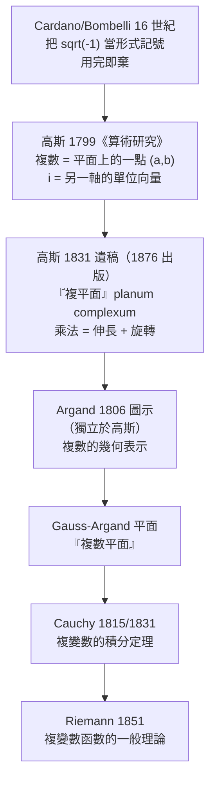

# 10.1 複數、高斯平面與兩維微積分（1831 年）

## 學習動機

第 7 章我們學了偏導數與重積分，知道在 $`\mathbb{R}^2`$ 上「可微」意味著某一個方向的微分存在、某些方向上「只有偏導數」是不夠的。遺憾的是， $`\mathbb{R}^2`$ 上的微積分有兩個令人不安的特徵：

1. **格林定理**只對「偏導數連續」的函數成立（第 8 章），但我們經常會遇到偏導數存在卻不連續的情形；
2. 更根本的是， $`\mathbb{R}^2`$ 上的向量場有**旋度**這個額外自由度，什麼都留數、什麼都散度（第 8 章的格林/斯托克斯/高斯定理）。

複變數分析之所以是一門「不一樣」的學問，關鍵在於：**複數只有一個維度**。一個複數 $`z = a + bi`$ 是一個「有向的數」，不是二維空間中的一個點。它加上一個乘法之後，就有了「方向」與「長度」兩個自由度，但也因此**多了一層內在結構**。

本節要回答四個問題：

1. **複數憑什麼該存在？** —— 高斯 1799 年的《算術研究》如何把 $`-1`$ 的平方根從「虛無」變成「合法對象」；
2. **複數的「圖」長什麼樣？** —— Argand 1806 年的圖示如何預見了向量與向量空間；
3. **複變數函數的「導數」長什麼樣？** —— 為什麼 CR 方程會出現，以及它為什麼比實變數嚴格得多；
4. **複分析為什麼特別「剛性」？** —— 為什麼全純函數不能隨便挑選、不能有奇特的行為。

---

## 10.1.1 複數的合法化：高斯 1799 與 1831

### 從「虛數」到「複數」

在 16 世紀，Cardano 與 Bombelli 在解三次與四次方程時被迫使用 $`\sqrt{-1}`$ 這類「虛」量，但只敢把它當成**形式記號**——計算時遵循代數律，最後若答案是實數就丟掉虛部分。這種「用完即棄」的態度，使 $`\sqrt{-1}`$ 在數學中游離了將近三百年。

真正的轉折發生在 1799 年：高斯在博士論文《算術研究》（*Disquisitiones Arithmeticae*，1799 年完成、1801 年出版）中，把 $`x^2 + 1 = 0`$ 的根寫成 $`x \equiv +1`$ 與 $`x \equiv -1 \pmod 4`$ 的同餘類，並且明確指出：**若 $`x^2 = -1`$ ，則 $`x`$ 與 $`-x`$ 的和應是 $`2`$ 的一半，而不是 0**。這會導致矛盾，除非引入新的量。高斯寫道，若把 $`x`$ 視為一個「方向相反的單位」，那麼 $`x = +1`$ 與 $`x = -1`$ 就像 $`+1`$ 與 $`-1`$ 那樣互為相反數，「只不過它們的單位長度是沿著另一個方向的」。

這段話正是「複數」的幾何直覺：高斯把 $`\mathrm{i}`$ 看成**沿著另一個軸的單位向量**，而不是什麼「不可能的數」。在《算術研究》裡，高斯已經把複數表示成平面上的點對 $`(a, b)`$ ，並且定義了加法與乘法。

### 1831 年：從「工具」到「學科」

1799 年的高斯是在**用**複數解決二次型的問題；到了 1831 年，他寫了一篇手稿《關於平面幾何中複數的一般定理》（德文標題 *Allgemeine Lehrsätze in Beziehung auf die im verkehrten Verhältnisse des Quadrats der Distanz zwischen den Punkten ebenen complexen Größen*），首次把複數的幾何表示系統化：

- 他明確使用「**複**（complex）」這個詞（來自拉丁文 *complicatus*，意為「複合的」），並使用「**複平面**」（*planum complexum*）這個名稱；
- 他指出「複數的絕對值就是它所代表的平面向量長度」；
- 他把「複數的乘法」解釋為「伸長 + 旋轉」。

這篇手稿在他 1855 年去世後，直到 **1876 年**才作為遺稿出版。換言之，**複變數分析這門學科的核心直覺，是高斯在生前五十年裡私下建立的**。



---

## 10.1.2 Argand 1806 的圖示與「向量」的預見

在法國軍官 **Robert Argand** 於 1806 年匿名出版的小冊子《關於用幾何構造表示虛量的一種方法》（*Essai sur une manière de représenter les quantités imaginaires dans les constructions géométriques*）中，複數第一次被畫成一個**向量**。

Argand 的圖示要點：

- 複數 $`a + bi`$ 用平面上一個從原點出發的箭頭表示，橫軸是實部、縱軸是虛部；
- **加法**＝箭頭的向量加法（平行四邊形法則）；
- **乘法** ＝ 先把第一個向量伸長 $`|b|`$ 倍並旋轉 $`\arg(b)`$ 角。

Argand 還在 1813 年給 Gergonne 編輯的《數學分析雜誌》（*Annales de Gergonne*）的註記中使用了「**vecteur**（向量）」一詞，並描述了「**旋轉-量**」（*rotation-magnitude*）。這比向量空間的正式建立早了將近一百年——我們今天在平面上畫複數用的那張圖，就叫 **Argand 圖**（Argand diagram）。他還指出：**乘法 $`a+bi`$ 的乘法表可以解釋幾何作圖**，因此複數運算不再只是「形式的」，而是可以用尺與圓錐完成的真實構造。

SymPy 讓我們可以把這張圖畫出來。先熟悉複數的基本運算：

```python
import sympy as sp

z = sp.Symbol('z')
w = 3 + 4 * sp.I

print("w =", w)
print("Re(w) =", sp.re(w), " Im(w) =", sp.im(w))
print("|w| =", sp.Abs(w), " arg(w) =", sp.arg(w))
print("conjugate(w) =", sp.conjugate(w))
print("w * conjugate(w) =", sp.expand(w * sp.conjugate(w)))
print("1/w =", sp.simplify(1 / w))
print("expand_complex(1/w) =", sp.expand_complex(1 / w))
print()
# modulus identity |z1 z2| = |z1||z2|
z1, z2 = sp.symbols('z1 z2')
print("|z1 z2| - |z1||z2| =", sp.simplify(sp.Abs(z1 * z2) - sp.Abs(z1) * sp.Abs(z2)))
```

預期輸出：

```text
w = 3 + 4*I
Re(w) = 3  Im(w) = 4
|w| = 5  arg(w) = atan(4/3)
conjugate(w) = 3 - 4*I
w * conjugate(w) = 25
1/w = 3/25 - 4*I/25
expand_complex(1/w) = 3/25 - 4*I/25

|z1 z2| - |z1||z2| = 0
```

注意 `w * conjugate(w) = 25`：這正是 $`|w|^2 = w\bar{w}`$ ，也就是「複數的平方等於向量長度的平方」這件事的代數版本。而 `1/w = 3/25 - 4*I/25` 說明**除法就是乘以共軛再除以 $`|w|^2`$ **——幾何上就是把向量「拉長並旋轉回去」。

### 極形式與歐拉公式的發現史

**Euler 1748** 年的《無窮小分析導論》（*Introductio in analysin infinitorum*）中出現了

$$
e^{\mathrm{i}\theta} = \cos\theta + \mathrm{i}\sin\theta
$$

這個今天我們視為「理所當然」的公式。但要注意：Euler 在 1748 年**已經知道** $`\cos`$ 與 $`\sin`$ 可以用複數的指數寫成 $`\cos x = \frac{e^{\mathrm{i}x} + e^{-\mathrm{i}x}}{2}`$ 、 $`\sin x = \frac{e^{\mathrm{i}x} - e^{-\mathrm{i}x}}{2\mathrm{i}}`$ ，這兩個式子是用對數的級數 $`\log(1+x)`$ 與 $`\exp`$ 的級數比較「形式」地得到的。Euler 把 $`e^{\mathrm{i}x}`$ 稱為「介於 $`\cos x`$ 與 $`\sin x`$ 之間的某種中間物」。

極形式

$$
z = r e^{\mathrm{i}\theta}, \qquad r = |z|,\quad \theta = \arg z
$$

把「乘法」變成一句話：**模相乘、角相加**。De Moivre 公式

$$
(\cos\theta + \mathrm{i}\sin\theta)^n = \cos n\theta + \mathrm{i}\sin n\theta
$$

則是極形式的直接後果。

```python
import cmath
import numpy as np
import sympy as sp

t = sp.Symbol('t', real=True)

print("=== 1. 歐拉公式 e^{iθ} = cos θ + i sin θ ===")
lhs = sp.exp(sp.I * t)
rhs = sp.cos(t) + sp.I * sp.sin(t)
print("  exp(i*t) - (cos t + i sin t) =", sp.simplify(sp.expand_complex(lhs - rhs)))
print()

print("=== 2. 極形式 z = r e^{iθ} ===")
z0 = 1 + sp.sqrt(3) * sp.I
r = sp.Abs(z0)
theta = sp.arg(z0)
print("  z =", z0)
print("  r = |z| =", r, " ; θ = arg(z) =", theta, " ； 等於 π/3？", sp.simplify(theta - sp.pi / 3) == 0)
back = sp.simplify(sp.expand_complex(r * sp.exp(sp.I * theta)))
print("  r e^{iθ} =", back, " ； 與原來的 z 相同？", sp.simplify(back - z0) == 0)
print()

print("=== 3. De Moivre 公式：(cos θ + i sin θ)^n = cos nθ + i sin nθ ===")
n = 7
lhs2 = sp.expand_complex((sp.cos(theta) + sp.I * sp.sin(theta)) ** n)
rhs2 = sp.expand_complex(sp.cos(n * theta) + sp.I * sp.sin(n * theta))
print("  (cos θ + i sin θ)^7 - (cos 7θ + i sin 7θ) =", sp.simplify(lhs2 - rhs2))
print("  （注意 sin θ 與 cos θ 中 θ = π/3 代入後自動化簡）")
print()

print("=== 4. 乘法的幾何意義：模相乘、角相加 ===")
z1, z2 = sp.symbols('z1 z2')
print("  |z1 z2| - |z1||z2| =", sp.simplify(sp.Abs(z1 * z2) - sp.Abs(z1) * sp.Abs(z2)))
print("  數值檢查 arg(z1 z2) - arg z1 - arg z2 （應為 2π 的整數倍）：")
for u, v in [(1 + 1j, 1 - 1j), (-1 + 0j, 1 + 1j), (2 + 3j, -1 + 1j)]:
    d = cmath.phase(u * v) - cmath.phase(u) - cmath.phase(v)
    print("      u=%-6s v=%-6s 相位差 = %+.6f = %+.6f * pi" % (u, v, d, d / np.pi))
print()
```

預期輸出：

```text
=== 1. 歐拉公式 e^{iθ} = cos θ + i sin θ ===
  exp(i*t) - (cos t + i sin t) = 0

=== 2. 極形式 z = r e^{iθ} ===
  z = 1 + sqrt(3)*I
  r = |z| = 2  ; θ = arg(z) = pi/3  ； 等於 π/3？ True
  r e^{iθ} = 1 + sqrt(3)*I  ； 與原來的 z 相同？ True

=== 3. De Moivre 公式：(cos θ + i sin θ)^n = cos nθ + i sin nθ ===
  (cos θ + i sin θ)^7 - (cos 7θ + i sin 7θ) = 0
  （注意 sin θ 與 cos θ 中 θ = π/3 代入後自動化簡）

=== 4. 乘法的幾何意義：模相乘、角相加 ===
  |z1 z2| - |z1||z2| = 0
  數值檢查 arg(z1 z2) - arg z1 - arg z2 （應為 2π 的整數倍）：
      u=(1+1j) v=(1-1j) 相位差 = +0.000000 = +0.000000 * pi
      u=(-1+0j) v=(1+1j) 相位差 = -6.283185 = -2.000000 * pi
      u=(2+3j) v=(-1+1j) 相位差 = -6.283185 = -2.000000 * pi
```

---

## 10.1.3 複變數的導數：CR 方程

### 定義：複導數

對 $`f : D \to \mathbb{C}`$ （ $`D \subseteq \mathbb{C}`$ 開集）， $`z_0 \in D`$ ，定義複導數

$$
f'(z_0) = \lim_{h \to 0} \frac{f(z_0 + h) - f(z_0)}{h}, \qquad h \in \mathbb{C}.
$$

關鍵在於 ** $`h`$ 是在複數平面中趨近 0**，而不是只沿實軸。因此這個極限若存在，**必須與方向無關**。

在實變數的情形， $`f'(x_0)`$ 的存在只要求沿實軸的差商收斂； $`f`$ 在 $`\mathbb{R}^2`$ 上「可微」還要求「所有方向」的導數存在且等於同一個線性映射。而在複變數的情形，**方向無關的要求被直接放進了定義裡**——這就是「剛性」的來源。

### CR 方程

設 $`f(z) = u(x,y) + \mathrm{i}v(x,y)`$ ，其中 $`z = x + \mathrm{i}y`$ 。若 $`f`$ 在 $`z_0`$ 複可導，且 $`u, v`$ 的偏導數存在，則

$$
\frac{\partial u}{\partial x} = \frac{\partial v}{\partial y},
\qquad
\frac{\partial u}{\partial y} = -\frac{\partial v}{\partial x}.
$$

這就是 **Cauchy–Riemann 方程**（CR 方程）。它的來歷頗有意味：這組方程至少被 Euler 與 d'Alembert（1767）在流體力學的位勢流討論中獨立察覺；Cauchy 在 1827 年的《數學練習》中把它們明確寫成「實部與虛部的相容條件」；**Riemann 在 1851 年的 habilitation 論文中**才給出今天的完整敘述與深遠的解讀。

在極座標 $`(r, \theta)`$ 下，CR 方程變成

$$
r\frac{\partial u}{\partial r} = \frac{\partial v}{\partial \theta},
\qquad
r\frac{\partial v}{\partial r} = -\frac{\partial u}{\partial \theta}.
$$

### 符號驗證

```python
import sympy as sp

x, y = sp.symbols('x y', real=True)
z = x + sp.I * y

u = sp.Function('u')(x, y)
v = sp.Function('v')(x, y)

# CR 方程 in u,v form
cr1 = sp.diff(u, x) - sp.diff(v, y)
cr2 = sp.diff(u, y) + sp.diff(v, x)
print("CR (u,v):  u_x = v_y ?  殘差 =", cr1, " ;  u_y = -v_x ?  殘差 =", cr2)
print()

# check concrete holomorphic functions
funcs = {
    "z**3": z**3,
    "exp(z)": sp.exp(z),
    "sin(z)": sp.sin(z),
    "log(z)": sp.log(z),
    "1/z": 1 / z,
}
for name, f in funcs.items():
    f = sp.simplify(f)
    uu = sp.re(sp.expand_complex(f))
    vv = sp.im(sp.expand_complex(f))
    r1 = sp.simplify(sp.diff(uu, x) - sp.diff(vv, y))
    r2 = sp.simplify(sp.diff(uu, y) + sp.diff(vv, x))
    print(f"{name:>8}: u_x - v_y = {r1},  u_y + v_x = {r2}")
print()

# non-holomorphic example: f(z) = conj(z)
f = sp.conjugate(z)
uu = sp.re(sp.expand_complex(f))
vv = sp.im(sp.expand_complex(f))
print("f(z) = conj(z): u =", uu, " v =", vv)
print("  u_x - v_y =", sp.simplify(sp.diff(uu, x) - sp.diff(vv, y)))
print("  u_y + v_x =", sp.simplify(sp.diff(uu, y) + sp.diff(vv, x)))
print()

# polar form of CR: u_r = (1/r) v_theta , v_r = -(1/r) u_theta
r, th = sp.symbols('r theta', positive=True, real=True)
U = sp.Function('U')(r, th)
V = sp.Function('V')(r, th)
print("polar CR:  r*U_r - V_theta =", sp.simplify(r * sp.diff(U, r) - sp.diff(V, th)))
print("polar CR:  r*V_r + U_theta =", sp.simplify(r * sp.diff(V, r) + sp.diff(U, th)))
print()

# polar CR checked on f(z) = z**2
f = (r * sp.exp(sp.I * th)) ** 2
uu = sp.re(sp.expand_complex(f))
vv = sp.im(sp.expand_complex(f))
print("z^2 polar: u =", sp.simplify(uu), " v =", sp.simplify(vv))
print("  r*u_r - v_theta =", sp.simplify(r * sp.diff(uu, r) - sp.diff(vv, th)))
print("  r*v_r + u_theta =", sp.simplify(r * sp.diff(vv, r) + sp.diff(uu, th)))
```

預期輸出：

```text
CR (u,v):  u_x = v_y ?  殘差 = Derivative(u(x, y), x) - Derivative(v(x, y), y)  ;  u_y = -v_x ?  殘差 = Derivative(u(x, y), y) + Derivative(v(x, y), x)

    z**3: u_x - v_y = 0,  u_y + v_x = 0
  exp(z): u_x - v_y = 0,  u_y + v_x = 0
  sin(z): u_x - v_y = 0,  u_y + v_x = 0
  log(z): u_x - v_y = 0,  u_y + v_x = 0
     1/z: u_x - v_y = 0,  u_y + v_x = 0

f(z) = conj(z): u = x  v = -y
  u_x - v_y = 2
  u_y + v_x = 0

polar CR:  r*U_r - V_theta = r*Derivative(U(r, theta), r) - Derivative(V(r, theta), theta)
polar CR:  r*V_r + U_theta = r*Derivative(V(r, theta), r) + Derivative(U(r, theta), theta)

z^2 polar: u = r**2*cos(2*theta)  v = r**2*sin(2*theta)
  r*u_r - v_theta = 0
  r*v_r + u_theta = 0
```

**怎麼解讀**：CR 方程是一組「一階偏導數的相容條件」。在 $`\mathbb{R}^2`$ 上任給一個 $`u`$ ，幾乎沒有理由能找到 $`v`$ 使它滿足 CR 方程；**只有非常特殊的 $`u`$ （調和函數）才配得上有一個 $`v`$ **。這就是「剛性」的第一個證據：複可導性不是「自動成立」的，而是極其苛刻的相容條件。

順帶注意 `log(z)` 那一列：SymPy 給出的 CR 殘差是 0，但這只在**避開負實軸的分支**上成立—— $`\log`$ 是**多值**的，這是複變數相對實變數多出來的一整層結構（分支切割），我們在 10.3 節會用路徑積分把它量化成 $`2\pi\mathrm{i}`$ 。

---

## 10.1.4 剛性的第一個證據：方向依賴性

在 $`\mathbb{R}`$ 上， $`f(x) = |x|`$ 在 $`0`$ 處不可導，因為左右導數不同。在 $`\mathbb{C}`$ 上，「方向」有無限多個，所以可導性的門檻更高。讓我們用**差商極限**把這件事算清楚：對同一個 $`f`$ ，分別沿實方向（ $`h \to 0`$ ）、虛方向（ $`h = \mathrm{i}t \to 0`$ ）與一般方向（ $`h = e^{\mathrm{i}\varphi}t \to 0`$ ）計算差商的極限。

```python
import sympy as sp

z = sp.Symbol('z')
h = sp.Symbol('h', complex=True)
t = sp.Symbol('t', real=True)
phi = sp.Symbol('phi', real=True)

def directional_derivative(f, z0, direction):
    """沿 direction 方向計算差商極限；direction 為 'real' / 'imag' / 一般 phi"""
    num = f.subs(z, z0 + h) - f.subs(z, z0)
    if direction == 'real':
        return sp.limit(sp.simplify(num / h), h, 0)
    if direction == 'imag':
        return sp.limit(sp.simplify((num / h).subs(h, sp.I * t)), t, 0)
    d = sp.exp(sp.I * phi) * t
    return sp.simplify(sp.limit(sp.expand((num / h).subs(h, d)), t, 0))

cases = [
    ("z",            z),
    ("z**2",         z**2),
    ("conj(z)",      sp.conjugate(z)),
    ("z*conj(z)",    z * sp.conjugate(z)),
    ("Abs(z)",       sp.Abs(z)),
]

print(f"{'f(z)':>12} {'實方向 h':>16} {'虛方向 h=i*t':>18} {'方向 phi':>18}")
print("-" * 70)
for name, f in cases:
    dr = directional_derivative(f, 0, 'real')
    di = directional_derivative(f, 0, 'imag')
    dp = directional_derivative(f, 0, 'phi')
    print(f"{name:>12} {str(dr):>16} {str(di):>18} {str(dp):>18}")
print()
print("判讀：若三個方向的極限一致，則 f 在 0 處複可導；否則不可導。")
print("  z*conj(z) 三者皆為 0 -> 在 0 處複可導，但導數不連續（故非全純）")
print("  Abs(z) 三者不一致  -> 在 0 處不可導")
print()
```

預期輸出：

```text
        f(z)            實方向 h          虛方向 h=i*t             方向 phi
----------------------------------------------------------------------
           z                1                  1                  1
        z**2                0                  0                  0
     conj(z)                1                 -1      exp(-2*I*phi)
   z*conj(z)                0                  0                  0
      Abs(z)                1                 -I        exp(-I*phi)

判讀：若三個方向的極限一致，則 f 在 0 處複可導；否則不可導。
  z*conj(z) 三者皆為 0 -> 在 0 處複可導，但導數不連續（故非全純）
  Abs(z) 三者不一致  -> 在 0 處不可導
```

兩個重點：

1. $`f(z) = \overline{z}`$ ：沿實方向的導數是 $`1`$ ，沿虛方向是 $`-1`$ ，沿一般方向是 $`e^{-2\mathrm{i}\varphi}`$ ——**每個方向都給出不同的答案**。這就是「複可導」比「實可導」嚴格得多的第一個具體感受。
2. $`f(z) = |z|^2`$ ：三個方向都給出 $`0`$ ，所以它在 $`0`$ **處**複可導（導數為 0）。但 CR 方程在 $`2x = 0`$ 、 $`2y = 0`$ 之外都失敗，所以它**不是全純函數**。這提醒我們：**「在一點可導」不等於「在一個開集上可導且導數連續」**。全純（holomorphic）的定義是「在一個開集上處處複可導」；由 CR 方程可證，若 $`f`$ 在開集上處處複可導，則 $`f'`$ 自動連續——這是複分析與實分析的又一處深刻差異（第 10.2 節的 Goursat 定理正是這件事的里程碑）。

---

## 10.1.5 全純函數的映射

若 $`f`$ 在區域 $`D`$ 上全純，則 $`f`$ 把 $`D`$ 映到複平面，其**像**稱為 $`f(D)`$ 。全純映射有非常強的幾何限制（第 10.2 節會系統化）：

- **開映射定理**：非恆等的全純映射把開集映成開集（不像 $`\overline{z}`$ 把開圓盤映成閉圓盤）；
- **最大模原理**： $`|f|`$ 在區域內不能取到局部極大，除非 $`f`$ 恆定；
- **Liouville 定理**：有界的全純函數必為常數。

兩個最古典的映射：

- ** $`z \mapsto z^2`$ **：把 $`|z| = r`$ 的圓映成 $`|w| = r^2`$ 的圓；把射線 $`\arg z = \theta`$ 映成射線 $`\arg w = 2\theta`$ 。於是直角座標的**圓與直線**被映成**拋物線族與雙曲線族**。
- ** $`z \mapsto 1/z`$ **：把通過原點的直線映成通過原點的直線；把不通過原點的直線映成**通過原點的圓**；把以原點為心的圓映成以原點為心的圓（半徑取倒數）。

```python
import numpy as np
import matplotlib.pyplot as plt

fig, axes = plt.subplots(1, 3, figsize=(15, 5))
th = np.linspace(0, 2 * np.pi, 400)

def draw(ax, wfunc, title, radii, nray=8):
    for r in radii:
        z = r * np.exp(1j * th)
        w = wfunc(z)
        ax.plot(w.real, w.imag, lw=1.6)
    for a in np.linspace(0, 2 * np.pi, nray)[:-1]:
        rr = np.linspace(0.02, 3.0, 300)
        z = rr * np.exp(1j * a)
        w = wfunc(z)
        ax.plot(w.real, w.imag, lw=1.0, ls='--', alpha=0.7)
    ax.set_title(title)
    ax.set_xlabel("Re w")
    ax.set_ylabel("Im w")
    ax.set_aspect('equal')
    ax.grid(alpha=0.3)

draw(axes[0], lambda z: z**2, r"$z \mapsto z^2$", [0.5, 1.0, 1.5, 2.0])
draw(axes[1], lambda z: 1 / z, r"$z \mapsto 1/z$", [0.5, 1.0, 2.0])
draw(axes[2], lambda z: z + 1 / z, r"$z \mapsto z + 1/z$ (Joukowski)", [0.5, 1.0, 2.0])

plt.tight_layout()
plt.savefig("/tmp/ch10_mapping.png", dpi=120)
print("saved /tmp/ch10_mapping.png")

# --- 數值檢查 1：z^2 把 |z|=r 映到 |w|=r^2，arg 加倍 ---
r = 1.5
th0 = 0.4
z = r * np.exp(1j * th0)
w = z**2
print("z =", z)
print("  |z| =", abs(z), " |z^2| =", abs(w), " (r^2 =", r**2, ")")
print("  arg(z) =", np.angle(z), " arg(z^2) =", np.angle(w), " (2*arg(z) =", 2 * np.angle(z), ")")
print()

# --- 數值檢查 2：1/z 把直線 Re z = c 映成圓 (圓心 1/(2c), 半徑 1/(2c)) ---
c = 1.5
tt = np.linspace(-1e4, 1e4, 200001)
z = c + 1j * tt
w = 1 / z
center = 1 / (2 * c)
radius = np.abs(w - center)
print("直線 Re z =", c, " 的像：")
print("  理論圓心 =", center, " 理論半徑 =", 1 / (2 * c))
print("  實測 |w - 圓心| 的最大/最小 =", radius.max(), "/", radius.min())
print()

# --- 數值檢查 3：|z|=r 在 1/z 下映到 |w|=1/r ---
r = 2.0
z = r * np.exp(1j * th)
w = 1 / z
print("圓 |z| =", r, " 的像：|w| 恆為", np.abs(w).min(), "~", np.abs(w).max(), " (理論 1/r =", 1 / r, ")")
```

預期輸出：

```text
saved /tmp/ch10_mapping.png
z = (1.3815914910043277+0.5841275134629758j)
  |z| = 1.5  |z^2| = 2.25  (r^2 = 2.25 )
  arg(z) = 0.4  arg(z^2) = 0.8  (2*arg(z) = 0.8 )

直線 Re z = 1.5  的像：
  理論圓心 = 0.3333333333333333  理論半徑 = 0.3333333333333333
  實測 |w - 圓心| 的最大/最小 = 0.3333333333333334 / 0.33333333333333326

圓 |z| = 2.0  的像：|w| 恆為 0.4999999999999999 ~ 0.5000000000000001  (理論 1/r = 0.5 )
```

右邊的 Joukowski 映射 $`w = z + \frac{1}{z}`$ 把 $`|z| = r`$ 映成**離心圓**——這是空氣動力學中「Joukowski 變換」的原型，也是複變數方法如何進入工程問題的著名例子（把繞流的「無窮遠邊界」變成一個圓）。

---

## 10.1.6 複分析為什麼特別「剛性」？

我們已經看到三層「剛性」：

1. **方向無關性**：複導數的存在直接要求所有方向一致；
2. **CR 方程的相容性**：實部與虛部不能隨便挑；
3. **全純函數的解析性**：在開集上處處可導 $`\Rightarrow`$ $`f`$ 是**實解析**的（等於自己的泰勒級數，這一點將在 10.3 節用 `sp.series` 量化）。

讓我們把第 2 點用 SymPy 具體展示出來，並加入一個更深刻的第 4 點：**恆等定理**——全純函數由其在「有累積點的集合」上的值唯一決定。這意味著全純函數的「自由度」遠比實變數連續函數低。

```python
import sympy as sp
import numpy as np

x, y = sp.symbols('x y', real=True)
zc = sp.Symbol('z')
z = x + sp.I * y

# ---------- 1. 調和性：全純函數的實部必為調和函數 ----------
print("=== 1. 調和性 (Laplace 方程) ===")
for name, f in [("z**3", zc**3), ("exp(z)", sp.exp(zc)), ("1/z", 1 / zc), ("log(z)", sp.log(zc))]:
    u = sp.re(sp.expand_complex(f.subs(zc, z)))
    lap = sp.simplify(sp.diff(u, x, 2) + sp.diff(u, y, 2))
    print("  u = Re(%-8s) = %-22s ;  u_xx + u_yy = %s" % (name, sp.simplify(u), lap))
print("  對照：u = |z|^2 (非全純) 的 Laplace =",
      sp.simplify(sp.diff(x**2 + y**2, x, 2) + sp.diff(x**2 + y**2, y, 2)))
print()

# ---------- 2. 調和共軛：實部唯一決定虛部（差一個常數）----------
print("=== 2. 調和共軛：u 決定 v ===")
u = x**3 - 3 * x * y**2
print("  u =", u)
v = sp.integrate(sp.diff(u, x), y)
print("  由 u_x 積分得 v =", v)
print("  檢查 CR: u_y + v_x =", sp.simplify(sp.diff(u, y) + sp.diff(v, x)))
print("  於是 f(z) = u + i v =", sp.simplify(u + sp.I * v), " （應等於 z^3）")
print("  與 z^3 之差 =", sp.simplify(u + sp.I * v - (x + sp.I * y)**3))
print()

# ---------- 3. 極大模原理：最大值只能在邊界取到 ----------
print("=== 3. 極大模原理 ===")
R = 2.0
tt = np.linspace(0, 2 * np.pi, 20001)
boundary = np.abs((R * np.exp(1j * tt))**2)
gx = np.linspace(-R, R, 401)
X, Y = np.meshgrid(gx, gx)
mask = (X**2 + Y**2) <= R**2 + 1e-12
G = np.abs((X + 1j * Y)**2)
print("  f(z) = z^2, |z| <= 2")
print("  邊界上 |f| 的最小/最大 = %.12f / %.12f" % (boundary.min(), boundary.max()))
print("  圓盤內部 |f| 的最大 = %.12f" % G[mask].max())
print("  內部最大值 <= 邊界最大值？", G[mask].max() <= boundary.max() + 1e-12)
print("  等號只在邊界成立（z = ±2 與 ±2i）：", np.isclose(G[mask].max(), boundary.max()))
print()

# ---------- 4. 恆等定理：全純函數由其在 R 上的值唯一決定 ----------
print("=== 4. 恆等定理（解析延拓的唯一性）===")
w = sp.Symbol('w')
n = sp.symbols('n', integer=True, nonnegative=True)
g = sp.summation(w**n / sp.factorial(n), (n, 0, sp.oo))
print("  g(w) = sum w^n/n! =", g)
print("  g(w) - exp(w) =", sp.simplify(g - sp.exp(w)))
print("  => f(w)=exp(w) 與 g(w) 在實軸上相同，故在全平面相同")
print()
```

預期輸出：

```text
=== 1. 調和性 (Laplace 方程) ===
  u = Re(z**3    ) = x*(x**2 - 3*y**2)      ;  u_xx + u_yy = 0
  u = Re(exp(z)  ) = exp(x)*cos(y)          ;  u_xx + u_yy = 0
  u = Re(1/z     ) = x/(x**2 + y**2)        ;  u_xx + u_yy = 0
  u = Re(log(z)  ) = log(x**2 + y**2)/2     ;  u_xx + u_yy = 0
  對照：u = |z|^2 (非全純) 的 Laplace = 4

=== 2. 調和共軛：u 決定 v ===
  u = x**3 - 3*x*y**2
  由 u_x 積分得 v = 3*x**2*y - y**3
  檢查 CR: u_y + v_x = 0
  於是 f(z) = u + i v = x**3 - 3*x*y**2 + I*y*(3*x**2 - y**2)  （應等於 z^3）
  與 z^3 之差 = 0

=== 3. 極大模原理 ===
  f(z) = z^2, |z| <= 2
  邊界上 |f| 的最小/最大 = 4.000000000000 / 4.000000000000
  圓盤內部 |f| 的最大 = 4.000000000000
  內部最大值 <= 邊界最大值？ True
  等號只在邊界成立（z = ±2 與 ±2i）： True

=== 4. 恆等定理（解析延拓的唯一性）===
  g(w) = sum w^n/n! = exp(w)
  g(w) - exp(w) = 0
  => f(w)=exp(w) 與 g(w) 在實軸上相同，故在全平面相同
```

**四個結論**：

1. **調和性**：全純函數的實部（和虛部）都滿足拉普拉斯方程 $`u_{xx} + u_{yy} = 0`$ 。對照組 $`|z|^2`$ 的拉普拉斯算子等於 4 —— 全純性是比「滿足拉普拉斯方程」**更強**的條件（因為還要求共軛存在）。
2. **調和共軛**：給定 $`u`$ ，若存在 $`v`$ 使 $`u + \mathrm{i}v`$ 全純，則 $`v`$ **只差一個常數**就被決定。這就是 CR 方程「第一階相容條件」的精確內容。
3. **極大模原理**： $`|f|`$ 的最大值只能在邊界取到（除非 $`f`$ 恆定）。這在實變數裡**完全沒有對應物**： $`\mathbb{R}`$ 上的連續函數在內部取到極值是家常便飯。
4. **恆等定理**：兩個全純函數若在「有累積點的集合」（例如整條實軸）上相等，就處處相等。這意味著**一個全純函數由它在實軸上的值唯一決定**——這是後來「解析延拓」（把 $`\frac{1}{1+x^2}`$ 從實軸延拓到整個平面從而算出 $`\pi`$ ）的理論基礎，也是 10.2 節的主戲。

---

## 習題

**習題 10.1.1（複數的代數與幾何）**

(a) 用 `sp.expand_complex` 計算 $`(1 + \mathrm{i})^8`$ 、 $`(3 + 4\mathrm{i})^{-1}`$ 、 $`\left(\frac{1+\mathrm{i}}{\sqrt{2}}\right)^{2026}`$ ；
(b) 證明 $`\left|\frac{z_1 - z_3}{z_1 - z_2}\right| = \left|\frac{w_1 - w_3}{w_1 - w_2}\right|`$ 對所有 Möbius 變換 $`w = \frac{az+b}{cz+d}`$ 成立（交叉比的不變性）；
(c) 用 `sp.arg` 與 `sp.Abs` 驗證 $`\arg(z_1 z_2) \equiv \arg z_1 + \arg z_2 \pmod{2\pi}`$ ，並說明為什麼必須「模 $`2\pi`$ 」。

**習題 10.1.2（CR 方程）**

(a) 寫一個函式 `is_CR(f)`，對形如 $`f = u(x,y) + \mathrm{i}v(x,y)`$ 的**實部、虛部為實符號多項式**的函式，判斷是否滿足 CR 方程；
(b) 用它檢查 $`f(z) = z^2`$ 、 $`f(z) = \overline{z}`$ 、 $`f(z) = z\bar{z}`$ 、 $`f(z) = z^3 + 2\bar{z}`$ 、 $`f(z) = \mathrm{e}^{z}`$ ；
(c) 對滿足 CR 方程的情形，寫出 $`f'(z) = u_x + \mathrm{i}v_x`$ ，並用 `sp.diff` 驗證它等於 $`\mathrm{d}f/\mathrm{d}z`$ 。

**習題 10.1.3（方向依賴性）**

(a) 找出所有使 $`f(z) = z^{2/3}`$ 在原點複可導的**分支**（注意多值性）；
(b) 證明：若 $`f`$ 在 $`z_0`$ 複可導，則 $`|f(z_0+h) - f(z_0)| = |f'(z_0)|\,|h| + o(|h|)`$ ，並用數值實驗檢查 $`f(z)=z^2`$ 在 $`z_0 = 1+\mathrm{i}`$ 的情形；
(c) 用 10.1.4 節的程式，證明 $`f(z) = \overline{z}^{\,2}`$ 在原點不可導，並找出它的「可導點集合」。

**習題 10.1.4（映射與剛性）**

(a) 求 $`w = z + \frac{1}{z}`$ 在 $`|z| = 1`$ 上的像的方程（提示：消去 $`\theta`$ ）；
(b) 求 $`w = \frac{1}{z - 1}`$ 在直線 $`\mathrm{Im}\, z = 1`$ 上的像（它是一條圓弧嗎？圓心與半徑是多少？）；
(c) 用數值方法驗證 $`w = \mathrm{e}^{z}`$ 把水平線 $`\mathrm{Im}\, z = c`$ 映成**射線**（從原點出發），並求出該射線的張角；
(d) 證明：若 $`f`$ 在區域 $`D`$ 上全純且 $`f' = 0`$ ，則 $`f`$ 為常數（複版的 MVT，請給出證明）；
(e) 給出 $`u(x,y) = \mathrm{e}^{x}\cos y`$ 的調和共軛，並驗證 $`\frac{\partial v}{\partial x} = -\frac{\partial u}{\partial y}`$ ；
(f) 用 `sp.series` 說明 $`f(z) = \frac{1}{1-z}`$ 在 $`z = 0`$ 的 Taylor 級數的收斂半徑，並解釋它與「最近的奇點 $`z = 1`$ 」的關係。

---

## 小結

- **複數的合法化**來自高斯 1799 年的《算術研究》（把 $`\mathrm{i}`$ 當成另一軸的單位向量）與 1831 年的遺稿（1876 年才出版，創造了「複平面」一詞）；**Argand 1806 年的匿名小冊子**獨立地給出同一張圖，並在 1813 年使用了「向量」一詞。
- **極形式** $`z = re^{\mathrm{i}\theta}`$ 與 **Euler 1748** 的 $`e^{\mathrm{i}\theta} = \cos\theta + \mathrm{i}\sin\theta`$ 讓複數乘法變成「模相乘、角相加」，從而給出 De Moivre 公式。
- **複導數**要求差商極限與方向無關；這在 $`f(z)=\overline{z}`$ 上立刻失敗（實方向給 1、虛方向給 $`-1`$ ）。寫成 $`f = u + \mathrm{i}v`$ 之後，複可導性等價於 **CR 方程** $`u_x = v_y`$ 、 $`u_y = -v_x`$ （極座標形式為 $`r u_r = v_\theta`$ 、 $`r v_r = -u_\theta`$ ）。
- **全純函數的映射**把圓與線變成圓、線、拋物線與雙曲線族； $`z \mapsto 1/z`$ 把不通過原點的直線映成通過原點的圓， $`z \mapsto z + 1/z`$ 把圓映成離心圓（Joukowski 變換）。
- **複分析的剛性**表現在四件事上：實部必為調和函數；調和共軛唯一（差一常數）；極大模原理；恆等定理（全純函數由其在實軸上的值唯一決定）。這四件事在實變數裡**全都沒有對應物**。

下一節（10.2）我們把這些性質兌現成**可以計算的定理**：科西積分定理說明「全純函數沿閉曲線的積分是 0」，科西公式說明「 $`f`$ 在一點的值由圍線積分決定」，留數定理則把「圍線積分」換成「極點處的留數之和」——這是整個分析學最強大的計算武器之一。
