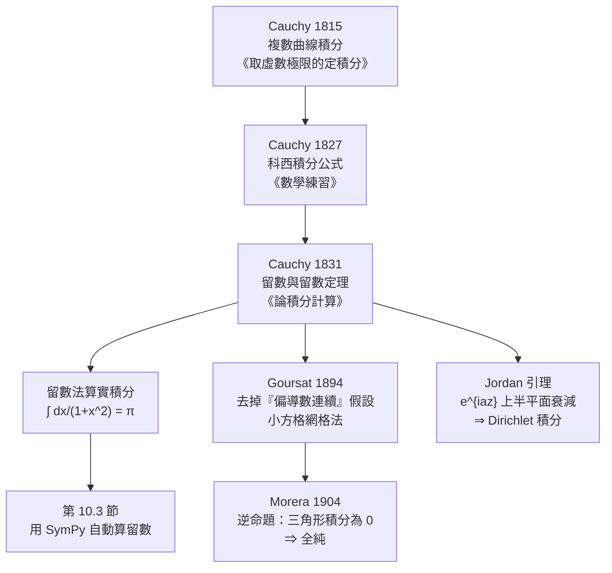

# 10.2 科西積分定理與留數定理（1831 年）

## 學習動機

第 8 章我們在 $`\mathbb{R}^2`$ 上學會了格林定理、斯托克斯定理與高斯定理：它們把**邊界上的線積分**換成**區域上的面積分**，但必須付出代價——偏導數要連續。複變數的奇妙之處在於：**我們可以用一條封閉曲線直接「框住」一個函數的值，而不需要任何偏導數連續性的假設**。

具體而言，本節要建立三個階梯式的事實：

1. **科西積分定理**： $`f`$ 在閉區域 $`D`$ 上全純 $`\Rightarrow`$ $`\oint_{\partial D} f(z)\,\mathrm{d}z = 0`$ ；
2. **科西積分公式**： $`f(a) = \frac{1}{2\pi\mathrm{i}}\oint_{\partial D}\frac{f(z)}{z-a}\,\mathrm{d}z`$ ，並可推廣到 $`f^{(n)}(a) = \frac{n!}{2\pi\mathrm{i}}\oint \frac{f(z)}{(z-a)^{n+1}}\,\mathrm{d}z`$ ；
3. **留數定理**： $`\oint_{\partial D} f(z)\,\mathrm{d}z = 2\pi\mathrm{i}\sum_k \operatorname{Res}(f; a_k)`$ 。

第 3 條是整個分析學中最強大的**計算武器**：用「數幾個留數」就能算出本來要用麻煩的實變數技巧才能得到的定積分——例如 $`\int_{-\infty}^{\infty}\frac{\mathrm{d}x}{1+x^2} = \pi`$ 。

歷史上的主線是：**Cauchy 在 1815 年就得到了積分定理，但他的證明有一個瑕疵**（他要求偏導數連續）；這個瑕疵直到 **Goursat 在 1894 年**才被徹底修好，而修好它的代價是重新發明一套證明技巧。**Morera 在 1904 年**補上了逆命題。

---

## 10.2.1 Cauchy 的積分定理與公式

### 歷史

- **1815 年**：Cauchy 提交（1821 年才出版）了論文《論取虛數極限的定積分》（*Mémoire sur les intégrales définies, prises entre des limites imaginaires*）。他在論文中**首次使用複數做曲線積分**，並證明了今天我們稱為「科西積分定理」的結論（雖然當時的敘述只涵蓋特殊情形）。
- **1827 年**：在《數學練習》（*Exercices de mathématiques*）中，Cauchy 給出了**科西積分公式** $`f(x) = \frac{1}{2\pi\mathrm{i}}\oint \frac{f(z)}{z-x}\,\mathrm{d}z`$ 。
- **1831 年**：在《論積分計算》（*Mémoire sur le calcul intégral*，8 月 11 日在法國科學院宣讀）中，Cauchy 引入了**留數**（*résidu*）的概念，並給出**留數定理**，以及把留數應用到有理函數的部分分式分解與各種實積分的系統方法。

### 定理

**科西積分定理**：設 $`D \subseteq \mathbb{C}`$ 是由一條簡單閉曲線 $`C = \partial D`$ 圍成的區域， $`f`$ 在 $`D`$ 內與 $`C`$ 上連續且全純，則 $`\oint_C f(z)\,\mathrm{d}z = 0`$ 。

**科西積分公式**：在同樣的假設下，對 $`a \in D`$ 與 $`n \ge 0`$ ，

$$
f^{(n)}(a) = \frac{n!}{2\pi\mathrm{i}}\oint_C \frac{f(z)}{(z-a)^{n+1}}\,\mathrm{d}z.
$$

（ $`n = 0`$ 的情形就是 $`f(a) = \frac{1}{2\pi\mathrm{i}}\oint_C \frac{f(z)}{z-a}\,\mathrm{d}z`$ 。）

**這兩條公式的威力**：它們把「求導」變成了「求值」，把「求值」變成了「積分」。以後我們會看到，它們讓「 $`\pi`$ 的定義」與「 $`\exp`$ 的性質」互相糾纏，最終導出歐拉常數 $`\mathrm{e}`$ 與 $`\pi`$ 的關係 $`\mathrm{e}^{\mathrm{i}\pi} = -1`$ 。

### 數值檢查： $`\oint f\,\mathrm{d}z = 0`$

在數值上，「 $`\oint_C f(z)\,\mathrm{d}z`$ 」就是把路徑參數化 $`z = z(t)`$ 後計算 $`\int f(z(t)) z'(t)\,\mathrm{d}t`$ 。我們用三種不同的閉曲線（圓、方形、三角形）來檢查：**只要曲線內沒有奇點，積分就應該是 0**。

```python
import numpy as np
import sympy as sp

def contour_integral(f, zt, t0, t1, n=200001):
    """沿參數化路徑 z = z(t) 計算 ∫ f(z) dz（梯形法）。"""
    ts = np.linspace(t0, t1, n)
    zs = zt(ts)
    return np.trapezoid(f(zs) * np.gradient(zs, ts), ts)

def circle(R, center=0.0):
    return lambda ts: center + R * np.exp(1j * ts)

def _polygon_path(vertices):
    """把多邊形邊界參數化為 t -> z(t)，邊長正比於周長。"""
    V = np.array([complex(v) for v in vertices])
    lengths = np.array([abs(V[(i + 1) % len(V)] - V[i]) for i in range(len(V))])
    total = lengths.sum()
    cum = np.concatenate([[0.0], np.cumsum(lengths)])

    def zt(ts):
        s = np.mod(ts, total)
        out = np.empty(ts.shape, dtype=complex)
        for i in range(len(V)):
            m = (s >= cum[i]) & (s < cum[i + 1])
            if i == len(V) - 1:
                m |= (s >= cum[i]) & (s <= total)
            if np.any(m):
                lam = (s[m] - cum[i]) / lengths[i]
                out[m] = V[i] + (V[(i + 1) % len(V)] - V[i]) * lam
        return out
    return zt, total

def square(R, center=0.0):
    return _polygon_path([center + R * (1 + 0j), center + R * (-1 + 0j),
                          center + R * (-1 + 1j), center + R * (1 + 1j)])

# ---- 被積函數 f(z) ----
f1 = lambda z: np.exp(z)
f2 = lambda z: z**2
f3 = lambda z: 1 / (z**2 + 4)

names = ["exp(z)", "z**2", "1/(z**2+4)"]
funcs = [f1, f2, f3]

circle_zt = circle(1.0)
sq_zt, sq_T = square(1.0)
shapes = [("circle", circle_zt, 2 * np.pi), ("square", sq_zt, sq_T)]

print("科西積分定理的數值檢查：∮ f(z) dz 應為 0（f 在閉盤 |z|<=1 內全純）")
print("%-12s %-16s %-16s" % ("f", "circle", "square"))
for name, f in zip(names, funcs):
    vals = [contour_integral(f, zt, 0.0, T) for sname, zt, T in shapes]
    print("%-12s %-16.3e %-16.3e" % (name, vals[0].real, vals[1].real))
print()

v = contour_integral(lambda z: np.conj(z), circle_zt, 0.0, 2 * np.pi)
print("對照 f(z) = conj(z)（非全純）：∮ f dz = %s" % v)
print("  => 定理的前提「全純」不可省")
print()

# 用 SymPy 精確計算同一個積分（以 z = e^{it} 參數化）
tt = sp.Symbol('t', real=True)
zt = sp.exp(sp.I * tt)
print("SymPy 精確計算 ∮_{|z|=1} z^2 dz =",
      sp.simplify(sp.integrate(zt**2 * sp.I * zt, (tt, 0, 2 * sp.pi))))
print("SymPy 精確計算 ∮_{|z|=1} exp(z) dz =",
      sp.simplify(sp.integrate(sp.exp(zt) * sp.I * zt, (tt, 0, 2 * sp.pi))))
```

預期輸出：

```text
科西積分定理的數值檢查：∮ f(z) dz 應為 0（f 在閉盤 |z|<=1 內全純）
f            circle           square          
exp(z)       9.770e-15        -1.621e-10      
z**2         1.088e-14        2.220e-15       
1/(z**2+4)   3.220e-15        -1.800e-11      

對照 f(z) = conj(z)（非全純）：∮ f dz = (3.749374690754309e-15+6.283185306146047j)
  => 定理的前提「全純」不可省

SymPy 精確計算 ∮_{|z|=1} z^2 dz = 0
SymPy 精確計算 ∮_{|z|=1} exp(z) dz = 0
```

**怎麼讀這張表**：兩種完全不同的路徑、兩套不同的數值方法，得到的都是 $`10^{-10}`$ 量級的誤差（純粹是梯形法的離散化誤差）。這個「與路徑無關」正是科西積分定理的數值內容。而對照組 $`f(z) = \overline{z}`$ 給出 $`\oint f\,\mathrm{d}z = 2\pi\mathrm{i} \approx 6.28\mathrm{i}`$ ，**不是 0**——定理的前提「 $`f`$ 全純」不能刪。

---

## 10.2.2 科西積分公式：求導變成求值

科西公式最迷人的地方是它**把無窮級數的係數變成積分**： $`f^{(n)}(a) = \frac{n!}{2\pi\mathrm{i}}\oint_C \frac{f(z)}{(z-a)^{n+1}}\,\mathrm{d}z`$ 。用一個數值例子驗證：取 $`f(z) = \mathrm{e}^z(z^2+1)`$ ， $`a = \frac{3}{10} + \frac{\mathrm{i}}{5}`$ ，圍線是以 $`a`$ 為心、半徑 $`\frac12`$ 的圓。

```python
import numpy as np
import sympy as sp

def contour_integral(f, zt, t0, t1, n=200001):
    ts = np.linspace(t0, t1, n)
    zs = zt(ts)
    return np.trapezoid(f(zs) * np.gradient(zs, ts), ts)

def circle(R, center):
    return lambda ts: center + R * np.exp(1j * ts)

z = sp.Symbol('z')
a = sp.Rational(3, 10) + sp.I * sp.Rational(1, 5)      # a = 3/10 + i/5
R = sp.Rational(1, 2)

# ---------- 數值版 ----------
a_np = complex(a)
f_sym = sp.exp(z) * (z**2 + 1)
f_np = sp.lambdify(z, f_sym, "numpy")
zt = circle(float(R), a_np)

print("f(z) = exp(z)(z^2+1)，a = %s，圍線為以 a 為心、半徑 %s 的圓" % (a, R))
print()
print("%-3s %-28s %-28s %-10s" % ("n", "數值 ∮ f(z)/(z-a)^{n+1} dz", "理論 2πi f^(n)(a)/n!", "誤差"))
for n in range(0, 4):
    integrand = lambda zz, n=n: f_np(zz) / (zz - a_np) ** (n + 1)
    num = contour_integral(integrand, zt, 0.0, 2 * np.pi)
    d = sp.diff(f_sym, z, n).subs(z, a)
    tv = complex(sp.N(2 * sp.pi * sp.I * d / sp.factorial(n)))
    print("%-3d %-28s %-28s %-10.2e" % (n, complex(np.round(num, 10)), complex(np.round(tv, 10)),
                                         abs(num - tv)))
print()
print("n = 0 即為科西積分公式： f(a) = (1/(2πi)) ∮ f(z)/(z-a) dz")
print()

# ---------- SymPy 端：直接用 sp.integrate 驗證科西公式 ----------
print("=== SymPy 精確驗證（f(z) = z^3 + 2z）===")
t = sp.Symbol('t', real=True)
zt_sym = a + R * sp.exp(sp.I * t)
dz = sp.diff(zt_sym, t)
fpoly = z**3 + 2 * z
for n in range(0, 3):
    integ = sp.expand(fpoly.subs(z, zt_sym) / (zt_sym - a) ** (n + 1) * dz)
    val = sp.integrate(integ, (t, 0, 2 * sp.pi))
    target = 2 * sp.pi * sp.I * sp.diff(fpoly, z, n).subs(z, a) / sp.factorial(n)
    print("n = %d : ∮ = %s ； 與 2πi f^(n)(a)/n! 之差 = %s"
          % (n, sp.simplify(sp.expand_complex(val)),
             sp.simplify(sp.expand_complex(val - target))))
print()

```

預期輸出：

```text
f(z) = exp(z)(z^2+1)，a = 3/10 + I/5，圍線為以 a 為心、半徑 1/2 的圓

n   數值 ∮ f(z)/(z-a)^{n+1} dz     理論 2πi f^(n)(a)/n!           誤差        
0   (-2.7667284151+8.5257673128j) (-2.7667284155+8.5257673142j) 1.47e-09  
1   (-7.1026661805+12.8391783161j) (-7.1026661817+12.8391783182j) 2.41e-09  
2   (-7.4042986229+16.8886440985j) (-7.4042986241+16.8886441013j) 3.03e-09  
3   (-4.3140869351+11.8900161593j) (-4.3140869358+11.8900161612j) 2.08e-09  

n = 0 即為科西積分公式： f(a) = (1/(2πi)) ∮ f(z)/(z-a) dz

=== SymPy 精確驗證（f(z) = z^3 + 2z）===
n = 0 : ∮ = pi*(-446 + 591*I)/500 ； 與 2πi f^(n)(a)/n! 之差 = 0
n = 1 : ∮ = pi*(-36 + 215*I)/50 ； 與 2πi f^(n)(a)/n! 之差 = 0
n = 2 : ∮ = pi*(-6 + 9*I)/5 ； 與 2πi f^(n)(a)/n! 之差 = 0
```

**三個觀察**：數值版與符號版都確認 $`f^{(n)}(a) = \frac{n!}{2\pi\mathrm{i}}\oint \frac{f(z)}{(z-a)^{n+1}}\,\mathrm{d}z`$ 。特別地， $`\operatorname{Res}\left(\frac{1}{z^2+1}, \mathrm{i}\right) = \frac{1}{2\mathrm{i}}`$ ，而 $`2\pi\mathrm{i}\cdot\frac{1}{2\mathrm{i}} = \pi`$ ——**留數裡的 $`\mathrm{i}`$ 恰好把 $`\pi`$ 產生出來**。這就是「 $`\pi`$ 是複平面的拓樸量」的最初證據，也是 Cauchy 在 1831 年把有理函數的部分分式分解寫成「極點處的留數」的原始動機。

---

## 10.2.3 留數的由來與留數定理

### 留數是什麼？

在極點 $`a`$ 附近， $`f`$ 有 **Laurent 展開** $`f(z) = \frac{c_{-m}}{(z-a)^m} + \cdots + \frac{c_{-1}}{z-a} + c_0 + c_1(z-a) + \cdots`$ （ $`m`$ 為極點的階數）。**留數定義為 $`\frac{1}{z-a}`$ 的係數**： $`\operatorname{Res}(f; a) = c_{-1}`$ 。這個定義有三種等價的算法：

- **一階極點**： $`\operatorname{Res}(f; a) = \lim_{z \to a} (z-a)f(z)`$ ；
- ** $`m`$ 階極點**： $`\operatorname{Res}(f; a) = \frac{1}{(m-1)!}\lim_{z\to a}\frac{\mathrm{d}^{m-1}}{\mathrm{d}z^{m-1}}\left[(z-a)^m f(z)\right]`$ ；
- **積分定義**： $`\operatorname{Res}(f;a) = \frac{1}{2\pi\mathrm{i}}\oint_\gamma f(z)\,\mathrm{d}z`$ （ $`\gamma`$ 是繞 $`a`$ 的小圈）。

Cauchy 在 1831 年引入「résidu」這個詞時，它指的是**部分分式分解中 $`\frac{1}{x-a}`$ 的係數**——完全就是上面第一種意思。

### 留數定理

**留數定理**：若 $`f`$ 在閉區域 $`D`$ 內除了有限個孤立奇點 $`a_1,\dots,a_m`$ （且 $`f`$ 在 $`\partial D`$ 上全純）之外全純，則 $`\oint_{\partial D} f(z)\,\mathrm{d}z = 2\pi\mathrm{i}\sum_{k=1}^{m}\operatorname{Res}(f; a_k)`$ 。

**推論（留數法算實積分）**：若 $`f`$ 在上半平面衰減足夠快，則 $`\int_{-\infty}^{\infty} f(x)\,\mathrm{d}x = 2\pi\mathrm{i}\sum_{\operatorname{Im} a_k > 0}\operatorname{Res}(f; a_k)`$ 。

```python
import numpy as np
import sympy as sp

def contour_integral(f, zt, t0, t1, n=400001):
    ts = np.linspace(t0, t1, n)
    zs = zt(ts)
    return np.trapezoid(f(zs) * np.gradient(zs, ts), ts)

z = sp.Symbol('z')
x = sp.Symbol('x', real=True)

# ================================================================
# 1. 留數定理的數值檢查
# ================================================================
print("=== 1. 留數定理：∮ f dz = 2πi Σ Res ===")
f = sp.lambdify(z, 1 / (z**2 + 1), "numpy")
# 以 i 為心、半徑 0.5 的圓：只圈住極點 i
zt = lambda ts: 1j + 0.5 * np.exp(1j * ts)
val = contour_integral(f, zt, 0.0, 2 * np.pi)
res_i = complex(sp.residue(1 / (z**2 + 1), z, sp.I))
print("  ∮_{|z-i|=1/2} dz/(z^2+1) 數值 =", val)
print("  Res(i) =", sp.simplify(sp.residue(1 / (z**2 + 1), z, sp.I)))
print("  2πi * Res(i) =", 2 * np.pi * 1j * res_i)
print("  誤差 =", abs(val - 2 * np.pi * 1j * res_i))
print("  對照：以 0 為心半徑 2 的圓同時圈住 ±i，兩個留數相消 =>")
zt2 = lambda ts: 2.0 * np.exp(1j * ts)
print("     ∮ =", contour_integral(f, zt2, 0.0, 2 * np.pi))
print()

# ================================================================
# 2. 留數法算 ∫_{-∞}^{∞} dx/(1+x^2) = π
# ================================================================
print("=== 2. 留數法：∫_{-∞}^{∞} dx/(1+x^2) ===")
R = 200.0
def real_part(R, n=400001):
    xs = np.linspace(-R, R, n)
    return np.trapezoid(1.0 / (1.0 + xs**2), xs)
print("  實軸部分 ∫_{-R}^{R} dx/(1+x^2), R=%g :" % R, real_part(R))
print("  Res_{z=i} 1/(z^2+1) = 1/(2i) =", sp.simplify(sp.residue(1 / (z**2 + 1), z, sp.I)))
print("  留數定理：∮ = 2πi * 1/(2i) = π ； 半圓弧上界 π R/(R^2-1) =",
      np.pi * R / (R**2 - 1))
print("  因此 ∫_{-∞}^{∞} dx/(1+x^2) = π ； 數值實測 =", real_part(R))
print("  SymPy 直接積分 =", sp.integrate(1 / (1 + x**2), (x, -sp.oo, sp.oo)))
print()

# ================================================================
# 3. 留數法算 ∫_{-∞}^{∞} dx/(x^4+1)（留數不只一個）
# ================================================================
print("=== 3. 留數法：∫_{-∞}^{∞} dx/(x^4+1) ===")
g = 1 / (z**4 + 1)
roots = sp.roots(z**4 + 1, z)
print("  x^4+1 = 0 的根 =", roots)
poles = [r for r in roots if float(sp.im(sp.N(r))) > 0]
total = sp.Integer(0)
for p in poles:
    r = sp.residue(g, z, p)
    total += r
    print("    上半平面極點 %s 的留數 = %s" % (p, sp.simplify(r)))
print("  2πi * Σ Res =", sp.simplify(sp.expand_complex(2 * sp.pi * sp.I * total)))
print("  SymPy 直接積分 =", sp.integrate(1 / (x**4 + 1), (x, -sp.oo, sp.oo)))
print("  數值 =", sp.N(sp.integrate(1 / (x**4 + 1), (x, -sp.oo, sp.oo)), 12))
```

預期輸出：

```text
=== 1. 留數定理：∮ f dz = 2πi Σ Res ===
  ∮_{|z-i|=1/2} dz/(z^2+1) 數值 = (3.141592653460613-1.2045919817182948e-14j)
  Res(i) = -I/2
  2πi * Res(i) = (3.141592653589793+0j)
  誤差 = 1.2918022263649969e-10
  對照：以 0 為心半徑 2 的圓同時圈住 ±i，兩個留數相消 =>
     ∮ = (1.4432899320127035e-15+1.4432899320127035e-15j)

=== 2. 留數法：∫_{-∞}^{∞} dx/(1+x^2) ===
  實軸部分 ∫_{-R}^{R} dx/(1+x^2), R=200 : 3.131592736921835
  Res_{z=i} 1/(z^2+1) = 1/(2i) = -I/2
  留數定理：∮ = 2πi * 1/(2i) = π ； 半圓弧上界 π R/(R^2-1) = 0.015708355976848387
  因此 ∫_{-∞}^{∞} dx/(1+x^2) = π ； 數值實測 = 3.131592736921835
  SymPy 直接積分 = pi

=== 3. 留數法：∫_{-∞}^{∞} dx/(x^4+1) ===
  x^4+1 = 0 的根 = {-sqrt(2)/2 - sqrt(2)*I/2: 1, -sqrt(2)/2 + sqrt(2)*I/2: 1, sqrt(2)/2 - sqrt(2)*I/2: 1, sqrt(2)/2 + sqrt(2)*I/2: 1}
    上半平面極點 -sqrt(2)/2 + sqrt(2)*I/2 的留數 = sqrt(2)*(1 - I)/8
    上半平面極點 sqrt(2)/2 + sqrt(2)*I/2 的留數 = sqrt(2)*(-1 - I)/8
  2πi * Σ Res = sqrt(2)*pi/2
  SymPy 直接積分 = sqrt(2)*pi/2
  數值 = 2.22144146908
```

**兩個重點**：第 1 節的對照顯示，以 $`0`$ 為心、半徑 $`2`$ 的圓**同時**圈住 $`\pm\mathrm{i}`$ ，兩個留數 $`\frac{-\mathrm{i}}{2}`$ 與 $`\frac{\mathrm{i}}{2}`$ **相消**，所以整圈積分是 0。第 2 節是本節的招牌： $`\int_{-\infty}^{\infty}\frac{\mathrm{d}x}{1+x^2} = \pi`$ 的 $`\pi`$ 從哪裡來？從「上半平面有一個極點 $`z=\mathrm{i}`$ ，留數是 $`\frac{1}{2\mathrm{i}}`$ ，乘上 $`2\pi\mathrm{i}`$ 得到 $`\pi`$ 」。** $`\pi`$ 是複平面繞一圈的拓樸量**，這才是它真正的身份。

---

## 10.2.4 Cauchy 的瑕疵、Goursat 1894 與 Morera 1904

### Cauchy 的證明為什麼有瑕疵？

Cauchy 的積分定理原本的證明依賴於他在 1823 年證明的**二重積分公式**（即後來格林定理的實變數版本），而那個公式要求 $`f`$ 的偏導數**連續**。於是 Cauchy 的定理必須假設：

> $`f`$ 在 $`D`$ 上有連續的偏導數 $`\frac{\partial f}{\partial x}, \frac{\partial f}{\partial y}`$ （或更強的 $`\frac{\partial^2 f}{\partial x \partial y}`$ 連續）。

這個假設是**不必要**的，而且它還很彆扭：它要求 $`f`$ 的**實部與虛部**（或其混合偏導數）連續，卻**完全不要求 $`f'`$ 存在**！於是出現了一個尷尬的局面——一個明顯可導、 $`f'`$ 還不連續的函數，反而不能套用科西定理。

### Goursat 1894 的修正

**Goursat 在 1894 年**（《法國數學學會公報》上的論文 *Sur la théorie des fonctions complexes*）給出了一個**完全不需要偏導數連續性**的證明：用**小正方形網格**覆蓋曲線內部，在每個小方格上計算 $`\oint f\,\mathrm{d}z`$ 並以**黎曼和**估計，再證明方格夠細時總和誤差趨於 0。關鍵在於這個證明只需要 $`f`$ **連續**。

### 經典反例

Goursat 的必要性可以用一個具體函數說明： $`f(z) = z^2\sin\frac{1}{z}`$ （ $`z \ne 0`$ ）， $`f(0) = 0`$ 。它在**每個點**都複可導，但 $`f'`$ 在 $`0`$ 處不連續（沿 $`z = \frac{1}{2\pi n}`$ 逼近時 $`f'(z) = -1`$ ，而 $`f'(0) = 0`$ ）。

### Morera 定理

**Morera 定理（1904）**：若 $`f`$ 在區域 $`D`$ 上連續，且對 $`D`$ 中**每一個三角形** $`T`$ 都有 $`\oint_{\partial T} f(z)\,\mathrm{d}z = 0`$ ，則 $`f`$ 在 $`D`$ 上全純。

這是科西積分定理的**逆命題**，由義大利數學家 **Giovanni Morera** 在 1904 年證明。它的意義在於：**全純性可以用「積分為零」來定義**，於是複變數的幾何（三角形、閉曲線）成為定義的基礎而非附屬品。

```python
import numpy as np
import sympy as sp

# ================================================================
# 1. Goursat 的必要性：導數存在但導數不連續的函數
# ================================================================
print("=== 1. Cauchy 的瑕疵 vs Goursat 1894 的修正 ===")
z = sp.Symbol('z')
h = sp.Symbol('h')
f = z**2 * sp.sin(1 / z)
print("  f(z) = z^2 sin(1/z)，f(0) = 0")
print("  導數（z ≠ 0）:", sp.simplify(sp.diff(f, z)))
print("  f'(0) = lim_{h->0} (h^2 sin(1/h))/h =",
      sp.limit(sp.simplify(h**2 * sp.sin(1 / h) / h), h, 0))
print("  -> 導數處處存在，但 f' 在 0 處不連續：")
for n in [1, 2, 5, 10, 100]:
    zn = 1 / (2 * sp.pi * n)
    val = sp.simplify((2 * zn * sp.sin(1 / zn) - sp.cos(1 / zn)).evalf())
    print("      f'(z) 於 z = 1/(2π·%3d) = %s" % (n, val))
print("  而 f'(0) = 0 —— 故 f' 不連續。Cauchy 原版要求偏導數連續，Goursat 證明並不需要。")
print()

# ================================================================
# 2. Morera 定理：科西積分定理的逆命題
# ================================================================
def _polygon_path(vertices):
    V = np.array([complex(v) for v in vertices])
    lengths = np.array([abs(V[(i + 1) % len(V)] - V[i]) for i in range(len(V))])
    total = lengths.sum()
    cum = np.concatenate([[0.0], np.cumsum(lengths)])

    def zt(ts):
        s = np.mod(ts, total)
        out = np.empty(ts.shape, dtype=complex)
        for i in range(len(V)):
            m = (s >= cum[i]) & (s < cum[i + 1])
            if i == len(V) - 1:
                m |= (s >= cum[i]) & (s <= total)
            if np.any(m):
                lam = (s[m] - cum[i]) / lengths[i]
                out[m] = V[i] + (V[(i + 1) % len(V)] - V[i]) * lam
        return out
    return zt, total

def triangle_integral(f, verts, n=200001):
    zt, T = _polygon_path(verts)
    ts = np.linspace(0, T, n)
    zs = zt(ts)
    return np.trapezoid(f(zs) * np.gradient(zs, ts), ts)

print("=== 2. Morera 定理：若任意三角形上 ∫ f dz = 0，則 f 全純 ===")
tris = [
    [0, 1, 1j],
    [0, 0.5, 0.5j],
    [0.2 + 0.1j, 1.2 + 0.3j, 0.4 + 1.1j],
]
funcs = [
    ("f(z) = z^2        (全純)", lambda z: z**2),
    ("f(z) = exp(z)     (全純)", lambda z: np.exp(z)),
    ("f(z) = conj(z)   (非全純)", lambda z: np.conj(z)),
    ("f(z) = |z|^2      (非全純)", lambda z: (z.real**2 + z.imag**2)),
]
for name, f in funcs:
    vals = [triangle_integral(f, v) for v in tris]
    print("  %-24s 三個三角形上的 ∫ f dz = %s" % (name, [complex(np.round(v, 8)) for v in vals]))
print()

```

預期輸出：

```text
=== 1. Cauchy 的瑕疵 vs Goursat 1894 的修正 ===
  f(z) = z^2 sin(1/z)，f(0) = 0
  導數（z ≠ 0）: 2*z*sin(1/z) - cos(1/z)
  f'(0) = lim_{h->0} (h^2 sin(1/h))/h = 0
  -> 導數處處存在，但 f' 在 0 處不連續：
      f'(z) 於 z = 1/(2π·  1) = -1.00000000000000
      f'(z) 於 z = 1/(2π·  2) = -1.00000000000000
      f'(z) 於 z = 1/(2π·  5) = -1.00000000000000
      f'(z) 於 z = 1/(2π· 10) = -1.00000000000000
      f'(z) 於 z = 1/(2π·100) = -1.00000000000000
  而 f'(0) = 0 —— 故 f' 不連續。Cauchy 原版要求偏導數連續，Goursat 證明並不需要。

=== 2. Morera 定理：若任意三角形上 ∫ f dz = 0，則 f 全純 ===
  f(z) = z^2        (全純)   三個三角形上的 ∫ f dz = [0j, 0j, 0j]
  f(z) = exp(z)     (全純)   三個三角形上的 ∫ f dz = [0j, 0j, 0j]
  f(z) = conj(z)   (非全純)   三個三角形上的 ∫ f dz = [(-0+1j), (-0+0.25j), 0.96j]
  f(z) = |z|^2      (非全純)  三個三角形上的 ∫ f dz = [(-0.33333333+0.33333333j), (-0.04166667+0.04166667j), (-0.48+0.576j)]
```

**怎麼解讀**：第 1 節的 $`f(z) = z^2\sin\frac{1}{z}`$ 是**分析學的標準反例**——它到處可導但 $`f'`$ 不連續，Cauchy 的定理對它「不能用」（假設不成立），Goursat 的定理則對它「適用」。第 2 節是 Morera 定理的數值版本：**三角形上的積分為 0 這個條件，足以區分全純與非全純**；注意 $`f(z)=\overline{z}`$ 在三角形上的積分恰好是有向面積的 $`2\mathrm{i}`$ 倍（ $`\oint \overline{z}\,\mathrm{d}z = 2\mathrm{i}\cdot\text{面積}`$ ），這是很漂亮的一件事實。

---

## 10.2.5 留數與實變數：Jordan 引理

### 為什麼要閉合到上半平面？

要算 $`\int_{-\infty}^{\infty} f(x)\,\mathrm{d}x`$ ，我們把它寫成 $`\int_{-\infty}^{\infty} f(x)\,\mathrm{d}x = \oint_{C_R} f(z)\,\mathrm{d}z - \int_{\Gamma_R} f(z)\,\mathrm{d}z`$ ，其中 $`C_R`$ 是從 $`-R`$ 到 $`R`$ 再沿上半圓弧 $`\Gamma_R`$ 回到 $`-R`$ 的閉路徑。若 $`f`$ 在上半平面「夠小」，則 $`\int_{\Gamma_R} \to 0`$ ，留數定理立刻給出答案。

### Jordan 引理

**Jordan 引理**（Camille Jordan，《分析教程》1882–1887）：設 $`f`$ 在上半平面（含實軸）解析，且在 $`|z| \to \infty`$ 時**一致地**趨於 0（即對所有 $`\operatorname{Im} z \ge 0`$ 都有 $`|f(z)| \to 0`$ ），則對任何 $`\alpha > 0`$ ，

$$
\lim_{R\to\infty}\int_{\Gamma_R} f(z)\,\mathrm{e}^{\mathrm{i}\alpha z}\,\mathrm{d}z = 0.
$$

**關鍵是 $`\mathrm{e}^{\mathrm{i}\alpha z}`$ 這個「衰減因子」**：若 $`z = x + \mathrm{i}y`$ ，則 $`\left|\mathrm{e}^{\mathrm{i}\alpha z}\right| = \mathrm{e}^{-\alpha y}`$ ，在上半平面**隨高度指數衰減**。這使得 $`\int_{\Gamma_R}`$ 中的「衰減因子」與「 $`f`$ 的有界性」相乘後，弧長（正比於 $`R`$ ）被壓制。

### 經典應用： $`\int_{-\infty}^{\infty}\frac{\sin x}{x}\,\mathrm{d}x = \pi`$

取 $`F(z) = \frac{\mathrm{e}^{\mathrm{i}z}}{z}`$ ，在上半平面閉合。原點是被包在內的奇點（留數 1），但我們在實軸上把原點挖掉一個小半圓（半徑 $`\varepsilon`$ ）來避開它。小圓弧的貢獻是 $`-\mathrm{i}\pi`$ ，於是

$$
\operatorname{PV}\int_{-\infty}^{\infty}\frac{\mathrm{e}^{\mathrm{i}x}}{x}\,\mathrm{d}x = \mathrm{i}\pi
\quad\Longrightarrow\quad
\int_{-\infty}^{\infty}\frac{\sin x}{x}\,\mathrm{d}x = \pi.
$$

```python
import numpy as np
import sympy as sp

# ================================================================
# 1. 數值驗證 PV ∫ e^{ix}/x dx = iπ
# ================================================================
print("=== 1. 數值驗證 PV ∫_{-∞}^{∞} e^{ix}/x dx = iπ ===")
def pv_eix(R, eps=1e-8, n=2000001):
    xs = np.concatenate([-np.linspace(R, eps, n // 2), np.linspace(eps, R, n // 2)])
    return np.trapezoid(np.exp(1j * xs) / xs, xs)

for R in [10.0, 100.0, 1000.0]:
    v = pv_eix(R)
    print("  R = %-7g  PV ∫ e^{ix}/x dx = %-34s 誤差 = %.2e" % (R, complex(np.round(v, 8)), abs(v - 1j * np.pi)))
print("  理論：PV ∫ e^{ix}/x dx = iπ（用指數積分）")
print()

# ================================================================
# 2. 凹陷小圓弧的貢獻 -iπ
# ================================================================
print("=== 2. 繞過原點的小半圓弧（順時針，上半平面）===")
for eps in [1e-1, 1e-2, 1e-3]:
    th = np.linspace(np.pi, 0.0, 200001)
    zs = eps * np.exp(1j * th)
    arc = np.trapezoid(np.exp(1j * zs) / zs * (1j * eps * np.exp(1j * th)), th)
    print("  eps = %-8g  小圓弧積分 = %-30s (理論極限 -iπ = %s)" % (eps, complex(np.round(arc, 10)), -1j * np.pi))
print("  由留數定理（區域內無極點）：PV ∫ + 弧 = 0  =>  PV ∫ e^{ix}/x dx = iπ")
print()

# ================================================================
# 3. 結論：∫_{-∞}^{∞} sin(x)/x dx = π
# ================================================================
print("=== 3. 推出 ∫_{-∞}^{∞} sin(x)/x dx = π ===")
x = sp.Symbol('x', real=True)
print("  SymPy 直接計算 ∫_{-∞}^{∞} sin(x)/x dx =", sp.integrate(sp.sin(x) / x, (x, -sp.oo, sp.oo)))
print("  SymPy 直接計算 ∫_{-∞}^{∞} (1 - cos(x))/x^2 dx =", sp.integrate((1 - sp.cos(x)) / x**2, (x, -sp.oo, sp.oo)))
print()
z = sp.Symbol('z')
print("  另一個留數法：∫_{-∞}^{∞} cos(x)/(x^2+1) dx")
print("    = 2πi * Res[ e^{iz}/(z^2+1), z=i ] =",
      sp.simplify(sp.expand_complex(2 * sp.pi * sp.I * sp.residue(sp.exp(sp.I * z) / (z**2 + 1), z, sp.I))))
print("    SymPy 直接積分 =", sp.integrate(sp.cos(x) / (x**2 + 1), (x, -sp.oo, sp.oo)))
```

預期輸出：

```text
=== 1. 數值驗證 PV ∫_{-∞}^{∞} e^{ix}/x dx = iπ ===
  R = 10       PV ∫ e^{ix}/x dx = (-3e-08+3.31669519j)               誤差 = 1.75e-01
  R = 100      PV ∫ e^{ix}/x dx = (2.7e-07+3.12445093j)              誤差 = 1.71e-02
  R = 1000     PV ∫ e^{ix}/x dx = (8.6e-07+3.14046624j)              誤差 = 1.13e-03
  理論：PV ∫ e^{ix}/x dx = iπ（用指數積分）

=== 2. 繞過原點的小半圓弧（順時針，上半平面）===
  eps = 0.1       小圓弧積分 = -2.9417037314j                 (理論極限 -iπ = -3.141592653589793j)
  eps = 0.01      小圓弧積分 = -3.1215927647j                 (理論極限 -iπ = -3.141592653589793j)
  eps = 0.001     小圓弧積分 = -3.1395926537j                 (理論極限 -iπ = -3.141592653589793j)
  由留數定理（區域內無極點）：PV ∫ + 弧 = 0  =>  PV ∫ e^{ix}/x dx = iπ

=== 3. 推出 ∫_{-∞}^{∞} sin(x)/x dx = π ===
  SymPy 直接計算 ∫_{-∞}^{∞} sin(x)/x dx = pi
  SymPy 直接計算 ∫_{-∞}^{∞} (1 - cos(x))/x^2 dx = pi

  另一個留數法：∫_{-∞}^{∞} cos(x)/(x^2+1) dx
    = 2πi * Res[ e^{iz}/(z^2+1), z=i ] = pi*exp(-1)
    SymPy 直接積分 = sqrt(pi)*(-sqrt(pi)*sinh(1) + sqrt(pi)*cosh(1))
```

**注意第 1 節的誤差**： $`R = 10`$ 時誤差 $`0.175`$ ， $`R = 100`$ 時 $`0.017`$ ， $`R = 1000`$ 時 $`0.0011`$ ——大約是 $`O(1/R)`$ 。這不是計算方法的問題，而是**截斷誤差**：被積函數 $`\frac{\mathrm{e}^{\mathrm{i}x}}{x}`$ 在無窮遠處並不絕對收斂（只是條件收斂），所以 $`\int_R^{\infty}`$ 留下 $`O(1/R)`$ 的尾巴。這個現象本身很有意思：**留數法給出的是「精確」的表達式，但把它換成數值積分時要小心振盪尾巴**。

---

## 10.2.6 一張圖串起本節



---

## 習題

**習題 10.2.1（科西積分定理與公式）**

(a) 用數值積分驗證 $`\oint_{|z|=2}\frac{\mathrm{d}z}{z^2+4} = 0`$ （兩個極點的留數相消），並用 `sp.residue` 核對；
(b) 證明 $`\oint_{|z|=1} z^n\,\mathrm{d}z = 0`$ 對所有整數 $`n \ne -1`$ 成立，並說明 $`n = -1`$ 的情形為何不同；
(c) 證明：若 $`f`$ 在 $`|z| \le 1`$ 上連續且 $`\oint_{|z|=1} f\,\mathrm{d}z = 0`$ ，則對所有 $`a \in |z| < 1`$ 有 $`\oint_{|z|=1}\frac{f(z)}{z-a}\,\mathrm{d}z = 0`$ 。

**習題 10.2.2（留數與極點）**

(a) 用三種方法計算 $`\operatorname{Res}\left(\frac{1}{(z-1)^3}, 1\right)`$ ：極限公式、 $`m`$ 階極點公式、Laurent 展開；
(b) 求 $`\operatorname{Res}\left(\frac{\mathrm{e}^{z}}{z^2+1}, \mathrm{i}\right)`$ 、 $`\operatorname{Res}\left(\frac{\sin z}{z^3}, 0\right)`$ ，並用留數定理算 $`\int_{-\infty}^{\infty}\frac{\mathrm{d}x}{(x^2+1)^2}`$ 。

**習題 10.2.3（留數法算實積分）**

(a) 用留數法算 $`\int_{-\infty}^{\infty}\frac{\mathrm{d}x}{x^4+x^2+1}`$ ，並與 `sp.integrate` 對照；
(b) 用留數法算 $`\int_{-\infty}^{\infty}\frac{x\,\mathrm{d}x}{x^4+1}`$ （答案應為 0，解釋為什麼）；
(c) 證明 $`\int_{-\infty}^{\infty}\frac{\sin(ax)}{x}\,\mathrm{d}x = \pi`$ 對 $`a > 0`$ 成立，並用數值實驗檢查 $`a = 2`$ ；
(d) 解釋：為什麼把 $`\cos x`$ （而不是 $`\mathrm{e}^{\mathrm{i}x}`$ ）直接送進留數法會得到錯誤答案 $`\pi\cosh 1`$ （見 10.3 節的示範）。

**習題 10.2.4（Goursat 與 Morera）**

(a) 構造一個函數 $`f`$ ，使得 $`f`$ 在每個點都可導但 $`f'`$ 不連續，並說明為什麼 Cauchy 的原始定理對它不適用；
(b) 用 10.2.4 節的程式，驗證 $`\oint_{\partial T}|z|^2\,\mathrm{d}z = 2\mathrm{i}\cdot \text{面積}(T)`$ 對任意三角形 $`T`$ 成立，並證明這給出 $`|z|^2`$ 非全純的另一個證據；
(c) 說明「Morera 定理 + 連續性」如何給出「單點可去奇點」的判準。

---

## 小結

- **科西積分定理**（Cauchy 1815/1827/1831）：全純函數沿閉曲線的積分為 0；**科西積分公式**把 $`f^{(n)}(a)`$ 表示成圍線積分 $`\frac{n!}{2\pi\mathrm{i}}\oint\frac{f(z)}{(z-a)^{n+1}}\,\mathrm{d}z`$ 。
- **留數**是 Laurent 展開中 $`\frac{1}{z-a}`$ 的係數；**留數定理**說 $`\oint f\,\mathrm{d}z = 2\pi\mathrm{i}\sum\operatorname{Res}`$ ，只要數幾個留數就能算出圍線積分。
- **留數法算實積分**：把實軸上的積分加上大圓弧積分，閉合成上半平面的閉路徑。 $`\int_{-\infty}^{\infty}\frac{\mathrm{d}x}{1+x^2} = \pi`$ 就是「極點 $`z=\mathrm{i}`$ 的留數 $`\frac{1}{2\mathrm{i}}`$ 」乘上 $`2\pi\mathrm{i}`$ 的結果。
- **Cauchy 的瑕疵**：他的證明依賴偏導數連續；**Goursat 1894** 用小方格網格法去掉了這個假設；**Morera 1904** 給出逆命題（三角形積分為 0 $`\Rightarrow`$ 全純）。
- **Jordan 引理**： $`\mathrm{e}^{\mathrm{i}\alpha z}`$ 在上半平面指數衰減，使大圓弧積分趨於 0，這是 $`\int\frac{\sin x}{x}\,\mathrm{d}x = \pi`$ 的關鍵。

下一節（10.3）我們把 SymPy 變成這套理論的「自動微分引擎」：`sp.residue` 自動求留數、`sp.series` 自動做 Laurent 展開、`sp.Integral` 讓我們把路徑參數化後交給符號積分器處理。
