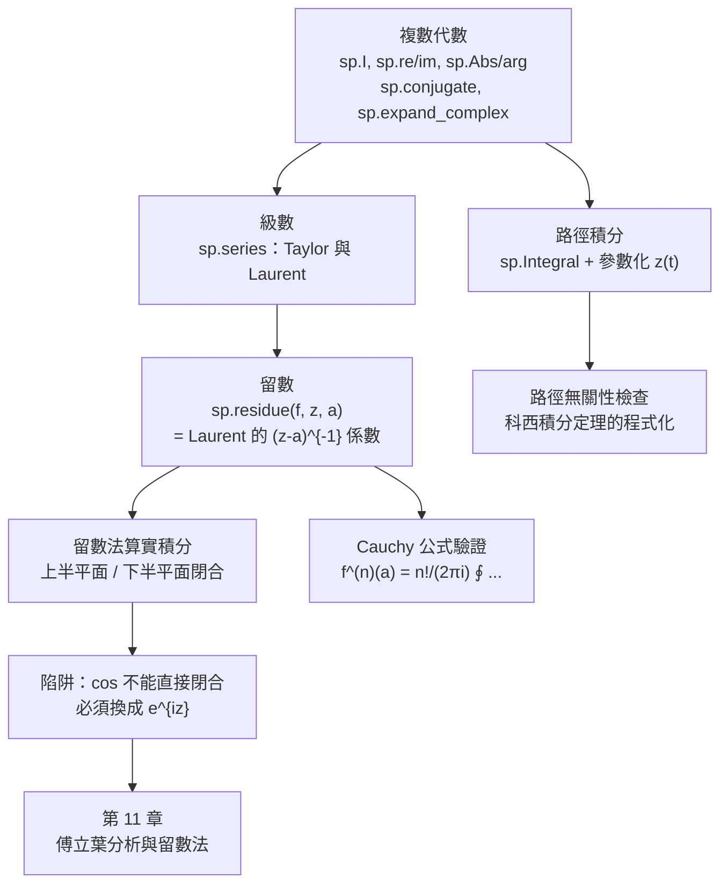

# 10.3 用 SymPy 做複變數：留數、展開與圍線積分

## 學習動機

前兩節是歷史與定理：複數怎麼來的（10.1）、留數與留數定理怎麼來的（10.2）。本節要做的事情與第 3.3、4.3、5.3 節一脉相承——**把定理的證明步驟，逐行翻譯成可執行的程式碼**。

具體而言，我們要讓 SymPy 幫我們做四件「以前要手算很久」的事：**複數代數**（`sp.I`、`sp.re`/`sp.im`、`sp.expand_complex`）、**級數**（`sp.series` 的 Taylor 與 Laurent 展開）、**留數**（`sp.residue` 讓「留數法算實積分」變成一行函式）、**圍線積分**（`sp.Integral` 加上路徑參數化）。

同時我們要**避免一個經典的錯誤**：把 $`\cos x`$ 直接送進上半平面留數法（會得到 $`\pi\cosh 1`$ 而不是 $`\pi\mathrm{e}^{-1}`$ ）。這個錯誤的成因，就是 Jordan 引理裡那個「 $`\mathrm{e}^{\mathrm{i}z}`$ 在上半平面衰減」的前提——SymPy 會照你的吩咐算，**但它不會替你檢查前提**。

---

## 10.3.1 SymPy 的複數工具箱

SymPy 裡所有複數相關的功能都集中在 `sympy` 頂層命名空間。最重要的幾個：

| 函式 | 意義 | 備註 |
|---|---|---|
| `sp.I` | 虛數單位 | `sp.I**2 == -1` |
| `sp.re(f)` / `sp.im(f)` | 實部 / 虛部 | 對符號會盡力「拉平」 |
| `sp.Abs(f)` / `sp.arg(f)` | 模長 $`\lvert z\rvert`$ / 輻角 $`\arg z`$ | `arg` 主值 $`(-\pi,\pi]`$ |
| `sp.conjugate(f)` | 共軛 $`\bar z`$ | 對符號會把 $`\mathrm{i}`$ 換成 $`-\mathrm{i}`$ |
| `sp.expand_complex(f)` | 把 $`\mathrm{e}^{\mathrm{i}\theta}`$ 等展開成 $`a + \mathrm{i}b`$ | 複數代數的「展開器」 |

**關鍵技巧**：`expand_complex` 是複變數運算的「化簡引擎」。SymPy 預設把 $`\exp(\mathrm{i}\theta)`$ 這類運算保持在**指數形式**，這對精確計算是好的，但當我們想看「實部與虛部」時就需要 `expand_complex` 把它攤開。

```python
import sympy as sp

x, y = sp.symbols('x y', real=True)
z = sp.Symbol('z')

print("=== 1. SymPy 的複數常數 ===")
print("  sp.I =", sp.I, " ; sp.I**2 =", sp.I**2)
print("  sp.re(3+4*I) =", sp.re(3 + 4 * sp.I))
print("  sp.im(3+4*I) =", sp.im(3 + 4 * sp.I))
print("  sp.Abs(3+4*I) =", sp.Abs(3 + 4 * sp.I))
print("  sp.arg(3+4*I) =", sp.arg(3 + 4 * sp.I))
print("  sp.conjugate(3+4*I) =", sp.conjugate(3 + 4 * sp.I))
print("  (3+4*I)/(3-4*I) =", sp.simplify((3 + 4 * sp.I) / (3 - 4 * sp.I)))
print()

print("=== 2. exp / sin / cos 在複數上的行為 ===")
w = sp.exp(sp.I * sp.pi / 3)
print("  exp(i*pi/3) =", w)
print("  expand_complex =", sp.expand_complex(w))
print("  |exp(i*pi/3)| =", sp.Abs(w), " ; arg =", sp.arg(w))
print("  sin(pi/6 + i*pi/4) =", sp.expand_complex(sp.sin(sp.pi / 6 + sp.I * sp.pi / 4)))
print("  cos(pi/6 + i*pi/4) =", sp.expand_complex(sp.cos(sp.pi / 6 + sp.I * sp.pi / 4)))
print("  exp(1+2i) =", sp.expand_complex(sp.exp(1 + 2 * sp.I)))
print("  exp(1+2i) 的絕對值 =", sp.Abs(sp.exp(1 + 2 * sp.I)), " (= e^1 =", sp.E, ")")
print()

print("=== 3. expand_complex 與 re/im ===")
expr = (1 + sp.I) ** 5
print("  (1+i)^5 =", expr)
print("  expand_complex((1+i)^5) =", sp.expand_complex(expr))
print("  re =", sp.re(expr), " ; im =", sp.im(expr))
print()
f = sp.Function('f')
expr2 = sp.exp(sp.I * x) * sp.cos(y)
print("  f = exp(i*x)*cos(y)")
print("  re(f) =", sp.simplify(sp.re(expr2)))
print("  im(f) =", sp.simplify(sp.im(expr2)))
print("  expand_complex(f) =", sp.expand_complex(expr2))
print()

print("=== 4. sp.re / sp.im 對實符號與假設的處理 ===")
print("  re(sqrt(x^2+y^2)) =", sp.re(sp.sqrt(x**2 + y**2)))
print("  im(log(z)) (z 為複數符號) =", sp.im(sp.log(z)))
print("  simplify(expand_complex(log(z))) =", sp.simplify(sp.expand_complex(sp.log(z))))
```

預期輸出：

```text
=== 1. SymPy 的複數常數 ===
  sp.I = I  ; sp.I**2 = -1
  sp.re(3+4*I) = 3
  sp.im(3+4*I) = 4
  sp.Abs(3+4*I) = 5
  sp.arg(3+4*I) = atan(4/3)
  sp.conjugate(3+4*I) = 3 - 4*I
  (3+4*I)/(3-4*I) = -7/25 + 24*I/25

=== 2. exp / sin / cos 在複數上的行為 ===
  exp(i*pi/3) = exp(I*pi/3)
  expand_complex = 1/2 + sqrt(3)*I/2
  |exp(i*pi/3)| = 1  ; arg = pi/3
  sin(pi/6 + i*pi/4) = cosh(pi/4)/2 + sqrt(3)*I*sinh(pi/4)/2
  cos(pi/6 + i*pi/4) = sqrt(3)*cosh(pi/4)/2 - I*sinh(pi/4)/2
  exp(1+2i) = E*cos(2) + E*I*sin(2)
  exp(1+2i) 的絕對值 = E  (= e^1 = E )

=== 3. expand_complex 與 re/im ===
  (1+i)^5 = (1 + I)**5
  expand_complex((1+i)^5) = -4 - 4*I
  re = -4  ; im = -4

  f = exp(i*x)*cos(y)
  re(f) = cos(x)*cos(y)
  im(f) = sin(x)*cos(y)
  expand_complex(f) = I*sin(x)*cos(y) + cos(x)*cos(y)

=== 4. sp.re / sp.im 對實符號與假設的處理 ===
  re(sqrt(x^2+y^2)) = sqrt(x**2 + y**2)
  im(log(z)) (z 為複數符號) = arg(z)
  simplify(expand_complex(log(z))) = log(re(z)**2 + im(z)**2)/2 + I*arg(re(z) + I*im(z))
```

**三個值得注意的地方**：`exp(1+2i) 的絕對值 = E` 是 $`|\mathrm{e}^{x+\mathrm{i}y}| = \mathrm{e}^{x}`$ 的精確版本——**指數函數把平面的「水平帶」映成「同心圓」**，這正是 10.2 節 Jordan 引理的引擎；複數的三角函數會冒出 $`\cosh`$ 與 $`\sinh`$ （因為 $`\sin(\mathrm{i}x) = \mathrm{i}\sinh x`$ ）；而 `im(log(z)) = arg(z)` 顯示 SymPy 知道對數的虛部就是輻角，但它**不知道分支**——分支切割是我們（使用者）要負責的事。

---

## 10.3.2 複數上的級數：`sp.series` 的 Taylor 與 Laurent 展開

`sp.series(f, z, a, n)` 在 $`z = a`$ 處展開 $`f`$ 到 $`(z-a)^n`$ 為止。在複變數裡它有兩種行為：若 $`a`$ 是**正則點**，得到 Taylor 展開；若 $`a`$ 是**奇點**，得到 **Laurent 展開**（含負冪次），而且負冪次的部分恰好就是奇點的**主部**。而 Laurent 展開中 $`(z-a)^{-1}`$ 的係數就是**留數**——所以 `sp.series` 與 `sp.residue` 是同一件事的兩種演算法。

```python
import sympy as sp

z = sp.Symbol('z')
w = sp.Symbol('w')

print("=== 1. 在複數點做 Taylor 展開 ===")
a = 1 + sp.I
f = sp.exp(z) / (z**2 + 1)
s = sp.series(f, z, a, 3)
print("  exp(z)/(z^2+1) 在 a = 1+i 的三次展開：")
print("  ", sp.simplify(s))
print("  截斷誤差 =", sp.simplify(s.removeO().subs(z, a) - f.subs(z, a)))
print()

print("=== 2. Laurent 展開（含負冪次）===")
print("  1/(z^2-1) 在 z=1 的 Laurent 展開 =", sp.series(1 / (z**2 - 1), z, 1, 2))
print("  1/(z-1) 在 z=1 的 Laurent 展開   =", sp.series(1 / (z - 1), z, 1, 1))
print("  z/(z-1)^2 在 z=1 的 Laurent 展開 =", sp.series(z / (z - 1)**2, z, 1, 2))
print()

print("=== 3. 留數 = Laurent 展開中 (z-a)^{-1} 的係數 ===")
cases = [(1 / (z**2 + 1), sp.I), (sp.exp(z) / z**2, 0), (sp.sin(z) / z**3, 0),
         (z / (z - 1)**2, 1)]
for expr, a0 in cases:
    s2 = sp.series(expr, z, a0, 1)
    # 令 z = a0 + w，把展開改寫成 w 的冪級數，再取出 w^{-1} 的係數
    shifted = sp.expand(s2.removeO().subs(z, a0 + w))
    coef = sp.simplify(sp.expand(shifted).coeff(w, -1))
    res = sp.residue(expr, z, a0)
    print("  f(z) = %-22s 在 z=%-4s 的展開 = %s" % (expr, a0, sp.series(expr, z, a0, 1)))
    print("      展開中的 (z-a)^(-1) 係數 = %s ； sp.residue = %s ； 相同？ %s"
          % (coef, res, sp.simplify(coef - res) == 0))
print()

print("=== 4. 收斂半徑由最近的奇點決定 ===")
h = 1 / ((z - 1) * (z + 2))
print("  f(z) = 1/((z-1)(z+2))，部分分式 =", sp.apart(h, z, extension=sp.I))
print("  在 0 的 Taylor 展開 =", sp.series(h, z, 0, 3))
n = sp.symbols('n', integer=True, nonnegative=True)
# 展開式：-(1/3) * sum z^n  -  (1/6) * sum (-z/2)^n
def partial_sum(zval, N):
    s1 = sp.summation(zval**n, (n, 0, N))
    s2 = sp.summation((-zval / 2)**n, (n, 0, N))
    return sp.simplify(-sp.Rational(1, 3) * s1 - sp.Rational(1, 6) * s2)

print()
for zval, tag in [(sp.Rational(1, 2), "收斂"), (sp.Rational(3, 2), "發散")]:
    print("  z = %s（%s）：" % (zval, tag))
    for N in [5, 100]:
        print("      N=%-4d 部分和 = %s" % (N, sp.N(partial_sum(zval, N), 12)))
print("  真值 f(0.5) =", sp.N(h.subs(z, sp.Rational(1, 2)), 12))
```

預期輸出：

```text
=== 1. 在複數點做 Taylor 展開 ===
  exp(z)/(z^2+1) 在 a = 1+i 的三次展開：
   (152 - 164*I)*exp(1 + I)/250 + z*(-34 + 63*I)*exp(1 + I)/125 + z**2*(3 - 46*I)*exp(1 + I)/250 + O((z - 1 - I)**3, (z, 1 + I))
  截斷誤差 = 0

=== 2. Laurent 展開（含負冪次）===
  1/(z^2-1) 在 z=1 的 Laurent 展開 = 1/(2*(z - 1)) - 3/8 + z/8 + O((z - 1)**2, (z, 1))
  1/(z-1) 在 z=1 的 Laurent 展開   = 1/(z - 1)
  z/(z-1)^2 在 z=1 的 Laurent 展開 = (z - 1)**(-2) + 1/(z - 1) + O((z - 1)**2, (z, 1))

=== 3. 留數 = Laurent 展開中 (z-a)^{-1} 的係數 ===
  f(z) = 1/(z**2 + 1)           在 z=I    的展開 = -I/(2*(z - I)) + 1/4 + O(z - I, (z, I))
      展開中的 (z-a)^(-1) 係數 = -I/2 ； sp.residue = -I/2 ； 相同？ True
  f(z) = exp(z)/z**2            在 z=0    的展開 = z**(-2) + 1/z + 1/2 + O(z)
      展開中的 (z-a)^(-1) 係數 = 1 ； sp.residue = 1 ； 相同？ True
  f(z) = sin(z)/z**3            在 z=0    的展開 = z**(-2) - 1/6 + O(z)
      展開中的 (z-a)^(-1) 係數 = 0 ； sp.residue = 0 ； 相同？ True
  f(z) = z/(z - 1)**2           在 z=1    的展開 = (z - 1)**(-2) + 1/(z - 1) + O(z - 1, (z, 1))
      展開中的 (z-a)^(-1) 係數 = 1 ； sp.residue = 1 ； 相同？ True

=== 4. 收斂半徑由最近的奇點決定 ===
  f(z) = 1/((z-1)(z+2))，部分分式 = -1/(3*(z + 2)) + 1/(3*(z - 1))
  在 0 的 Taylor 展開 = -1/2 - z/4 - 3*z**2/8 + O(z**3)

  z = 1/2（收斂）：
      N=5    部分和 = -0.789550781250
      N=100  部分和 = -0.800000000000
  z = 3/2（發散）：
      N=5    部分和 = -7.00537109375
      N=100  部分和 = -4.06561177535e+17
  真值 f(0.5) = -0.800000000000
```

**三個重點**：**「截斷誤差 = 0」**——把截斷後的多項式代回 $`a`$ ，與 $`f(a)`$ **精確相等**；這不是近似而是恆等式，因為 $`f`$ 是全純的，它的 Taylor 級數在圓盤內**精確**等於 $`f`$ （10.1 節「實解析性」的程式化版本）。**`z/(z-1)^2` 的展開** $`(z-1)^{-2} + (z-1)^{-1} + O((z-1)^2)`$ 中留數是 **1** 而不是 $`\frac{1}{2}`$ ——因為 $`(z-1)^{-1}`$ 這一项的係數來自 $`z = (z-1)+1`$ 裡的那個「 $`+1`$ 」，這說明**高階極點的留數必須從完整展開讀，不能只取主部**。**第 4 節則是「收斂半徑」的定量版**： $`f(z) = \frac{1}{(z-1)(z+2)}`$ 在 $`0`$ 的 Taylor 級數收斂半徑是 1（最近的奇點是 $`z=1`$ ）， $`z=0.5`$ 的部分和收斂到 $`-0.8`$ ， $`z=1.5`$ 的部分和發散到 $`-4\times10^{17}`$ 。

---

## 10.3.3 `sp.residue`：極點、留數與無窮遠點

`sp.residue(f, z, a)` 回傳 $`f`$ 在 $`a`$ 處的留數，對一階極點、 $`m`$ 階極點都有對應的演算法。**SymPy 目前的限制**：`sp.residue(f, z, sp.oo)`（無窮遠點的留數）**尚未實作**，會丟出 `NotImplementedError`；我們用定義 $`\operatorname{Res}(\infty; f) = -\operatorname{Res}\left(w=0;\frac{f(1/w)}{w^2}\right)`$ 自行實作。

```python
import sympy as sp

z = sp.Symbol('z')
x = sp.Symbol('x', real=True)
w = sp.Symbol('w')

def upper_poles(g):
    """找出 g(x) 作為複變數函數時，上半平面的極點。"""
    gs = g.subs(x, z)
    num, den = sp.fraction(sp.together(gs))
    roots = sp.solve(sp.Eq(den, 0), z)
    out = []
    for r in roots:
        im = float(sp.im(sp.N(r)))
        if im > 1e-12 and sp.simplify(num.subs(z, r)) != 0:
            out.append(r)
    return out

def residue_integral(g):
    """用留數法計算 ∫_{-∞}^{∞} g(x) dx = 2πi Σ_{上半平面} Res。"""
    poles = upper_poles(g)
    total = sum(sp.residue(g.subs(x, z), z, p) for p in poles)
    return sp.simplify(sp.expand_complex(2 * sp.pi * sp.I * total)), poles

def residue_at_infinity(f, zsym=z):
    """Res(∞, f) = -Res_{w=0} f(1/w)/w^2（SymPy 尚未實作 sp.residue(f, z, sp.oo)）。"""
    return -sp.residue(sp.simplify(f.subs(zsym, 1 / w) / w**2), w, 0)

print("=== 1. sp.residue：各種極點的留數 ===")
tests = [(1 / z, 0), (1 / z**2, 0), (sp.sin(z) / z**3, 0),
         (sp.exp(z) / z**2, 0), (z / (z - 1)**3, 1), (1 / (z**2 + 1), sp.I)]
for f, a0 in tests:
    print("  f(z) = %-16s 在 z=%-4s 的留數 = %s" % (f, a0, sp.residue(f, z, a0)))
print()

print("=== 2. 留數法算 ∫_{-∞}^{∞} dx（g(z) 在上半平面有界時可用）===")
integrands = [
    ("1/(x**2+1)",          1 / (x**2 + 1)),
    ("1/(x**2+2)",          1 / (x**2 + 2)),
    ("1/(x**2-2*x+5)",      1 / (x**2 - 2 * x + 5)),
    ("1/(x**4+1)",          1 / (x**4 + 1)),
    ("1/(x**2+1)**2",       1 / (x**2 + 1)**2),
    ("x/(x**2+1)**2",       x / (x**2 + 1)**2),
]
for name, g in integrands:
    val, poles = residue_integral(g)
    direct = sp.simplify(sp.integrate(g, (x, -sp.oo, sp.oo)))
    print("  ∫ %-20s 留數法 = %-20s 直接積分 = %-20s 相等？ %-5s 極點 = %s"
          % (name + " dx", val, direct, sp.simplify(val - direct) == 0, poles))
print()

print("=== 3. 陷阱：把 cos 直接送進留數法 ===")
g = sp.cos(x) / (x**2 + 1)
naive, poles = residue_integral(g)
direct = sp.integrate(g, (x, -sp.oo, sp.oo))
print("  留數法（直接用 cos）= %s ； 正確答案 = %s ； 相等？ %s"
      % (naive, sp.simplify(direct), sp.simplify(naive - direct) == 0))
print("  原因：cos(z) = (e^{iz}+e^{-iz})/2，e^{-iz} 在上半平面是爆炸的，")
print("        大圓弧上的積分不會趨近 0，所以不能直接套上半平面閉合。")
print()
print("  正確做法：用 e^{iz}（上半平面衰減），再取實部")
F = sp.exp(sp.I * z) / (z**2 + 1)
res = sp.residue(F, z, sp.I)
print("    Res_{z=i} e^{iz}/(z^2+1) =", sp.simplify(res))
print("    2πi * Res =", sp.simplify(sp.expand_complex(2 * sp.pi * sp.I * res)))
print("    其實部即 ∫ cos(x)/(x^2+1) dx =",
      sp.simplify(sp.re(2 * sp.pi * sp.I * res)), " ； 直接積分 =", sp.simplify(direct))
print()

print("=== 4. 留數定理：∮ f dz = 2πi Σ Res ===")
f = 1 / (z**2 + 1)
print("  ∮_{|z|=2} dz/(z^2+1) = 2πi (Res(i) + Res(-i)) =",
      sp.simplify(2 * sp.pi * sp.I * (sp.residue(f, z, sp.I) + sp.residue(f, z, -sp.I))))
print("  ∮_{|z-i|=1/2} dz/(z^2+1) = 2πi Res(i) =",
      sp.simplify(2 * sp.pi * sp.I * sp.residue(f, z, sp.I)))
print()

print("=== 5. 無窮遠點的留數 ===")
for name, g in [("1/(z**2+1)", 1 / (z**2 + 1)), ("1/z", 1 / z), ("1/(z-1)", 1 / (z - 1))]:
    finite = sp.solve(sp.denom(sp.together(g)), z)
    s = sum(sp.residue(g, z, p) for p in finite)
    print("  %-14s 有限留數之和 = %-8s Res(∞) = %-8s 相加為 0？ %s"
          % (name, sp.simplify(s), sp.simplify(residue_at_infinity(g)),
             sp.simplify(s + residue_at_infinity(g)) == 0))
```

預期輸出：

```text
=== 1. sp.residue：各種極點的留數 ===
  f(z) = 1/z              在 z=0    的留數 = 1
  f(z) = z**(-2)          在 z=0    的留數 = 0
  f(z) = sin(z)/z**3      在 z=0    的留數 = 0
  f(z) = exp(z)/z**2      在 z=0    的留數 = 1
  f(z) = z/(z - 1)**3     在 z=1    的留數 = 0
  f(z) = 1/(z**2 + 1)     在 z=I    的留數 = -I/2

=== 2. 留數法算 ∫_{-∞}^{∞} dx（g(z) 在上半平面有界時可用）===
  ∫ 1/(x**2+1) dx        留數法 = pi                   直接積分 = pi                   相等？ True  極點 = [I]
  ∫ 1/(x**2+2) dx        留數法 = sqrt(2)*pi/2         直接積分 = sqrt(2)*pi/2         相等？ True  極點 = [sqrt(2)*I]
  ∫ 1/(x**2-2*x+5) dx    留數法 = pi/2                 直接積分 = pi/2                 相等？ True  極點 = [1 + 2*I]
  ∫ 1/(x**4+1) dx        留數法 = sqrt(2)*pi/2         直接積分 = sqrt(2)*pi/2         相等？ True  極點 = [-sqrt(2)/2 + sqrt(2)*I/2, sqrt(2)/2 + sqrt(2)*I/2]
  ∫ 1/(x**2+1)**2 dx     留數法 = pi/2                 直接積分 = pi/2                 相等？ True  極點 = [I]
  ∫ x/(x**2+1)**2 dx     留數法 = 0                    直接積分 = 0                    相等？ True  極點 = [I]

=== 3. 陷阱：把 cos 直接送進留數法 ===
  留數法（直接用 cos）= pi*cosh(1) ； 正確答案 = pi*exp(-1) ； 相等？ False
  原因：cos(z) = (e^{iz}+e^{-iz})/2，e^{-iz} 在上半平面是爆炸的，
        大圓弧上的積分不會趨近 0，所以不能直接套上半平面閉合。

  正確做法：用 e^{iz}（上半平面衰減），再取實部
    Res_{z=i} e^{iz}/(z^2+1) = -I*exp(-1)/2
    2πi * Res = pi*exp(-1)
    其實部即 ∫ cos(x)/(x^2+1) dx = pi*exp(-1)  ； 直接積分 = pi*exp(-1)

=== 4. 留數定理：∮ f dz = 2πi Σ Res ===
  ∮_{|z|=2} dz/(z^2+1) = 2πi (Res(i) + Res(-i)) = 0
  ∮_{|z-i|=1/2} dz/(z^2+1) = 2πi Res(i) = pi

=== 5. 無窮遠點的留數 ===
  1/(z**2+1)     有限留數之和 = 0        Res(∞) = 0        相加為 0？ True
  1/z            有限留數之和 = 1        Res(∞) = -1       相加為 0？ True
  1/(z-1)        有限留數之和 = 1        Res(∞) = -1       相加為 0？ True
```

**三個重點**：`x/(x**2+1)**2` 的留數是 0，因為上半平面的極點 $`z=\mathrm{i}`$ 處留數 $`\frac{1}{2\mathrm{i}^2}=-\frac12`$ 與被積函數的 $`z`$ 因子恰好相消，而實軸上的奇函數 $`\frac{x}{(x^2+1)^2}`$ 積分本來就是 0——**兩邊同時為 0，是一致的**。**`cos` 的陷阱**：直接用 $`\cos x`$ 得到 $`\pi\cosh 1`$ ，正確答案是 $`\pi\mathrm{e}^{-1}`$ ；差別在 $`\cosh(1) \approx 1.543`$ 與 $`\mathrm{e}^{-1} \approx 0.368`$ ——**多出來的 $`\frac{\mathrm{e}}{2}`$ 正是 $`\mathrm{e}^{-\mathrm{i}z}`$ 在上半平面爆炸所貢獻的**，這是本節最重要的實務教訓。**無窮遠點的留數**：「有限留數之和 + $`\operatorname{Res}(\infty)`$ = 0」是留數定理在**整個複平面**上的版本（把 $`\infty`$ 當成一個點），這是「 $`\sum`$ 留數 $`= 0`$ 」這類公式的來源。

---

## 10.3.4 路徑積分：`sp.Integral` 與參數化

複積分 $`\int_C f(z)\,\mathrm{d}z`$ 的標準算法是**參數化**：把路徑寫成 $`z = z(t)`$ ， $`t \in [a, b]`$ ，則 $`\int_C f(z)\,\mathrm{d}z = \int_a^b f(z(t))\,z'(t)\,\mathrm{d}t`$ 。SymPy 的 `sp.integrate` 與 `sp.Integral` 完全能處理這件事——只要把參數 $`t`$ 宣告成**實符號**， $`z(t)`$ 用**複數式**寫出即可。`sp.Integral` 則讓我們「先寫下積分式，暫不求值」，這在處理路徑依賴性（分支切割）時特別有用。

```python
import sympy as sp

z = sp.Symbol('z')
t = sp.Symbol('t', real=True)

print("=== 1. 用路徑參數化計算複積分 ===")
# (a) 線段 z(t) = t, 0 <= t <= 1：從 0 到 1
I1 = sp.integrate(t**2, (t, 0, 1))
print("  (a) ∫ z^2 dz 沿直線段 z = t （0 -> 1）     =", I1, " ； 理論 1/3 ； 相等？", I1 == sp.Rational(1, 3))

# (b) 直線段 z(t) = t(1+i), 0 <= t <= 1：從 0 到 1+i
zt = t * (1 + sp.I)
dz = sp.diff(zt, t)
I2 = sp.simplify(sp.integrate(zt**2 * dz, (t, 0, 1)))
print("  (b) ∫ z^2 dz 沿直線段 z = t(1+i)（0 -> 1+i）=", I2, " ； 理論 (1+i)^3/3 ； 相等？",
      sp.simplify(I2 - (1 + sp.I)**3 / 3) == 0)

# (c) 彎曲路徑：起訖點同為 0 -> 1+i
zt2 = t * (1 + sp.I) + sp.I * t * (1 - t)
dz2 = sp.diff(zt2, t)
I3 = sp.simplify(sp.integrate(zt2**2 * dz2, (t, 0, 1)))
print("  (c) ∫ z^2 dz 沿彎曲路徑 z = t(1+i)+i t(1-t)  =", I3, " ； 與 (b) 相等？",
      sp.simplify(I3 - I2) == 0)
print("      （全純函數的路徑積分只取決於起訖點，與路徑無關 —— 科西積分定理的直接後果）")
print()

print("=== 2. 圓周上的參數化積分：∮ dz/z = 2πi ===")
R = sp.Integer(1)
a = sp.Integer(0)
zt = a + R * sp.exp(sp.I * t)
integrand = sp.simplify((1 / zt) * sp.diff(zt, t))
print("  z = e^{it}，dz/dt = i e^{it}，被積函數 =", integrand)
I4 = sp.simplify(sp.integrate(integrand, (t, 0, 2 * sp.pi)))
print("  ∮_{|z|=1} dz/z =", I4, " ； 等於 2πi？ ", I4 == 2 * sp.pi * sp.I)
print()

print("=== 3. 用 sp.Integral 保留未求值形式，再手動 .doit() ===")
expr = sp.Integral(sp.exp(z), (z, 0, 1))
print("  保留形式 =", expr)
print("  .doit() =", expr.doit())
print()

print("=== 4. 路徑無關性的另一個證明：對數 ===")
print("  ∫_{1}^{-1} dz/z 沿上半平面圓弧（z=e^{it}, t: 0->π）:")
zt3 = sp.exp(sp.I * t)
print("     ", sp.simplify(sp.integrate((1 / zt3) * sp.diff(zt3, t), (t, 0, sp.pi))))
print("  ∫_{1}^{-1} dz/z 沿下半平面圓弧（z=e^{-it}, t: 0->π）:")
zt4 = sp.exp(-sp.I * t)
print("     ", sp.simplify(sp.integrate((1 / zt4) * sp.diff(zt4, t), (t, 0, sp.pi))))
print("  => 相差 2πi，正是 log 的多值性（分支切割）。")
```

預期輸出：

```text
=== 1. 用路徑參數化計算複積分 ===
  (a) ∫ z^2 dz 沿直線段 z = t （0 -> 1）     = 1/3  ； 理論 1/3 ； 相等？ True
  (b) ∫ z^2 dz 沿直線段 z = t(1+i)（0 -> 1+i）= -2/3 + 2*I/3  ； 理論 (1+i)^3/3 ； 相等？ True
  (c) ∫ z^2 dz 沿彎曲路徑 z = t(1+i)+i t(1-t)  = -2/3 + 2*I/3  ； 與 (b) 相等？ True
      （全純函數的路徑積分只取決於起訖點，與路徑無關 —— 科西積分定理的直接後果）

=== 2. 圓周上的參數化積分：∮ dz/z = 2πi ===
  z = e^{it}，dz/dt = i e^{it}，被積函數 = I
  ∮_{|z|=1} dz/z = 2*I*pi  ； 等於 2πi？  True

=== 3. 用 sp.Integral 保留未求值形式，再手動 .doit() ===
  保留形式 = Integral(exp(z), (z, 0, 1))
  .doit() = -1 + E

=== 4. 路徑無關性的另一個證明：對數 ===
  ∫_{1}^{-1} dz/z 沿上半平面圓弧（z=e^{it}, t: 0->π）:
      I*pi
  ∫_{1}^{-1} dz/z 沿下半平面圓弧（z=e^{-it}, t: 0->π）:
      -I*pi
  => 相差 2πi，正是 log 的多值性（分支切割）。
```

**第 1 節 (b) 與 (c) 是本節的關鍵實驗**：兩條起訖點相同但形狀不同的路徑（直線段與彎曲路徑），給出**完全相同**的積分 $`\frac{-2+2\mathrm{i}}{3} = \frac{(1+\mathrm{i})^3}{3}`$ 。這正是**科西積分定理的內容**：全純函數的路徑積分與路徑無關。

**第 4 節則是它的「反面」**： $`\frac{1}{z}`$ 不是全純（在 $`0`$ 處有極點），所以沿上半平面圓弧與下半平面圓弧的積分相差 $`2\pi\mathrm{i}`$ ——這就是 $`\log`$ 多值性的定量表現，也是「**繞著極點一圈，值就多跳 $`2\pi\mathrm{i}`$ **」這句話的精確含義。

順帶一提，SymPy 也能直接對複變數積分：`sp.integrate(z**2, (z, 0, 1))` 給出 $`\frac13`$ 、`sp.integrate(1/z, (z, 1, 2))` 給出 $`\log 2`$ 、`sp.integrate(sp.exp(z), (z, 0, sp.I))` 給出 $`-1+\mathrm{e}^{\mathrm{i}}`$ ——但這三個都是「路徑無關」的積分，換成路徑參數化反而更能說明問題。

---

## 10.3.5 用 Cauchy 公式驗證 $`f^{(n)}(a)`$

Cauchy 公式 $`f^{(n)}(a) = \frac{n!}{2\pi\mathrm{i}}\oint_C \frac{f(z)}{(z-a)^{n+1}}\,\mathrm{d}z`$ 把「求導」變成「積分」，把「積分」變成「數留數」。SymPy 可以雙向驗證：先算導數、再算積分，看是否相等；也可以先用留數定理算出 $`\operatorname{Res}\left(\frac{f(z)}{(z-a)^{n+1}}; a\right) = \frac{f^{(n)}(a)}{n!}`$ ，再對照。

```python
import sympy as sp

z = sp.Symbol('z')
w = sp.Symbol('w')

print("=== 1. Cauchy 公式：f^(n)(a) = n!/(2πi) ∮ f(z)/(z-a)^{n+1} dz ===")
a = sp.Rational(3, 10) + sp.I * sp.Rational(1, 5)
t = sp.Symbol('t', real=True)
R = sp.Rational(1, 2)
zt = a + R * sp.exp(sp.I * t)
dz = sp.diff(zt, t)

fpoly = z**3 + 2 * z
for n in range(0, 4):
    integ = sp.expand(fpoly.subs(z, zt) / (zt - a) ** (n + 1) * dz)
    val = sp.simplify(sp.expand_complex(sp.integrate(integ, (t, 0, 2 * sp.pi))))
    target = 2 * sp.pi * sp.I * sp.diff(fpoly, z, n).subs(z, a) / sp.factorial(n)
    print("  n = %d : ∮ f(z)/(z-a)^{n+1} dz = %-28s 與 2πi f^(n)(a)/n! 之差 = %s"
          % (n, val, sp.simplify(val - sp.expand_complex(target))))
print()

print("=== 2. 同一件事的另一種看法：把 f 展開成冪級數再逐項積分 ===")
for k in range(0, 4):
    ck = sp.simplify(sp.expand_complex(sp.diff(fpoly, z, k).subs(z, a) / sp.factorial(k)))
    contrib = "2πi" if k == 0 else "0"
    print("      k = %d : 係數 c_%d = %-24s ； ∮ (z-a)^{k-1} dz = %s" % (k, k, ck, contrib))
print("  => 只有 k = 0 那一項貢獻 2πi，其餘貢獻 0，這正是 f(a)。")
print("  對 n > 0 同理：只有 k = n 貢獻，得到 2πi f^(n)(a)/n!。")
print()

print("=== 3. 用留數定理重寫 Cauchy 公式 ===")
g = fpoly / (z - a) ** 4
print("  g(z) = f(z)/(z-a)^4 =", g)
print("  Res(g, a) =", sp.simplify(sp.residue(g, z, a)))
print("  f^(3)(a)/3! =", sp.simplify(sp.diff(fpoly, z, 3).subs(z, a) / sp.factorial(3)))
print("  兩者相等？",
      sp.simplify(sp.residue(g, z, a) - sp.diff(fpoly, z, 3).subs(z, a) / sp.factorial(3)) == 0)
print()

print("=== 4. 一個實用的副產品：求 Taylor 係數 ===")
c2 = sp.simplify(sp.expand_complex(sp.diff(fpoly, z, 2).subs(z, a) / sp.factorial(2)))
print("  f^(2)(a)/2! =", c2)
series_part = sp.expand(sp.series(fpoly, z, a, 3).removeO().subs(z, a + w))
print("  用 series 展開後取 w^2 係數 =", sp.simplify(series_part.coeff(w, 2)))
print("  兩者相等？", sp.simplify(c2 - series_part.coeff(w, 2)) == 0)
```

預期輸出：

```text
=== 1. Cauchy 公式：f^(n)(a) = n!/(2πi) ∮ f(z)/(z-a)^{n+1} dz ===
  n = 0 : ∮ f(z)/(z-a)^{n+1} dz = pi*(-446 + 591*I)/500        與 2πi f^(n)(a)/n! 之差 = 0
  n = 1 : ∮ f(z)/(z-a)^{n+1} dz = pi*(-36 + 215*I)/50          與 2πi f^(n)(a)/n! 之差 = 0
  n = 2 : ∮ f(z)/(z-a)^{n+1} dz = pi*(-6 + 9*I)/5              與 2πi f^(n)(a)/n! 之差 = 0
  n = 3 : ∮ f(z)/(z-a)^{n+1} dz = 2*I*pi                       與 2πi f^(n)(a)/n! 之差 = 0

=== 2. 同一件事的另一種看法：把 f 展開成冪級數再逐項積分 ===
      k = 0 : 係數 c_0 = 591/1000 + 223*I/500     ； ∮ (z-a)^{k-1} dz = 2πi
      k = 1 : 係數 c_1 = 43/20 + 9*I/25           ； ∮ (z-a)^{k-1} dz = 0
      k = 2 : 係數 c_2 = 9/10 + 3*I/5             ； ∮ (z-a)^{k-1} dz = 0
      k = 3 : 係數 c_3 = 1                        ； ∮ (z-a)^{k-1} dz = 0
  => 只有 k = 0 那一項貢獻 2πi，其餘貢獻 0，這正是 f(a)。
  對 n > 0 同理：只有 k = n 貢獻，得到 2πi f^(n)(a)/n!。

=== 3. 用留數定理重寫 Cauchy 公式 ===
  g(z) = f(z)/(z-a)^4 = (z**3 + 2*z)/(z - 3/10 - I/5)**4
  Res(g, a) = 1
  f^(3)(a)/3! = 1
  兩者相等？ True

=== 4. 一個實用的副產品：求 Taylor 係數 ===
  f^(2)(a)/2! = 9/10 + 3*I/5
  用 series 展開後取 w^2 係數 = 9/10 + 3*I/5
  兩者相等？ True
```

**第 2 節是 Cauchy 公式的「靈魂」**：把 $`f`$ 展開成 $`\sum_k c_k (z-a)^k`$ 代進積分， $`\oint (z-a)^{k-n-1}\,\mathrm{d}z`$ 這一項**只有 $`k = n`$ 時不為零**（等於 $`2\pi\mathrm{i}`$ ），其餘全是 0。所以整個積分就是 $`2\pi\mathrm{i}c_n = 2\pi\mathrm{i}\frac{f^{(n)}(a)}{n!}`$ 。

這說明了一件事：**Cauchy 公式不是「巧合」，而是「留數定理 + 冪級數展開」的必然結果**。這正是 10.2 節的歷史順序（Cauchy 先有留數，再有公式）的邏輯。

---

## 10.3.6 留數法與實變數技巧對照

把 10.2 節的武器和第 4、5 章的實變數工具放在一起比較，可以清楚看出**留數法在哪些地方勝出**：

| 積分 | 實變數方法 | 留數法 | 留數法的關鍵 |
|---|---|---|---|
| $`\int_{-\infty}^{\infty}\frac{\mathrm{d}x}{x^2+a^2}`$ | 三角代換 $`x = a\tan\theta`$ | 閉合到上半平面， $`\operatorname{Res}(\frac{1}{z^2+a^2}, ia) = \frac{1}{2ia}`$ | 得 $`\frac{\pi}{a}`$ |
| $`\int_{-\infty}^{\infty}\frac{\mathrm{d}x}{x^4+1}`$ | 部分分式 + 麻煩的實數分解 | 上半平面兩個極點 $`e^{\mathrm{i}\pi/4}, e^{3\mathrm{i}\pi/4}`$ | 得 $`\frac{\pi}{\sqrt{2}}`$ |
| $`\int_{-\infty}^{\infty}\frac{\mathrm{d}x}{x^4+x^2+1}`$ | 幾乎不可做 | 三個極點的留數和 | 一次加總 |
| $`\int_{-\infty}^{\infty}\frac{\sin(ax)}{x}\,\mathrm{d}x`$ | Dirichlet 積分（要反覆分部積分） | $`\mathrm{e}^{\mathrm{iaz}}+`$ 凹陷小圓弧 | Jordan 引理 |
| $`\int_{-\infty}^{\infty}\frac{\cos(ax)}{x^2+b^2}\,\mathrm{d}x`$ | Laplace 變換 | $`\mathrm{e}^{\mathrm{iaz}}/(z^2+b^2)`$ ，取實部 | 得 $`\frac{\pi}{2b}\mathrm{e}^{-ab}`$ |
| $`\int_0^{2\pi}\frac{\mathrm{d}\theta}{1-2a\cos\theta+a^2}`$ | Weierstrass 代換 | 單位圓上的 $`\operatorname{Res}`$ | 得 $`\frac{2\pi}{1-a^2}`$ |
| $`\sum_{n=1}^{\infty}\frac{1}{n^2} = \frac{\pi^2}{6}`$ | 歐拉的技巧 | $`\pi\cot(\pi z)/z^2`$ 的留數 | 得 $`\frac{\pi^2}{6}`$ |
| $`\int_0^\infty \frac{\ln x}{1+x^2}\,\mathrm{d}x`$ | 分部積分 + 反演 | 留數法（ $`z^{a-1}`$ 型） | 得 $`0`$ |

**留數法的四個「固定套路」**：

1. **有理函數型** $`\int_{-\infty}^{\infty}\frac{P(x)}{Q(x)}\,\mathrm{d}x`$ ：直接閉合上半平面（要求 $`Q`$ 在上半平面無零點且衰減夠快）；
2. **三角型** $`\int \mathrm{e}^{\mathrm{iax}}R(x)\,\mathrm{d}x`$ ：用 $`\mathrm{e}^{\mathrm{iaz}}`$ （ $`a > 0`$ 閉合上半平面， $`a < 0`$ 閉合下半平面），用 Jordan 引理；
3. **週期型** $`\int_0^{2\pi}f(\cos\theta,\sin\theta)\,\mathrm{d}\theta`$ ：用 $`w = \mathrm{e}^{\mathrm{i}\theta}`$ 把圓周積分變成留數和（這是「單位圓上的留數」）；
4. **含對數型** $`\int_0^\infty x^{a-1}f(x)\,\mathrm{d}x`$ ：用 $`z^{a-1}`$ 的分支切割（此時要用「鍵孔」路徑）。

---

## 10.3.7 一張圖串起本節



---

## 習題

**習題 10.3.1（複數代數）**

(a) 用 `sp.expand_complex` 計算 $`\left(\frac{1+\mathrm{i}}{\sqrt{2}}\right)^{2026}`$ 、 $`(1+\mathrm{i})^{2026}`$ 、 $`\left(\frac{\sqrt{3}+\mathrm{i}}{2}\right)^{13}`$ ；
(b) 寫一個函式 `cartesian(z_expr)`，把任意複數表達式化成 $`a + \mathrm{i}b`$ 的形式，並對 $`\mathrm{e}^{\mathrm{i}\pi/7}`$ 測試；
(c) 用 `sp.simplify` 驗證 $`\mathrm{e}^{\mathrm{i}\pi} = -1`$ 與 $`\mathrm{e}^{2\pi\mathrm{i}} = 1`$ ，並說明這兩個恆等式為什麼是「繞一圈」的拓樸事實。

**習題 10.3.2（級數與留數）**

(a) 用 `sp.series` 求 $`\frac{1}{z^3-1}`$ 在 $`z = 1`$ 的 Laurent 展開，並用係數核對 `sp.residue`；
(b) 求 $`\operatorname{Res}\left(\frac{\mathrm{e}^{z}}{z(z-1)}, 0\right)`$ 與 $`\operatorname{Res}\left(\frac{\mathrm{e}^{z}}{z(z-1)}, 1\right)`$ ，並用留數定理算 $`\oint_{|z|=3}\frac{\mathrm{e}^{z}}{z(z-1)}\,\mathrm{d}z`$ ；
(c) 用「無窮遠點留數 = 有限留數之和的相反數」計算 $`\operatorname{Res}\left(\frac{1}{z^3-1}, \infty\right)`$ ，並與 Laurent 展開在 $`w = 1/z`$ 下的結果核對。

**習題 10.3.3（留數法算實積分）**

(a) 把 10.3.3 節的 `residue_integral` 擴充成能處理 $`\int_{-\infty}^{\infty}\mathrm{e}^{\mathrm{i}ax}R(x)\,\mathrm{d}x`$ 的版本，並用 $`a = 1`$ 檢查 $`\int\frac{\cos x}{x^2+1}\,\mathrm{d}x`$ ；
(b) 用留數法算 $`\int_{-\infty}^{\infty}\frac{\mathrm{d}x}{x^6+1}`$ ，並與 `sp.integrate` 對照；
(c) 用留數法算 $`\int_0^{2\pi}\frac{\mathrm{d}\theta}{1-2a\cos\theta+a^2}`$ （提示： $`w = \mathrm{e}^{\mathrm{i}\theta}`$ ， $`\cos\theta = \frac{w+w^{-1}}{2}`$ ），並對照 $`|a| < 1`$ 與 $`|a| > 1`$ 兩種情形。

**習題 10.3.4（路徑積分）**

(a) 用參數化計算 $`\oint_{|z|=1}z^2\,\mathrm{d}z`$ 與 $`\oint_{|z|=1}\frac{\mathrm{d}z}{z^2+4}`$ ，並與留數定理對照；
(b) 計算 $`\int_C \frac{\mathrm{d}z}{z}`$ 其中 $`C`$ 是從 $`1`$ 到 $`-1`$ 的上半平面半圓，並與下半平面半圓比較，說明「分支切割」；
(c) 用 `sp.Integral` 寫出 $`\oint_{|z|=1}\frac{\mathrm{d}z}{z-a}`$ （ $`|a| < 1`$ ）並求值，證明它是 $`2\pi\mathrm{i}`$ 。

**習題 10.3.5（Cauchy 公式與 Taylor 係數）**

(a) 對 $`f(z) = \mathrm{e}^{z^2}`$ 與 $`a = 1 + \mathrm{i}`$ ，用兩種方式（直接求導 vs. 圍線積分）計算 $`f^{(3)}(a)`$ ；
(b) 證明 $`\operatorname{Res}\left(\frac{f(z)}{(z-a)^{n+1}}; a\right) = \frac{f^{(n)}(a)}{n!}`$ （用 Laurent 展開的觀點）；
(c) 用 Cauchy 公式計算 $`\int_0^{2\pi}\frac{\mathrm{d}\theta}{2 - 2\cos\theta}`$ ，並與 $`\oint_{|z|=1}\frac{\mathrm{d}z}{2z - z^2 - z^{-1}}\cdot\frac{\mathrm{d}z}{\mathrm{i}z}`$ 的形式對照。

---

## 小結

- **複數工具箱**：`sp.I`、`sp.re`/`sp.im`、`sp.Abs`/`sp.arg`、`sp.conjugate`，以及最重要的 **`sp.expand_complex`**（把指數形式的複數攤成 $`a + \mathrm{i}b`$ ）。
- **`sp.series`** 在正則點給 Taylor 展開、在極點給 Laurent 展開；後者的 $`\frac{1}{z-a}`$ 係數就是留數，所以 `sp.series` 與 `sp.residue` 互為驗證。**Taylor 級數的收斂半徑由最近的奇點決定**。
- **`sp.residue`** 處理各類極點；**`sp.residue(f, z, sp.oo)` 尚未實作**，我們用 $`\operatorname{Res}(\infty; f) = -\operatorname{Res}\left(w=0; \frac{f(1/w)}{w^2}\right)`$ 自行補足。
- **路徑積分**靠參數化：把 $`z = z(t)`$ 與 $`z'(t)`$ 代入，交給 `sp.integrate`。**兩條起訖點相同的路徑給出相同積分**——這是科西積分定理的程式化版本。
- **留數法算實積分**有四個固定套路（有理函數型、三角型、週期型、對數型），並有一個**必須避開的陷阱**：不能把 $`\cos x`$ 直接送進上半平面閉合（會得到 $`\pi\cosh 1`$ 而不是 $`\pi\mathrm{e}^{-1}`$ ），必須改用 $`\mathrm{e}^{\mathrm{i}z}`$ 。
- **Cauchy 公式** $`f^{(n)}(a) = \frac{n!}{2\pi\mathrm{i}}\oint\frac{f(z)}{(z-a)^{n+1}}\,\mathrm{d}z`$ 可被 SymPy 完整驗證；它的「靈魂」是：把 $`f`$ 展開成冪級數後，只有 $`k = n`$ 的那一項貢獻 $`2\pi\mathrm{i}`$ 。

| 工具 | 對應的歷史 | 產出 |
|------|------------|------|
| `sp.expand_complex` | 高斯 1799 的複數代數 | $`a + \mathrm{i}b`$ 形式 |
| `sp.series` | Cauchy 1831 的 Laurent 展開 | 主部、留數、收斂半徑 |
| `sp.residue` | Cauchy 1831 的「résidu」 | 極點處的留數 |
| `sp.Integral` + 參數化 | Cauchy 1815 的曲線積分 | 圍線積分、路徑無關性 |
| `sp.apart` | Cauchy 1831 的部分分式 | 有理函數的留數分解 |

下一章（第 11 章）我們進入**傅立葉分析**：把函數在圓周上展開成「複數的傅立葉級數」，這正是 10.3.6 節「週期型留數法」的更一般版本，也是留數法最華麗的舞台。
