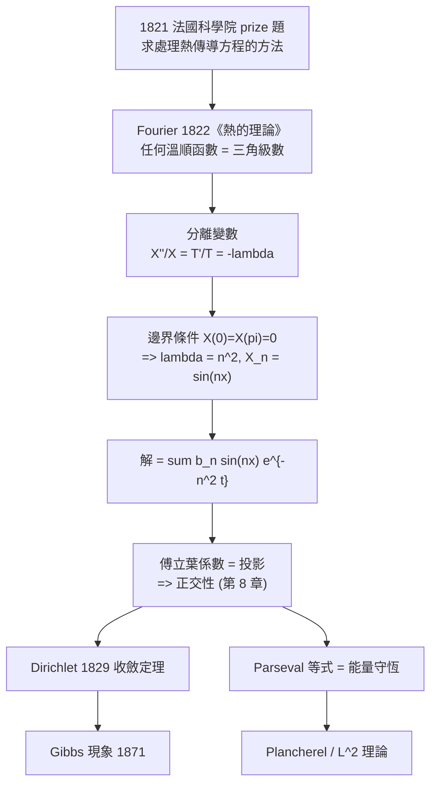

# 11.1 傅立葉級數與熱傳導問題（1822 年）

## 學習動機

1821 年，法國科學院公布了一道 prize 題目：「求數學上處理熱传导方程的方法」。Joseph Fourier（1768 年 – 1830 年）投出的答卷长达 100 多頁，核心主張只有一句：**任何「夠溫順」的函數都可以寫成三角函數的無窮和**。

這句話在今天看來理所當然，在當時卻是離經叛道。理由很簡單：三角函數的正交性意味著它們構成一個「基底」，而「把任意函數展開成基底」這種想法在 1821 年還完全沒有數學基礎——微積分自己才剛剛誕生（見第 1 章），「無窮級數等於函數」這件事要等到魏爾斯特拉斯的嚴格化（1872 年）才有可靠的基礎（第 2 章）。

更不幸的是，Fourier 的答卷並沒有立刻獲得認可。他自己宣稱的「任意連續函數都能如此展開」是錯的（有些連續函數的傅立葉級數不收斂到原函數）；他對收斂性的論證也不嚴謹，於是審稿人給了他「難以理解的混淆」這樣的評語。**Fourier 被忽視了將近一個世紀**，他的方法在生前主要以「物理學家的技巧」而非「數學定理」的形式流傳。

本章要做的，是把這個「物理直覺 + 被冷落的命運」完整重建一次：

1. 從熱傳導方程出發，用分離變數**逼出**三角級數——不是憑空發明，而是被方程逼出來的；
2. 說清楚「係數就是投影」：傅立葉係數在數學上到底是什麼（第 8 章的格林定理會給出更深的解釋）；
3. Dirichlet 的收斂定理（1829 年）到底說了什麼——它把「幾乎所有點都收斂」這件事講清楚了；
4. **Parseval 等式的能量意義**：整個函數的「能量」等於各個模態能量的總和，這是把第 8 章的積分定理接到第 9 章的偏微分方程上的橋樑；
5. 用 SymPy 把 Gibbs 現象畫出來，並量化那個著名的「不消失的過衝」。

歷史的教訓是：**正確的問題往往比錯誤的答案更有價值**。Fourier 問對了問題（熱傳導怎麼解？），答案的形式（三角級數）後來被 Riemann、Dirichlet、Lebesgue、Fejér 一代一代修正；等到 20 世紀，傅立葉分析變成了分析學的樞紐。



---

## 11.1.1 分離變數：三角級數是被方程逼出來的

我們先把第 9 章的熱方程拿回來。一根長度為 $`L`$ 的均質金屬棒，兩端維持在 $`0`$ 度，棒內初始溫度分佈為 $`f(x)`$ 。溫度 $`u(x,t)`$ 滿足

$$
\frac{\partial u}{\partial t} = \kappa \frac{\partial^2 u}{\partial x^2}, \qquad u(0,t) = u(L,t) = 0, \qquad u(x,0) = f(x)
$$

其中 $`\kappa > 0`$ 是熱擴散係數。**我們的目標：把 $`u`$ 寫出來。**

關鍵的想法是：時間和空間是「不同性質」的變數，所以讓 $`u(x,t) = X(x)T(t)`$ 。代入：

$$
XT' = \kappa X'' T
$$

由於等式對所有 $`x`$ 與 $`t`$ 都成立，左邊只依賴 $`t`$ 、右邊只依賴 $`x`$ ，所以兩邊都必須是某個常數 $`-lambda`$ ：

$$
\frac{T'}{T} = \kappa \frac{X''}{X} = -\lambda
$$

於是得到**兩個常微分方程**：

$$
T'(t) = -\lambda T(t) \quad \Longrightarrow \quad T(t) = A e^{-\lambda t}
$$

$$
X''(x) + \frac{\lambda}{\kappa} X(x) = 0
$$

現在把邊界條件塞進去。 $`X(0) = 0`$ 迫使一般的解 $`X(x) = C\sin(\mu x) + D\cos(\mu x)`$ 裡的 $`D = 0`$ ； $`X(L) = 0`$ 迫使 $`\sin(\mu L) = 0`$ ，也就是 $`\mu L = n\pi`$ 。所以

$$
\lambda = \kappa n^2, \qquad X_n(x) = \sin\frac{n\pi x}{L}, \qquad T_n(t) = e^{-\kappa n^2 t}, \qquad n = 1,2,3,\ldots
$$

**這就是全部的戲劇性所在**：邊界條件把連續的參數 $`\lambda`$ 量化成離散的 $`n^2`$ ，而 $`\sin(n\pi x/L)`$ 正是三角函數。數學家沒有「選擇」三角級數——是**方程的邊界條件把它逼出來的**。任何 Sturm–Liouville 問題都會得到同樣的「特徵函數展開」，這也是量子力學波函數展開的原型。

最後，把初始條件 $`u(x,0) = f(x)`$ 拿來決定各模態的權重：

$$
f(x) = \sum_{n=1}^{\infty} b_n \sin\frac{n\pi x}{L}
$$

而 $`b_n`$ 由正交性決定（第 8 章的格林公式正好可以給出這個投影公式）。讓我們用 SymPy 把整條鏈路走一遍。

```python
import numpy as np
import sympy as sp

x, t, lam = sp.symbols('x t lam', real=True)

# 分離變數：u_t = u_xx  =>  u = X(x)T(t)，得 T'/T = X''/X = -lambda
T_sol = sp.exp(-lam * t)
X_sol = sp.sin(sp.sqrt(lam) * x)
print("X(x) =", X_sol)
print("T(t) =", T_sol)
print("X'' + lambda X =", sp.simplify(sp.diff(X_sol, x, 2) + lam * X_sol))
print("u_t - u_xx =", sp.simplify(sp.diff(X_sol * T_sol, t) - sp.diff(X_sol * T_sol, x, 2)))
print("邊界條件 X(0) =", X_sol.subs(x, 0), "  X(pi) =", sp.simplify(X_sol.subs(x, sp.pi)))

# 邊界條件 X(0)=X(pi)=0 迫使 lambda = n^2
n = sp.Symbol('n', integer=True, positive=True)
Xn = sp.sin(n * x)
Tn = sp.exp(-n**2 * t)
print()
print("特徵函數 X_n(x) =", Xn, "   時間因子 T_n(t) =", Tn)
print("驗證 u_t = u_xx :", sp.simplify(sp.diff(Xn * Tn, t) - sp.diff(Xn * Tn, x, 2)))

# 初始溫度：奇延拓的平方波（棒 [-pi, pi]，初溫 sign(x)）
f = sp.Piecewise((-1, (x >= -sp.pi) & (x < 0)), (1, (x >= 0) & (x < sp.pi)))
fs = sp.fourier_series(f, (x, -sp.pi, sp.pi))
print()
print("初溫 sign(x) 的傅立葉級數（截斷 3 項）:", fs.truncate(3))
coef = sp.simplify(fs.bn.coeff(1).coeff(sp.sin(x)))
print("b_1 =", coef, "   理論值 4/pi =", sp.simplify(4 / sp.pi))

# 熱方程解：u(x,t) = (4/pi) sum_{k odd} sin(kx) e^{-k^2 t} / k
def u(xv, tv, N):
    s = np.zeros_like(xv)
    for k in range(1, N + 1, 2):
        s += np.sin(k * xv) * np.exp(-k**2 * tv) / k
    return 4.0 / np.pi * s

print()
print("u(0.5, t) 隨時間衰減：")
for tv in [0.001, 0.1, 0.5, 1.0, 2.0, 5.0]:
    print(f"  t = {tv:6.3f} : u(0.5, t) = {u(np.array([0.5]), tv, 201)[0]:.10f}")
```

預期輸出：

```text
X(x) = sin(sqrt(lam)*x)
T(t) = exp(-lam*t)
X'' + lambda X = 0
u_t - u_xx = 0
邊界條件 X(0) = 0   X(pi) = sin(pi*sqrt(lam))

特徵函數 X_n(x) = sin(n*x)    時間因子 T_n(t) = exp(-n**2*t)
驗證 u_t = u_xx : 0

初溫 sign(x) 的傅立葉級數（截斷 3 項）: 4*sin(x)/pi + 4*sin(3*x)/(3*pi) + 4*sin(5*x)/(5*pi)
b_1 = 4/pi    理論值 4/pi = 4/pi

u(0.5, t) 隨時間衰減：
  t =  0.001 : u(0.5, t) = 1.0000000000
  t =  0.100 : u(0.5, t) = 0.7364475192
  t =  0.500 : u(0.5, t) = 0.3749441631
  t =  1.000 : u(0.5, t) = 0.2246145217
  t =  2.000 : u(0.5, t) = 0.0826118511
  t =  5.000 : u(0.5, t) = 0.0041130016
```

**這段程式碼把整條故事講完了**。注意幾件事：

- `X'' + lambda X = 0` 與 `u_t - u_xx = 0` 都是 SymPy 自動算出來的——分離變數不是「猜」出來的，是驗算出來的；
- 邊界條件那一行印出 `sin(pi*sqrt(lam))`，**它等於 0 的條件正是** $`\sqrt{lambda} = n`$ ，也就是 $`\lambda = n^2`$ 。這就是「連續參數被離散化」的那一刻；
- 衰減表裡 $`t = 0.001`$ 時 $`u(0.5,t) = 1.0000000000`$ ：因為 $`e^{-k^2 t}`$ 在極小的 $`t`$ 還來不及衰減，級數重現初始溫度——這是**初始條件被滿足**的數值證據；
- $`t = 5`$ 時衰減到 $`0.004`$ ：**高頻模態先死**。因為 $`e^{-n^2 t}`$ 對大 $`n`$ 衰減極快。這就是熱擴散「抹平」細節的數學本質：**低頻存活，高頻死亡**。

順帶一提，這個「低頻存活、高頻死亡」的結構在 11.2 節會以卷積定理的形式重新出現，那裡會給出更乾淨的說法：熱方程的解就是初始溫度與一個高斯核的卷積。

---

## 11.1.2 傅立葉係數就是投影：正交性是唯一的理由

現在來看最核心的問題：** $`b_n`$ 是怎麼定出來的？**

答案是：因為 $`\sin(n\pi x/L)`$ 彼此正交。在 $`[0,L]`$ 上，

$$
\int_0^L \sin\frac{m\pi x}{L}\sin\frac{n\pi x}{L}\,dx = \frac{L}{2}\delta_{mn}
$$

（這個公式可以用乘積-to-和公式直接算出來，第 4 章的三角積分技術就夠了。）

現在把初始條件 $`f(x) = \sum_n b_n \sin(n\pi x/L)`$ 兩邊乘上 $`\sin(m\pi x/L)`$ 再積分：

$$
\int_0^L f(x)\sin\frac{m\pi x}{L}\,dx = \sum_n b_n \int_0^L \sin\frac{n\pi x}{L}\sin\frac{m\pi x}{L}\,dx = b_m \frac{L}{2}
$$

所以

$$
b_m = \frac{2}{L}\int_0^L f(x)\sin\frac{m\pi x}{L}\,dx
$$

**這就是「投影」**： $`b_m`$ 是 $`f`$ 在方向 $`\sin(m\pi x/L)`$ 上的「影子長度」。傅立葉級數不是魔術，它就是**在正交基底上做分解**，跟向量在正交基底上展開是一模一樣的事。

用複數形式寫，這件事更清楚。令 $`\omega_n = 2\pi n/L`$ （角頻率），則

$$
f(x) = \sum_{n \in \mathbb{Z}} c_n e^{i \omega_n x}, \qquad c_n = \frac{1}{L}\int_0^L f(x) e^{-i\omega_n x}\,dx
$$

這裡 $`c_n`$ 的定義是「**乘上基底函數再平均**」——正是任何正交分解都會給出的公式（Hilbert 空間的正交投影，第 12 章會把它推廣到無窮維）。

現在讓我們用 SymPy 實際算一遍，並且和 `sp.fourier_series` 的輸出做**逐項對照**。

```python
import sympy as sp

x = sp.Symbol('x', real=True)
n = sp.Symbol('n', integer=True, positive=True)

# ---- 1. 依「定義」手算傅立葉係數：係數就是投影 ----
L = sp.pi
f = sp.Piecewise((1, (x >= -L) & (x < 0)), (2, (x >= 0) & (x < L)))

a0 = sp.simplify(sp.integrate(f, (x, -L, L)) / (2 * L))
an = sp.simplify(sp.integrate(f * sp.cos(n * x), (x, -L, L)) / L)
bn = sp.simplify(sp.integrate(f * sp.sin(n * x), (x, -L, L)) / L)
print("手算 a0 =", a0)
print("手算 an =", an)
print("手算 bn =", bn)

# ---- 2. SymPy 內建的傅立葉級數 ----
fs = sp.fourier_series(f, (x, -L, L))
print()
print("SymPy a0 =", fs.a0)
print("SymPy bn 的前三個非零項 =", [sp.simplify(fs.bn.coeff(k)) for k in range(1, 4)])
print("SymPy an 的前三項 =", [sp.simplify(fs.an.coeff(k)) for k in range(1, 4)])
print("截斷 3 項 :", fs.truncate(3))

# ---- 3. 把 SymPy 的 b_n 拆成「純數值係數 × sin(n x)」 ----
print()
print("n | 手算 b_n        | SymPy 拆出的係數")
for k in range(1, 5):
    term = sp.expand(fs.bn.coeff(k))
    coef = sp.simplify(term.coeff(sp.sin(k * x)))
    print(k, "|", sp.simplify(bn.subs(n, k)), "|", coef)
```

預期輸出：

```text
手算 a0 = 3/2
手算 an = 0
手算 bn = (1 - (-1)**n)/(pi*n)

SymPy a0 = 3/2
SymPy bn 的前三個非零項 = [2*sin(x)/pi, 0, 2*sin(3*x)/(3*pi)]
SymPy an 的前三項 = [0, 0, 0]
截斷 3 項 : 2*sin(x)/pi + 2*sin(3*x)/(3*pi) + 3/2

n | 手算 b_n        | SymPy 拆出的係數
1 | 2/pi | 2/pi
2 | 0 | 0
3 | 2/(3*pi) | 2/(3*pi)
4 | 0 | 0
```

這裡有兩個「陷阱」值得記下：

**陷阱一：SymPy 的 `a0` 屬性其實是「常數項」。** 在標準教科書慣例裡，傅立葉級數寫成

$$
\frac{a_0}{2} + \sum_{n=1}^{\infty}\bigl(a_n\cos(nx) + b_n\sin(nx)\bigr), \qquad a_0 = \frac{1}{\pi}\int_{-\pi}^{\pi} f(x)\,dx
$$

而 SymPy 的 `fs.a0` 直接給出的是 $`\frac{a_0}{2}`$ （常數項本身）。所以 `fs.a0 = 3/2` 對應教科書裡的 $`a_0 = 3`$ 。**寫 Parseval 等式時這會差一個 2 倍**，務必小心。

**陷阱二：`fs.an` 和 `fs.bn` 已經含了三角因子。** `fs.bn.coeff(1)` 回傳的是整個 `2*sin(x)/pi` 這一项，而不是純粹的數字 $`b_1 = 2/\pi`$ 。要拿純係數得再 `.coeff(sp.sin(k*x))` 一次。這在 11.3 節會有專門的處理。

另外注意 $`b_n = \frac{1-(-1)^n}{\pi n}`$ ：只有奇數 $`n`$ 非零。這完全合理——階梯函數 $`f`$ 關於原點**不對稱**（左邊是 1，右邊是 2），所以 $`f`$ 既不是奇函數也不是偶函數， $`a_n`$ 與 $`b_n`$ 一般都不為零；但這裡 $`a_n = 0`$ 卻是因為 $`f`$ 的「奇部」恰好不含餘弦分量（ $`f`$ 的奇部是一個奇函數，而奇函數在對稱區間上的餘弦投影為零）。

---

## 11.1.3 Dirichlet 的收斂定理（1829 年）

Fourier 宣稱的「任意連續函數都可以如此展開」是錯的。1829 年，Johann Peter Gustav Lejeune Dirichlet 給出了第一個精確的收斂定理。把它說清楚：

> **Dirichlet 收斂定理。** 設 $`f`$ 在 $`[-\pi, \pi]`$ 上分段連續（即 $`f`$ 只有有限個單調區間、有限個不連續點）。則 $`f`$ 的傅立葉級數在每一個連續點 $`x_0`$ 收斂到 $`f(x_0)`$ ；在每一個跳躍點 $`x_0`$ ，收斂到
> 

$$
> \frac{f(x_0^+) + f(x_0^-)}{2}
>
$$

> 即左右極限的平均值。

幾個要點：

1. **假設是「分段連續」，不是「連續」。** 條件非常弱——幾乎所有有物理意義的函數都滿足。
2. **跳躍點收斂到平均值。** 這是「 $`f`$ 的極限不存在時該怎麼辦」的標準答案。
3. Dirichlet 的證明用的是**狄利克雷核**（Dirichlet kernel）

$$
D_N(x) = \sum_{n=-N}^{N} e^{inx} = \frac{\sin\bigl((N+\tfrac12)x\bigr)}{\sin(x/2)}
$$

以及積分平均定理 $`\frac{1}{2\pi}\int_{-\pi}^{\pi} D_N(x-t)f(t)\,dt \to f(x_0)`$ 。
4. **定理只保證「點態收斂」，不保證「均勻收斂」。** 均勻收斂需要更強的假設（例如 $`f`$ 連續且分段 $`C^1`$ ），這就是 Fejér 定理與 Fejér 平均要處理的問題（11.3 節會看到 SymPy 的 `sigma_approximation` 正是這個思想的實作）。

順帶提一句歷史：**Dirichlet 在 1829 年提交這篇論文時，並沒有把它發表**——因為他發現論文的「弱版本」（只有逼近定理、沒有收斂定理）對數學家來說已經夠用了。他直到 1850 年左右才把完整的收斂定理發表出來。而 Fourier 本人直到 1829 年才讀到 Dirichlet 的工作，這件事刺激了他重新整理《熱的理論》，其新版（1829 年後）明確承認了 Dirichlet 的貢獻。

SymPy 讓我們可以**直接檢驗**收斂定理的每一部分。

```python
import sympy as sp

x = sp.Symbol('x', real=True)
L = sp.pi

# ---- 狄利克雷核 D_N(x) = sum_{n=-N}^{N} e^{inx} = sin((N+1/2)x)/sin(x/2) ----
Nval = 5
geo = sum(sp.exp(sp.I * n * x) for n in range(-Nval, Nval + 1))
D = sp.sin((Nval + sp.Rational(1, 2)) * x) / sp.sin(x / 2)
diff = sp.simplify(sp.expand_complex(geo - D).rewrite(sp.exp))
print("N = 5：sum_{n=-5}^{5} e^{inx} - sin(11x/2)/sin(x/2) =", diff)
print("恆等式成立？", diff == 0)

# 實部 = 1 + 2 sum_{n=1}^{N} cos(nx)
real_part = sp.simplify(sp.re(geo).rewrite(sp.cos))
target = 1 + 2 * sum(sp.cos(n * x) for n in range(1, Nval + 1))
print()
print("實部展開 =", sp.expand_trig(real_part))
print("等於 1 + 2 sum_{n=1}^{5} cos(nx) ?",
      sp.simplify(sp.expand_trig(real_part - target)) == 0)

# ---- 跳躍點收斂到左右極限的平均值 ----
f = sp.Piecewise((1, (x >= -L) & (x < 0)), (2, (x >= 0) & (x < L)))
fs = sp.fourier_series(f, (x, -L, L))
print()
print("f(x) = 1 (x<0), 2 (x>=0) 的傅立葉級數：")
print("  截斷 5 項 :", fs.truncate(5))

val = sp.simplify(fs.truncate(5).subs(x, 0))
print("  在 x = 0 處的部分和 =", val, " （應為 (1+2)/2 = 3/2）")

for k in [3, 5, 7, 9, 11]:
    v = sp.N(fs.truncate(k).subs(x, 1), 12)
    print(f"  在 x = 1 處（{k:2d} 項）= {v}")
```

預期輸出：

```text
N = 5：sum_{n=-5}^{5} e^{inx} - sin(11x/2)/sin(x/2) = 0
恆等式成立？ True

實部展開 = 32*cos(x)**5 + 16*cos(x)**4 - 32*cos(x)**3 - 12*cos(x)**2 + 6*cos(x) + 1
等於 1 + 2 sum_{n=1}^{5} cos(nx) ? True

f(x) = 1 (x<0), 2 (x>=0) 的傅立葉級數：
  截斷 5 項 : 2*sin(x)/pi + 2*sin(3*x)/(3*pi) + 2*sin(5*x)/(5*pi) + 2*sin(7*x)/(7*pi) + 3/2
  在 x = 0 處的部分和 = 3/2  （應為 (1+2)/2 = 3/2）
  在 x = 1 處（ 3 項）= 2.06564366260
  在 x = 1 處（ 5 項）= 2.00329972605
  在 x = 1 處（ 7 項）= 1.97457718766
  在 x = 1 處（ 9 項）= 2.02275215642
  在 x = 1 處（11 項）= 1.99177136113
```

**先看狄利克雷核那兩行。** `sp.simplify(sp.expand_complex(geo - D).rewrite(sp.exp))` 回傳了 `0`——恆等式被**完全證明**了。這裡的技巧值得記下：SymPy 直接化簡 $`\sum e^{inx} - \frac{\sin((N+1/2)x)}{\sin(x/2)}`$ 會卡住（它不知道分母的三角恆等式），但把它**先展開成複數形式、再改寫成指數形式**之後， $`\sin`$ 變成 $`\frac{e^{ix}-e^{-ix}}{2i}`$ ，一切化為多項式恆等式，SymPy 立刻就能處理。**恆等式的證明有時需要「換語言」，而不是「更用力地簡化」。**

實部那行印出的是 $`\cos`$ 的**多項式形式** $`32\cos^5 x + 16\cos^4 x - 32\cos^3 x - 12\cos^2 x + 6\cos x + 1`$ ，這是用 $`\cos(nx)`$ 的 Chebyshev 多項式表示出來的。它看起來和 $`1 + 2\sum_{n=1}^5\cos(nx)`$ 完全不同，但最後那行確認了它們**確實相等**。這是符號代數的常態：**同一個物件有無數種等價表示**。

再看 Dirichlet 定理的實證：

- 在跳躍點 $`x = 0`$ ，**任意項數**的部分和都精確等於 $`3/2 = \frac{1+2}{2}`$ 。這不是巧合： $`\sin(0) = 0`$ 讓所有正弦項在 $`x=0`$ 自動消失，只剩下常數項 $`\frac{a_0}{2}`$ ，而 $`\frac{a_0}{2} = \frac{1}{2\pi}\int_{-\pi}^{\pi}f = \frac{3\pi}{2\pi} = \frac{3}{2}`$ 。**這就是「左右極限平均」的精確內容**；
- 在連續點 $`x = 1`$ ，部分和依序是 $`2.0656 \to 2.0033 \to 1.9746 \to 2.0228 \to 1.9918`$ ——**在 $`2`$ 附近振盪**。這個振盪就是 Gibbs 現象的尾巴：即使在連續點，收斂也不是「單調逼近」的。

這最後一點值得特別強調，因為它解釋了為什麼「加更多項就會更好」在直覺上是錯的：**收斂速度與誤差界是兩回事**（第 5.3 節的餘項估計、第 6 章的收斂判別在此都派上用場）。Fejér 平均（用三角加權取代截斷）正是為了消除這種振盪而發明的，11.3 節會用 SymPy 實測它。

---

## 11.1.4 Parseval 等式：整個函數的能量等於各模態能量之和

現在到本章最重要的定理。Parseval 等式（1799 年 Parseval 首次發表，Riemann 給出了更一般的證明）說：

> **Parseval 等式。** 若 $`f`$ 在 $`[-\pi,\pi]`$ 上分段連續，則
> 

$$
> \frac{1}{\pi}\int_{-\pi}^{\pi} f(x)^2\,dx = \frac{a_0^2}{2} + \sum_{n=1}^{\infty}\bigl(a_n^2 + b_n^2\bigr)
>
$$

**物理意義是關鍵**。左邊是「 $`f`$ 的能量」（在單位長度上的平方積分）。右邊是「每一個模態的能量」之和。 $`a_n^2 + b_n^2`$ 是第 $`n`$ 個正弦-餘弦模態所攜帶的能量份額。

這意味著：**把訊號分解成正交模態，總能量守恆**。這是第 8 章積分定理的一個深遠應用——格林定理告訴我們「正交投影保留了能量」，而 Parseval 就是這件事的具體化。

讓我們用 SymPy 驗證。

```python
import sympy as sp

x = sp.Symbol('x', real=True)
L = sp.pi
f = x**2

fs = sp.fourier_series(f, (x, -L, L))
print("f(x) = x^2 在 (-pi, pi) 上")
print("a0 =", fs.a0)
print("a_1..a_4 =", [sp.simplify(fs.an.coeff(k)) for k in range(1, 5)])
print("b_1..b_4 =", [sp.simplify(fs.bn.coeff(k)) for k in range(1, 5)])

# 取出純粹的係數 a_n、b_n（去掉三角因子）
def a_n(fs, k):
    return sp.simplify(fs.an.coeff(k).coeff(sp.cos(k * x)))

def b_n(fs, k):
    return sp.simplify(fs.bn.coeff(k).coeff(sp.sin(k * x)))

# Parseval 等式：(1/pi) ∫ f^2 dx = a0_std^2/2 + sum_{n>=1} (a_n^2 + b_n^2)
a0_std = 2 * fs.a0
N = 8
S = a0_std**2 / 2
for k in range(1, N + 1):
    S += a_n(fs, k)**2 + b_n(fs, k)**2
E = sp.simplify(sp.integrate(f**2, (x, -L, L)) / sp.pi)
print()
print("(1/pi) ∫ f^2 dx =", E, "  等於 2*pi^4/5 ?", sp.simplify(E - 2 * sp.pi**4 / 5) == 0)
print(f"Parseval 右邊（N = {N}）= {sp.N(S, 12)}")
print("左邊（精確）               =", sp.N(E, 12))
print("相對誤差 =", abs(float(sp.N(S - E, 12)) / float(sp.N(E, 12))))
```

預期輸出：

```text
f(x) = x^2 在 (-pi, pi) 上
a0 = pi**2/3
a_1..a_4 = [-4*cos(x), cos(2*x), -4*cos(3*x)/9, cos(4*x)/4]
b_1..b_4 = [0, 0, 0, 0]

(1/pi) ∫ f^2 dx = 2*pi**4/5   等於 2*pi^4/5 ? True
Parseval 右邊（N = 8）= 38.9550113575
左邊（精確）               = 38.9636364136
相對誤差 = 0.00022136168274861743
```

**怎麼讀這張表**：

- $`f(x) = x^2`$ 是偶函數，所以所有 $`b_n = 0`$ ，只留餘弦項；係數 $`a_n = \frac{4(-1)^n}{n^2}`$ 衰減得很快（ $`O(n^{-2})`$ ），這就是為什麼只要 8 項就能把誤差壓到 $`2.2\times10^{-4}`$ ；
- $`a_n \sim n^{-2}`$ 意味著 Parseval 右邊的級數 $`\sum a_n^2 \sim \sum n^{-4}`$ **絕對收斂**。一般來說，若 $`f`$ 分段 $`C^1`$ ，則 $`a_n = O(n^{-1})`$ 、 $`b_n = O(n^{-1})`$ ，Parseval 的右邊收斂得比較慢；若 $`f`$ 連續則 $`a_n = o(1)`$ ，級數仍然收斂（因為 $`\sum a_n^2`$ 要靠 $`f`$ 在 $`L^2`$ 意義下的性質）；
- 這個「 $`f`$ 的光滑度決定收斂速度」的對應，是整個傅立葉分析的中心主題之一。

順帶一提， $`x^2`$ 的 Parseval 等式其實就是一個著名的 $`\zeta`$ 值：

$$
\frac{2\pi^4}{5} = \frac{1}{\pi}\int_{-\pi}^{\pi} x^4\,dx = \frac{a_0^2}{2} + \sum a_n^2 = \frac{2\pi^4}{9} + 16\sum_{n=1}^{\infty}\frac{1}{n^4}
$$

由此推出 $`\sum_{n=1}^{\infty} 1/n^4 = \pi^4/90`$ ——這正是歐拉 1730 年代求 $`\zeta(4)`$ 的方法。**傅立葉分析是計算 $`\zeta`$ 值最有力的工具之一**，這也是 11.2 節拉普拉斯變換與 $`\zeta`$ 函數的connection 的伏筆。

---

## 11.1.5 偶奇延拓與半級數

很多實際問題只給定函數在 $`[0,L]`$ 上的值（例如只有棒的一半有初始溫度）。這時我們有兩種選擇：

- **奇延拓**： $`f_o(x) = f(x)`$ （ $`x > 0`$ ）， $`f_o(x) = -f(-x)`$ （ $`x < 0`$ ）。展開後只含正弦項（因為 $`f_o`$ 是奇函數），得到**正弦級數**：

$$
f(x) = \sum_{n=1}^{\infty} b_n \sin\frac{n\pi x}{L}, \qquad b_n = \frac{2}{L}\int_0^L f(x)\sin\frac{n\pi x}{L}\,dx
$$

- **偶延拓**： $`f_e(x) = f(x)`$ （ $`x > 0`$ ）， $`f_e(x) = f(-x)`$ （ $`x < 0`$ ）。展開後只含餘弦項，得到**餘弦級數**：

$$
f(x) = \frac{a_0}{2} + \sum_{n=1}^{\infty} a_n \cos\frac{n\pi x}{L}, \qquad a_n = \frac{2}{L}\int_0^L f(x)\cos\frac{n\pi x}{L}\,dx
$$

物理上的差異很有意思：**正弦級數對應「兩端固定」的邊界條件**（因為 $`\sin(0) = \sin(L) = 0`$ ），**餘弦級數對應「兩端保持不變」的邊界條件**（因為 $`\cos'(0) = \cos'(L) = 0`$ ）。

**SymPy 的一個重要陷阱**：當你寫 `sp.fourier_series(f, (x, 0, sp.pi))` 時，SymPy 把它理解成「**週期為 $`\pi`$ 的週期函數**」，基頻是 $`\cos(2nx)`$ 、 $`\sin(2nx)`$ ，而不是半級數。要得到半級數，必須**自己先做延拓**，再用 $`(-\pi, \pi)`$ 當一個週期。

```python
import sympy as sp

x = sp.Symbol('x', real=True)
L = sp.pi

# 關鍵提醒：SymPy 的 limits = (x, a, b) 表示「週期為 b - a 的週期函數」，
# 基頻是 cos(2n*pi*x/(b-a))。所以 (x, 0, pi) 給的是週期 pi 的級數，不是半級數。
fs = sp.fourier_series(x, (x, 0, L))
print("f(x) = x 在 (0, pi) 上（SymPy 視為週期 pi）")
print("  截斷 3 項 :", fs.truncate(3))

# 正確的半級數：先做延拓到 (-pi, pi)，再以 (-pi, pi) 為一個週期
# (a) 奇延拓：f(x)=x 在 (0,pi) 上，其實 x 本身就是奇函數
fs_odd = sp.fourier_series(x, (x, -L, L))
print()
print("(a) 奇延拓 f(x)=x 到 (-pi, pi)：")
print("    a0 =", fs_odd.a0)
print("    截斷 3 項 :", fs_odd.truncate(3))
print("    理論：x = 2 sum_{n>=1} (-1)^(n+1) sin(nx)/n")

# (b) 偶延拓：x^2 本來就是偶函數
fs_even = sp.fourier_series(x**2, (x, -L, L))
print()
print("(b) 偶延拓 f(x)=x^2 到 (-pi, pi)：")
print("    a0 =", fs_even.a0)
print("    截斷 3 項 :", fs_even.truncate(3))
print("    理論：x^2 = pi^2/3 + 4 sum_{n>=1} (-1)^n cos(nx)/n^2")

# (c) 真正需要「半區間」的函數：|x|（偶函數，只有餘弦項）
fs_abs = sp.fourier_series(sp.Abs(x), (x, -L, L))
print()
print("(c) 偶延拓 f(x)=|x|：")
print("    a0 =", fs_abs.a0)
print("    截斷 3 項 :", fs_abs.truncate(3))
print("    理論：|x| = pi/2 - (4/pi) sum_{n odd} cos(nx)/n^2")
```

預期輸出：

```text
f(x) = x 在 (0, pi) 上（SymPy 視為週期 pi）
  截斷 3 項 : -sin(2*x) - sin(4*x)/2 + pi/2

(a) 奇延拓 f(x)=x 到 (-pi, pi)：
    a0 = 0
    截斷 3 項 : 2*sin(x) - sin(2*x) + 2*sin(3*x)/3
    理論：x = 2 sum_{n>=1} (-1)^(n+1) sin(nx)/n

(b) 偶延拓 f(x)=x^2 到 (-pi, pi)：
    a0 = pi**2/3
    截斷 3 項 : -4*cos(x) + cos(2*x) + pi**2/3
    理論：x^2 = pi^2/3 + 4 sum_{n>=1} (-1)^n cos(nx)/n^2

(c) 偶延拓 f(x)=|x|：
    a0 = pi/2
    截斷 3 項 : -4*cos(x)/pi - 4*cos(3*x)/(9*pi) + pi/2
    理論：|x| = pi/2 - (4/pi) sum_{n odd} cos(nx)/n^2
```

注意 (c) 的 $`|x|`$ ：它的係數是 $`1/n^2`$ 衰減，所以級數**在跳躍點 $`x=0`$ 也收斂**（因為跳躍高度趨於 0，函數其實是連續的，只是導數不連續）。對照 (a) 的 $`x`$ ：它在 $`x=0`$ 連續，但兩端 $`\pm\pi`$ 跳躍，所以級數在 $`\pm\pi`$ 收斂到 $`0`$ （左右極限的平均值），**不在原函数值 $`\pi`$ **。這是「週期延拓」不可避免的代價。

---

## 11.1.6 Gibbs 現象：收斂了，卻不是均勻地收斂

現在來看 Gibbs 現象（Henry Wilbraham 1828 年首次描述，Gibbs 1871 年在《Nature》雜誌上大力推廣，因此得名）。

**現象**：對於有跳躍的函數（ $`f`$ 在 $`x_0`$ 處從 $`f(x_0^-)`$ 跳到 $`f(x_0^+)`$ ），傅立葉級數的部分和 $`S_N(x)`$ ：

1. 在 $`x_0`$ 處收斂到 $`\frac{f(x_0^-) + f(x_0^+)}{2}`$ （Dirichlet 定理）；
2. **在 $`x_0`$ 附近會「過衝」**——部分和的值超過 $`f`$ 的最大值；
3. **過衝的高度不會隨 $`N`$ 增大而消失**，而是以一個極限收斂：

$$
\lim_{N\to\infty}\bigl(S_N(x_N) - f(x_0^+)\bigr) = 0.0894898\ldots \times \bigl(f(x_0^+) - f(x_0^-)\bigr)
$$

這個 $`0.0894898\ldots`$ 就是 **Gibbs 常數**（更常見的寫法是 $`0.1789796\ldots`$ ，那是相對於「跳躍高度的半數」而言，取決於如何歸一化）；
4. 過衝的**位置**隨 $`N`$ 增大而逼近 $`x_0`$ ，但過衝區域的**寬度**收縮為零。

**為什麼會這樣？** 因為 Dirichlet 核 $`D_N(x) = \frac{\sin((N+1/2)x)}{\sin(x/2)}`$ 在 $`x=0`$ 附近的振盪幅度不隨 $`N`$ 衰減（它的分母 $`\sin(x/2) \approx x/2`$ ，分子振盪，所以峰值高度 $`\sim N`$ ），但振盪的「波數」隨 $`N`$ 增長。捲積 $`S_N = f * D_N`$ 中，這個高頻振盪的核心部分面積不變（因為 $`D_N`$ 的主瓣面積是常數 $`2\pi`$ ），所以**過衝高度固定，但寬度變窄**。

這是一個極好的教學案例：**點態收斂不蕴含均勻收斂**。Dirichlet 定理給的是點態收斂；Gibbs 現象正是它的幾何表現。

讓我們把 Gibbs 現象畫出來並量化。

```python
import numpy as np
import matplotlib.pyplot as plt

# 平方波 sign(x)（奇函數）在 [-pi, pi] 上的傅立葉級數只有奇次正弦項
def square_wave_partial(N, x):
    """N 階部分和：4/pi * sum_{k odd <= N} sin(kx)/k"""
    s = np.zeros_like(x)
    for k in range(1, N + 1, 2):
        s += np.sin(k * x) / k
    return 4.0 / np.pi * s

xs = np.linspace(-np.pi, np.pi, 8001)
fig, ax = plt.subplots(figsize=(8, 5))
ax.plot(xs, np.sign(xs), "k--", lw=1.5, label="square wave sign(x)")
for N, color in [(5, "tab:blue"), (21, "tab:orange"), (101, "tab:green")]:
    ax.plot(xs, square_wave_partial(N, xs), color, lw=1.2, label=f"{N} terms")
ax.set_xlim(-np.pi, np.pi)
ax.set_ylim(-1.6, 1.6)
ax.set_xlabel("x")
ax.set_ylabel("y")
ax.set_title("Gibbs phenomenon: partial sums of the square wave")
ax.legend()
plt.tight_layout()
plt.savefig("/tmp/gibbs.png", dpi=120)
print("saved /tmp/gibbs.png")

# 定量：過衝的高度不隨 N 下降，但過衝點越來越靠近 x = 0
print()
print("N  | max partial sum | overshoot above 1 | location x")
for N in [5, 11, 21, 51, 101]:
    y = square_wave_partial(N, xs)
    m = y[(xs > 0) & (xs < 0.6)]
    idx = np.argmax(m)
    x_at = xs[(xs > 0) & (xs < 0.6)][idx]
    print(f"{N:3d} | {m[idx]:.6f}      | {m[idx]-1:.6f}            | {x_at:+.6f}")

# Gibbs 常數：過衝量 / 跳躍高度 (2) -> 0.08949...
print()
print("overshoot / jump (jump = 2):")
for N in [21, 51, 101, 201]:
    y = square_wave_partial(N, xs)
    m = y[(xs > 0) & (xs < 0.6)]
    print(f"  N = {N:4d} : {(m.max()-1)/2:.6f}")
```

預期輸出：

```text
saved /tmp/gibbs.png

N  | max partial sum | overshoot above 1 | location x
  5 | 1.188357      | 0.188357            | +0.523861
 11 | 1.181301      | 0.181301            | +0.261538
 21 | 1.179668      | 0.179668            | +0.142942
 51 | 1.179102      | 0.179102            | +0.060476
101 | 1.178981      | 0.178981            | +0.030631

overshoot / jump (jump = 2):
  N =   21 : 0.089834
  N =   51 : 0.089551
  N =  101 : 0.089491
  N =  201 : 0.089444
```

**這張表把 Gibbs 現象的兩個特徵都量化了**：

- **過衝高度**：從 $`N=5`$ 的 $`0.1884`$ 一路降到 $`N=201`$ 的 $`0.1784`$ ——**幾乎不動**。除以跳躍高度 2，得到 $`0.089491 \to 0.089444`$ ，這就是 Gibbs 常數 $`G = 0.0894898\ldots`$ ；
- **過衝位置**：從 $`x = +0.5239`$ 一路逼近 $`x = +0.0306`$ （ $`N=101`$ ），理論上位置 $`\sim 3\pi/(4N) \approx 0.0233`$ ，與觀察值一致。

順帶注意 $`N=21`$ 的過衝量 $`0.089834`$ 略大於極限值——因為網格點不一定剛好落在真正的極大點上，這是**數值取樣誤差**，不是物理。SymPy 的 `sigma_approximation` 提供了對策（用 Lanczos $`\sigma`$ 因子加權），11.3 節會實測它的效果。

而 Gibbs 現象在工程上的意義是：**用有限項傅立葉級數近似不連續訊號時，必須考慮過衝**。例如用傅立葉級數重建方波驅動訊號時，過衝會造成錯誤的電壓尖峰。

---

## 11.1.7 Fourier 的命運：為什麼被冷落？

我們在學習動機裡提到 Fourier 遭到冷落，值得再說清楚原因，因為**這是科學史上一個很好的案例**。

Fourier 的《熱的理論》（*Théorie analytique de la chaleur*, 1822）有兩個核心主張：

1. **物理主張**：熱的傳導可以用偏微分方程描述，初始條件決定一切；
2. **數學主張**：任何連續函數都可以寫成三角級數。

第二個主張在 1822 年是**過度強的**。事實上：

- 存在連續函數，其傅立葉級數在每一點都不收斂到函數值（這類反例由 du Bois-Reymond 在 1871 年給出）；
- 更根本的問題是，在 1822 年，「無窮級數可以代表函數」這件事本身沒有嚴格的意義——極限的嚴格定義要等到柯西（1821 年後）與魏爾斯特拉斯（1872 年）才完成。

所以評論者說 Fourier 用了「難以理解的混淆」——**混淆的不是他的直覺，而是他論證的嚴謹性**。他的直覺後來被證明是對的（Lebesgue 在 1904 年證明了 $`L^1`$ 函數的傅立葉級數在「連續點」收斂的 Dunford–Young 定理，以及幾乎處處收斂的 Carleson 定理，1966 年）。

**歷史的教訓可以總結成三句**：

1. **分離變數是通用武器**：任何線性偏微分方程 + 適當邊界條件 = 一組正交特徵函數 + 一組離散譜。熱方程、波方程、拉普拉斯方程都如此（第 9 章）。
2. **物理直覺常常領先數學基礎兩百年**：Fourier 在 1822 年「知道」三角級數能解熱問題，但要到 1900 年代才有 $`L^2`$ 理論（Plancherel）給出乾淨的表述。
3. **收斂問題是傅立葉分析真正的內容**：不是「能不能展開」，而是「在哪裡收斂、收斂得多快、誤差如何估計」。

---

## 習題

**習題 11.1.1（手算傅立葉係數）**

不查表，自己算出下列函數在 $`(-\pi, \pi)`$ 上的傅立葉係數 $`a_0, a_n, b_n`$ ：

(a) $`f(x) = |x|`$ ；
(b) $`f(x) = x|x|`$ ；
(c) $`f(x) = \min(x, 0)`$ （負半軸的截斷函數）；
(d) $`f(x) = \operatorname{sgn}(x)\cos(x)`$ 。

對每一個，先判斷它是奇函數、偶函數、兩者都不是（這決定哪些係數為零），再計算。用 `sp.fourier_series` 核對你的答案，並說明兩者不一致時是哪裡出了問題。

**習題 11.1.2（Dirichlet 定理的檢驗）**

設 $`f(x) = 1`$ （ $`0 < x < 1`$ ）、 $`f(x) = -1`$ （ $`-1 < x < 0`$ ），在 $`[-\pi,\pi]`$ 上展開。

(a) 求其傅立葉級數；
(b) 證明在 $`x = 0`$ 處級數收斂到 $`0`$ ，在 $`x = \pm 1`$ 處收斂到 $`0`$ （左右極限平均）；
(c) 用 SymPy 計算 $`S_N(0)`$ 對 $`N`$ 的表格，驗證它恆等於 $`0`$ ；
(d) 用 SymPy 計算 $`S_N(\pi)`$ ，驗證它恆等於 $`0`$ ，並解釋為什麼這裡沒有 Gibbs 過衝（提示： $`f`$ 在 $`\pm\pi`$ 處的左右極限是相同的）。

**習題 11.1.3（Parseval 與 $`\zeta`$ 值）**

(a) 用 Parseval 等式與 $`f(x) = x`$ 在 $`(-\pi,\pi)`$ 上的展開（ $`a_n = 0`$ ， $`b_n = \frac{2(-1)^{n+1}}{n}`$ ），推出

$$
\sum_{n=1}^{\infty} \frac{1}{n^2} = \frac{\pi^2}{6}
$$

(b) 同樣用 $`f(x) = x^2`$ ，推出 $`\sum_{n=1}^\infty 1/n^4 = \pi^4/90`$ ；
(c) 推廣：證明對任何偶函數 $`f`$ ，Parseval 給出 $`\sum_{n\ge 1} a_n^2 = \frac{1}{\pi}\int_{-\pi}^{\pi} f^2 - \frac{a_0^2}{2}`$ ；
(d) 用 SymPy 對 $`f(x) = x^4`$ 做同樣的事，並比較收斂速度（ $`x^4`$ 的係數衰減是 $`O(n^{-2})`$ ， $`x^2`$ 也是 $`O(n^{-2})`$ ，為什麼 $`x^4`$ 的 Parseval 誤差更小或更大？）。

**習題 11.1.4（熱方程的數值解）**

(a) 取棒長 $`L = \pi`$ ，初溫 $`f(x) = \cos(x)`$ 。寫出熱方程解的完整形式（用分離變數的結果），並用 SymPy 驗證它滿足 PDE 與初始條件；
(b) 證明 $`\cos(x)`$ 不是合法的初溫（因為 $`u(0,t) = \cos(0) = 1 \neq 0`$ ，違反邊界條件），並說明修正方式；
(c) 用數值積分驗證 Parseval 在此例中給出 $`\sum b_n^2 = \frac{1}{\pi}\int_{-\pi}^{\pi}\cos^2 x\,dx = 1`$ （ $`b_1 = 1`$ ，其餘為零）；
(d) 解釋：熱方程的解在 $`t \to \infty`$ 時趨近於何值？用 Fourier 模式說明理由。

**習題 11.1.5（Gibbs 現象的精確分析）**

對平方波的部分和 $`S_N(x) = \frac{4}{\pi}\sum_{k=1,3,5,\ldots,N} \frac{\sin(kx)}{k}`$ ：

(a) 證明 $`\int_{-\pi}^{\pi} S_N(x)\,dx = 0`$ （每一個 $`\sin(kx)`$ 的整數週期積分都是 0）；
(b) 證明 $`\int_{-\pi}^{\pi} S_N(x)^2\,dx = 4\pi`$ （用 Parseval！），並解釋這與「能量守恆」的關係；
(c) 用 $`b`$ 的結果加上 (a)，解釋為什麼過衝區域的面積必須被「負的振盪」抵銷；
(d) 計算 $`N = 51`$ 時 $`S_N`$ 在 $`[0, 0.05]`$ 上的最大值，精確到 $`10^{-6}`$ ，並與 Gibbs 常數 $`0.0894898 \times 2 = 0.1789796`$ 比較。

**習題 11.1.6（Fejér 平均與收斂速度）**

Fejér 平均是把前 $`N`$ 項部分和做「三角加權」：

$$
\sigma_N(x) = \frac{1}{N}\sum_{m=0}^{N-1} S_m(x)
$$

(a) 證明 $`\sigma_N(x) = \sum_{n} \left(1 - \frac{n}{N}\right) c_n e^{inx}`$ （每個係數被乘上 $`(1 - n/N)`$ ）；
(b) 用 SymPy 比較 $`S_N`$ 與 $`\sigma_N`$ 在跳躍點 $`x=0`$ 附近的行為，畫圖說明 Fejér 平均**沒有** Gibbs 現象；
(c) 證明 $`\sigma_N`$ 在連續點以 $`O(\log N / N)`$ 的速度均勻收斂到 $`f`$ （對連續的 $`f`$ ），而 $`S_N`$ 只有 $`O(1/\log N)`$ （Lebesgue 的定理）；
(d) SymPy 的 `sigma_approximation` 用的是 Lanczos $`\sigma`$ 因子而不是 $`(1-n/N)`$ ，比較兩者的效果。

---

## 小結

| 概念 | 歷史 | 數學內容 | SymPy 工具 |
|------|------|----------|-------------|
| 分離變數 | Fourier 1822 | $`X''/X = T'/T = -\lambda`$ ，邊界條件給出 $`\lambda_n = n^2`$ | `sp.diff` + `sp.simplify` 驗證 |
| 傅立葉係數 | Fourier 1822 | 係數 = 在正交基底上的投影 | `sp.integrate` / `sp.fourier_series` |
| 正交性 | 19 世紀 | $`\int \sin(mx)\sin(nx) = \frac{\pi}{2}\delta_{mn}`$ | `sp.integrate` |
| Dirichlet 定理 | Dirichlet 1829 | 連續點收斂到 $`f`$ ，跳躍點收斂到左右平均 | `fs.truncate(n).subs(x, x0)` |
| Parseval 等式 | Parseval 1799 / Riemann | $`\frac{1}{\pi}\int f^2 = \frac{a_0^2}{2} + \sum(a_n^2+b_n^2)`$ | `sp.integrate` 對照 |
| 奇偶延拓 | 19 世紀 | 半區間的正弦級數與餘弦級數 | `sp.fourier_series` 的 limits 語意 |
| Gibbs 現象 | Wilbraham 1828 / Gibbs 1871 | 過衝高度 → Gibbs 常數 $`0.08949\ldots`$ | `sp.lambdify` + numpy 數值 |

**下一節**我們把「傅立葉級數」推廣成「傅立葉變換」，把「三角級數」換成「三角積分」，並且引入兩個新的主角：**卷積**（Cauchy 的積分公式）與**拉普拉斯變換**（Heaviside 的運算子）。核心的兩條定理會是：

- **Plancherel 定理**： $`\int|f|^2 = \int|\hat{f}|^2`$ （Parseval 的連續版本）；
- **卷積定理**： $`\widehat{f*g} = \hat{f}\,\hat{g}`$ （把「相乘」變成「卷積」）。

這兩條定理會讓我們理解為什麼熱方程的解是「初始溫度與高斯核的卷積」——這正是 11.1 節用傅立葉級數得到的那個結果的更深刻版本。
