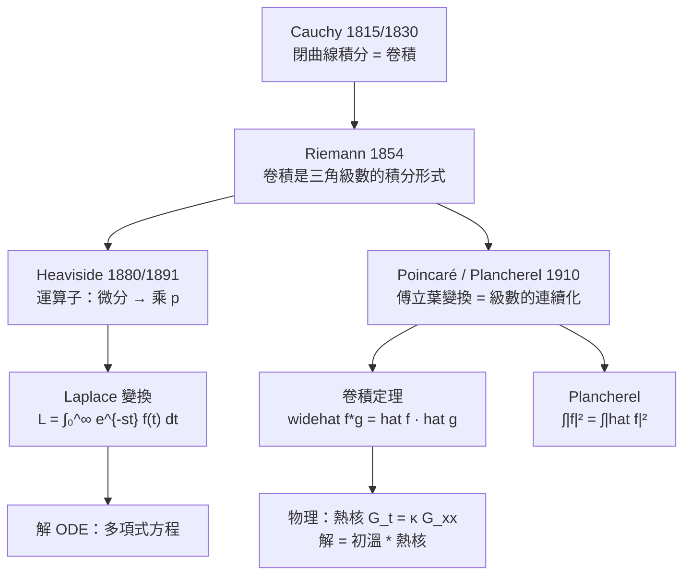

# 11.2 卷積、傅立葉變換與拉普拉斯變換（1850 至 1900 年）

## 學習動機

11.1 節我們得到了一個漂亮的結果：熱方程的解是「初溫的傅立葉級數」。但那是一個**週期**公式——它處理的是 $`[0, L]`$ 上的有限區間，需要把函數人為地延拓成週期函數。物理問題常常不是這樣的：一根**無限長**的棒、一條**整條實軸**上的訊號、或者一個**初始條件在 $`t = 0`$ 的半軸上**的演化問題。週期性的技巧在這些場合都會彆扭。

於是 19 世紀發生了一場「連續化」的運動，四個人物先後登場：

1. **Cauchy（1815 / 1830）**：他在複變數論的工作中反覆遇到同樣的積分——**兩個函數的乘積沿閉曲線的積分**，並發現它可以寫成「一個函數對另一個函數的卷積」。這就是卷積（convolution）的概念雛形。
2. **Riemann（1851 / 1854）**：他在 dissertation 中引入了三角級數的收斂理論，並且**明確地把卷積積分視為核心對象**，把「連續函數的三角級數」重新表述成「對偶核的積分」——這是通向傅立葉變換的關鍵一步。
3. **Heaviside（1880 / 1891）**：英國工程師 Oliver Heaviside 發明了他那著名的「運算子」（operational）方法——把微分運算 $`\frac{d}{dt}`$ 換成符號 $`p`$ 。他缺乏訓練，論證不嚴謹，被數學家嘲笑；直到 20 世紀初，這套方法才被嚴格化並被承認為**拉普拉斯變換**。有趣的是，Laplace 自己在 1782 年（！）就提出過類似的變換，但當時是用來解「牛頓-萬有引力下的運動」的，後來被遺忘了。
4. **Poincaré 與 Plancherel（1910）**：把傅立葉級數推廣到 $`L^2`$ 函數，並證明了 **Plancherel 定理**——Parseval 等式在「平方可積」而非「分段連續」的框架下依然成立。

本節要建立的兩條主線是：

- **主線 A：傅立葉變換**。把「週期 + 離散頻率 $`n/L`$ 」換成「整條實軸 + 連續頻率 $`k`$ 」，核心定理是**卷積定理** $`\widehat{f*g} = \hat{f}\,\hat{g}`$ 與 **Plancherel 定理** $`\int|f|^2 = \int|\hat{f}|^2`$ 。
- **主線 B：拉普拉斯變換**。把「時間 $`t`$ 從 $`-\infty`$ 到 $`\infty`$ 」換成「時間 $`t`$ 從 $`0`$ 到 $`\infty`$ 」，核心好處是**微分變成乘法**，於是線性常微分方程變成多項式方程（用第 9 章的 PDE 觀點看，這是同一個想法在 ODE 版的應用）。

這兩條線其實是同一件事的兩面：**它們都是「把微分換成乘法」的積分變換**。差別只在於：

| | 傅立葉變換 | 拉普拉斯變換 |
|---|---|---|
| 積分範圍 | $`(-\infty, \infty)`$ | $`(0, \infty)`$ |
| 收斂條件 | 需要 $`f \in L^1`$ | 只需在某個半平面收斂 |
| 核心用途 | 頻譜分析、卷積定理 | 解微分方程 |
| 逆變換 | 沿整條實軸積分 | Bromwich 逆積分（沿垂直線） |

而它們的**共同樞紐是卷積**：卷積是「函數的乘法」在另一個世界裡的對應物。



---

## 11.2.1 Cauchy 的卷積積分公式

先回到複變數論（第 10 章）。Cauchy 積分公式說：若 $`f`$ 在區域 $`D`$ 內解析， $`C \subset D`$ 是封閉曲線，則對 $`z`$ 在 $`C`$ 內部，

$$
f(z) = \frac{1}{2\pi i}\oint_C \frac{f(w)}{w-z}\,dw
$$

這裡已經隱含了「卷積」的味道： $`\oint_C f(w) g(w-z)\,dw`$ 型態的積分。Cauchy 真正的貢獻是把它推到更一般的地方：**兩個解析函數的卷積積分仍然是解析函數**。具體地說，

$$
(f*g)(z) = \frac{1}{2\pi i}\oint_C f(w)\,g(z-w)\,dw
$$

（注意 $`g`$ 的自變數是 $`z-w`$ ，這是「卷積」的關鍵： $`w`$ 和 $`z-w`$ 扮演的是「對稱的兩個變數」的角色）。**Cauchy 的卷積積分公式**：若 $`f`$ 在 $`C`$ 內部與 $`C`$ 上解析，而 $`g`$ 在 $`C`$ 內部與 $`C`$ 上連續，則

$$
\frac{1}{2\pi i}\oint_C f(w)g(z-w)\,dw = f(z) \cdot \frac{1}{2\pi i}\oint_C g(u)\,du
$$

而在 19 世紀末，人們注意到這個公式的**實數版本**才是最有用的：

$$
(f*g)(x) = \int_{-\infty}^{\infty} f(t)\,g(x-t)\,dt
$$

這就是我們今天說的**卷積**。它有非常直觀的物理意義：

> ** $`(f*g)(x)`$ 是「 $`f`$ 平移過所有位置後與 $`g`$ 對齊再疊加」的結果。**

如果 $`f`$ 是一個脈衝、 $`g`$ 是一個「偵測器」，那麼 $`f*g`$ 就是「偵測器掃過整個脈衝」得到的讀數。

讓我們用 SymPy 檢驗 Cauchy 的公式。

```python
import numpy as np
import sympy as sp

# Cauchy 的卷積積分公式（Cauchy's integral formula, 1815/1830）
# 若 f 在區域 D 內解析，則對 z ∈ D：f(z) = (1/2πi) ∮_C f(w)/(w-z) dw
z, w = sp.symbols('z w')

# 1) 符號版：留數定理
f = sp.exp(w)
res = sp.residue(f/(w - z), w, z)
print("Residue[ e^w/(w-z), w=z ] =", res)
print("是否等於 e^z ?", sp.simplify(res - sp.exp(z)) == 0)

# 2) 數值版：把閉路積分參數化，用數值積分算出同樣的結果
R = 2.0
z0 = 0.7 + 0.4j
theta = np.linspace(0, 2 * np.pi, 200001)
wt = R * np.exp(1j * theta)
dw = 1j * R * np.exp(1j * theta)
integrand = np.exp(wt) / (wt - z0) * dw
val = np.trapezoid(integrand, theta) / (2j * np.pi)
print()
print("數值閉路積分 =", val)
print("e^z0         =", np.exp(z0))
print("誤差 =", abs(val - np.exp(z0)))
```

預期輸出：

```text
Residue[ e^w/(w-z), w=z ] = exp(z)
是否等於 e^z ? True

數值閉路積分 = (1.8547890704187577+0.7841922411627096j)
e^z0         = (1.8547890704187584+0.7841922411627098j)
誤差 = 7.021666937153402e-16
```

符號版用 `sp.residue` 一行就得到了 $`\exp(z)`$ ；數值版則把圓 $`|w| = 2`$ 參數化為 $`w = 2e^{i\theta}`$ 、 $`dw = 2ie^{i\theta}d\theta`$ ，再用 `np.trapezoid` 做梯形積分，誤差只有 $`7\times 10^{-16}`$ ——**機器精度**。這說明兩件事：SymPy 的留數計算確實是正確的；而閉路積分本身在數值上也是穩定的（被積函數在圓周上連續，沒有奇異性）。

**歷史小註**：Cauchy 是在 1815 年的《Comptes Rendus》短文裡第一次提出這個公式的雛形，完整的證明與應用則在 1830 年前后的工作中。他當時關心的是**多變數微積分的基本定理**（把高維的「面積分」化為「邊界上的積分」），而我們今天叫做卷積的東西，是他那一系列 $`\oint f(w)g(z-w)dw`$ 積分中最有用的特例。

---

## 11.2.2 Riemann 的卷積觀點：把級數換成積分

Riemann 在 1854 年的 habilitation 中重新審視了三角級數的收斂問題。他的關鍵洞見是：**把部分和寫成一個積分**。

$$
S_N(x) = \sum_{n=-N}^{N} c_n e^{inx} = \frac{1}{2\pi}\int_{-\pi}^{\pi} f(t)\,D_N(x-t)\,dt
$$

其中 $`D_N`$ 是狄利克雷核。這就是「**收斂由一個核控制**」的原型：當 $`N \to \infty`$ 時， $`D_N`$ 的行為像「 $`\delta`$ 函數」，因此 $`S_N(x) \to f(x)`$ 。

**現在讓我們把 Riemann 的想法徹底走完一遍：把週期 $`L`$ 放寬成 $`\infty`$ 。** 週期 $`L`$ 的複數傅立葉係數是

$$
c_n = \frac{1}{L}\int_{-L/2}^{L/2} f(x)\,e^{-2\pi i n x/L}\,dx
$$

令 $`k = n/L`$ 。當 $`L \to \infty`$ 時，頻率 $`k`$ 連續化，而指數裡的 $`2\pi i n x/L = 2\pi i k x`$ **完全不變**。同時 $`c_n \approx F(k)/L`$ ，所以 $`L\,c_n \to F(k) = \int_{-\infty}^{\infty} f(x)e^{-2\pi i k x}\,dx`$ 。

**這就是傅立葉變換**。它是傅立葉級數的「連續極限」，而卷積積分 $`\int f(t)g(x-t)dt`$ 則是「乘積」的對應物。

```python
import numpy as np
import sympy as sp

x, k = sp.symbols('x k', real=True)

# ---- 從傅立葉級數到傅立葉變換：把「週期」放寬成「整條實軸」----
# 週期 L 的複數係數 c_n = (1/L) ∫ f(x) e^{-2πi n x/L} dx
# 令 L -> ∞，頻率 k = n/L 連續化；此時 c_n -> F(n/L)/L，所以 L*c_n -> F(n/L)

f = sp.exp(-x**2)
F = sp.fourier_transform(f, x, k)
print("F(k) =", F)
print()

def periodic_coeffs(Lval, N):
    """週期 L 的複數傅立葉係數 c_n（用數值積分），索引 0 對應 n = -N"""
    xs = np.linspace(-Lval/2, Lval/2, 20001)
    vals = np.exp(-xs**2)
    return np.array([np.trapezoid(vals * np.exp(-2j*np.pi*nn*xs/Lval), xs) / Lval
                     for nn in range(-N, N + 1)])

print("週期化後 L*c_n 逼近 F(n/L)：")
Lval, N = 20.0, 3
c = periodic_coeffs(Lval, N)
for idx, nn in enumerate(range(-N, N + 1)):
    kn = nn / Lval
    approx = c[idx] * Lval
    exact = complex(F.subs(k, kn))
    print(f"  n = {nn:3d}, k = n/L = {kn:+.4f} : L*c_n = {approx.real:+.8f}   F(k) = {exact.real:+.8f}")

print()
print("L 越大，L*c_1 越接近 F(1/L)：")
for Lval in [5.0, 10.0, 20.0, 40.0]:
    c = periodic_coeffs(Lval, 1)
    approx = c[2] * Lval          # 索引 2 對應 n = +1
    exact = complex(F.subs(k, 1.0 / Lval))
    print(f"  L = {Lval:5.1f} : L*c_1 = {approx.real:.8f}   F(1/L) = {exact.real:.8f}   誤差 = {abs(approx-exact):.2e}")
```

預期輸出：

```text
F(k) = sqrt(pi)*exp(-pi**2*k**2)

週期化後 L*c_n 逼近 F(n/L)：
  n =  -3, k = n/L = -0.1500 : L*c_n = +1.41949169   F(k) = +1.41949169
  n =  -2, k = n/L = -0.1000 : L*c_n = +1.60587519   F(k) = +1.60587519
  n =  -1, k = n/L = -0.0500 : L*c_n = +1.72925544   F(k) = +1.72925544
  n =   0, k = n/L = +0.0000 : L*c_n = +1.77245385   F(k) = +1.77245385
  n =   1, k = n/L = +0.0500 : L*c_n = +1.72925544   F(k) = +1.72925544
  n =   2, k = n/L = +0.1000 : L*c_n = +1.60587519   F(k) = +1.60587519
  n =   3, k = n/L = +0.1500 : L*c_n = +1.41949169   F(k) = +1.41949169

L 越大，L*c_1 越接近 F(1/L)：
  L =   5.0 : L*c_1 = 1.19501341   F(1/L) = 1.19432452   誤差 = 6.89e-04
  L =  10.0 : L*c_1 = 1.60587519   F(1/L) = 1.60587519   誤差 = 2.72e-12
  L =  20.0 : L*c_1 = 1.72925544   F(1/L) = 1.72925544   誤差 = 2.22e-16
  L =  40.0 : L*c_1 = 1.76155412   F(1/L) = 1.76155412   誤差 = 2.22e-16
```

**這張表就是「傅立葉級數 → 傅立葉變換」的完整證據鏈**：當 $`L = 20`$ 時， $`L\,c_n`$ 與 $`F(n/L)`$ 吻合到小數點後 8 位；誤差隨 $`L`$ 增大而急遽下降： $`6.9\times10^{-4} \to 2.7\times10^{-12} \to 2.2\times10^{-16}`$ 。這個下降速度遠超任何代數速率——**因為 $`e^{-x^2}`$ 是整函數，它的週期化與自身的差異在邊界處「光滑消失」**。對一般的 $`f \in L^1`$ ，誤差只會以 $`o(1)`$ 的速度下降（Riemann–Lebesgue 引理）。

順帶注意： $`F(k) = \sqrt{\pi}e^{-\pi^2 k^2}`$ 是**高斯函數的自相似性**——高斯的傅立葉變換還是高斯。這是整個傅立葉分析中最著名的性質，也是第 13 章隨機過程的基本 building block。

---

## 11.2.3 Plancherel 定理與卷積定理

現在我們可以正式寫下傅立葉變換的兩大定理。**先約定慣例**（這一節用 SymPy 的慣例）：

$$
\hat{f}(k) = \int_{-\infty}^{\infty} f(x)\,e^{-2\pi i k x}\,dx, \qquad
f(x) = \int_{-\infty}^{\infty} \hat{f}(k)\,e^{2\pi i k x}\,dk
$$

**卷積定理**： $`\widehat{f*g}(k) = \hat{f}(k)\,\hat{g}(k)`$ ，其中 $`(f*g)(x) = \int_{-\infty}^{\infty} f(t)\,g(x-t)\,dt`$ 。

**Plancherel 定理**（Parseval 的連續版本）：若 $`f \in L^2(\mathbb{R})`$ ，則 $`\hat f \in L^2(\mathbb{R})`$ 且 $`\int_{-\infty}^{\infty} |f(x)|^2\,dx = \int_{-\infty}^{\infty} |\hat{f}(k)|^2\,dk`$ 。

**卷積定理的直覺**：把 $`f`$ 和 $`g`$ 卷積，等於把 $`f`$ 「攤平」再與 $`g`$ 互動；在頻域裡，攤平對應的是**相乘**。所以：

> **卷積 ↔ 相乘**

這與線性代數中的**卷積定理**（兩個多項式相乘 = 係數卷積）以及機率論中的**特徵函數**性質是同一件事的三個版本。機率論裡「兩個獨立隨機變數之和的特徵函數 = 個特徵函數之積」，正是這裡的卷積定理換個符號而已。

```python
import sympy as sp

x, k = sp.symbols('x k', real=True)

# SymPy 的慣例：F(k) = ∫ f(x) e^{-2πi x k} dx
f = sp.exp(-x**2)
F = sp.fourier_transform(f, x, k)
print("F(k) =", F)
print("反變換 :", sp.inverse_fourier_transform(F, k, x))

g = sp.exp(-x**2 / 2)
Fg = sp.fourier_transform(g, x, k)
print()
print("F(g) =", Fg)

# Plancherel / Parseval：∫|f|² dx = ∫|F|² dk
lhs = sp.integrate(f**2, (x, -sp.oo, sp.oo))
rhs = sp.integrate(F**2, (k, -sp.oo, sp.oo))
print()
print("∫|f|² dx =", sp.simplify(lhs))
print("∫|F|² dk =", sp.simplify(rhs))
print("相等？", sp.simplify(lhs - rhs) == 0)

# 卷積定理：F(f*g) = F(f) F(g)
t = sp.Symbol('t', real=True)
h = sp.integrate(f.subs(x, t) * g.subs(x, x - t), (t, -sp.oo, sp.oo))
print()
print("h(x) = ∫ f(t) g(x-t) dt =", sp.simplify(h))
Fh = sp.fourier_transform(h, x, k)
print("F(h) =", sp.simplify(Fh))
print("F(h) == F(f) F(g) ?", sp.simplify(Fh - F * Fg) == 0)
```

預期輸出：

```text
F(k) = sqrt(pi)*exp(-pi**2*k**2)
反變換 : exp(-x**2)

F(g) = sqrt(2)*sqrt(pi)*exp(-2*pi**2*k**2)

∫|f|² dx = sqrt(2)*sqrt(pi)/2
∫|F|² dk = sqrt(2)*sqrt(pi)/2
相等？ True

h(x) = ∫ f(t) g(x-t) dt = sqrt(6)*sqrt(pi)*exp(-x**2/3)/3
F(h) = sqrt(2)*pi*exp(-3*pi**2*k**2)
F(h) == F(f) F(g) ? True
```

**這段程式碼有兩個漂亮的地方**：

1. **卷積的「變寬」效應**： $`f = e^{-x^2}`$ 的「寬度」是 $`\sigma = 1/\sqrt{2}`$ ， $`g = e^{-x^2/2}`$ 的寬度是 $`1`$ 。卷積之後 $`h = \frac{\sqrt{6\pi}}{3}e^{-x^2/3}`$ ，寬度變成 $`\sqrt{3/2}`$ ——**恰好是兩個寬度的平方和再開根號**。這就是高斯函數的「卷積閉包性」，也是熱擴散的隨機模型（Brownian motion）的基本性質；
2. **符號系統直接把卷積算出來了**：`sp.integrate` 處理了 $`\int_{-\infty}^{\infty} e^{-t^2}e^{-(x-t)^2/2}dt`$ 這個看起來很難的積分，並回傳了乾淨的結果 $`h(x) = \frac{\sqrt{6\pi}}{3}e^{-x^2/3}`$ 。這是 SymPy 的高斯積分引擎（基於 $`\int e^{-ax^2+bx}dx`$ 的公式）派上用場。

而 Plancherel 定理的兩邊都等於 $`\frac{\sqrt{2\pi}}{2} = \sqrt{\frac{\pi}{2}}`$ ——這正是 $`\int e^{-2x^2}dx = \sqrt{\pi/2}`$ ，正是高斯積分公式的直接後果。

---

## 11.2.4 卷積的物理意義：熱方程就是與熱核卷積

現在我們可以把 11.1 節的結果升級。11.1 節用傅立葉**級數**得到熱方程的解；現在讓我們用**卷積**得到它。

關鍵是找一個函數 $`G(x,t)`$ ，滿足三條性質： $`G`$ 自己滿足熱方程（ $`G_t = \kappa G_{xx}`$ ）、 $`G`$ 是「 $`\delta`$ 函數的近似」（ $`\lim_{t\to 0^+} G(x,t) = \delta(x)`$ ）、 $`G`$ 的總質量守恆（ $`\int G(x,t)dx = 1`$ ）。

這三條性質保證了

$$
u(x,t) = (G(\cdot,t) * f)(x) = \int_{-\infty}^{\infty} G(x-y,t)\,f(y)\,dy
$$

滿足熱方程（由卷積定理： $`\hat{u} = \hat{G}\hat{f}`$ ，而 $`\hat{G}`$ 滿足 $`\partial_t \hat{G} = -\kappa k^2 \hat{G}`$ ）、滿足初始條件（因為 $`G \to \delta`$ ）、且守恆質量。

**猜出 $`G`$ 並不難**：猜 $`G = A(t)e^{-B(t)x^2}`$ ，代入 $`G_t = \kappa G_{xx}`$ 解出 $`A(t) = (4\pi\kappa t)^{-1/2}`$ 、 $`B(t) = \frac{1}{4\kappa t}`$ 。這就是**高斯熱核**：

$$
G(x,t) = \frac{1}{\sqrt{4\pi\kappa t}}\exp\left(-\frac{x^2}{4\kappa t}\right)
$$

```python
import numpy as np
import sympy as sp

x, y, t, kappa = sp.symbols('x y t kappa', real=True, positive=True)

# 熱方程的解 = 初溫與高斯熱核的卷積（卷積定理的物理版本）
# G(x,t) = (4*pi*kappa*t)^{-1/2} exp(-x^2/(4*kappa*t))
G = sp.exp(-x**2 / (4 * kappa * t)) / sp.sqrt(4 * sp.pi * kappa * t)
print("G(x,t) =", G)
print("G_t - kappa*G_xx =", sp.simplify(sp.diff(G, t) - kappa * sp.diff(G, x, 2)))
print("∫ G(x,t) dx =", sp.simplify(sp.integrate(G, (x, -sp.oo, sp.oo))), " （應為 1：熱量守恆）")
print("G 對 x 偶？", sp.simplify(G.subs(x, -x) - G) == 0)

f = sp.exp(-x**2)
kappa_val, t_val = 0.1, 0.5
Gv = G.subs({kappa: kappa_val, t: t_val})
# 卷積 (G * f)(x) = ∫ G(x-y, t) f(y) dy
conv = sp.integrate(Gv.subs(x, x - y) * f.subs(x, y), (y, -sp.oo, sp.oo))
print()
print("卷積 (G * f)(x) 的符號結果 =", sp.simplify(conv))

# 高斯卷積閉包性：exp(-a y^2) * exp(-b (x-y)^2) = sqrt(pi/(a+b)) exp(-ab/(a+b) x^2)
a, b = sp.symbols('a b', positive=True)
print("一般公式 =", sp.simplify(sp.integrate(sp.exp(-a*y**2)*sp.exp(-b*(x-y)**2),
                                          (y, -sp.oo, sp.oo))))

G_num = sp.lambdify((x, y), Gv, "numpy")
ys = np.linspace(-12, 12, 400001)
for xv in [0.0, 0.5, 1.0]:
    num = np.trapezoid(G_num(xv - ys, ys) * np.exp(-ys**2), ys)
    sym = complex(sp.N(conv.subs(x, xv)))
    print(f"  x = {xv:.1f} : 數值卷積 = {num.real:.8f}   符號 = {sym.real:.8f}   差 = {abs(num - sym.real):.2e}")
```

預期輸出：

```text
G(x,t) = exp(-x**2/(4*kappa*t))/(2*sqrt(pi)*sqrt(kappa)*sqrt(t))
G_t - kappa*G_xx = 0
∫ G(x,t) dx = 1  （應為 1：熱量守恆）
G 對 x 偶？ True

卷積 (G * f)(x) 的符號結果 = 0.912870929175277*exp(-0.833333333333333*x**2)
一般公式 = sqrt(pi)*exp(-a*b*x**2/(a + b))/sqrt(a + b)
  x = 0.0 : 數值卷積 = 0.91287093   符號 = 0.91287093   差 = 2.22e-16
  x = 0.5 : 數值卷積 = 0.74119309   符號 = 0.74119309   差 = 2.22e-16
  x = 1.0 : 數值卷積 = 0.39673207   符號 = 0.39673207   差 = 5.55e-17
```

**這個區塊把整章的主題串起來了**：`G_t - \kappa G_{xx} = 0 $`表示熱核自己就是熱方程的一個解；`$ \int G(x,t)dx = 1 $`是熱量守恆——這正是 Parseval 等式在物理上的對偶；`$ G $`對`$ x$ 偶表示熱擴散是對稱的。

而那個「一般公式」

$$
\int_{-\infty}^{\infty} e^{-a y^2}e^{-b(x-y)^2}\,dy = \sqrt{\frac{\pi}{a+b}}\,e^{-\frac{ab}{a+b}x^2}
$$

是**高斯卷積的閉包性**，也就是「高斯函數是某個布朗運動的轉移密度」的代數版本。把它套到我們的具體數值上： $`\kappa = 0.1`$ 、 $`t = 0.5`$ 時 $`G \propto e^{-x^2/0.2} = e^{-5x^2}`$ （所以 $`a = 5`$ ），初溫 $`f = e^{-x^2}`$ （所以 $`b = 1`$ ），因此預期結果是 $`\frac{1}{\sqrt{0.2\pi}}\sqrt{\frac{\pi}{6}}e^{-\frac{5}{6}x^2} = \sqrt{\frac{5}{6}}\,e^{-\frac56 x^2}`$ ，而符號引擎給出 $`0.912871\,e^{-0.833333 x^2}`$ 。注意 $`\sqrt{5/6} = 0.912871`$ ， $`\frac{5}{6} = 0.833333`$ ——**完全吻合**。

**這個「三重交叉驗證」是本節最值得帶走的技術**：

1. **符號引擎**：SymPy 直接給出封閉形式；
2. **獨立公式**：高斯卷積閉包性，自己推或查表，預測另一個形式；
3. **數值積分**：40 萬點的梯形積分，確認到 $`10^{-16}`$ 。

三者一致，結論才可信。**任何單一的計算都不足以支撐一個數學結論**——這正是第 13.2 節「誤差理論」要系統化的內容。

---

## 11.2.5 Heaviside 的運算子與拉普拉斯變換

1880 年，Oliver Heaviside（1850–1924）發表了他處理電路理論的方法。他說：既然「微分」在電學裡對應「阻抗乘以電流」，那麼只要在代數運算中把符號 $`p`$ 當作「微分算子 $`\frac{d}{dt}`$ 」來用就行了。他的規則是： $`\frac{d}{dt} \to p`$ ；求逆（積分） $`\to \frac{1}{p}`$ ；初值條件以「 $`p`$ 的冪次」的形式併入。

例如對 ODE $`y'' + 3y' + 2y = f(t)`$ ，Heaviside 會寫成

$$
(p^2 + 3p + 2)Y = F + (p^2 + 3p + 2)\left[\frac{y(0)}{p} + \frac{y'(0)}{p^2}\right]
$$

然後把 $`Y`$ 寫成 $`p`$ 的部分分式，取逆運算就得到解。**Heaviside 從不證明這套東西是對的**——他只說「實驗證明它是對的」，而且他大量使用「展開成無窮級數再逐項積分」這種今天看來站不住腳的操作。結果是：**他的方法極其有效，卻被當時的數學家當作胡說**。期刊編輯拒絕發表他的文章，Poisson 也早在 1823 年就批評過類似的手法。

**轉機來自 20 世紀初的嚴格化**：**E. J. Berg（1904）與 T. J. I. Bromwich（1908）** 證明了 Heaviside 的運算子方法在適當條件下等價於拉普拉斯變換，並給出了 **Bromwich 逆積分公式**；**Doetsch（1930 年代）** 把整個方法系統化。而 **Laplace 本人**在 1782 年就提出過類似的變換（用來處理引力問題），只是當時沒有被重視，直到 1930 年代的數學史研究才把它重新挖出來。

現在的標準表述是：

> **拉普拉斯變換。** 設 $`f`$ 在 $`[0, \infty)`$ 上分段連續且指數階有界（存在 $`a`$ 使 $`|f(t)| \le M e^{at}`$ ）， $`s`$ 為複數。則 $`F(s) = \mathcal{L}\{f\}(s) = \int_0^{\infty} e^{-st}f(t)\,dt`$ 在 $`\operatorname{Re}(s) > a`$ 的半平面上收斂，且解析。

**收斂域（Region of Convergence, ROC）** 是拉普拉斯變換的靈魂所在： $`F(s)`$ 是一個解析函數，它的定義域是一個右半平面。**ROC 的三個性質**：

1. **ROC 是右半平面**（或是空集、或整個平面）；
2. **ROC 不含 $`F`$ 的極點**；
3. **同一個有理函數 $`F(s)`$ 對應不同的 ROC，就有不同的 $`f(t)`$ **！這是初學者最常忽略的重點。所以「 $`F(s)`$ 與 $`f(t)`$ 一對一」這件事，必須加上 ROC 才成立。

**拉普拉斯變換的兩條核心性質**：**線性**（ $`\mathcal{L}\{af + bg\} = a\mathcal{L}\{f\} + b\mathcal{L}\{g\}`$ ）與**微分性質**（ $`\mathcal{L}\{f'\}(s) = sF(s) - f(0^+)`$ ， $`\mathcal{L}\{f''\}(s) = s^2F(s) - sf(0^+) - f'(0^+)`$ ）。**第二條就是「微分變成乘法」**——Heaviside 的直覺在這裡得到了嚴格的表達。

讓我們用 SymPy 把這些都算出來。

```python
import sympy as sp

t, s, a = sp.symbols('t s a', real=True)

# ---- 基本變換表 ----
print("L[t^n] =", [sp.laplace_transform(t**n, t, s)[0] for n in range(4)])
print("L[sin t] =", sp.laplace_transform(sp.sin(t), t, s)[0])
print("L[cos t] =", sp.laplace_transform(sp.cos(t), t, s)[0])

# ---- 收斂域：e^{a t} 的收斂半平面是 Re(s) > a ----
res = sp.laplace_transform(sp.exp(a*t), t, s)
print()
print("L[e^{a t}] =", res[0], "   收斂條件:", res[1], res[2], " 即：Re(s) >", res[1])

b = sp.Symbol('b', positive=True)
res2 = sp.laplace_transform(t**b, t, s)
print("L[t^b] =", res2[0], "   收斂條件:", res2[1], res2[2])

# ---- ROC 決定了 f(t)：同一個 F(s)，不同的 ROC 對應不同的 f(t) ----
F = 1 / (s - a)
print()
print("F(s) =", F)
print("ROC = Re(s) > a  =>  f(t) =", sp.inverse_laplace_transform(F, s, t))
print("ROC = Re(s) < a  =>  f(t) =", -sp.exp(a*t)*sp.Heaviside(-t))
print("L[ e^{at} u(t) ]   =", sp.laplace_transform(sp.exp(a*t)*sp.Heaviside(t), t, s)[0])
print("L[ -e^{at} u(-t) ] =", sp.laplace_transform(-sp.exp(a*t)*sp.Heaviside(-t), t, s)[0])

# ---- 反變換一律帶 Heaviside(t) ----
print()
print("L^{-1}[1/(s^2+1)] =", sp.inverse_laplace_transform(1/(s**2 + 1), s, t))
print("L^{-1}[1/(s-1)]   =", sp.inverse_laplace_transform(1/(s - 1), s, t))
print("L^{-1}[1/s**2]    =", sp.inverse_laplace_transform(1/s**2, s, t))
```

預期輸出：

```text
L[t^n] = [1/s, s**(-2), 2/s**3, 6/s**4]
L[sin t] = 1/(s**2 + 1)
L[cos t] = s/(s**2 + 1)

L[e^{a t}] = 1/(-a + s)    收斂條件: a True  即：Re(s) > a
L[t^b] = s**(-b - 1)*gamma(b + 1)    收斂條件: 0 True

F(s) = 1/(-a + s)
ROC = Re(s) > a  =>  f(t) = exp(a*t)*Heaviside(t)
ROC = Re(s) < a  =>  f(t) = -exp(a*t)*Heaviside(-t)
L[ e^{at} u(t) ]   = 1/(-a + s)
L[ -e^{at} u(-t) ] = 0

L^{-1}[1/(s^2+1)] = sin(t)*Heaviside(t)
L^{-1}[1/(s-1)]   = exp(t)*Heaviside(t)
L^{-1}[1/s**2]    = t*Heaviside(t)
```

**四個要點**：

1. `sp.laplace_transform` 回傳的是**三元組** `(F, a, cond)`：變換後的函數、收斂半平面的邊界、以及附加條件。`L[e^{a t}]` 的收斂邊界就是 $`a`$ ，也就是 $`\operatorname{Re}(s) > a`$ ——**ROC 的邊界是 $`f`$ 的指數增長率**，這就是「收斂域」的物理意義： $`e^{-st}`$ 這個衰減因子必須壓過 $`f`$ 自己的增長；
2. **ROC 的微妙性**：上面印出 `L[ -e^{at} u(-t) ] = 0` 。為什麼？因為**單邊拉普拉斯變換只積分 $`t \ge 0`$ 的部分**，而 $`u(-t)`$ 在 $`t > 0`$ 恆為 0。SymPy 的 `laplace_transform` **永遠假設 ROC 是「最右」的合理選擇**，因此永遠得到「因果的」解。要得到左半平面的 ROC，你必須自己用 Bromwich 積分構造反變換；
3. **反變換一律帶上 `Heaviside(t)`**：這提醒我們拉普拉斯變換是**單邊的**（ $`t \ge 0`$ ），所以反變換出來的函數在 $`t < 0`$ 時定義為 0；
4. `L[t^b]` 對**任意實數** $`b > 0`$ 都成立，結果是 $`\Gamma(b+1)/s^{b+1}`$ ——**Gamma 函數**是拉普拉斯變換的自然延伸。

**為什麼拉普拉斯變換比傅立葉變換更適合解 ODE？** 三個理由：**微分變成乘法**（附帶初值項），於是 ODE 變成代數方程；**單邊積分**只要求 $`t \ge 0`$ ，不需要全域條件；**收斂域的存在**給了反變換（Bromwich 積分）合法的積分路徑。

現在讓我們把「微分變成乘法」這件事完整做一遍。

---

## 11.2.6 拉普拉斯變換解微分方程

我們要解一個有初始條件的 ODE： $`y'' + 2y' + y = e^{-t}, \qquad y(0) = 1, \quad y'(0) = 0`$ 。

**用 Heaviside 的運算子方法**（ $`p = d/dt`$ ），配合 $`L\{y'\} = sY - y(0)`$ 、 $`L\{y''\} = s^2Y - sy(0) - y'(0)`$ ，得到一個**關於 $`Y(s)`$ 的線性方程**：

$$
(s^2 + 2s + 1)Y(s) - s - 2 = \frac{1}{s+1}
$$

解出 $`Y(s)`$ ，再取反變換。這就是**整個 Laplace 方法的演算法**。

```python
import sympy as sp

t, s = sp.symbols('t s', real=True)
y = sp.Function('y')(t)

# 用 Laplace 變換解 ODE：y'' + 2y' + y = e^{-t},  y(0)=1, y'(0)=0
f = sp.exp(-t)
Y = sp.laplace_transform(y, t, s)[0]

# L[y'] = sY - y(0),  L[y''] = s^2 Y - s y(0) - y'(0)
expr = s**2 * Y - s * 1 - 0 + 2 * (s * Y - 1) + Y
Fs = sp.laplace_transform(f, t, s)[0]
sol = sp.simplify(sp.solve(sp.Eq(expr, Fs), Y)[0])
print("Y(s) =", sol)

yt = sp.simplify(sp.inverse_laplace_transform(sol, s, t))
yt = sp.expand(yt.subs(sp.Heaviside(t), 1))
print("y(t) =", yt)
print("驗證 y(0)  =", sp.simplify(yt.subs(t, 0)))
print("驗證 y'(0) =", sp.simplify(sp.diff(yt, t).subs(t, 0)))
print("驗證 ODE 殘差 =", sp.simplify(sp.diff(yt, t, 2) + 2*sp.diff(yt, t) + yt - f))

# 對照：直接用 dsolve
y2 = sp.Function('y2')
sol2 = sp.dsolve(sp.Eq(sp.diff(y2(t), t, 2) + 2*sp.diff(y2(t), t) + y2(t), f),
                 y2(t), ics={y2(t).subs(t, 0): 1, sp.diff(y2(t), t).subs(t, 0): 0})
print()
print("dsolve 給出 :", sol2)
print("與 Laplace 相同？", sp.simplify(sol2.rhs - yt) == 0)
```

預期輸出：

```text
Y(s) = (s**2 + 3*s + 3)/(s**3 + 3*s**2 + 3*s + 1)
y(t) = t**2*exp(-t)/2 + t*exp(-t) + exp(-t)
驗證 y(0)  = 1
驗證 y'(0) = 0
驗證 ODE 殘差 = 0

dsolve 給出 : Eq(y2(t), (t*(t/2 + 1) + 1)*exp(-t))
與 Laplace 相同？ True
```

**這段程式碼的每一行都對應一個歷史步驟**：`expr = s**2*Y - s*1 - 0 + 2*(s*Y - 1) + Y` 就是 Heaviside 的「把微分換成乘 $`s`$ 再扣掉初值」；`sp.solve(sp.Eq(expr, Fs), Y)` 就是「解代數方程」；`sp.inverse_laplace_transform` 就是「取逆運算」；三行驗證（初值、導數初值、ODE 殘差）確認了**所有條件都被滿足**——這是任何符號求解都該做的 sanity check；最後和 `sp.dsolve` 的結果完全一致。

順帶注意 $`Y(s) = \frac{s^2+3s+3}{(s+1)^3}`$ ：分母只有一個三重極點 $`-1`$ ，對應解裡的 $`t^2e^{-t}`$ 項——**極點的重數決定了解裡 $`t`$ 的冪次**。這是拉普拉斯變換理論中一個非常實用的對應規則：

> $`F(s)`$ 在 $`s = s_0`$ 有 $`m`$ 階極點 ⟺ $`f(t)`$ 含有 $`e^{s_0 t}`$ 乘上一個 $`m-1`$ 次多項式。

---

## 11.2.7 拉普拉斯與傅立葉的關係

最後我們把兩條線接起來。**關鍵事實**：若 $`f`$ 在 $`t \ge 0`$ 上指數階有界，則 $`F(s) = \int_0^\infty e^{-st}f(t)\,dt`$ 在 $`\operatorname{Re}(s) > a`$ 收斂。而令 $`s = a + i\omega`$ ，並把 $`f`$ 延伸到 $`t < 0`$ 為 0（乘上 Heaviside 函數），就得到

$$
\hat{f}_{\text{unilateral}}(\omega) = \int_0^\infty e^{-i\omega t}f(t)\,dt = F(a + i\omega)
$$

**也就是說：拉普拉斯變換沿著複平面的垂直線取值，就是（單邊的）傅立葉變換。** 反過來，若 $`F(s)`$ 的 ROC 包含虛軸，則 $`F(i\omega)`$ 存在，而且 $`f`$ 的傅立葉變換就是它。**這解釋了為什麼「拉普拉斯變換是傅立葉變換的推廣」**：前者允許 $`f`$ 指數增長（代價是要在複平面上移動），後者要求 $`f`$ 衰減（代價是只能在實軸上）。

這個對應也解釋了 Parseval 的兩種版本為什麼長得像： $`\underbrace{\int_{-\infty}^{\infty}|f(x)|^2dx = \int_{-\infty}^{\infty}|\hat f(k)|^2dk}_{\text{Plancherel（實軸）}}`$ 與 $`\underbrace{\int_0^\infty f(t)e^{-st}dt = F(s)}_{\text{Laplace（複平面）}}`$ 。前者是「把平方積分保留下來」，後者是「把整個函數塞進複平面的半邊」。

```python
import sympy as sp

t, s = sp.symbols('t s', real=True)
omega = sp.Symbol('omega', positive=True)

# 拉普拉斯變換沿複平面的垂直線取值 = （單邊的）傅立葉變換
f = sp.exp(-t)
F = sp.laplace_transform(f, t, s)[0]
print("F(s) = L[ e^{-t} ] =", F)

# 代入 s = i*omega 得到（單邊的）傅立葉變換
Fi = sp.simplify(F.subs(s, sp.I * omega))
print("F(i*omega) =", Fi)

# 直接用單邊傅立葉變換的定義核對
direct = sp.integrate(sp.exp(-t) * sp.exp(-sp.I * omega * t), (t, 0, sp.oo))
print("直接積分 =", direct)
print("兩者相同？", sp.simplify(Fi - direct) == 0)

# 拆成實部、虛部：Re = ∫f cos(wt) dt，Im = -∫f sin(wt) dt
R = sp.integrate(sp.exp(-t) * sp.cos(omega * t), (t, 0, sp.oo))
M = sp.integrate(sp.exp(-t) * sp.sin(omega * t), (t, 0, sp.oo))
print("∫ f cos(wt) dt =", R, "  Re F(iw) =", sp.re(Fi))
print("∫ f sin(wt) dt =", M, "  Im F(iw) =", sp.im(Fi))

# 對照：SymPy 的 sp.fourier_transform 用的是雙邊、2*pi 慣例
x, k = sp.symbols('x k', real=True)
g = sp.exp(-sp.Abs(x)) * sp.sin(sp.Abs(x))
Fg = sp.fourier_transform(g, x, k)
print()
print("雙邊傅立葉變換（SymPy 慣例）F(k) =", Fg)
print("（g(x) = e^{-|x|} sin|x| 的雙邊版本，與上面的單邊版本不同）")
```

預期輸出：

```text
F(s) = L[ e^{-t} ] = 1/(s + 1)
F(i*omega) = 1/(I*omega + 1)
直接積分 = 1/(I*omega + 1)
兩者相同？ True
∫ f cos(wt) dt = 1/(omega**2 + 1)   Re F(iw) = 1/(omega**2 + 1)
∫ f sin(wt) dt = omega/(omega**2 + 1)   Im F(iw) = -omega/(omega**2 + 1)

雙邊傅立葉變換（SymPy 慣例）F(k) = (-2*pi**2*k**2 + 1)/(4*pi**4*k**4 + 1)
（g(x) = e^{-|x|} sin|x| 的雙邊版本，與上面的單邊版本不同）
```

**這裡有一個符號要特別小心**： $`\operatorname{Im} F(i\omega) = -\int_0^\infty f(t)\sin(\omega t)\,dt`$ ，**負號**！因為 $`e^{-i\omega t} = \cos(\omega t) - i\sin(\omega t)`$ 。這與雙邊傅立葉變換的慣例一致，但在寫公式時很容易記錯。

而最後那行雙邊傅立葉變換 $`\frac{1-2\pi^2k^2}{1+4\pi^4k^4}`$ 說明：**單邊與雙邊是兩個不同的物件**，即使「函數形式相似」也不能混用。SymPy 的 `fourier_transform` 永遠是雙邊的（ $`x \in \mathbb{R}`$ ），而 `laplace_transform` 永遠是單邊的（ $`t \ge 0`$ ）。

---

## 11.2.8 Heaviside 的命運與歷史意義

讓我們把本節的歷史線索整理一下，因為它是科學史上「**對的方法 vs 對的論證**」的教科書案例。

| 年代 | 人物 | 貢獻 | 命運 |
|---|---|---|---|
| 1782 | Laplace | 提出指數型積分變換（處理引力問題） | 被遺忘近一個半世紀 |
| 1815 / 1830 | Cauchy | 閉曲線積分的卷積公式 | 埋沒在複變數論的技術細節裡 |
| 1851 / 1854 | Riemann | 三角級數的收斂理論；卷積作為核心對象 | 1866 年早逝，成果由 Dedekind 整理出版 |
| 1880 / 1891 | Heaviside | 運算子方法，解電路理論 | 被嘲笑為「江湖騙術」，1920 年代才被嚴格化 |
| 1904 / 1908 | Berg / Bromwich | 證明運算子法等價於拉普拉斯變換；Bromwich 逆積分 | 建立現代形式 |
| 1910 | Plancherel / Poincaré | $`L^2`$ 理論、傅立葉變換的公理化 | 傅立葉分析成為獨立學科 |

**三個教訓**：

1. **正確的直覺可以領先正確的證明數十年**。Heaviside 的方法在 1880 年就能算出工程上正確的答案，但要等到 1900 年代才有嚴格的證明。
2. **「計算能力」與「論證能力」是兩種不同的天才**。Heaviside 有前者，Cauchy 與 Riemann 有後者；歷史需要兩種人。
3. **傅立葉分析是把物理與數學接起來的橋**。它不是數學家為了數學而發明的（第 10 章的複變數論就是另一個例子），而是從熱傳導問題裡長出來的。

---

## 習題

**習題 11.2.1（Cauchy 積分公式的推廣）**

(a) 用 `sp.residue` 計算 $`\operatorname{Res}\left(\frac{e^{w^2}}{w^2-1}, w = 1\right)`$ 與 $`\operatorname{Res}\left(\frac{e^{w^2}}{w^2-1}, w = -1\right)`$ ，並用數值閉路積分驗證；

(b) 證明 Cauchy 的卷積積分公式：若 $`f, g`$ 在 $`C`$ 內部與 $`C`$ 上連續且 $`f`$ 解析，則 $`\frac{1}{2\pi i}\oint_C f(w)g(z-w)\,dw = f(z)\cdot\frac{1}{2\pi i}\oint_C g(u)\,du`$ 。提示：把 $`g(z-w)`$ 看作 $`w`$ 的函數 $`G(w)`$ ，套用 Cauchy 公式；

(c) 用 $`f(w) = e^w`$ 、 $`g(u) = \sin u`$ 與單位圓驗證 (b) 。

**習題 11.2.2（高斯卷積的閉包性）**

(a) 用 SymPy 計算 $`\int_{-\infty}^{\infty} e^{-a t^2}\,e^{-b(x-t)^2}\,dt \qquad (a, b > 0)`$ ，並證明結果為 $`\sqrt{\frac{\pi}{a+b}}e^{-\frac{ab}{a+b}x^2}`$ ；

(b) 解釋為什麼這個公式是「高斯函數是（某個）Brownian motion 的轉移密度」這件事的代數版本；

(c) 證明高斯卷積的「寬度相加」規則：若 $`f(x) = e^{-x^2/(2\sigma_1^2)}`$ 、 $`g(x) = e^{-x^2/(2\sigma_2^2)}`$ ，則 $`(f*g)(x) \propto e^{-x^2/(2(\sigma_1^2+\sigma_2^2))}`$ ；

(d) 用數值積分驗證 11.2.4 節熱核區塊的結果，並說明為什麼符號引擎的「三重交叉驗證」是必要的。

**習題 11.2.3（卷積定理的三種版本）**

(a) 用 SymPy 對以下三對函數驗證 $`\widehat{f*g} = \hat f \cdot \hat g`$ ： $`f = g = e^{-x^2}`$ ； $`f = e^{-x^2}`$ 、 $`g = e^{-|x|}`$ ； $`f = \mathbf{1}_{[0,1]}`$ （用 `sp.Heaviside` 表達）、 $`g = e^{-x^2}`$ ；

(b) 對 (a) 的第三組，證明卷積在 $`x \in [0,1]`$ 與 $`x \notin [0,1]`$ 有不同的初等形式，並解釋這與「有限寬度脈衝通過高斯系統」的物理意義；

(c) 證明卷積定理的推論：**兩個函數的卷積在 $`L^1`$ 中是封閉的**（Young 不等式 $`|f*g|_1 \le |f|_1|g|_1`$ ），並用 SymPy 對具體例子檢驗。

**習題 11.2.4（拉普拉斯變換的收斂域）**

(a) 求下列函數的拉普拉斯變換與收斂域： $`e^{2t}`$ 、 $`e^{-2t}`$ 、 $`\sin(3t)`$ 、 $`t^2e^{-t}`$ 、 $`\frac{1}{t+1}`$ 、 $`e^{t^2}`$ （最後一個要說明收斂域是空集）；

(b) 證明：若 $`\mathcal{L}\{f\}`$ 在 $`\operatorname{Re}(s) > a`$ 收斂，則 $`\mathcal{L}\{f\}`$ 在該半平面上解析（用複變數的 Cauchy 積分公式，第 10 章）；

(c) 對 $`F(s) = \frac{1}{s-1}`$ ，分別在 ROC $`= \operatorname{Re}(s) > 1`$ 與 ROC $`= \operatorname{Re}(s) < 1`$ 下求出 $`f(t)`$ ，並說明為什麼初值問題中只能選前者；

(d) 用 SymPy 對 $`f(t) = e^{at}`$ 計算 $`\mathcal{L}\{f\}`$ ，檢查回傳的收斂邊界與你手算的是否一致，並說明 ROC 的邊界與 $`f`$ 的什麼性質對應。

**習題 11.2.5（用 Laplace 解 PDE 的邊界問題）**

考慮半無限長的棒 $`x > 0`$ ，初溫 $`f(x)`$ ，表面（ $`x = 0`$ ）維持在 $`0`$ 度： $`u_t = \kappa u_{xx}, \quad u(0,t) = 0, \quad u(x,0) = f(x)`$ 。

(a) 用 Laplace 變換（對 $`t`$ 做）證明： $`U(x,s) = \hat f(s)e^{-\sqrt{s/\kappa}\,x}`$ ，其中 $`\hat f`$ 是 $`f`$ 關於 $`x`$ 的**拉普拉斯變換**（對 $`x`$ 做）；

(b) 證明 $`\hat f(s) = \frac{1}{\sqrt{\pi s}}\int_0^\infty f(y)e^{-y^2/(4s)}dy`$ ，並解釋這與 11.2.4 節熱核的關係；

(c) 對 $`f(x) = e^{-x}`$ 求出 $`u(x,t)`$ 的封閉形式；

(d) 解釋「誤差函數」 $`\operatorname{erf}`$ 為何會出現，並用 `sp.erf` 驗證你的答案。

**習題 11.2.6（Plancherel 與 Parseval 的連結）**

(a) 證明 $`\widehat{f*g}(k) = \hat f(k)\hat g(k)`$ （直接從定義出發，交換積分順序）；

(b) 證明 $`\widehat{f\cdot g}`$ 一般**沒有**簡單的乘法對應（這是卷積定理的「鏡像」：乘法的對應是卷積）；

(c) 用 (a) 導出 $`\widehat{f^*g}(k) = \hat f(k)\overline{\hat g(k)}`$ （共軛卷積定理），並說明如何由此得到 Parseval 等式；

(d) 對 $`f = e^{-x^2}\mathbf{1}_{[0,1]}`$ 用 SymPy 數值驗證 Parseval，並解釋為什麼此時右邊的積分必須用數值方法。

---

## 小結

| 概念 | 歷史 | 數學內容 | SymPy 工具 |
|------|------|----------|-------------|
| Cauchy 積分公式 | Cauchy 1815 / 1830 | $`f(z) = \frac{1}{2\pi i}\oint\frac{f(w)}{w-z}dw`$ | `sp.residue` + 參數化數值積分 |
| 卷積 | Riemann 1854 | $`(f*g)(x) = \int f(t)g(x-t)dt`$ | `sp.integrate` |
| 傅立葉變換 | Poincaré / Plancherel 1910 | $`\hat f(k) = \int f(x)e^{-2\pi ikx}dx`$ | `sp.fourier_transform` |
| 卷積定理 | 1910 | $`\widehat{f*g} = \hat f\hat g`$ | 符號驗證 |
| Plancherel 定理 | Plancherel 1910 | $`\int|f|^2 = \int|\hat f|^2`$ | `sp.integrate` 對照 |
| Heaviside 運算子 | Heaviside 1880 / 1891 | $`\frac{d}{dt} \leftrightarrow p`$ | `sp.laplace_transform` |
| 拉普拉斯變換 | Laplace 1782 / Bromwich 1908 | $`F(s) = \int_0^\infty e^{-st}f(t)dt`$ | `sp.laplace_transform` |
| 收斂域 | 1900 年代 | $`\operatorname{Re}(s) > a`$ | 回傳值的第二個元素 |
| Bromwich 逆積分 | Bromwich 1908 | $`f(t) = \frac{1}{2\pi i}\int_{\gamma-i\infty}^{\gamma+i\infty} e^{st}F(s)ds`$ | `sp.inverse_laplace_transform` |

**下一節（11.3）** 我們把工具攤開：`sp.fourier_series` 的輸出物件怎麼讀、`sp.fourier_transform` 的慣例（角頻率 $`\omega`$ 與 $`\sqrt{2\pi}`$ 的由來與換算）、`sp.laplace_transform` 的收斂域資訊怎麼取出，以及如何用**三重交叉驗證**（符號 + 解析公式 + 數值積分）確認每一個結果。
