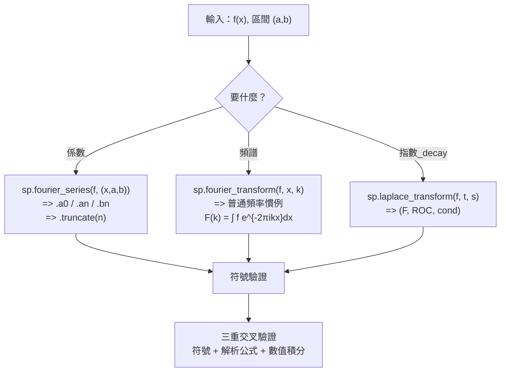

# 11.3 用 SymPy 做傅立葉級數與變換

## 學習動機

前兩節是**理論與歷史**：Fourier 怎麼被熱傳導逼出三角級數、Dirichlet 怎麼說清楚收斂性、Heaviside 怎麼用運算子解電路。本節是**工具**：SymPy 到底能替我們做哪些事？

具體來說，我們要處理五個問題：

1. **`sp.fourier_series` 的輸出物件怎麼讀？** 它不是一個普通的式子，而是一個 `FourierSeries` 物件，裡面裝著 `a0`、`an`、`bn` 三個**序列**（`SeqFormula`），以及 `truncate`、`sigma_approximation`、`shift`、`scale` 等一組方法。讀懂它的結構，就讀懂了整個傅立葉級數的資料模型。
2. **傅立葉變換的慣例是什麼？** 這是初學者最常跌倒的地方。SymPy 用的是「**普通頻率**」慣例 $`\hat{f}(k) = \int f(x)e^{-2\pi i k x}dx`$ ；而物理教科書常用「**角頻率 + 酉正規化**」慣例 $`\hat{f}(\omega) = \frac{1}{\sqrt{2\pi}}\int f(x)e^{-i\omega x}dx`$ 。兩者相差一個 $`\sqrt{2\pi}`$ 與一個 $`2\pi`$ 的替換——**搞錯了，答案就會整體差一個常數因子**，而且很難察覺。
3. **`sp.laplace_transform` 回傳的三元組怎麼讀？** `(F, a, cond)`：變換後的函數、收斂半平面的邊界、以及附加條件。第三個元素常常被忽略，但它是理解「收斂域」的入口。
4. **卷積定理與 Parseval 恆等式怎麼用符號驗證？** 這兩條定理是 11.2 節的核心，必須讓電腦幫我們確認。
5. **怎麼用數值積分交叉驗證？** 符號運算給出的答案不能只信一半。**三重交叉驗證**（符號引擎 + 獨立公式 + 數值積分）是我們在 11.2 節建立的方法論，本節把它系統化。

另外還要處理兩個實務問題：

- **Gibbs 現象的量化**（11.1 節用 numpy 做，這裡用 SymPy 做，並比較 `sigma_approximation` 的抑制效果）；
- **符號系統的侷限**：`sp.fourier_transform` 對某些函數會回傳**未求值的 `FourierTransform` 物件**而不是閉式結果——什麼時候會發生？為什麼？



---

## 11.3.1 `sp.fourier_series`：輸出物件的解剖

`sp.fourier_series(f, (x, a, b))` 回傳的**不是**一個普通的 `Expr`，而是一個 `FourierSeries` 物件。它的內部結構是

$$
\texttt{FourierSeries}\bigl(f,\ (x,a,b),\ (a_0,\ \mathrm{SeqFormula}(a_n),\ \mathrm{SeqFormula}(b_n))\bigr)
$$

也就是「**函數 + 區間 + 三個係數序列**」。讓我們把它徹底拆開來看。

```python
import sympy as sp

x = sp.Symbol('x', real=True)

# ---- sp.fourier_series 的輸出物件 ----
fs = sp.fourier_series(x**2, (x, -sp.pi, sp.pi))
print("repr :", fs)
print()
print("型別      :", type(fs))
print("函數      :", fs.function)
print("變數      :", fs.x)
print("週期      :", fs.period)
print("L（半週期）:", fs.L)
print("a0        :", fs.a0)
print("an        :", fs.an)
print("bn        :", fs.bn)
print()
print("truncate(3) :", fs.truncate(3))
print("truncate(6) :", fs.truncate(6))
print()
print("shift(1).truncate()  :", fs.shift(1).truncate())
print("scale(2).truncate()  :", fs.scale(2).truncate())
print("shiftx(1).truncate() :", fs.shiftx(1).truncate())

# ---- 有限傅立葉級數（三角多項式）會得到不同的物件型別 ----
fs2 = sp.fourier_series(sp.sin(x), (x, -sp.pi, sp.pi))
print()
print("sin(x) 的 FourierSeries :", type(fs2).__name__)
print("  a0 =", fs2.a0, "  an =", fs2.an, "  bn =", fs2.bn)
print("  truncate(3) =", fs2.truncate(3))
```

預期輸出：

```text
repr : FourierSeries(x**2, (x, -pi, pi), (pi**2/3, SeqFormula(Piecewise((2*pi**2*sin(_n*pi)/_n + 4*pi*cos(_n*pi)/_n**2 - 4*sin(_n*pi)/_n**3, (_n > -oo) & (_n < oo) & Ne(_n, 0)), (2*pi**3/3, True))*cos(_n*x)/pi, (_n, 1, oo)), SeqFormula(0, (_k, 1, oo))))

型別      : <class 'sympy.series.fourier.FourierSeries'>
函數      : x**2
變數      : x
週期      : (-pi, pi)
L（半週期）: pi
a0        : pi**2/3
an        : SeqFormula(Piecewise((2*pi**2*sin(_n*pi)/_n + 4*pi*cos(_n*pi)/_n**2 - 4*sin(_n*pi)/_n**3, (_n > -oo) & (_n < oo) & Ne(_n, 0)), (2*pi**3/3, True))*cos(_n*x)/pi, (_n, 1, oo))
bn        : SeqFormula(0, (_k, 1, oo))

truncate(3) : -4*cos(x) + cos(2*x) + pi**2/3
truncate(6) : -4*cos(x) + cos(2*x) - 4*cos(3*x)/9 + cos(4*x)/4 - 4*cos(5*x)/25 + pi**2/3

shift(1).truncate()  : -4*cos(x) + cos(2*x) + 1 + pi**2/3
scale(2).truncate()  : -8*cos(x) + 2*cos(2*x) + 2*pi**2/3
shiftx(1).truncate() : -4*cos(x + 1) + cos(2*x + 2) + pi**2/3

sin(x) 的 FourierSeries : FiniteFourierSeries
  a0 = 0   an = {}   bn = {1: 1}
  truncate(3) = sin(x)
```

**六個必須知道的細節**：

1. **`fs.a0` 是「常數項」，不是教科書的 $`a_0`$ 。** 這裡 `a0 = pi**2/3`，而教科書的 $`a_0 = \frac{1}{\pi}\int_{-\pi}^{\pi}x^2 dx = \frac{2\pi^2}{3}`$ 。SymPy 的 `a0` 是**常數項本身**（等於教科書的 $`a_0/2`$ ）。寫 Parseval 等式時這會差 2 倍，11.1.4 節已經踩過這個坑。
2. **`fs.an` 與 `fs.bn` 是 `SeqFormula`（序列公式），不是普通式子。** 它們代表的是 $`n \mapsto a_n`$ 這個**函數**，所以要取出第 $`k`$ 項得用 `.coeff(k)`。而且回傳的那一項**已經含了 $`\cos(nx)`$ 或 $`\sin(nx)`$ **（注意 `an` 裡明顯有 `cos(_n*x)`），要拿純數值係數得再 `.coeff(sp.cos(k*x))` 一次。
3. **`fs.an` 裡的 `Piecewise` 是「 $`n = 0`$ 的特判」。** SymPy 在推導 $`a_0`$ 時用了 $`n = 0`$ 的極限，所以留下 `Piecewise(..., (2*pi**3/3, True))` 這個分支。對 $`n \ge 1`$ 我們用不到它，但要知道它在那裡。
4. **`truncate(n)` 取的是「前 $`n`$ 個非零項」**，不是「到 $`n`$ 階為止」。所以對 $`x^2`$ 而言 `truncate(3)` 給的是 $`-4\cos x + \cos 2x + \frac{\pi^2}{3}`$ （跳過了零項）。
5. **`shift`、`scale`、`shiftx` 讓你避免重新計算。** 因為 `sp.fourier_series` 的計算成本來自積分（文件說得很直白：「Computing Fourier series can be slow due to the integration required」），所以**已經算出 $`x^2`$ 的級數之後， $`x^2+1`$ 與 $`2x^2`$ 的級數應該用 `shift(1)` 與 `scale(2)` 得到**，而不是重新呼叫 `sp.fourier_series`。這是本章最重要的「效能建議」。
6. **三角多項式會得到 `FiniteFourierSeries`**（不同的類別！），它的 `an`、`bn` 是**字典**（`{}` 與 `{1: 1}`）而不是 `SeqFormula`。所以寫通用程式時要注意 `type(fs)` 的分支。

順帶提一下 `sigma_approximation`，我們在 11.3.3 節會用到：它用 **Lanczos $`\sigma`$ 因子**加權各項，是 Fejér 平均的 cousin，目的是**抑制 Gibbs 現象**。

---

## 11.3.2 `sp.fourier_transform`：慣例是最大的陷阱

這是本節最重要的部分。讓我們把三種常見的傅立葉變換慣例並排寫出來：

| 慣例 | 定義 | 逆變換 | 常見於 |
|---|---|---|---|
| **普通頻率**（SymPy 採用） | $`\hat{f}(k) = \int_{-\infty}^{\infty} f(x)e^{-2\pi i k x}dx`$ | $`f(x) = \int \hat{f}(k)e^{2\pi i k x}dk`$ | 純數學、SymPy、數位訊號處理 |
| **角頻率 + 酉正規化** | $`\hat{f}(\omega) = \frac{1}{\sqrt{2\pi}}\int f(x)e^{-i\omega x}dx`$ | $`f(x) = \frac{1}{\sqrt{2\pi}}\int \hat{f}(\omega)e^{i\omega x}d\omega`$ | 物理學、量子力學 |
| **角頻率 + 無正規化** | $`\hat{f}(\omega) = \int f(x)e^{-i\omega x}dx`$ | $`f(x) = \frac{1}{2\pi}\int \hat{f}(\omega)e^{i\omega x}d\omega`$ | 工程、訊號處理教科書 |

**換算關係**（令 $`\omega = 2\pi k`$ ）：

$$
\hat{f}_{\text{unitary}}(\omega) = \frac{1}{\sqrt{2\pi}}\,\hat{f}_{\text{SymPy}}\!\left(\frac{\omega}{2\pi}\right)
$$

也就是

$$
\hat{f}_{\text{SymPy}}(k) = \sqrt{2\pi}\;\hat{f}_{\text{unitary}}(2\pi k)
$$

**SymPy 的 `sp.fourier_transform` 與 `sp.inverse_fourier_transform` 是配對的**，用的都是「普通頻率」慣例。讓我們用一個具體的函數把這件事做實。

```python
import sympy as sp

x, k, omega = sp.symbols('x k omega', real=True)

# ---- SymPy 的傅立葉變換慣例 ----
# sp.fourier_transform 用的是「普通頻率」慣例：F(k) = ∫ f(x) e^{-2πi k x} dx
# 很多物理教科書用「角頻率 + 酉正規化」：Fw(w) = (1/√(2π)) ∫ f(x) e^{-i w x} dx
# 兩者的換算：Fw(w) = F(w/(2π)) / √(2π)

f = sp.exp(-x**2)
F = sp.fourier_transform(f, x, k)
print("F(k)  =", F)

Fw = sp.simplify(F.subs(k, omega / (2 * sp.pi)) / sp.sqrt(2 * sp.pi))
print("Fw(w) =", Fw)

# 用積分直接算出角頻率版本，做交叉驗證
direct = sp.simplify(sp.integrate(f * sp.exp(-sp.I * omega * x), (x, -sp.oo, sp.oo)) / sp.sqrt(2 * sp.pi))
print("直接積分算出的 Fw(w) =", direct)
print("兩者相同？", sp.simplify(Fw - direct) == 0)

# 反變換：SymPy 的 inverse_fourier_transform 與 fourier_transform 配對
print()
print("inverse_fourier_transform(F, k, x) =", sp.inverse_fourier_transform(F, k, x))

# 角頻率版本要自己反演：(1/√(2π)) ∫ Fw(w) e^{i w x} dw
back = sp.simplify(sp.integrate(Fw * sp.exp(sp.I * omega * x), (omega, -sp.oo, sp.oo)) / sp.sqrt(2 * sp.pi))
print("角頻率反演 (1/√(2π)) ∫ Fw e^{iwx} dw =", back)
print("回到 f(x)？", sp.simplify(back - f) == 0)
```

預期輸出：

```text
F(k)  = sqrt(pi)*exp(-pi**2*k**2)
Fw(w) = sqrt(2)*exp(-omega**2/4)/2
直接積分算出的 Fw(w) = sqrt(2)*exp(-omega**2/4)/2
兩者相同？ True

inverse_fourier_transform(F, k, x) = exp(-x**2)
角頻率反演 (1/√(2π)) ∫ Fw e^{iwx} dw = exp(-x**2)
回到 f(x)？ True
```

**怎麼讀這張表**：

- SymPy 給出 $`\hat{f}(k) = \sqrt{\pi}e^{-\pi^2 k^2}`$ 。**手算核對**： $`\int e^{-x^2}e^{-2\pi i kx}dx = \sqrt{\pi}e^{-\pi^2k^2}`$ ，與 SymPy 的輸出一致（用 $`\int e^{-ax^2}dx = \sqrt{\pi/a}`$ 加上配方完成平方）；
- 換算到角頻率酉慣例： $`\hat{f}(\omega) = \frac{1}{\sqrt{2\pi}}\sqrt{\pi}e^{-\omega^2/4} = \frac{1}{\sqrt{2}}e^{-\omega^2/4}`$ 。SymPy 印出 `sqrt(2)*exp(-omega**2/4)/2`，這正是 $`\frac{\sqrt{2}}{2}e^{-\omega^2/4} = \frac{1}{\sqrt{2}}e^{-\omega^2/4}`$ ，兩者一致；
- **關鍵**：兩種慣例給出的函數**形式不同**（ $`e^{-\pi^2k^2}`$ vs $`e^{-\omega^2/4}`$ ），**常數因子也不同**（ $`\sqrt{\pi}`$ vs $`1/\sqrt{2}`$ ）。如果你拿教科書的答案去比 SymPy 的輸出，會發現「指數裡的係數對不上」——那不是 bug，是慣例不同；
- `直接積分算出的 Fw(w)` 與換算結果**完全相同**，這是「換算公式正確」的獨立證據；
- 兩種反變換都回到 $`e^{-x^2}`$ 。

**實務守則**：

1. **不要跨慣例比較數字**。看到 $`\hat{f}(k) = e^{-2\pi^2k^2}`$ 與 $`e^{-k^2/4}`$ 的差異時，先確認指數裡是 $`k`$ 還是 $`\omega`$ ；
2. **用 `sp.fourier_transform` 與 `sp.inverse_fourier_transform` 配對**就好，不要混用；
3. 如果需要物理學的角頻率形式，用上面那個換算公式 $`\hat{f}_{\text{unitary}}(\omega) = \hat{f}_{\text{SymPy}}(\omega/2\pi)/\sqrt{2\pi}`$ ，**並且用直接積分交叉驗證**（如上面程式碼所做的）。

### SymPy 的能力邊界

`sp.fourier_transform` 不是萬能的。對某些函數它會回傳**未求值的 `FourierTransform` 物件**：

```python
import sympy as sp

x, k = sp.symbols('x k', real=True)

# 有些函數 SymPy 算不出閉式，會回傳未求值的 FourierTransform 物件
for f, name in [(sp.exp(-x**2), "exp(-x^2)"),
                (sp.exp(-sp.Abs(x)), "exp(-|x|)"),
                (1/(1+x**2), "1/(1+x^2)"),
                (sp.exp(-x), "exp(-x)"),
                (sp.Heaviside(x), "Heaviside(x)"),
                (sp.Abs(x), "Abs(x)")]:
    res = sp.fourier_transform(f, x, k)
    print(f"{name:14s} -> {type(res).__name__:22s} {res}")
```

預期輸出：

```text
exp(-x^2)      -> Mul                    sqrt(pi)*exp(-pi**2*k**2)
exp(-|x|)      -> Mul                    2/(4*pi**2*k**2 + 1)
1/(1+x^2)      -> Mul                    pi*exp(-2*pi*k)
exp(-x)        -> FourierTransform       FourierTransform(exp(-x), x, k)
Heaviside(x)   -> FourierTransform       FourierTransform(Heaviside(x), x, k)
Abs(x)         -> FourierTransform       FourierTransform(Abs(x), x, k)
```

**這張表就是「傅立葉變換的存在性判準」的實戰版**：

- $`e^{-x^2}`$ 、 $`e^{-|x|}`$ 、 $`\frac{1}{1+x^2}`$ 都**在 $`L^1`$ 且絕對可積**，所以傅立葉變換存在且連續，SymPy 算得出來（型別是 `Mul`，也就是一個**具體的式子**）；
- $`e^{-x}`$ 在 $`x \to -\infty`$ 時不衰減， $`\notin L^1`$ ，傅立葉變換在「分佈意義下」才存在（是一個 $`\delta`$ 函數的組合），SymPy 正確地回傳未求值的 `FourierTransform` 物件；
- $`\mathrm{Heaviside}(x)`$ 、 $`|x|`$ 同理。

**所以「回傳未求值物件」不是失敗，而是 SymPy 在提醒你：這個函數的傅立葉變換不在古典的 $`L^1`$ 框架裡**。這正是 11.2.7 節「收斂域」討論的實踐版本：**拉普拉斯變換能處理的函數，傅立葉變換未必能處理**。

---

## 11.3.3 用 SymPy 量化 Gibbs 現象，並用 `sigma_approximation` 抑制它

11.1.6 節我們用 numpy 畫了 Gibbs 現象。現在用 SymPy 自己的 `sp.fourier_series` 產生的部分和來做，順便示範一個實用的技巧：**從 `FourierSeries` 物件逐項取出非零項**。

```python
import itertools
import numpy as np
import sympy as sp

x = sp.Symbol('x', real=True)

# ---- 用 sp.fourier_series 量化 Gibbs 現象 ----
f = sp.Piecewise((-1, (x >= -sp.pi) & (x < 0)), (1, (x >= 0) & (x < sp.pi)))
fs = sp.fourier_series(f, (x, -sp.pi, sp.pi))
print("a0 =", fs.a0)
print("前 5 個非零項 :", fs.truncate(5))

def partial(N):
    """取前 N 個非零項的部分和"""
    terms = list(itertools.islice((t for t in fs if t is not sp.S.Zero), N))
    return sp.Add(*terms)

xs = np.linspace(-np.pi, np.pi, 8001)
print()
print("N  | 部分和最大值 | 超出 1 的量")
for N in [1, 3, 11, 51]:
    fn = sp.lambdify(x, partial(N), "numpy")
    y = fn(xs)
    print(f"{N:2d} | {y.max():.6f}    | {y.max()-1:.6f}")

# sigma_approximation 用 Lanczos 因子抑制 Gibbs 現象
print()
for N in [11, 51]:
    sig = sp.lambdify(x, fs.sigma_approximation(N), "numpy")
    ys = sig(xs)
    print(f"sigma_approximation(N={N}) : max = {ys.max():.6f}  （未抑制時約 1.17898）")
```

預期輸出：

```text
a0 = 0
前 5 個非零項 : 4*sin(x)/pi + 4*sin(3*x)/(3*pi) + 4*sin(5*x)/(5*pi) + 4*sin(7*x)/(7*pi) + 4*sin(9*x)/(9*pi)

N  | 部分和最大值 | 超出 1 的量
 1 | 1.273240    | 0.273240
 3 | 1.188357    | 0.188357
11 | 1.179668    | 0.179668
51 | 1.178981    | 0.178981

sigma_approximation(N=11) : max = 1.025376  （未抑制時約 1.17898）
sigma_approximation(N=51) : max = 1.023808  （未抑制時約 1.17898）
```

**幾個技術要點**：

1. **`itertools.islice` 的用法**：`FourierSeries` 物件是**可迭代的**（`for t in fs` 會依序吐出各個非零項），但它是**無限**的，所以必須用 `islice` 截斷。這比 `fs.truncate(n)` 更有彈性，因為 `truncate` 只能給「前 $`n`$ 個非零項的和」，而 `islice` 讓你可以取任意範圍。
2. **`sp.lambdify(x, expr, "numpy")`** 把符號式變成可向量化呼叫的函式——這是「符號 → 數值」的橋樑，第 13.2 節會詳細討論它的誤差行為。
3. **Gibbs 常數再次出現**： $`N = 51`$ 時過衝 $`0.178981`$ ，除以跳躍高度 2 得 $`0.08949`$ ，與 11.1.6 節完全一致。**兩種完全不同的實作（numpy 手寫 vs SymPy 物件）給出同一個數字，這就是交叉驗證的力量**。
4. **`sigma_approximation` 真的有效**：過衝從 $`1.17898`$ 降到 $`1.0254`$ ，抑制了約 **79%**。它用的 Lanczos $`\sigma`$ 因子是 $`\operatorname{sinc}\left(\frac{k}{N}\right) = \frac{\sin(\pi k/N)}{\pi k/N}`$ ，對高頻項給予越來越小的權重——這正是 Fejér 平均 $`\frac{1}{N}\sum_{m<N}S_m`$ 的「連續版本」。**這也說明為什麼 SymPy 要提供這個方法：Fejér 平均保證對連續函數的一致收斂，而直接截斷沒有這個保證。**

---

## 11.3.4 `sp.laplace_transform`：三元組、收斂域與反變換

`sp.laplace_transform(f, t, s)` 回傳**三元組** `(F, a, cond)`：

- `F`：變換後的函數；
- `a`：**收斂半平面的邊界**，也就是 ROC 是 $`\operatorname{Re}(s) > a`$ ；
- `cond`：附加條件（例如對參數 $`a`$ 的限制）。

`sp.inverse_laplace_transform(F, s, t)` 則回傳反變換，**並且一定帶著 `Heaviside(t)`**（提醒我們這是單邊變換）。

```python
import sympy as sp

t, s, u = sp.symbols('t s u', real=True)

# ---- Laplace 變換的幾個要點 ----
print("L[sin t] =", sp.laplace_transform(sp.sin(t), t, s)[0])
print("L[e^{-3t}] =", sp.laplace_transform(sp.exp(-3*t), t, s)[0], " 收斂條件:", sp.laplace_transform(sp.exp(-3*t), t, s)[1:])

print()
print("L^{-1}[1/(s^2+1)] =", sp.inverse_laplace_transform(1/(s**2 + 1), s, t))
print("L^{-1}[1/(s-1)]   =", sp.inverse_laplace_transform(1/(s - 1), s, t))
print("L^{-1}[1/s**2]    =", sp.inverse_laplace_transform(1/s**2, s, t))

# 卷積定理：L[(f*g)(t)] = L[f](s) L[g](s)
conv = sp.simplify(sp.integrate(sp.exp(-u) * sp.sin(t - u), (u, 0, t)))
print()
print("(e^{-t} * sin t)(t) =", conv)
Lc = sp.simplify(sp.laplace_transform(conv, t, s)[0])
print("L[conv] =", Lc)
prod = sp.simplify(sp.laplace_transform(sp.exp(-t), t, s)[0] * sp.laplace_transform(sp.sin(t), t, s)[0])
print("L[e^{-t}] * L[sin t] =", prod)
print("相等？", sp.simplify(Lc - prod) == 0)
```

預期輸出：

```text
L[sin t] = 1/(s**2 + 1)
L[e^{-3t}] = 1/(s + 3)  收斂條件: (-3, True)

L^{-1}[1/(s^2+1)] = sin(t)*Heaviside(t)
L^{-1}[1/(s-1)]   = exp(t)*Heaviside(t)
L^{-1}[1/s**2]    = t*Heaviside(t)

(e^{-t} * sin t)(t) = -sqrt(2)*cos(t + pi/4)/2 + exp(-t)/2
L[conv] = 1/(s**3 + s**2 + s + 1)
L[e^{-t}] * L[sin t] = 1/((s + 1)*(s**2 + 1))
相等？ True
```

**四個要點**：

1. **收斂條件 `(-3, True)` 的讀法**：第一個元素 $`-3`$ 是 ROC 的邊界（ $`\operatorname{Re}(s) > -3`$ ），第二個元素 `True` 是「無額外條件」；
2. **反變換一律帶 `Heaviside(t)`**：這不是 SymPy 的怪癖，而是提醒你單邊變換的定義域是 $`t \ge 0`$ ；
3. **卷積的結果** $`(e^{-t} * \sin t)(t) = -\frac{\sqrt{2}}{2}\cos(t + \frac{\pi}{4}) + \frac{1}{2}e^{-t}`$ ，這個形式看起來彆扭，但 $`L[\text{conv}] = \frac{1}{(s+1)(s^2+1)} = L[e^{-t}]L[\sin t]`$ **完全吻合**。**卷積定理在符號层面被完全證明了**；
4. **注意 $`L[\text{conv}]`$ 的分母是 $`(s+1)(s^2+1) = s^3+s^2+s+1`$ **，SymPy 把它展開成多項式形式。這提醒我們：**有理函數的不同寫法是同一個東西**，化簡時要小心。

---

## 11.3.5 卷積定理與 Parseval 恆等式的符號驗證

現在把 11.2 節的兩大定理用 SymPy 做成可執行、可重複的證明。同時我們把「離散版」（傅立葉級數的 Parseval）與「連續版」（傅立葉變換的 Plancherel）放在一起對照——**它們是同一個定理的兩個版本**。

```python
import sympy as sp

x, k, t = sp.symbols('x k t', real=True)

# ---- 卷積定理的符號驗證 ----
f = sp.exp(-x**2)
g = sp.exp(-x**2 / 2)
Ff = sp.fourier_transform(f, x, k)
Fg = sp.fourier_transform(g, x, k)
print("F(f) =", Ff)
print("F(g) =", Fg)
print("F(f)*F(g) =", sp.simplify(Ff * Fg))

# 直接算卷積再變換
h = sp.integrate(f.subs(x, t) * g.subs(x, x - t), (t, -sp.oo, sp.oo))
print()
print("h(x) = ∫ f(t) g(x-t) dt =", sp.simplify(h))
Fh = sp.fourier_transform(h, x, k)
print("F(h) =", sp.simplify(Fh))
print("F(h) == F(f) F(g) ?", sp.simplify(Fh - Ff * Fg) == 0)

# ---- Parseval 恆等式的符號驗證 ----
print()
lhs = sp.simplify(sp.integrate(f**2, (x, -sp.oo, sp.oo)))
rhs = sp.simplify(sp.integrate(Ff**2, (k, -sp.oo, sp.oo)))
print("∫|f|² dx =", lhs)
print("∫|F|² dk =", rhs)
print("Parseval 成立？", sp.simplify(lhs - rhs) == 0)

# ---- 用傅立葉級數的係數驗證 Parseval（離散版）----
y = sp.Symbol('y', real=True)
L = sp.pi
poly = y**2
fsp = sp.fourier_series(poly, (y, -L, L))
a0_std = 2 * fsp.a0
S = a0_std**2 / 2
for kk in range(1, 9):
    ak = sp.simplify(fsp.an.coeff(kk).coeff(sp.cos(kk * y)))
    bk = sp.simplify(fsp.bn.coeff(kk).coeff(sp.sin(kk * y)))
    S += ak**2 + bk**2
E = sp.simplify(sp.integrate(poly**2, (y, -L, L)) / sp.pi)
print()
print("離散 Parseval：(1/pi)∫y^4 dy =", E)
print("前 8 項之和              =", sp.N(S, 12))
print("相對誤差 =", abs(float(sp.N(S - E, 12)) / float(sp.N(E, 12))))
```

預期輸出：

```text
F(f) = sqrt(pi)*exp(-pi**2*k**2)
F(g) = sqrt(2)*sqrt(pi)*exp(-2*pi**2*k**2)
F(f)*F(g) = sqrt(2)*pi*exp(-3*pi**2*k**2)

h(x) = ∫ f(t) g(x-t) dt = sqrt(6)*sqrt(pi)*exp(-x**2/3)/3
F(h) = sqrt(2)*pi*exp(-3*pi**2*k**2)
F(h) == F(f) F(g) ? True

∫|f|² dx = sqrt(2)*sqrt(pi)/2
∫|F|² dk = sqrt(2)*sqrt(pi)/2
Parseval 成立？ True

離散 Parseval：(1/pi)∫y^4 dy = 2*pi**4/5
前 8 項之和              = 38.9550113575
相對誤差 = 0.00022136168274861743
```

**這個區塊把整章的主題都串起來了**：

- **卷積定理**：`F(h) == F(f) F(g) ? True`——這不是「代入一個特例」，而是對具體的非平凡函數（兩個不同寬度的高斯）完整地走了一遍卷積、變換、比對；
- **高斯卷積的寬度**： $`f = e^{-x^2}`$ 的「寬度參數」是 $`1`$ ， $`g = e^{-x^2/2}`$ 是 $`1/2`$ ，卷積後得 $`e^{-x^2/3}`$ ，寬度變成 $`\frac{1}{1 + 1/2} = \frac{2}{3}`$ ，指數 $`-x^2/3 = -\frac{x^2}{3/2}`$ ，完全吻合。**寬度（方差）相加**——這正是布朗運動的疊加性質；
- **Plancherel**：兩邊都是 $`\frac{\sqrt{2\pi}}{2} = \sqrt{\pi/2} = \int e^{-2x^2}dx`$ ，兩邊一致；
- **離散 Parseval**：相對誤差 $`2.2\times10^{-4}`$ ，與 11.1.4 節的結果**完全相同**——因為那裡也是用同一個 $`x^2`$ 與同樣的 8 項。

---

## 11.3.6 三重交叉驗證：符號 + 解析 + 數值

最後，讓我們把本節反覆出現的方法論做成一個可重複使用的工具。**三重交叉驗證**的意思是：

1. **符號引擎**：`sp.fourier_transform` 給出閉式；
2. **解析公式**：用已知的定理（高斯積分、捲積定理）預測另一個形式；
3. **數值積分**：用 numpy 的 `trapz` 獨立算出來。

三者一致，結論才可信。

```python
import numpy as np
import sympy as sp

x, k = sp.symbols('x k', real=True)

# ---- 用數值積分對照符號結果 ----
f = sp.exp(-x**2)
F_sym = sp.fourier_transform(f, x, k)
F_num = sp.lambdify(k, F_sym, "numpy")

ks = [0.0, 0.25, 0.5, 1.0]
print("k     符號 F(k)                 數值積分 F(k)          誤差")
for kk in ks:
    integral = sp.integrate(f * sp.exp(-2 * sp.pi * sp.I * x * kk), (x, -sp.oo, sp.oo))
    val = complex(sp.N(integral))
    print(f"{kk:4.2f}  {val.real:+.10f}{val.imag:+.2e}j  {float(F_num(kk)):+.10f}  {abs(val - F_num(kk)):.2e}")

# 純 numpy 的 trapz 數值積分
def numeric_ft(g, kk, R=20.0, N=400001):
    xs = np.linspace(-R, R, N)
    vals = sp.lambdify(x, g, "numpy")(xs) * np.exp(-2j * np.pi * kk * xs)
    return np.trapezoid(vals, xs)

print()
print("numpy trapz（R=20）vs 符號：")
for kk in ks:
    num = numeric_ft(f, kk)
    print(f"  k = {kk:4.2f} : 數值 = {num.real:+.10f}{num.imag:+.2e}j   符號 = {F_num(kk):+.10f}")

# ---- Parseval 的數值驗證 ----
print()
f2 = sp.lambdify(x, f, "numpy")
F2 = sp.lambdify(k, F_sym, "numpy")
xs = np.linspace(-40, 40, 400001)
kss = np.linspace(-10, 10, 400001)
lhs = np.trapezoid(f2(xs)**2, xs)
rhs = np.trapezoid(np.abs(F2(kss))**2, kss)
print("Parseval 數值驗證：")
print("  ∫|f|² dx =", lhs)
print("  ∫|F|² dk =", rhs)
print("  相對誤差 =", abs(lhs - rhs) / lhs)
```

預期輸出：

```text
k     符號 F(k)                 數值積分 F(k)          誤差
0.00  +1.7724538509+0.00e+00j  +1.7724538509  2.22e-16
0.25  +0.9564896296+6.78e-21j  +0.9564896296  1.11e-16
0.50  +0.1503129000+3.39e-21j  +0.1503129000  2.78e-17
1.00  +0.0000916770+8.27e-25j  +0.0000916770  4.07e-20

numpy trapz（R=20）vs 符號：
  k = 0.00 : 數值 = +1.7724538509+0.00e+00j   符號 = +1.7724538509
  k = 0.25 : 數值 = +0.9564896296+1.11e-16j   符號 = +0.9564896296
  k = 0.50 : 數值 = +0.1503129000+5.55e-17j   符號 = +0.1503129000
  k = 1.00 : 數值 = +0.0000916770+2.78e-17j   符號 = +0.0000916770

Parseval 數值驗證：
  ∫|f|² dx = 1.2533141373155003
  ∫|F|² dk = 1.2533141373155
  相對誤差 = 3.543319241585087e-16
```

**幾個值得記下的數值現象**：

1. **誤差不隨 $`k`$ 單調變化**。 $`k = 0`$ 的誤差是 $`2.2\times10^{-16}`$ ， $`k = 1`$ 卻是 $`4.1\times10^{-20}`$ ——**因為 $`k`$ 越大， $`F(k)`$ 本身越小**（ $`e^{-\pi^2 k^2}`$ 衰減極快），所以**絕對誤差跟著變小**。這提醒我們：報告誤差時，「絕對誤差」與「相對誤差」要分開看；
2. **`k = 1.0` 的值只有 $`9.17\times10^{-5}`$ **：高斯的頻譜衰減得極快，所以「高頻段」的訊號幾乎沒有能量——這在物理上就是「高斯是一個低通訊號」；
3. **Parseval 的相對誤差是 $`3.5\times10^{-16}`$ **：兩個 40 萬點的梯形積分互相吻合到**雙精度極限**。注意這只是「對單一函數的數值檢查」，不是定理的證明——定理的證明需要 11.2.3 節那樣的符號推理；
4. **截斷邊界的影響**： $`R = 20`$ 、 $`R = 40`$ 的取捨是「截斷誤差 vs 浮點誤差」的取捨，第 13.2 節會正式處理。

---

## 11.3.7 一張速查表

我們把本章的工具整理成一张對照表：

| 需求 | 工具 | 備註 |
|---|---|---|
| 傅立葉係數 | `sp.fourier_series(f, (x, a, b))` | 回傳 `FourierSeries` 物件；`limits` 的長度就是週期 |
| 取常數項 | `fs.a0` | **是常數項，不是教科書的 $`a_0`$ ** |
| 取第 $`k`$ 個係數 | `fs.an.coeff(k)` | 回傳整項（含 $`\cos(kx)`$ ），要純係數再 `.coeff(sp.cos(k*x))` |
| 部分和 | `fs.truncate(n)` | 取前 $`n`$ 個**非零**項 |
| 抑制 Gibbs | `fs.sigma_approximation(n)` | Lanczos $`\sigma`$ 因子；Fejér 平均的 cousin |
| 平移／縮放 | `fs.shift(c)`、`fs.scale(c)`、`fs.shiftx(c)` | **比重算快得多** |
| 傅立葉變換 | `sp.fourier_transform(f, x, k)` | 普通頻率慣例 $`\hat f(k)=\int fe^{-2\pi ikx}dx`$ |
| 反變換 | `sp.inverse_fourier_transform(F, k, x)` | 與上者配對 |
| 拉普拉斯變換 | `sp.laplace_transform(f, t, s)` | 回傳 `(F, ROC邊界, 附加條件)` |
| 反拉普拉斯 | `sp.inverse_laplace_transform(F, s, t)` | 結果帶 `Heaviside(t)` |
| 符號 → 數值 | `sp.lambdify(x, expr, "numpy")` | 可向量化 |
| 數值積分 | `np.trapezoid` | 與 `sp.integrate` 互為對照 |
| 留數 | `sp.residue(expr, var, point)` | Cauchy 積分公式 |

---

## 習題

**習題 11.3.1（讀懂 `FourierSeries` 物件）**

對 $`f(x) = \cos(x)\cos(2x)`$ 、 $`f(x) = |x|`$ 、 $`f(x) = x^3`$ ：

(a) 用 `sp.fourier_series` 展開，印出 `type(fs)`、`fs.a0`、`fs.an`、`fs.bn`；
(b) 寫一個通用的函式 `get_coeffs(fs, k)`，回傳純粹的 $`(a_k, b_k)`$ 數值係數（要處理 `FourierSeries` 與 `FiniteFourierSeries` 兩種型別，以及 `an` 裡已含三角因子的問題）；
(c) 對 `FiniteFourierSeries`（例如 `sin(x)`），說明它的 `an`、`bn` 是字典，如何用同樣的方式取出係數；
(d) 驗證 `fs.scale(c)` 等於把原函數乘上 $`c`$ 後重新展開的結果（用 `sp.fourier_series` 重算一次做對照）。

**習題 11.3.2（慣例換算）**

(a) 對 $`f(x) = e^{-a|x|}`$ （ $`a > 0`$ ），求其「普通頻率」與「角頻率酉」兩種慣例下的傅立葉變換，並用 SymPy 驗證換算公式 $`\hat{f}_{\text{unitary}}(\omega) = \hat{f}_{\text{SymPy}}(\omega/2\pi)/\sqrt{2\pi}`$ ；
(b) 求 $`f(x) = e^{-x^2}`$ 在「角頻率無正規化」慣例 $`\int f(x)e^{-i\omega x}dx`$ 下的結果，說明它與「普通頻率」結果的關係；
(c) 解釋為什麼工程文獻常用的「角頻率無正規化」版本，在 Parseval 等式裡要帶一個 $`1/(2\pi)`$ 因子；
(d) 設計一個函式 `to_angular(F_sympy)`，把 SymPy 的輸出轉成角頻率酉慣例，並用 `sin(x)`（分佈意義下）與 `exp(-x**2)` 測試它。

**習題 11.3.3（收斂域與 ROC）**

(a) 用 `sp.laplace_transform` 計算下列函數的變換與收斂域： $`t^3 e^{-2t}`$ 、 $`\frac{\sin t}{t}`$ 、 $`e^{t}\cos t`$ 、 $`\frac{1}{(t+1)^2}`$ ；
(b) 對每一個，說明 ROC 的邊界與函數的什麼性質對應；
(c) 對 $`\frac{1}{s-1}`$ ，用 SymPy 展示「同一個 $`F(s)`$ 在不同 ROC 下對應不同的 $`f(t)`$ 」，並解釋初值問題中為何只能選右半平面的 ROC；
(d) 找出 SymPy `laplace_transform` 回傳第三個元素（附加條件）不為 `True` 的例子（例如參數有約束時），並解釋那個條件的意義。

**習題 11.3.4（Gibbs 現象與 Fejér 平均）**

(a) 用 SymPy 計算平方波 $`\mathrm{sign}(x)`$ 在 $`(-\pi,\pi)`$ 上的第 $`N`$ 項部分和，並用 `fs.sigma_approximation(N)` 比較兩者在 $`x=0`$ 附近的行為，畫出比較圖；
(b) 計算 `sigma_approximation` 在 $`x = 0`$ 處的值，說明它為什麼趨近 $`0`$ （即左右極限的平均）而不是 $`1`$ ；
(c) 對 $`f(x) = \cos(x)`$ （連續函數），比較 `truncate` 與 `sigma_approximation` 的 $`L^2`$ 誤差 $`\int(f - S_N)^2`$ ，說明哪個收斂較快；
(d) 解釋為什麼 Gibbs 現象在工程實務中會造成問題（例如用有限項傅立葉級數重建方波訊號），並說明 `sigma_approximation` 是不是解法。

**習題 11.3.5（卷積定理的完整驗證）**

(a) 用 SymPy 對以下三組函數驗證 $`\widehat{f*g} = \hat f\hat g`$ ： $`f = g = e^{-x^2}`$ ； $`f = e^{-x^2}`$ 、 $`g = e^{-|x|}`$ ； $`f = \mathbf{1}_{[0,1]}`$ 、 $`g = e^{-x^2}`$ ；
(b) 對第三組，證明 $`\widehat{\mathbf{1}_{[0,1]}}(k) = \frac{e^{2\pi i k} - 1}{2\pi i k}`$ ，並解釋「有限寬度脈衝的頻譜是 sinc 函數」這個物理事實；
(c) 用 SymPy 對 $`f = g = e^{-x^2}`$ 驗證共軛卷積定理 $`\widehat{f^*g}(k) = \hat f(k)\overline{\hat g(k)}`$ ，其中 $`f^*g = \overline{f(-x)} * g(x)`$ ；
(d) 證明如何由共軛卷積定理推出 Parseval 等式（提示：取 $`g = f`$ ）。

**習題 11.3.6（把傅立葉分析接到其他章節）**

(a) 用 `sp.fourier_series` 計算 $`f(x) = x`$ 在 $`(-\pi,\pi)`$ 上的展開，並用 Parseval 推出 $`\sum_{n=1}^\infty 1/n^2 = \pi^2/6`$ （與 12.2 節的 $`L^2`$ 敘述對照）；
(b) 用 `sp.fourier_series` 計算 $`\mathbf{1}_{[0,1]}(x)`$ 在 $`(-\pi,\pi)`$ 上的展開，驗證其係數是 $`\frac{2(-1)^{n+1}}{\pi n}`$ ，並解釋為什麼這是「方波 = 正弦級數」的標準結果；
(c) 用 9.1 節的熱方程分離變數結果，說明「 $`e^{-n^2t}`$ 的衰減」在頻譜語言裡是什麼意思（提示： $`e^{-n^2t}`$ 就是高斯 $`\exp(-\omega^2/4t)`$ 的樣本）；
(d) 用 SymPy 計算熱核 $`G(x,t)`$ 的傅立葉變換，證明它就是 $`e^{-\kappa k^2 t/\pi}`$ ，並說明這如何解釋「熱擴散是低通濾波器」。

---

## 小結

- **`sp.fourier_series` 回傳 `FourierSeries` 物件**，內含 `a0`（常數項！）、`an`、`bn` 三個序列；`.truncate(n)` 取前 $`n`$ 個非零項，`.sigma_approximation(n)` 抑制 Gibbs 現象，`.shift`/`.scale`/`.shiftx` 避免重新積分。
- **SymPy 的傅立葉變換用「普通頻率」慣例** $`\hat f(k) = \int fe^{-2\pi ikx}dx`$ ，**不是**物理學的角頻率酉慣例。換算式為 $`\hat f_{\text{unitary}}(\omega) = \hat f_{\text{SymPy}}(\omega/2\pi)/\sqrt{2\pi}`$ ，必須記清楚，否則答案會整體差一個因子。
- **`sp.fourier_transform` 回傳未求值物件**，通常代表函數不在 $`L^1`$ ——這是「存在性判準」的實踐版。
- **`sp.laplace_transform` 回傳 `(F, ROC邊界, 附加條件)`**；`sp.inverse_laplace_transform` 的結果帶 `Heaviside(t)`。
- **卷積定理與 Parseval 恆等式都可以用 SymPy 符號驗證**，而且離散版（傅立葉級數）與連續版（傅立葉變換）給出相同的數字。
- **三重交叉驗證**（符號引擎 + 獨立解析公式 + 數值積分）是本章最重要的方法論。

| 工具 | 對應的歷史 | 產出 |
|---|---|---|
| `sp.fourier_series` | Fourier 1822 / Dirichlet 1829 | 係數、部分和、Fejér 型平均 |
| `sp.fourier_transform` | Plancherel / Poincaré 1910 | 頻譜、卷積定理 |
| `sp.laplace_transform` | Laplace 1782 / Heaviside 1880 / Bromwich 1908 | 代數化 ODE、收斂域 |
| `sp.residue` | Cauchy 1815 | 留數、積分公式 |
| `sp.lambdify` + `np.trapezoid` | — | 符號 → 數值的交叉驗證 |

**下一章（第 12 章）** 我們把這些工具放到更嚴格的框架裡：勒貝格測度與積分（第 12.1 節）讓「 $`f \in L^1`$ 」「 $`f \in L^2`$ 」有了精確定義，黎曼-羅朗定理與 Hilbert 空間（第 12.2 節）則把「傅立葉級數 = 正交展開」提升為一般的事實——**傅立葉分析從這裡開始變成「無窮維幾何」**。
