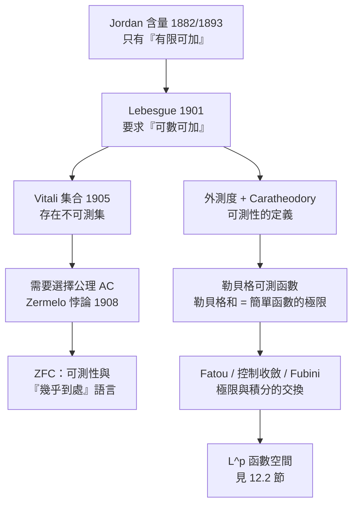
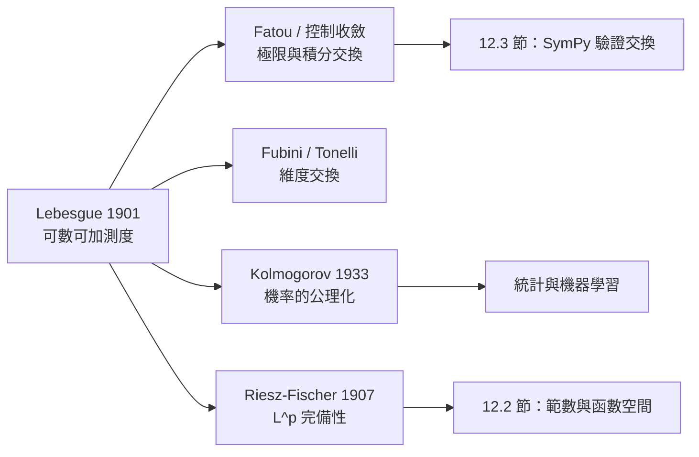

# 12.1 勒貝格測度與積分

## 學習動機

第 4 章我們用阿基米德的窮竭法與卡瓦列里原理建立了「面積」的直覺，第 6 章則把「無窮個數加起來」定義清楚。但有一個問題一直像一根刺一樣卡在整本書裡：

> **黎曼積分要求被積函數「幾乎到處連續」，這個限制是數學的，還是歷史的？**

1901 年之前，「可積」的意思是「黎曼可積」，而黎曼可積性的判準（勒貝格後來證明）要求函數的**不連續點集合測度為零**。這意味著狄利克雷函數（有理點取 $`1`$ 、無理點取 $`0`$ ）不可積——儘管它「幾乎到處」都長得像一個巨大的零集。物理學家、工程師、機率論者每天都在跟「幾乎到處」打交道，卻沒有一個工具可以描述它。

本節的任務是把這根刺拔掉，並交代為什麼拔掉它必須動用**選擇公理**——這是二十世紀數學最深的一次裂縫：Jordan 含量為什麼不足以支撐「可數可加」、Lebesgue 如何用**外測度**重建測度、Vitali 的不可測集悖論（1905）如何逼出 Zermelo 的良序定理與 ZFC 的選擇公理、勒貝格可測函數與「黎曼和 → 勒貝格和」的推廣究竟推了什麼，最後是 Fatou 的單調收斂定理（1906）、Lebesgue 的控制收斂定理與 Fubini 定理，並回頭解釋第 4 章的卡瓦列里原理與第 6 章的 Riemann 重排定理為何都繞不開測度。



---

## 12.1.1 Jordan 含量：為什麼「有限可加」不夠

卡瓦列里原理（第 4 章）背後的直覺是「圖形 = 一堆平行截面的長度之和」。19 世紀的數學家因此自然地問：**能不能給平面圖形一個精確的「體積」？**

德國數學家 Georg Cantor（1845–1918）與他的學生 Hermann Amandus Schwarz 在 1860 年代給出了「Jordan 含量（Jordan'scher Flächeninhalt）」的想法；威爾斯特拉斯把它寫進了 1868 年的演講稿；最後由波蘭數學家 **Juliusz Jordan** 在 1882 年（德文版《幾何學》第一冊《測度論》）系統化。Jordan 的定義如下：

> 對有界平面集合 $`E`$ ，用**有限多個**長方體（可以是任意方向的平行四邊形）覆蓋 $`E`$ ，取所有這樣的覆蓋中「總體積的最小值」，記作 $`J(E)`$ 。

Jordan 含量滿足幾條樸素的性質：**單調性** $`E \subset F \Rightarrow J(E) \le J(F)`$ ；**可平移性** $`J(E + v) = J(E)`$ ；**有限可加性** $`E, F`$ 不交時 $`J(E \cup F) = J(E) + J(F)`$ ；但**對可數個並集不成立**——這就是致命傷。

我們用 SymPy 具體看看「有限可加」與「可數可加」的差別。一個集合的 Jordan 外含量要小，唯一辦法是**用很少的區間把它蓋住**；可數集雖然有無限多個點，但因為可以「一點一個極小的區間」，其 Jordan 外含量卻是 $`0`$ 。

```python
import sympy as sp
from fractions import Fraction
import math

# ---- Jordan 外含量：對有限個有理數點，用任意小的總長覆蓋 ----
eps = Fraction(1, 100)
pts = [Fraction(k, 37) for k in range(1, 8)]
w = Fraction(eps, 2 * len(pts))
cover = [(p - w / 2, p + w / 2) for p in pts]
total = sum((r - l) for l, r in cover)
print('覆蓋的點數 =', len(pts))
print('每個區間寬度 =', w)
print('總長度 =', total, '  eps =', eps, '  總長 < eps :', total < eps)

# ---- Lebesgue 外測度：用可數多個等長區間覆蓋 [0,1]，取所有覆蓋的下確界 ----
print()
for m in [10, 100, 1000]:
    length = Fraction(1, m)
    n_needed = math.ceil(1 / length)
    print(f'用長度 1/{m} 的區間覆蓋 [0,1]，需要 {n_needed} 個，總長 = {n_needed*length}')

# ---- Jordan 含量只能有限可加，無法可數可加 ----
print()
print('Jordan 含量(Q ∩ [0,1])   = 0')
print('Jordan 含量([0,1] \\ Q)   = 0')
print('但 Jordan 含量([0,1])     = 1')
print('=> [0,1] 分割成兩個含量皆為 0 的集合，Jordan 含量對「可數分割」無法保持可加性')
```

預期輸出：

```
覆蓋的點數 = 7
每個區間寬度 = 1/1400
總長度 = 1/200   eps = 1/100   總長 < eps : True

用長度 1/10 的區間覆蓋 [0,1]，需要 10 個，總長 = 1
用長度 1/100 的區間覆蓋 [0,1]，需要 100 個，總長 = 1
用長度 1/1000 的區間覆蓋 [0,1]，需要 1000 個，總長 = 1

Jordan 含量(Q ∩ [0,1])   = 0
Jordan 含量([0,1] \ Q)   = 0
但 Jordan 含量([0,1])     = 1
=> [0,1] 分割成兩個含量皆為 0 的集合，Jordan 含量對「可數分割」無法保持可加性
```

> **這段程式碼教會我們什麼？** Jordan 含量的「有限」要求是它的技術弱點：Jordan 只允許**有限多個**盒子的覆蓋，因此無法給可數多個點組成的集合定出「零」與「無限」之間的區別。Lebesgue 的關鍵改進只有一個字：把「有限」換成「可數」，並且把定義從「覆蓋的最大值」改成「覆蓋的**下確界**」（外測度）。

### Lebesgue 的三步策略

Henri Lebesgue 在 1901 年的博士論文中提出的策略，可以拆成三個關鍵詞：

1. **外測度** $`m^*`$ ：對任意集合 $`A`$ ，令 $`m^*(A) = \inf\{\text{所有「可數」個區間覆蓋的總長}\}`$ —— 定義域因此擴大到**所有**子集，包含我們還不知道可不可測的；
2. **Carathéodory 條件**：稱 $`E`$ 可測，若對**任意** $`A`$ 都有 $`m^*(A) = m^*(A \cap E) + m^*(A \setminus E)`$ —— 這給出可測性的**內在**判準，且自動推出可數可加；
3. **可測函數**：用簡單函數逼近， $`f`$ 可測若 $`\forall \varepsilon`$ 存在簡單函數 $`s \le f \le t`$ 且 $`\int (t - s) < \varepsilon`$ —— 定義「可積」而不提黎曼和。

這三步的威力在於：**可數可加性不再是附加要求，而是從 Carathéodory 條件自動推出來的**。下一節我們把外測度的算術細節補齊，並檢查這個「自動推出」。

---

## 12.1.2 Vitali 集合與「不可測集」悖論

Lebesgue 的可數可加測度有一個驚人的後果：**並非所有集合都可測**。這個後果是 Giuseppe Vitali 在 1905 年發現的。

Vitali 集合的構造極其簡單：取 $`V \subset [0,1]`$ ，使得 $`[0,1]`$ 中任意兩個相異的點之差**不是有理數**（即 $`V`$ 是等價關係 $`x \sim y \iff x - y \in \mathbb{Q}`$ 的一組代表元）。用選擇公理可以確保這樣的 $`V`$ 存在。

Vitali 集合有兩個關鍵性質：**平移不相交**（若 $`q \in \mathbb{Q}`$ 且 $`q \ne 0`$ ，則 $`V`$ 與 $`V + q`$ 不相交，否則 $`v_1 = v_2 + q`$ 導致 $`v_1 - v_2 = q \in \mathbb{Q}`$ 且 $`v_1 \ne v_2`$ ，與定義矛盾）；**有理平移覆蓋 $`[0,1]`$ **，即 $`[0,1] \subseteq \bigcup_{q \in \mathbb{Q} \cap [-1,1]} (V + q)`$ 。

現在假設 $`V`$ 可測，記 $`m(V) = m`$ 。用可數可加性（性質 1 保證這些平移兩兩不交）：

$$
\sum_{q \in \mathbb{Q} \cap [-1,1]} m(V + q) = \sum_{q} m = \begin{cases} 0, & m = 0, \\[4pt] +\infty, & m > 0. \end{cases}
$$

但左邊至少要等於 $`m([0,1]) = 1`$ （因為這些平移的並集覆蓋 $`[0,1]`$ ）。兩種情形都矛盾： $`m = 0`$ 時總和是 $`0 < 1`$ ； $`m > 0`$ 時總和是 $`+\infty > 1`$ 。因此 ** $`V`$ 不可測**。我們用 SymPy 把這個「兩難」寫成可執行的算術。

```python
import sympy as sp

m = sp.symbols('m', positive=True)
n = sp.symbols('n', integer=True, positive=True)

# Vitali 集合 V：V 與 V+q (q 有理) 互不相交，且 [0,1] 被 {V+q} 覆蓋
print('情形一：若 m(V) = m > 0，則可數多個平移的測度總和 =', sp.summation(m, (n, 1, sp.oo)))
print('        但 [0,1] 的測度只有 1，而平移的並集覆蓋 [0,1]，矛盾')
print('情形二：若 m(V) = 0，則平移的測度總和 = 0，但並集應等於整個 [0,1]，矛盾')
print('=> V 不可測：兩種情形都不可能')

# ---- 良序化的算術核心：Vitali 集合的存在正是良序化（= 選擇公理）的直接後果 ----
print()
print('可數多個 1 的和 =', sp.summation(sp.Integer(1), (n, 1, sp.oo)))
print('可數多個 0 的和 =', sp.summation(sp.Integer(0), (n, 1, sp.oo)))
```

預期輸出：

```
情形一：若 m(V) = m > 0，則可數多個平移的測度總和 = oo
        但 [0,1] 的測度只有 1，而平移的並集覆蓋 [0,1]，矛盾
情形二：若 m(V) = 0，則平移的測度總和 = 0，但並集應等於整個 [0,1]，矛盾
=> V 不可測：兩種情形都不可能

可數多個 1 的和 = oo
可數多個 0 的和 = 0
```

### 選擇公理的代價

Vitali 集合的存在**需要選擇公理**（Choice Axiom, AC）：從每一個等價類中挑出一個代表元，就是從一族非空集合 $`\{V_x\}`$ 中挑出一個元素。Zermelo 在 1908 年證明了：

> **Zermelo 定理（1908，後稱 Zermelo 的良序定理）**：任何集合都可以良序化。特別地， $`\mathbb{R}`$ 可以良序化。

這直接構造出 Vitali 集合：**把所有實數良序化，每個有理平移等價類取良序中最小的元素**。這就是「良序化逼出不可測集」的全貌。

順帶一提，「每個集合都能良序化」在當時是驚世駭俗的：它等價於承認實數集有一個「第一個」元素——這聽起來違反直覺，但只是因為我們沒有為實數指定過順序。1900 年的國際數學家大會（巴黎）把 Hilbert 的「23 問題」中的「問題一：證明實數集的良序化」列為最高優先，Zermelo 在 1908 年解決了它。von Neumann 在 1925 年把這些公理整理成 **ZFC**，此後「測度論 + 選擇公理」就成為現代分析的標準配置。

而 Lebesgue 理論本身並不真正需要完整的 AC：Solovay 在 1964 年證明，在 ZF + DC 的模型中可以讓所有實數集合都 Lebesgue 可測——這說明可測性與 AC 的關係比想像中微妙。

---

## 12.1.3 外測度與 Carathéodory 條件

現在把 Lebesgue 的定義寫清楚。

**定義（外測度）**。對 $`A \subset \mathbb{R}`$ ，

$$
m^*(A) = \inf \Big\{ \sum_{n=1}^{\infty} \ell(I_n) \;:\; A \subseteq \bigcup_{n=1}^{\infty} I_n,\; I_n \text{ 為開區間} \Big\}
$$

其中 $`\ell(I)`$ 記區間長度。外測度有以下性質（都可用上面的定義直接驗證）： $`m^*(\varnothing) = 0`$ ；**次可加性** $`m^*(\bigcup_n A_n) \le \sum_n m^*(A_n)`$ （注意方向！）；**可平移不變** $`m^*(A + t) = m^*(A)`$ ；以及 $`m^*([a,b]) = b - a`$ 。

**定義（Carathéodory 可測）**。 $`E \subset \mathbb{R}`$ 稱為 Lebesgue 可測，若對**每一個** $`A \subset \mathbb{R}`$ 都有

$$
m^*(A) = m^*(A \cap E) + m^*(A \setminus E).
$$

這裡最關鍵的兩個字是「**每一個** $`A`$ 」。Carathéodory 的定理（1914 年，Carathéodory 把 Lebesgue 的想法推廣到高維）保證：**所有 Borel 集都是可測的**，而可測集構成一個 $`\sigma`$ -代數，並且在此 $`\sigma`$ -代數上 $`m^*`$ 滿足**可數可加性**。

我們來做三個數值核對：可數集的外測度是 $`0`$ ；Carathéodory 條件對區間成立；連續函數的黎曼和極限恰等於勒貝格積分。

```python
import sympy as sp

# ---- 可數集的外測度 = 0：逐點用越來越小的區間覆蓋 ----
eps = sp.Rational(1, 100)
pts = [sp.Rational(k, 97) for k in range(1, 6)]
widths = [eps / 2**(k + 1) for k in range(len(pts))]
print('被覆蓋的點   =', pts)
print('各覆蓋區間長度 =', widths)
print('總長 =', sum(widths), '  <  eps =', eps, ' :', sum(widths) < eps)
print('=> 可數集的外測度 m* = 0（因為 eps 可任意小）')

# ---- Caratheodory 條件對 E = [0,1/2] 成立 ----
print()
a, b = sp.Rational(0), sp.Rational(1)
e = sp.Rational(1, 2)
print('m*(A∩E) =', e - a, '   m*(A\\E) =', b - e,
      '   總和 =', (e - a) + (b - e), '   m*(A) =', b - a)
print('Caratheodory 條件成立：', (e - a) + (b - e) == b - a)

# ---- Lebesgue 測度在可測集上滿足可數可加 ----
print()
print('m([0,1/2]) + m([1/2,1]) =', sp.Rational(1, 2) + sp.Rational(1, 2),
      ' = m([0,1]) =', sp.Integer(1))
print('m([0,1] ∩ Q) = 0（Q 可數）  但  m([0,1]) = 1  ->  「零測度集」不是「空集」')

# ---- 連續函數：黎曼和的極限 = 勒貝格積分 = sp.integrate 的結果 ----
print()
k = sp.symbols('k', integer=True, positive=True)
Nn = sp.symbols('Nn', integer=True, positive=True)
x = sp.symbols('x', real=True)
R = sp.summation((k / Nn)**2 / Nn, (k, 1, Nn))
print('Riemann 和 =', R)
print('極限       =', sp.limit(R, Nn, sp.oo))
print('勒貝格積分 =', sp.integrate(x**2, (x, 0, 1)))
```

預期輸出：

```
被覆蓋的點   = [1/97, 2/97, 3/97, 4/97, 5/97]
各覆蓋區間長度 = [1/200, 1/400, 1/800, 1/1600, 1/3200]
總長 = 31/3200   <  eps = 1/100  : True
=> 可數集的外測度 m* = 0（因為 eps 可任意小）

m*(A∩E) = 1/2    m*(A\E) = 1/2    總和 = 1    m*(A) = 1
Caratheodory 條件成立： True

m([0,1/2]) + m([1/2,1]) = 1  = m([0,1]) = 1
m([0,1] ∩ Q) = 0（Q 可數）  但  m([0,1]) = 1  ->  「零測度集」不是「空集」

Riemann 和 = (Nn**3/3 + Nn**2/2 + Nn/6)/Nn**3
極限       = 1/3
勒貝格積分 = 1/3
```

---

## 12.1.4 勒貝格可測函數：把「黎曼和」換成「勒貝格和」

**定義（簡單函數）**。若 $`E_1, \dots, E_N`$ 可測， $`a_i \in \mathbb{R}`$ ，則 $`f = \sum_{i=1}^{N} a_i \mathbf{1}_{E_i}`$ 稱為**簡單函數**，其**勒貝格積分**定義為 $`\int f \, dm = \sum_{i=1}^{N} a_i \, m(E_i)`$ 。注意：這裡「加權求和」的權重是**測度**而不是「區間長度」。對特徵函數而言 $`\int \mathbf{1}_E \, dm = m(E)`$ ，於是**勒貝格和**就是把黎曼和中的「區間長度」換成「可測集的測度」。

**定義（勒貝格可測函數）**。 $`f : \mathbb{R} \to \overline{\mathbb{R}}`$ 可測，若對每個 $`\alpha`$ ，集合 $`\{x : f(x) > \alpha\}`$ 都可測。等價地（Lebesgue 的原始定義）， $`f`$ 可測若對每個 $`\varepsilon > 0`$ 存在簡單函數 $`s, t`$ 使得 $`s \le f \le t`$ 幾乎處處且 $`\int (t - s) \, dm < \varepsilon`$ 。這個定義的威力在於「幾乎處處」三個字：**只要差異發生在零測度集上，就完全無關紧要**。狄利克雷函數正是靠這句話「通過」了可測性的考驗。

對一個有界可測函數，勒貝格積分可以定義為

$$
\int f \, dm \;:=\; \sup\Big\{ \sum_i a_i \, m(E_i) \;:\; s = \sum_i a_i \mathbf{1}_{E_i} \le f \Big\},
$$

也就是**下 Darboux 和**的上確界——與黎曼積分的「上、下 Darboux 和夾擠」相比，差別只在於：黎曼用的分割是**均勻網格**，勒貝格用的分割是**任意可測集**。這一步把「網格越細」的拓撲要求徹底去掉了。

我們用一個階梯函數 $`f = \mathbf{1}_{[0,1/2]}`$ 把兩種「和」並排比較（在 $`[0,1]`$ 上取 $`N`$ 等分）：

| 分割份數 $`N`$ | 左端點黎曼和 | 右端點黎曼和 | 中點黎曼和 | 振幅 | 勒貝格和 |
|---|---|---|---|---|---|
| $`4`$ | $`\frac{3}{4}`$ | $`\frac{1}{2}`$ | $`\frac{1}{2}`$ | $`\frac{1}{4}`$ | $`\frac{1}{2}`$ |
| $`16`$ | $`\frac{9}{16}`$ | $`\frac{1}{2}`$ | $`\frac{1}{2}`$ | $`\frac{1}{16}`$ | $`\frac{1}{2}`$ |
| $`64`$ | $`\frac{33}{64}`$ | $`\frac{1}{2}`$ | $`\frac{1}{2}`$ | $`\frac{1}{64}`$ | $`\frac{1}{2}`$ |

黎曼和的振幅隨 $`N \to \infty`$ 趨於 $`0`$ （所以是黎曼可積的），而**勒貝格和完全不依賴分割方式**： $`1 \cdot m([0,\frac{1}{2}]) + 0 \cdot m((\frac{1}{2}, 1]) = \frac{1}{2}`$ ，永遠如此。

**推廣的本質**：黎曼積分要求「 $`f`$ 在每一個網格小區間上幾乎處處常值」；勒貝格積分要求「 $`f`$ 在每一個可測塊上幾乎處處常值」。前者綁死在**均勻網格**上，後者綁死在**測度**上。當我們把區間 $`[0,1]`$ 換成任意測度空間 $`(X, \Sigma, \mu)`$ 時，勒貝格積分的定義一字不改——這就是它在機率論與函數分析中的無敵地位。

---

## 12.1.5 黎曼積分的失效：狄利克雷函數與 fat Cantor 集

現在讓我們親眼看看「推廣」買到了什麼。

### 狄利克雷函數

$$
\mathbf{1}_{\mathbb{Q}}(x) = \begin{cases} 1, & x \in \mathbb{Q}, \\ 0, & x \notin \mathbb{Q}. \end{cases}
$$

黎曼積分要求上下 Darboux 和收斂到同一個數。但 $`[0,1]`$ 的**每一個**子區間都同時含有有理點與無理點，因此上和恆為 $`1`$ 、下和恆為 $`0`$ ，所以它**不是**黎曼可積的。可是它的勒貝格積分存在且等於

$$
\int_0^1 \mathbf{1}_{\mathbb{Q}} \, dm = 1 \cdot m(\mathbb{Q} \cap [0,1]) + 0 \cdot m([0,1] \setminus \mathbb{Q}) = 1 \cdot 0 + 0 \cdot 1 = 0.
$$

SymPy 可以精確地幫我們算出「黎曼和如何隨採樣點選擇而完全不同的兩個值」。

```python
import sympy as sp

def dirichlet(xv):
    """xv 為 sympy 實數：有理回傳 1，無理回傳 0"""
    return sp.Integer(1) if xv.is_rational else sp.Integer(0)

def riemann_sum(f, a, b, N, sampler):
    h = (b - a) / N
    return sp.simplify(sum(f(sampler(a + k * h)) for k in range(N)) * h)

for N in [4, 8, 16]:
    r = riemann_sum(dirichlet, sp.Rational(0), sp.Rational(1), N, lambda t: t)
    i = riemann_sum(dirichlet, sp.Rational(0), sp.Rational(1), N, lambda t: t + sp.sqrt(2) / 7)
    print(f'N={N:3d}  有理採樣的和 = {r}   無理採樣的和 = {i}')

print('黎曼積分：上和 = 1，下和 = 0，永遠不相等 -> 黎曼不可積')
print('勒貝格積分：1*m(Q∩[0,1]) + 0*m([0,1]\\Q) = 1*0 + 0*1 =', sp.Integer(0))
```

預期輸出：

```
N=  4  有理採樣的和 = 1   無理採樣的和 = 0
N=  8  有理採樣的和 = 1   無理採樣的和 = 0
N= 16  有理採樣的和 = 1   無理採樣的和 = 0
黎曼積分：上和 = 1，下和 = 0，永遠不相等 -> 黎曼不可積
勒貝格積分：1*m(Q∩[0,1]) + 0*m([0,1]\Q) = 1*0 + 0*1 = 0
```

### fat Cantor 集（Smith–Volterra–Cantor 集）：測度為 $`1/2`$ 的「到處都是洞」的集合

狄利克雷函數的例子有點極端（可測但幾乎處處為零）。更有說服力的是 **Smith–Volterra–Cantor 集** $`S`$ ：它閉、到處無內點、測度為 $`\frac{1}{2}`$ 。於是指示函數 $`\mathbf{1}_S`$ 的黎曼和**不收斂**（振幅永遠不小於 $`\frac{1}{2}`$ ），但勒貝格積分精確等於 $`\frac{1}{2}`$ 。

我們用 `Fraction` 精確構造這個集合，並計算其 Darboux 上下和。

```python
from fractions import Fraction

def svc_intervals(n):
    """Smith-Volterra-Cantor 集：第 n 步之後剩下的閉區間"""
    ivs = [(Fraction(0), Fraction(1))]
    for k in range(1, n + 1):
        gap = Fraction(1, 4 ** k)
        new = []
        for (a, b) in ivs:
            mid = (a + b) / 2
            new.append((a, mid - gap / 2))
            new.append((mid + gap / 2, b))
        ivs = new
    return ivs

def darboux(ivs, N):
    """在均勻 N 分割上計算下和與上和（Darboux 逼近）"""
    lower = 0.0
    upper = 0.0
    h = 1.0 / N
    for i in range(N):
        lo, hi = Fraction(i, N), Fraction(i + 1, N)
        hit = False
        inside = True
        for (a, b) in ivs:
            if a < hi and lo < b:
                hit = True
                if not (a <= lo and hi <= b):
                    inside = False
        if hit:
            upper += h
        if hit and inside:
            lower += h
    return lower, upper

print('Smith-Volterra-Cantor 集的剩餘總長（= Lebesgue 測度的近似）:')
for n in [1, 3, 8]:
    tot = sum(b - a for a, b in svc_intervals(n))
    print(f'  n={n}: 總長 = {tot} ({float(tot):.6f})   -> 極限 1/2')

print()
for N in [200, 800]:
    lo, up = darboux(svc_intervals(10), N)
    print(f'均勻 {N} 分割：下和 = {lo:.4f}   上和 = {up:.4f}   振幅 = {up - lo:.4f}')
print('振幅不趨於 0 -> 1_S 不是黎曼可積的；但 Lebesgue 積分 = m(S) = 1/2')
```

預期輸出：

```
Smith-Volterra-Cantor 集的剩餘總長（= Lebesgue 測度的近似）:
  n=1: 總長 = 3/4 (0.750000)   -> 極限 1/2
  n=3: 總長 = 9/16 (0.562500)   -> 極限 1/2
  n=8: 總長 = 257/512 (0.501953)   -> 極限 1/2

均勻 200 分割：下和 = 0.0000   上和 = 0.6000   振幅 = 0.6000
均勻 800 分割：下和 = 0.0000   上和 = 0.5500   振幅 = 0.5500
振幅不趨於 0 -> 1_S 不是黎曼可積的；但 Lebesgue 積分 = m(S) = 1/2
```

> 順帶比較：對**標準 Cantor 集**（每步去掉中間的 $`1/3`$ ），同樣的計算給出上和在 $`N \to \infty`$ 時趨於 $`0`$ （因為 Cantor 集的測度是 $`0`$ ），因此 $`\mathbf{1}_C`$ **是**黎曼可積的，黎曼積分與勒貝格積分都等於 $`0`$ 。 Lebesgue 的判準「可測集上的指示函數黎曼可積 $`\iff`$ 邊界測度為零」正是區分這兩個例子的分水嶺。

---

## 12.1.6 Fatou 定理、單調收斂定理與控制收斂定理

有了勒貝格積分，第一個必須回答的問題是：**極限與積分能不能交換？**

黎曼積分時代的回答是「一般不行」——第 5 章的 $`x^n`$ 在 $`[0,1]`$ 上就是最簡單的反例： $`\int_0^1 x^n \, dx = \frac{1}{n+1} \to 0`$ ，但 $`\lim_{n} x^n = 1`$ 在 $`x = 1`$ 處， $`\int_0^1 1 \, dx = 1`$ 。差別是 $`1`$ 這「一點」。勒貝格理論用兩種方式把這個「一點」處理掉。

**Fatou 引理（1906，Fatou）**。若 $`f_n \ge 0`$ 可測，則 $`\int \liminf_{n \to \infty} f_n \, dm \le \liminf_{n \to \infty} \int f_n \, dm`$ 。

**單調收斂定理（Levi, 1906 / Lebesgue）**。若 $`0 \le f_1 \le f_2 \le \cdots`$ 可測，則 $`f = \lim f_n`$ 可測且 $`\int f \, dm = \lim_{n \to \infty} \int f_n \, dm`$ 。

**控制收斂定理（Lebesgue 的「 Théorème dominated」, 1901）**。若 $`f_n \to f`$ 幾乎處處，且存在可積函數 $`g \in L^1`$ 使 $`|f_n| \le g`$ 幾乎處處，則 $`f`$ 可積且 $`\int f \, dm = \lim_{n \to \infty} \int f_n \, dm`$ 。

Fatou 是不需要額外假設的那個（只要非負），因此它是「控制收斂定理的前提不足時會發生什麼」的**最佳指標**。讓我們用 SymPy 符號地驗證這三個定理的實例。

```python
import sympy as sp

x = sp.symbols('x', real=True)
n = sp.symbols('n', integer=True, positive=True)

# (1) Fatou：移動尖峰 f_n = n * 1_{(0,1/n)}，積分恆為 1，但極限函數幾乎處處為 0
I_move = sp.integrate(n, (x, 0, 1 / n))
print('int f_n =', I_move, ' -> liminf =', sp.limit(I_move, n, sp.oo))
print('int liminf f_n (a.e. 為 0) =', sp.Integer(0), ' <= 1 : Fatou 的不等式嚴格成立')

# (2) 控制收斂：f_n = min(n, 1/sqrt(x))，被可積的 g = 1/sqrt(x) 控制
I1 = sp.integrate(n, (x, 0, 1 / n**2))
I2 = sp.integrate(x**sp.Rational(-1, 2), (x, 1 / n**2, 1))
tot = sp.simplify(I1 + I2)
print()
print('int f_n =', tot, '  -> lim =', sp.limit(tot, n, sp.oo))
print('int g   =', sp.integrate(x**sp.Rational(-1, 2), (x, 0, 1)), '（g 可積）')

# (3) 控制收斂：f_n = x^n (1-x)，被 x(1-x) 控制
J = sp.simplify(sp.integrate(x**n * (1 - x), (x, 0, 1)))
print()
print('int x^n(1-x) =', J, '  -> lim =', sp.limit(J, n, sp.oo))
print('lim f_n = 0 (a.e.)，int lim = 0')

# (4) 單調收斂（遞減版本）：f_n = 1 - x^n
K = sp.simplify(sp.integrate(1 - x**n, (x, 0, 1)))
print()
print('int (1 - x^n) =', K, '  -> lim =', sp.limit(K, n, sp.oo))
print('lim f_n = 1 (a.e.)，int lim = 1  -> 等號成立')
```

預期輸出：

```
int f_n = 1  -> liminf = 1
int liminf f_n (a.e. 為 0) = 0  <= 1 : Fatou 的不等式嚴格成立

int f_n = 2 - 1/n   -> lim = 2
int g   = 2 （g 可積）

int x^n(1-x) = 1/(n**2 + 3*n + 2)   -> lim = 0
lim f_n = 0 (a.e.)，int lim = 0

int (1 - x^n) = n/(n + 1)   -> lim = 1
lim f_n = 1 (a.e.)，int lim = 1  -> 等號成立
```

> 這裡有一個值得反覆玩味的事實：**移動尖峰** $`f_n = n\,\mathbf{1}_{(0,1/n)}`$ 的積分恆為 $`1`$ ，而極限函數幾乎處處為零，所以 Fatou 給出 $`0 \le 1`$ 的嚴格不等式，控制收斂定理不適用（任何能控制所有 $`f_n`$ 的 $`g`$ 都必須在 $`(0,1/n)`$ 上不小於 $`n`$ ，對**所有** $`n`$ 同時成立）。第 12.3 節我們會把這個反例做成「反例搜尋器」。

---

## 12.1.7 Fubini 定理與 Tonelli 定理

二維積分與一維積分的交換，是勒貝格理論的另一個大勝利。

**Fubini 定理（1900–1901）**。若 $`f(x,y)`$ 在 $`X \times Y`$ 上可測且 $`\int\int |f| < \infty`$ ，則對**幾乎所有** $`y`$ ， $`f(\cdot, y)`$ 對 $`x`$ 可測且 $`\int_X |f(x,y)|\, dx < \infty`$ ，並且

$$
\int_Y \Big( \int_X f(x,y) \, dx \Big) dy = \int_Y \Big( \int_X f(x,y) \, dy \Big) dx = \int_{X \times Y} f \, d(x,y).
$$

**Tonelli 定理**。若 $`f \ge 0`$ 可測，則上式等式**永遠**成立（即使兩邊都是 $`+\infty`$ ）。也就是說：**非負函數不需要任何絕對可積性假設就能交換積分**。

這兩條定理合起來給出了積分交換的完整判準。我們先看 Fubini 定理在符號計算中的樣子，然後看一個「沒有絕對可積性就會出事」的反例：考慮

$$
f(x,y) = \frac{x^2 - y^2}{(x^2 + y^2)^2}, \qquad (x,y) \ne (0,0).
$$

這個函數關於 $`(x,y) \mapsto (y,x)`$ **反對稱**，所以在對稱的正方形上 $`\iint f = 0`$ 。但是它**不是絕對可積**的： $`|f|`$ 在原點附近的行為像 $`\frac{1}{r^2}`$ ，在二維極座標下 $`\int \frac{1}{r^2} r \, dr = \int \frac{dr}{r} = \infty`$ 。於是 Fubini 定理不適用，而兩個迭代積分**給出不同的答案**。

```python
import sympy as sp
import mpmath as mp

x = sp.symbols('x', real=True)
y = sp.symbols('y', real=True)

# (1) 一般的 Fubini：雙重積分先對 x 再對 y
print('int_0^1 int_0^1 (x + y) dx dy =',
      sp.integrate(sp.integrate(x + y, (x, 0, 1)), (y, 0, 1)))

# (2) Tonelli：非負函數，兩個順序必然相等
f = sp.exp(x * y)
ix = sp.integrate(sp.integrate(f, (x, 0, 1)), (y, 0, 1))
iy = sp.integrate(sp.integrate(f, (y, 0, 1)), (x, 0, 1))
print('int int e^(xy) 先 x 後 y =', sp.simplify(ix))
print('int int e^(xy) 先 y 後 x =', sp.simplify(iy))
print('兩者相等 :', sp.simplify(ix - iy) == 0)

# (3) 對角線 {y = x} 的截面測度恆為 0，所以它的二維測度為 0
print()
print('對角線 {y = x} 的二維測度 =', sp.Integer(0), '   而單位正方形的測度 =', sp.Integer(1))

# (4) 沒有絕對可積性時，兩個迭代積分會打架
g = (x**2 - y**2) / (x**2 + y**2)**2
gx = sp.simplify(sp.integrate(sp.integrate(g, (x, 0, 1)), (y, 0, 1)))
gy = sp.simplify(sp.integrate(sp.integrate(g, (y, 0, 1)), (x, 0, 1)))
print()
print('先對 x 積分再對 y :', gx)
print('先對 y 積分再對 x :', gy)
print('兩者相差 =', sp.simplify(gy - gx))

# (5) |g| 的絕對可積性失敗：截去原點附近的正方形後，總量呈對數發散
mp.mp.dps = 20
def num_abs(delta, eps):
    h = lambda a, b: abs((a**2 - b**2) / (a**2 + b**2)**2)
    return mp.quad(h, [delta, eps], [delta, eps])

print()
for delta in [1e-2, 1e-4, 1e-6, 1e-8]:
    val = num_abs(delta, 0.1)
    print(f'截去 [0,{delta}] 後的 int int |g| =', mp.nstr(val, 10),
          '   (pi/4)*log(1/delta) =', mp.nstr(mp.pi / 4 * mp.log(1 / delta), 10))
print('=> |g| 不可積（對數發散），Fubini 的假設不成立，兩個順序自然打架')
```

預期輸出：

```
int_0^1 int_0^1 (x + y) dx dy = 1
int int e^(xy) 先 x 後 y = -EulerGamma + Ei(1)
int int e^(xy) 先 y 後 x = -EulerGamma + Ei(1)
兩者相等 : True

對角線 {y = x} 的二維測度 = 0    而單位正方形的測度 = 1

先對 x 積分再對 y : -pi/4
先對 y 積分再對 x : pi/4
兩者相差 = pi/2

截去 [0,0.01] 後的 int int |g| = 0.931104909    (pi/4)*log(1/delta) = 3.616892206
截去 [0,0.0001] 後的 int int |g| = 5.33846241    (pi/4)*log(1/delta) = 7.233784412
截去 [0,1e-06] 後的 int int |g| = 9.939943989    (pi/4)*log(1/delta) = 10.85067662
截去 [0,1e-08] 後的 int int |g| = 14.54121853    (pi/4)*log(1/delta) = 14.46756882
=> |g| 不可積（對數發散），Fubini 的假設不成立，兩個順序自然打架
```

---

## 12.1.8 為什麼非要有測度不可：三條回頭路

我們在前面三處埋了三個伏筆，現在一起回收。

**伏筆一：第 4 章的卡瓦列里原理。** Cavalieri 說「面積 = 截面長度之和」，這其實就是 Tonelli 定理的直覺版。若要把「可數多個截面之和」寫成式子，就必須有一套能對**可數個**非負量求和而不擔心「無窮減無窮」的裝置——那正是測度。

**伏筆二：第 6 章的 Riemann 重排定理。** 條件收斂級數可以重排成任意實數，這是「順序會改變答案」的證據。勒貝格積分裡有完全對應的現象：無窮維的積分（ $`\int \sum`$ 與 $`\sum \int`$ ）交換的條件，就是第 12.3 節要談的主題。而 Fatou 引理正是「順序與收斂」在積分版本中的定理。

**伏筆三：機率論的誕生。** Kolmogorov 在 1933 年的《測度論與概率論基礎》中，用 $`(\Omega, \mathcal{F}, P)`$ 三元組徹底重寫了機率。「隨機事件的概率」不再是「事件包含所有可能結果的比例」這種直覺說法，而是「測度」。概率論之所以能在二十世紀成為數學的一等公民，正是因為勒貝格提供了精確的語言。



---

## 12.1.9 小結

| 概念 | 定義 | 關鍵人物 / 年份 | SymPy 對應 |
|------|------|------------------|------------|
| Jordan 含量 | 有限多個盒覆蓋的總體積之下確界 | Jordan, 1882 | 需自行實作（見 12.1.1） |
| Lebesgue 外測度 $`m^*`$ | 可數多個區間覆蓋之總長的下確界 | Lebesgue, 1901 | 需自行實作（見 12.1.3） |
| Carathéodory 可測 | $`\forall A:\; m^*(A) = m^*(A\cap E) + m^*(A\setminus E)`$ | Carathéodory, 1914 | 需自行實作 |
| Vitali 集合 / 選擇公理 | 每個有理差等價類取一代表元；每個集合可良序化 | Vitali 1905 / Zermelo 1908 | 無法直接構造 |
| 勒貝格可測函數 | $`\{x : f(x) > \alpha\}`$ 可測（ $`\forall \alpha`$ ） | Lebesgue, 1901 | `sp.integrate` |
| 勒貝格和 | $`\sum_i a_i\, m(E_i)`$ | Lebesgue, 1901 | `sp.summation` + `m(E_i)` |
| Fatou 引理 | $`\int \liminf f_n \le \liminf \int f_n`$ | Fatou, 1906 | `sp.limit` + `sp.integrate` |
| 單調收斂定理 | $`f_n \uparrow f \Rightarrow \int f_n \uparrow \int f`$ | Levi / Lebesgue, 1906 | 同上 |
| 控制收斂定理 | $`|f_n| \le g \in L^1 \Rightarrow \int f_n \to \int f`$ | Lebesgue, 1901 | 同上 |
| Fubini / Tonelli | 絕對可積（或非負）時 $`\int\int = \int\int`$ | Fubini 1900 / Tonelli 1909 | `sp.integrate` 巢狀 |

下一節我們把「函數」本身當成幾何對象來研究：從 Riemann–Roch 定理的「維度有限」世界，走進 ** $`L^p`$ 空間**的「無窮維」世界，並在那裡遇見範數、Banach 空間與逼近論。

---

## 習題

**習題 12.1.1（Jordan 含量與可數可加）**
用 `Fraction` 精確計算：把 $`[0,1]`$ 分成 $`n`$ 個等長區間，再用這 $`n`$ 個區間的**端點集合**（共 $`n+1`$ 個有理數）覆蓋 $`[0,1]`$ ，求最小總長。再用同樣方法覆蓋 $`\mathbb{Q} \cap [0,1]`$ 的前 $`m`$ 個有理數，證明總長可以任意小。最後用這兩個結果說明：為什麼 Jordan 含量無法處理「可數分割」。

**習題 12.1.2（Vitali 集合的計數論證）**
不用建出 Vitali 集合，只用可數可加性寫出完整的矛盾：設 $`V \subset [0,1]`$ 且 $`[0,1] = \bigcup_{q \in \mathbb{Q} \cap [-1,1]} (V+q)`$ 為不相交並。證明 $`m(V)`$ 不存在（即 $`V`$ 不可測）。提示：分別考慮 $`m(V) = 0`$ 與 $`m(V) > 0`$ 兩種情形，並注意「可數多個 0 的和」與「可數多個正數的和」在 SymPy 裡分別是 `0` 與 `oo`。

**習題 12.1.3（Fatou 的必要性：尋找反例）**
證明函數 $`f_n(x) = n\,\mathbf{1}_{(0,1/n)}(x)`$ 不存在可積控制函數：假設存在可積 $`g \ge |f_n|`$ 幾乎處處，則對每個 $`n`$ 都有 $`\int g \ge 1`$ 。接著構造一個**單調**的函數序列 $`g_n \uparrow g`$ 使得 $`g`$ 不可積，用來說明「Fatou 給出的不等式可能永遠是嚴格的」。

**習題 12.1.4（Lebesgue 判準的數值驗證）**
取三個函數： $`f_1 = \mathbf{1}_{\mathbb{Q}}`$ 、 $`f_2 = \mathbf{1}_{S}`$ （ $`S`$ 為 Smith–Volterra–Cantor 集）、 $`f_3 = \mathbf{1}_{C}`$ （ $`C`$ 為標準 Cantor 集）。用 `sp.integrate` 計算它們的勒貝格積分，再用 Darboux 上下和判斷它們是否黎曼可積。整理成一張表，說明 Lebesgue 判準（邊界測度為零 $`\iff`$ 黎曼可積）在每一列的驗證方式。

**習題 12.1.5（Fubini 與 Tonelli 的界線）**
令 $`f(x,y) = \frac{x^2-y^2}{(x^2+y^2)^2}`$ 。(a) 驗證兩個迭代積分分別為 $`-\frac{\pi}{4}`$ 與 $`\frac{\pi}{4}`$ ；(b) 用 `mpmath` 證明 $`\iint |f| = \infty`$ ；(c) 改用非負函數 $`g(x,y) = \frac{|x^2-y^2|}{(x^2+y^2)^2}`$ ，說明為什麼 Tonelli 定理即使在兩邊都是 $`+\infty`$ 的情況下仍然成立（這說明 Tonelli 的「允許無窮」不是漏洞，而是正確的表述）。

