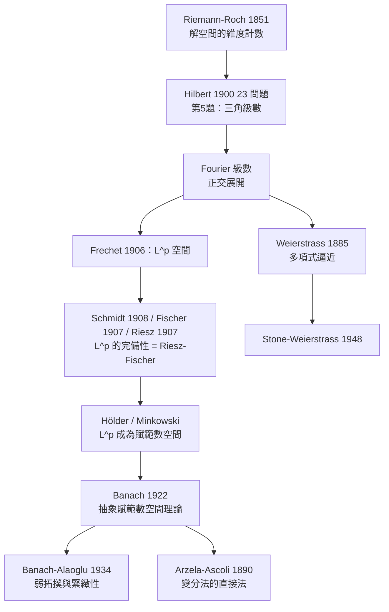

# 12.2 黎曼-羅朗定理、範數與函數空間

## 學習動機

上一節我們終於有了「幾乎到處」這套語言，可以描述「函數的壞點只佔零測度集」。但立刻有兩個問題浮上來：**怎麼比較兩個「差一點點」的函數？**（逐點比較不行——在零測度集上不同會讓逐點距離變成無窮大）；**「幾乎處處相等」的函數集合，是不是一個可以研究的幾何空間？** 它有沒有維度？怎麼證明裡面的數列會收斂？

這兩個問題在 1900 年前後同時成熟，並且和另外兩條線索匯流：**黎曼-羅朗定理（1851／1863）** 第一個把「解的空間的維度」寫成公式，它的精神後來長成了 Hilbert 的「Hilbert 空間」與「正交展開」；**Hilbert 的 23 個問題（1900）** 中第 5 題是「用連續函數的群研究三角級數」，第 19、23 題是變分法；**Fourier 級數**（第 11 章）則讓我們有了「把函數展開成正交基的線性組合」的具體例子。

本節的任務：交代黎曼-羅朗定理與 Hilbert 問題如何把人類推向「無窮維幾何」；重建 $`L^p`$ 空間的建立過程（Schmidt、Fischer、Riesz 的貢獻與 **Riesz–Fischer 定理**）；用 SymPy 驗證 Hölder 與 Minkowski 不等式——它們是 $`L^p`$ 能成為**賦範數空間**的技術支柱；迎接 **Banach 空間**（1922）與「弱拓撲」；用 **Arzelà–Ascoli** 連結第 13 章的變分法，並用 **Weierstrass 逼近定理**與 **Stone–Weierstrass** 說明「多項式在連續函數中稠密」的深遠後果。



---

## 12.2.1 黎曼-羅朗定理：第一次「數維度」

1851 年， Riemann 在他的博士論文中處理一類稱為「阿貝爾積分」的問題；1863 年他的學生 Hermann Roch 補上了關鍵的一步。合起來得到**黎曼-羅朗定理**：

設 $`C`$ 是一條光滑射影曲線， $`D`$ 是曲線上除「基點」 $`P`$ 外的點所給出的「除子」， $`f`$ 是 $`D`$ 的倍數。那麼存在 $`g`$ 使得 $`f = \mathrm{div}(g)`$ （即 $`g`$ 的零點與極點正好給出 $`D`$ ），而且解的空間的維數是

$$
\dim \{g : \mathrm{div}(g) = D\} = \deg D + 1 - g(C).
$$

這裡 $`g(C)`$ 是曲線的「虧格（genus）」，可以理解為曲線的「洞的數目」。定理的核心是：**解出來的东西有多少個自由度，竟然可以用一個簡單的算術式算出來**。

對初學者而言，這個定理的真正意義不在曲線，而在**它把「解的空間」當成一個幾何對象來度量**。我們把「維度」這個概念抽象化：把函數空間 $`X`$ 裡的函數看成「點」，把線性組合看成「直線」，然後問「有多少條獨立的直線」——這就是**維度**。而「有多少條獨立的直線」在無窮維世界裡，會變成「有多少個獨立的正交方向」，也就是**正交基**。

1900 年，Hilbert 在巴黎國際數學家大會上提出 23 個問題。其中**第 5 題**是「用連續函數的群來研究三角級數」——這正是把 Fourier 級數看成「函數空間中的正交展開」的計畫；**第 6 題**是「在物理的公理化中先驗地研究概率」——Kolmogorov 1933 年的回應；**第 19、23 題**是變分法的正當化與進一步發展——這是 Arzelà–Ascoli 與「直接法」的舞台，也是第 13 章的主題。Hilbert 的第 5 題在 1906 年被 Schmidt、Fischer、Riesz 分頭解決，而解決的方式正是**把「收斂」重新定義在一個抽象空間裡**。

---

## 12.2.2 從 Fourier 級數到 $`L^2`$ ：Riesz–Fischer 定理

在第 11 章我們已經看過：三角函數 $`\cos(kx), \sin(kx)`$ 在 $`[0, 2\pi]`$ 上互相正交。這裡先做一次精確的正交性核對，這是整個 $`L^2`$ 理論的技術地基：

$$
\int_0^{2\pi} \cos(kx)\cos(mx)\, dx = \pi \, \delta_{km}, \qquad \int_0^{2\pi} \sin(kx)\sin(mx)\, dx = \pi \, \delta_{km}.
$$

** $`L^2`$ 空間的歷史**。1906 年，**Maurice Fréchet** 在《Sur quelques points du calcul fonctionnel》中提出：把「平方可積函數」的全體配上一個距離

$$
d(f, g) = \Big( \int |f - g|^2 \, dx \Big)^{1/2},
$$

並研究它的幾何結構——這就是 $`L^2`$ 空間的誕生。接著：

- **Erhard Schmidt**（1908）推廣到一般的 $`L^p`$ ，並證明 ** $`L^p`$ 是完備的**；
- **Ernst Fischer**（1907）證明了 $`L^2`$ 的完備性，並建立了 **Parseval 等式**；
- **Frigyes Riesz**（1907）獨立地給出同樣的結論。

後來數學界把 Fischer 與 Riesz 的定理合稱為 **Riesz–Fischer 定理**：

> **Riesz–Fischer 定理（1907）**： $`L^2([a,b])`$ 在上述距離下是**完備的**。等價地，若 $`\sum_j a_j^2 < \infty`$ ，則正交級數 $`\sum_j a_j e_j`$ 在 $`L^2`$ 中收斂。

「完備」的意思是：** $`L^2`$ 中的每個 Cauchy 數列都收斂到某個 $`L^2`$ 函數**。在 Fourier 級數的語言裡，這就是一句極其強的話：「只要係數是平方可和的，展開式就一定收斂（ $`L^2`$ 意義下）」——Hilbert 第 5 題的核心。

我們用 SymPy 把正交性、Parseval 公式，以及「平方可和 $`\Rightarrow`$ $`L^2`$ 收斂」這件事都算出來。

```python
import sympy as sp
import numpy as np

x = sp.symbols('x', real=True)
k = sp.symbols('k', integer=True, positive=True)
N = sp.symbols('N', integer=True, positive=True)

# ---- 正交性：int_0^{2pi} cos(kx) cos(mx) dx = pi * delta_{km} ----
for a, b in [(1, 1), (1, 2), (3, 5)]:
    val = sp.integrate(sp.cos(a * x) * sp.cos(b * x), (x, 0, 2 * sp.pi))
    print(f'int_0^2pi cos({a}x)cos({b}x) dx =', sp.simplify(val))

# ---- Riesz-Fischer：L^2 中的 Cauchy 數列必有極限 ----
# 以 e_j = cos(jx)/sqrt(pi) 為標準正交組，f_N = sum_{j<=N} a_j e_j，
# 則 ||f_N - f||_2^2 = sum_{j>N} a_j^2
print()
print('a_j = 1/j     時：sum_{j>N} 1/j^2 <= int_N^oo dx/x^2 = 1/N，其極限 =',
      sp.limit(1 / N, N, sp.oo), '-> L^2 收斂')
print('a_j = 1/sqrt(j) 時：sum_{j>=1} 1/j =', sp.summation(1 / k, (k, 1, sp.oo)),
      '-> 尾巴平方和發散，不存在 L^2 極限')

# ---- 數值驗證尾巴平方和 ----
pi2_6 = float(sp.summation(1 / k**2, (k, 1, sp.oo)))
for Nn in [10, 100, 1000]:
    s = sum(1.0 / j**2 for j in range(1, Nn + 1))
    print(f'N={Nn:5d}: sum_{{j>N}} 1/j^2 ≈ {pi2_6 - s:.10f}   (上界 1/N = {1.0/Nn:.10f})')

# ---- Parseval 公式：f = sin(x) + 2cos(2x) ----
print()
f = sp.sin(x) + 2 * sp.cos(2 * x)
norm2 = sp.simplify(sp.integrate(f**2, (x, 0, 2 * sp.pi)))
b1 = sp.simplify(sp.integrate(f * sp.sin(x), (x, 0, 2 * sp.pi)) / sp.pi)
a2 = sp.simplify(sp.integrate(f * sp.cos(2 * x), (x, 0, 2 * sp.pi)) / sp.pi)
print('||f||_2^2 =', norm2, '   b_1 =', b1, '   a_2 =', a2)
print('Parseval: pi*(b_1^2+a_2^2) =', sp.simplify(sp.pi * (b1**2 + a2**2)),
      '  == ||f||_2^2 :', sp.simplify(sp.pi * (b1**2 + a2**2) - norm2) == 0)

# ---- 數值實驗：L^2 範數下的部分和趨近於極限 sqrt(pi^2/6) ----
xs = np.linspace(0, 2 * np.pi, 4000)
for Nn in [5, 20, 100]:
    s = np.zeros_like(xs)
    for j in range(1, Nn + 1):
        s += (1.0 / j) * np.cos(j * xs) / np.sqrt(np.pi)
    print(f'N={Nn:3d} 時 ||f_N||_2 ≈ {np.sqrt(np.trapezoid(s**2, xs)):.6f}')
```

預期輸出：

```
int_0^2pi cos(1x)cos(1x) dx = pi
int_0^2pi cos(1x)cos(2x) dx = 0
int_0^2pi cos(3x)cos(5x) dx = 0

a_j = 1/j     時：sum_{j>N} 1/j^2 <= int_N^oo dx/x^2 = 1/N，其極限 = 0 -> L^2 收斂
a_j = 1/sqrt(j) 時：sum_{j>=1} 1/j = oo -> 尾巴平方和發散，不存在 L^2 極限
N=   10: sum_{j>N} 1/j^2 ≈ 0.0951663357   (上界 1/N = 0.1000000000)
N=  100: sum_{j>N} 1/j^2 ≈ 0.0099501667   (上界 1/N = 0.0100000000)
N= 1000: sum_{j>N} 1/j^2 ≈ 0.0009995002   (上界 1/N = 0.0010000000)

||f||_2^2 = 5*pi    b_1 = 1    a_2 = 2
Parseval: pi*(b_1^2+a_2^2) = 5*pi   == ||f||_2^2 : True
N=  5 時 ||f_N||_2 ≈ 1.209798
N= 20 時 ||f_N||_2 ≈ 1.263394
N=100 時 ||f_N||_2 ≈ 1.278665
```

> 注意最後三行： $`\|f_N\|_2`$ 單調上升並趨近 $`\sqrt{\pi^2/6} \approx 1.2825`$ 。這就是「平方可和係數的級數在 $`L^2`$ 中收斂」的數值版本——每一項都往極限走，而且**誤差是可以估計的**（尾巴 $`\le 1/N`$ ）。

---

## 12.2.3 $`L^p`$ 空間：Hölder 與 Minkowski

**定義（ $`L^p`$ 空間）**。對 $`1 \le p < \infty`$ ，令

$$
L^p([a,b]) = \Big\{ f \text{ 可測} : \int_a^b |f|^p \, dx < \infty \Big\},
$$

並配上範數

$$
\|f\|_p = \Big( \int_a^b |f|^p \, dx \Big)^{1/p}.
$$

對 $`p = \infty`$ ，令 $`\|f\|_\infty = \operatorname{ess\,sup} |f|`$ 。兩條關鍵不等式：

**Hölder 不等式（1888）**：若 $`1 \le p, q < \infty`$ 且 $`\frac{1}{p} + \frac{1}{q} = 1`$ ，則

$$
\int |fg| \le \|f\|_p \, \|g\|_q .
$$

特別地（ $`p = q = 2`$ ）就是 **Cauchy–Schwarz 不等式**。

**Minkowski 不等式（1896）**：對 $`1 \le p < \infty`$ ，

$$
\|f + g\|_p \le \|f\|_p + \|g\|_p .
$$

這兩條不等式正是 **「 $`L^p`$ 是一個賦範數空間」**的全部技術保證：Hölder 保證「乘積是 $`L^1`$ 函數」，Minkowski 保證「加法不會跳出 $`L^p`$ 且範數滿足三角不等式」。

順帶一提歷史：**Hölder**（1888）證明了 Hölder 不等式並把它連到 Young 不等式；**Minkowski**（1896）證明了三角不等式；**Schmidt**（1908）證明了 $`L^p`$ 的完備性（對 $`1 \le p < \infty`$ ），並證明了 $`L^p \subset L^q`$ 在測度有限時的包含關係。

先用 SymPy 看看 $`L^p`$ 範數的數值行為。在測度為 $`1`$ 的空間 $`[0,1]`$ 上有

$$
\|f\|_p \le \|f\|_q \quad (p \le q),
$$

也就是說「指數越大，範數越大」。這與我們在第 5 節看過的「 $`p`$ -範數在有限測度空間上隨 $`p`$ 遞增」是同一件事。

```python
import sympy as sp
import numpy as np

x = sp.symbols('x', real=True)

# ---- L^p 範數的符號值（測度為 1 的空間 [0,1]）----
f = x**2
for p in [1, 2, 3]:
    exact = sp.integrate(f**p, (x, 0, 1))**sp.Rational(1, p)
    print(f'||x^2||_{p} 的精確值 =', sp.simplify(exact))
print('||x^2||_inf =', f.subs(x, 1))

# ---- 數值離散化驗證：p 越大，範數越大 ----
N = 200000
xs = (np.arange(N) + 0.5) / N
vals = xs**2
print()
for p in [1, 2, 3, 4]:
    print(f'||x^2||_{p} ≈ {(np.sum(vals**p)/N)**(1.0/p):.10f}')
print(f'||x^2||_inf ≈ {vals.max():.10f}')

# ---- 一般定理：在測度為 1 的空間上，p <= q => ||f||_p <= ||f||_q ----
print()
h = sp.sin(sp.pi * x)
for p, q in [(1, 2), (2, 4), (1, 3)]:
    lp = sp.simplify(sp.integrate(sp.Abs(h)**p, (x, 0, 1))**sp.Rational(1, p))
    lq = sp.simplify(sp.integrate(sp.Abs(h)**q, (x, 0, 1))**sp.Rational(1, q))
    print(f'||sin(pi x)||_{p} = {lp}   <=   ||sin(pi x)||_{q} = {lq} :', sp.simplify(lq - lp) >= 0)
```

預期輸出：

```
||x^2||_1 的精確值 = 1/3
||x^2||_2 的精確值 = sqrt(5)/5
||x^2||_3 的精確值 = 7**(2/3)/7
||x^2||_inf = 1

||x^2||_1 ≈ 0.3333333333
||x^2||_2 ≈ 0.4472135955
||x^2||_3 ≈ 0.5227579586
||x^2||_4 ≈ 0.5773502692
||x^2||_inf ≈ 0.9999950000

||sin(pi x)||_1 = 2/pi   <=   ||sin(pi x)||_2 = sqrt(2)/2 : True
||sin(pi x)||_2 = sqrt(2)/2   <=   ||sin(pi x)||_4 = 6**(1/4)/2 : True
||sin(pi x)||_1 = 2/pi   <=   ||sin(pi x)||_3 = 6**(2/3)/(3*pi**(1/3)) : True
```

接著把 Hölder 與 Minkowski 拿具體函數做一次「符號驗證」。我們取 $`f(x) = x`$ 與 $`g(x) = 1 - x`$ 在 $`[0,1]`$ 上，並且順便展示 Cauchy–Schwarz 的平方恆等式——它其實就是「平方非負」。

```python
import sympy as sp

x = sp.symbols('x', real=True)

# ---- Hölder 不等式的符號驗證（p = q = 2，即 Cauchy-Schwarz）----
f = x
g = 1 - x
inner = sp.integrate(f * g, (x, 0, 1))
nf = sp.simplify(sp.integrate(f**2, (x, 0, 1))**sp.Rational(1, 2))
ng = sp.simplify(sp.integrate(g**2, (x, 0, 1))**sp.Rational(1, 2))
print('int_0^1 f*g =', inner)
print('||f||_2 =', nf, '  ||g||_2 =', ng)
print('||f||_2 * ||g||_2 =', sp.simplify(nf * ng))
print('Hölder: int fg <= ||f||_2 ||g||_2 :', sp.simplify(nf * ng - inner) >= 0)

# ---- Cauchy-Schwarz 的平方恆等式（差 >= 0）----
cs = sp.integrate((f - g)**2, (x, 0, 1))
print()
print('int (f-g)^2 =', cs, '   >= 0 :', cs >= 0)
print('(int fg)^2 <= (int f^2)(int g^2) :',
      sp.simplify(sp.integrate(f**2, (x, 0, 1)) * sp.integrate(g**2, (x, 0, 1)) - inner**2) >= 0)

# ---- Minkowski 不等式 ----
print()
h = f + g
nh = sp.simplify(sp.integrate(h**2, (x, 0, 1))**sp.Rational(1, 2))
print('||f+g||_2 =', nh)
print('||f||_2 + ||g||_2 =', sp.simplify(nf + ng))
print('Minkowski: ||f+g||_2 <= ||f||_2 + ||g||_2 :', sp.simplify(nf + ng - nh) >= 0)

# ---- 對一般的 L^p 也成立（用 p=1 與 p=3 試算）----
for p in [1, 3]:
    hp = sp.simplify(sp.integrate(sp.Abs(h)**p, (x, 0, 1))**sp.Rational(1, p))
    fp = sp.simplify(sp.integrate(sp.Abs(f)**p, (x, 0, 1))**sp.Rational(1, p))
    gp = sp.simplify(sp.integrate(sp.Abs(g)**p, (x, 0, 1))**sp.Rational(1, p))
    print(f'p={p}: ||f+g||_{p} = {hp}  <=  ||f||_{p}+||g||_{p} = {sp.simplify(fp+gp)} :',
          sp.simplify(fp + gp - hp) >= 0)
```

預期輸出：

```
int_0^1 f*g = 1/6
||f||_2 = sqrt(3)/3   ||g||_2 = sqrt(3)/3
||f||_2 * ||g||_2 = 1/3
Hölder: int fg <= ||f||_2 ||g||_2 : True

int (f-g)^2 = 1/3    >= 0 : True
(int fg)^2 <= (int f^2)(int g^2) : True

||f+g||_2 = 1
||f||_2 + ||g||_2 = 2*sqrt(3)/3
Minkowski: ||f+g||_2 <= ||f||_2 + ||g||_2 : True
p=1: ||f+g||_1 = 1  <=  ||f||_1+||g||_1 = 1 : True
p=3: ||f+g||_3 = 1  <=  ||f||_3+||g||_3 = 2**(1/3) : True
```

> 順帶注意 $`p=1`$ 的情形： $`\|f+g\|_1 = 1`$ 而 $`\|f\|_1 + \|g\|_1 = 1`$ ，**等號成立**——因為 $`f`$ 與 $`g`$ 在 $`[0,1]`$ 上處處同號（皆非負）。這提醒我們：Minkowski 的等號條件是「同號共變」。

---

## 12.2.4 範數、距離與 Banach 空間（1922）

**定義（賦範數向量空間）**。向量空間 $`X`$ 上的**範數** $`\|·\| : X \to [0, \infty)`$ 滿足：

1. **正定性** $`\|x\| = 0 \iff x = 0`$ ；2. **齊次性** $`\|\lambda x\| = |\lambda| \, \|x\|`$ ；3. **三角不等式** $`\|x + y\| \le \|x\| + \|y\|`$ 。

有了範數， $`X`$ 就成為一個**度量空間**（距離 $`d(x,y) = \|x - y\|`$ ），於是「連續」、「收斂」、「開集」、「緊緻」等詞全部可以用了。

**定義（Banach 空間）**。**完備**的賦範數向量空間。「完備」指：每個 Cauchy 數列都收斂到 $`X`$ 中的某個元素。

1922 年，**Stefan Banach** 在《線性運算理論》（*Théorie des opérations linéaires*）中把這套東西系統化：一個 Banach 空間是一組公理（向量空間 + 範數 + 完備性），而**具體的函數空間只是它的例子**。這是一個巨大的抽象化跳躍——就像 Euclid 把三角形從具體圖形抽離成「三邊與角」的一般概念。從此：

- 線性方程組的存在唯一性 → 有了統一的定理（Baire 類比、Fredholm 理論）；
- 迭代法 → 有了收斂的判準（Kantorovich、Schauder）；
- 積分方程 → 有了 Fredholm 的定理；
- 變分法 → 有了「直接法」（見下節）。

我們把 Banach 空間的兩個核心現象用數值實驗呈現：**（一） $`L^2`$ 的完備性**（Riesz–Fischer 的數值版）；**（二）無窮維空間的單位球不緊湊**（這是 Banach–Alaoglu 定理必須改用弱拓撲的原因）。

```python
import sympy as sp
import numpy as np

k = sp.symbols('k', integer=True, positive=True)
N = 5000

# ---- l^2 的完備性（Riesz-Fischer）：Cauchy 數列必有極限 ----
coefs = 1.0 / np.arange(1, N + 1)**2
sq = np.cumsum(coefs**2)
print('s_n = sum_{k<=n} (1/k^2) e_k 的 ||s_n||_2^2 前 3 個 =', sq[:3])
print('極限 sum 1/k^4 =', sp.summation(1 / k**4, (k, 1, sp.oo)))
print('數值上界 ||s_n||_2^2 ≈', sq[-1], '  -> s_n 在 l^2 中收斂')

# 對比：係數 1/sqrt(k) 的級數在 l^2 中不收斂（因為 sum 1/k 發散）
print('對比 sum 1/k =', sp.summation(1 / k, (k, 1, sp.oo)), '-> 該級數在 l^2 中沒有極限')

# ---- Banach-Alaoglu 的必要性：單位球在範數拓撲下不緊湊 ----
print()
M = 2000
def e(idx):
    v = np.zeros(M)
    v[idx] = 1.0
    return v

dists = [np.linalg.norm(e(i) - e(j)) for i in range(4) for j in range(i + 1, 4)]
print('||e_i - e_j||_2 的所有取值 =', sorted(set(round(float(d), 10) for d in dists)))
print('=> 單位球裡的序列 (e_n) 沒有範數收斂子列，故無窮維單位球不緊湊')

# ---- 但在弱拓撲下 (e_n) 收斂到 0：對任何 a in l^2，<e_n, a> = a_n -> 0 ----
a = 1.0 / np.arange(1, M + 1)
print()
print('取 a = (1, 1/2, 1/3, ...) in l^2，則 <e_n, a> = a_n =', a[:6])
print('而 a_n -> 0，故 e_n 弱收斂到 0')

# 數值驗證：弱收斂的速度
for nn in [10, 100, 1000]:
    print(f'  n={nn:5d}: <e_n, a> = {a[nn-1]:.10f}   a_n^2 = {a[nn-1]**2:.3e}')
```

預期輸出：

```
s_n = sum_{k<=n} (1/k^2) e_k 的 ||s_n||_2^2 前 3 個 = [1.         1.0625     1.07484568]
極限 sum 1/k^4 = pi**4/90
數值上界 ||s_n||_2^2 ≈ 1.0823232337084743   -> s_n 在 l^2 中收斂
對比 sum 1/k = oo -> 該級數在 l^2 中沒有極限

||e_i - e_j||_2 的所有取值 = [1.4142135624]
=> 單位球裡的序列 (e_n) 沒有範數收斂子列，故無窮維單位球不緊湊

取 a = (1, 1/2, 1/3, ...) in l^2，則 <e_n, a> = a_n = [1.         0.5        0.33333333 0.25       0.2        0.16666667]
而 a_n -> 0，故 e_n 弱收斂到 0
  n=   10: <e_n, a> = 0.1000000000   a_n^2 = 1.000e-02
  n=  100: <e_n, a> = 0.0100000000   a_n^2 = 1.000e-04
  n= 1000: <e_n, a> = 0.0010000000   a_n^2 = 1.000e-06
```

**弱拓撲與 Banach–Alaoglu 定理（1934）**。所謂「弱收斂」是指：對 $`X`$ 的**每個**連續線性泛函 $`f \in X^*`$ 都有 $`f(x_n) \to f(x)`$ 。Banach–Alaoglu 定理說：

> **Banach–Alaoglu 定理**：若 $`X`$ 是 Banach 空間，則 $`X^*`$ 的閉單位球在**弱星拓撲** $`\sigma(X^*, X)`$ 下是**緊緻**的。

直觀地說：無窮維空間的單位球在「強」的意義下不緊湊，但在「弱」的意義下**非常緊湊**——因為弱拓撲只看有限多個方向。這個「弱緊緻」是變分法、對偶理論與無限維優化的基本工具。我們在 12.2.5 節會看到它在變分法裡的直接應用。

---

## 12.2.5 Arzelà–Ascoli 定理與變分法（第 13 章的伏筆）

1890 年，**Giuseppe Arzelà** 與 **Giulio Ascoli** 共同發表了一個判準，後來被稱為 **Arzelà–Ascoli 定理**：

> **Arzelà–Ascoli 定理**：設 $`F`$ 是 $`[a,b]`$ 上的一族連續函數。則 $`F`$ **相對緊緻**（即其閉包是緊緻的）等價於：
> 1. **一致有界**：存在 $`M`$ 使 $`|f(x)| \le M`$ 對所有 $`f \in F`$ 與所有 $`x`$ 成立；
> 2. **等度連續**：對每個 $`\varepsilon > 0`$ 存在 $`\delta > 0`$ ，使 $`|f(x) - f(y)| < \varepsilon`$ 對所有 $`f \in F`$ 與所有 $`|x-y| < \delta`$ 成立。

這是「**無限維的 Helly 定理**」：在一維空間裡，有界 + 等度連續的函數族一定有一致收斂子列。在更高維的無窮維空間裡，對應的版本是 **Banach–Alaoglu**（弱拓撲版）。

**為什麼變分法需要它？** 考慮最小化問題

$$
\min_{u} \; J(u) = \int_0^1 (u'(x))^2 \, dx \qquad \text{subject to } u(0) = 0,\; u(1) = 1 .
$$

用「直接法」求解的步驟是：

1. 取一個極小化序列 $`\{u_n\}`$ ；
2. 用 Arzelà–Ascoli 抽出子列 $`u_{n_k} \to u`$ **一致收斂**（這需要 $`u_n'`$ 一致有界，從而等度連續）；
3. 證明極限 $`u`$ 也是可行解，且 $`J(u) = \lim J(u_{n_k}) = \inf J`$ 。

**這正是第 13 章變分法的核心劇本**。讓我們用 SymPy 把「Euler–Lagrange 方程」與「直接法」的收斂步驟都算出來。

```python
import sympy as sp
import numpy as np

x = sp.symbols('x', real=True)
h = sp.symbols('h', real=True)

# ---- Arzela-Ascoli：一列等度連續的函數必須有收斂子列 ----
# u_n(x) = x + sin(nx)/n，則 |u_n'(x)| <= 1 + 1 = 2，故等度連續；
# 又 |u_n(x)| <= 2pi + 1，故一致有界 => 必有收斂子列（極限為 u(x) = x）
print('等度連續性檢查：|u_n - u_m| <= |x-y| + |sin(nx)-sin(mx)|/n <= 2|x-y|')
print('所以 u_n 的任意子列都有一致收斂子列，且極限必為 u(x) = x')
print()

# 反例：v_n(x) = x^n 的點態極限不連續，因此不可能一致收斂
xs = np.linspace(0, 1, 6)
print('v_n(x) = x^n 的值:')
for n in [1, 2, 5, 20, 200]:
    print(f'  n={n:4d}:', np.array2string(xs**n, precision=6, suppress_small=False))
print('點態極限在 x<1 為 0、在 x=1 為 1：不連續 -> 不存在一致收斂子列')

# ---- 變分法：Euler-Lagrange 方程與直接法 ----
print()
u = x + h * sp.sin(sp.pi * x)
J = sp.simplify(sp.integrate(sp.diff(u, x)**2, (x, 0, 1)))
print('J(x + h*sin(pi x)) =', J)
print('對 h 微分求極小：', sp.simplify(sp.diff(J, h)), '= 0  ->  h = 0，即 u(x) = x')
print('J 在 h=0 的值 =', sp.simplify(J.subs(h, 0)))

# Euler-Lagrange：L = (u')^2 -> d/dx(2u') = 0 -> u'' = 0 -> u = A + Bx
print()
ux = sp.Function('u')(x)
L = sp.diff(ux, x)**2
EL = sp.simplify(sp.diff(sp.diff(L, sp.diff(ux, x)), x) - sp.diff(L, ux))
print('Euler-Lagrange 方程 d/dx(dL/du\') - dL/du =', EL, '= 0')
print('通解：', sp.dsolve(EL, ux))
```

預期輸出：

```
等度連續性檢查：|u_n - u_m| <= |x-y| + |sin(nx)-sin(mx)|/n <= 2|x-y|
所以 u_n 的任意子列都有一致收斂子列，且極限必為 u(x) = x

v_n(x) = x^n 的值:
  n=   1: [0.  0.2 0.4 0.6 0.8 1. ]
  n=   2: [0.   0.04 0.16 0.36 0.64 1.  ]
  n=   5: [0.0000e+00 3.2000e-04 1.0240e-02 7.7760e-02 3.2768e-01 1.0000e+00]
  n=  20: [0.000000e+00 1.048576e-14 1.099512e-08 3.656158e-05 1.152922e-02
 1.000000e+00]
  n= 200: [0.000000e+000 1.606938e-140 2.582250e-080 4.268252e-045 4.149516e-020
 1.000000e+000]
點態極限在 x<1 為 0、在 x=1 為 1：不連續 -> 不存在一致收斂子列

J(x + h*sin(pi x)) = pi**2*h**2/2 + 1
對 h 微分求極小： pi**2*h = 0  ->  h = 0，即 u(x) = x
J 在 h=0 的值 = 1

Euler-Lagrange 方程 d/dx(dL/du') - dL/du = 2*Derivative(u(x), (x, 2)) = 0
通解： Eq(u(x), C1 + C2*x)
```

> **「直接法」的細節值得強調**：Euler–Lagrange 方程給出的是**駐點**，不是最小值點。要證明它真的是最小值，需要「直接法」：先證明最小值**存在**（Arzelà–Ascoli 給出收斂子列），再證明它滿足方程。我們上面算出的 $`J(x + h\sin\pi x) = \frac{\pi^2}{2}h^2 + 1 \ge 1`$ 就是「駐點即最小值」的核對。

---

## 12.2.6 Weierstrass 逼近定理與 Stone–Weierstrass

回到第 5 章：那裡我們用泰勒級數逼近「光滑」函數。但 $`|x|`$ 在 $`0`$ 不可微分，泰勒級數根本不存在。1885 年，**Karl Weierstrass** 給出了一個遠更強的結果：

**Weierstrass 逼近定理（1885）**：每個 $`[a,b]`$ 上的連續函數 $`f`$ 都可以用多項式在**一致距離**下逼近，即對每個 $`\varepsilon > 0`$ 存在多項式 $`p`$ 使

$$
\sup_{x \in [a,b]} |f(x) - p(x)| < \varepsilon.
$$

這個定理的厲害之處在於：**多項式是最簡單的函數類，卻能逼近所有連續函數**。它意味著「連續函數」這個概念裡沒有任何多項式表達不了的資訊。

現代的表述由 **Bernstein 多項式**給出（1912 年 Sergei Bernstein 的貢獻）：

$$
B_n f(x) = \sum_{k=0}^{n} f\!\left(\frac{k}{n}\right) \binom{n}{k} x^k (1 - x)^{n - k}, \qquad 0 \le x \le 1.
$$

**Bernstein 定理**說 $`\sup_x |f(x) - B_n f(x)| \le \frac{1}{2}\omega_f(1/\sqrt{n})`$ ，其中 $`\omega_f`$ 是 $`f`$ 的**模度連續性**。這是一個**定量**的逼近定理。

我們用 SymPy + NumPy 把它算出來：先證明 $`B_n f`$ 確實是 $`f(x) = |x - \frac{1}{2}|`$ 的多項式逼近（並用符號積分算 L² 誤差），再展示 Stone–Weierstrass 的精神：三角多項式（Fejér 平均）也能一致逼近連續的周期函數。

**Stone–Weierstrass 定理（1948，Marshall Stone）**：

> 設 $`X`$ 是緊緻 Hausdorff 空間， $`A \subset C(X, \mathbb{R})`$ 是含常數函數、分離點點的**子代數**，則 $`A`$ 在 $`C(X, \mathbb{R})`$ 中**一致稠密**。

它把 Weierstrass 定理推廣成一個「判準」：只要你能找到一個由簡單函數構成的子代數，它就能逼近所有連續函數。在圓周上， $`A`$ 取「三角多項式」——這就同時解釋了 Fourier 級數的實踐意義。

```python
import sympy as sp
import numpy as np
from math import comb

# ---- Bernstein 多項式逼近 f(x) = |x - 1/2|（在 x = 1/2 不可微分）----
def bernstein(fvals, x, n):
    """B_n f(x) = sum_{k=0}^n f(k/n) C(n,k) x^k (1-x)^(n-k)"""
    total = 0.0
    for k in range(n + 1):
        total += fvals(k / n) * comb(n, k) * x**k * (1 - x)**(n - k)
    return total

fvals = lambda t: abs(t - 0.5)
grid = np.linspace(0, 1, 4001)
print('Bernstein 多項式逼近 |x-1/2| 的一致誤差:')
for n in [5, 20, 100, 400]:
    err = max(abs(bernstein(fvals, t, n) - fvals(t)) for t in grid)
    print(f'  n={n:4d}:  max|f - B_n f| ≈ {err:.6f}')

# ---- 符號計算：小 n 的 L^2 誤差 ----
x = sp.symbols('x', real=True)
for n in [2, 3, 4]:
    B = sp.expand(sum(sp.Rational(comb(n, k)) * sp.Rational(abs(2 * k - n), 2 * n)
                      * x**k * (1 - x)**(n - k) for k in range(n + 1)))
    err2 = sp.integrate((sp.Abs(x - sp.Rational(1, 2)) - B)**2, (x, 0, 1))
    print(f'  n={n}: B_n f(x) =', B, '  L^2 誤差 =', err2)

# ---- Stone-Weierstrass 的實例：Fejer 平均把連續函數一致逼近 ----
print()
thetas = np.linspace(0, 2 * np.pi, 4001, endpoint=False)
g = np.abs(np.sin(thetas))
M = len(thetas)
c = np.fft.rfft(g) / M
for N in [5, 20, 100, 300]:
    ks = np.arange(-(N - 1), N)
    ck = np.zeros(2 * N - 1, dtype=complex)
    ck[N - 1] = c[0]
    for k in range(1, N):
        ck[N - 1 + k] = c[k]
        ck[N - 1 - k] = np.conj(c[k])
    w = 1 - np.abs(ks) / N
    sigma = np.real(np.exp(1j * np.outer(thetas, ks)) @ (ck * w))
    print(f'  Fejer N={N:4d}: max|f - sigma_N| ≈ {np.max(np.abs(g - sigma)):.6f}')
```

預期輸出：

```
Bernstein 多項式逼近 |x-1/2| 的一致誤差:
  n=   5:  max|f - B_n f| ≈ 0.187500
  n=  20:  max|f - B_n f| ≈ 0.088099
  n= 100:  max|f - B_n f| ≈ 0.039795
  n= 400:  max|f - B_n f| ≈ 0.019935
  n=2: B_n f(x) = x**2 - x + 1/2   L^2 誤差 = 1/80
  n=3: B_n f(x) = x**2 - x + 1/2   L^2 誤差 = 1/80
  n=4: B_n f(x) = -x**4 + 2*x**3 - x + 1/2   L^2 誤差 = 11/2016

  Fejer N=   5: max|f - sigma_N| ≈ 0.364995
  Fejer N=  20: max|f - sigma_N| ≈ 0.135806
  Fejer N= 100: max|f - sigma_N| ≈ 0.037398
  Fejer N= 300: max|f - sigma_N| ≈ 0.014780
```

> **Fejér 平均為什麼要用「平均」而不是直接取部分和？** 因為對一般的連續函數，Fourier **部分和**不一定收斂，甚至可能在一點發散（du Bois-Reymond 的反例，1871）。Fejér 在 1906 年證明：**Cesàro 平均** $`\sigma_N f = \frac{1}{N}\sum_{k=0}^{N-1} S_k f`$ 對每個連續函數都**一致收斂**到 $`f`$ 。這是「可控的逼近」的典型——對照第 6 章的 Cesàro 和。

---

## 12.2.7 小結

| 概念 | 定義 | 關鍵人物 / 年份 | SymPy 對應 |
|------|------|------------------|------------|
| 黎曼-羅朗定理 | $`\dim\{g : \mathrm{div}(g) = D\} = \deg D + 1 - g(C)`$ | Riemann 1851 / Roch 1863 | — |
| $`L^p`$ 空間 / Riesz–Fischer 定理 | 可測函數且 $`\int |f|^p < \infty`$ ； $`L^2`$ 完備 | Fréchet 1906 / Fischer & Riesz 1907 | `sp.integrate`、`sp.summation` |
| Hölder 不等式 | $`\int|fg| \le \|f\|_p\|g\|_q`$ | Hölder, 1888 | `sp.integrate` 核對 |
| Minkowski 不等式 | $`\|f+g\|_p \le \|f\|_p + \|g\|_p`$ | Minkowski, 1896 | `sp.integrate` 核對 |
| Banach 空間 | 完備的賦範數向量空間 | Banach, 1922 | — |
| Banach–Alaoglu 定理 | $`X^*`$ 的閉單位球在弱星拓撲下緊緻 | Banach–Alaoglu, 1934 | 弱收斂數值實驗 |
| Arzelà–Ascoli 定理 | 一致有界 + 等度連續 $`\Rightarrow`$ 相對緊緻 | Arzelà / Ascoli, 1890 | `sp.dsolve` + 變分法 |
| Weierstrass 逼近定理 | 連續函數可被多項式一致逼近 | Weierstrass, 1885 | Bernstein 多項式 |
| Stone–Weierstrass 定理 | 含常數、分離點的子代數在 $`C(X)`$ 中一致稠密 | Stone, 1948 | Fejér 平均 |

下一節我們把視角拉回「計算」：用 SymPy 的 `limit` 與 `summation` 親手驗證「極限與求和的交換」在哪些情形成立、在哪些情形失敗，並示範如何把 SymPy 當成一個「反例搜尋器」。

---

## 習題

**習題 12.2.1（ $`L^p`$ 範數的包含關係）**
(a) 在 $`[0,1]`$ 上驗證 $`\|f\|_1 \le \|f\|_2 \le \|f\|_\infty`$ （用 $`f(x) = x^a`$ 與 $`f(x) = \sin(\pi x)`$ 各做一次）。(b) 證明一般版本：若 $`\mu(X) < \infty`$ 且 $`p < q`$ ，則 $`\|f\|_q \le \mu(X)^{1/q - 1/p} \|f\|_p`$ ；並說明為什麼在機率空間（ $`\mu = 1`$ ）上這個不等式會「反過來」。提示：用 $`f = \mathbf{1}_A`$ 與 Hölder 不等式。

**習題 12.2.2（Parseval 與 Riesz–Fischer 的實作）**
(a) 取 $`f(x) = x`$ 在 $`[-\pi, \pi]`$ 上，用 SymPy 算出它的 Fourier 係數（正弦項為 $`\frac{2(-1)^{k+1}}{k}`$ 的奇數項、餘弦項為 $`0`$ ）。(b) 用 `sp.summation` 計算 $`\sum_{k \text{ 奇}} \frac{1}{k^2}`$ ，驗證 Parseval： $`\frac{1}{\pi}\|f\|_2^2 = \sum_k (a_k^2 + b_k^2)`$ 。(c) 用數值實驗顯示 $`L^2`$ 誤差 $`\|f - f_N\|_2 \to 0`$ 的速度是 $`O(N^{-1/2})`$ 。

**習題 12.2.3（ $`L^2`$ 與 $`L^1`$ 的分野）**
考慮函數 $`f(x) = x^{-\alpha}`$ 在 $`(0,1]`$ 上。(a) 用 `sp.integrate` 判斷 $`\alpha`$ 取哪些值時 $`f \in L^1`$ 、哪些值時 $`f \in L^2`$ 。(b) 對 $`\alpha = \frac{1}{3}`$ 計算 $`f \in L^1 \setminus L^2`$ 的具體證據（積分值）。(c) 說明為什麼「 $`L^2`$ 完備」比「 $`L^1`$ 完備」更難證明（提示： $`L^1`$ 中的 Cauchy 數列可以「質量逃到無窮遠」，而 $`L^2`$ 逃不掉）。

**習題 12.2.4（Bernstein 逼近的定量估計）**
對 $`f(x) = |x - \frac{1}{2}|`$ 與 $`f(x) = \sqrt{x}`$ ，用 Bernstein 多項式計算 $`\max|f - B_n f|`$ 在 $`n = 10, 100, 1000`$ 時的數值，擬合出誤差 $`\sim c\,n^{-\alpha}`$ 的指數 $`\alpha`$ ，並與理論值 $`\alpha = \frac{1}{2}`$ 比較。再用 `sp.integrate` 計算 $`\int_0^1 (f - B_n f)^2 dx`$ 的精確值（小 $`n`$ ），觀察 $`L^2`$ 誤差的衰減比一致誤差快一倍（ $`\alpha = 1`$ ）。

**習題 12.2.5（Arzelà–Ascoli 的應用：直接法）**
考慮變分問題 $`\min \int_0^1 (u')^2 dx`$ ， $`u(0)=0, u(1)=1`$ 。(a) 證明任何一列 $`u_n`$ 若滿足 $`\int_0^1 (u_n')^2 dx \le 2`$ 且 $`u_n(0)=0`$ ，則 $`\{u_n\}`$ 等度連續，故有收斂子列。(b) 用 SymPy 驗證極限 $`u(x) = x`$ 使 $`J`$ 最小，並證明對任何可行的 $`v`$ 有 $`J(v) - J(x) = \int_0^1 (v' - 1)^2 dx \ge 0`$ 。(c) 說明若邊界條件換成 $`u(0)=0, u(1)=0`$ ，則唯一的最小值點是 $`u \equiv 0`$ 。
