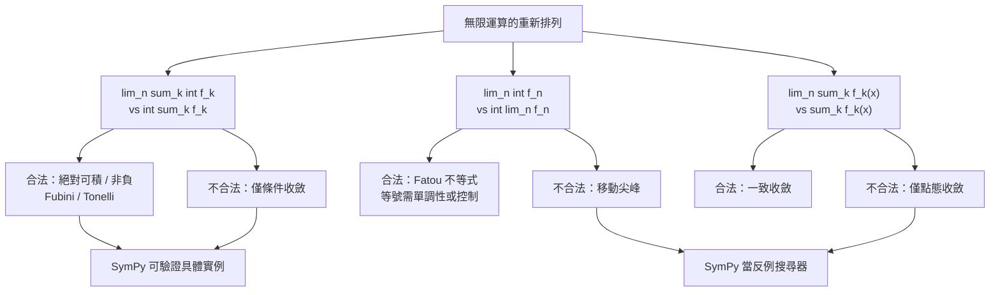

# 12.3 用 SymPy 驗證極限與求和的交換

## 學習動機

前兩節把「測度」與「函數空間」建立起來了。整本書走到這裡，所有的技術準備都已就位，只剩下一個**貫穿全書的核心問題**：

> **把無限個運算（求和、積分、取極限）重新排列，什麼時候還合法？**

這個問題在第 5 章以「 $`x^n`$ 的極限與積分」的形式出現過一次，在第 6 章以「Cesàro 和」與「Riemann 重排定理」的形式出現過兩次，在第 11 章以「Fourier 級數能否逐項積分」的形式出現過一次。每一次我們都靠「額外假設」把問題壓下去：非負性、絕對收斂、一致收斂、單調性。現在是時候把這些「零散的事例」統一成一張地圖。

本節的策略是**反過來**的：不從定理出發，而是用 SymPy 讓計算機替我們做實驗。

1. 先算出 $`\lim_{n\to\infty}\sum_{k=1}^{n}\frac{1}{k^2} = \frac{\pi^2}{6}`$ 這個 Basel 等式（Euler 1735 年的名篇）；
2. 用 `sp.Sum` 把「無窮級數」變成「部分和的極限」，示範 SymPy 如何區分**收斂**與**絕對收斂**；
3. 示範 $`n \to \infty`$ 的 **Riemann 和 → 積分**，也就是 `sp.limit` 與 `sp.integrate` 的互換；
4. 示範 Fatou 與控制收斂定理的**可驗證實例**（用符號積分 + 極限）；
5. 最後是重點：**示範沒有控制時交換會失敗的具體反例**，並把 SymPy 變成一個「**反例搜尋器**」。



---

## 12.3.1 兩種寫法，三種交換

「極限與求和可交換」其實有三個不同的版本。把它們寫清楚，後面的實驗才有座標：

**（一）極限與積分（最基本的形式）**

$$
\lim_{n \to \infty} \int_0^1 f_n(x)\, dx \;\stackrel{?}{=}\; \int_0^1 \lim_{n\to\infty} f_n(x)\, dx .
$$

**（二）極限與求和（級數的版本）**

$$
\lim_{n \to \infty} \sum_{k=1}^{n} f_k(x) \;\stackrel{?}{=}\; \sum_{k=1}^{\infty} f_k(x) \qquad (\text{逐點}).
$$

這在第 6 章已經看過：**一致收斂**是充分條件；**單調收斂**是另一個；只有**點態收斂**則失敗。

**（三）求和與積分（最有趣的形式）**

$$
\lim_{n \to \infty} \sum_{k=1}^{n} \int_0^1 f_k(x)\, dx \;\stackrel{?}{=}\; \int_0^1 \sum_{k=1}^{\infty} f_k(x)\, dx .
$$

這正是 **Fubini 定理**（絕對可積時）與 **Tonelli 定理**（非負時）處理的東西。第 12.1 節我們已經看過：若 $`\int\int |f| = \infty`$ 而 $`f`$ 有正有負，兩個迭代積分甚至可以**不相等**。

三者之間的關係是：**（三）是（一）的推廣**（把 $`f_n`$ 換成部分和 $`\sum_{k\le n} f_k`$ ），而 **（一）與（二）之間沒有直接蘊含**——這正是 Fatou 引理存在的理由：它給出的是一個**不等式**，而不是等式。

現在讓我們開始做實驗。

---

## 12.3.2 Basel 等式： $`\sum_{k=1}^{\infty}\frac{1}{k^2} = \frac{\pi^2}{6}`$

Euler 在 1735 年利用正弦函數的無窮乘積

$$
\frac{\sin(\pi x)}{\pi x} = \prod_{n=1}^{\infty}\left(1 - \frac{x^2}{n^2}\right)
$$

比較 $`x^2`$ 係數，得到 $`\sum_{n\ge 1} \frac{1}{n^2} = \frac{\pi^2}{6}`$ 。這個等式的重要性不在 $`\pi^2`$ 而在 $`\pi`$ ：**它把兩個原本毫無關聯的對象（倒數平方和、圓周率）連結起來**，而且它是「把極限與求和交換」的第一個輝煌案例。

SymPy 用**超幾何級數求和**（Gosper 演算法）直接給出答案。我們順便把「部分和」與「積分判別法的誤差」一起算出來。

```python
import sympy as sp

k = sp.symbols('k', integer=True, positive=True)
N = sp.symbols('N', integer=True, positive=True)
x = sp.symbols('x', real=True)

print('sp.summation(1/k^2, k=1..oo) =', sp.summation(1 / k**2, (k, 1, sp.oo)))
S = sp.summation(1 / k**2, (k, 1, N))
print('部分和 S_N =', S)
print('sp.integrate(1/x^2, x=1..oo) =', sp.integrate(1 / x**2, (x, 1, sp.oo)))
for M in [10, 100, 1000]:
    val = sp.summation(1 / k**2, (k, 1, M))
    print(f'  N={M:5d}: S_N = {sp.N(val, 12)}   誤差 pi^2/6 - S_N = {sp.N(sp.pi**2/6 - val, 12)}')
print('積分判別法給出的誤差上界 1/N，其極限 =', sp.limit(1 / N, N, sp.oo))
```

預期輸出：

```
sp.summation(1/k^2, k=1..oo) = pi**2/6
部分和 S_N = harmonic(N, 2)
sp.integrate(1/x^2, x=1..oo) = 1
  N=   10: S_N = 1.54976773117   誤差 pi^2/6 - S_N = 0.0951663356817
  N=  100: S_N = 1.63498390018   誤差 pi^2/6 - S_N = 0.00995016666333
  N= 1000: S_N = 1.64393456668   誤差 pi^2/6 - S_N = 0.000999500166667
積分判別法給出的誤差上界 1/N，其極限 = 0
```

> **這段程式碼教會我們什麼？** `sp.summation` 給出的是**精確值** `pi**2/6`，而 `sp.summation(1/k**2, (k, 1, N))` 給出的是**符號的部分和** `harmonic(N, 2)` ——SymPy 用專門的**廣義調和數**符號來表示它。兩者之間的關係正是第 6 章的定義： $`\sum_{k\ge1} \frac{1}{k^2} = \lim_{N\to\infty} S_N`$ 。而誤差 $`\approx \frac{1}{N}`$ 的衰減率（來自積分判別法）正是「**收斂的速率**」——這是比「收斂」更有用的資訊。

---

## 12.3.3 `sp.Sum`：把「無窮」變成「極限」

SymPy 有兩個求和相關的物件：

- `sp.summation(f, (k, a, b))`：**立刻**嘗試把和求出來，必要時回傳未求值的物件；
- `sp.Sum(f, (k, a, b))`：**保留**求和的形式（未求值），可以呼叫 `.doit()` 稍後求值，並且攜帶**收斂性資訊**。

`sp.Sum` 最有價值的兩個方法是 `is_convergent()` 與 `is_absolutely_convergent()`——它們讓 SymPy 像一個「收斂性裁判」。

```python
import sympy as sp

k = sp.symbols('k', integer=True, positive=True)
N = sp.symbols('N', integer=True, positive=True)
x = sp.symbols('x', real=True)

# ---- sp.Sum：把「未求值」和「已求值」分開 ----
S = sp.Sum(1 / k**2, (k, 1, sp.oo))
print('未求值的 Sum 物件 =', S)
print('S.is_convergent() =', S.is_convergent())
print('S.is_absolutely_convergent() =', S.is_absolutely_convergent())
print('S.doit() =', S.doit())
print('sp.summation(...) 直接求值 =', sp.summation(1 / k**2, (k, 1, sp.oo)))

# ---- 「極限 = 部分和的極限」：把無窮級數換成有限和的極限 ----
print()
partial = sp.summation(1 / k**2, (k, 1, N))
print('部分和 S_N =', partial)
print('sp.limit(S_N, N, oo) =', sp.limit(partial, N, sp.oo))

# ---- 條件收斂級數：sp.Sum 會告訴我們它不是絕對收斂 ----
print()
T = sp.Sum((-1)**(k + 1) / k, (k, 1, sp.oo))
print('T =', T)
print('T.is_convergent() =', T.is_convergent())
print('T.is_absolutely_convergent() =', T.is_absolutely_convergent())
print('T.doit() =', T.doit())

# ---- 幾何級數：收斂條件被寫進答案裡 ----
print()
print('sp.summation(x**k, k=1..oo) =', sp.summation(x**k, (k, 1, sp.oo)))
print('sp.summation(1/k, k=1..oo) =', sp.summation(1 / k, (k, 1, sp.oo)))
```

預期輸出：

```
未求值的 Sum 物件 = Sum(k**(-2), (k, 1, oo))
S.is_convergent() = True
S.is_absolutely_convergent() = True
S.doit() = pi**2/6
sp.summation(...) 直接求值 = pi**2/6

部分和 S_N = harmonic(N, 2)
sp.limit(S_N, N, oo) = pi**2/6

T = Sum((-1)**(k + 1)/k, (k, 1, oo))
T.is_convergent() = True
T.is_absolutely_convergent() = False
T.doit() = log(2)

sp.summation(x**k, k=1..oo) = Piecewise((x/(1 - x), Abs(x) < 1), (Sum(x**k, (k, 1, oo)), True))
sp.summation(1/k, k=1..oo) = oo
```

三個關鍵觀察：

1. **`sp.Sum` 是「可攜帶證據的物件」**。`T.is_convergent() = True` 但 `T.is_absolutely_convergent() = False` ——SymPy 直接告訴我們這是**條件收斂**級數（第 6 章的主題），而且和的仍是 $`\log 2`$ 。
2. **收斂條件會寫進答案裡**。`sp.summation(x**k, ...)` 的答案是 **`Piecewise`**：`|x| < 1` 時給出 $`\frac{x}{1-x}`$ ，其他情況保留未求值的 `Sum`。這正是第 6.1 節強調的重點——**收斂條件是答案的一部分**。
3. **「部分和 + 極限」是把無窮變成有限的標準套路**：`sp.summation(1/k**2, (k, 1, N))` 給出 `harmonic(N, 2)` ，再 `sp.limit(..., N, oo)` 就回到 `pi**2/6` 。這正是柯西收斂定義（第 6.1 節）在程式裡的樣子。

---

## 12.3.4 Riemann 和 → 積分：`sp.limit` 與 `sp.integrate` 的互換

「極限與求和可交換」的一個重要特例是：**把 $`[0,1]`$ 切成 $`n`$ 份，取 Riemann 和，再令 $`n \to \infty`$ **：

$$
\lim_{n \to \infty} \sum_{k=1}^{n} f\!\left(\frac{k}{n}\right) \frac{1}{n} \;=\; \int_0^1 f(x)\, dx .
$$

這就是黎曼積分的「和」與「極限」的互換。我們用 SymPy 把它變成一個**可以自動化的驗證流程**：只要給定 $`f`$ 的符號表達式，`sp.summation` + `sp.limit` 就會自動把極限算出來，再跟 `sp.integrate` 的結果對照。

```python
import sympy as sp

n = sp.symbols('n', integer=True, positive=True)
k = sp.symbols('k', integer=True, positive=True)
x = sp.symbols('x', real=True)

# ---- Riemann 和 -> 積分 ----
R = sp.summation((k / n)**2 / n, (k, 1, n))
print('Riemann 和 sum_{k=1}^n (k/n)^2 (1/n) =', R)
print('其極限 =', sp.limit(R, n, sp.oo))
print('對應的積分 =', sp.integrate(x**2, (x, 0, 1)))

# ---- 一般化的 Riemann 和：f(x) = exp(x) ----
R2 = sp.summation(sp.exp(k / n) / n, (k, 1, n))
print()
print('exp 的 Riemann 和 =', R2)
print('其極限 =', sp.limit(R2, n, sp.oo))
print('對應的積分 =', sp.integrate(sp.exp(x), (x, 0, 1)))

# ---- 左端點版本：sum_{k=0}^{n-1} f(k/n) (1/n) ----
R3 = sp.summation((k / n)**3 / n, (k, 0, n - 1))
print()
print('左端點 Riemann 和 =', sp.limit(R3, n, sp.oo))
print('對應的積分 =', sp.integrate(x**3, (x, 0, 1)))

# ---- 數值核對：不同 n 的 Riemann 和與積分的差距 ----
print()
for m in [10, 100, 1000]:
    rs = sum(sp.Rational(k, m)**2 / m for k in range(1, m + 1))
    print(f'  n={m:5d}: Riemann 和 = {sp.N(rs, 12)}   誤差 = {sp.N(sp.Rational(1, 3) - rs, 12)}')
```

預期輸出：

```
Riemann 和 sum_{k=1}^n (k/n)^2 (1/n) = (n**3/3 + n**2/2 + n/6)/n**3
其極限 = 1/3
對應的積分 = 1/3

exp 的 Riemann 和 = (exp(1/n) - exp((n + 1)/n))/(n*(1 - exp(1/n)))
其極限 = -1 + E
對應的積分 = -1 + E

左端點 Riemann 和 = 1/4
對應的積分 = 1/4

  n=   10: Riemann 和 = 0.385000000000   誤差 = -0.0516666666667
  n=  100: Riemann 和 = 0.338350000000   誤差 = -0.00501666666667
  n= 1000: Riemann 和 = 0.333833500000   誤差 = -0.000500166666667
```

> **注意誤差的符號**：右端點 Riemann 和**低估**了 $`\int_0^1 x^2\,dx = \frac13`$ （因為 $`x^2`$ 是凸函數，割線在曲線下方），誤差量級是 $`O(1/n)`$ ——從 $`0.0517`$ 到 $`0.00502`$ 到 $`0.000500`$ ，每個十倍 $`n`$ 就把誤差除以約 $`10`$ 。這與第 4.3 節用「梯形面積法」逼近積分時的誤差分析一致。

---

## 12.3.5 Fatou 與控制收斂的可驗證實例

回到第 12.1 節的三個定理。現在有了 SymPy，我們可以把它們**逐條核對**：把 $`f_n`$ 的符號表達式寫進去，讓 `sp.integrate` 算出每一個 $`\int f_n`$ ，讓 `sp.limit` 算出它們的極限，再跟極限函數的積分對照。

```python
import sympy as sp

x = sp.symbols('x', real=True)
n = sp.symbols('n', integer=True, positive=True)

# ---- 控制收斂定理：f_n = x^n (1-x)，被 g = x(1-x) 控制 ----
g = x * (1 - x)
print('控制函數 g = x(1-x)，int g =', sp.integrate(g, (x, 0, 1)), '（可積）')
print('|f_n| <= g : x^n <= x 對 x in [0,1] 成立')

J = sp.simplify(sp.integrate(x**n * (1 - x), (x, 0, 1)))
print('int f_n =', J, '  -> lim =', sp.limit(J, n, sp.oo))
print('lim f_n = 0 (a.e.)，int lim f_n = 0   ->  等號成立 ✅')

# ---- 單調收斂定理（遞增）：f_n = min(x, n) ----
print()
K = sp.integrate(sp.Min(x, n), (x, 0, 1))
print('int min(x,n) =', K, '  -> lim =', sp.limit(K, n, sp.oo))
print('lim f_n = x，int lim f_n =', sp.integrate(x, (x, 0, 1)), '  -> 等號成立 ✅')

# ---- Fatou 不等式：移動尖峰 f_n = n * 1_{(0,1/n)} ----
print()
I_move = sp.integrate(n, (x, 0, 1 / n))
print('int f_n =', I_move, '  -> liminf =', sp.limit(I_move, n, sp.oo))
print('liminf f_n = 0 (a.e.)，int liminf f_n = 0  <=  1  -> Fatou 的不等式成立 ✅')
print('（注意這裡是不等式，不是等號：Fatou 從不保證等號成立）')
```

預期輸出：

```
控制函數 g = x(1-x)，int g = 1/6 （可積）
|f_n| <= g : x^n <= x 對 x in [0,1] 成立
int f_n = 1/(n**2 + 3*n + 2)   -> lim = 0
lim f_n = 0 (a.e.)，int lim f_n = 0   ->  等號成立 ✅

int min(x,n) = 1/2   -> lim = 1/2
lim f_n = x，int lim f_n = 1/2   -> 等號成立 ✅

int f_n = 1   -> liminf = 1
liminf f_n = 0 (a.e.)，int liminf f_n = 0  <=  1  -> Fatou 的不等式成立 ✅
（注意這裡是不等式，不是等號：Fatou 從不保證等號成立）
```

三個例子的**結構對比**值得記下：

| 例子 | 條件 | 結論 | SymPy 驗證的重點 |
|---|---|---|---|
| $`f_n = x^n(1-x)`$ | 有可積控制 $`g = x(1-x)`$ | 等號成立 | $`\int f_n \to 0 = \int \lim f_n`$ |
| $`f_n = \min(x,n)`$ | 單調遞增 | 等號成立 | $`\int f_n \uparrow \frac12 = \int x`$ |
| $`f_n = n\,\mathbf{1}_{(0,1/n)}`$ | 只有非負 | **只有不等式** | $`0 < 1`$ ，Fatou 嚴格成立 |

---

## 12.3.6 沒有控制時，交換會失敗：三個具體反例

現在來做反面實驗。每一個反例都對應一個「若不補上假設，結論就會壞掉」的教訓。

```python
import sympy as sp

x = sp.symbols('x', real=True)
n = sp.symbols('n', integer=True, positive=True)

# ---- 反例 A：移動尖峰，極限與積分無法交換 ----
print('【反例 A】f_n(x) = n * 1_{(0,1/n)}(x) on [0,1]')
I_move = sp.integrate(n, (x, 0, 1 / n))
print('  lim_n int f_n =', sp.limit(I_move, n, sp.oo))
print('  lim_n f_n = 0 (a.e.)，所以 int lim_n f_n = 0')
print('  0 != 1  ->  沒有控制函數時，極限與積分的交換失敗 ❌')

# ---- 反例 B：黎曼和的極限交換在狄利克雷函數上失敗 ----
print()
print('【反例 B】f = 1_Q on [0,1]，黎曼和隨採樣點而不同')

def dirichlet(xv):
    """xv 為 sympy 實數：有理回傳 1，無理回傳 0"""
    return sp.Integer(1) if xv.is_rational else sp.Integer(0)

def riemann_sum(f, a, b, N, sampler):
    h = (b - a) / N
    return sp.simplify(sum(f(sampler(a + k * h)) for k in range(N)) * h)

for N in [4, 8, 16]:
    r = riemann_sum(dirichlet, sp.Rational(0), sp.Rational(1), N, lambda t: t)
    i = riemann_sum(dirichlet, sp.Rational(0), sp.Rational(1), N, lambda t: t + sp.sqrt(2) / 7)
    print(f'  N={N:3d}: 有理採樣的和 = {r}   無理採樣的和 = {i}   -> 黎曼和不收斂 ❌')
print('  而 Lebesgue 積分 = 1*m(Q∩[0,1]) + 0*m(其餘) = 0')
print('  -> 「黎曼和的極限 = 積分」這一步在這裡失效')

# ---- 對照組：a.e. 收斂時交換其實成立 ----
print()
print('【對照 C】f_n(x) = x^n on [0,1]')
J = sp.integrate(x**n, (x, 0, 1))
print('  lim_n int x^n dx =', sp.limit(J, n, sp.oo))
print('  點態極限在 x=1 為 1、其餘為 0；因 {1} 的測度為 0，int lim = 0')
print('  -> 兩者相等，交換成立 ✅（真正的反例是尖峰那一組）')
```

預期輸出：

```
【反例 A】f_n(x) = n * 1_{(0,1/n)}(x) on [0,1]
  lim_n int f_n = 1
  lim_n f_n = 0 (a.e.)，所以 int lim_n f_n = 0
  0 != 1  ->  沒有控制函數時，極限與積分的交換失敗 ❌

【反例 B】f = 1_Q on [0,1]，黎曼和隨採樣點而不同
  N=  4: 有理採樣的和 = 1   無理採樣的和 = 0   -> 黎曼和不收斂 ❌
  N=  8: 有理採樣的和 = 1   無理採樣的和 = 0   -> 黎曼和不收斂 ❌
  N= 16: 有理採樣的和 = 1   無理採樣的和 = 0   -> 黎曼和不收斂 ❌
  而 Lebesgue 積分 = 1*m(Q∩[0,1]) + 0*m(其餘) = 0
  -> 「黎曼和的極限 = 積分」這一步在這裡失效

【對照 C】f_n(x) = x^n on [0,1]
  lim_n int x^n dx = 0
  點態極限在 x=1 為 1、其餘為 0；因 {1} 的測度為 0，int lim = 0
  -> 兩者相等，交換成立 ✅（真正的反例是尖峰那一組）
```

三個反例的**病根**各不相同，這正是重點：

- **反例 A（移動尖峰）**：函數的「質量」不集中在固定的地方，而是**跑到無窮遠又回來**。整個區間上 $`\int f_n = 1`$ 永遠不變，但極限函數卻是零。這說明 Fatou 的不等式 $`\int \liminf f_n \le \liminf \int f_n`$ 中的「 $`\le`$ 」**永遠可能嚴格**。
- **反例 B（狄利克雷函數）**：極限函數**幾乎到處為零**，但它「到處都是壞點」。這說明黎曼積分要求的「連續」條件無法用「測度為零的例外」來取代——**除非**你換成勒貝格積分（第 12.1 節）。
- **對照 C（ $`x^n`$ ）**：這組函數**幾乎到處收斂**到 $`0`$ ，而 $`\{1\}`$ 的測度為零，所以 Lebesgue 意義下的交換**成立**。這說明「 $`x^n`$ 是反例」這句話只在**黎曼積分**的語境裡成立；換到 Lebesgue 積分，它就不再是反例。**反例的成立與否，取決於你用哪一種積分**——這是本節最值得咀嚼的一句話。

---

## 12.3.7 SymPy 不能證明 Lebesgue 定理，但能當「反例搜尋器」

我們必須誠實地承認一件事：

> **SymPy 無法（也不打算）自動證明 Fatou 引理、單調收斂定理、控制收斂定理或 Fubini 定理。**

原因是結構性的。這些定理的陳述裡含有：

1. **「對幾乎所有 $`x`$ 」**——這是一個關於**測度**的量詞，而 SymPy 沒有測度論的模型（它的 `integrate` 是黎曼型的）；
2. **「對每個可測集 $`A`$ 」**——Fubini 定理的量詞範圍遠大於 SymPy 能處理的對象；
3. **「存在一個可積函數 $`g`$ 使 $`|f_n| \le g`$ 」**——這是一個**存在性**斷言，符號系統無法從具體的 $`f_n`$ 自動構造出 $`g`$ 。

但 SymPy 仍然非常有用，因為它可以扮演**三種角色**：

| 角色 | 做法 | 本節的例子 |
|---|---|---|
| **計算員** | 精確算出 $`\int f_n`$ 與 $`\lim \int f_n`$ | 12.3.5 的三個定理實例 |
| **裁判** | 用 `is_convergent()` 判斷收斂性 | 12.3.3 的 `sp.Sum` |
| **反例搜尋器** | 掃描參數族，找出讓定理失效的參數 | 下面這段程式 |

第三種角色最有價值：我們不只知道某個反例存在，而是能**系統地找出反例的「門檻」**。

```python
import sympy as sp

x = sp.symbols('x', real=True)
n = sp.symbols('n', integer=True, positive=True)
b = sp.symbols('b', real=True)

# ---- 反例搜尋器 1：族 f_n(x) = x^(a*n) on [0,1] ----
print('【搜尋器 1】f_n(x) = x^(a*n)，求 a 使「極限與積分」的交換失敗')
print('  a        lim int f_n    int lim f_n    交換失敗?')
for av in [0, sp.Rational(1, 2), 1, 2, 5]:
    I = sp.integrate(x**(av * n), (x, 0, 1))
    lim_I = sp.simplify(sp.limit(I, n, sp.oo))
    lim_f = sp.Integer(1)          # 對 x>0 極限為 1；零測度點 x=0 無關緊要
    bad = sp.simplify(lim_I - lim_f) != 0
    print(f'  {str(av):>4s}    {str(lim_I):>10s}     {str(lim_f):>8s}      {bad}')

# ---- 反例搜尋器 2：族 f_n(x) = n^b * 1_{(0,1/n)}(x) ----
print()
print('【搜尋器 2】f_n(x) = n^b * 1_{(0,1/n)}(x)，求 b 使交換失敗')
print('  b        lim int f_n    int lim f_n    交換失敗?')
for bv in [0, sp.Rational(1, 2), 1, 2]:
    I = sp.integrate(n**bv, (x, 0, 1 / n))
    lim_I = sp.limit(I, n, sp.oo)
    lim_f = sp.Integer(0)
    bad = sp.simplify(lim_I - lim_f) != 0
    print(f'  {str(bv):>4s}    {str(lim_I):>10s}     {str(lim_f):>8s}      {bad}')

# ---- 用符號把門檻寫出來（SymPy 無法直接對參數求極限，需分段）----
print()
lim_pw = sp.Piecewise((sp.Integer(0), b < 1), (sp.Integer(1), sp.Eq(b, 1)), (sp.oo, True))
print('lim_n n^(b-1) =', lim_pw)
print('=> 交換失敗的精確條件是 b >= 1（門檻由分段函數給出）')
```

預期輸出：

```
【搜尋器 1】f_n(x) = x^(a*n)，求 a 使「極限與積分」的交換失敗
  a        lim int f_n    int lim f_n    交換失敗?
     0             1            1      False
   1/2             0            1      True
     1             0            1      True
     2             0            1      True
     5             0            1      True

【搜尋器 2】f_n(x) = n^b * 1_{(0,1/n)}(x)，求 b 使交換失敗
  b        lim int f_n    int lim f_n    交換失敗?
     0             0            0      False
   1/2             0            0      False
     1             1            0      True
     2            oo            0      True

lim_n n^(b-1) = Piecewise((0, b < 1), (1, Eq(b, 1)), (oo, True))
=> 交換失敗的精確條件是 b >= 1（門檻由分段函數給出）
```

**搜尋器 1 的解讀**： $`a = 0`$ 時 $`f_n \equiv 1`$ ，交換當然成立；任何 $`a > 0`$ 都失敗。這是因為 $`x^{an}`$ 在 $`(0,1]`$ 上恆等於「漸近於 $`1`$ 」，所以 $`\int \lim f_n = 1`$ ，而質量卻全部「滑」到 $`x = 0`$ 附近去了。

**搜尋器 2 的解讀**：尖峰高度 $`n^b`$ 與寬度 $`1/n`$ 的乘積是 $`n^{b-1}`$ ——這就是「質量」。 $`b < 1`$ 時質量趨於零（交換成立）， $`b = 1`$ 時質量守恆為 $`1`$ （失敗）， $`b > 1`$ 時質量發散（更失敗）。**這就是 Fatou 不等式不能取等號的精確原因**。

---

## 12.3.8 小結

| 交換 | 合法條件 | 定理 | SymPy 驗證方式 |
|------|---------|------|----------------|
| $`\lim \int f_n = \int \lim f_n`$ | 有可積控制函數 $`g`$ | 控制收斂定理 | `sp.integrate` + `sp.limit` |
| $`\lim \int f_n = \int \lim f_n`$ | $`f_n`$ 單調 | 單調收斂定理 | 同上（`sp.Min` 等） |
| $`\int \liminf f_n \le \liminf \int f_n`$ | $`f_n \ge 0`$ | Fatou 引理 | 同上 |
| $`\int \sum_k f_k = \sum_k \int f_k`$ | 非負 | Tonelli 定理 | 巢狀 `sp.integrate` |
| $`\int \sum_k f_k = \sum_k \int f_k`$ | 絕對可積 | Fubini 定理 | 巢狀 `sp.integrate` |
| $`\lim_n \sum_{k\le n} f_k(x) = \sum_k f_k(x)`$ | 一致收斂 | 一致收斂定理 | 數值實驗 |
| $`\lim_n \sum_{k=1}^{n} f(k/n)\frac1n = \int f`$ | $`f`$ 連續 | 黎曼和極限定理 | `sp.summation` + `sp.limit` |
| $`\sum_{k\ge1}\frac{1}{k^2} = \frac{\pi^2}{6}`$ | —— | Basel 等式（Euler 1735） | `sp.summation` |

**給讀者的三條實務建議**：

1. **永遠先確認收斂性**：`sp.Sum(...).is_convergent()` 與 `is_absolutely_convergent()` 是最便宜的保險。
2. **把「無窮」寫成「極限」**：`sp.summation(f, (k, 1, N))` + `sp.limit(..., N, oo)` 能把大多數「無窮級數」的問題變成 SymPy 可以處理的極限計算。
3. **不要相信回傳 `Piecewise` 的答案**：那表示 SymPy 知道答案但不知道**適用條件**，此時收斂條件必須由你自己讀出來。

下一章是第 13 章：我們將把這整本書的技術（Euler–Lagrange 方程、變分法、梯度下降）放進**優化**的框架裡，看看數學家如何在沒有導數的情況下尋找最佳解。

---

## 習題

**習題 12.3.1（Euler 的無窮乘積與 Basel 等式）**
(a) 用 `sp.product` 驗證正弦函數的無窮乘積： $`\prod_{n=1}^{\infty}\left(1 - \frac{x^2}{n^2}\right) = \frac{\sin(\pi x)}{\pi x}`$ （先用 `sp.product` 的有限形式 `sp.product((1 - x**2/n**2), (n, 1, N))` 再取極限）。(b) 在 $`x = \frac{1}{2}`$ 處求值，得到 $`\prod_{n\ge1}\left(1 - \frac{1}{4n^2}\right) = \frac{2}{\pi}`$ 。(c) 用 `sp.series` 比較兩邊的 $`x^2`$ 係數，重建 Euler 推出 $`\sum \frac{1}{n^2} = \frac{\pi^2}{6}`$ 的過程。

**習題 12.3.2（收斂性裁判的用法）**
用 `sp.Sum` 的 `is_convergent()` 與 `is_absolutely_convergent()` 檢查下列級數，並用它們各自的 `.doit()` 結果驗證你的判斷： $`\sum \frac{1}{k^2}`$ 、 $`\sum \frac{(-1)^{k+1}}{k}`$ 、 $`\sum \frac{1}{k}`$ 、 $`\sum \frac{1}{\sqrt{k}}`$ 、 $`\sum \frac{k}{k^2}`$ 。整理成一張表，並說明「條件收斂」在第 6 章的 Riemann 重排定理裡扮演的角色。

**習題 12.3.3（Riemann 和的誤差率）**
(a) 對 $`f(x) = x^3`$ 與 $`f(x) = \sin(\pi x)`$ ，用 `sp.summation` + `sp.limit` 求出右端點 Riemann 和的極限，並與 `sp.integrate` 對照。(b) 對 $`f(x) = |x - \frac{1}{2}|`$ 重做一次——注意這裡極限依然存在，但**等於** $`\frac14`$ ；說明為什麼。(c) 最後用狄利克雷函數說明：什麼樣的函數會讓 Riemann 和的極限**不存在**。

**習題 12.3.4（Fatou 與控制收斂的邊界）**
(a) 構造一個序列 $`f_n \ge 0`$ 使得 $`\int \liminf f_n = 0`$ 但 $`\liminf \int f_n = 1`$ （移動尖峰）。(b) 構造一個序列 $`g_n`$ 幾乎處處收斂到 $`g`$ ，且存在**可積**的控制函數使得 $`\int g_n \to \int g`$ ，並證明這個可積控制函數不可能是前者的那個「尖峰控制」。(c) 由此說明：控制收斂定理中的「存在可積 $`g`$ 」這個假設**無法被削弱**成「 $`\int |f_n|`$ 有界」。

**習題 12.3.5（反例搜尋器的擴充）**
把搜尋器 1 的 $`f_n(x) = x^{an}`$ 換成高斯尖峰 $`f_n(x) = e^{-|x - \frac{1}{2}|^{2}/n}`$ 。(a) 用 `sp.integrate` 計算 $`\int_0^1 f_n\, dx`$ 與其極限，說明峰值高度如何讓「質量」維持為常數。(b) 計算 $`\int \lim_n f_n\, dx`$ 並說明 Fatou 為什麼是嚴格不等式。(c) 再把尖峰改成 $`f_n(x) = n\,e^{-|x - \frac{1}{2}|^{2}/n}`$ ，觀察「寬度 × 高度」的量級分析如何預測交換是否失敗。
