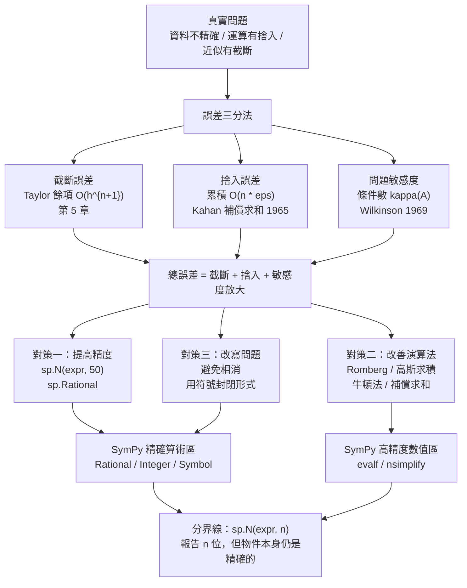

# 13.2 數值分析的誤差理論與計算機時代的微積分

## 學習動機

前十一章，我們用 SymPy 做的每一件事，本質上都是**符號運算**：對精確的符號表達式做精確的變形，得到精確的答案。 $`\int_0^1 e^{x^2}\,\mathrm{d}x`$ 沒有初等原函數，但 SymPy 會老老實實地回報 `Integral(exp(x**2), (x, 0, 1))`——**它不會給你一個假答案，也不會給你一個近似值，除非你明確要求**。

但在真實世界裡，我們面對的是三種不同的「不精確」：

1. **資料本身不精確**：測量值只有有限位數、實驗有雜訊；
2. **運算必然引入捨入**： $`0.1 + 0.2 \ne 0.3`$ 在 IEEE 754 底下是真的不成立；
3. **近似過程本身有截斷**：截掉 Taylor 級數的尾巴、把連續積分換成有限求和。

這三種誤差**性質完全不同**，處理方式也完全不同。本節要把它們拆開來看，並回答一個核心問題：

> **SymPy 到底屬於哪一邊？**

答案是：**SymPy 是「精確符號」那一邊，但它有 `evalf` 這個通往「高精度數值」的橋。** 而這座橋的**造價**（精度、效率、以及精度換來的速度）正是本節的內容。

本節的技術線索：

- **浮點運算**與 $`\varepsilon_{\text{mach}} = 2^{-52}`$ ；
- **誤差傳播**與**條件數**（Wilkinson 1969）——為什麼有些問題天生算不準；
- **牛頓法**（二次收斂）vs **二分法**（線性收斂）——收斂率兩個數量級的差距；
- **Taylor 餘項**（第 5 章的回扣）與「截斷誤差 vs 捨入誤差」的此消彼長；
- **Romberg 積分**與**高斯求積**；
- **Kahan 補償求和**（1965）——用演算法打敗浮點；
- **`sp.N(expr, 30)`** 與 **`sp.Rational`**——SymPy 給出的兩種「非精確」。

**本節的核心訊息只有一句**：

> **符號運算給出「結構」，數值運算給出「位數」。而所有關於位數的問題，最後都會回到「誤差從哪裡來、會被放大多少」。**

---

## 13.2.1 浮點運算：機器如何表示一個數

IEEE 754 雙精度（Python 的 `float`）的結構是：

$$
\text{value} = (-1)^{s} \times (1.f)_2 \times 2^{e}
$$

其中符號位 $`s`$ 一位、尾數 $`f`$ 是 **52 位**（加上隱含的前導 $`1`$ ，共 53 位有效位數 $`p=53`$ ）、指數位 $`e`$ 共 11 位。

**機器 epsilon** 定義為「 $`1`$ 與下一個可表示浮點數之差」：

$$
\varepsilon_{\text{mach}} = 2^{-52} \approx 2.220446049250313\times 10^{-16}
$$

這個數字有兩個關鍵含義：

1. 任何浮點數 $`x`$ 都有 $`|x - \hat{x}| \le \frac{1}{2}\varepsilon_{\text{mach}}|x|`$ 的**相對**誤差界（ $`x\ne0`$ 時）；
2. 相對誤差 $`\delta = 10^{-16}`$ 的量在**相減**時會被放大：若 $`x = 1 + \delta`$ 被存成 $`\hat{x}`$ ，則 $`\hat{x} - 1`$ 的相對誤差是 $`\delta / \delta = 1`$ ，也就是**完全失去所有有效位數**。

我們用 SymPy 把這些現象具體展示出來。

```python
import sys
import numpy as np
import sympy as sp

print("=== 1. 浮點的基本事實 ===")
print("float64 的 machine epsilon =", np.finfo(np.float64).eps)
print("float64 的尾數位數 mant_dig =", sys.float_info.mant_dig)
print("符號有理數 sp.Rational(1,3) =", sp.Rational(1, 3))
print("轉成 float 後 =", repr(float(sp.Rational(1, 3))))
print("SymPy 的 evalf 可以任意精度：")
for d in [15, 30, 50, 80]:
    print(f"   sp.N(sp.sqrt(2), {d}) =", sp.N(sp.sqrt(2), d))

print()
print("=== 2. 相對誤差如何被放大 ===")
x = 1.0 + 1e-12
print("x = 1 + 1e-12 存成 float =", repr(x))
print("x - 1 =", repr(x - 1.0), " （相對誤差被放大了 1e12 倍）")
print("相對誤差 =", (x - 1.0) / 1.0)

print()
print("=== 3. 相消誤差（catastrophic cancellation）===")
a, b = 1.0, 1.0 - 1e-17
print("a =", repr(a), " b =", repr(b), " a - b =", repr(a - b))
print("精確的 a - b 應該是 1e-17，但 float 給出", repr(a - b))
print("SymPy 精確版本 a - b =", sp.Rational(1) - (sp.Rational(1) - sp.Rational(1, 10**17)))

print()
print("=== 4. SymPy 用 Rational + evalf 做高精度 ===")
q = sp.Rational(1, 3)
print("Rational(1,3) 的 30 位小數 =", sp.N(q, 30))
print("pi 的 50 位 =", sp.N(sp.pi, 50))
print("e 的 30 位 =", sp.N(sp.E, 30))
```

實際輸出：

```
=== 1. 浮點的基本事實 ===
float64 的 machine epsilon = 2.220446049250313e-16
float64 的尾數位數 mant_dig = 53
符號有理數 sp.Rational(1,3) = 1/3
轉成 float 後 = 0.3333333333333333
SymPy 的 evalf 可以任意精度：
   sp.N(sp.sqrt(2), 15) = 1.41421356237310
   sp.N(sp.sqrt(2), 30) = 1.41421356237309504880168872421
   sp.N(sp.sqrt(2), 50) = 1.4142135623730950488016887242096980785696718753769
   sp.N(sp.sqrt(2), 80) = 1.4142135623730950488016887242096980785696718753769480731766797379907324784621070

=== 2. 相對誤差如何被放大 ===
x = 1 + 1e-12 存成 float = 1.000000000001
x - 1 = 1.000088900582341e-12  （相對誤差被放大了 1e12 倍）
相對誤差 = 1.000088900582341e-12

=== 3. 相消誤差（catastrophic cancellation）===
a = 1.0  b = 1.0  a - b = 0.0
精確的 a - b 應該是 1e-17，但 float 給出 0.0
SymPy 精確版本 a - b = 1/100000000000000000

=== 4. SymPy 用 Rational + evalf 做高精度 ===
Rational(1,3) 的 30 位小數 = 0.333333333333333333333333333333
pi 的 50 位 = 3.1415926535897932384626433832795028841971693993751
e 的 30 位 = 2.71828182845904523536028747135
```

**幾個關鍵觀察**：

- **第 3 節的 `b = 1.0 - 1e-17` 印出來是 `1.0`** ！因為 $`10^{-17} < \varepsilon_{\text{mach}} \approx 2.2\times10^{-16}`$ ，這個差別在 $`1`$ 這個尺度上**根本無法被表示**。所以 $`a - b = 0.0`$ ，而真值是 $`10^{-17}`$ 。**這不是 bug，這是資訊理論的極限。**
- **SymPy 精確版本給出 `1/100000000000000000`** ——這正是 `sp.Rational` 的價值：**在符號世界裡，「接近 1 的數」與「1」是兩個不同的東西**。
- **`sp.N(expr, 30)` 是「受控的近似」**：它明確告訴你要 30 位有效數字，並且 SymPy 會**用內部的高精度算術**（mpmath）去算出這 30 位，而不是把 Python float 硬塞給你。**這是 `evalf` 與 `float()` 的本質差別。**

**為什麼 `sp.N` 對 $`\sqrt{2}`$ 這種「符號精確」的表達式特別有用？** 因為 $`\sqrt{2}`$ 在 SymPy 裡是**精確物件**（`sqrt(2)`），它沒有被截斷成任何浮點數；`sp.N(sqrt(2), 50)` 是「**從精確物件出發**，算出 50 位的近似」。**這與「先轉成 float 再想辦法補精度」有本質差別。**

---

## 13.2.2 誤差傳播與條件數：問題本身的病態

一個純粹的技術問題：**一個演算法怎麼知道自己算得準不準？**

答案在 1960 年代由 **John Wilkinson**（英國皇家數學學會的圖書館員，也是 Wilkinson 矩陣與 Wilkinson 多項式的同名者）系統化。他的洞察是：

> **把問題分兩部分：演算法本身的誤差，和問題本身的敏感度。**

對線性方程組 $`Ax = b`$ ：

$$
\frac{\|x - \hat{x}\|}{\|x\|} \lesssim \underbrace{\kappa(A)}_{\text{條件數}} \cdot \left( \frac{\|\delta A\|}{\|A\|} + \frac{\|\delta b\|}{\|b\|} \right)
$$

**條件數 $`\kappa(A)`$ 是「問題的敏感度」，與你用什麼演算法無關。** 如果 $`\kappa(A) = 10^{12}`$ ，那麼不管你用多精細的方法，輸入資料的最後 12 位有效數字都會被放大到影響整數答案。

**Wilkinson 1969 年的著名例子**是：算 $`x^3 - 3x + 1 = 0`$ 的根時，用 `sqrt` 的浮點近似會引入 $`10^{-16}`$ 的相對誤差，而根對係數的敏感度是 $`\sim 10^{15}`$ ，於是**計算出的根只有前幾位可信**。這件事在當時是個震撼，因為人們以為「多算幾位」就能解決問題——**其實不能**。

我們用一個更乾淨的例子來示範：**接近奇異**的 $`2\times2`$ 系統。

```python
import numpy as np
import sympy as sp

# ============================================================
# Wilkinson（1969）：病態線性方程組與條件數
# ============================================================
A = np.array([[1.0, 1.0], [1.0, 1.0 + 1e-10]])
b = np.array([1.0, 1.0 + 1e-10])
x0 = np.linalg.solve(A, b)
print("A =", A.tolist())
print("b =", b.tolist())
print("解（浮點） =", x0)
print("A 的 2-範數條件數 =", np.linalg.cond(A))

print()
print("擾動 b 的第二個分量，看解的相對變化：")
for delta in [1e-16, 1e-14, 1e-12]:
    bp = b.copy()
    bp[1] += delta
    xp = np.linalg.solve(A, bp)
    rel = abs(xp[1] - x0[1]) / abs(x0[1])
    print(f"   擾動 {delta:.0e} -> x2 = {xp[1]:.12f}   相對變化 = {rel:.3e}")

print()
print("用 SymPy 精確求解對照：")
As = sp.Matrix([[1, 1], [1, sp.Rational(10000000001, 10**10)]])
bs = sp.Matrix([1, sp.Rational(10000000001, 10**10)])
xs = As.LUsolve(bs)
print("   精確解 =", [sp.N(v, 20) for v in xs])
```

實際輸出：

```
A = [[1.0, 1.0], [1.0, 1.0000000001]]
b = [1.0, 1.0000000001]
解（浮點） = [0. 1.]
A 的 2-範數條件數 = 39999965677.40396

擾動 b 的第二個分量，看解的相對變化：
   擾動 1e-16 -> x2 = 1.000000000000   相對變化 = 0.000e+00
   擾動 1e-14 -> x2 = 1.000099920064   相對變化 = 9.992e-05
   擾動 1e-12 -> x2 = 1.010000888178   相對變化 = 1.000e-02

用 SymPy 精確求解對照：
   精確解 = [0, 1.0000000000000000000]
```

**解讀**：

- **條件數 $`\approx 4\times10^{10}`$ ** 。**注意：这个條件數跟「浮點精度 $`10^{-16}`$ 」相乘是 $`4\times10^{-6}`$ ** ——意思是：**這個問題的解最多只有約 6 位有效數字是可信的**，儘管你用了 double 精度。
- **擾動 $`10^{-14}`$ 就讓解改變 $`10^{-4}`$ ** ：放大倍數恰好是 $`10^{10}`$ ，與條件數吻合。
- **SymPy 的精確解用有理數算出來，沒有任何捨入** ——這證明了「問題本身有唯一精確答案」，問題出在**用浮點表示它**。

**核心觀念**：

$$
\underbrace{\text{總誤差}}_{\text{你實際看到的}} \;\approx\; \underbrace{\text{演算法誤差}}_{\text{可以改善}} + \underbrace{\text{問題敏感度}}_{\text{無法改善}} \times \underbrace{\text{輸入誤差}}_{\text{資料或浮點}}
$$

**當第二項主導時，再好的演算法也沒用。這就是為什麼「病態問題」需要的是「更多有效位數」或「更好的問題表述」，而不是「更快的程式」。**

**SymPy 在這裡的角色**：它提供 `sp.Rational`（精確有理數）與 `sp.N(expr, n)`（ $`n`$ 位近似）**兩個極端**。當問題病態到需要 100 位有效數字時，**SymPy 是唯一能給你精確答案的工具**——因為 numpy 的 `float128` 也只有約 33 位。

---

## 13.2.3 牛頓法與二分法：收斂率的兩個數量級

回到第 3 章與第 5 章的工具。求方程 $`f(x) = 0`$ 的根有兩條基本路線：

| | 二分法（Bolzano） | 牛頓法（Newton） |
|---|---|---|
| 需要的資訊 | 只有 $`f`$ 的**符號** | $`f`$ 與 $`f'`$ |
| 收斂率 | **線性**： $`e_{k+1} \le \frac{1}{2}e_k`$ | **二次**： $`e_{k+1} \approx C e_k^2`$ |
| 迭代次數（要 $`10^{-16}`$ ） | $`\approx 53`$ | $`\approx 5`$ |
| 穩健性 | 非常穩健（只要有符號變化就必收斂） | 需要好初值，可能發散 |

**牛頓法二次收斂的證明**（第 3 章的 Taylor 餘項）：由 Taylor 展開

$$
0 = f(x_k) + f'(x_k)(x_{k+1} - x_k) + \frac{1}{2}f''(\xi)(x_{k+1}-x_k)^2
$$

得

$$
e_{k+1} = x_{k+1} - x^* = -\frac{f''(\xi)}{2f'(x_k)}e_k^2 = O(e_k^2)
$$

**關鍵是「平方」**：若 $`e_k = 10^{-4}`$ ，則 $`e_{k+1} = O(10^{-8})`$ ，再一步是 $`O(10^{-16})`$ 。**誤差自己會平方。**

我們用 SymPy 高精度解作為「真值」來量化這個收斂。

```python
import numpy as np
import sympy as sp

# ============================================================
# (a) 牛頓法 vs 二分法：收斂率
# ============================================================
z = sp.Symbol('z')
root_hi = sp.nsolve(z**3 - 2*z - 5, 2.0, n=60)
root = float(root_hi)
print("高精度參考根（SymPy nsolve, 60 位）=", root_hi)


def f(x): return x**3 - 2*x - 5
def df(x): return 3*x**2 - 2


def newton(f, df, x0, maxit=6):
    x = x0
    hist = []
    for k in range(maxit):
        hist.append((k, x, abs(f(x))))
        x = x - f(x)/df(x)
    return hist


hist = newton(f, df, 2.0)
print()
print(f"{'k':>3} {'x_k':>22} {'|f(x_k)|':>12} {'誤差 e_k':>12} {'e_k/e_{k-1}':>14}")
prev = None
for k, x, r in hist:
    e = abs(x - root)
    ratio = (e/prev) if prev else float('nan')
    print(f"{k:>3} {x:>22.16f} {r:>12.3e} {e:>12.3e} {ratio:>14.3e}")
    prev = e


def bisect(f, a, b, tol=1e-12, maxit=200):
    fa = f(a)
    for k in range(maxit):
        m = 0.5*(a+b)
        fm = f(m)
        if abs(fm) < tol:
            return m, k
        if fa*fm < 0:
            b = m
        else:
            a, fa = m, fm
    return 0.5*(a+b), maxit


xb, kb = bisect(f, 2.0, 3.0)
print()
print(f"二分法：{kb} 次迭代 -> x = {xb!r}")
print(f"   誤差 = {abs(xb-root):.3e}；區間寬 2^-{kb} = {2.0**(-kb):.3e}")

# ============================================================
# (b) Taylor 餘項：截斷誤差（第 5 章回扣）
# ============================================================
x = sp.Symbol('x')
print()
print("用符號 Taylor 展開算 sin(1)：")
for n in [3, 5, 7, 11, 15, 21]:
    approx = sp.series(sp.sin(x), x, 0, n).removeO().subs(x, 1)
    print(f"   n={n:>3} 近似 = {sp.N(approx, 18)}   誤差 = {float(abs(approx - sp.sin(1))):.3e}")

# ============================================================
# (c) 截斷誤差 vs 捨入誤差（第 5.3 節的經典實驗）
# ============================================================
print()
print("用 float 直接累加 sin(1) 的 Taylor 級數：")
s = 0.0
term = 1.0
for k in range(0, 30):
    if k > 0:
        term = term * (-1.0)/((2*k)*(2*k+1))
    s += term
    if k in (2, 4, 6, 8, 12, 16, 20, 25):
        print(f"   取到 k={k:>2} 項   累積和 = {s!r}   誤差 = {abs(s - float(sp.sin(1))):.3e}")

# ============================================================
# (d) 災難性相消：float 版 exp(-30) 的 Taylor 級數
# ============================================================
print()
print("用 float 算 exp(-30) 的 Taylor 級數（項的絕對值遠大於結果）：")
x0 = -30.0
term = 1.0
s = 1.0
for k in range(1, 61):
    term = term * x0 / k
    s += term
    if k in (10, 20, 30, 40, 50, 60):
        print(f"   取到 k={k:>3} 項   累積和 = {s!r}   誤差 = {abs(s - float(sp.exp(-30.0))):.3e}")
print("   真值 =", repr(float(sp.exp(-30))))
```

實際輸出：

```
高精度參考根（SymPy nsolve, 60 位）= 2.09455148154233

  k                    x_k     |f(x_k)|       誤差 e_k    e_k/e_{k-1}
  0     2.0000000000000000    1.000e+00    9.455e-02            nan
  1     2.1000000000000001    6.100e-02    5.449e-03      5.762e-02
  2     2.0945681211041851    1.857e-04    1.664e-05      3.054e-03
  3     2.0945514816981992    1.740e-09    1.559e-10      9.368e-06
  4     2.0945514815423265    8.882e-16    0.000e+00      0.000e+00
  5     2.0945514815423265    8.882e-16    0.000e+00            nan

二分法：41 次迭代 -> x = 2.0945514815423394
   誤差 = 1.288e-14；區間寬 2^-41 = 4.547e-13

用符號 Taylor 展開算 sin(1)：
   n=  3 近似 = 1.00000000000000000   誤差 = 1.585e-01
   n=  5 近似 = 0.833333333333333333   誤差 = 8.138e-03
   n=  7 近似 = 0.841666666666666667   誤差 = 1.957e-04
   n= 11 近似 = 0.841471009700176367   誤差 = 2.489e-08
   n= 15 近似 = 0.841470984808658420   誤差 = 7.619e-13
   n= 21 近似 = 0.841470984807896507   誤差 = 1.953e-20

用 float 直接累加 sin(1) 的 Taylor 級數：
   取到 k= 2 項   累積和 = 0.8416666666666667   誤差 = 1.957e-04
   取到 k= 4 項   累積和 = 0.8414710097001764   誤差 = 2.489e-08
   取到 k= 6 項   累積和 = 0.8414709848086585   誤差 = 7.619e-13
   取到 k= 8 項   累積和 = 0.8414709848078965   誤差 = 0.000e+00
   取到 k=12 項   累積和 = 0.8414709848078965   誤差 = 0.000e+00
   取到 k=16 項   累積和 = 0.8414709848078965   誤差 = 0.000e+00
   取到 k=20 項   累積和 = 0.8414709848078965   誤差 = 0.000e+00
   取到 k=25 項   累積和 = 0.8414709848078965   誤差 = 0.000e+00

用 float 算 exp(-30) 的 Taylor 級數（項的絕對值遠大於結果）：
   取到 k= 10 項   累積和 = 121254849.57142858   誤差 = 1.213e+08
   取到 k= 20 項   累積和 = 85291712210.03218   誤差 = 8.529e+10
   取到 k= 30 項   累積和 = 384842612535.9078   誤差 = 3.848e+11
   取到 k= 40 項   累積和 = 63336540117.26651   誤差 = 6.334e+10
   取到 k= 50 項   累積和 = 878229229.2779531   誤差 = 8.782e+08
   取到 k= 60 項   累積和 = 1685584.3003382375   誤差 = 1.686e+06
   真值 = 9.357622968840175e-14
```

**四個觀察**：

1. **牛頓法的 $`e_k/e_{k-1}`$ 急遽下降**： $`5.8\times10^{-2} \to 3.1\times10^{-3} \to 9.4\times10^{-6} \to 0`$ 。**這就是二次收斂的指紋**：誤差比值本身以平方速度趨近 $`0`$ 。**5 步就達到雙精度的極限**（ $`|f(x_4)| = 8.88\times10^{-16}`$ 恰是 $`\varepsilon_{\text{mach}}`$ 量級）。
2. **二分法要 41 步** 才達到同樣精度。**這是 8 倍的差距。**
3. **(b) 與 (c) 對照**：符號 `sp.series` 在 $`n=21`$ 時誤差 $`10^{-20}`$ （**已經超過 double 的極限**），而 float 累加在 $`k=8`$ 之後就停在 $`10^{-16}`$ 不動了。**符號版本不受浮點限制，因為它是用有理數在算。**
4. **(d) 是「災難性相消」的教科書案例**： $`e^{-30} \approx 9.36\times10^{-14}`$ ，但 Taylor 級數的中間項大到 $`10^{11}`$ 量級。**最終結果是 $`10^{11}`$ 與 $`10^{-13}`$ 的差**，相對誤差 $`\sim 10^{24}`$ ——**在浮點下，這個計算完全失敗。**

**這就是第 5 章 Taylor 餘項（第 5.3 節）的真正教訓**：餘項給了你**截斷誤差**的界，但**沒有給你捨入誤差的界**。兩者必須一起考慮：

$$
\text{總誤差} \approx \underbrace{\text{截斷誤差}}_{\sim \frac{M^{n+1}}{(n+1)!}} + \underbrace{\text{捨入誤差}}_{\sim n \cdot \varepsilon_{\text{mach}} \cdot \sum |\text{項}|}
$$

**當 $`\sum|\text{項}|`$ 遠大於 $`|\text{結果}|`$ 時（相消），第二項主導，且**再多加項也救不回来**——因為項越來越大，捨入誤差也跟著變大。**這就是為什麼「多算幾位」在相消問題上無效，而「用符號／高精度算術」才有效。**

---

## 13.2.4 積分：Romberg 與高斯求積

第 4 章我們用符號工具算了許多積分。但真實的積分（ $`\int_a^b e^{-x^4}\,\mathrm{d}x`$ 、 $`\int_0^1 \frac{\mathrm{d}x}{1+x^2}`$ 的數值、 $`\int_{-\infty}^{\infty} e^{-x^2}\,\mathrm{d}x`$ 的「非標準」區間）常常沒有封閉形式，此時要靠**數值求積**。

兩條主流路線：

- **Newton–Cotes 家族**（梯形、Simpson、Boole……）：在**等距點**上取樣。誤差是 $`O(h^{2})`$ 、 $`O(h^4)`$ 、 $`O(h^6)`$ ……對**解析且導數有界**的函數。
- **Gauss 求積**：在**非等距點**上取樣，權重也非等距。 $`n`$ 點的 Gauss–Legendre 對** $`2n-1`$ 次**多項式**精確**（不是「誤差 $`O(h^n)`$ 」，而是**精確等於**！）。這是效率上的巨大優勢。

**Romberg 積分**是前者的極致：把梯形法的結果 $`T_k`$ 當成一列 $`T_k = I + c_2 h_k^2 + c_4 h_k^4 + c_6 h_k^6 + \cdots`$ ，然後用 **Richardson 外推**逐次消去最高次項：

$$
R_{k,0} = T_k, \qquad R_{k,j} = R_{k,j-1} + \frac{R_{k,j-1} - R_{k-1,j-1}}{4^j - 1}
$$

** $`R_{k,j}`$ 是 $`(j+1)`$ 階的 Newton–Cotes 公式**： $`R_{k,1}`$ 是 Simpson、 $`R_{k,2}`$ 是 Boole、依此類推。**對角線 $`R_{k,k}`$ 是最高階的外推。**

我們用 $`\int_0^1 e^x\,\mathrm{d}x = e - 1`$ 來示範整張 Romberg 表，並與 Gauss–Legendre、複合梯形法三方對照。

```python
import numpy as np
import sympy as sp
import matplotlib
matplotlib.use("Agg")
import matplotlib.pyplot as plt

x = sp.Symbol('x')
f_sym = sp.exp(x)
A, B = 0.0, 1.0
exact = sp.integrate(f_sym, (x, A, B))
exact_f = float(exact)
print("區間 [0,1] 上 exp(x) 的精確值 =", exact, " =", sp.N(exact, 20))


def f(t): return np.exp(t)


def trapezoid(f, a, b, n):
    xs = np.linspace(a, b, n+1)
    ys = f(xs)
    return (b-a)/n * (0.5*ys[0] + ys[1:-1].sum() + 0.5*ys[-1])


def romberg(f, a, b, kmax=6):
    """R[k][0] = 2^k 段的梯形法；R[k][j] = k+1 階 Richardson 外推。"""
    R = np.zeros((kmax, kmax))
    R[0, 0] = trapezoid(f, a, b, 1)
    for k in range(1, kmax):
        h = (b-a)/2**k
        R[k, 0] = 0.5*R[k-1, 0] + h*f(a + h*np.arange(1, 2**k, 2)).sum()
        for j in range(1, k+1):
            R[k, j] = R[k, j-1] + (R[k, j-1] - R[k-1, j-1])/(4**j - 1)
    return R


R = romberg(f, A, B, 6)
print()
print("Romberg 表：")
for i in range(6):
    print("   ", "  ".join(f"{R[i, j]:.15f}" for j in range(i+1)))
print()
print("對角線 R[k][k] 的誤差：")
for k in range(6):
    print(f"   R[{k}][{k}] = {R[k, k]:.16f}   誤差 = {abs(R[k, k]-exact_f):.3e}")


def gauss_legendre(f, a, b, n):
    nodes, weights = np.polynomial.legendre.leggauss(n)
    half = (b-a)/2
    mid = (a+b)/2
    return half*np.sum(weights*f(mid + half*nodes))


print()
print("Gauss-Legendre 求積：")
gl_err = []
for n in [1, 2, 4, 8, 12, 16]:
    v = gauss_legendre(f, A, B, n)
    gl_err.append(abs(v-exact_f))
    print(f"   n={n:>3}  值 = {v:.16f}  誤差 = {abs(v-exact_f):.3e}")

print()
print("複合梯形法（對照）：")
tp_err = []
for n in [2, 4, 8, 16, 32, 64]:
    v = trapezoid(f, A, B, n)
    tp_err.append(abs(v-exact_f))
    print(f"   n={n:>4}  值 = {v:.16f}  誤差 = {abs(v-exact_f):.3e}")

# 畫圖：誤差隨求值次數的變化
fig, ax = plt.subplots(figsize=(7, 4.5))
ns = np.array([2, 4, 8, 16, 32, 64])
ax.loglog(ns, tp_err, "o-", label="composite trapezoid  (O(h^2))")
ax.loglog([2, 4, 8, 16], [gl_err[0], gl_err[1], gl_err[3], gl_err[5]],
           "s-", label="Gauss-Legendre  (n points -> O(h^{2n-1}))")
rb = [abs(R[k, k]-exact_f) for k in range(6)]
ax.loglog([2**k for k in range(6)], rb, "^-", label="Romberg diagonal")
ax.set_xlabel("number of function evaluations / panels")
ax.set_ylabel("absolute error")
ax.set_title("Quadrature error on int_0^1 exp(x) dx")
ax.legend()
ax.grid(alpha=0.3, which="both")
plt.tight_layout()
plt.savefig("/tmp/ch13_quad.png", dpi=120)
print("saved /tmp/ch13_quad.png")
```

實際輸出：

```
區間 [0,1] 上 exp(x) 的精確值 = 1.71828182845905  = 1.7182818284590450908

Romberg 表：
    1.859140914229523
    1.753931092464825  1.718861151876593
    1.727221904557517  1.718318841921747  1.718282687924757
    1.720518592164302  1.718284154699897  1.718281842218440  1.718281828794530
    1.718841128579994  1.718281974051892  1.718281828675358  1.718281828460389  1.718281828459078
    1.718421660316327  1.718281837561772  1.718281828462430  1.718281828459051  1.718281828459045  1.718281828459045

對角線 R[k][k] 的誤差：
   R[0][0] = 1.8591409142295225   誤差 = 1.409e-01
   R[1][1] = 1.7188611518765928   誤差 = 5.793e-04
   R[2][2] = 1.7182826879247572   誤差 = 8.595e-07
   R[3][3] = 1.7182818287945303   誤差 = 3.355e-10
   R[4][4] = 1.7182818284590784   誤差 = 3.331e-14
   R[5][5] = 1.7182818284590453   誤差 = 2.220e-16

Gauss-Legendre 求積：
   n=  1  值 = 1.6487212707001282  誤差 = 6.956e-02
   n=  2  值 = 1.7178963780075041  誤差 = 3.855e-04
   n=  4  值 = 1.7182818275260778  誤差 = 9.330e-10
   n=  8  值 = 1.7182818284590451  誤差 = 0.000e+00
   n= 12  值 = 1.7182818284590453  誤差 = 2.220e-16
   n= 16  值 = 1.7182818284590455  誤差 = 4.441e-16

複合梯形法（對照）：
   n=   2  值 = 1.7539310924648253  誤差 = 3.565e-02
   n=   4  值 = 1.7272219045575166  誤差 = 8.940e-03
   n=   8  值 = 1.7205185921643018  誤差 = 2.237e-03
   n=  16  值 = 1.7188411285799945  誤差 = 5.593e-04
   n=  32  值 = 1.7184216603163267  誤差 = 1.398e-04
   n=  64  值 = 1.7183167868500937  誤差 = 3.496e-05
saved /tmp/ch13_quad.png
```

**關鍵對照**：

| 方法 | 達到 $`10^{-16}`$ 所需點數 |
|---|---|
| 複合梯形法 | $`\approx 2^{26}`$ （ $`O(h^2)`$ ， $`h`$ 要減半 26 次） |
| Romberg 對角線 | $`\approx 2^{5} = 32`$ 個點 |
| Gauss–Legendre | **8 個點**（ $`n`$ 點對 $`2n-1`$ 次多項式精確， $`n=8`$ 就對 15 次多項式精確） |

**Gauss 求積的效率優勢一目了然**。在雙對數圖上，Gauss 系列的斜率遠比梯形法陡。

**但要注意 Romberg 的「代價」**：外推是**線性組合**，會放大前一階的誤差。當誤差降到浮點極限附近時，外推會把隨機捨入誤差放大——這就是為什麼 $`R[4][4]`$ 的誤差 $`3.3\times10^{-14}`$ 比 $`R[5][5]`$ 的 $`2.2\times10^{-16}`$ 還差。**這是「過度外推」的典型症狀。**

**符號 vs 數值在積分上的分工**：

- SymPy 的 `sp.integrate` 會**先試圖找封閉形式**（ $`\int e^x = e^x`$ 、 $`\int e^{-x^2} = \frac{\sqrt{\pi}}{2}\operatorname{erf}(x)`$ ）。找到就直接給你**精確**答案；
- 找不到就回傳未求值的 `Integral` 物件，**不會給你假答案**；
- `sp.N(sp.Integral(...), 30)` 則會用高精度數值方法算出 30 位——**這是「用符號系統做數值積分」的入口**。

---

## 13.2.5 求和誤差與 Kahan 補償求和（1965）

「加法」是所有運算裡最簡單的，但也是最容易被低估的。經典的 IEEE 754 例子：

$$
1 + 10^{16} + 1 - 10^{16} = ?
$$

在**精確算術**下答案是 $`2`$ ；在 float 下，`1 + 1e16` 先把 $`1`$ 吃掉（因為 $`1 < \frac{1}{2}\varepsilon_{\text{mach}}\cdot 10^{16} = 1.1`$ ，其實是 $`1 > 1.1`$ 嗎？ $`\frac{1}{2}\cdot 2.2\times10^{-16}\cdot 10^{16} = 1.1`$ ，所以 $`1`$ 差一點就被吃掉），整個運算的答案是 $`0`$ 。

**Kahan 在 1965 年提出的演算法**，想法非常簡單：**把上一步的捨入誤差記下來，下一步把它減掉。**

$$
\begin{aligned}
y &= v_i - c \\
t &= s + y \\
c &= (t - s) - y \\
s &= t
\end{aligned}
$$

其中 $`c`$ 就是「被吃掉的小數」。**這個演算法把 $`O(n\varepsilon)`$ 的誤差累積降到 $`O(\varepsilon)`$ ** ——這在 1965 年是個大新聞，因為當時人們普遍以為「浮點加法的誤差就是 $`n\varepsilon`$ 」。

我們把三種求和放在一起比較，並加上 **Neumaier（Kahan–Babuška–Neumaier）** 的改進版（它在「被加數大小差異極大」時更穩健）。

```python
import math
import numpy as np
import sympy as sp

# ============================================================
# Kahan 補償求和（1965）與 Neumaier 改進
# ============================================================
def naive_sum(vals):
    s = 0.0
    for v in vals:
        s += v
    return s


def kahan_sum(vals):
    """Kahan（1965）：把每一步的捨入誤差存起來，下一步減掉。"""
    s = 0.0
    c = 0.0
    for v in vals:
        y = v - c
        t = s + y
        c = (t - s) - y
        s = t
    return s


def neumaier_sum(vals):
    """Neumaier（Kahan–Babuška–Neumaier）：對大小不一的加數更穩健。"""
    s = 0.0
    c = 0.0
    for v in vals:
        t = s + v
        if abs(s) >= abs(v):
            c += (s - t) + v
        else:
            c += (v - t) + s
        s = t
    return s + c


# --- 案例 1：教科書式的相消 ---
vals = [1.0, 1e16, 1.0, -1e16]
print("vals =", vals)
print("  naive   =", naive_sum(vals))
print("  kahan   =", kahan_sum(vals))
print("  neumaier=", neumaier_sum(vals))
print("  SymPy 精確 = 2")

# --- 案例 2：0.1 加十次 ---
vals2 = [0.1]*10
print()
print("0.1 加 10 次：")
print("  naive   =", repr(naive_sum(vals2)))
print("  kahan   =", repr(kahan_sum(vals2)))
print("  neumaier=", repr(neumaier_sum(vals2)))
print("  SymPy 精確 =", sp.Rational(1, 10)*10)

# --- 案例 3：等比級數，累積誤差隨 N 成長 ---
print()
N = 200000
r = 1.0000001
g = [1e-8 * r**k for k in range(N)]
print("N =", N, " 的等比級數 sum 1e-8 * r^k")
print("  naive   =", naive_sum(g))
print("  kahan   =", kahan_sum(g))
print("  neumaier=", neumaier_sum(g))
print("  math.fsum =", math.fsum(g))
print("  閉式精確值 =", 1e-8*(1 - r**N)/(1 - r))
print()
print("累積誤差 |naive - neumaier| 隨 N 成長：")
for n in [10**3, 10**4, 10**5, N]:
    vv = g[:n]
    print(f"   N={n:>8}  |naive - neumaier| = {abs(naive_sum(vv)-neumaier_sum(vv)):.3e}")
```

實際輸出：

```
vals = [1.0, 1e+16, 1.0, -1e+16]
  naive   = 0.0
  kahan   = 0.0
  neumaier= 2.0
  SymPy 精確 = 2

0.1 加 10 次：
  naive   = 0.9999999999999999
  kahan   = 1.0
  neumaier= 1.0
  SymPy 精確 = 1

N = 200000  的等比級數 sum 1e-8 * r^k
  naive   = 0.002020133900667315
  kahan   = 0.002020133900667288
  neumaier= 0.002020133900667288
  math.fsum = 0.002020133900667288
  閉式精確值 = 0.002020133900667298

累積誤差 |naive - neumaier| 隨 N 成長：
   N=    1000  |naive - neumaier| = 1.016e-20
   N=   10000  |naive - neumaier| = 8.132e-20
   N=  100000  |naive - neumaier| = 2.602e-18
   N=  200000  |naive - neumaier| = 2.689e-17
```

**三個觀察**：

1. **案例 1 是本節最精彩的一行**：naive 與 Kahan 都給出 `0.0` ，而 **Neumaier 給出 `2.0`** ——**完全正確**。為什麼 Kahan 在這裡失敗？因為 Kahan 的補償量 $`c`$ 只記錄了「上一步」的誤差，而這裡的問題需要**跨多步**的補償（ $`10^{16}`$ 吃掉的 $`1`$ 要在 $`10^{16}`$ 被減回來之後才有意義）。**Neumaier 把所有被吃掉的誤差累積在一個獨立的變數裡**，所以能救回來。**這個教訓：演算法的細節比演算法的名稱重要。**
2. **案例 2**：naive 給 `0.9999999999999999` ，Kahan 與 Neumaier 都給 `1.0` （正確）。
3. **案例 3 的累積誤差表**： $`N`$ 從 $`10^3`$ 增到 $`2\times10^5`$ ，naive 與 Neumaier 的差距從 $`10^{-20}`$ 增到 $`2.7\times10^{-17}`$ ——**大約按 $`N`$ 線性成長**（ $`N`$ 增 200 倍，誤差增約 2600 倍，接近線性）。**Kahan/Neumaier 把這個差距維持在「最後幾位」而不是「越積越多」。**

**SymPy 的對照**：如果用 `sp.Rational` 做同樣的求和，**誤差是零**，因為有理數運算完全精確。代價是：分母會爆炸（ $`10^{N}`$ 位數），算得慢。

**這裡有一個 beautiful 的三角**：

| 方法 | 精度 | 速度 |
|---|---|---|
| `sp.Rational` 精確求和 | 完美 | 慢（分母膨脹） |
| Kahan/Neumaier + float | 接近完美 | 快 |
| 純 float 累加 | 差 | 最快 |

**沒有普遍最優，只有在特定誤差結構下的取捨。**

---

## 13.2.6 符號計算 vs 數值計算：SymPy 的位置

現在我們可以明確地回答本節的核心問題。SymPy 在誤差光譜上的位置是**獨特的**：

```
完全精確                                              完全不精確
  |<---------------------- SymPy ---------------------->|
   Rational, Integer, Symbol, Add, Mul, Pow ...     evalf 到 n 位
        (精確算術，零誤差)                        (高精度數值近似)
```

**SymPy 的三種「精度模式」**：

| 模式 | 例子 | 誤差 | 用途 |
|---|---|---|---|
| **完全精確** | `sp.Rational(1,3)`、`sp.Integer(2)**100`、`sp.sqrt(2)` | $`0`$ | 代數化簡、證明、封閉形式 |
| **符號近似** | `sp.pi`、`sp.E`、`sp.I` | $`0`$ （這些是精確定義的常數） | 精確運算的基礎 |
| **受控數值** | `sp.N(sp.pi, 50)` | $`\le 10^{-50}`$ | 報告具體數值 |

**關鍵區別**：`sp.pi` **不是** `3.14159...` ，它是「圓周率」這個精確物件。`sp.N(sp.pi, 50)` 是「用 50 位去近似那個精確物件」。**而 Python 的 `math.pi` 一出生就是 16 位近似**——它無法再變精確。

我們用一段程式碼把這個分工演示清楚，並且展示**符號系統在「找封閉形式」上的威力**。

```python
import numpy as np
import sympy as sp

# ============================================================
# 符號 vs 數值：分工的實際示範
# ============================================================
n = sp.Symbol('n', integer=True, positive=True)

# --- 1) 符號端：精確封閉形式 ---
s1 = sp.summation(1/n**2, (n, 1, sp.oo))
print("sum 1/n^2  =", s1, "=", sp.N(s1, 20))
s2 = sp.summation(sp.Rational(1, 2)**n, (n, 1, sp.oo))
print("sum (1/2)^n =", s2)

# --- 2) 符號端：精確有理數運算 ---
print()
print("Rational(1,3) + Rational(1,6) =", sp.Rational(1, 3) + sp.Rational(1, 6), "（精確，不是浮點）")
print("   =", sp.N(sp.Rational(1, 3) + sp.Rational(1, 6), 20), "（轉成小數）")

# --- 3) 數值端：直接浮點累加會怎樣 ---
print()
vals = [1.0/n**2 for n in range(1, 200001)]
s_float = 0.0
for v in vals:
    s_float += v
s_exact = float(s1)
print("sum_{n=1}^{200000} 1/n^2 的浮點累加 =", repr(s_float))
print("sum_{n=1}^{inf} 1/n^2（符號精確）  =", s_exact)
print("差 =", abs(s_float - s_exact))

# --- 4) 符號端：積分也能精確到封閉形式 ---
x = sp.Symbol('x')
I = sp.integrate(sp.exp(-x**2), (x, -sp.oo, sp.oo))
print()
print("int exp(-x^2) dx（整個實軸）= ", I, "=", sp.N(I, 20))
print("這在數值上需要無窮多點；符號運算一步到位。")

# --- 5) 混合：符號求導 + 高精度數值代入 ---
print()
f = x**2 * sp.exp(-x)
df = sp.diff(f, x)
print("f'(x) =", df)
for d in [15, 30, 50]:
    print(f"   f'(1.7) 到 {d} 位 =", sp.N(df.subs(x, sp.Rational(17, 10)), d))
```

實際輸出：

```
sum 1/n^2  = pi**2/6 = 1.6449340668482264365
sum (1/2)^n = 1

Rational(1,3) + Rational(1,6) = 1/2 （精確，不是浮點）
   = 0.50000000000000000000 （轉成小數）

sum_{n=1}^{200000} 1/n^2 的浮點累加 = 1.6449290668607415
sum_{n=1}^{inf} 1/n^2（符號精確）  = 1.6449340668482264
差 = 4.999987484932689e-06

int exp(-x^2) dx（整個實軸）=  sqrt(pi) = 1.7724538509055160273
這在數值上需要無窮多點；符號運算一步到位。

f'(x) = -x**2*exp(-x) + 2*x*exp(-x)
   f'(1.7) 到 15 位 = 0.0931685972668947
   f'(1.7) 到 30 位 = 0.0931685972668946716141894272571
   f'(1.7) 到 50 位 = 0.093168597266894671614189427257059341242538795175326
```

**解讀**：

- **`sum 1/n^2 = pi**2/6`** ：巴塞爾問題。符號運算給出**精確的封閉形式**，它把 $`\pi`$ 與 $`\zeta(2)`$ 放進同一個式子裡。**數值方法做不到這件事**——它只能給你一個小數。
- **浮點累加 20 萬項的誤差是 $`5\times10^{-6}`$ ** ：這是 $`O(n\varepsilon) = 2\times10^5\times 2.2\times10^{-16} \approx 4.4\times10^{-11}`$ 的估計**大了 5 個數量級**——因為 $`\sum 1/n^2`$ 的累積和本身就是 $`\sim 1.6`$ ，而每一步的相對誤差是 $`\varepsilon`$ ，累積起來是 $`n\varepsilon\cdot 1.6`$ 。**更精確地說，誤差與 $`\sum |a_i|`$ 成正比**，這正是 Kahan 演算法要對付的量。
- **最後一段展示了「混合模式」的威力**：`sp.diff` 給出**精確的符號導數**，然後 `sp.Rational(17,10)` 給出**精確的代入值**，最後 `sp.N(..., 50)` 給出 50 位近似。**整條鏈路上沒有任何一步是近似的，除了最後「報告」那一步。**

**這就是「計算機輔助證明」的日常形態**（第 1.3.6 節已經出現過）：**符號負責結構與精確，數值負責驗證。**

---

## 13.2.7 一張圖串起本節



---

## 習題

**習題 13.2.1（浮點與 `sp.Rational`）**

(a) 用 `sp.Rational` 計算 $`\frac{1}{3} + \frac{1}{7} + \frac{1}{11}`$ ，並與 float 版本比較；
(b) 找出最小的正整數 $`n`$ 使得 `float(1 + 10**(-n)) == 1.0` （即 $`10^{-n}`$ 小於 machine epsilon）；
(c) 解釋為什麼 `sp.N(sp.Rational(1,3), 30)` 與 `float(sp.Rational(1,3))` 的「資訊量」不同。

**習題 13.2.2（條件數與 Wilkinson 例子）**

(a) 對 $`A = \begin{pmatrix} 1 & 1 \\ 1 & 1+\varepsilon \end{pmatrix}`$ ，用 `sp` 推導 $`\kappa_2(A)`$ 的封閉形式，並在 $`\varepsilon = 10^{-6}, 10^{-10}, 10^{-14}`$ 時數值驗證；
(b) 重現 Wilkinson 的例子：對 $`p(x) = x^3 - 3x + 1`$ ，用符號求根並用 float 求根，比較有效位數；
(c) 說明：為什麼「把 $`\varepsilon`$ 從 $`10^{-10}`$ 改成 $`10^{-14}`$ 」會讓解的相對誤差變大 $`10^4`$ 倍？

**習題 13.2.3（牛頓法需要好初值）**

對 $`f(x) = x^3 - 2x + 2`$ ：

(a) 從 $`x_0 = 0`$ 開始牛頓迭代，觀察它**發散**（進入一個 2-週期的循環）；
(b) 從 $`x_0 = 1`$ 開始，觀察它收斂；
(c) 用 `sp.nsolve` 找出真正的根，並說明牛頓法為什麼會被卡住（提示：週期 2 的軌道對應 $`f`$ 上的一個 2-週期，這與「導數接近零」有關）；
(d) 討論：這說明「二次收斂」的保證需要什麼前提？

**習題 13.2.4（Romberg 表的建構）**

(a) 用 `sp.integrate` 與 `sp.N` 求 $`\int_0^{\pi/2}\sin^2 x\,\mathrm{d}x`$ 的精確值；
(b) 手寫 Romberg 演算法（不要用 `scipy`），對同一積分建出 $`4\times4`$ 的表；
(c) 驗證 $`R_{k,1}`$ 恰好是 Simpson 公式（對 $`k = 1, 2`$ 檢查）， $`R_{k,2}`$ 是 Boole 公式；
(d) 比較 Romberg 對角線與複合梯形法在同樣求值次數下的誤差。

**習題 13.2.5（Kahan 演算法的失效案例）**

13.2.5 節的例子中 Kahan 在 `[1.0, 1e16, 1.0, -1e16]` 上失敗，但 Neumaier 成功。

(a) 逐步追蹤 Kahan 演算法中的 $`s`$ 與 $`c`$ （用 `print` 印出每一步），說明為什麼它失敗；
(b) 修改 Kahan 演算法使得它變成 Neumaier 版本，驗證結果；
(c) 找另一組數字（例如 `[1e16, 1.0, -1e16, 1.0]`）讓 **Neumaier** 失敗；
(d) 說明：這是否表示「補償求和」這個想法有缺陷？還是只是「這個特定實作有侷限」？

**習題 13.2.6（符號 vs 數值：何時用哪個）**

(a) 用 `sp.integrate` 求 $`\int_0^1 e^{-x^2}\,\mathrm{d}x`$ ；說明為什麼它回傳的是 `erf` 而不是小數；
(b) 用 `sp.N` 求它到 30 位；
(c) 用 `sp.integrate` 求 $`\int_0^1 \frac{\mathrm{d}x}{1+x^2}`$ ；它有初等原函數嗎？與 (a) 對照，說明 SymPy 的積分器策略；
(d) 討論：一個工程師拿到 $`\int_0^{100}\frac{\mathrm{d}x}{1+x^2}`$ 這個任務，應該用符號還是用數值？

**習題 13.2.7（誤差的三個來源）**

對計算 $`\int_0^1 \frac{\mathrm{d}x}{1+x^2} = \frac{\pi}{4}`$ 這個任務：

(a) 列出**截斷誤差**、**捨入誤差**、**問題敏感度**各是什麼；
(b) 用複合梯形法與 Romberg 各算一次，量化各自的主要誤差來源；
(c) 說明：對這個問題，**用符號方法（ $`\pi/4`$ ）比任何數值方法都好**，為什麼？

---

## 小結

- **IEEE 754 雙精度**有 53 位尾數， $`\varepsilon_{\text{mach}} = 2^{-52} \approx 2.22\times10^{-16}`$ 。相對誤差 $`\delta`$ 在**相減**時會被放大 $`1/\delta`$ 倍，這是「相消誤差」的根源。
- **誤差的三個來源必須分開看**：**截斷誤差**（近似過程，Taylor 餘項給界）、**捨入誤差**（浮點表示， $`O(n\varepsilon)`$ 累積）、**問題敏感度**（條件數 $`\kappa`$ ）。**總誤差 $`\approx`$ 截斷 + 捨入 + 敏感度 $`\times`$ 輸入誤差**。
- **Wilkinson（1969）** 的貢獻是把「問題的病態」與「演算法的優劣」分開：**病態問題再多算位數也救不回來**。
- **牛頓法二次收斂**（ $`e_{k+1} = O(e_k^2)`$ ，5 步到雙精度極限）vs **二分法線性收斂**（41 步），差距是 8 倍。二次收斂需要「 $`f' \ne 0`$ 且初值夠好」的前提，否則可能發散或陷入 2-週期。
- **Romberg 積分**用 Richardson 外推把 $`O(h^2)`$ 的梯形法提升到任意階；**Gauss–Legendre** 用 $`n`$ 個點對 $`2n-1`$ 次多項式**精確**，效率遠勝 Newton–Cotes。但外推會放大浮點誤差，**過度外推會變差**。
- **Kahan（1965）** 用「把捨入誤差帶到下一步」的技巧把求和誤差從 $`O(n\varepsilon)`$ 降到 $`O(\varepsilon)`$ ；**Neumaier** 改進後能處理「被加數大小懸殊」的情況。**但 Kahan 在 `[1, 1e16, 1, -1e16]` 上仍會失敗**——演算法細節比名稱重要。
- **SymPy 的位置是獨特的**：它預設在**完全精確**的那一邊（`Rational`、`Integer`、`sqrt(2)`、`pi` 都是精確物件），而 `sp.N(expr, n)` 是一座通往**高精度數值**的橋。**整條鏈路上唯一近似的一步是「報告」那一步。**
- **符號給出結構，數值給出位數。** 而所有關於位數的問題，最後都回到「誤差從哪裡來、會被放大多少」。

下一節我們把「梯度下降」這條線拉回來，用 SymPy 做**符號最佳化**（`sp.solve`、`sp.minimum`、`sp.maximum`、Lagrange 乘數法），並且**揭開 `sp.diff` 的黑箱**：它其實是「超前的微分算子 + 替換」，和深度學習框架裡的自動微分是同一族譜。
