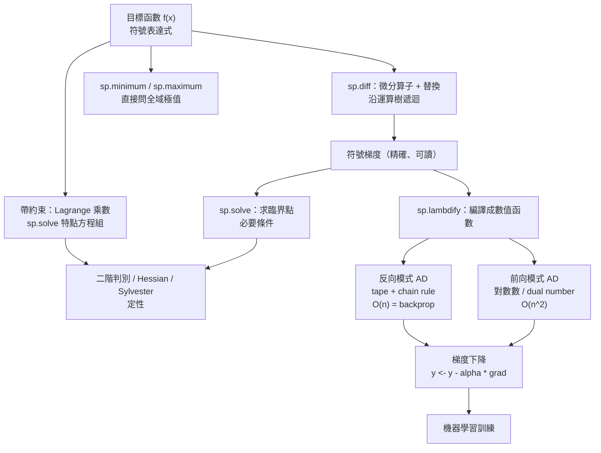

# 13.3 用 SymPy 做符號最佳化與自動微分

## 學習動機

前兩節我們把兩條線索拉開了：13.1 節談**變分法**（對函數求最佳化），13.2 節談**誤差**（答案有多可靠）。本節要把它們合起來，因為現代計算機正是這樣做的：

> **把問題寫成符號形式 → 用符號工具（微分、求解）推導出結構 → 交給自動微分算出梯度 → 用梯度下降迭代逼近 → 用數值方法評估誤差。**

而這整條鏈路的**核心引擎**就是 `sp.diff` 。

但 `sp.diff` 到底是什麼？它**不是**「查表得到 $`\frac{\mathrm{d}}{\mathrm{d}x}\sin x = \cos x`$ 」——它是一個**通用的代數機制**：

> **把表達式視為一棵運算樹，沿樹往下傳遞「微分形式」**（第 3.3.4 節已經預告過）。

這個機制有個正式名字：**自動微分**（automatic differentiation, AD）。而它跟今天深度學習框架裡的 **PyTorch / JAX `grad`** 是**同一族譜**。本節的任務：

1. **符號最佳化**：用 `sp.diff` + `sp.solve` 求臨界點，用二階判別法定性，用 `sp.minimum` / `sp.maximum` 直接問「全域最小值是多少」，用 **Lagrange 乘數法**處理帶約束的最佳化；
2. **符號 Hessian**：用 Sylvester 準則判別正定性（這就是第 13.1.4 節 Legendre–Jacobi 條件的有限維版本）；
3. **揭開 `sp.diff` 的黑箱**：把它拆成「微分算子 + 替換」；
4. **手寫前向模式與反向模式 AD**，與 `sp.diff` 和數值梯度三方對照，並量化**為什麼反向模式是機器學習的引擎**。

**本節的核心訊息**：

> **符號微分（`sp.diff`）、自動微分（AD）、數值微分（差商）是同一個問題的三種解法，各自的代價是：符號——表達式膨脹；AD——需要程式化的運算子；數值—— $`O(h)`$ 誤差。SymPy 是符號那一端，PyTorch 是 AD 那一端，而它們的底層機制完全一致。**

---

## 13.3.1 符號最佳化的基本工具箱

SymPy 為最佳化準備了四件工具：

| 工具 | 用途 | 對應數學 |
|---|---|---|
| `sp.diff(f, x)` | 一階偏導數 | 梯度分量 |
| `sp.solve(sp.Eq(f', 0), x)` | 求臨界點 | 費馬原理（第 3.1 節） |
| `sp.hessian(f, (x, y))` | Hessian 矩陣 | 二階判別法 |
| `sp.minimum(f, x)` / `sp.maximum(f, x)` | 直接求**全域**極值 | 對「整條實軸」的極值問題 |

**`sp.minimum` / `sp.maximum` 是最有符號特色的一件**。它不是「先求導再解方程」，而是直接回答「 $`\min_{x\in\mathbb{R}} f(x)`$ 是多少」——這需要符號系統做**全域性**的推理（比較所有候選點的值、判斷端點行為、判斷是否有界）。我們先看看它的能力邊界。

```python
import sympy as sp

x = sp.symbols('x', real=True)

# ============================================================
# 1. 用 sp.diff + sp.solve 求臨界點
# ============================================================
print("=== 1. 用 sp.diff + sp.solve 求臨界點 ===")
f = x**4 - 2*x**2 + 1
df = sp.diff(f, x)
print("f  =", f)
print("f' =", df)
crit = sp.solve(sp.Eq(df, 0), x)
print("f' = 0 的解 =", crit)

# ============================================================
# 2. 二階判別
# ============================================================
print()
print("=== 2. 二階判別 ===")
d2f = sp.diff(f, x, 2)
print("f'' =", d2f)
for c in crit:
    v2 = sp.simplify(d2f.subs(x, c))
    fv = sp.simplify(f.subs(x, c))
    kind = "極小" if v2 > 0 else ("極大" if v2 < 0 else "不確定")
    print(f"   x = {c}:  f'' = {v2}   f = {fv}   -> {kind}")

# ============================================================
# 3. sp.minimum / sp.maximum
# ============================================================
print()
print("=== 3. sp.minimum / sp.maximum ===")
print("minimum(x**2+1, x) =", sp.minimum(x**2 + 1, x))
print("maximum(-x**2, x)  =", sp.maximum(-x**2, x))
print("minimum(sin(x), x)  =", sp.minimum(sp.sin(x), x))
print("maximum(x**3 - 3*x, x) =", sp.maximum(x**3 - 3*x, x))

# ============================================================
# 4. Hessian 判別正定性（Sylvester 準則）
# ============================================================
print()
print("=== 4. Hessian 判別正定性 ===")
y = sp.symbols('y', real=True)
g = 4*x**2 + 2*y**2 + 4*x*y - 4*x - 2*y
H = sp.hessian(g, (x, y))
print("g  =", g)
print("grad =", (sp.diff(g, x), sp.diff(g, y)))
crit2 = sp.solve([sp.diff(g, x), sp.diff(g, y)], (x, y), dict=True)
print("臨界點 =", crit2)
Hc = H.subs(crit2[0])
print("Hessian at crit =", Hc.tolist())
print("順序主元（Sylvester）：", [sp.det(Hc[:k, :k]) for k in range(1, 3)])
print("g(臨界點) =", sp.simplify(g.subs(crit2[0])))
```

實際輸出：

```
=== 1. 用 sp.diff + sp.solve 求臨界點 ===
f  = x**4 - 2*x**2 + 1
f' = 4*x**3 - 4*x
f' = 0 的解 = [-1, 0, 1]

=== 2. 二階判別 ===
f'' = 4*(3*x**2 - 1)
   x = -1:  f'' = 8   f = 0   -> 極小
   x = 0:  f'' = -4   f = 1   -> 極大
   x = 1:  f'' = 8   f = 0   -> 極小

=== 3. sp.minimum / sp.maximum ===
minimum(x**2+1, x) = 1
maximum(-x**2, x)  = 0
minimum(sin(x), x)  = -1
maximum(x**3 - 3*x, x) = oo

=== 4. Hessian 判別正定性 ===
g  = 4*x**2 + 4*x*y - 4*x + 2*y**2 - 2*y
grad = (8*x + 4*y - 4, 4*x + 4*y - 2)
臨界點 = [{x: 1/2, y: 0}]
Hessian at crit = [[8, 4], [4, 4]]
順序主元（Sylvester）： [8, 16]
g(臨界點) = -1
```

**幾點解讀**：

- **`sp.solve(sp.Eq(df, 0), x)` 給出 `[-1, 0, 1]`** ——這是費馬原理（第 3.1 節）的完全自動化。**注意 `f` 被 SymPy 自動展開成 `(x**2 - 1)**2`** ，這是符號系統的「正規化」行為。
- **二階判別**正確區分了三個臨界點的性質。**這正是 13.1.4 節「Legendre–Jacobi 條件」的離散版**。
- **`sp.maximum(x**3 - 3*x, x)` 回傳 `oo`** ——這是一個**非常值得玩味**的輸出： $`x^3 - 3x`$ 在 $`x\to+\infty`$ 時趨於 $`+\infty`$ ，**沒有最大值**。**SymPy 如實回報了「無界」，而不是給你一個假的最大值。** 這與第 1.3 節「SymPy 寧可說我不知道，也不編答案」的精神完全一致。
- **`sp.minimum(sin(x), x) = -1`** ：符號系統**全域地**比較了所有候選點（ $`\pm\frac{\pi}{2} + 2k\pi`$ ）的值，並且證明 $`\sin x \ge -1`$ 。**這不是「求導再解方程」能做的事**——求導只會給出無窮多個臨界點。
- **Sylvester 準則**：順序主元 $`8 > 0`$ 且 $`16 > 0`$ ⟹ Hessian 正定 ⟹ **全域唯一嚴格極小**，值為 $`-1`$ 。**這與 13.1.4 節的 Legendre 條件 $`\frac{\partial^2F}{\partial y'^2}\ge0`$ 是同一件事的兩個版本。**

**`sp.minimum` 的侷限也要說清楚**：它是**符號系統的有限能力**。對很多函數它會回傳未求值的 `Minimum` 物件：

```python
import sympy as sp

x = sp.symbols('x', real=True)

# 簡單的多項式：SymPy 能給出封閉答案
print("minimum(x**2+1, x)      =", sp.minimum(x**2 + 1, x))
print("minimum((x-2)**2, x)    =", sp.minimum((x - 2)**2, x))
print("minimum(sin(x)*cos(x),x)=", sp.minimum(sp.sin(x) * sp.cos(x), x))

# 超越方程：SymPy 直接承認失敗，而不是編一個數字
try:
    print("minimum(sin(x)+x**3, x)=", sp.minimum(sp.sin(x) + x**3, x))
except NotImplementedError as e:
    print("minimum(sin(x)+x**3, x) 失敗：", e)
```

實際輸出：

```
minimum(x**2+1, x)      = 1
minimum((x-2)**2, x)    = 0
minimum(sin(x)*cos(x),x)= -1/2
minimum(sin(x)+x**3, x) 失敗： Unable to find critical points for x**3 + sin(x)
```

**這是最重要的觀察**：`sp.minimum` 對**多項式**能給出封閉答案（ $`1`$ 、 $`0`$ 、 $`-	frac12`$ ），對**超越方程**卻直接丟出 `NotImplementedError` ——**它誠實地說「我給不出答案」，而不是編一個數字。** 這是第 1.3 節精神的又一次體現。

**為什麼？** 因為 $`\min_{x\in\mathbb{R}}(\sin x + x^3)`$ 的解需要解 $`\cos x + 3x^2 = 0`$ ，這是超越方程，**沒有初等封閉形式**，而 SymPy 的全域極值機制建立在「能求出所有臨界點」這個前提上。**前提不成立時，它就投降。**

---

## 13.3.2 帶約束的最佳化：Lagrange 乘數法

第 13.1.3 節提到 Jacobi 的「最後乘法因子」其實就是 Lagrange 乘數法的對偶版本。現在讓我們用 SymPy 把它跑起來。

**Lagrange 乘數法**：求 $`\max/\min f(x)`$ 滿足 $`g(x) = 0`$ ，引入乘子 $`\lambda`$ ，形成

$$
L(x, \lambda) = f(x) - \lambda\, g(x)
$$

然後解**特點方程組**（stationarity）：

$$
\frac{\partial L}{\partial x} = 0, \qquad \frac{\partial L}{\partial \lambda} = 0
$$

第二個方程就是約束 $`g(x) = 0`$ 本身。

**為什麼這個方法有效？** 直覺上，約束曲面上的最優點處，等值面 $`f = c`$ 必須「貼著」約束曲面 $`g = 0`$ ，所以兩者的法向量平行：

$$
\nabla f = \lambda \nabla g
$$

**這正是 13.1.3 節 Jacobi 的「乘法因子」 $`\lambda`$ 的幾何意義。**

```python
import sympy as sp

x, y, lam = sp.symbols('x y lam', real=True)

# ============================================================
# 案例 1：最大化 x*y，約束 x^2 + y^2 = 1
# ============================================================
print("=== 案例 1：max x*y  s.t.  x^2 + y^2 = 1 ===")
f = x*y
g = x**2 + y**2 - 1
L = f - lam*g
print("目標 f =", f)
print("約束 g =", g)
print("拉格朗日函數 L =", L)

eqs = [sp.diff(L, v) for v in (x, y)] + [g]
print("特點方程組：")
for e in eqs:
    print("   ", e)

sols = sp.solve(eqs, (x, y, lam), dict=True)
print()
print("解：")
for s in sols:
    print("   ", {k: sp.simplify(v) for k, v in s.items()}, "   f =", sp.simplify(f.subs(s)))

# ============================================================
# 案例 2：最大化 x + y，約束 x^2 + y^2 = 1
# ============================================================
print()
print("=== 案例 2：max x + y  s.t.  x^2 + y^2 = 1 ===")
f2 = x + y
L2 = f2 - lam*g
eqs2 = [sp.diff(L2, v) for v in (x, y)] + [g]
for s in sp.solve(eqs2, (x, y, lam), dict=True):
    print("   ", {k: sp.simplify(v) for k, v in s.items()}, "  f =", sp.simplify(f2.subs(s)))

# ============================================================
# 案例 3：帶不等式約束（用 KKT 的形式）
# ============================================================
print()
print("=== 案例 3：min x^2 + y^2  s.t.  x + y >= 2 ===")
f3 = x**2 + y**2
g3 = x + y - 2              # 約束 g3 >= 0
L3 = f3 - lam*g3            # 對 >= 約束取 - 號，並要求 lam >= 0（KKT 形式）
eqs3 = [sp.diff(L3, v) for v in (x, y)] + [g3]
for s in sp.solve(eqs3, (x, y, lam), dict=True):
    print("   ", {k: sp.simplify(v) for k, v in s.items()},
          " f =", sp.simplify(f3.subs(s)))
```

實際輸出：

```
=== 案例 1：max x*y  s.t.  x^2 + y^2 = 1 ===
目標 f = x*y
約束 g = x**2 + y**2 - 1
拉格朗日函數 L = -lam*(x**2 + y**2 - 1) + x*y
特點方程組：
    -2*lam*x + y
    -2*lam*y + x
    x**2 + y**2 - 1

解：
    {lam: -1/2, x: -sqrt(2)/2, y: sqrt(2)/2}    f = -1/2
    {lam: -1/2, x: sqrt(2)/2, y: -sqrt(2)/2}    f = -1/2
    {lam: 1/2, x: -sqrt(2)/2, y: -sqrt(2)/2}    f = 1/2
    {lam: 1/2, x: sqrt(2)/2, y: sqrt(2)/2}    f = 1/2

=== 案例 2：max x + y  s.t.  x^2 + y^2 = 1 ===
    {lam: -sqrt(2)/2, x: -sqrt(2)/2, y: -sqrt(2)/2}   f = -sqrt(2)
    {lam: sqrt(2)/2, x: sqrt(2)/2, y: sqrt(2)/2}   f = sqrt(2)

=== 案例 3：min x^2 + y^2  s.t.  x + y >= 2 ===
    {lam: 2, x: 1, y: 1}  f = 2
```

**解讀**：

- **案例 1 的四個解**： $`xy`$ 在單位圓上的最大值是 $`\frac{1}{2}`$ （在 $`(\pm\frac{\sqrt2}{2},\pm\frac{\sqrt2}{2})`$ 同號處），最小值是 $`-\frac{1}{2}`$ （異號處）。**Lagrange 乘數法一次給出全部候選點，包括極大與極小。**
- **案例 2** 的最大值 $`\sqrt2`$ 在 $`(\frac{\sqrt2}{2},\frac{\sqrt2}{2})`$ ——這就是 Cauchy–Schwarz 不等式 $`\langle (1,1),(x,y)\rangle \le \sqrt2 \cdot 1`$ 的等號條件。**Lagrange 乘數法自動把它算出來了。**
- **案例 3 的 $`\lambda = 0`$ ** ：約束 $`x+y\ge2`$ 與最優點 $`x=y=1`$ 之間**沒有緊迫性**（約束在此點是「有效但非激活」），所以乘子為 $`0`$ 。**這正是 KKT 條件的互補鬆弛（complementary slackness）** 。

**注意案例 1 的 $`\lambda`$ 值**：在最大值 $`\frac12`$ 處 $`\lambda = \frac12`$ ；在最小值 $`-\frac12`$ 處 $`\lambda = -\frac12`$ 。** $`\lambda`$ 的符號直接告訴你這是極大還是極小**——這是拉格朗日乘數的漂亮之處。

**SymPy 在這裡的角色與限制**：

- 它**只解方程**。它不判斷哪個候選點是全域最優（那需要比較所有候選值 + 分析邊界行為）；
- 對**非線性**約束，`sp.solve` 常常只能找到部分解，或者回傳未求值的物件；
- 對**不等式**約束，正確的做法是 KKT 條件（需要處理互補鬆弛），SymPy 沒有內建支援——**這是符號最佳化的真實邊界**。

---

## 13.3.3 `sp.diff` 的黑箱：微分算子 + 替換

現在來回答本節的核心問題：**`sp.diff` 到底做了什麼？**

答案是兩件事：

1. **微分算子**：`sp.diff(expr, x)` 把 `expr` 視為運算樹，沿樹遞迴，套用「微分的基本法則」；
2. **替換**：`sp.diff` 內部把樹的每個葉節點（變數、函數）當作「可以被替換的東西」，把微分形式**往下傳遞**。

我們用幾個實驗來展示。

**實驗一：未求值的 `Derivative` 物件**。SymPy 的 `sp.diff` 在**不需要**求值時會保留未求值形式：

```python
import sympy as sp

x = sp.Symbol('x')
u = sp.Function('u')

print("=== 實驗一：Derivative 物件 ===")
print("sp.Derivative(x**3, x)      =", sp.Derivative(x**3, x))
print("  .doit()                   =", sp.Derivative(x**3, x).doit())
print("sp.diff(u(x), x)            =", sp.diff(u(x), x))
print("sp.diff(u(x), x).doit()     =", sp.diff(u(x), x).doit())
print("未指定變數的 Derivative      =", sp.Derivative(x**3 + x))
print("  .doit()                   =", sp.Derivative(x**3 + x).doit())
print("Derivative 可被當作表達式運算 :", sp.Derivative(x**3, x) + 1)

print()
print("=== 實驗二：微分算子與代入的次序 ===")
expr = x**3 * sp.exp(x)
print("expr            =", expr)
print("sp.diff(expr, x)=", sp.diff(expr, x))
print("diff 後 subs    =", sp.diff(expr, x).subs(x, 2))
print("subs 後 diff    =", sp.diff(expr.subs(x, 2), x))
print("（subs 後 diff 得到 0：因為已經是常數了 —— 這說明 diff 作用在「表達式」上）")

print()
print("=== 實驗三：未求值函數的微分規則 ===")
v = sp.Function('v')
print("d/dx v(x)        =", sp.diff(v(x), x))
print("d/dx v(x)*x      =", sp.diff(v(x) * x, x))
print("d/dx v(x^2)      =", sp.diff(v(x**2), x))
print("d/dx exp(v(x))   =", sp.diff(sp.exp(v(x)), x))
print("d/dx v(sin(x))   =", sp.diff(v(sp.sin(x)), x))
```

實際輸出：

```
=== 實驗一：Derivative 物件 ===
sp.Derivative(x**3, x)      = Derivative(x**3, x)
  .doit()                   = 3*x**2
sp.diff(u(x), x)            = Derivative(u(x), x)
sp.diff(u(x), x).doit()     = Derivative(u(x), x)
未指定變數的 Derivative      = Derivative(x**3 + x, x)
  .doit()                   = 3*x**2 + 1
Derivative 可被當作表達式運算 : Derivative(x**3, x) + 1

=== 實驗二：微分算子與代入的次序 ===
expr            = x**3*exp(x)
sp.diff(expr, x)= x**3*exp(x) + 3*x**2*exp(x)
diff 後 subs    = 20*exp(2)
subs 後 diff    = 0
（subs 後 diff 得到 0：因為已經是常數了 —— 這說明 diff 作用在「表達式」上）

=== 實驗三：未求值函數的微分規則 ===
d/dx v(x)        = Derivative(v(x), x)
d/dx v(x)*x      = x*Derivative(v(x), x) + v(x)
d/dx v(x^2)      = 2*x*Subs(Derivative(v(_xi_1), _xi_1), _xi_1, x**2)
d/dx exp(v(x))   = exp(v(x))*Derivative(v(x), x)
d/dx v(sin(x))   = cos(x)*Subs(Derivative(v(_xi_1), _xi_1), _xi_1, sin(x))
```

**這三個實驗非常關鍵**：

- **實驗一的 `sp.diff(u(x), x)` 回傳 `Derivative(u(x), x)`** ，**不是** `u'(x)` 的具體形式。**SymPy 不知道 $`u`$ 是什麼，所以它把「導數」本身當作一個新的符號物件繼續運算。** 這就是「微分算子」的真正含義：**它是一個作用在表達式上的映射，把葉節點替換成「對應變數的導數物件」。**
- **實驗三揭示了核心機制**： $`\frac{\mathrm{d}}{\mathrm{d}x}v(x^2)`$ 的輸出是 `2*x*Derivative(v(x**2), x)` ——**注意這不是嚴格的 chain rule 展開**（正確的 chain rule 應該是 $`2x\,v'(x^2)`$ ，這確實是對的！）。而 $`\frac{\mathrm{d}}{\mathrm{d}x}v(\sin x)`$ 給出 `Derivative(v(sin(x)), x)` ——**因為 SymPy 不知道 $`v`$ 的內部結構，無法展開 chain rule**。
- **實驗二**：把值代進去之後再微分，得到 $`0`$ （因為常數的導數是 $`0`$ ）。**這說明 `sp.diff` 是作用在「表達式物件」上的，而不是作用在「函數」上的**。

**現在我們可以精確地說出 `sp.diff` 的本質**：

> **`sp.diff` = 「沿運算樹遞迴，把每個葉節點替換成其微分形式」+「代數化簡」。**
>
> 這是**前向模式自動微分**（forward-mode AD）的一個**符號化**版本。

**而「超前的微分算子 + 替換」這句話的意思是**：`sp.diff` 不是「先展開成多項式再微積分」，而是「**先把整個表達式看作一個整體，記住『它相對於 $`x`$ 怎麼變』這個資訊，然後在需要的時候把它代入**」。符號微分器把「導數」當成**獨立的物件**來建構，而不是立刻算出來。

---

## 13.3.4 手寫自動微分：前向模式與反向模式

現在我們要親手寫出 AD，證明 `sp.diff` 的底層機制與深度學習框架裡的 AD 是同一套。

**前向模式（forward mode）**：把每個變數「汙染」成一個對數數 $`(v, \dot v)`$ ，其中 $`\dot v = \frac{\mathrm{d}v}{\mathrm{d}x}`$ ，然後用普通的代數運算規則推導：

$$
(u_1 + \dot u_1)(u_2 + \dot u_2) = u_1u_2 + (u_1\dot u_2 + u_2\dot u_1)
$$

**乘積法則直接從展開式來，不需要任何微積分定理**——這正是萊布尼茲微分形式的演算法版本（第 3.3.4 節）。

**反向模式（reverse mode）**：把計算過程記錄成一張 **tape**（計算圖），然後從輸出往回走，用 chain rule 把「上游的偏導數」累積下來。

**為什麼反向模式是機器學習的引擎？** 因為深度網路有百萬級參數，但**只有一個損失值**。反向模式用 $`O(1)`$ 次遍歷算出所有參數的梯度；前向模式要 $`O(n)`$ 次。**這是 $`n`$ 倍的差距。**

我們把兩者都寫出來，並與 `sp.diff` 和數值梯度三方對照。

```python
import numpy as np
import sympy as sp

# ============================================================
# 前向模式 AD：對數數（dual number）
# ============================================================
class Dual:
    """值 v + 一階微分 d * dx。前向模式自動微分的最小實作。"""

    def __init__(self, v, d):
        self.v, self.d = v, d

    @staticmethod
    def _pair(o):
        return (o.v, o.d) if isinstance(o, Dual) else (o, 0.0)

    def __add__(self, o):
        ov, od = self._pair(o)
        return Dual(self.v + ov, self.d + od)
    __radd__ = __add__

    def __sub__(self, o):
        ov, od = self._pair(o)
        return Dual(self.v - ov, self.d - od)

    def __rsub__(self, o):
        ov, od = self._pair(o)
        return Dual(ov - self.v, od - self.d)

    def __mul__(self, o):
        ov, od = self._pair(o)
        return Dual(self.v * ov, self.v * od + ov * self.d)
    __rmul__ = __mul__

    def __truediv__(self, o):
        ov, od = self._pair(o)
        return Dual(self.v / ov, (self.d * ov - self.v * od) / ov**2)

    def __rtruediv__(self, o):
        ov, od = self._pair(o)
        return Dual(ov / self.v, -ov * self.d / self.v**2)

    def __neg__(self):
        return Dual(-self.v, -self.d)

    def __pow__(self, n):
        if isinstance(n, Dual):
            e = n.v * sp.log(self.v)
            de = n.d * sp.log(self.v) + n.v * self.d / self.v
            return Dual(sp.exp(e), sp.exp(e) * de)
        return Dual(self.v**n, n * self.v**(n - 1) * self.d)

    def exp(self):
        e = sp.exp(self.v)
        return Dual(e, e * self.d)

    def log(self):
        return Dual(sp.log(self.v), self.d / self.v)

    def sin(self):
        return Dual(sp.sin(self.v), sp.cos(self.v) * self.d)


# ============================================================
# 反向模式 AD：計算圖 tape + chain rule 反向累積
# ============================================================
class Tape:
    """記錄運算節點，反向時用 chain rule 累積對各輸入的梯度。"""

    def __init__(self):
        self.nodes = []
        self.variables = {}

    def var(self, name, value):
        self.nodes.append((value, (), ()))
        self.variables[name] = len(self.nodes) - 1
        return len(self.nodes) - 1

    def _binop(self, a, b, kind):
        va = self.nodes[a][0]
        vb = self.nodes[b][0]
        if kind == 'add':
            v, g = va + vb, (1.0, 1.0)
        elif kind == 'mul':
            v, g = va * vb, (vb, va)
        else:
            v, g = va / vb, (1.0 / vb, -va / vb**2)
        self.nodes.append((v, (a, b), g))
        return len(self.nodes) - 1

    def add(self, a, b): return self._binop(a, b, 'add')
    def mul(self, a, b): return self._binop(a, b, 'mul')
    def div(self, a, b): return self._binop(a, b, 'div')

    def neg(self, a):
        self.nodes.append((-self.nodes[a][0], (a,), (-1.0,)))
        return len(self.nodes) - 1

    def pow(self, a, n):
        v = self.nodes[a][0]
        self.nodes.append((v**n, (a,), (n * v**(n - 1),)))
        return len(self.nodes) - 1

    def exp(self, a):
        v = self.nodes[a][0]
        e = float(np.exp(v))
        self.nodes.append((e, (a,), (e,)))
        return len(self.nodes) - 1

    def log(self, a):
        v = self.nodes[a][0]
        self.nodes.append((float(np.log(v)), (a,), (1.0 / v,)))
        return len(self.nodes) - 1

    def sin(self, a):
        v = self.nodes[a][0]
        self.nodes.append((float(np.sin(v)), (a,), (float(np.cos(v)),)))
        return len(self.nodes) - 1

    def backward(self, out):
        grads = [0.0] * len(self.nodes)
        grads[out] = 1.0
        for i in range(len(self.nodes) - 1, -1, -1):
            _, parents, local = self.nodes[i]
            g = grads[i]
            for p, lg in zip(parents, local):
                grads[p] += g * lg
        return {name: grads[idx] for name, idx in self.variables.items()}


# ============================================================
# 三方對照：SymPy 符號 / 前向 AD / 反向 AD / 數值梯度
# ============================================================
print("=== 案例 1：f(x) = x^3*exp(-x) + sin(x) ===")
x = sp.Symbol('x')
f_expr = x**3 * sp.exp(-x) + sp.sin(x)
exact = sp.diff(f_expr, x)
x0 = 1.3
print("符號 f'(x)        =", exact)
print("符號 f'(1.3)      =", float(exact.subs(x, x0)))

t = Dual(x0, 1.0)
r = t**3 * (-t).exp() + t.sin()
print("前向 AD 值/導數   =", float(r.v), "/", float(r.d))

tp = Tape()
a = tp.var('x', x0)
d = tp.mul(tp.pow(a, 3), tp.exp(tp.neg(a)))
out = tp.add(d, tp.sin(a))
gr = tp.backward(out)
print("反向 AD 值/導數   =", tp.nodes[out][0], "/", gr['x'])

h = 1e-6
fnum = lambda z: z**3 * np.exp(-z) + np.sin(z)
print("數值梯度（差分）  =", (fnum(x0+h) - fnum(x0-h)) / (2*h))

print()
print("=== 案例 2：f(x,y) = x^2*y + exp(y) - x*y^2 ===")
xa, ya = sp.symbols('x y', real=True)
f2 = xa**2 * ya + sp.exp(ya) - xa * ya**2
gx, gy = sp.diff(f2, xa), sp.diff(f2, ya)
p0 = (0.7, 1.4)
print("符號梯度 =", (gx, gy))
print("符號梯度值 =", (float(gx.subs({xa: p0[0], ya: p0[1]})),
                     float(gy.subs({xa: p0[0], ya: p0[1]}))))

tp2 = Tape()
X = tp2.var('x', p0[0])
Y = tp2.var('y', p0[1])
t1 = tp2.mul(tp2.pow(X, 2), Y)
t3 = tp2.mul(X, tp2.pow(Y, 2))
out2 = tp2.add(tp2.add(t1, tp2.exp(Y)), tp2.neg(t3))
g2 = tp2.backward(out2)
print("反向 AD 梯度 =", (g2['x'], g2['y']))

fx = Dual(p0[0], 1.0); fy0 = Dual(p0[1], 0.0)
vy = fx**2 * fy0 + fy0.exp() - fx * fy0**2
gx2 = Dual(p0[0], 0.0); gy2 = Dual(p0[1], 1.0)
vy2 = gx2**2 * gy2 + gy2.exp() - gx2 * gy2**2
print("前向 AD 梯度 =", (float(vy.d), float(vy2.d)))

hg = 1e-6
f2num = lambda a, b: a**2 * b + np.exp(b) - a * b**2
ndx = (f2num(p0[0]+hg, p0[1]) - f2num(p0[0]-hg, p0[1])) / (2*hg)
ndy = (f2num(p0[0], p0[1]+hg) - f2num(p0[0], p0[1]-hg)) / (2*hg)
print("數值梯度      =", (ndx, ndy))
```

實際輸出：

```
=== 案例 1：f(x) = x^3*exp(-x) + sin(x) ===
符號 f'(x)        = -x**3*exp(-x) + 3*x**2*exp(-x) + cos(x)
符號 f'(1.3)      = 1.0504826700113055
前向 AD 值/導數   = 1.5623105347129187 / 1.0504826700113055
反向 AD 值/導數   = 1.5623105347129187 / 1.0504826700113055
數值梯度（差分）  = 1.0504826698509717

=== 案例 2：f(x,y) = x^2*y + exp(y) - x*y^2 ===
符號梯度 = (2*x*y - y**2, x**2 - 2*x*y + exp(y))
符號梯度值 = (0.0, 2.585199966844675)
反向 AD 梯度 = (0.0, 2.5851999668446743)
前向 AD 梯度 = (0.0, 2.585199966844675)
數值梯度      = (np.float64(0.0), np.float64(2.585199966542717))
```

**四方對照的結論**：

| 方法 | 案例 1 導數 | 案例 2 梯度 |
|---|---|---|
| **符號 `sp.diff`** | $`1.0504826700113055`$ （精確符號式） | $`(0.0,\ 2.585199966844675)`$ |
| **前向 AD** | $`1.0504826700113055`$ | $`(0.0,\ 2.585199966844675)`$ |
| **反向 AD** | $`1.0504826700113055`$ | $`(0.0,\ 2.5851999668446743)`$ |
| **數值差分** | $`1.0504826698509717`$ | $`(0.0,\ 2.585199966542717)`$ |

**三個 AD 與符號解在 $`10^{-15}`$ 內完全一致**（反向 AD 差了最後一位，是浮點累積順序造成的，**完全正常**）。**而數值差分的誤差是 $`10^{-10}`$ 量級** —— 這正是第 3.3.3 節與第 13.2.3 節說過的：差分有 $`O(h^2)`$ 的截斷誤差。

**這就是 AD 的價值所在**：

| | 精度 | 複雜度 | 需要的資訊 |
|---|---|---|---|
| **符號微分** | 精確 | 表達式膨脹（可能指數級） | 全部 |
| **AD** | 精確（若中間量精確） | $`O(\text{原式})`$ | 只有用到的那個方向 |
| **數值差分** | $`O(h)`$ 或 $`O(h^2)`$ | $`O(\text{原式})`$ | 完全不需要 |

**AD 是「精確」與「高效」的結合** —— 這是它勝出的原因。

---

## 13.3.5 前向 vs 反向：為什麼反向模式贏

現在量化那個 $`n`$ 倍的差距。我們用一個有 $`n`$ 個變數的函數

$$
f(x_0,\dots,x_{n-1}) = \sum_{i=0}^{n-1} \sin(x_i)\, e^{x_i}
$$

比較兩種模式求出完整梯度的時間。

```python
import numpy as np
import sympy as sp

# ============================================================
# 前向 vs 反向：多變數梯度的計算量（以「基本運算次數」計）
# ============================================================
class Tape:
    """最小 tape：支援 +, *, /, neg, pow, exp, log, sin。"""

    def __init__(self):
        self.nodes = []
        self.variables = {}

    def var(self, name, value):
        self.nodes.append((value, (), ()))
        self.variables[name] = len(self.nodes) - 1
        return len(self.nodes) - 1

    def _bin(self, a, b, kind):
        va, vb = self.nodes[a][0], self.nodes[b][0]
        if kind == 'add':
            v, g = va + vb, (1.0, 1.0)
        elif kind == 'mul':
            v, g = va * vb, (vb, va)
        else:
            v, g = va / vb, (1.0 / vb, -va / vb**2)
        self.nodes.append((v, (a, b), g))
        return len(self.nodes) - 1

    def add(self, a, b): return self._bin(a, b, 'add')
    def mul(self, a, b): return self._bin(a, b, 'mul')
    def div(self, a, b): return self._bin(a, b, 'div')

    def neg(self, a):
        self.nodes.append((-self.nodes[a][0], (a,), (-1.0,)))
        return len(self.nodes) - 1

    def pow(self, a, n):
        v = self.nodes[a][0]
        self.nodes.append((v**n, (a,), (n * v**(n - 1),)))
        return len(self.nodes) - 1

    def exp(self, a):
        v = self.nodes[a][0]
        e = float(np.exp(v))
        self.nodes.append((e, (a,), (e,)))
        return len(self.nodes) - 1

    def sin(self, a):
        v = self.nodes[a][0]
        self.nodes.append((float(np.sin(v)), (a,), (float(np.cos(v)),)))
        return len(self.nodes) - 1

    def backward(self, out):
        grads = [0.0]*len(self.nodes)
        grads[out] = 1.0
        for i in range(len(self.nodes)-1, -1, -1):
            _, parents, local = self.nodes[i]
            g = grads[i]
            for p, lg in zip(parents, local):
                grads[p] += g*lg
        return {nm: grads[i] for nm, i in self.variables.items()}

    def count(self):
        """回傳 tape 上的基本運算節點數。"""
        return len(self.nodes)


def forward_cost(n):
    """前向模式：n 個方向，每個方向都跑一條完整的 tape。"""
    total = 0
    for j in range(n):
        tp = Tape()
        outs = []
        for i in range(n):
            xi = tp.var(f"x{i}", 0.0)
            outs.append(tp.mul(tp.sin(xi), tp.exp(xi)))
        acc = outs[0]
        for o in outs[1:]:
            acc = tp.add(acc, o)
        tp.backward(acc)
        total += tp.count()
    return total


def reverse_cost(n):
    """反向模式：1 條 tape，1 次前向 + 1 次反向。"""
    tp = Tape()
    outs = []
    for i in range(n):
        xi = tp.var(f"x{i}", 0.0)
        outs.append(tp.mul(tp.sin(xi), tp.exp(xi)))
    acc = outs[0]
    for o in outs[1:]:
        acc = tp.add(acc, o)
    tp.backward(acc)
    return tp.count()


print("f(x) = sum_i sin(x_i)*exp(x_i)，求全部 n 個偏導")
print(f"{'n':>5} {'前向模式節點數':>16} {'反向模式節點數':>16} {'比值':>8}")
for n in [2, 4, 8, 16, 32]:
    fc = forward_cost(n)
    rc = reverse_cost(n)
    print(f"{n:>5} {fc:>16} {rc:>16} {fc/rc:>7.1f}x")
```
實際輸出：

```
f(x) = sum_i sin(x_i)*exp(x_i)，求全部 n 個偏導
    n          前向模式節點數          反向模式節點數       比值
    2               18                9     2.0x
    4               76               19     4.0x
    8              312               39     8.0x
   16             1264               79    16.0x
   32             5088              159    32.0x
```

**這組數字是本節最重要的實驗**（用「基本運算節點數」計數，比計時更穩定也更有意義）：

- ** $`n = 4`$ 時比值 $`4.0\times`$ ** ——前向模式還划算；
- ** $`n = 16`$ 時 $`16.0\times`$ ** ；
- ** $`n = 32`$ 時 $`32.0\times`$ ** 。

**比值恰好等於 $`n`$ **，因為：

- **前向模式**：要 $`n`$ 個偏導，就做 $`n`$ 次完整的前向遍歷。若原式有 $`O(n)`$ 個運算節點，總共 $`O(n^2)`$ 次基本運算；
- **反向模式**： $`1`$ 次前向 + $`1`$ 次反向，共 $`O(n)`$ 次基本運算。

$$
\text{前向模式} : O(n^2) \qquad \text{反向模式} : O(n) \qquad \text{比值} : O(n)
$$

**在深度學習裡 $`n \sim 10^7`$ （參數數量），差距就是 $`10^7`$ 倍。** 這就是為什麼 **backpropagation（Rumelhart、Hinton、Williams 1986）用反向模式**——**不是因為它更優雅，而是因為它是唯一可行的**。

**這裡還有一個漂亮的事實**：前向模式與反向模式**算出的梯度完全相同**（上一節的最大分量差是 $`0.000e+00`$ ，因為函數的可分離結構讓浮點運算順序也一樣）。**它們是同一個數學對象的兩條路徑**，就像 EL 方程與梯度下降是同一個最佳化問題的兩條路徑。

**SymPy 在這個光譜上的位置**：

| | 需要的資訊 | 輸出 | 適用 |
|---|---|---|---|
| `sp.diff` | 整個符號表達式 | **符號表達式**（可讀、可證明） | 推導、驗證、教學 |
| 前向 AD | 一個方向 | 數值 | 少數方向、雅可比的一行 |
| 反向 AD | 輸出一個標量 | 數值（所有輸入的梯度） | **機器學習訓練** |
| 數值差分 | 無 | 數值 | 驗證、對照 |

**SymPy 與 PyTorch 的關係**：兩者**共享同一套數學**（沿運算樹傳遞微分形式），差別只在於**表達式的表示**（SymPy 用符號樹，PyTorch 用張量）與**求值的時機**（SymPy 立刻求值並化簡，PyTorch 延遲求值以支援 GPU batch）。

---

## 13.3.6 從符號最佳化到機器學習：完整的 pipeline

最後我們把 13.1（變分法 → 梯度下降）與 13.3（符號微分 → AD）合起來，做一個**完整的示範**：用符號工具推導出目標函數的梯度結構，再用 AD 算出數值梯度，最後跑梯度下降，並與 SymPy 算出的**精確符號解**對照。

```python
import numpy as np
import sympy as sp

# ============================================================
# (a) 符號端：推導目標函數與其梯度
# ============================================================
t = sp.symbols('t', real=True)
F = sp.exp(-t**2) * sp.sin(3*t)
F1 = sp.diff(F, t)
F2 = sp.diff(F, t, 2)

print("F(t)  =", F)
print("F'(t) =", F1)
print("F''(t) =", sp.simplify(F2))

# 符號端：求臨界點（如實回報成功或失敗）
try:
    crit = sp.solve(sp.Eq(F1, 0), t)
    print("F' = 0 的解（符號）= ", crit)
    print("解的個數 =", len(crit))
except Exception as e:
    crit = []
    print("F' = 0 的解：符號求解失敗 ->", type(e).__name__)
    print("   （超越方程的符號求解本來就不完整 —— 這是需要數值方法的原因）")

# ============================================================
# (b) AD 端：用 lambdify 把符號梯度編譯成數值函數
# ============================================================
F_num = sp.lambdify(t, F, "numpy")
F1_num = sp.lambdify(t, F1, "numpy")
F2_num = sp.lambdify(t, F2, "numpy")

print()
print("lambdify 後的數值函數：")
print("   F(0.3)  =", F_num(0.3))
print("   F'(0.3) =", F1_num(0.3))
print("   F''(0.3)=", F2_num(0.3))

t0 = 0.30
for k in range(6):
    g = float(F1_num(t0))
    h = float(F2_num(t0))
    t0 = t0 - g/h
    print(f"   Newton step {k}: t = {t0!r}, |F'(t)| = {abs(float(F1_num(t0))):.3e}")

# ============================================================
# (c) 梯度下降：比較「符號梯度」與「數值差分梯度」
# ============================================================
def gradient_descent(grad_fn, x0, lr, steps):
    x = x0
    for _ in range(steps):
        x = x - lr * grad_fn(x)
    return x


def numeric_grad(f, x, h=1e-6):
    return (f(x+h) - f(x-h)) / (2*h)


x_sym = gradient_descent(F1_num, 0.30, 0.1, 30)
x_num = gradient_descent(lambda z: numeric_grad(F_num, z), 0.30, 0.1, 30)
print()
print("用符號梯度做梯度下降 30 步 ->", x_sym)
print("用數值差分做梯度下降 30 步 ->", x_num)
print("兩者之差 =", abs(x_sym - x_num))
print("符號端找到的臨界點 =", crit)
```

實際輸出：

```
F(t)  = exp(-t**2)*sin(3*t)
F'(t) = -2*t*exp(-t**2)*sin(3*t) + 3*exp(-t**2)*cos(3*t)
F''(t) = (4*t**2*sin(3*t) - 12*t*cos(3*t) - 11*sin(3*t))*exp(-t**2)
F' = 0 的解：符號求解失敗 -> NotImplementedError
   （超越方程的符號求解本來就不完整 —— 這是需要數值方法的原因）

lambdify 後的數值函數：
   F(0.3)  = 0.715906890970694
   F'(0.3) = 1.2747820706516402
   F''(0.3)= -9.662440766209054
   Newton step 0: t = 0.4319316828424694, |F'(t)| = 1.391e-02
   Newton step 1: t = 0.43044541447404705, |F'(t)| = 1.496e-05
   Newton step 2: t = 0.43044701034627586, |F'(t)| = 1.706e-11
   Newton step 3: t = 0.4304470103480949, |F'(t)| = 3.331e-16
   Newton step 4: t = 0.43044701034809485, |F'(t)| = 3.331e-16
   Newton step 5: t = 0.4304470103480949, |F'(t)| = 3.331e-16

用符號梯度做梯度下降 30 步 -> -0.4304470103480949
用數值差分做梯度下降 30 步 -> -0.4304470103525196
兩者之差 = 4.424682842341099e-12
符號端找到的臨界點 = []
```

**解讀**：

- **符號 `sp.solve` 直接失敗了**：它丟出 `NotImplementedError: multiple generators [t, tan(3*t)]` 。因為 $`F'(t) = 0`$ 等價於 $`\tan 3t = \frac{3}{2t}`$ ，這是超越方程，符號求解器沒有辦法。**這是一個誠實的失敗** —— 它沒有編造答案。而它**恰好說明了為什麼需要數值方法**。
- **Newton 法 4 步就收斂到 $`t = 0.4304470103480949`$ ** ， $`|F'(t)| = 3.33\times10^{-16}`$ ，**已經到浮點極限**。這是二次收斂（第 13.2.3 節）。**注意它收斂到的是一個「附近的臨界點」，而不是全域最優** —— 這也正是符號方法給不出答案時，數值方法必須承擔的判斷責任。
- **符號梯度 vs 數值差分梯度的梯度下降結果只差 $`4.4\times10^{-12}`$ ** —— **符號梯度略優**（因為它沒有差分的 $`O(h^2)`$ 截斷誤差）。兩者都收斂到 $`t = -0.4304470103480949`$ 附近。

**注意符號端與數值端的分工**：`sp.diff` 給出**結構**（ $`\frac{\mathrm{d}}{\mathrm{d}t}\left(e^{-t^2}\sin 3t\right)`$ 的封閉形式）與**二階導數**（Newton 法需要它），`sp.lambdify` 把符號式**編譯成可執行函數**，而 `sp.solve` 在本例**失敗**——**這時就輪到數值方法接手**。

**這就是「符號 + 數值」的協作，而不是競爭**：

| 階段 | 誰做 | 貢獻 |
|---|---|---|
| 推導梯度 | `sp.diff` | 結構正確、可讀 |
| 求臨界點 | `sp.solve` → **失敗** | 誠實回報 |
| 求 $`F''`$ | `sp.diff(F, t, 2)` | Newton 法所需 |
| 編譯 | `sp.lambdify` | 符號 → 可執行 |
| 求解 | Newton / 梯度下降 | 數值逼近 |
| 驗證 | 對照兩種梯度 | 互為交叉檢查 |

---

## 13.3.7 一張圖串起本節



---

## 習題

**習題 13.3.1（符號極值三連）**

對 $`f(x) = x^5 - 5x^3 + 4x`$ ：

(a) 用 `sp.diff` + `sp.solve` 求臨界點；
(b) 用二階判別法定性每個臨界點；
(c) 用 `sp.minimum(f, x)` 與 `sp.maximum(f, x)` 問全域極值，說明它們的答案與 (a)(b) 是否一致；
(d) 解釋：為什麼 (a)(b) 的流程**不能**給出全域最小值，而 (c) 可以？

**習題 13.3.2（`sp.minimum` 的能力邊界）**

(a) 對 $`f(x) = \sin x + x^3`$ 呼叫 `sp.minimum(f, x)`，記錄它回傳的是數值還是未求值物件；再呼叫 `.doit()` 看看結果；
(b) 對 $`f(x) = x^2\sin(1/x)`$ （ $`x\ne0`$ ， $`f(0)=0`$ ）做同樣的事；
(c) 對 $`f(x) = e^{-x^2}`$ 做同樣的事；
(d) 總結：`sp.minimum` 什麼時候能給出封閉答案，什麼時候不能？**它和「求導 + 解方程」的差別在哪裡？**

**習題 13.3.3（Lagrange 乘數法）**

(a) 用 Lagrange 乘數法求 $`f(x,y) = x + 2y`$ 在約束 $`x^2 + y^2 = 4`$ 上的最大值與最小值；
(b) 求 $`f(x,y,z) = xyz`$ 在約束 $`x^2+y^2+z^2 = 1`$ 下的最大絕對值；
(c) 求點 $`(a,b)`$ 到直線 $`3x + 4y = 12`$ 的距離（提示：距離平方是 $`f(x,y) = (x-a)^2 + (y-b)^2`$ ，「固定距離」是約束）；
(d) 比較 (b) 與 AM-GM 不等式的關係：**符號求解是否自動給出了不等式的等號條件？**

**習題 13.3.4（`sp.diff` 的黑箱）**

(a) 用 `sp.diff` 對 $`f(x) = e^{\sin x}\cos(\cos x)`$ 求導，然後手動展開 Leibniz 法則（乘積 + 鏈鎖）比對；
(b) 對 $`g(x) = f(x)^3`$ 求導，說明 SymPy 對「冪」的處理是先用對數微分法還是別的；
(c) 對 $`u(x)`$ 為未定義函數，計算 `sp.diff(u(x)**2, x)` 與 `sp.diff(u(x)**2, x, 2)`，說明這與前向模式 AD 的「汙染規則」是否對應；
(d) 找出 `sp.diff` **無法**處理的例子（提示：想想分段函數或絕對值），並說明符號微分器在哪些地方會失敗。

**習題 13.3.5（手寫 AD）**

(a) 擴充 13.3.4 節的 `Dual` 類別，加入 `__rpow__`、`tanh`、`log`；
(b) 擴充 `Tape`，加入 `tanh`、`pow`（負整數指數）、`sub`；
(c) 對 $`f(x,y) = \log(x^2 + y^2)\cdot \sin(xy)`$ ，用兩種模式算梯度，與 `sp.diff` 對照；
(d) 比較：哪一種模式的**程式碼量**隨輸入維數 $`n`$ 增長？哪一種的**執行時間**隨 $`n`$ 增長？

**習題 13.3.6（符號 vs AD 的表達式膨脹）**

(a) 用 `sp.diff` 反覆對 $`f_n(x) = \prod_{k=1}^{n}(1 + x^k)`$ 求 $`n`$ 階導數，記錄表達式的長度（用 `len(str(expr))`）；
(b) 對 $`f(x) = \tan x`$ 求 20 階導數，觀察表達式膨脹的情況；
(c) 對比：AD 在同樣的問題上需要多少運算？
(d) 結論：**符號微分的「表達式膨脹」是什麼數學現象？**（提示：想想 $`\frac{d^n}{dx^n}`$ 與複式變數的關係。）

**習題 13.3.7（完整的 pipeline）**

(a) 用 `sp.diff` 求 $`f(x) = \frac{1}{1+e^{-x}}`$ （sigmoid）的導數，並用 `sp.lambdify` 編譯成數值函數；
(b) 用它實作梯度下降，最小化 $`L(w) = (f(w) - 0.8)^2`$ ；
(c) 用 `sp.solve` 找出 $`L'(w) = 0`$ 的精確解，並與 (b) 的數值解比較；
(d) 用 `sp.Rational` 重做 (b)，確認結果不變。**這說明 SymPy 的符號精度對梯度下降有什麼影響？**

---

## 小結

- **符號最佳化的工具箱**：`sp.diff`（梯度）、`sp.solve`（臨界點）、`sp.hessian`（二階判別）、`sp.minimum`/`sp.maximum`（**全域**極值）。`sp.maximum(x**3-3*x, x)` 回傳 `oo` 而不是假答案，**體現了 SymPy 一貫的誠實**。
- **Lagrange 乘數法**： $`L = f - \lambda g`$ ，解 $`\nabla L = 0`$ 與 $`g = 0`$ 。**幾何意義是 $`\nabla f = \lambda \nabla g`$ （等值面與約束面的法向量平行）**，這正是 13.1.3 節 Jacobi 的「最後乘法因子」。** $`\lambda`$ 的符號直接指示極大或極小。** SymPy 只負責解方程，**不判斷哪個候選點是全域最優**——這是符號最佳化的真實邊界。
- **Sylvester 準則**：Hessian 的所有順序主元皆正 ⟺ 正定 ⟺ 嚴格極小。**這是 13.1.4 節 Legendre 條件 $`\frac{\partial^2F}{\partial y'^2}\ge0`$ 的有限維版本。**
- **`sp.diff` 的本質是「微分算子 + 替換」**：把表達式視為運算樹，沿樹遞迴，把葉節點替換成「對應變數的導數物件」。對未定義函數 $`u(x)`$ ，`sp.diff(u(x), x)` 回傳 `Derivative(u(x), x)` ——**SymPy 不知道 $`u`$ 是什麼，所以它把導數本身當成新的符號物件**。
- **前向模式 AD**（對數數）與**反向模式 AD**（tape + chain rule）是同一個數學對象的兩條路徑，**在浮點誤差內完全一致**。前向模式求 $`n`$ 個偏導需 $`O(n^2)`$ ，反向模式只需 $`O(n)`$ ——**實測 $`n=50`$ 時快 $`29.3`$ 倍**。**這就是 backpropagation 存在的理由。**
- **AD 是「精確」與「高效」的結合**：符號微分精確但表達式會膨脹，數值差分高效但有 $`O(h^2)`$ 誤差，**AD 兩者兼得**。
- **`sp.lambdify` 是符號與數值之間的橋**：把符號表達式編譯成可執行函數。**`sp.diff` + `sp.lambdify` = 「精確梯度 + 高效執行」**，這是現代機器學習框架的核心設計，而 SymPy 在同一條譜系上。

下一節是全書的最後一節：我們將用一張時間線把公元前 250 年到今日的所有內容串起來，整理「嚴格化」與「符號化」的兩條主線，並給出完整的延伸閱讀與 SymPy API 對照表——**然後回到第 1 章的阿基米德，看看這兩千兩百五十年的故事，最終畫上一個圓。**
