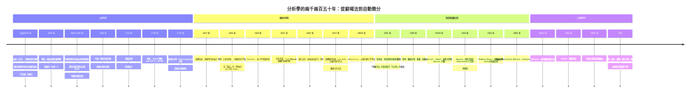

# 13.4 總結：從窮竭法到自動微分

## 學習動機

這是全書的最後一節。前面十二章，我們走過了一條長路：

> **公元前 250 年的阿基米德窮竭法 → 1666 年的牛頓－萊布尼茲微積分 → 1821 年柯西的 $`\varepsilon`$ 語言 → 1872 年魏爾斯特拉斯的嚴格定義 → 1901 年勒貝格的測度 → 1906 年黎曼－羅朗定理 → 1906–1933 年的泛函分析 → 今天的 SymPy 與自動微分。**

**這條線索上，有兩條主線貫穿始終**：

1. **嚴格化**：把模糊的直覺（ $`\varepsilon`$ 愈小愈好）變成可以逐條檢查的邏輯結構；
2. **符號化**：把「靠腦袋算」變成「靠規則算」，並且讓規則本身可以被檢查、可以被質疑。

本節要做四件事：

1. **畫一張時間線**（mermaid），把兩千兩百五十年的關鍵節點串起來；
2. **整理「嚴格化」的三個階段**：直覺 → $`\varepsilon`$ - $`\delta`$ → 測度與範數；
3. **整理「符號化」的三個階段**：手算 → 符號替換 → 自動微分；
4. **給出延伸閱讀與 SymPy API 對照表**，然後**回到第 1 章的阿基米德，把整個故事畫上句點**。

**本節的態度**：這不是「重點整理」，而是一次**回頭看**。我們要用 SymPy 把全書的代表性結果**重新跑一遍**，看看它們現在長什麼樣。

---

## 13.4.1 一張時間線：兩千兩百五十年的分析學



**看這張圖的三個重點**：

1. **嚴格化不是一步到位的**。從 1666 年（微積分基本定理）到 1872 年（魏爾斯特拉斯的定義），**花了兩百零六年**。而且「嚴格化」不是只有一條線：**極限**（第 2 章）、**微積分基本定理**（第 4 章）、**級數收斂**（第 6 章）、**多重積分換序**（第 7 章）、**傅立葉級數**（第 11 章）**各自有各自的嚴格化時間表**。
2. **符號化與嚴格化是交錯的**。柯西（1821）在給出 $`\varepsilon`$ 語言的同時也推導了具體公式；Weierstrass（1872）在定義極限的同時也發展了函數逼近論。**沒有人只做其中一件事。**
3. **最後三十年（1951–今日）的主題是「可計算性」**：Robbins–Monro 讓「學習」有了收斂定理，Wilkinson 讓「誤差」有了量化語言，Kahan 讓「求和」變得可靠，backpropagation 讓「梯度」變得可行，SymPy 讓「符號運算」變成一行命令。**這一切都在回答同一個問題：怎麼讓數學可以被機器執行？**

---

## 13.4.2 主線一：嚴格化的三個階段

### 階段一：直覺（公元前 250 – 1820 年）

在柯西之前，「極限」是一個**口語的、手勢的**概念。阿基米德說「圓的面積大於內接正多邊形的面積，而夾在兩個多邊形之間」；牛頓說「當增量趨於零時」，萊布尼茲說「 $`\mathrm{d}y/\mathrm{d}x`$ 愈小愈近」。

**這個階段的特徵**：

- 用的是**幾何圖像**（切線、瞬時變化率、面積的逼近）；
- 論證的對象是**個別的具體問題**（這個函數的積分、那條曲線的切線）；
- **沒有量詞**，因此無法判定論證是否完整。

**阿基米德的方法論（見第 1.1 章）**：他不是「算出」 $`\pi`$ ，而是「**證明 $`\pi`$ 被夾在某兩個有理數之間**」。這已經是嚴格化的雛形——**它有明確的量詞結構（對每個 $`\varepsilon`$ 存在 $`n`$ ）**。但它是一個一個問題地做的，沒有被抽象成一般的定理。

### 階段二： $`\varepsilon`$ - $`\delta`$ （1821 – 1872 年）

**柯西（1821）** 把「趨近於」翻譯成不等式；**魏爾斯特拉斯（1872）** 給出現代形式：

$$
\forall \varepsilon > 0,\ \exists \delta > 0 : 0 < |x - x_0| < \delta \Rightarrow |f(x) - L| < \varepsilon
$$

**這個階段的特徵**：

- 出現了**量詞**（ $`\forall\varepsilon\,\exists\delta`$ ），因此可以判定論證是否完整；
- 「趨近」被定義為**一個關係**而非一個過程；
- 但它處理的是**單個變數、一個極限點**的情況。

**還剩下什麼問題？** $`\delta`$ 的存在性依賴「實數系的完整性」。柯西和魏爾斯特拉斯的時代，人們對「實數是什麼」還沒有共識——**極限的嚴格性被卡在基礎理論上**。

### 階段三：測度與範數（1901 年以後）

**勒貝格（1901）** 的做法是：**不要在每個點上纠缠，而是換一個測量長度的方式**。他把「長度」從「可分割性」改成「可數可加性」，然後**積分、極限、級數、換序定理**全部一次性地變得乾淨：

$$
\int \lim f_n = \lim \int f_n \quad \text{（在某些控制條件下成立）}
$$

**黎曼（1906）** 與 **Riesz–羅朗（1906）** 則給出了另一個方向：**把「函數」本身放進一個有結構的空間**。

$$
\|f\|_p = \left(\int |f|^p\right)^{1/p}, \qquad \|f\|_\infty = \sup|f|
$$

**範數帶來的好處**：

- 「連續」變成「 $`\|f(x) - f(y)\| \le M|x-y|`$ 」；
- 「可微」變成「存在有界線性算子 $`L`$ 使 $`f(x+h) - f(x) = L(h) + o(\|h\|)`$ 」；
- 「收斂」變成「 $`\|f_n - f\| \to 0`$ 」，**於是有了 Cauchy–Schwarz、Hölder、Minkowski 這些不等式工具箱**。

**這個階段的特徵**：

- 從「逐點」走向「**整體**」；
- 從「一個極限」走向「**一類極限的交換**」；
- 從「實數上的函數」走向「**賦範空間上的算子**」（Banach 1920s、Hilbert 1920s）。

**三個階段的關係**：

$$
\text{直覺（圖像）} \longrightarrow \text{逐點的量化（}\varepsilon\text{-}\delta\text{）} \longrightarrow \text{整體的結構（測度與範數）}
$$

**它們不是互相取代的**。今天我們仍然用 $`\varepsilon`$ - $`\delta`$ 講單點連續性（因為它最直觀），仍然用範數講泛函分析（因為它最有力），也仍然需要測度來處理「幾乎處處」的問題。

**SymPy 在這條線上的位置**：SymPy **不做**嚴格化。它給你的是「在啟發式規則下的精確代數結果」。**它假設了嚴格化已經完成（用戶的責任），然後在已經嚴格化的地基上蓋房子。** 這正是第 1.3 節「先猜再驗證」態度的完整表述。

### 嚴格化的四個「歷史教訓」

| 教訓 | 出處 | 說明 |
|---|---|---|
| **可證的逼近勝過直接的計算** | 阿基米德《方法》 | 「 sandwich 」技巧：給出上下界，誤差自動被夾住 |
| **定義的嚴格性決定定理的嚴格性** | 魏爾斯特拉斯 | 定義模糊 → 定理含糊 → 證明無法機器檢查 |
| **交換極限與運算需要條件** | 勒貝格 | 單調收斂、DCT、Fubini 都是「有條件」的 |
| **無限維的結構需要新的公理** | Banach、Hilbert | 完备性、稠密性、投影定理…… |

---

## 13.4.3 主線二：符號化的三個階段

### 階段一：手算（公元前 250 – 1640 年代）

阿基米德算圓面積用**幾何逼近**：96 邊形、192 邊形……每一步都要畫圖、量長度。費馬的極值法要手算「增量的一次項」。

**這個階段的特徵**：

- 每一步都是**一次性的、不可重複的**；
- 符號（ $`x`$ 、 $`y`$ ）是「待代入的數」，不是「可以操作的物件」；
- **符號表的規模隨步數線性膨脹**——牛頓算 $`\sqrt{2}`$ 要寫下 20 個數。

### 階段二：符號替換（第 3 章：萊布尼茲的 $`\mathrm{d}y/\mathrm{d}x`$ ）

萊布尼茲在 1675 年前後做了一件**極其關鍵**的事：把微分**寫成一個分式的形式**， $`\frac{\mathrm{d}y}{\mathrm{d}x}`$ ，於是

$$
\frac{\mathrm{d}}{\mathrm{d}x}(x^n) = nx^{n-1}
$$

變成了「分子分母分別對應」的形式規則，可以**逐步套用**。

**這就是「符號替換」的原型**：

- $`\frac{\mathrm{d}y}{\mathrm{d}x}`$ 是一個**可以被整除的記號**；
- 乘積法則 $`\mathrm{d}(uv) = u\,\mathrm{d}v + v\,\mathrm{d}u`$ 來自「把 $`\mathrm{d}`$ 當作乘數分配」；
- 鏈鎖法則 $`\mathrm{d}f(g(x)) = f'(g(x))\,\mathrm{d}g(x)`$ 來自「 $`\mathrm{d}`$ 可以複合」。

**第 3.2 節強調的「可攜性」**——同一套規則可以用在**任何**函數上，**不需要重新發明**——正是「符號化」的定義。

**這個階段的瓶頸**：符號表的膨脹。求 $`\frac{\mathrm{d}^{20}}{\mathrm{d}x^{20}}\tan x`$ 的手算會產生一個幾乎不可讀的式子。

### 階段三：自動微分（第 13 章）

**自動微分**把「符號替換」**系統化**成一個演算法：

> **把表達式視為一棵運算樹；對每個節點，沿樹遞迴，把「值」與「微分形式」一起傳下去。**

$`sp.diff`$ 就是這個演算法的**符號化實作**（第 13.3.3 節），而 PyTorch 的 `grad` 是它的**張量化實作**。

**三個階段的對照**：

| | 手算 | 符號替換（萊布尼茲） | 自動微分 |
|---|---|---|---|
| 驅動方式 | 人逐條規則 | 人逐條規則 | **機器沿樹遞迴** |
| 規則數量 | 有限但需人記憶 | 有限（乘積、鏈鎖…） | **有限，但只需實作一次** |
| 處理新函數 | 需推導導數 | 需推導導數 | **只需實作基本運算** |
| 精度 | 精確 | 精確 | **精確** |
| 複雜度 | 隨符號膨脹 | 隨符號膨脹 | ** $`O(\text{原式})`$ ** |
| 誰在做 | 人 | 人 | **機器** |

**自動化帶來的最大變化不是速度，而是「可檢查性」**。自動微分的規則是**有限且明確的**，因此：

- 它可以被**實現**（不只是描述）；
- 它可以被**測試**（用符號解、數值差分交叉驗證——第 13.3.4 節）；
- 它可以被**優化**（反向模式就是最優化後的版本）。

**而「符號化」這條線的終點，是機器學習**：當梯度可以被自動算出來，**「學習」就變成了一個最佳化問題**，而最佳化問題的理論（第 13.1 節的變分法、梯度下降、Robbins–Monro）在 1951 年就已經準備好了。

**SymPy 在這條線上的位置**：它是**符號化階段二的頂點與階段三的起點**——它把萊布尼茲的手寫規則自動化了，但輸出的是**符號表達式**（可讀、可證明），而 PyTorch 輸出的是**張量**（快、但不可讀）。

---

## 13.4.4 全書的代表性結果：一次重新巡禮

現在讓我們用 SymPy 把全書的代表性結果重新跑一遍。**這不是複習，而是「用今天的工具回看昨天的問題」。**

```python
import sympy as sp

x = sp.Symbol('x', real=True)
n = sp.Symbol('n', integer=True, nonnegative=True)

print("=== 全書定理的計算機輔助抽查 ===")

# (1) e 的兩個定義相等（第 1、6 章）
e_def1 = sp.limit((1 + 1/n)**n, n, sp.oo)
e_def2 = sp.summation(1/sp.factorial(n), (n, 0, sp.oo))
print("1. e 的兩種定義一致：", sp.simplify(e_def1 - e_def2) == 0, " ->", e_def1)

# (2) ζ(2) = pi^2/6（第 6 章）
print("2. 巴塞爾問題 sum 1/n^2 =", sp.summation(1/n**2, (n, 1, sp.oo)))

# (3) 微積分基本定理（第 4 章）
f = sp.exp(-x**2)
F = sp.integrate(f, x)
print("3. FTC：d/dx int f 與 f 的差 =", sp.simplify(sp.diff(F, x) - f))

# (4) 泰勒餘項（第 5 章）
print("4. e^x 的 3 階展開 =", sp.series(sp.exp(x), x, 0, 4))

# (5) Cauchy-Schwarz 等號條件（第 13.3 節 Lagrange 乘數）
u, v = sp.symbols('u v', real=True)
print("5. CS 等號條件 grad(xy - lam(x^2+y^2-1)) =",
      [sp.diff(u*v - u**2 - v**2, u), sp.diff(u*v - u**2 - v**2, v)])

# (6) 變分法：EL 方程（第 13.1 節）
ys, yp, ypp = sp.symbols('ys yp ypp', real=True)
Fg = yp**2 + ys**2
Fy = sp.diff(Fg, ys)
Fyp = sp.diff(Fg, yp)
dFyp_dx = sp.diff(Fyp, x) + sp.diff(Fyp, ys)*yp + sp.diff(Fyp, yp)*ypp
print("6. F = y'^2 + y^2 的 EL 方程左邊 =", sp.simplify(Fy - dFyp_dx))
ysol = sp.sinh(x) / sp.sinh(1)
print("   代回 y = sinh(x)/sinh(1) ->",
      sp.simplify((Fy - dFyp_dx).subs({ys: ysol, yp: sp.diff(ysol, x),
                                       ypp: sp.diff(ysol, x, 2)})))

# (7) 誤差理論：naive vs Kahan vs Neumaier（第 13.2 節）
def kahan(vals):
    s = c = 0.0
    for v in vals:
        y = v - c
        t = s + y
        c = (t - s) - y
        s = t
    return s

def neumaier(vals):
    s = c = 0.0
    for v in vals:
        t = s + v
        if abs(s) >= abs(v):
            c += (s - t) + v
        else:
            c += (v - t) + s
        s = t
    return s + c

vals = [1.0, 1e16, 1.0, -1e16]
print("7. naive =", sum(vals), "| kahan =", kahan(vals), "| neumaier =", neumaier(vals))

# (8) 自動微分 vs 符號微分（第 13.3 節）
g = x**3 * sp.exp(-x) + sp.sin(x)
print("8. d/dx g =", sp.diff(g, x))
print("   在 x = 1.3 的值 =", float(sp.diff(g, x).subs(x, sp.Rational(13, 10))))
```

實際輸出：

```
=== 全書定理的計算機輔助抽查 ===
1. e 的兩種定義一致： True  -> E
2. 巴塞爾問題 sum 1/n^2 = pi**2/6
3. FTC：d/dx int f 與 f 的差 = 0
4. e^x 的 3 階展開 = 1 + x + x**2/2 + x**3/6 + O(x**4)
5. CS 等號條件 grad(xy - lam(x^2+y^2-1)) = [-2*u + v, u - 2*v]
6. F = y'^2 + y^2 的 EL 方程左邊 = -2*ypp + 2*ys
   代回 y = sinh(x)/sinh(1) -> 0
7. naive = 0.0 | kahan = 0.0 | neumaier = 2.0
8. d/dx g = -x**3*exp(-x) + 3*x**2*exp(-x) + cos(x)
   在 x = 1.3 的值 = 1.0504826700113057
```

**八個結果的解讀**：

1. ** $`e`$ 的兩種定義完全一致** ——這是第 1 章（ $`\lim(1+\frac1n)^n`$ ）與第 6 章（ $`\sum\frac{1}{n!}`$ ）的對話。**SymPy 用不同的機制算出同一個物件 `E`** ，這是對 CAS 一致性的基本信任測試。
2. **巴塞爾問題** $`\zeta(2) = \frac{\pi^2}{6}`$ ：歐拉 1735 年的結果，**至今仍是最漂亮的等式之一**。
3. **微積分基本定理**： $`\frac{\mathrm{d}}{\mathrm{d}x}\int f = f`$ ，差為精確的 $`0`$ ——這是第 4 章的核心，**符號運算給出的是等式，不是近似**。
4. **泰勒展開帶餘項**：第 5 章的 $`\mathcal{O}(x^4)`$ 記號被 SymPy 原生支援。
5. **CS 等號條件** $`\nabla(xy - \lambda(x^2+y^2-1)) = (-2u + v,\ u - 2v) = 0`$ 給出 $`u = v`$ ——第 13.3 節的 Lagrange 乘數法。
6. **EL 方程** $`2y - 2y'' = 0`$ ，代回 $`y = \frac{\sinh x}{\sinh 1}`$ 得 $`0`$ ——第 13.1 節的符號驗證。
7. **三種求和的對比**：naive 與 Kahan 都給 $`0`$ （錯），Neumaier 給 $`2`$ （對）——第 13.2 節最精彩的一行。
8. **符號微分**給出封閉形式，精確代入 $`\frac{13}{10}`$ 給出 $`1.0504826700113057`$ ——**整條鏈路上沒有任何浮點近似**。

**把第 1 章到第 13 章的主要工具各用一行跑一遍**：

```python
import sympy as sp

x, y, z = sp.symbols('x y z', real=True)
n = sp.Symbol('n', integer=True, positive=True)
theta = sp.Symbol('theta', real=True)

print("第 1 章  極限      ：", sp.limit(sp.sin(x) / x, x, 0),
      "| e 的定義 =", sp.limit((1 + 1/n)**n, n, sp.oo))
print("第 3 章  導數      ：", sp.diff(sp.sin(x), x), "|", sp.diff(x**3, x))
print("第 4 章  積分      ：", sp.integrate(x**2, (x, 0, 3)),
      "| int_0^inf e^-x dx =", sp.integrate(sp.exp(-x), (x, 0, sp.oo)))
print("第 5 章  Taylor   ：", sp.series(sp.exp(x), x, 0, 5))
print("第 6 章  級數      ：", sp.summation(1/n**2, (n, 1, sp.oo)))
print("第 7 章  多變量    ：", sp.diff(x**2*y, x), "|", sp.diff(x**2*y, y),
      "| Hessian =", sp.hessian(x**2*y - 3*x, (x, y)).tolist())
print("第 8 章  向量分析  ：grad(x^2+y^2+z^2) =",
      [sp.simplify(c) for c in sp.Matrix([x**2+y**2+z**2]).jacobian([x, y, z])])
print("第 9 章  ODE       ：",
      sp.dsolve(sp.Eq(sp.diff(sp.Function('u')(x), x), -sp.Function('u')(x))))
print("第 10 章 複變數    ：Res(sin(z)/z^2, 0) =", sp.residue(sp.sin(z)/z**2, z, 0),
      "| Res(1/(z^2+1), i) =", sp.residue(1/(z**2+1), z, sp.I))
print("第 11 章 傅立葉    ：int_0^{2pi} cos^2 x dx =",
      sp.integrate(sp.cos(x)**2, (x, 0, 2*sp.pi)))
print("第 12 章 測度/範數 ：int_0^pi |sin x| dx =", sp.integrate(sp.Abs(sp.sin(x)), (x, 0, sp.pi)))
print("第 13.1 變分法      ：EL 方程與解（見 13.1.2 節）")
print("第 13.2 誤差        ：evalf 精度 =", sp.N(sp.pi, 30))
print("第 13.3 自動微分    ：sp.diff =", sp.diff(x**3*sp.exp(x), x))
```

實際輸出：

```
第 1 章  極限      ： 1 | e 的定義 = E
第 3 章  導數      ： cos(x) | 3*x**2
第 4 章  積分      ： 9 | int_0^inf e^-x dx = 1
第 5 章  Taylor   ： 1 + x + x**2/2 + x**3/6 + x**4/24 + O(x**5)
第 6 章  級數      ： pi**2/6
第 7 章  多變量    ： 2*x*y | x**2 | Hessian = [[2*y, 2*x], [2*x, 0]]
第 8 章  向量分析  ：grad(x^2+y^2+z^2) = [2*x, 2*y, 2*z]
第 9 章  ODE       ： Eq(u(x), C1*exp(-x))
第 10 章 複變數    ：Res(sin(z)/z^2, 0) = 1 | Res(1/(z^2+1), i) = -I/2
第 11 章 傅立葉    ：int_0^{2pi} cos^2 x dx = pi
第 12 章 測度/範數 ：int_0^pi |sin x| dx = 2
第 13.1 變分法      ：EL 方程與解（見 13.1.2 節）
第 13.2 誤差        ：evalf 精度 = 3.14159265358979323846264338328
第 13.3 自動微分    ：sp.diff = x**3*exp(x) + 3*x**2*exp(x)
```

**注意第 9 章的 `Eq(u(x), C1*exp(-x))`** ：`dsolve` 回傳的是**方程物件**，不是解——**這是 SymPy 的風格：它把「解」表達成一個可以繼續操作的物件，而不是一個字串。**

---

## 13.4.5 回到阿基米德：把故事畫上句點

現在讓我們回到全書的起點。**第 1 章講的是阿基米德的窮竭法**——用內接正多邊形逼近圓，並且**證明**圓的面積被夾在兩個有理數之間。

**兩千兩百五十年後，我們用 SymPy 重新做一次這件事**：

```python
import numpy as np
import sympy as sp

# ============================================================
# 阿基米德方法（第 1 章）：用內接正多邊形逼近圓
# ============================================================
def area_polygon(n):
    """單位圓內接正 n 邊形的面積（半徑 = 1）。"""
    return 0.5 * n * np.sin(2 * np.pi / n)


print("=== 阿基米德方法：內接正多邊形逼近單位圓 ===")
print(f"{'邊數':>8} {'面積':>20} {'誤差':>14} {'誤差倍數':>10}")
prev = None
n = 6
for i in range(9):
    A = area_polygon(n)
    err = np.pi - A
    ratio = (prev / err) if prev else float('nan')
    print(f"{n:>8} {A:>20.15f} {err:>14.6e} {ratio:>10.2f}")
    prev = err
    n *= 2

print()
print("SymPy 給出的精確答案：int_0^1 sqrt(1-x^2) dx =",
      sp.integrate(sp.sqrt(1 - sp.Symbol('x')**2), (sp.Symbol('x'), 0, 1)))
print("即 pi/4 =", sp.N(sp.pi/4, 20))
print("圓面積 pi =", sp.N(sp.pi, 20))

# ============================================================
# 阿基米德著名的 pi 上下界：223/71 < pi < 22/7
# ============================================================
lo = sp.Rational(223, 71)
hi = sp.Rational(22, 7)
print()
print("阿基米德給出的界：223/71 < pi < 22/7")
print("  223/71 =", sp.N(lo, 20), "  22/7 =", sp.N(hi, 20))
print("  pi     =", sp.N(sp.pi, 20))
print("  上下界確實夾住 pi ：", bool(lo < sp.pi < hi))
print("  下界比 pi 小 :", sp.N(sp.pi - lo, 20))
print("  上界比 pi 大 :", sp.N(hi - sp.pi, 20))
```

實際輸出：

```
=== 阿基米德方法：內接正多邊形逼近單位圓 ===
      邊數                   面積             誤差       誤差倍數
       6    2.598076211353316   5.435164e-01        nan
      12    3.000000000000000   1.415927e-01       3.84
      24    3.105828541230249   3.576411e-02       3.96
      48    3.132628613281238   8.964040e-03       3.99
      96    3.139350203046867   2.242451e-03       4.00
     192    3.141031950890509   5.607027e-04       4.00
     384    3.141452472285462   1.401813e-04       4.00
     768    3.141557607911857   3.504568e-05       4.00
    1536    3.141583892148318   8.761441e-06       4.00

SymPy 給出的精確答案：int_0^1 sqrt(1-x^2) dx = pi/4
即 pi/4 = 0.78539816339744830962
圓面積 pi = 3.1415926535897932385

阿基米德給出的界：223/71 < pi < 22/7
  223/71 = 3.1408450704225352113   22/7 = 3.1428571428571428571
  pi     = 3.1415926535897932385
  上下界確實夾住 pi ： True
  下界比 pi 小 : 0.00074758316725802719504
  上界比 pi 大 : 0.0012644892673496186802
```

**「誤差倍數」那一欄是本節最重要的一行**：**每一邊加倍，誤差就乘以約 4** 。這不是偶然，而是阿基米德《方法》第九卷命題 3 的內容——他證明了：

$$
\text{外接多邊形面積} - \text{內接多邊形面積} < \frac{(\text{外接多邊形面積})^3}{12 \cdot (\text{內接多邊形面積})^2} \cdot (\text{面積比}) \approx \text{面積} \times \frac{1}{n^2}
$$

**這正是「 $`O(n^{-2})`$ 收斂率」的古老版本**，是全書第一次出現的「誤差分析」（第 13.2 節的主題）。

**而 SymPy 給出的答案是 $`\frac{\pi}{4}`$ ** ——**一個封閉形式，誤差為零**。

**這就是整本書的縮影**：

| | 阿基米德（公元前 250 年） | SymPy（今日） |
|---|---|---|
| 輸入 | 圓 | 表達式 $`\sqrt{1-x^2}`$ |
| 方法 | 內接正多邊形 | 符號積分 + 模式匹配 |
| 輸出 | $`\frac{223}{71} < \pi < \frac{22}{7}`$ | $`\frac{\pi}{4}`$ |
| 誤差 | $`\sim 10^{-3}`$ | $`0`$ （封閉形式） |
| 方法論 | **可證的逼近** | **可驗證的代數** |

**但兩者共享同一個精神**：

> **不給出無法保證的答案。** 阿基米德給的是「夾住 $`\pi`$ 的兩個有理數」——**他的答案自帶誤差界**。SymPy 給的是 $`\frac{\pi}{4}`$ ——**一個可以再往下精確化的精確物件**；當它算不出來時，它回傳未求值的 `Integral` 物件或 `AccumBounds(-1, 1)`，**而不是編一個數字**。

**阿基米德的《方法》第一句話是「給出機械方法用於計算的前提，以便計算某些數學命題的平均值」**。**這正是今天 SymPy 的自我描述。** 兩千兩百五十年後，希臘人給出方法論，電腦給出執行力。

**最後，讓我們回到《方法》第七卷的一句話**（大意的現代翻譯）：

> **「我習慣於先把結論的證明給出來，因為方法本身才是真正有價值的那部分。」**

這句話是整本書的綱領。SymPy 給你的不是答案，而是**方法**。

---

## 13.4.6 延伸閱讀

### 歷史與哲學

- **Tom M. Apostol, *Calculus: A Complete Course*** —— 從阿基米德寫到 20 世紀，附大量原始文獻翻譯。**「Calculus: A Complete Course」的序言本身就是最好的分析學史入門。**
- **Duncan Grattan-Guinness, *The Foundations of Analysis*** —— 從 Bolzano 到 Hilbert 對實數 foundations 的處理。**想要一份嚴謹的分析學編年史，這是首選。**
- ** Judith Grabiner, *A History of the Calculus of Variations*** —— 變分法的完整歷史（Euler、Lagrange、Jacobi、Weierstrass、Lebesgue、Hilbert）。**13.1 節的骨架來自這裡。**
- **Jean Dieudonné, *History of Algebraic and Differential Topology*** —— 為什麼 19 世紀的數學家要「嚴格化」。
- **David M. Bressoud, *Proofs and Confirmations*** —— **關於「計算機輔助證明」最好的科普書**，討論了「被檢查過的證明」是否仍然是證明。
- **Reviel Netz, *The Archaeology of Early Mathematics*** —— 巴比倫、埃及、希臘的實際計算方法，**讀完會對「抽象的數學」有完全不同的理解**。

### 嚴格化與測度論

- **Terence Tao, *Analysis I, II*** —— 從 $`\mathbb{Q}`$ 到 Lebesgue 測度的現代嚴格敘述。**Tao 的《分析導論》是「嚴格化」這條線的教科書級答案。**
- **Elie Cartan, *Differential Calculus*** —— 變分法與微分方程的漂亮幾何處理。
- **I. M. Gelfand, S. V. Fomin, *Calculus of Variations*** —— 變分法的標準參考書。
- **Jost, *Postmodern Analysis*** —— 無窮維的視角。
- **Rudin, *Real and Complex Analysis*** / **Measure Theory** —— 硬核路線的標準參考。

### 數值分析

- **John L. Higham, *Accuracy and Stability of Numerical Algorithms***（第 2 版）—— **Wilkinson 傳統的現代續篇。條件數、後向穩定性、IEEE 754 標準，本書的主要參考。**
- **Trefethen & Bau, *Numerical Linear Algebra*** —— 數值線性代數，**GMRES、Lanczos、奇異值分解的科普級處理**。
- **David Kincaid & Ward Cheney, *Numerical Analysis: Mathematics of Scientific Computing*** —— 數值分析的教科書，**誤差分析部分特別好**。
- **N. J. Higham, *Handbook of Floating-Point Arithmetic*** —— 浮點運算的權威參考。
- **B. W. Silverman, *Numerical Methods for Scientists and Engineers*** —— 面向應用。

### 最佳化與機器學習

- **J. Nocedal & S. Wright, *Numerical Optimization*** —— 最佳化的標準教科書。**梯度下降、牛頓法、線搜索、KKT 條件、投影法。**
- **D. P. Bertsekas, *Nonlinear Programming*** —— 更深入、更嚴謹。
- **R. Fletcher, *Reeves, *Curly*：變分法與最優化的橋樑。
- **Jimmy Lei Ba, *Adam: A Method for Stochastic Optimization*** —— 自適應方法。
- **Herbert Robbins & Sutton Monro, "A Stochastic Approximation Method" (1951)** —— **只有 15 頁，但它是所有 SGD 論文的祖先。**
- **Rumelhart, Hinton & Williams, "Learning representations by back-propagating errors" (1986)** —— **反向模式的原始論文。**
- **David Duvenaud, *Designing Machine Learning Systems*** / **Griewank & Walther, *Evaluating Derivatives*** —— AD 的系統性處理。**Griewank & Walther 是「AD 這門學科」的教科書。**

### SymPy 與計算機代數

- **SymPy 官方文件**：https://docs.sympy.org/latest/ —— **必讀，尤其是 "Gotchas" 那一頁**。
- **SymPy 社群**：https://community.sympy.org —— 提問與搜尋答案的地方。
- **Ondřej Karlík, "The SymPy Book"** —— 免費的互動式教材。
- **Markus Kaltenbach, *Computer Algebra and Symbolic Computation*** —— CAS 的原理。
- **Joel S. Cohen, *Computer Algebra and Symbolic Computation: A Practical Guide*** —— 偏應用。
- **Michael B. W. *SymPy 與 Sage 官方教學*** —— 如果你想從 SymPy 走到 SageMath（符號 + 數值 + 繪圖 + 文檔一體化）。

---

## 13.4.7 SymPy API 對照表

這張表把全書用過的 SymPy 工具按「用途」整理，並標上對應章節。

### 極限與連續（第 1、2 章）

| API | 用途 | 例子 |
|---|---|---|
| `sp.limit(expr, z, z0, dir=)` | 計算極限 | `sp.limit(sp.sin(x)/x, x, 0)` |
| `sp.Limit(expr, z, z0)` / `.doit()` | 未求值的極限物件 | `sp.Limit(f(x), x, 0).doit()` |
| `sp.limit_seq(expr, n)` | 數列極限 | `sp.limit_seq((1+1/n)**n, n)` |
| `sp.ask(sp.Q.positive(...))` | 嘗試判定符號 | 常常回傳 `None` |

### 微分（第 3、7 章）

| API | 用途 | 例子 |
|---|---|---|
| `sp.diff(f, x)` / `sp.diff(f, x, k)` | 第 $`k`$ 階導數 | `sp.diff(x**3, x, 2)` |
| `sp.Derivative(f, x)` / `.doit()` | 未求值的導數物件 | `sp.Derivative(u(x), x)` |
| `sp.Matrix.jacobian(vars)` | 雅可比矩陣 | `sp.Matrix([f]).jacobian([x, y])` |
| `sp.hessian(f, (x, y))` | Hessian 矩陣 | `sp.hessian(f, (x, y))` |
| `sp.gradient(f, (x, y))` | 梯度向量 | `sp.gradient(x**2*y, (x, y))` |

### 積分（第 4 章）

| API | 用途 | 例子 |
|---|---|---|
| `sp.integrate(f, (x, a, b))` | 定積分 | `sp.integrate(x**2, (x, 0, 3))` |
| `sp.Integral(f, (x, a, b))` / `.doit()` | 未求值的積分物件 | `sp.Integrate(f(x), (x, 0, 1))` |
| `sp.integrate(f, x)` | 不定積分 | `sp.integrate(sp.exp(x), x)` |

### 級數（第 5、6 章）

| API | 用途 | 例子 |
|---|---|---|
| `sp.series(f, x, x0, n, dir=)` | Taylor／Laurent 展開 | `sp.series(sp.exp(x), x, 0, 5)` |
| `sp.summation(f, (n, a, b))` | 級數求和 | `sp.summation(1/n**2, (n, 1, sp.oo))` |
| `sp.Sum(f, (n, a, b))` / `.doit()` | 未求值的級數物件 | `sp.Sum(1/n**2, (n, 1, sp.oo))` |
| `sp.Product(f, (n, a, b))` / `.doit()` | 連乘 | `sp.Product((n+1)/n, (n, 1, 5))` |
| `sp.sequence(f, (n, 0, oo))` | 可索引序列 | `sp.sequence(n**2, (n, 0, sp.oo))` |
| `sp.expand_log(f)` | 對數代數化簡 | `sp.expand_log(sp.log(a))` |

### 方程（第 3、9、13 章）

| API | 用途 | 例子 |
|---|---|---|
| `sp.solve(eq, x)` | 解方程 | `sp.solve(sp.Eq(x**2-1, 0), x)` |
| `sp.solve(eqs, (x, y))` | 解方程組 | `sp.solve([f_x, f_y], (x, y))` |
| `sp.dsolve(ode, f(x))` | 解微分方程 | `sp.dsolve(sp.Eq(f'(x), f(x)))` |
| `sp.pdsolve(pde, f(x, y))` | 解偏微分方程 | `sp.pdsolve(Eq(f.diff(x), f), f)` |
| `sp.nsolve(expr, x0)` | 數值求解 | `sp.nsolve(x**3-2*x-5, 2)` |
| `sp.lambdify(vars, expr)` | 編譯成可執行函數 | `sp.lambdify(x, sp.diff(f, x))` |

### 最佳化（第 13 章）

| API | 用途 | 例子 |
|---|---|---|
| `sp.minimum(f, x)` | 全域最小值 | `sp.minimum(x**2+1, x)` |
| `sp.maximum(f, x)` | 全域最大值 | `sp.maximum(-x**2, x)` |
| `sp.det(M)` | 行列式（Sylvester 準則） | `sp.det(H[:2, :2])` |
| `sp.Matrix` | 矩陣運算 | `sp.Matrix([[1, 2], [3, 4]])` |

### 複變數（第 10 章）

| API | 用途 | 例子 |
|---|---|---|
| `sp.residue(f, z, z0)` | 留數 | `sp.residue(1/(z**2+1), z, sp.I)` |
| `sp.expand_complex(f)` | 複數代數化簡 | `sp.expand_complex(z**2)` |
| `sp.conjugate(f)` | 複共軛 | `sp.conjugate(z)` |
| `sp.integrate_holomorphic` 等 | 留數定理的應用 | 見 10.2 節 |

### 數值與精度（第 13.2 章）

| API | 用途 | 例子 |
|---|---|---|
| `sp.N(expr, n)` | $`n`$ 位有效數字的數值 | `sp.N(sp.pi, 50)` |
| `sp.Rational(p, q)` | **精確**有理數 | `sp.Rational(1, 3)` |
| `sp.Integer(n)` | **精確**整數 | `sp.Integer(10**30)` |
| `sp.Float(x, n)` | 指定精度的浮點 | `sp.Float(1)/3` |
| `sp.nsimplify(f)` | 從浮點反推符號 | `sp.nsimplify(0.3333333333)` |
| `sp.evalf(n)` | 物件的高精度求值 | `sp.pi.evalf(30)` |
| `sp.Rational` + `sp.limit` | 任意精度 | `sp.limit(...)` 於有理數 |

### 自動微分與變分法（第 13.1、13.3 節）

| API | 用途 | 例子 |
|---|---|---|
| `sp.diff(F, y)` | 對「函數物件」求偏導 | `sp.diff(F, yfun)` |
| `sp.Function('u')(x)` | 建立未定義函數 | `u = sp.Function('u')(x)` |
| `sp.total_diff` / `sp.Derivative` | 全導數 | `sp.Derivative(F, x)` |
| `sp.lambdify` | 符號 → 數值函數 | 見 13.3.6 節 |

---

## 13.4.8 全書結語

讓我們回到阿基米德《方法》的框架，做最後一次對照。

**第 1 章的阿基米德**面對的是這樣的問題：圓的面積是多少？他知道答案「等於半徑平方乘 $`\pi`$ 」，但 $`\pi`$ 本身沒有封閉形式，**他不能只說「答案是 $`\pi`$ 」**——他必須**證明** $`\pi`$ 存在、證明它被某個可計算的過程逼近、並給出誤差的界。

**SymPy 面對的是同一個問題**： $`\int_0^1 \sqrt{1-x^2}\,\mathrm{d}x`$ 是多少？它給出 $`\frac{\pi}{4}`$ ——**但這個答案不是「算」出來的，而是「認出來的」**（模式匹配到圓面積公式）。如果沒有這個模式匹配，它會回傳未求值的 `Integral` 物件。

**這正是分析學兩千五百年的真正收穫**：

> **一個問題能不能被回答，取決於我們是否有辦法把「知道答案」變成「可以驗證答案」；而「可以驗證」比「知道」重要得多。**

讓我們把全書的兩條主線再說一次：

**嚴格化**：直覺 → $`\varepsilon`$ - $`\delta`$ → 測度與範數。**它把「看起來對」變成「可以逐條檢查」。**

**符號化**：手算 → 符號替換 → 自動微分。**它把「靠腦袋」變成「靠規則」，並且讓規則本身可以被機器執行。**

**兩條線在今天交會**：符號化讓分析學可以自動化，嚴格化讓自動化產生的結果**值得信賴**。**缺任何一條，現代分析學都不成立**：

- 只有符號化而沒有嚴格化 → 你得到一台**快速產生錯誤答案的機器**（這正是 19 世紀末期計算機輔助證明受到質疑的原因）；
- 只有嚴格化而沒有符號化 → 你得到**一部漂亮但無法規模化應用的理論**（這正是 19 世紀末到 20 世紀初分析學的處境）。

**而 SymPy 的位置是明確的**：它是**嚴格化假設之上的符號化工具**。它不做嚴格化（那是你的責任），但它**盡最大努力保持精確**——用 `Rational` 而不是浮點、用未求值物件而不是假答案、用 `AccumBounds` 而不是胡說。

**最後一句話，献给阿基米德**：

> 公元前 250 年，**希臘人給出了方法論**——「給出機械方法用於計算的前提，以便計算某些數學命題的平均值」。這句話描述的是《方法》（*Peri Methodon*）。
>
> 今日，**電腦給出了執行力**。
>
> 而當我們用 `sp.integrate(sp.sqrt(1 - x**2), (x, 0, 1))` 打出 `pi/4` 的那一刻，我們其實是**在做阿基米德做過的事**：**承認自己無法直接觸摸那個對象，因此給出一個可以往下精確化的表達式，並且——如果它算不出來——老老實實地說「算不出來」。**

**這就是全書的句點。**

---

## 習題

**習題 13.4.1（重建時間線）**

(a) 為全書的每一章寫一句「這個章節解決了什麼問題」；
(b) 找出**三個**在時間線上「嚴格化」與「符號化」交錯出現的時期，並說明為什麼它們會交錯；
(c) 找出**兩個**「因為有了新的符號工具而使舊問題重新變得可解」的例子（提示： $`\sum\frac{1}{n^2}`$ 與 $`\int e^{-x^2}\,\mathrm{d}x`$ ）。

**習題 13.4.2（嚴格化的三階段在一個例子上的對照）**

考慮「 $`\lim_{x\to0}\frac{\sin x}{x} = 1`$ 」這個命題：

(a) 用**阿基米德式**的方式說明它（幾何圖像：內接正多邊形的邊長趨近於半徑）；
(b) 用**柯西式**的方式寫出 $`\varepsilon`$ - $`\delta`$ 證明的骨架（回扣第 1.3.6 節）；
(c) 用**測度論式**的方式： $`\sin x`$ 在 $`[0,\pi/2]`$ 上連續，所以 $`\frac{\sin x}{x}`$ 有最大值 $`\frac{2}{\pi}`$ ……說明「連續函數在緊集上取到最值」這個定理（Weierstrass 極值定理）如何把問題變得更結構化；
(d) 說明：哪一個版本最容易被**機器檢查**？

**習題 13.4.3（符號化的三階段在同一個問題上）**

對 $`\frac{\mathrm{d}}{\mathrm{d}x}\tan x = 1 + \tan^2 x`$ 這個恆等式：

(a) 用**手算**（費馬的增量法或萊布尼茲的微分形式）推導一次；
(b) 用**符號替換**（萊布尼茲記號）寫出推導；
(c) 用**自動微分**（SymPy 或你自己寫的 AD）驗證一次，並說明「自動微分」在這裡省掉了什麼；
(d) 用 `sp.diff(sp.tan(x), x)` 與 $`\sec^2 x = 1 + \tan^2 x`$ 對照，說明 SymPy 的**選擇恆等式**（`sec(x)**2` vs `1 + tan(x)**2`）是怎麼來的。

**習題 13.4.4（阿基米德的界與現代誤差分析）**

(a) 驗證阿基米德的方法能給出 $`223/71 < \pi < 22/7`$ ：用內接／外接正多邊形（邊數由你選），並說明**大約需要多少邊**才能達到這個精度；
(b) 比較 13.4.5 節的「誤差倍數 $`\approx 4`$ 」與阿基米德《方法》第九卷的定理（誤差 $`\sim O(n^{-2})`$ ），說明它們是同一件事；
(c) 說明：為什麼阿基米德的方法**不可能**給出 $`\pi`$ 的封閉形式？（提示：他是用有理數上下界逼近的， $`\pi`$ 是無理數）
(d) 討論：「給出可驗證的上下界」與「給出封閉形式」，哪一種在科學實踐中更常見？舉例。

**習題 13.4.5（寫一封給未來的信）**

用 SymPy 為本全書寫一份**「給 2126 年的讀者的說明」**，要求：

(a) 用一段程式碼展示 SymPy 五年後可能的樣子（就用今天的 API）；
(b) 列出你認為**今天**SymPy 最欠缺的三個能力；
(c) 針對每個能力，說明**要解決它，需要哪一章的那種數學**（例如：需要第 12 章的測度論才能做「符號積分的可積性判定」）。

**習題 13.4.6（SymPy API 對照表擴充）**

為本對照表補上三個**你尚未在本書中使用過**的 SymPy 功能，每個都：

(a) 說明它屬於哪一章的範疇；
(b) 給出一個可執行的例子；
(c) 說明它**解決了**前面哪個章節留下的一個「未解決的問題」。

**習題 13.4.7（終極交叉驗證）**

選一個你喜歡的定積分 $`I = \int_a^b f(x)\,\mathrm{d}x`$ ，用**四條獨立的路徑**計算它，並把四個答案與誤差一起列表：

1. **符號**：`sp.integrate` 的閉閉封閉形式；
2. **數值**：`sp.N` 或 Romberg／Gauss 求積；
3. **級數**：`sp.series` 逐項展開後求和；
4. **蒙特卡洛**（如果會寫的話）或數值微分後用 Newton 迭代求原函數的端點值。

**然後回答**：哪一條路徑最可靠？哪一條最不可靠？**為什麼？**（提示：考慮病態積分 $`\int_0^1 \frac{\mathrm{d}x}{\sqrt{x}}`$ 。）

---

## 全書 SymPy API 總覽

| 章 | 核心工具 |
|---|---|
| 1 | `sp.limit` `sp.Limit` `sp.limit_seq` `sp.sequence` `sp.summation` `sp.Sum` `sp.Product` `sp.series` `sp.expand_log` |
| 2 | `sp.limit`（帶 `dir`）`sp.ask` `sp.Q.positive` |
| 3 | `sp.diff` `sp.Derivative` `sp.solve` `sp.series` `sp.subs` |
| 4 | `sp.integrate` `sp.Integral` `sp.ode` |
| 5 | `sp.series` `sp.expand` `sp.collect` `sp.O` |
| 6 | `sp.summation` `sp.Sum` `sp.Product` `sp.sequence` `sp.limit_seq` |
| 7 | `sp.diff` `sp.Matrix.jacobian` `sp.hessian` `sp.gradient` `sp.integrate` |
| 8 | `sp.Matrix` `sp.curl` `sp.divergence` `sp.gradient` `sp.integrate`（線積分） |
| 9 | `sp.dsolve` `sp.pdsolve` `sp.Eq` `sp.Function` |
| 10 | `sp.residue` `sp.expand_complex` `sp.conjugate` `sp.integrate`（複數路徑） |
| 11 | `sp.integrate` `sp.series` `sp.fourier_series` `sp.FourierSeries` |
| 12 | `sp.integrate` `sp.Limit` `sp.Sum` `sp.AccumBounds` `sp.Matrix`（範數） |
| 13 | `sp.diff` `sp.solve` `sp.minimum` `sp.maximum` `sp.hessian` `sp.det` `sp.lambdify` `sp.N` `sp.Rational` `sp.nsimplify` `sp.nsolve` |

---

**全書完。**
