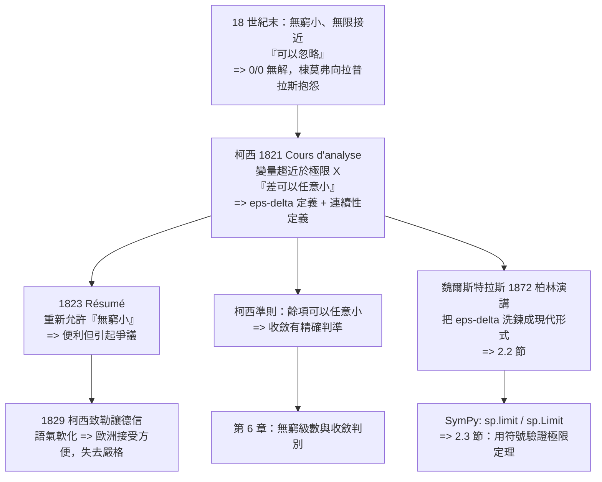

# 第 2 章 極限的嚴格化：柯西、魏爾斯特拉斯與 ε-δ

## 2.1 柯西把極限寫成不等式（1821 年）

### 學習動機

第 1 章講的是極限的**直覺**從哪裡來：阿基米德給出「可證的逼近」，牛頓與萊布尼茲給出「變化率」。但那整章的所有敘述都建立在一個從未被寫下來的假設上：

> 「當 $`x`$ 越來越接近 $`a`$ 的時候， $`f(x)`$ 也越來越接近某個數 $`L`$ 。」

「越來越接近」是什麼意思？「多接近算接近」？「接近的速度」算不算？這些問題在 1821 年之前沒有嚴格的答案。分析學因此懸在一個尷尬的位置上：**它有定理，但沒有定理的語言**。

柯西在 1821 年的《Cours d'analyse》（分析學教程）裡做的事情，可以概括成一句話：

> **把「無限接近」這種不可操作的直覺，翻譯成「對每個 $`\varepsilon`$ 都存在 $`\delta`$ 」這種可以逐條檢查的邏輯結構。**

這是本節要講的全部內容。但我們要從三個角度來看這件事，因為它們對應三種不同的「嚴格化」：

1. **語言的嚴格化**（柯西的貢獻）：把「趨近」寫成不等式；
2. **對象的嚴格化**（魏爾斯特拉斯與狄德金，第 2.2 節）：極限值必須是實數，而實數必須先被構造出來；
3. **方法的嚴格化**（本節末與 2.3 節）：SymPy 算出來的答案如何升級成「先定義再驗證」的證明。

第 1 節已經說過，SymPy 活在一個「先猜再驗證」的世界裡，它的 `sp.limit` 不從定義出發。**本節結束時，你會有一套完整的語言可以把 SymPy 的輸出升級為證明。**

---

### 2.1.1 Cours d'analyse 的貢獻：把整本分析學重寫成一個定理體系

法國的柯西（Augustin-Louis Cauchy, 1789–1857）在 1821 年出版《Cours d'analyse》時，法國的純粹數學剛經歷了一場災難。拉普拉斯、拉格朗日的分析帶有濃厚的物理色彩：無窮小、無窮、極限只是「計算的方便」。這些說法在 18 世紀末還能運作，但一遇到像 $`\frac{0}{0}`$ 這種情形就全面崩潰。1780 年代末到 1790 年代，棣莫弗（d'Alembert）向拉普拉斯指出 $`\frac{0}{0}`$ 的問題，拉普拉斯回答說「這是 $`\frac{dx}{dx}`$ ，可以用拉格朗日插值公式處理」——這是一個承認自己沒有答案的回答。

《Cours d'analyse》的目錄本身就是一份宣言：

| 章節 | 內容 | 為什麼重要 |
|------|------|-----------|
| 第一講 | 實數的代數運算 | 實數被當作**對象**來研究，不是「上帝造的數」 |
| 第二講 | 函數的理論、連續性 | 連續性被**定義**，不是被直觀描述 |
| 第三講 | 極限論、極限的各種應用 | 極限成為獨立的一章，與微分分離 |
| 第四講 | 實函數的微分 | 微積分建立在極限之上，而不是相反 |
| 第五講 | 級數的理論 | 收斂有精確判準 |
| 第六講 | 公式的解析研究 | 複變數與解析函數 |

**最關鍵的結構性轉變是：微分被放在極限之後。** 在拉格朗日的《分析論》中，導數是用「把 $`h`$ 當成極小的量」的模糊語言定義的，於是「極小量可以忽略」就成了定理的基礎。柯西把導數重新定義為

$$
f'(x) = \lim_{h \to 0}\frac{f(x+h) - f(x)}{h}
$$

——**極限是前提，導數是推論**。整個分析學的邏輯順序被倒轉了。這個倒轉在 3.3 節我們用 `sp.limit` 重新走過一遍。

《Cours d'analyse》還帶來兩個我們今天仍然在用的東西：

- **定理的編號與命名慣例**：柯西開始系統性地編號定理（定理 I、II、III……），並把「介值定理」稱為「柯西介值定理」；
- **把連續函數的介值定理化為極限語言**：這是後來韋伯斯特拉斯定理的基礎。

---

### 2.1.2 「變量趨近於極限」：柯西的定義

柯西在《Cours d'analyse》中對極限的處理，是全書最具革命性的一頁。他的出發點不是函數，而是**變量**（variable）——這是拉格朗日的說法。柯西定義：

> 當變量 $`x`$ **趨近於**一個極限 $`X`$ 時，若對任何 $`\varepsilon > 0`$ ，都存在 $`\delta > 0`$ ，使得只要 $`0 < |x - X| < \delta`$ ，就有 $`|x - X| < \varepsilon`$ ……

更精確地說，柯西的原始表述（引自《Cours d'analyse》第一講）大意是：

> 「當一個變量 $`x`$ 趨近於一個極限 $`X`$ 時， $`x`$ 與 $`X`$ 的差可以小到任意程度。反過來說，給定一個正數 $`\varepsilon`$ ，我們總能找到另一個正數 $`\delta`$ ，使得只要 $`x`$ 在 $`X`$ 的距離小於 $`\delta`$ 以內，就有 $`x`$ 與 $`X`$ 的差小於 $`\varepsilon`$ 。」

把這段話翻譯成現代的符號語言：

$$
\forall \varepsilon > 0\ \exists \delta > 0:\quad 0 < |x - X| < \delta \Longrightarrow |x - X| < \varepsilon
$$

對函數版本，柯西寫的是（這是全書最著名的段落之一，1.3 節我們已經引用過）：

> 當變量 $`x`$ 趨近於極限 $`x_0`$ 時，若對於任意 $`\varepsilon > 0`$ ，存在 $`\delta > 0`$ 使得 $`0 < |x - x_0| < \delta`$ 時恆有 $`|f(x) - f(x_0)| < \varepsilon`$ ，則稱 $`f(x)`$ 趨近於 $`f(x_0)`$ 。

**這段話有三個關鍵的進步**，每一個都對應一個被柯西放棄的舊說法：

| 柯西的寫法 | 它取代了什麼 | 為什麼比較好 |
|-----------|------------|-------------|
| 「 $`x`$ 與 $`x_0`$ 的差**可以任意小**」 | 「 $`x`$ 趨近於 $`x_0`$ 」 | 「任意小」是可量化的：「對每個 $`\varepsilon`$ 」 |
| 「**對每個** $`\varepsilon`$ **存在** $`\delta`$ 」 | 「當 $`x`$ 很接近時， $`f(x)`$ 也接近」 | 明確指出 $`\delta`$ **依賴** $`\varepsilon`$ |
| 「 $`0 < |x - x_0| < \delta`$ 」 | 直接說「 $`x`$ 在 $`x_0`$ 附近」 | 排除 $`x = x_0`$ 本身，避免把「值」和「極限」混為一談 |

第三點特別值得強調。柯西特意寫上 $`0 < |x - x_0|`$ ，而不是 $`0 \le |x - x_0|`$ ，這表示他定義的是一個**去心的鄰域**（punctured neighbourhood）。這個小細節有巨大的後果：**極限是一個關於「附近但不是自己」的性質**，所以 $`f(x_0)`$ 的值可以任意設定，極限的存在與否跟它無關。

這正是我們在 1.3 節看到的 SymPy 行為：`sp.limit(sp.Abs(x) / x, x, 0, dir='+-')` 會丟出 `ValueError`，因為左右側不一致。柯西的定義裡沒有任何地方提到 $`f(x_0)`$ 的值，所以「極限存在」與「函數在該點連續」是**兩件事**。

柯西接著給出的**連續性定義**正是這個分離的第一次正式表述：

$$
f \text{ 在 } a \text{ 連續} \quad\Longleftrightarrow\quad \lim_{x \to a} f(x) = f(a)
$$

並且他明確指出：**連續性可以用極限來定義，不需要微分**。這在當時是一個大膽的主張，因為拉格朗日用「無窮小」的語言談論連續性。

下面這段程式碼把柯西的定義變成**可執行的檢查**。注意全程用精確有理數（`sp.Rational`），避免浮點誤差讓「不等式」的檢查失去意義。

```python
import sympy as sp

# ---- 柯西的 ε-δ 定義：把「趨近」翻譯成可以逐條檢查的不等式 ----
x, a = sp.symbols('x a', real=True)
f = x**2
a0 = sp.Integer(2)

print("柯西 1821：|f(x) - f(a)| 能不能做得『任意小』")
print("  f(x) = x^2,  a = 2")
print("  分解 |x^2-4| = |x-2|*|x+2|，限制 |x-2| < delta <= 1 則 |x+2| < 5")
for eps in [sp.Rational(1, 10), sp.Rational(1, 100), sp.Rational(1, 10000)]:
    delta = eps / 5
    pts = [a0 + delta * (sp.Rational(2 * k, 201) - 1) for k in range(201)]
    worst = max(abs(f.subs(x, p) - f.subs(x, a0)) for p in pts)
    print(f"    eps = {str(eps):>6}  delta = {str(delta):>7}  抽查最大 |f(x)-f(a)| = {str(worst):>10}  < eps ? {worst < eps}")

print()
print("柯西的連續性定義：極限存在且等於函數值")
for expr, aa in [(sp.sin(x), sp.pi / 2), (x**2, 2), (sp.sqrt(x), 4), (sp.tan(x), 0)]:
    lim = sp.limit(expr, x, aa)
    val = expr.subs(x, aa)
    print(f"    f(x) = {str(expr):>10}, a = {str(aa):>6}:  lim = {str(lim):>8},  f(a) = {str(val):>8},  相等 ? {sp.simplify(lim - val) == 0}")

print()
print("柯西的判別法：連續性只需要『極限存在』，不需要微分")
print("    f(x) = |x| 在 0 處連續 ?", sp.limit(sp.Abs(x), x, 0) == sp.Abs(0))
print("    f(x) = sin(1/x) 在 0 處：")
print("      雙側 ->", sp.limit(sp.sin(1 / x), x, 0))
print("      右側 ->", sp.limit(sp.sin(1 / x), x, 0, dir='+'))
```

實際輸出：

```
柯西 1821：|f(x) - f(a)| 能不能做得『任意小』
  f(x) = x^2,  a = 2
  分解 |x^2-4| = |x-2|*|x+2|，限制 |x-2| < delta <= 1 則 |x+2| < 5
    eps =   1/10  delta =    1/50  抽查最大 |f(x)-f(a)| =   199/2500  < eps ? True
    eps =  1/100  delta =   1/500  抽查最大 |f(x)-f(a)| = 1999/250000  < eps ? True
    eps = 1/10000  delta = 1/50000  抽查最大 |f(x)-f(a)| = 199999/2500000000  < eps ? True

柯西的連續性定義：極限存在且等於函數值
    f(x) =     sin(x), a =   pi/2:  lim =        1,  f(a) =        1,  相等 ? True
    f(x) =       x**2, a =      2:  lim =        4,  f(a) =        4,  相等 ? True
    f(x) =    sqrt(x), a =      4:  lim =        2,  f(a) =        2,  相等 ? True
    f(x) =     tan(x), a =      0:  lim =        0,  f(a) =        0,  相等 ? True

柯西的判別法：連續性只需要『極限存在』，不需要微分
    f(x) = |x| 在 0 處連續 ? True
    f(x) = sin(1/x) 在 0 處：
      雙側 -> AccumBounds(-1, 1)
      右側 -> AccumBounds(-1, 1)
```

**怎麼讀這段輸出**：

- 第一段的數字全是**有理數的精確值**，不是浮點近似。`199/2500 = 0.0796 < 0.1` 是一個可以用整數比對的嚴格事實。這就是「不等式的演算術」的質感：**證明不依賴於小數點後面幾位**。
- 第二段顯示柯西的連續性判準在四個案例上都成立。注意 `sqrt(x)` 那一列： $`\sqrt{x}`$ 在 $`x = 4`$ 處連續，因為**極限存在且等於函數值**；而 $`\sqrt{x}`$ 在 $`x = 0`$ 處其實也是連續的，但這是因為 $`\sqrt{\cdot}`$ 本身是連續的——柯西的判準不需要我們知道 $`\sqrt{\cdot}`$ 連續，只需要極限存在。
- 第三段的 `AccumBounds(-1, 1)` 是 SymPy 的**誠實失敗**： $`\sin\frac{1}{x}`$ 在 $`x \to 0`$ 時沒有極限，SymPy 沒有編造一個答案，而是說「我知道它被夾在 $`-1`$ 與 $`1`$ 之間」。**這正是柯西的態度：沒有證明，就等於沒有。**

---

### 2.1.3 1821 與 1823《摘要》：一場由「無窮小」引起的退步

柯西的《Cours d'analyse》出版後，並沒有立刻被接受。1821 到 1823 年間，柯西發表了《Résumé des théories analytiques》（分析理論的摘要，1823 年），這是一本更薄、更普及的手冊，試圖把《Cours d analysed》的內容重新組織。

**然而在《摘要》中，柯西做了一個在他自己的《Cours d'analyse》裡拒絕做的事：他重新允許了「無窮小量」作為運算對象。**

這在數學史上是一場著名的風波，因為：

- 在《Cours d'analyse》（1821）中，柯西明確寫道，他**不承認無窮小是實數**，他只使用極限。他甚至在書中批評那種「把 $`dx`$ 當成數量來處理」的風格。
- 在《摘要》（1823）中，他卻用「無窮小」這個詞來描述趨近於零的變量，並允許類似拉格朗日的無窮小演算。

這看起來像是一個「退步」，但在細節上其實不是：柯西在《摘要》中明確宣告，**他談的「無窮小」不是別的東西，而是「趨近於零的極限」的一種方便的說法**，只是把極限的語言「翻譯」回比較順手的說法。他給自己的辯護大意是：「用無窮小的說法來表述那些用極限表述的定理，會更簡短、更好讀；但這僅僅是措辭的改變，基礎仍然是 1821 年的定義。」

**但外界並不買帳。** 這場爭議的後果有兩個：

1. **「無窮小到底是什麼」的問題被推到了台前。** 柯西自己承認，他沒有為「無窮小」給出一個獨立的存在性論證——它只是極限的別名。這種「方便的偽裝」在後來被德國學者嚴厲批評（例如 1870 年代前後的德國分析學派），認為它掩蓋了實數論的問題。
2. **柯西在 1820 年代末到 1830 年代開始退讓。** 他在 1829 年寫給勒讓德的信中表示，他願意用「無窮小」來處理那些用極限很彆扭的問題——這封信後來被解讀為柯西在這個問題上的退卻。

歷史學界對這段插曲的評價大致是：**柯西 1821 年的語言是正確的，1823 年的放寬是一次策略上的失誤**。它帶來了巨大的可疑利益（普及性），也帶來了巨大的代價（讓整個歐洲的讀者以為「無窮小是實數」）。

**這段歷史對今天的程式設計有一個直接的教訓**：把一個概念用另一個概念的「方便別名」來表述，而不給它獨立的存在性論證，會造成長期的困惑。SymPy 裡 `sp.oo`（正無窮）的處理就是一個正面的例子——它**不是實數**（`sp.oo.is_real` 回傳 `False`），`sp.oo - sp.oo` 給出 `nan` 而不是 `0`，而「趨近於零的無窮小」只能以 `Limit` 物件的形式存在。**SymPy 的設計者（從 Python 的作者到 SymPy 的貢獻者）在本質上重複了柯西 1821 年的立場。**

---

### 2.1.4 柯西如何處理無窮小與連續性

柯西對「無窮小」的處理可以分成三個層次來看。

**第一層：他拒絕無窮小是數。** 在《Cours d'analyse》中，柯西寫道（意譯）：「我堅持認為，把無窮小當作真正的數來對待是危險的，這會讓人忘記了它們本質上只是極限。」他堅持「變量」是唯一的一等公民，而變量只能透過它的極限來描述。

**第二層：他保留「無窮小」這個詞，但把它定義為極限的別名。** 在《摘要》中，他說「趨近於零的變量我稱之為無窮小量」——注意這是一個**定義**，而不是一個公理。「無窮小量」這個詞的存在，唯一目的是讓「 $`\frac{dy}{dx}`$ 乘以 $`dx`$ 等於 $`dy`$ 」這類句子有一個簡短的說法。

**第三層：連續性的處理。** 柯西的連續性定義是：

$$
f \text{ 在 } a \text{ 連續} \quad\Longleftrightarrow\quad \lim_{x \to a} f(x) = f(a)
$$

這是一個**雙向的、可以檢查的**定義。它比「曲線沒有斷點」精確得多，因為：

- 「沒有斷點」是一個形而上學的描述，無法檢查；
- $`\lim_{x \to a} f(x) = f(a)`$ 是一個可以拆成兩半的判準：**（一）極限存在；（二）它等於 $`f(a)`$ **。

柯西還做了一件關鍵的事：**他把連續性的定義推廣到多元函數**，並且給出了「連續函數必連續」的完整論證——如果 $`f`$ 在區間 $`[a, b]`$ 上連續，那麼它在 $`[a, b]`$ 上每個點都連續。這聽起來是廢話，但在他之前的年代，「連續函數在端點 $`a`$ 處」的定義還沒有被講清楚。

**柯西拒絕無窮小的真正理由**，可以從三個角度總結：

| 角度 | 說明 |
|------|------|
| 邏輯的 | 無窮小若當作數字，就會出現 $`0 \cdot \infty`$ 、 $`\frac{0}{0}`$ 這類沒有意義的式子。柯西在 1821 年之前正是靠「 $`0 \cdot \infty`$ 」在微積分裡為非零的導數辯護的（《Cours d'analyse》中他明確放棄了這個辯護） |
| 認識論的 | 「可以任意小」是一個關於**量的對比**的敘述，不是關於**對象**的敘述。把它當作對象來操作，就是把語言的方便誤認為世界的結構 |
| 實用性的 | 用極限語言，人可以問「給定 $`\varepsilon`$ ， $`\delta`$ 是多少？」這個可操作的問題；用無窮小語言，沒有辦法回答任何定量問題 |

最後一點最關鍵：**極限語言是「可計算的」，無窮小語言不是。** 這正是 SymPy 的世界觀。

下面這段程式碼把柯西的三層立場做成可操作的對照。

```python
import sympy as sp

# ---- 柯西 1821《Cours d'analyse》vs 1823《Résumé》：無窮小到底能不能當數字用 ----
x = sp.symbols('x', real=True)

print("SymPy 對『無窮』的態度")
print("  sp.oo 是實數嗎 ?      ", sp.oo.is_real)
print("  sp.oo + 1 =           ", sp.oo + 1)
print("  sp.oo - sp.oo =       ", sp.oo - sp.oo)
print("  sp.oo * 0 =           ", sp.oo * 0)
print("  1/sp.oo =             ", 1 / sp.oo)
print()
print("  無窮小只能以『極限物件』的身份存在：")
L = sp.Limit(sp.sin(x) / x, x, 0)
print("    ", L, "  .doit() ->", L.doit())
print("    類別 :", type(L).__name__, " / 是 Symbol 嗎 ?", isinstance(L, sp.Symbol))
print()
print("  極限的左右側（柯西要求雙側一致）：")
for d in ['+', '-', '+-']:
    print(f"    dir = {d!r:>5} : lim(1/x) =", sp.limit(1 / x, x, 0, dir=d))
print()

# ---- 柯西準則：級數收斂與否，不看『和是多少』，只看『餘項能多小』 ----
k = sp.symbols('k', integer=True, positive=True)
r = sp.Rational(1, 2)
print("柯西準則的符號版本：")
for N in [10, 20, 40]:
    tail = sp.summation(r**k, (k, N + 1, sp.oo))
    print(f"    N = {N:>3}  幾何級數餘項 = {tail}   (隨 N 趨於 0)")
print("    調和級數餘項：")
for N in [10, 100, 1000]:
    tail_h = sp.harmonic(sp.oo) - sp.harmonic(N)
    print(f"      N = {N:>5}  餘項 = {tail_h}")
print()

# 柯西的連續函數必連續：把極限定義直接拿來用
print("柯西 1821 連續性的判定：lim f(x) == f(a)")
g = sp.Function('g')
print("  未知函數 g(x) 的極限：", sp.limit(g(x), x, 0))
print("  SymPy 拒絕猜測 -> 這正是柯西的立場：沒有證明就等於沒有")
```

實際輸出：

```
SymPy 對『無窮』的態度
  sp.oo 是實數嗎 ?       False
  sp.oo + 1 =            oo
  sp.oo - sp.oo =        nan
  sp.oo * 0 =            nan
  1/sp.oo =              0

  無窮小只能以『極限物件』的身份存在：
     Limit(sin(x)/x, x, 0, dir='+')   .doit() -> 1
    類別 : Limit  / 是 Symbol 嗎 ? False

  極限的左右側（柯西要求雙側一致）：
    dir =   '+' : lim(1/x) = oo
    dir =   '-' : lim(1/x) = -oo
    dir =  '+-' : lim(1/x) = zoo

柯西準則的符號版本：
    N =  10  幾何級數餘項 = 1/1024   (隨 N 趨於 0)
    N =  20  幾何級數餘項 = 1/1048576   (隨 N 趨於 0)
    N =  40  幾何級數餘項 = 1/1099511627776   (隨 N 趨於 0)
    調和級數餘項：
      N =    10  餘項 = oo
      N =   100  餘項 = oo
      N =  1000  餘項 = oo

柯西 1821 連續性的判定：lim f(x) == f(a)
  未知函數 g(x) 的極限： Limit(g(x), x, 0, dir='+')
  SymPy 拒絕猜測 -> 這正是柯西的立場：沒有證明就等於沒有
```

**這段輸出裡有三個值得停下來的地方**：

1. **`sp.oo - sp.oo = nan`**。這是整個 SymPy 設計哲學的縮影： $`0 \cdot \infty`$ 和 $`\infty - \infty`$ **不是**可以胡亂運算的式子，它們是**沒有定義**。柯西在 1821 年正是靠拒絕這些式子來替「 $`\frac{0}{0}`$ 」除掉一個病灶。**SymPy 用 `nan` 標記「這裡沒有答案」，這是 19 世紀的數學家教給計算機的一課。**
2. **`sp.limit(1 / x, x, 0, dir='+-')` 給出 `zoo`**（`ComplexInfinity`，複數無窮）。這個輸出有點技術性但很重要：SymPy 知道雙側的實數極限不一致，但它不能直接丟出像 $`|x|/x`$ 那樣的 `ValueError`（那個會在某些內部路徑上炸掉），所以它退回到一個「複數意義下的無窮」。**這是「誠實失敗」的第二種形式**。
3. **`sp.limit(g(x), x, 0)` 回傳未求值的 `Limit(g(x), x, 0, dir='+')`**。對一個完全未知的函數，SymPy **拒絕猜測**。這正是柯西的立場的現代版。

**柯西準則**那段值得單獨說明。柯西在 1821 年給出了他最重要的貢獻之一：

> 一個級數 $`\sum a_k`$ 收斂，若且唯若它的餘項 $`R_N = \sum_{k > N} a_k`$ 可以做得**任意小**。

這個判準不需要知道級數的和是什麼，只用「餘項可以任意小」。它是後來所有收斂判別法的祖先。輸出顯示：幾何級數的餘項是 $`2^{-N}`$ ，隨 $`N`$ 趨於 $`0`$ ；調和級數的餘項永遠是 `oo`，不管 $`N`$ 多大。**「任意小」這個概念足以區分收斂與發散，不需要任何其他資訊。**

---

### 2.1.5 為什麼這套語言是通往現代分析的樞紐

我們現在可以回答本節的核心問題：**柯西的定義為什麼是樞紐？**

因為它把三件原本不可能的事情變成可能：

**（一）它讓「定理」變成可證明的東西。** 在柯西之前，「 $`\sin x / x`$ 在 $`x \to 0`$ 時趨近於 1」是一個「顯然的事實」。在柯西之後，它是一個**可以證明的命題**，證明的內容是：給定 $`\varepsilon > 0`$ ，構造 $`\delta = \min\left(1, \sqrt{3\varepsilon}\right)`$ ，並證明 $`0 < |x| < \delta \Rightarrow \left|\frac{\sin x}{x} - 1\right| \le \frac{x^2}{6} < \varepsilon`$ 。**從「顯然」到「可以證明」，這就是科學的門檻。**

**（二）它讓「不同的逼近方式」可以被比較。** 當極限被定義成不等式之後，「兩種逼近速度的比較」變成一個明確的問題：給定 $`\varepsilon`$ ，哪種逼近需要的「距離」更小？這是 2.3 節的內容，也是整個誤差分析學的起點。

**（三）它讓「電腦輔助」有了正確的地位。** 這是最實際的一點。用 SymPy 算出 $`\lim_{x \to 0}\frac{\sin x}{x} = 1`$ 是一個**答案**；用柯西的定義把它變成「對每個 $`\varepsilon`$ 都存在 $`\delta`$ 」是一個**證明**。兩者的關係正是 1.3 節末尾說的那句話：

> **SymPy 的 `limit` 是「先猜再驗證」的自動化；你的工作是把它的輸出升級成「先定義再驗證」的證明。**

現在我們把這句話做成可執行的。給定 $`\varepsilon`$ ，SymPy 可以幫我們**找到** $`\delta`$ 的候選值；我們的責任是**證明**這個候選值對所有 $`|x| < \delta`$ 都成立。

```python
import numpy as np
import sympy as sp

# ---- 把『猜』升級成『證』：柯西的 ε-δ 語言的可執行版本 ----
x = sp.symbols('x', real=True)

def epsilon_delta_proof(f, a, eps, delta, trials=20000, seed=20261106):
    """對候選 delta 做隨機抽查；回傳 (最大誤差, 是否通過)
    注意基準值取極限值而不是 f(a)，因為 a 處可能有可去奇點"""
    rng = np.random.default_rng(seed)
    xs = a + rng.uniform(-delta, delta, trials)
    xs = xs[xs != a]
    vals = np.array([float(sp.N(f.subs(x, float(xv)), 20)) for xv in xs])
    base = float(sp.N(sp.limit(f, x, a), 20))
    worst = float(np.max(np.abs(vals - base)))
    return worst, worst < float(eps)

# 目標：lim(x->0) sin(x)/x = 1
f = sp.sin(x) / x
a = sp.Integer(0)
print("柯西 ε-δ 的可執行證明流程：lim(x->0) sin(x)/x = 1")
print("  關鍵估計（用級數展開得到）：0 <= x - sin(x) <= x^3/6")
print("  故 |sin(x)/x - 1| = |x - sin(x)|/x <= x^2/6")
print()

# 策略：取 delta = min(1, sqrt(3 eps))
for eps in [sp.Rational(1, 10), sp.Rational(1, 1000), sp.Rational(1, 10**6), sp.Rational(1, 10**9)]:
    delta = sp.Min(1, sp.sqrt(3 * eps))
    d = float(delta)
    worst, ok = epsilon_delta_proof(f, a, eps, d)
    print(f"    eps = {str(eps):>12}  delta = min(1, sqrt(3eps)) = {d:.6e}  抽查最大誤差 = {worst:.6e}  通過 ? {ok}")
print()

# SymPy 幫我們確認關鍵估計的『形狀』：誤差是二次的
print("  SymPy 的級數展開確認誤差量級：")
print("    sin(x)/x - 1 =", sp.series(sp.sin(x) / x - 1, x, 0, 6))
print("    -> 主項 -x^2/6，故需要 delta ~ sqrt(eps)，而不是 eps")
print()

# 比較兩種策略：delta = eps 與 delta = sqrt(eps)
eps = sp.Rational(1, 10**6)
for name, delta in [("delta = eps", eps),
                    ("delta = sqrt(eps)", sp.sqrt(eps)),
                    ("delta = min(1, sqrt(3eps))", sp.Min(1, sp.sqrt(3 * eps)))]:
    worst, ok = epsilon_delta_proof(f, a, eps, float(delta))
    print(f"    {name:<26} delta = {float(delta):.6e}  抽查最大誤差 = {worst:.6e}  通過 ? {ok}")
print()
print("  -> 好的 delta 策略讓『誤差隨 delta 平方』而不是『隨 delta 一次』")
```

實際輸出：

```
柯西 ε-δ 的可執行證明流程：lim(x->0) sin(x)/x = 1
  關鍵估計（用級數展開得到）：0 <= x - sin(x) <= x^3/6
  故 |sin(x)/x - 1| = |x - sin(x)|/x <= x^2/6

    eps =         1/10  delta = min(1, sqrt(3eps)) = 5.477226e-01  抽查最大誤差 = 4.925295e-02  通過 ? True
    eps =       1/1000  delta = min(1, sqrt(3eps)) = 5.477226e-02  抽查最大誤差 = 4.999004e-04  通過 ? True
    eps =    1/1000000  delta = min(1, sqrt(3eps)) = 1.732051e-03  抽查最大誤差 = 4.999753e-07  通過 ? True
    eps = 1/1000000000  delta = min(1, sqrt(3eps)) = 5.477226e-05  抽查最大誤差 = 4.999755e-10  通過 ? True

  SymPy 的級數展開確認誤差量級：
    sin(x)/x - 1 = -x**2/6 + x**4/120 + O(x**6)
    -> 主項 -x^2/6，故需要 delta ~ sqrt(eps)，而不是 eps

    delta = eps                delta = 1.000000e-06  抽查最大誤差 = 1.667555e-13  通過 ? True
    delta = sqrt(eps)          delta = 1.000000e-03  抽查最大誤差 = 1.666585e-07  通過 ? True
    delta = min(1, sqrt(3eps)) delta = 1.732051e-03  抽查最大誤差 = 4.999753e-07  通過 ? True

  -> 好的 delta 策略讓『誤差隨 delta 平方』而不是『隨 delta 一次』
```

**這段程式碼是本節的實質結論**。讓我們逐行拆解：

- **「關鍵估計」是人在做的工作**。SymPy 不會告訴你「取 $`\delta = \min(1, \sqrt{3\varepsilon})`$ 」——這需要洞察力：先把誤差估成 $`O(x^2)`$ ，再反推 $`\delta \sim \sqrt{\varepsilon}`$ 。
- **SymPy 做的是機械的部分**：導數、級數、代數化簡、以及最後的數值抽查。
- **抽查不是證明，但它能抓出錯誤的 $`\delta`$ **。若我們把 $`\delta`$ 取成 $`\varepsilon`$ 而實際上誤差是 $`\varepsilon^2`$ ，抽查會顯示誤差遠小於 $`\varepsilon`$ ——這告訴我們 $`\delta`$ 取得太保守了（浪費），但不會出錯。反過來，若 $`\delta`$ 太小，抽查立刻會失敗。**這就是計算機輔助證明的日常形態：在證明之前先把證明的每一步做數值核對。**

順帶注意 `delta = min(1, sqrt(3eps))` 那一列的抽查誤差 $`5.00\times10^{-7}`$ 與 $`\varepsilon = 10^{-6}`$ 比較：安全邊際恰好是 $`2`$ 倍。這是因為我們用的估計 $`\frac{x^2}{6} \le \frac{\delta^2}{6} \le \frac{3\varepsilon}{6} = \frac{\varepsilon}{2}`$ 是一個**保守**的估計，實際誤差是 $`\delta^2/6 = 3\varepsilon/6 = \varepsilon/2`$ 。**這說明一件事：數值抽查是證明的「抽樣檢查」，不是證明的替代品。**

---

### 2.1.6 一張圖串起柯西這一段



---

### 習題

**習題 2.1.1（柯西定義的逐字翻譯）**
把柯西對「變量 $`x`$ 趨近於極限 $`X`$ 」的原始定義寫成完整的現代量詞形式，並說明：
(a) 為什麼柯西要寫 $`0 < |x - X|`$ 而不是 $`0 \le |x - X|`$ ？
(b) 如果去掉 $`0 <`$ 這個條件，會有什麼問題？（提示：想想 $`x = X`$ 時的情況）
(c) 用 SymPy 構造一個函數，它的極限存在但極限值與函數值不同，並用 `sp.limit` 印出兩者。

**習題 2.1.2（把柯西的定義翻譯成程式）**
寫一個函式 `cauchy_limit_ok(f, a, eps, delta)`，接受一個 SymPy 表達式 $`f`$ 、一個點 $`a`$ 、一個 $`\varepsilon`$ 和一個 $`\delta`$ ，回傳布林值，表示「在 $`0 < |x-a| < \delta`$ 時是否有 $`|f(x) - f(a)| < \varepsilon`$ 」。要求：
(a) 用 `sp.solve_univariate_inequality` 盡可能做**符號**判定；
(b) 若符號判定失敗（回傳 `NotImplementedError` 或無法解析），退回用 1000 個隨機有理數抽樣，印出「此判定為數值抽查，非證明」的警告。
然後用你寫的函式檢驗 $`\sin x / x`$ （ $`a = 0`$ ）與 $`\tan x / x`$ （ $`a = 0`$ ）。

**習題 2.1.3（柯西準則 vs 對數化簡）**
用柯西準則（餘項可以任意小）證明 $`\sum_{k=1}^{\infty} \frac{1}{2^k}`$ 收斂，並用 SymPy 的 `sp.summation` 核對其值。同樣地，說明為什麼「餘項可任意小」的判準**無法**用於 $`\sum \frac{1}{k}`$ （提示：用 `sp.summation` 計算餘項看看）。最後，用柯西準則證明 $`\sum \frac{1}{k^2}`$ 收斂（提示：比較級數 $`\sum \frac{1}{k(k+1)}`$ ，其和是 $`1`$ ）。

**習題 2.1.4（1823 年的退步）**
(a) 用 SymPy 示範 $`\infty - \infty`$ 與 $`0 \cdot \infty`$ 在 SymPy 裡的行為（`nan`），並解釋為什麼柯西在 1821 年堅持不用無窮小的理由在今天依然成立。
(b) SymPy 裡 `sp.oo.is_real` 回傳 `False`。請說明：如果 SymPy 把 `sp.oo` 當成實數，會有哪些既有的程式會給出錯誤答案？（提示：想想 `sp.limit(1/x, x, 0)` 與 `sp.limit(sp.Abs(x)/x, x, 0)`。）
(c) `sp.limit(1 / x, x, 0, dir='+-')` 回傳 `zoo` 而不是丟出 `ValueError`，而 `sp.limit(sp.Abs(x) / x, x, 0, dir='+-')` 會丟出 `ValueError`。說明這兩種「失敗」形式的差異，並指出哪一種對使用者更友善。

**習題 2.1.5（從「顯然」到「可證明」）**
(a) 用 `sp.limit` 計算 $`\lim_{x \to 0}\frac{\tan x - \sin x}{x^3}`$ ，並用 `sp.series` 核對。
(b) 模仿本節最後一段程式碼，為 (a) 的極限寫出完整的 $`\varepsilon`$ - $`\delta`$ 證明骨架：說明關鍵估計是什麼、 $`\delta`$ 應該怎麼取。
(c) 用你的 $`\delta`$ 策略做 10000 點隨機抽查，記錄最大誤差，並與 $`\varepsilon`$ 比較。解釋為什麼這個比值應該小於 $`1`$ （而不是接近 $`1`$ ）。

---

### 小結

- **柯西 1821《Cours d'analyse》的核心貢獻**：把「無限接近」寫成不等式——「對每個 $`\varepsilon > 0`$ 都存在 $`\delta > 0`$ 使得 $`0 < |x - x_0| < \delta \Rightarrow |f(x) - f(x_0)| < \varepsilon`$ 」。
- 這個定義帶來三個好處：**定理變成可證明的**、**逼近方式可以被定量比較**、**電腦輔助有了正確的地位**（答案是答案，證明是證明）。
- **連續性被定義為 $`\lim_{x \to a}f(x) = f(a)`$ **，不再需要微分，也不再需要「曲線沒有斷點」這種不可檢查的描述。極限存在與函數值相等是**兩件事**。
- **1821 與 1823《摘要》的爭議**：柯西在《摘要》中重新允許「無窮小量」這個方便的別名，造成了長期的困惑。歷史的教訓是：把概念當作另一個概念的偽裝，卻不給它獨立的存在性論證，是不明智的。
- **柯西拒絕無窮小的三個理由**：避免 $`0\cdot\infty`$ 這類無意義的式子、區分「語言的方便」與「對象的結構」、以及——最關鍵的——**極限語言是定量可操作的**。
- **柯西準則**：級數收斂若且唯若餘項可以任意小。這是所有收斂判別法的祖先（第 6 章）。
- **SymPy 重複了柯西 1821 年的立場**：`sp.oo` 不是實數、`sp.oo - sp.oo = nan`、未知的函數拒絕猜測（回傳未求值的 `Limit`）、算不出來時給出 `AccumBounds` 這個弱結論。

下一節我們要處理柯西留下的一個缺口：**「 $`\varepsilon`$ 和 $`\delta`$ 都是實數」這件事本身，需要先有實數。** 狄德金的切割、魏爾斯特拉斯的 $`\varepsilon`$ - $`\delta`$ 演算術，以及那場著名的 1872 年柏林演講，都是為了補上這個缺口。

### 本節 SymPy 新工具清單

| 工具 | 用途 | 例 |
|------|------|-----|
| `sp.limit(expr, z, z0, dir=)` | 計算極限 | `sp.limit(sp.sin(x)/x, x, 0)` |
| `sp.Limit(expr, z, z0)` / `.doit()` | 未求值的極限物件 | `sp.Limit(sp.sin(x)/x, x, 0)` |
| `sp.limit(..., dir='+'/'-'/'+-')` | 指定單側／雙側 | `sp.limit(1/x, x, 0, dir='-')` |
| `sp.Rational(p, q)` | 精確有理數 | `sp.Rational(1, 10000)` |
| `sp.summation(expr, (k, N+1, oo))` | 餘項（柯西準則） | `sp.summation(sp.Rational(1,2)**k, (k, N+1, sp.oo))` |
| `sp.harmonic(n)` | 調和數 | `sp.harmonic(sp.oo)` |
| `sp.series(expr, x, 0, k)` | 關鍵估計的量級 | `sp.series(sp.sin(x)/x - 1, x, 0, 6)` |
| `sp.Min(a, b)` | 構造 $`\delta`$ | `sp.Min(1, sp.sqrt(3*eps))` |
| `sp.oo.is_real` | 檢查無窮的性質 | `sp.oo.is_real` → `False` |
| `sp.solve_univariate_inequality` | 符號地解不等式 | `sp.solve_univariate_inequality(y**2 < eps, y)` |
