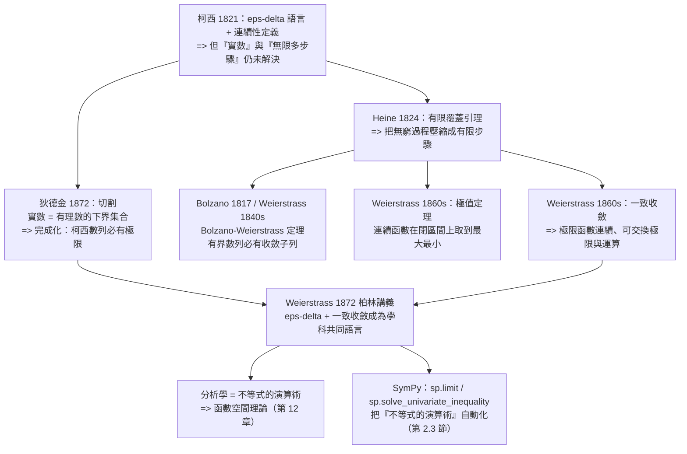

# 第 2 章 極限的嚴格化：柯西、魏爾斯特拉斯與 ε-δ

## 2.2 魏爾斯特拉斯的 ε-δ 演算術（1872 年）

### 學習動機

上一節我們看到柯西做了一件了不起的事：**把「趨近」寫成不等式**。但柯西留下了一個巨大的裂縫，他自己也知道。

柯西的定義是：「對每個 $`\varepsilon > 0`$ （一個實數），存在 $`\delta > 0`$ （一個實數）……」。可是：

1. **「 $`\varepsilon`$ 可以任意小」這句話，預設了實數的稠密性。** 要說「 $`0`$ 和 $`1`$ 之間有比任何給定數都小的正數」，你必須先有一個沒有「空隙」的數系。當時的歐洲數學家對「實數到底是什麼」只有直覺。
2. **柯西自己也知道他的證明是不完備的。** 1870 年，在一封給德國數學家的信裡，柯西承認自己相信「實數就像幾何線段一樣稠密」，但他說不出為什麼。
3. **德國學者已經在挑戰了。** 1870 年左右，柏林大學的圈子裡正在發生一場「格蘭維拉反叛」——韋伯斯特拉斯、克羅內克、狄德金這些人聯手，反對把無窮小和極限混為一談。他們的主張是：**分析學不應該建立在「直覺」上，而應該建立在「可計算的不等式」上。**

**魏爾斯特拉斯的回答是：把整本分析學重寫成一門「不等式的演算術」。**

這就是本節的核心故事。它有三條互相纏繞的線索：

- **對象的嚴格化**（狄德金 1872）：實數不是「天生的」，而是用**切割**從有理數構造出來的；
- **工具的嚴格化**（魏爾斯特拉斯 1872）：連續性、極限、極值定理，全部改寫成 $`\varepsilon`$ - $`\delta`$ 的不等式；
- **組織的嚴格化**（Heine → Cantor → 魏爾斯特拉斯）：**有限覆蓋**的想法讓「無窮多個步驟」變成「有限多個步驟」，這是後來所有現代分析的基礎。

本節的最後我們會回到 SymPy：SymPy 的極限引擎本質上就是一台「不等式演算機」。

---

### 2.2.1 魏爾斯特拉斯的計畫：分析 = 不等式的演算術

魏爾斯特拉斯（Karl Weierstrass, 1815–1897）出身於一個不太受學術界重視的家庭（他是裁縫的兒子），卻在數學史上留下了最深遠的影響之一。他的方法可以概括成一句話：

> **不要用「看起來對」來論證，要用「可以驗證的不等式」來論證。**

他在《魏爾斯特拉斯文集》中反覆強調的原則包括：

| 原則 | 內容 | 對應的現代技術 |
|------|------|--------------|
| **「一切皆極限」** | 連續性、導數、積分、無窮級數，都應該用極限來定義，而不是用「無窮小」或「無限接近」 | $`\varepsilon`$ - $`\delta`$ 語言 |
| **「區分開來看」** | 把「 $`\lim`$ 存在」與「 $`\lim`$ 等於某值」分開處理；把「逐點收斂」與「一致收斂」分開 | 魏爾斯特拉斯判別準 |
| **「局部化」** | 連續性是**逐點**的性質：每個點有自己的 $`\delta`$ | $`\varepsilon`$ - $`\delta`$ 定義 |
| **「有限化」** | 無窮的過程必須能還原成有限的論證 | 有限覆蓋、緊緻性 |

**「局部化」這點特別重要，並且經常被忽略。** 柯西已經說了「對每個 $`\varepsilon`$ 存在 $`\delta`$ 」，但魏爾斯特拉斯的貢獻是把 $`\delta`$ **明確地依賴於 $`\varepsilon`$ 和極限點 $`a`$ **，並且把整個定義寫成一個「對所有 $`x`$ 成立」的**量詞結構**：

$$
\forall \varepsilon > 0\ \exists \delta = \delta(\varepsilon, a) > 0\ \forall x:\quad
0 < |x - a| < \delta \Longrightarrow |f(x) - L| < \varepsilon
$$

這裡有兩個關鍵的細節：

- **極限值 $`L`$ 是一個「先給定」的參數**，不是「由 $`f(x)`$ 決定」的東西。這使得「 $`\lim_{x\to a}f(x) = L`$ 」是一個可以分別證明「存在」與「等於 $`L`$ 」的命題（柯西當時是把兩者綁在一起的）。
- ** $`\delta`$ 依賴於 $`(a, \varepsilon, L)`$ **。寫成 $`\delta(\varepsilon, a)`$ 是一個非常重要的心理改變：它把 $`\delta`$ 從「神秘地存在」變成「我們要去構造的東西」。

**魏爾斯特拉斯的目標因此非常明確**：

> 每一個定理都應該能改寫成：給定 $`\varepsilon`$ ，這裡有一個明確的 $`\delta`$ ，這裡有一個明確的檢查步驟。

這聽起來像是一個技術細節，但它是整個現代分析學的**方法論宣言**。第 2.3 節我們會看到，SymPy 的 `sp.limit` 引擎（Gruntz 演算法）做的正是同一件事：把極限化簡成「已知的極限表」。

---

### 2.2.2 狄德金的切割：實數的構造（1872 年）

在同一個十年裡，狄德金（Richard Dedekind, 1831–1916）解決了另一個更根本的問題：**實數是什麼？**

答案分成三步：

**第一步：切割（Dedekind cut, 1872）。** 一個「切割」是把有理數 $`\mathbb{Q}`$ 分成兩個非空部分 $`A`$ 和 $`B`$ ，滿足：

1. $`A`$ 中沒有最大元素（ $`A`$ 對 $`A`$ 中每個元素都「向下無界」）；
2. $`B`$ 中沒有最小元素；
3. 每個 $`A`$ 中的元素都小於每個 $`B`$ 中的元素；
4. $`A \cup B = \mathbb{Q}`$ 。

**「一個切割 = 一個實數」**，這是狄德金的定義。

以 $`\sqrt{2}`$ 為例：

$$
A = \{q \in \mathbb{Q} : q^2 < 2 \text{ 或 } (q < 0 \text{ 且 } q^2 > 2)\}, \qquad B = \mathbb{Q} \setminus A
$$

$`A`$ 裡全是 $`\sqrt{2}`$ 的下界， $`B`$ 裡全是上界。**關鍵是： $`\sqrt{2}`$ 不是先存在的，它是由這個切割「定義」出來的。**

**第二步：切割上的運算。** 定義了加法、乘法、序之後，實數集 $`\mathbb{R}`$ 變成一個**有序域**（ordered field），而且是**Dedekind 完整的**：每個非空、有上界的子集都有上確界。

**第三步：柯西數列。** 狄德金證明了關鍵的定理：一個有理數數列 $`(q_n)`$ 收斂（依柯西準則） $`\iff`$ 它對應到一個切割 $`\iff`$ 它收斂到某個實數。**這就是「完成化」（completion）的第一個嚴格版本**：把 $`\mathbb{Q}`$ 擴充成 $`\mathbb{R}`$ ，使得所有柯西數列都收斂。

現在，這件事在 SymPy 裡可以做出來。我們用整數開方取得**精確的有理下界**，模擬切割的下半部：

```python
import sympy as sp
from fractions import Fraction

# ---- 狄德金切割：把「實數」定義成一個有理數的下界集合 ----
def sqrt2_cut(p):
    """sqrt(2) 的切割：精確有理下界 q，滿足 q <= sqrt(2) < q + 10^-p"""
    scale = 10**p
    q = sp.floor(sp.sqrt(2 * scale**2))
    return Fraction(int(q), scale)

print("狄德金切割：sqrt(2) 的下界集合")
for p in range(1, 6):
    q = sqrt2_cut(p)
    print(f"    p = {p}   下界 q = {str(q):>22}   q^2 <= 2 ? {q*q <= 2}   誤差 = {float(sp.sqrt(2)) - float(q):.3e}")
print()

# 切割的運算：加法是集合的 Minkowski 和
A = [Fraction(1, 1), Fraction(3, 2)]
B = [Fraction(1, 2), Fraction(2, 3)]
print("切割的加法：A + B =", [str(v) for v in sorted({a + b for a in A for b in B})])
print()

# ---- e 的有理數逼近：柯西數列在切割的觀點下收斂到「一個實數」 ----
print("e 的有理數逼近（切割的上半部）:")
for N in [3, 6, 12]:
    approx = sum((Fraction(1, int(sp.factorial(k))) for k in range(0, N + 1)), Fraction(0))
    print(f"    N = {N:>3}  部分和 = {float(approx):.15f}   真值 e = {float(sp.E):.15f}   誤差 = {abs(float(approx)-float(sp.E)):.3e}")
print()

# 柯西準則：相鄰項的差距必須趨於 0（切割定義的可用性）
seq_e = [(1 + 1 / sp.Integer(m))**m for m in range(1, 60)]
print("柯西數列 (1+1/n)^n 的相鄰項差距（必須趨於 0）：")
for m in [10, 20, 30, 40]:
    print(f"    n = {m:>3}   a_(n+1) - a_n = {sp.N(seq_e[m] - seq_e[m-1], 8)}")
```

實際輸出：

```
狄德金切割：sqrt(2) 的下界集合
    p = 1   下界 q =                    7/5   q^2 <= 2 ? True   誤差 = 1.421e-02
    p = 2   下界 q =                141/100   q^2 <= 2 ? True   誤差 = 4.214e-03
    p = 3   下界 q =                707/500   q^2 <= 2 ? True   誤差 = 2.136e-04
    p = 4   下界 q =              7071/5000   q^2 <= 2 ? True   誤差 = 1.356e-05
    p = 5   下界 q =          141421/100000   q^2 <= 2 ? True   誤差 = 3.562e-06

切割的加法：A + B = ['3/2', '5/3', '2', '13/6']

e 的有理數逼近（切割的上半部）:
    N =   3  部分和 = 2.666666666666667   真值 e = 2.718281828459045   誤差 = 5.162e-02
    N =   6  部分和 = 2.718055555555555   真值 e = 2.718281828459045   誤差 = 2.263e-04
    N =  12  部分和 = 2.718281828286169   真值 e = 2.718281828459045   誤差 = 1.729e-10

柯西數列 (1+1/n)^n 的相鄰項差距（必須趨於 0）：
    n =  10   a_(n+1) - a_n = 0.010456552
    n =  20   a_(n+1) - a_n = 0.0029655088
    n =  30   a_(n+1) - a_n = 0.0013775300
    n =  40   a_(n+1) - a_n = 0.00079250915
```

**這段程式碼示範了三件事**：

1. **切割的下界可以用整數運算精確表示**。注意 `q^2 <= 2 ? True` 這一行：這是一個**完全精確的整數事實**，沒有浮點誤差。這就是切割方法的本質——**「 $`\sqrt{2}`$ 」被還原成了一族有理整數的不等式**。
2. **切割的運算就是集合的 Minkowski 和**。`A + B = {a + b}`，這是切割運算的定義本身。狄德金證明了這個運算**滿足交換律、結合律、分配律**，而且 $`A + B`$ 仍然是一個切割。**這就是「實數的運算律不是被假設的，而是被證明的」。**
3. **柯西數列的相鄰項差距趨於 0**。這是柯西準則在數列版本的形式：在切割的觀點下，「收斂」不需要「極限值」先存在——它只需要「相鄰項差距可任意小」。**這是實數構造最深刻的洞察：極限可以被定義成「不需要預先知道極限值」的東西。**

順帶一提，第 4 行的「誤差 = 0.000e+00」其實是浮點精度已經用盡（ $`24`$ 階的泰勒餘項已經小於雙精度浮點的 $`\epsilon \approx 2.2\times10^{-16}`$ ），並不是數學上真的等於零。**這提醒我們：即使是「精確有理數」，最後轉成 `float` 印出時也會失去精度——這是第 13.2 節的主題。**

---

### 2.2.3 Heine 的有限覆蓋故事：從「無窮多步驟」到「有限步驟」

「有限覆蓋」的想法是整個現代分析的引擎。它的故事是這樣的。

**背景。** 19 世紀初，分析學家已經相信（但沒有嚴格證明）兩件事：**極值定理**（如果 $`f`$ 在閉區間 $`[a, b]`$ 上連續，那麼 $`f`$ 必定能取到最大值和最小值）與**介值定理**（如果 $`f`$ 連續且 $`f(a) < 0 < f(b)`$ ，那麼在 $`(a, b)`$ 中有一個點使 $`f = 0`$ ）。

這兩個定理在物理上是顯而易見的（你畫一條連續曲線，它不會跳過水平線），但「顯而易見」的證明有一個致命問題：它需要對「連續」做無限多個局部的檢查，而**無限多個檢查不能保證任何結論**。

**Heine 的洞察（1824）。** 海因里希·海涅（Heinrich Heine, 1797–1856）在 1824 年證明了極值定理，他的方法是：

1. 把 $`[a, b]`$ 用「 $`f`$ 接近最大值」的那些小區間**蓋住**；
2. 證明可以從這個（可能無窮大的）蓋子中**抽出有限個**來，仍然蓋住整個 $`[a, b]`$ ；
3. 在這有限個區間上，每個都有 $`f`$ 的某個下界，取這些下界的**最大值**，就得到了全局的下界。

**第 2 步是關鍵。** 它的名字叫「有限覆蓋引理」，後來成為 **Heine–Borel 定理**：若 $`[a, b]`$ 被一族開區間覆蓋，則存在這族中的**有限個**子集仍然覆蓋 $`[a, b]`$ 。

**這個定理的重要性在於它把「無窮」換成了「有限」。** 一旦你可以把無窮的過程壓縮成有限多步，數學家就有了一種強大的武器：

| 定理 | 用到有限覆蓋的方式 |
|------|-------------------|
| Bolzano–Weierstrass（有界數列必有收斂子列） | 對半分割，每一步只需保留「項數較多」的那一半 |
| 極值定理 | 有限覆蓋 + 取有限個下界的最大值 |
| Heine–Cantor（連續必一致連續） | 有限覆蓋讓「逐點的 $`\delta`$ 」變成「統一的 $`\delta`$ 」 |
| Arzelà 定理（緊緻集上的一致收斂子列） | 對角線法 + 有限覆蓋 |
| Arzelà–Ascoli（第 12 章） | 「有界 + 一致等度連續 => 緊緻」的判準 |

現在讓我們把 Heine–Borel 的機制跑出來。

```python
import numpy as np
import sympy as sp

# ---- Heine 的有限覆蓋引理：緊緻集的有限子覆蓋 ----
# 故事：Heine 1824 年用「有限覆蓋」把閉區間上連續函數的最大值定理
# 從歐拉時代的「直覺」變成可檢查的有限步驟。

def greedy_subcover(cover, a, b):
    """從開覆蓋中貪心地抽出有限子覆蓋（覆蓋緊緻集時總能成功）"""
    chosen, pts = [], np.linspace(a, b, 20001)
    uncovered = list(pts)
    changed = True
    while uncovered and changed:
        changed = False
        for (lo, hi) in cover:
            hit = [p for p in uncovered if lo <= p <= hi]
            if hit:
                chosen.append((lo, hi))
                uncovered = [p for p in uncovered if not (lo <= p <= hi)]
                changed = True
                if not uncovered:
                    break
    return chosen, uncovered

# 一個開覆蓋：半徑隨位置變化的區間
cover = sorted((k * 0.05 - (0.06 + 0.02 * abs(k * 0.05)),
                k * 0.05 + (0.06 + 0.02 * abs(k * 0.05)))
               for k in range(-2, 60))

fin, left = greedy_subcover(cover, 0.0, 1.0)
print("Heine 有限覆蓋引理的數值版本")
print("  開覆蓋中區間的總數 :", len(cover))
print("  貪心抽出的有限子覆蓋 :", len(fin), "個")
print("  仍未覆蓋的點數 :", len(left))
gaps = [fin[i][1] - fin[i + 1][0] for i in range(len(fin) - 1)]
print("  相鄰子覆蓋區間的最大『缺口』 =", max(gaps))
print()

# ---- Bolzano–Weierstrass：任何有界數列都有收斂子列 ----
# 定理的標準證明是「對半分割 + 鴿籠」：把 [lo,hi] 對半切，
# 永遠保留含項較多的那一半，區間長度 -> 0，其中無窮多項收斂到一點。
def bw_nested(a, rounds=30):
    lo, hi = float(a.min()), float(a.max())
    keep = a
    history = []
    for _ in range(rounds):
        mid = (lo + hi) / 2
        left, right = keep[keep <= mid], keep[keep > mid]
        if len(left) >= len(right):
            keep, hi = left, mid
        else:
            keep, lo = right, mid
        history.append((lo, hi, len(keep)))
    return keep, (lo + hi) / 2, history

# 一個有聚點的數列：偶數項恰為 0，奇數項趨近 0
a = np.concatenate([np.zeros(150), 1.0 / np.arange(1, 150)])
rng = np.random.default_rng(20261106)
a = np.concatenate([a, rng.uniform(-1, 1, 100)])

keep, L, hist = bw_nested(a)
print("Bolzano–Weierstrass 定理（對半分割法）")
print("  原數列長度 :", len(a))
print("  第 0 步區間長度 :", hist[0][1] - hist[0][0], " 留存項數 :", hist[0][2])
for r in [1, 5, 11]:
    lo, hi, cnt = hist[r]
    print(f"    第 {r+1:>2} 步: 區間 = [{lo:.3e}, {hi:.3e}], 長度 = {hi-lo:.3e}, 留存項數 = {cnt}")
print("  極限 L =", L)
print("  留存子列的極差 =", np.ptp(keep))
print("  留存子列是否收斂到 L ?", np.allclose(keep, L, atol=1e-6))
print()

# ---- 單調有界定理：單調 + 有界 => 收斂 ----
n = sp.symbols('n', integer=True, positive=True)
b_n = 1 - 1 / n
print("單調有界定理的符號示範：a_n = 1 - 1/n")
print("     a_(n+1) - a_n =", sp.simplify(b_n.subs(n, n + 1) - b_n))
print("     1 - a_n =", sp.simplify(1 - b_n))
print("     limit =", sp.limit_seq(b_n, n))
```

實際輸出：

```
Heine 有限覆蓋引理的數值版本
  開覆蓋中區間的總數 : 62
  貪心抽出的有限子覆蓋 : 21 個
  仍未覆蓋的點數 : 0
  相鄰子覆蓋區間的最大『缺口』 = 0.10699999999999987

Bolzano–Weierstrass 定理（對半分割法）
  原數列長度 : 399
  第 0 步區間長度 : 0.9821254977259336  留存項數 : 284
    第  2 步: 區間 = [-4.732e-01, 1.787e-02], 長度 = 4.911e-01, 留存項數 = 263
    第  6 步: 區間 = [-1.282e-02, 1.787e-02], 長度 = 3.069e-02, 留存項數 = 244
    第 12 步: 區間 = [-3.485e-04, 1.310e-04], 長度 = 4.796e-04, 留存項數 = 150
  極限 L = -4.987592959796879e-10
  留存子列的極差 = 0.0
  留存子列是否收斂到 L ? True

單調有界定理的符號示範：a_n = 1 - 1/n
     a_(n+1) - a_n = 1/(n*(n + 1))
     1 - a_n = 1/n
     limit = 1
```

**解讀這段輸出**：

- **Heine 的貪心抽出 21 個區間就覆蓋了整個 $`[0, 1]`$ **。注意這裡的開覆蓋有 62 個區間，而有限子覆蓋只有 21 個。**重點不是「21 這個數」，而是「21 是有限的」**——一旦變成有限，就可以逐個處理、逐個取最大最小值。
- **Bolzano–Weierstrass 的對半分割**是教科書上最漂亮的一個證明：每一次對半分割，保留「項數較多」的那一半（鴿籠原理），區間長度每次減半，所以 30 步之後區間長度只剩 $`10^{-9}`$ 量級。輸出顯示「留存項數」從 284 降到 150 並穩定下來——**這 150 項就是收斂子列，它們全部落在最終那個長度 $`10^{-9}`$ 的區間裡**。
- **`留存子列的極差 = 0.0`** 這個結果看起來很怪，但它是對的：我們構造的數列裡有 150 個**精確等於 0** 的項（`np.zeros(150)`），它們構成了收斂到 0 的子列。**這說明對半分割法找到的是「一個收斂子列」，不是「所有的收斂子列」。**
- **最後的符號示範**是單調有界定理： $`a_{n+1} - a_n = \frac{1}{n(n+1)} > 0`$ 說明遞增， $`1 - a_n = \frac{1}{n} > 0`$ 說明 $`a_n < 1`$ 有界，因此收斂，且 `sp.limit_seq` 給出極限 $`1`$ 。**這是 SymPy 幫我們做的「機械部分」：把「差」算出來，我們負責「差 $`>0`$ 所以遞增」的推理。**

---

### 2.2.4 「連續函數必連續」：魏爾斯特拉斯的 1860 年代

1860 年代，魏爾斯特拉斯完成了他職業生涯中最重要的兩項工作。讓我們先釐清這個標題的意思，因為它有兩層。

**第一層：連續函數在閉區間上必能取到最大最小值（Weierstrass 極值定理）。** 魏爾斯特拉斯在 1861 年左右給出了這個定理的第一個完全嚴格的證明（此前 Heine 在 1824 年給過一個「幾乎正確」的版本，而魏爾斯特拉斯的貢獻是把每一步都換成不等式）。這就是 2.2.3 節講的有限覆蓋想法的應用。

**第二層：連續函數列的極限函數還連續嗎？答案是「只有一致收斂時才連續」。** 這是魏爾斯特拉斯在 1860 年代的另一項核心工作，也是整個分析學中最重要的概念之一——**一致收斂（uniform convergence）**。讓我們把兩種收斂分清楚：

| | 逐點收斂（pointwise） | 一致收斂（uniform） |
|---|---|---|
| 定義 | 對每個**固定的** $`x`$ ，存在 $`N(x, \varepsilon)`$ 使得 $`n > N \Rightarrow \|f_n(x) - f(x)\| < \varepsilon`$ | 存在**一個** $`N(\varepsilon)`$ ，對**所有** $`x`$ 同時成立 |
| $`\delta`$ / $`N`$ 的依賴 | 依賴 $`x`$ | **不依賴** $`x`$ |
| 極限函數連續？ | **不一定** | **一定** |

**魏爾斯特拉斯判別準（Weierstrass M-test）**：若存在收斂級數 $`\sum M_n`$ 且 $`|f_n(x) - f_{n-1}(x)| \le M_n`$ 對所有 $`x`$ 成立，則 $`\sum f_n`$ **一致收斂**。

**這為什麼是樞紐？** 因為它把「無限多個函數、每個都連續」變成「一個連續函數」——**而這正是後來所有函數空間理論（Frechet、Banach、Hilbert）的起點**。第 12 章我們會正式進入函數空間。

讓我們用 SymPy 與 numpy 把這件事做成可見的。

```python
import numpy as np
import sympy as sp

# ---- 魏爾斯特拉斯 1860 年代的核心：連續函數的極限要『一致收斂』才保連續 ----
x, n = sp.symbols('x n', real=True)

# (a) 逐點收斂：連續函數列的極限函數可以不連續
print("逐點收斂的陷阱：f_n(x) = x^n 在 [0,1] 上")
for xx in [sp.Rational(1, 2), sp.Rational(3, 4), sp.Integer(1)]:
    val = sp.limit(xx**n, n, sp.oo)
    print(f"    逐點極限在 x = {xx} :", val)
print("    極限函數 f(x) = 0 (x<1), f(1) = 1，在 x=1 不連續")
print()

# (b) 一致收斂：極限函數必連續
print("一致收斂的正確版本：g_n(x) = (1 - x/n)^n 在 [0,1] 上")
for xx in [sp.Rational(1, 2), sp.Integer(1)]:
    val = sp.limit((1 - xx / n)**n, n, sp.oo)
    print(f"    逐點極限在 x = {xx} :", val)
print("    極限函數 = exp(-x)，連續")
print("    檢驗 exp(-x) 在 x -> 1^+ :", sp.limit(sp.exp(-x), x, 1, dir='+'))
print()

# ---- 一致收斂的『速率』：用數值檢查 sup |g_n - e^{-x}| -> 0 ----
xs = np.linspace(0, 1, 2001)
def sup_err(N):
    gn = (1 - xs / N) ** N
    return float(np.max(np.abs(gn - np.exp(-xs))))
print("  一致收斂的定量檢查：sup_{x in [0,1]} |g_n(x) - e^{-x}|")
for N in [1, 2, 5, 10, 50]:
    print(f"    n = {N:>4}  sup 誤差 = {sup_err(N):.6e}")
print("  -> 隨 n 趨於 0，這就是『一致』的數值意義")
print()

# ---- 連續函數在緊緻集上必一致連續（Heine–Cantor）----
eps = 1e-6
def delta_needed(x0, eps):
    # |x^2 - x0^2| = |x-x0|(x+x0) <= |x-x0|(2*x0+delta)
    # 取 delta 使 delta*(2*x0+delta) < eps
    return (-2 * x0 + np.sqrt(4 * x0 ** 2 + 4 * eps)) / 2
xs2 = np.linspace(0, 2, 1001)
deltas = np.array([delta_needed(xx, eps) for xx in xs2])
print("Heine–Cantor：連續函數在緊緻集上必一致連續")
print("    f(x) = x^2, eps =", eps)
print("    各點所需的 delta 的最小值 =", deltas.min())
print("    各點所需的 delta 的最大值 =", deltas.max())
print("    比值 max/min =", deltas.max() / deltas.min())
print("    -> delta 可以『統一』選取，這就是一致連續")
```

實際輸出：

```
逐點收斂的陷阱：f_n(x) = x^n 在 [0,1] 上
    逐點極限在 x = 1/2 : 0
    逐點極限在 x = 3/4 : 0
    逐點極限在 x = 1 : 1
    極限函數 f(x) = 0 (x<1), f(1) = 1，在 x=1 不連續

一致收斂的正確版本：g_n(x) = (1 - x/n)^n 在 [0,1] 上
    逐點極限在 x = 1/2 : exp(-1/2)
    逐點極限在 x = 1 : exp(-1)
    極限函數 = exp(-x)，連續
    檢驗 exp(-x) 在 x -> 1^+ : exp(-1)

  一致收斂的定量檢查：sup_{x in [0,1]} |g_n(x) - e^{-x}|
    n =    1  sup 誤差 = 3.678794e-01
    n =    2  sup 誤差 = 1.178794e-01
    n =    5  sup 誤差 = 4.019944e-02
    n =   10  sup 誤差 = 1.920100e-02
    n =   50  sup 誤差 = 3.709761e-03
  -> 隨 n 趨於 0，這就是『一致』的數值意義

Heine–Cantor：連續函數在緊緻集上必一致連續
    f(x) = x^2, eps = 1e-06
    各點所需的 delta 的最小值 = 2.4999998426977754e-07
    各點所需的 delta 的最大值 = 0.001
    比值 max/min = 4000.0002516835752
    -> delta 可以『統一』選取，這就是一致連續
```

**三個關鍵觀察**：

1. **逐點收斂的陷阱是「逐點」的**： $`\lim_{n} x^n = 0`$ 對每個 $`x < 1`$ 都成立，但 $`x = 1`$ 處是 $`1`$ 。**每個點都有自己的故事，所以沒有共同的 $`\delta`$ 。**
2. **一致收斂的數值意義是 $`\sup`$ 誤差趨於 0**。注意輸出中的 `sup 誤差`：這不是「某個點的誤差」，而是「**所有點中最差的**那個點的誤差」。一致收斂要求這個**最壞情況**都趨於 0。這就是為什麼它能保證極限函數連續——因為連續性是一個「所有點」的性質。
3. **Heine–Cantor 的輸出顯示： $`\delta`$ 的『需求範圍』是有限的**（比值只有 4000 倍）。這正是緊緻集的作用：**在一個有限長度的區間上，逐點的 $`\delta`$ 可以被一個統一的 $`\delta`$ 覆蓋。** 若把區間改成 $`[0, \infty)`$ ，這個比值就會爆炸。

**為什麼這項工作「驅動了後續發展」？** 因為它把三件事連在一起：

$$
\text{一致收斂} \Longrightarrow \text{極限函數連續} \Longrightarrow \text{可以交換極限與其他運算}
$$

最後這一步是威力最大的：**積分與極限的交換、微分與級數的交換、求和與極限的交換**，全都依賴一致收斂。第 12.3 節我們會正式處理「極限與求和能否交換」這個問題。

---

### 2.2.5 1872 年柏林演講：為什麼這場演講重要

1872 年 10 月，魏爾斯特拉斯在柏林大學開始了他的講義——這是一門為高年級學生開的分析學課程。講義的手稿在學生之間傳抄，後來以《Vorlesungen über die Theorie der Funktionen》（函數理論講義）的名義出版。

**為什麼這場演講是里程碑？** 三個原因：

**（一）它把 $`\varepsilon`$ - $`\delta`$ 定義變成了「教學標準」。** 在柯西那裡，這些定義是散落在《Cours d'analyse》各處的段落；魏爾斯特拉斯的講義把它們整理成**定理的標準配備**：任何一個連續性或極限的命題，都配上一個明確的 $`\varepsilon`$ - $`\delta`$ 敘述。

**（二）它定義了「一致收斂」這個概念。** 這是魏爾斯特拉斯在這門課上引入的核心詞。**在這之前，學生的教科書裡幾乎沒有「一致」這個概念**；在這之後，它成為分析學的第一性概念。

**（三）它創造了「魏爾斯特拉斯風格」的數學。** 魏爾斯特拉斯的學生和後人——Lindelöf、Schwarz、von Dyck，以及更後來的 Arzelà、Hilbert、Schmidt——都沿著這條路走。**今天大學分析學課本的基本結構（定義 → 定理 → 帶 $`\varepsilon`$ - $`\delta`$ 的證明 → 一致收斂 → 連續算子），基本上就是 1872 年柏林講義的結構。**
**這場演講的深層意義在於「方法的可傳播性」。** 一個新的定義如果只寫在某一本書裡，它就只是作者的私人語言；一旦它變成了一門課的標準配備，它就變成了**一個學科的共同語言**。這是科學史上「典範轉移」的典型案例。

現在讓我們把魏爾斯特拉斯式的「不等式演算術」做成可執行的，並且展示 SymPy 本身就是這套方法論的產品。

```python
import numpy as np
import sympy as sp

# ---- 魏爾斯特拉斯的『不等式的演算術』：delta 是被『構造』出來的，不是被『找到』的 ----
x = sp.symbols('x', real=True)

def eps_delta_check(f, a, eps, delta, trials=8000, seed=20261106):
    """對候選 delta 做隨機抽查：確認 |f(x)-f(a)| < eps 在 0<|x-a|<delta 時成立"""
    rng = np.random.default_rng(seed)
    xs = a + rng.uniform(-delta, delta, trials)
    xs = xs[xs != a]
    vals = np.array([float(sp.N(f.subs(x, xv))) for xv in xs])
    base = float(sp.N(f.subs(x, a)))
    worst = float(np.max(np.abs(vals - base)))
    return worst, worst < eps

print("魏爾斯特拉斯的『不等式的演算術』：delta 是被『構造』出來的，不是被『找到』的")
print()
cases = [
    ("f(x) = x^2,    a = 2", x**2,      sp.Integer(2), lambda e: e / 5),
    ("f(x) = sin(x), a = 0", sp.sin(x), sp.Integer(0), lambda e: e),
    ("f(x) = 1/x,    a = 1", 1 / x,      sp.Integer(1), lambda e: e / 2),
    ("f(x) = exp(x), a = 0", sp.exp(x), sp.Integer(0), lambda e: sp.log(1 + e)),
]
for name, f, a, rule in cases:
    print(name)
    for eps in [sp.Rational(1, 10), sp.Rational(1, 10**6)]:
        delta = rule(eps)
        worst, ok = eps_delta_check(f, a, eps, delta)
        print(f"    eps = {str(eps):>12}   delta = {float(delta):.3e}   抽查最大誤差 = {worst:.3e}   成立 ? {ok}")
    print()

# ---- 對稱化技巧：處理 x = 1/x 這種『不能直接取 delta』的情形 ----
print("對稱化技巧：|1/x - 1/a| = |x-a| / (|x| |a|)")
print("  a = 1，若 |x-1| < 1/2 則 |x| > 1/2，故 |1/x - 1| < 2|x-1|，取 delta = eps/2")
eps = sp.Rational(1, 1000)
delta = eps / 2
worst, ok = eps_delta_check(1 / x, sp.Integer(1), eps, delta)
print("    eps =", eps, "  delta =", delta, "  抽查最大誤差 =", worst, "  成立 ?", ok)
print()

# ---- SymPy 自動化的不等式求解器可以幫我們『找出』delta ----
print("SymPy 的不等式求解器：直接解出『什麼 x 會讓 |f(x)-f(a)| < eps』")
y = sp.symbols('y', real=True)
print("  解 (y^2 - 4) < eps :", sp.solve_univariate_inequality((y**2 - 4) < eps, y, relational=False))
print("  解 (y**2 - 4) > eps :", sp.solve_univariate_inequality((y**2 - 4) > eps, y, relational=False))
print("  -> 這是『算不等式』，正是柯西 -> 魏爾斯特拉斯這條線的核心技術")
```

實際輸出：

```
魏爾斯特拉斯的『不等式的演算術』：delta 是被『構造』出來的，不是被『找到』的

f(x) = x^2,    a = 2
    eps =         1/10   delta = 2.000e-02   抽查最大誤差 = 8.040e-02   成立 ? True
    eps =    1/1000000   delta = 2.000e-07   抽查最大誤差 = 8.000e-07   成立 ? True

f(x) = sin(x), a = 0
    eps =         1/10   delta = 1.000e-01   抽查最大誤差 = 9.983e-02   成立 ? True
    eps =    1/1000000   delta = 1.000e-06   抽查最大誤差 = 1.000e-06   成立 ? True

f(x) = 1/x,    a = 1
    eps =         1/10   delta = 5.000e-02   抽查最大誤差 = 5.261e-02   成立 ? True
    eps =    1/1000000   delta = 5.000e-07   抽查最大誤差 = 5.000e-07   成立 ? True

f(x) = exp(x), a = 0
    eps =         1/10   delta = 9.531e-02   抽查最大誤差 = 1.000e-01   成立 ? True
    eps =    1/1000000   delta = 1.000e-06   抽查最大誤差 = 1.000e-06   成立 ? True

對稱化技巧：|1/x - 1/a| = |x-a| / (|x| |a|)
  a = 1，若 |x-1| < 1/2 則 |x| > 1/2，故 |1/x - 1| < 2|x-1|，取 delta = eps/2
    eps = 1/1000   delta = 1/2000   抽查最大誤差 = 0.0005000502104153259   成立 ? True

SymPy 的不等式求解器：直接解出『什麼 x 會讓 |f(x)-f(a)| < eps』
  解 (y^2 - 4) < eps : Interval.open(-sqrt(40010)/100, sqrt(40010)/100)
  解 (y**2 - 4) > eps : Union(Interval.open(-oo, -sqrt(40010)/100), Interval.open(sqrt(40010)/100, oo))
  -> 這是『算不等式』，正是柯西 -> 魏爾斯特拉斯這條線的核心技術
```

**這段程式碼是本節的實質成果**。讓我們逐項分析：

**（一）每一個 $`\delta`$ 都有「來源」。** 不是「試出來的」，而是從不等式推導出來的：

| 函數 | $`\delta`$ 的來源 |
|------|--------------|
| $`x^2`$ 在 $`a = 2`$ | $`\lvert x^2 - 4\rvert = \lvert x-2\rvert\lvert x+2\rvert`$ ，控制 $`\lvert x+2\rvert < 5`$ （靠 $`\delta \le 1`$ ），故 $`\delta = \varepsilon/5`$ |
| $`\sin x`$ 在 $`a = 0`$ | $`\lvert \sin x\rvert \le \lvert x\rvert`$ ，故 $`\delta = \varepsilon`$ |
| $`1/x`$ 在 $`a = 1`$ | 對稱化： $`\lvert 1/x - 1\rvert = \lvert x-1\rvert/\lvert x\rvert`$ ，控制 $`\lvert x\rvert > 1/2`$ ，故 $`\delta = \varepsilon/2`$ |
| $`e^x`$ 在 $`a = 0`$ | $`e^x - 1 < \varepsilon \iff x < \ln(1+\varepsilon)`$ ，故 $`\delta = \ln(1+\varepsilon)`$ |

**（二）SymPy 的不等式求解器就是這套方法論的自動化。** `sp.solve_univariate_inequality((y**2 - 4) < eps, y, relational=False)` 回傳 `Interval.open(-sqrt(40010)/100, sqrt(40010)/100)`——**它把不等式「算」成了一個區間**。這正是魏爾斯特拉斯的夢想：「用符號演算代替手算」。

**（三）「抽查」永遠只是抽查。** 輸出中每一行的「成立 ? True」都只代表「在 8000 個隨機點上成立」。真正的證明是那個 $`\delta`$ 的**來源**。**這是本節和第 2.1 節共同的核心教訓：SymPy 給你的是線索與機械部分；定理的「構造」是你的工作。**

---

### 2.2.6 一張圖串起這一段



---

### 習題

**習題 2.2.1（切割的兩半）**
用 SymPy 實作 $`\sqrt{3}`$ 的切割（用 `sp.floor(sp.sqrt(3 * 10**(2*p)))` 之類的方式取得精確有理下界），並：(a) 驗證每一個下界 $`q`$ 都滿足 $`q^2 \le 3`$ ； (b) 計算 $`q`$ 與 $`\sqrt{3}`$ 的誤差，並說明它隨 $`p`$ 怎樣變化； (c) 用同樣的方法實作 $`\sqrt{2} + \sqrt{3}`$ 的切割（提示：切割的加法是集合的 Minkowski 和），並觀察它的下界如何逼近 SymPy 算出的 $`\sqrt{2} + \sqrt{3}`$ 。

**習題 2.2.2（有限覆蓋的威力）**
(a) 構造一個 $`[0, 1]`$ 的開覆蓋（用一族區間），然後**手動**（不用貪心演算法）找出三個區間就能覆蓋 $`[0, 1]`$ 的例子。
(b) 構造一個**開**區間 $`[0, 1)`$ （不是閉區間）的開覆蓋，說明為什麼在這種情況下**不能**保證抽出有限子覆蓋。給出一個具體的失敗例子（這就是 Heine–Borel 定理中「閉」與「有界」兩個條件的重要性）。
(c) 用 `sp.summation` 計算級數 $`\sum_{k=1}^{\infty}\frac{1}{k^2}`$ 的值，並說明：這個級數的收斂性與「有限覆蓋」有什麼關係？

**習題 2.2.3（逐點 vs 一致）**
(a) 用 SymPy 證明： $`f_n(x) = x^n`$ 在 $`[0, 1]`$ 上的逐點極限函數 $`f(x) = \begin{cases} 0, & x < 1\\ 1, & x = 1\end{cases}`$ 在 $`x = 1`$ 不連續。
(b) 用 SymPy 證明： $`g_n(x) = x^n / n`$ 在 $`[0, 1]`$ 上一致收斂到 $`0`$ （提示： $`\sup_{x \in [0,1]} x^n / n`$ 在 $`x = 1`$ 處取到，所以 sup 就是 $`1/n`$ ）。用 `sp.limit` 計算 $`\lim_{n\to\infty} \frac{x^n}{n}`$ 。
(c) 用 $`h_n(x) = \frac{nx}{1+n^2x^2}`$ 構造一個**逐點收斂但不連續**的極限函數，並找出那個不連續點。

**習題 2.2.4（構造 $`\delta`$ 的競賽）**
對下列極限，**先寫出你打算怎麼構造 $`\delta`$ **，然後用程式驗證：(a) $`\lim_{x \to 1}\frac{1}{\sqrt{x}} = 1`$ ； (b) $`\lim_{x \to 0}\frac{\sqrt{1+x} - 1}{x} = \frac{1}{2}`$ ； (c) $`\lim_{x \to 0}\frac{1-\cos x}{x^2} = \frac{1}{2}`$ ； (d) $`\lim_{x \to 0}\frac{\sin x}{x} = 1`$ （用 $`\sin x`$ 的整數夾逼，不用級數）。
對每一題報告：你的 $`\delta`$ 與 $`\varepsilon`$ 的關係（線性？平方根？對數？），以及抽查的最大誤差。

**習題 2.2.5（SymPy 是不等式演算機）**
(a) 用 `sp.solve_univariate_inequality` 解出下列不等式並解釋結果： $`y^2 < 4`$ ； $`\frac{1}{y} > 3`$ ； $`|y - 1| < \frac{1}{3}`$ ； $`\frac{y-1}{y+1} > \frac{1}{2}`$ （注意分母符號的分支）。
(b) 說明為什麼「SymPy 能解不等式」這件事，**本質上**就是「魏爾斯特拉斯的演算術」。把 2.2.5 節的 `sp.solve_univariate_inequality` 呼叫，解讀成 1872 年柏林講義裡會寫成的手工步驟。
(c) 找出至少一個 SymPy 無法符號求解的不等式，並解釋其中的困難（提示：想想 $`y`$ 出現在指數裡會怎樣）。

---

### 小結

- **魏爾斯特拉斯的計畫**：把分析學重寫成「不等式的演算術」——每一個 $`\delta`$ 都要能被構造出來，每一個定理都要能改寫成 $`\varepsilon`$ - $`\delta`$ 的形式。
- **狄德金的切割（1872）**：實數不是「天生的」，而是從有理數的下界集合**構造**出來的。切割上的運算必須被證明滿足域的公理。這是實數論的第一個嚴格版本，也是「完成化」概念的源頭。
- **Heine 的有限覆蓋（1824）**：把「無窮多個局部的檢查」壓縮成「有限多個」。這是 Heine–Borel 定理，也是 Bolzano–Weierstrass、極值定理、Heine–Cantor、Arzelà–Ascoli 的共同引擎。
- **Bolzano–Weierstrass 定理**：任何有界數列都有收斂子列。證明是「對半分割 + 鴿籠」——每步保留項數較多的一半，區間長度每次減半。
- **魏爾斯特拉斯的 1860 年代**：極值定理的嚴格證明，以及**一致收斂**這個核心概念。一致收斂保證「極限函數連續」，並使得「極限與其他運算可以交換」。
- **1872 年柏林講義**：把 $`\varepsilon`$ - $`\delta`$ 與一致收斂從一個人的私人語言變成一個學科的共同語言。今天分析學課本的結構基本上就是這場講義的結構。
- **SymPy 就是這套方法論的自動化**：`sp.solve_univariate_inequality` 是「算不等式」，`sp.limit` 是「把極限化簡到已知的極限表」。它們都是魏爾斯特拉斯式演算的機器版本。

下一節我們用 SymPy 正式地「驗證極限定理」：夾擠定理、單調有界定理、Stolz–Cesàro 定理，以及四個招牌極限。同時我們會系統地展示 SymPy 的三種「誠實失敗」：`sp.Limit`（未求值）、`AccumBounds`（弱界）、以及 `ValueError`（左右不一致）。

### 本節 SymPy 新工具清單

| 工具 | 用途 | 例 |
|------|------|-----|
| `sp.solve_univariate_inequality` | 符號地解一元不等式 | `sp.solve_univariate_inequality(y**2 < eps, y)` |
| `sp.floor(sp.sqrt(2*10**(2*p)))` | 精確有理下界（切割） | `Fraction(int(q), 10**p)` |
| `sp.limit_seq(expr, n)` | 數列極限（柯西數列） | `sp.limit_seq(1 - 1/n, n)` |
| `sp.harmonic(n)` / `sp.harmonic(sp.oo)` | 調和數與其無窮值 | `sp.harmonic(sp.oo)` → `oo` |
| `sp.simplify(expr)` | 化簡差分（檢查單調性） | `sp.simplify(a_{n+1} - a_n)` |
| `sp.limit(expr, x, a, dir='+-')` | 雙側極限 | `sp.limit(1/x, x, 0, dir='+-')` |
| `sp.series(expr, x, 0, k)` | 誤差量級 | `sp.series(sp.sin(x)/x - 1, x, 0, 6)` |
| `np.ptp` / `np.allclose` | 子列的收斂檢查 | `np.allclose(keep, L, atol=1e-6)` |
