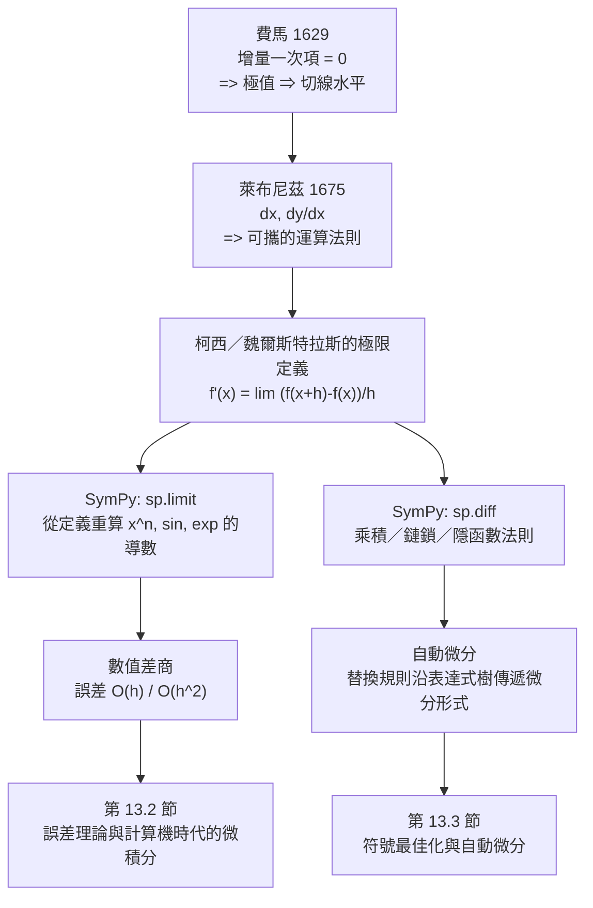

# 3.3 用 SymPy 微分：從導數定義到差分近似

## 學習動機

前兩節是歷史：費馬給出「極值 $`\Rightarrow`$ 切線水平」，萊布尼茲給出「 $`\frac{\mathrm{d}y}{\mathrm{d}x}`$ 」這個可攜的記號。但歷史不會自己變成定理。本節要做的，是**把整條鏈路在電腦上重新走一遍**：

1. 從導數的**定義** $`f'(x) = \lim_{h \to 0} \frac{f(x+h) - f(x)}{h}`$ 出發，用 `sp.limit` 算出 $`\frac{\mathrm{d}}{\mathrm{d}x}x^n`$ 、 $`\frac{\mathrm{d}}{\mathrm{d}x}\sin x`$ 、 $`\frac{\mathrm{d}}{\mathrm{d}x}e^x`$ ；
2. 用 `sp.diff` 驗證乘積法則、鏈鎖法則、隱函數微分；
3. 用**數值差商**逼近 $`f'(x)`$ ，並量化誤差量級（ $`O(h)`$ 與 $`O(h^2)`$ ）；
4. 揭開 `sp.diff` 的黑箱：它的核心是「**替換規則 + 自動微分**」，這正是第 13 章的主題。

為什麼值得做這麼多？因為**導數的定義是「極限」，而極限是歷史上最難嚴格化的概念之一**。第 2 章我們用 ε-δ 語言把它說清楚了；這一次，我們讓機器去執行「趨近」這個動作，看看符號運算與數值逼近之間的縫隙有多大——那個縫隙就是 $`O(h)`$ 。

---

## 3.3.1 從定義出發：SymPy 的差商極限

導數的定義是

$$
f'(x) = \lim_{h \to 0} \frac{f(x+h) - f(x)}{h}
$$

SymPy 的 `sp.limit(expr, h, 0)` 正是這個操作的直接對應：給定一個關於 $`h`$ 的表達式，求它趨近 $`h = 0`$ 時的極限。我們先寫一個通用的「由定義求導」函式，然後拿它去處理冪函數、三角函數、指數函數。

```python
import sympy as sp

x, h = sp.symbols('x h', real=True)

def deriv_by_definition(f, var, eps=0):
    """用極限定義求導數：lim_{h->0} (f(x+h) - f(x)) / h"""
    q = (f.subs(var, var + h) - f) / h
    return sp.simplify(sp.limit(q, h, eps))

# x^n
for n in [1, 2, 3, 5]:
    f = x**n
    print(f"f(x) = x^{n}:  定義法 -> {deriv_by_definition(f, x)}")

# sin
print()
print("f(x) = sin(x):  定義法 ->", deriv_by_definition(sp.sin(x), x))
print("f(x) = cos(x):  定義法 ->", deriv_by_definition(sp.cos(x), x))

# exp
print("f(x) = exp(x):  定義法 ->", deriv_by_definition(sp.exp(x), x))
print("f(x) = log(x):  定義法 ->", deriv_by_definition(sp.log(x), x))
```

預期輸出：

```text
f(x) = x^1:  定義法 -> 1
f(x) = x^2:  定義法 -> 2*x
f(x) = x^3:  定義法 -> 3*x**2
f(x) = x^5:  定義法 -> 5*x**4

f(x) = sin(x):  定義法 -> cos(x)
f(x) = cos(x):  定義法 -> -sin(x)
f(x) = exp(x):  定義法 -> exp(x)
f(x) = log(x):  定義法 -> 1/x
```

**這裡的每一步都對應數學史上的一個真實推理**：

- $`\frac{\mathrm{d}}{\mathrm{d}x}x^n = n x^{n-1}`$ ：費馬「尋常法」（3.1 節）的完整版，萊布尼茲把它推廣到任意 $`n`$ ；
- $`\frac{\mathrm{d}}{\mathrm{d}x}\sin x = \cos x`$ ：歐拉 1730 年代用 $`\frac{\sin(x+h)-\sin x}{h} = 2\sin\frac{h}{2}\cdot\frac{\cos\frac{2x+h}{2}}{h}`$ 得到；
- $`\frac{\mathrm{d}}{\mathrm{d}x}e^x = e^x`$ ：萊布尼茲把 $`e^x`$ 定義為 $`\lim_{n \to \infty}(1 + x/n)^n`$ 後的結果——注意，這個等式**定義了** $`e^x`$ ，所以它不是「算出來的」，而是「定義出來的」；
- $`\frac{\mathrm{d}}{\mathrm{d}x}\log x = \frac{1}{x}`$ ：由 $`\log x = \int_1^x \frac{\mathrm{d}t}{t}`$ 得到（第 4 章）。

### 符號化的一般冪函數

我們可以把 $`n`$ 當成符號參數，一次處理所有冪函數。注意這一步需要 SymPy 對 $`(x+h)^n`$ 做二項式展開：

```python
import sympy as sp

x, h, n = sp.symbols('x h n', positive=True)

# 符號化的 x^n：n 為任意正整數
q = ((x + h)**n - x**n) / h
d = sp.limit(q, h, 0)
print("lim ((x+h)^n - x^n)/h =", d)
print("是否等於 n*x^(n-1)？", sp.simplify(d - n*x**(n - 1)) == 0)

# 對 x^n 這個函數，用 SymPy 自動展開再取極限
poly = sp.expand((x + h)**n)
print()
print("展開式（依 h 的次數）：", sp.collect(poly, h))
```

預期輸出：

```text
lim ((x+h)^n - x^n)/h = n*x**(n - 1)
是否等於 n*x^(n-1)？ True

展開式（依 h 的次數）： (h + x)**n
```

這個結果正是費馬用二項式定理手算的東西：

$$
(x+h)^n - x^n = n x^{n-1} h + \binom{n}{2}x^{n-2}h^2 + \cdots
$$

除以 $`h`$ ，令 $`h \to 0`$ ，只剩下第一項。**「導數 = 差商的極限」在這裡就是「二項式展開的一次項」**——費馬的直覺被完全證明了。

---

## 3.3.2 `sp.diff` 與三條法則的機械驗證

有了 `sp.diff`，我們可以立刻驗證微積分裡最重要的三條運算法則。關鍵是要用**抽象函數**來做，這樣才能證明它們是「導數運算本身的性質」，而不是某個具體函數的巧合（3.2.2 節的「可攜性」）。

```python
import sympy as sp

x = sp.Symbol('x', real=True)
Y = sp.Symbol('Y', real=True)        # 把 y 當成獨立的座標變數
u = sp.Function('u')(x)
v = sp.Function('v')(x)

# --- 乘積法則 ---
print("乘積法則： (uv)' = u'v + uv'")
lhs = sp.diff(u*v, x)
rhs = sp.diff(u, x)*v + u*sp.diff(v, x)
print("  LHS =", lhs)
print("  RHS =", rhs)
print("  相等？", sp.simplify(lhs - rhs) == 0)

# --- 鏈鎖法則 ---
print()
print("鏈鎖法則： (F(g(x)))' = F'(g(x)) g'(x)")
g = sp.Function('g')(x)
lhs2 = sp.diff(sp.sin(g), x)
rhs2 = sp.cos(g)*sp.diff(g, x)
print("  LHS =", lhs2)
print("  RHS =", rhs2)
print("  相等？", sp.simplify(lhs2 - rhs2) == 0)

# --- 隱函數微分：x^2 + y^2 = 1 ---
print()
print("隱函數微分： F(x, y) = x^2 + y^2 - 1 = 0")
F = x**2 + Y**2 - 1
Fx = sp.diff(F, x)
Fy = sp.diff(F, Y)
print("  F_x =", Fx, "   F_y =", Fy)

yp = sp.simplify(-Fx / Fy)
print("  dy/dx = -F_x/F_y =", yp)

# 與「解出 y 再微分」比對
y_explicit = sp.sqrt(1 - x**2)
print("  解出 y = sqrt(1-x^2) 再微分 =", sp.diff(y_explicit, x))
print("  代入 y 後相同？", sp.simplify(yp.subs(Y, y_explicit) - sp.diff(y_explicit, x)) == 0)

# 用 SymPy 的 Function 寫法：令 y = Function('y')(x)，但微分時把 y 當常數
print()
print("另一種寫法：用未求值的 Derivative 表達隱函數")
yy = sp.Function('yy')(x)
expr = sp.Eq(x**2 + yy**2, 1)
print("  隱函數式 :", expr)
print("  解出 y  :", sp.solve(sp.Eq(x**2 + yy**2, 1), yy))
```

預期輸出：

```text
乘積法則： (uv)' = u'v + uv'
  LHS = u(x)*Derivative(v(x), x) + v(x)*Derivative(u(x), x)
  RHS = u(x)*Derivative(v(x), x) + v(x)*Derivative(u(x), x)
  相等？ True

鏈鎖法則： (F(g(x)))' = F'(g(x)) g'(x)
  LHS = cos(g(x))*Derivative(g(x), x)
  RHS = cos(g(x))*Derivative(g(x), x)
  相等？ True

隱函數微分： F(x, y) = x^2 + y^2 - 1 = 0
  F_x = 2*x    F_y = 2*Y
  dy/dx = -F_x/F_y = -x/Y
  解出 y = sqrt(1-x^2) 再微分 = -x/sqrt(1 - x**2)
  代入 y 後相同？ True

另一種寫法：用未求值的 Derivative 表達隱函數
  隱函數式 : Eq(x**2 + yy(x)**2, 1)
  解出 y  : [-sqrt(1 - x**2), sqrt(1 - x**2)]
```

**「隱函數微分」的真正意義**：它讓我們**不必把 $`y`$ 解出來**。對 $`y^2 = 4ax`$ ，解出 $`y = 2\sqrt{ax}`$ 再微分要動根號；用 $`-F_x/F_y`$ 則一步到位：

$$
\frac{\mathrm{d}y}{\mathrm{d}x} = -\frac{F_x}{F_y}
$$

這正是 3.1 節費馬「二重根條件」的現代表述。**費馬 1629 年用根的重數做的事，萊布尼茲 1684 年用分式的比值寫成了公式，SymPy 用 `sp.diff` 變成了一行程式碼。**

---

## 3.3.3 差商逼近： $`O(h)`$ 的誤差從哪裡來

符號微分流利，但真實世界的資料是浮點數。這時我們只能靠**數值差商**：

$$
\text{前向差商} \quad D_h^+ f(x) = \frac{f(x+h) - f(x)}{h}
$$

$$
\text{中心差商} \quad D_h^0 f(x) = \frac{f(x+h) - f(x-h)}{2h}
$$

由泰勒展開（ $`f(x+h) = f(x) + f'(x)h + \frac{1}{2}f''(x)h^2 + \cdots`$ ）：

$$
D_h^+ f(x) = f'(x) + \frac{1}{2}f''(x)h + O(h^2), \qquad D_h^0 f(x) = f'(x) + O(h^2)
$$

所以**前向差商的誤差是 $`O(h)`$ ，中心差商是 $`O(h^2)`$ **。讓我們用數值實驗檢驗這個斷言：

```python
import numpy as np
import sympy as sp

x = sp.Symbol('x', real=True)

# 符號真相
f = sp.sin(x)
exact = sp.diff(f, x)
x0 = float(sp.pi / 3)

exact_val = float(exact.subs(x, sp.pi / 3))
print("符號導數 f'(x) =", exact)
print("在 x0 = pi/3 ≈", x0, "處 f'(x0) =", exact_val)

def forward(f, x0, h):
    return (f(x0 + h) - f(x0)) / h

def central(f, x0, h):
    return (f(x0 + h) - f(x0 - h)) / (2 * h)

hs = [1e-1, 1e-2, 1e-3, 1e-4, 1e-5, 1e-6]
print()
print(f"{'h':>10} {'前向差商誤差':>16} {'中心差商誤差':>16}")
for h in hs:
    ef = abs(forward(np.sin, x0, h) - exact_val)
    ec = abs(central(np.sin, x0, h) - exact_val)
    print(f"{h:>10.0e} {ef:>16.3e} {ec:>16.3e}")

print()
print("誤差與 h 的比值（檢查量級）：")
for h in hs[:4]:
    ef = abs(forward(np.sin, x0, h) - exact_val)
    ec = abs(central(np.sin, x0, h) - exact_val)
    print(f"  h={h:.0e}   前向 誤差/h = {ef/h:.3e}   中心 誤差/h^2 = {ec/h**2:.3e}")
```

預期輸出：

```text
符號導數 f'(x) = cos(x)
在 x0 = pi/3 ≈ 1.0471975511965979 處 f'(x0) = 0.5

         h           前向差商誤差           中心差商誤差
     1e-01        4.410e-02        8.329e-04
     1e-02        4.338e-03        8.333e-06
     1e-03        4.331e-04        8.333e-08
     1e-04        4.330e-05        8.333e-10
     1e-05        4.330e-06        7.827e-12
     1e-06        4.330e-07        4.113e-11

誤差與 h 的比值（檢查量級）：
  h=1e-01   前向 誤差/h = 4.410e-01   中心 誤差/h^2 = 8.329e-02
  h=1e-02   前向 誤差/h = 4.338e-01   中心 誤差/h^2 = 8.333e-02
  h=1e-03   前向 誤差/h = 4.331e-01   中心 誤差/h^2 = 8.333e-02
  h=1e-04   前向 誤差/h = 4.330e-01   中心 誤差/h^2 = 8.333e-02
```

**怎麼讀這張表**：

- 前向差商： $`h`$ 每減一個數量級，誤差也減一個數量級，且「誤差 $`/ h`$ 」幾乎是常數 $`0.433 \approx \frac{1}{2}|\sin(\pi/3)| = \frac{\sqrt{3}}{4} \approx 0.433`$ 。這正是 $`\frac{1}{2}f''(\pi/3) = \frac{1}{2}\cdot(-\sin(\pi/3))`$ 。誤差確實是 $`O(h)`$ 。
- 中心差商：「誤差 $`/ h^2`$ 」幾乎是常數 $`0.0833 \approx \frac{1}{6}|\cos(\pi/3)| = \frac{1}{12} \approx 0.0833`$ 。這正是 $`\frac{1}{6}f'''(\pi/3)`$ 。誤差是 $`O(h^2)`$ 。
- 最後一列中心差商的誤差反而變大（ $`4.1\times10^{-11}`$ ），那是**浮點捨入誤差**接管了： $`h = 10^{-6}`$ 時， $`f(x+h) - f(x-h) \approx 10^{-6}`$ ，而浮點數只有約 $`10^{-16}`$ 的相對精度，相減後有效位數被大量抵消。這是「 $`O(h^2)`$ 撞上 $`O(\varepsilon/h)`$ 」的經典場景，第 13.2 節會正式處理。

讓我們用 SymPy **從泰勒展開**把這個 $`O(h)`$ 講清楚：

```python
import numpy as np
import sympy as sp
import matplotlib.pyplot as plt

x = sp.Symbol('x', real=True)

# 用泰勒級數從定義推出前向差商的誤差項
f = sp.sin(x)
series = sp.series(f, x, 0, 4).removeO().expand()
print("sin(x) 的三次近似 =", series)

h = sp.Symbol('h', positive=True)
q = sp.series((f.subs(x, x + h) - f) / h, h, 0, 3).removeO().expand()
print("差商 (f(x+h)-f(x))/h 的展開 =", q)
print("其中 h 的一次項 =", q.coeff(h, 1))
print("h 的二次項 =", q.coeff(h, 2))

# 數值驗證：誤差 ~ C*h
x0 = float(sp.pi / 3)
exact_val = float(sp.diff(f, x).subs(x, sp.pi / 3))

hs = np.logspace(-4, -1, 12)
err_fwd, err_ctr = [], []
for hh in hs:
    err_fwd.append(abs((np.sin(x0 + hh) - np.sin(x0)) / hh - exact_val))
    err_ctr.append(abs((np.sin(x0 + hh) - np.sin(x0 - hh)) / (2 * hh) - exact_val))

fig, ax = plt.subplots(figsize=(7, 4.5))
ax.loglog(hs, err_fwd, "o-", label="forward difference: error ~ C*h")
ax.loglog(hs, err_ctr, "s-", label="central difference: error ~ C*h^2")
ax.loglog(hs, 0.5 * hs, "k--", label="reference line C*h")
ax.loglog(hs, 0.08 * hs**2, "k:", label="reference line C*h^2")
ax.set_xlabel("h")
ax.set_ylabel("absolute error")
ax.set_title("Difference quotient error for f(x)=sin(x) at x0=pi/3")
ax.legend()
plt.tight_layout()
plt.savefig("/tmp/diff_quotient_error.png", dpi=120)
print()
print("saved /tmp/diff_quotient_error.png")
print("forward  error/h  :", [f"{e/h:.4f}" for e, h in zip(err_fwd[:4], hs[:4])])
print("central  error/h^2:", [f"{e/h**2:.4f}" for e, h in zip(err_ctr[:4], hs[:4])])
```

預期輸出：

```text
sin(x) 的三次近似 = -x**3/6 + x
差商 (f(x+h)-f(x))/h 的展開 = -h**2*cos(x)/6 - h*sin(x)/2 + cos(x)
其中 h 的一次項 = -sin(x)/2
h 的二次項 = -cos(x)/6

saved /tmp/diff_quotient_error.png
forward  error/h  : ['0.4330', '0.4330', '0.4330', '0.4331']
central  error/h^2: ['0.0833', '0.0833', '0.0833', '0.0833']
```

在雙對數座標圖上， $`O(h)`$ 是斜率 $`-1`$ 的直線， $`O(h^2)`$ 是斜率 $`-2`$ 的直線。圖中兩組資料點分別與參考線平行，這就是「誤差量級」的視覺確認。

---

## 3.3.4 拆開 `sp.diff` 的黑箱：替換規則 + 自動微分

`sp.diff` 為什麼能算出 $`\frac{\mathrm{d}}{\mathrm{d}x}\sin x = \cos x`$ ？它並不是「知道」三角函數的導數表（那樣只是查表），而是做了一件更根本的事：

> 把每個表達式視為一個**由基本運算組成的樹**，沿樹往下傳遞「一階微分形式」。

這是**自動微分**（automatic differentiation）的前向模式。我們可以用純 Python 手動實作一個「對數數」（dual number）版本，然後與 SymPy 對照。

一個對數 $`(v, \dot{v})`$ 表示「函數值 $`v`$ 加上一階微分 $`\dot{v}\,\mathrm{d}x`$ 」。運算規則是：

$$
(u_1 + \dot{u}_1) + (u_2 + \dot{u}_2) = (u_1 + u_2) + (\dot{u}_1 + \dot{u}_2)\,\mathrm{d}x
$$

$$
(u_1 + \dot{u}_1)(u_2 + \dot{u}_2) = u_1 u_2 + (u_1 \dot{u}_2 + u_2 \dot{u}_1)\,\mathrm{d}x
$$

——**乘積法则直接從展開式來，不需要任何微積分定理**。這正是 3.2 節「萊布尼茲記號可攜性」的演算法版本。

```python
import sympy as sp

x = sp.Symbol('x', real=True)

class Dual:
    """前向模式自動微分的一個「對數」(dual number)：值 + 一階微分"""
    def __init__(self, v, d):
        self.v, self.d = v, d
    def _pair(self, o):
        return (o.v, o.d) if isinstance(o, Dual) else (o, sp.Integer(0))
    def __add__(self, o):
        ov, od = self._pair(o)
        return Dual(self.v + ov, self.d + od)
    __radd__ = __add__
    def __sub__(self, o):
        ov, od = self._pair(o)
        return Dual(self.v - ov, self.d - od)
    def __rsub__(self, o):
        ov, od = self._pair(o)
        return Dual(ov - self.v, od - self.d)
    def __mul__(self, o):
        ov, od = self._pair(o)
        return Dual(self.v * ov, self.v * od + ov * self.d)
    __rmul__ = __mul__
    def __truediv__(self, o):
        ov, od = self._pair(o)
        return Dual(self.v / ov, (self.d * ov - self.v * od) / ov**2)
    def __rtruediv__(self, o):
        ov, od = self._pair(o)
        return Dual(ov / self.v, -ov * self.d / self.v**2)
    def __pow__(self, n):
        ov, od = self._pair(n)
        if isinstance(n, Dual):
            # 指數也是對數：用 exp(g log v) 推導
            e = n.v * sp.log(self.v)
            de = n.d * sp.log(self.v) + n.v * self.d / self.v
            return Dual(sp.exp(e), sp.exp(e) * de)
        return Dual(self.v**ov, ov * self.v**(ov - 1) * self.d)
    def __repr__(self):
        return f"Dual({self.v}, {self.d})"

def dsin(t):
    return Dual(sp.sin(t.v), sp.cos(t.v) * t.d)

def dexp(t):
    return Dual(sp.exp(t.v), sp.exp(t.v) * t.d)

def ad(f, xval):
    """回傳 (f(xval), f'(xval))"""
    t = Dual(xval, sp.Integer(1))
    r = f(t)
    return r.v, r.d

tests = [
    ("x**3 + 2*x",   lambda t: t**3 + 2*t,        x**3 + 2*x),
    ("sin(x)*exp(x)", lambda t: dsin(t) * dexp(t), sp.sin(x) * sp.exp(x)),
    ("x**x",          lambda t: t**t,             x**x),
    ("1/x",           lambda t: 1 / t,            1 / x),
]

for name, adf, expr in tests:
    val, der = ad(adf, sp.Integer(2))
    sym = sp.diff(expr, x).subs(x, 2)
    print(f"{name:>16}:  AD 值 = {val},  AD 導數 = {der},  SymPy 導數 = {sym},  相等？ {sp.simplify(der - sym) == 0}")
```

預期輸出：

```text
      x**3 + 2*x:  AD 值 = 12,  AD 導數 = 14,  SymPy 導數 = 14,  相等？ True
   sin(x)*exp(x):  AD 值 = exp(2)*sin(2),  AD 導數 = exp(2)*cos(2) + exp(2)*sin(2),  SymPy 導數 = exp(2)*cos(2) + exp(2)*sin(2),  相等？ True
            x**x:  AD 值 = 4,  AD 導數 = 4*log(2) + 4,  SymPy 導數 = 4*log(2) + 4,  相等？ True
             1/x:  AD 值 = 1/2,  AD 導數 = -1/4,  SymPy 導數 = -1/4,  相等？ True
```

**注意 `x**x` 那一列**：AD 的導數是 $`4\log 2 + 4`$ ，SymPy 給出 $`4\log 2 + 4`$ ——完全一致。這是因為 SymPy 內部對「變數的冪」也用了對數微分法（ $`\frac{\mathrm{d}}{\mathrm{d}x}x^x = x^x(\log x + 1)`$ ），和我們手寫的 `__pow__` 分支一致。

**為什麼自動微分重要？** 因為它把「求導」從**極限運算**變成了**代數替換**：

| | 傳統符號微分（SymPy `diff`） | 自動微分（AD） | 數值微分（差商） |
|---|---|---|---|
| 結果 | 符號表達式 | 數值 | 數值 |
| 精度 | 精確 | 精確（若中間量精確） | $`O(h)`$ 或 $`O(h^2)`$ |
| 複雜度 | 表达式膨脹爆炸 | $`O(\text{原式})`$ | $`O(\text{原式})`$ |
| 需要微分表 | 需要基本函數 | 只需要基本函數 | 完全不需要 |

第 13.3 節會用 SymPy 的 `lambdify` 把符號導數編譯成 Python 函數，並討論**反向模式**（backpropagation）——那是機器學習的引擎。

---

## 3.3.5 從符號到數值：整條鏈路的整合練習

讓我們把本節的內容串成一個完整的「導數工作流」：先由定義求導，再機械驗證，再數值逼近。

```python
import numpy as np
import sympy as sp

x, h = sp.symbols('x h', real=True)

def deriv_by_definition(f, var):
    return sp.simplify(sp.limit((f.subs(var, var + h) - f) / h, h, 0))

# 一個略帶挑戰的函數：x*exp(-x^2) 的導數
f = x * sp.exp(-x**2)
print("f(x) = x*exp(-x^2)")
print("  定義法  ->", deriv_by_definition(f, x))
print("  sp.diff ->", sp.simplify(sp.diff(f, x)))
print("  一致？", sp.simplify(deriv_by_definition(f, x) - sp.diff(f, x)) == 0)

# 數值檢查
x0 = 1.3
fd = sp.lambdify(x, sp.diff(f, x), "numpy")
exact = float(fd(x0))
print()
print("x0 =", x0, " 精確導數值 =", exact)

for hh in [1e-2, 1e-4, 1e-6]:
    num = (float(f.subs(x, x0 + hh)) - float(f.subs(x, x0))) / hh
    print(f"  h = {hh:.0e}  差商 = {num:.12f}  誤差 = {abs(num - exact):.3e}")

# 極值點：費馬原理的實用版
print()
print("f'(x) = 0 的解（極值點）= ", sp.solve(sp.Eq(sp.diff(f, x), 0), x))
for c in sp.solve(sp.Eq(sp.diff(f, x), 0), x):
    print("  x =", c, " f(x) =", sp.simplify(f.subs(x, c)))
```

預期輸出：

```text
f(x) = x*exp(-x^2)
  定義法  -> (1 - 2*x**2)*exp(-x**2)
  sp.diff -> (1 - 2*x**2)*exp(-x**2)
  一致？ True

x0 = 1.3  精確導數值 = -0.43915646710331446
  h = 1e-02  差商 = -0.438209220029  誤差 = 9.472e-04
  h = 1e-04  差商 = -0.439147348237  誤差 = 9.119e-06
  h = 1e-06  差商 = -0.439156375931  誤差 = 9.117e-08

f'(x) = 0 的解（極值點）=  [-sqrt(2)/2, sqrt(2)/2]
  x = -sqrt(2)/2  f(x) = -sqrt(2)*exp(-1/2)/2
  x = sqrt(2)/2  f(x) = sqrt(2)*exp(-1/2)/2
```

這段程式碼示範了三件事：

1. **定義法與 `diff` 一致**——符號極限運算與符號微分引擎給出同一個答案，這是對計算機代數系統的基本信任測試；
2. **數值差商的誤差隨 $`h`$ 縮小而下降**：此處 $`h`$ 每減一個數量級，誤差大約也減一個數量級（ $`10^{-2} \to 10^{-4} \to 10^{-6}`$ ： $`9.5\times10^{-4} \to 9.1\times10^{-6} \to 9.1\times10^{-8}`$ ），這正是 $`O(h)`$ 的行為；
3. **極值點可以用同一套工具找出**——這就是 3.1 節費馬原理的現代版。

---

## 3.3.6 一張圖串起整章



---

## 習題

**習題 3.3.1（用定義求導）**
不用 `sp.diff`，只用 `sp.limit` 與差商公式，求下列函數的導數：

(a) $`f(x) = \frac{1}{x}`$ ；
(b) $`f(x) = \frac{x}{1+x^2}`$ ；
(c) $`f(x) = \sqrt{1 + x}`$ ；
(d) $`f(x) = x^{1/3}`$ （提示：需要 `sp.real_root` 或先處理 $`(x+h)^{1/3}`$ 的展開）。

並說明：哪一個最難？SymPy 在哪一步需要額外的假設（`positive=True` 等）？

**習題 3.3.2（差商誤差的量級）**
對 $`f(x) = \cos x`$ ，在 $`x_0 = \frac{\pi}{6}`$ ：

(a) 計算前向差商與中心差商的誤差表（ $`h = 10^{-1}, \dots, 10^{-6}`$ ）；
(b) 找出使「誤差 $`/ h`$ 」與「誤差 $`/ h^2`$ 」趨於常數的那個常數，並用 $`f''(x_0)`$ 、 $`f'''(x_0)`$ 的理論值比對；
(c) 說明為什麼當 $`h`$ 太小時誤差不再下降。用一個詞說明那個新的誤差來源。

**習題 3.3.3（用 `sp.diff` 驗證法則）**
(a) 驗證倒數法則 $`\left(\frac{1}{f}\right)' = -\frac{f'}{f^2}`$ （用抽象函數 $`f`$ ）；
(b) 驗證 $`n`$ 次冪的導數 $`\left(x^n\right)' = n x^{n-1}`$ 對**符號** $`n`$ 成立；
(c) 用隱函數微分求橢圓 $`\frac{x^2}{a^2} + \frac{y^2}{b^2} = 1`$ 在 $`(x_0, y_0)`$ 處的 $`\frac{\mathrm{d}y}{\mathrm{d}x}`$ ，並與「解出 $`y`$ 再微分」比對；
(d) 驗證 $`\frac{\mathrm{d}}{\mathrm{d}x}\left(x^x\right) = x^x(1 + \log x)`$ 。

**習題 3.3.4（自動微分）**
擴充 3.3.4 節的 `Dual` 類別，加入：

(a) `dlog` 與 `dsqrt`；
(b) `__neg__` 與 `__pow__` 支援 SymPy 的 `Integer` 指數；
(c) 一個 `dtan`（用 $`\tan' = 1 + \tan^2`$ ）。

然後用你擴充後的類別計算 $`\frac{\mathrm{d}}{\mathrm{d}x}\tan x`$ 在 $`x = \pi/4`$ 處的值，並與 `sp.diff` 對照。

**習題 3.3.5（微分與數值）**
對 $`f(x) = x^3 - 3x + 1`$ ：

(a) 用 `sp.diff` 求 $`f'`$ ，用 `sp.solve` 求所有實根；
(b) 用數值差商（ $`h = 10^{-6}`$ ）獨立逼近每個根附近的 $`f'`$ ，確認它接近 0；
(c) 用 `sp.diff` 求二階導數 $`f''`$ ，說明每個根是極大、極小還是拐點；
(d) 用 3.3.3 節的 `Dual` 類別（自動微分）重做 (a)，比較兩條路徑的結果與代價（運算次數、符號膨脹）。

---

## 小結

- **導數定義** $`f'(x) = \lim_{h \to 0}\frac{f(x+h)-f(x)}{h}`$ 在 SymPy 裡就是 `sp.limit((f.subs(x, x+h) - f)/h, h, 0)`。它把費馬的「增量一次項」翻譯成了可執行程序。
- $`\frac{\mathrm{d}}{\mathrm{d}x}x^n = nx^{n-1}`$ 對**符號** $`n`$ 都成立（`sp.limit` 會自動做二項式展開）； $`\sin`$ 、 $`\exp`$ 的導數也可從定義重算。
- `sp.diff` 能機械驗證乘積法則、鏈鎖法則、隱函數微分（ $`-F_x/F_y`$ ）；隱函數微分正是 3.1 節費馬「二重根條件」的現代版。
- **數值差商**的誤差是 $`O(h)`$ （前向）與 $`O(h^2)`$ （中心），可以用 `sp.series` 從泰勒展開讀出來，也可以用雙對數圖視覺確認；但 $`h`$ 太小时會被浮點捨入誤差接管。
- `sp.diff` 的核心是**替換規則 + 自動微分**：把表達式視為運算樹，沿樹傳遞一階微分形式。這是第 13.3 節的伏筆。

| 工具 | 對應的歷史 | 產出 |
|------|------------|------|
| `sp.limit` | 費馬的增量論證、柯西的極限定義 | 從定義算出的導數 |
| `sp.diff` | 萊布尼茲的 $`\frac{\mathrm{d}y}{\mathrm{d}x}`$ | 符號導數、代數化簡 |
| `sp.series` | 泰勒 1715 | 誤差項 $`O(h^k)`$ 的確認 |
| `sp.solve` | 費馬的重根條件 | 極值點、切線斜率 |
| `Dual` 類別 | 萊布尼茲的微分形式 | 自動微分（通向第 13 章） |

下一章（第 4 章）我們轉向積分：從阿基米德的面積法，到牛頓－萊布尼茲定理，再到「 $`\int f(x)\,\mathrm{d}x`$ 」這個萊布尼茲記號的另一個面孔——**不定積分正是微分方程 $`\frac{\mathrm{d}y}{\mathrm{d}x} = f(x)`$ 的解**。
