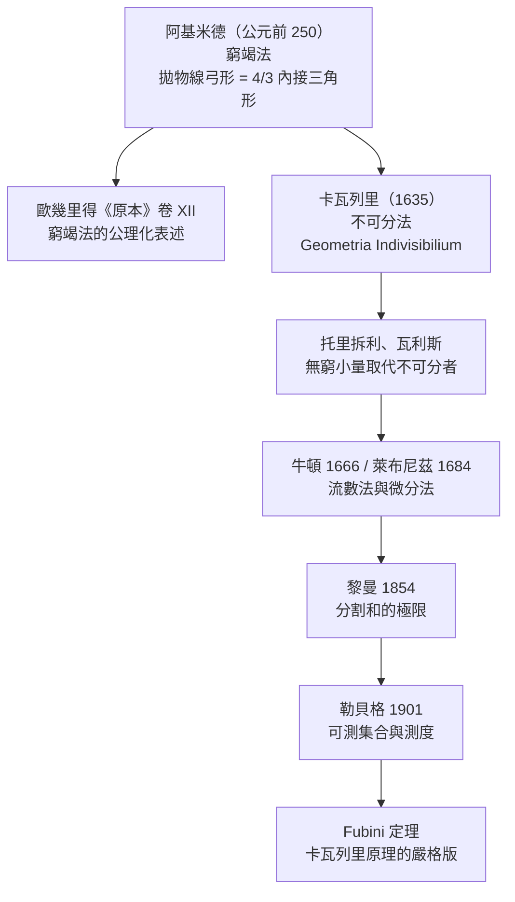

# 4.1 阿基米德的面積法與卡瓦列里原理

## 學習動機

第 1 章講了阿基米德的窮竭法，第 2、3 章把極限與導數嚴格化了。但有一個問題還懸在半空：**面積到底是什麼？**

古希臘人不用「積分」這個詞。他們說的是 *quadrature*——「求方」，意思是**把一個圖形化成一个等面積的正方形**。要證明拋物線弓形的面積是內接三角形的 $`4/3`$ ，就必須真的**構造**那個正方形（或證明它存在），而不是寫下一個 $`\int`$ 記號。阿基米德面對的正是這個難題：窮竭法能證明「面積介於某兩個數之間」，卻**永遠不能給出一個精確的等號**。

到了 17 世紀，卡瓦列里（Bonaventura Cavalieri, 1598–1647）提出了一個大膽到離譜的想法：**把一個平面圖形想成「所有平行線的總和」，把立體想成「所有平行平面的總和」**。只要兩個圖形在每一個高度上的截面長度都一樣，它們的面積就一樣——這就是**卡瓦列里原理**。這個原理後來被傅立葉、勒貝格、Fubini 一路繼承，最終長成第 12 章的測度論。

本節的任務有兩條線：

1. **把阿基米德的 $`4/3`$ 定理真的算出來**——不是背結果，而是用 SymPy 重建他的窮竭遞迴，看著那個幾何級數 $`1 + \frac{1}{4} + \frac{1}{16} + \cdots`$ 收斂到 $`\frac{4}{3}`$ 。
2. **理解卡瓦列里原理的邏輯骨架**，並看見它為什麼**必須**等到測度論出現才能被嚴格化——這正是第 12 章的伏筆。

---

## 4.1.1 阿基米德的面積法：4/3 定理

### 問題的精確陳述

阿基米德在《拋物線的平方》（*Quadratum Parabolae*）中處理如下圖形：

- 一條拋物線（例如 $`y = x^2`$ ）；
- 一條與它相交的弦（例如 $`y = 1`$ ，連接 $`(-1,1)`$ 與 $`(1,1)`$ ）；
- 弦與拋物線弧圍成的區域稱為**拋物線弓形**（parabolic segment）。

他的定理是：

> **弓形的面積是「內接三角形」面積的 $`\frac{4}{3}`$ 倍。**

這裡的「內接三角形」有一個精確的定義（阿基米德《拋物線的平方》命題 1）：以弦為底邊，**第三個頂點取在拋物線上、且該點的切線平行於弦**。對 $`y = x^2`$ 與弦 $`y = 1`$ ，切線斜率是 $`2x`$ ，令 $`2x = 0`$ 得 $`x = 0`$ ，所以頂點就是拋物線的頂點 $`(0,0)`$ 。

我們先把幾何量用 SymPy 算出來。注意 `Triangle.area` 對頂點順序敏感（順時針會給負值），所以我們讓三點逆時針排列。

```python
import sympy as sp

x = sp.symbols('x', real=True)

# 拋物線 y = x^2，弦 y = 1 連接 (-1,1) 與 (1,1)
parabola = x**2
chord = sp.Integer(1)

# 內接三角形：頂點 (-1,1)、(1,1)、拋物線頂點 (0,0)（逆時針排列）
tri = sp.Triangle(sp.Point(-1, 1), sp.Point(0, 0), sp.Point(1, 1))
T = sp.simplify(tri.area)
print('內接三角形面積 T =', T)

# 弓形面積 S = 弦與弧線之間的面積
S = sp.integrate(chord - parabola, (x, -1, 1))
print('弓形面積 S =', S)
print('比值 S/T =', sp.simplify(S / T))
```

預期輸出：

```
內接三角形面積 T = 1
弓形面積 S = 4/3
比值 S/T = 4/3
```

這裡有個值得停下來的方法論問題：我們用 `sp.integrate` 算出了 $`S`$ ，**但這是作弊**——積分正是第 4.3 節的主題，而阿基米德手上沒有積分符號。真正的歷史做法是**只靠幾何遞迴**。

### 幾何的遞迴：阿基米德真正用的武器

阿基米德《拋物線的平方》命題 18–24 的核心構造如下。設弓形的弦為 $`AB`$ ，內接三角形的頂點為 $`C`$ （切線平行於弦的那點）。那麼：

- 弓形可以**再切**成兩個更小的弓形，各自內接於它們自己的三角形；
- 每個小弓形的內接三角形，其**寬是藍色三角形寬的一半、高是高的一半**，所以面積是藍色三角形的 $`\frac{1}{8}`$ ；
- 兩個綠色三角形合起來就是藍色三角形的 $`\frac{1}{4}`$ ；
- 再下一層的四個黃色三角形合起來是 $`\frac{1}{16}`$ ；
- 依此類推。

於是弓形面積是等比級數

$$
T + \frac{1}{4}T + \frac{1}{16}T + \frac{1}{64}T + \cdots
$$

之和。我們用 SymPy 把這個遞迴**真的跑出來**：每一層把弦二分，在兩個子弓形裡各畫一個內接三角形。

```python
import sympy as sp

def tri_area(P, Q, R):
    """三點構成的三角形面積（取絕對值，確保為正）"""
    return sp.simplify(abs(sp.Triangle(sp.Point(*P), sp.Point(*Q), sp.Point(*R)).area))

def apex(a, b):
    """拋物線 y = x^2 上，切線平行於弦 ab 的那個點"""
    t = (a + b) / 2
    return (t, t**2)

def layer(a, b, depth):
    """回傳弓形中第 depth 層的所有內接三角形（由外往內細分）"""
    if depth == 0:
        return [((a, a**2), (b, b**2), apex(a, b))]
    c = apex(a, b)
    out = []
    for u, v in [(a, c[0]), (c[0], b)]:
        out.extend(layer(u, v, depth - 1))
    return out

T = tri_area(*layer(0, 1, 0)[0])
print('第 0 層（藍色）三角形面積 T =', T)

for d in range(4):
    tris = layer(0, 1, d)
    total = sp.simplify(sum(tri_area(*t) for t in tris))
    print(f'第 {d} 層：{len(tris)} 個三角形，總面積 {total}，是 T 的 {sp.simplify(total/T)} 倍')
```

預期輸出：

```
第 0 層（藍色）三角形面積 T = 1/8
第 0 層：1 個三角形，總面積 1/8，是 T 的 1 倍
第 1 層：2 個三角形，總面積 1/32，是 T 的 1/4 倍
第 2 層：4 個三角形，總面積 1/128，是 T 的 1/16 倍
第 3 層：8 個三角形，總面積 1/512，是 T 的 1/64 倍
```

**讀出什麼？** 第 $`d`$ 層的三角形總面積恰好是 $`T`$ 的 $`4^{-d}`$ 倍，個數是 $`2^d`$ 個。所以無限多層加起來是等比級數

$$
T\sum_{d=0}^{\infty} 4^{-d} = T \cdot \frac{1}{1 - 1/4} = \frac{4}{3}T.
$$

阿基米德本人不用極限語言，他用**窮竭法**：證明「弓形面積比 $`\frac{4}{3}T`$ 多出的部分，可以小到任意程度」，從而由反證法逼出等號。而「無窮幾何級數求和」是他《論圓與柱》中另一項了不起的成就（史上第一次處理無窮級數的求和）。

現在讓 SymPy 把這個級數收斂掉，並與積分交叉驗證。

```python
import sympy as sp

k = sp.symbols('k', integer=True, nonnegative=True)
T = sp.Rational(1, 8)

# 無窮多層三角形的總面積：T(1 + 1/4 + 1/16 + ...)
series = sp.summation(T * sp.Rational(1, 4)**k, (k, 0, sp.oo))
print('無窮三角形總面積 =', series)

# 與積分交叉驗證（弓形：拋物線 y=x^2 與弦 y=x 之間，0 <= x <= 1）
x = sp.symbols('x', real=True)
S = sp.integrate(x - x**2, (x, 0, 1))
print('積分算出的弓形面積 =', S)
print('兩者相等？', sp.simplify(series - S) == 0)
print('係數 S/T =', sp.simplify(S / T))
```

預期輸出：

```
無窮三角形總面積 = 1/6
積分算出的弓形面積 = 1/6
兩者相等？ True
係數 S/T = 4/3
```

> **歷史索引**：《拋物線的平方》（*Quadratum Parabolae*）給了兩個證明——一個用槓桿的**機械論證**（對應《機械定理方法》裡發現的「方法」，2006 年才從羊皮紙殘卷中辨識出來），一個用**純幾何 + 等比級數**。後者就是上面重現的這個。

---

## 4.1.2 黎曼和的另一條路：極限版的 4/3

窮竭法有一個不便：它給出的是「任意接近」，不是精確等式。1870 年代黎曼把它改寫成**極限定義**：定積分就是分割的和的極限。到了第 2 章我們已經學過 `sp.Limit`，現在把它接上來。

同一個弓形（拋物線 $`y = x^2`$ 與弦 $`y = 1`$ ， $`-1 \le x \le 1`$ ），用**中點法**的黎曼和逼近。注意 SymPy 的 `Sum` 物件會保留符號形式，`sp.Limit(...).doit()` 會真的把極限算出來。

```python
import sympy as sp

x, n, k = sp.symbols('x n k', real=True)

# 弓形：拋物線 y = x^2 與弦 y = 1 之間，-1 <= x <= 1
f = lambda u: sp.Integer(1) - u**2

# 中點法黎曼和：把 [-1,1] 分成 n 段，取各段中點
delta = sp.Integer(2)/n
mid = sp.Integer(-1) + (k + sp.Rational(1,2))*delta
Riemann = sp.Sum(f(mid)*delta, (k, 0, n-1))
print('黎曼和 =', Riemann)
print('極限 =', sp.Limit(Riemann, n, sp.oo).doit())

# 係數：S / T，T 是內接三角形面積（弦 y=1、頂點 (0,0)）
T = sp.Integer(1)
S = sp.Limit(Riemann, n, sp.oo).doit()
print('S =', S, '  T =', T)
print('係數 S/T =', sp.simplify(S / T))
```

預期輸出：

```
黎曼和 = Sum(2*(1 - (-1 + 2*(k + 1/2)/n)**2)/n, (k, 0, n - 1))
極限 = 4/3
S = 4/3   T = 1
係數 S/T = 4/3
```

**兩條路殊途同歸**：阿基米德用等比級數 + 窮竭法，黎曼用分割 + 極限，得到的都是 $`\frac{4}{3}`$ 。這不是巧合——極限語言正是窮竭法的現代形式。第 2 章講過「極限是 $`\varepsilon`$ - $`\delta`$ 語言的精確化」，這裡則是它的**應用層面**。

順帶一提：把黎曼和寫成 `Sum` 再取極限，是 SymPy 裡做這類驗證的標準套路，因為它讓「和 → 極限 → 積分」這條推理鏈**全程保持符號精確**，不會被浮點數汙染。

---

## 4.1.3 卡瓦列里原理：未幾何的幾何

### 1635 年的《不可分者的幾何》

卡瓦列里在 1627 年寫成、1635 年出版《以新的方式推廣連續體不可分者的幾何》（*Geometria indivisibilium continuorum nova quadam ratione promota*）。他的核心想法可以這樣表述：

> 一個平面圖形的面積，等於它內部**所有平行線**的長度之和；一個立體的體積，等於它內部**所有平行平面**的截面面積之和。

這就是著名的「**未幾何的幾何**」（geometria sine geometria）——它把面積與體積從「形狀」翻譯成「**量**」，因此可以用算術處理。

注意卡瓦列里的說法裡有一個極其微妙的措辭：他不說「所有線**等於**面積」，只說「所有線**可比於**（comparable to）面積」。他刻意迴避「連續體由無限多個不可分者組成」這個命題，因為那會立刻引發哲學與神學上的一致性問題（無限可分成無限多個部分，會導致「無限倍無限」是什麼？）。他後來在 1647 年的《六項幾何練習》（*Exercitationes geometricae sex*）中針對古爾丁的批評做辯護時，反過來說自己的方法用的是「**相對的無限**」而非「絕對的無限」，所以兩個「無限」之間的比例仍有意義。

### 卡瓦列里原理

從「所有線」的想法直接抽出的定理是：

> **卡瓦列里原理**：若兩個立體被夾在兩平行平面之間，且**每一個平行於這兩平面的截面**，兩者在該截面上的**面積相等**，則兩立體的**體積相等**。

二維版本：若兩個平面圖形被夾在兩平行線之間，且每一條平行線截出的**線段長度相等**，則兩者**面積相等**。

阿基米德其實已經隱含地用了這個原理（他在《機械定理方法》裡用截面比較算球體積），但把它提煉成一般原理的是卡瓦列里。

### 符號驗證：截面相等 ⟹ 體積相等

我們用 SymPy 完整重現卡瓦列里的招牌例子：**上半球的體積等於「圓柱減掉一個圓錐」**。取半徑 $`r`$ 的球，球心在下底平面中心。

- 在高度 $`y`$ （ $`0 \le y \le r`$ ），球截面是半徑 $`\sqrt{r^2 - y^2}`$ 的圓盤，面積 $`\pi(r^2 - y^2)`$ ；
- 同高度的圓柱截面是面積 $`\pi r^2`$ 的圓盤；
- 圓錐（頂點在下底圓心、高 $`r`$ ）截面是半徑 $`y`$ 的圓盤，面積 $`\pi y^2`$ 。

於是「圓柱減圓錐」的截面面積是 $`\pi r^2 - \pi y^2`$ ，**恰好等於**球的截面 $`\pi(r^2 - y^2)`$ 。截面全等，體積必相等——這就同時證明了球的體積公式。

```python
import sympy as sp

y, r = sp.symbols('y r', positive=True)

# 上半球在高度 y 的截面（圓盤）
A_ball = sp.pi * (r**2 - y**2)
# 圓柱（半徑 r、高 r）的截面
A_cyl = sp.pi * r**2
# 圓錐（頂點在下底圓心）的截面：半徑 y
A_cone = sp.pi * y**2

print('截面面積之差 =', sp.simplify(A_ball - (A_cyl - A_cone)))

V_ball = sp.integrate(A_ball, (y, 0, r))
V_cyl = sp.integrate(A_cyl, (y, 0, r))
V_cone = sp.integrate(A_cone, (y, 0, r))
print('上半球體積 =', sp.simplify(V_ball))
print('圓柱體積   =', sp.simplify(V_cyl))
print('圓錐體積   =', sp.simplify(V_cone))
print('球體積 = 4/3 π r^3 ?', sp.simplify(2*V_ball - sp.Rational(4,3)*sp.pi*r**3) == 0)
```

預期輸出：

```
截面面積之差 = 0
上半球體積 = 2*pi*r**3/3
圓柱體積   = pi*r**3
圓錐體積   = pi*r**3/3
球體積 = 4/3 π r^3 ? True
```

**注意這段程式碼裡「測度」是隱形的。** 我們寫了 `sp.integrate(A_ball, (y, 0, r))`，這是在計算 $`\int_0^r \pi(r^2-y^2)\,dy`$ 。但卡瓦列里本人**不能**寫這一行——他只能說「所有平行平面之和」。這道缺口就是下一小節的主題。

### 卡瓦列里原理的推論：拋物體是圓柱的一半

同一原理立刻給出「拋物體體積 = 外接圓柱體積的一半」：半徑 $`r`$ 、高 $`h`$ 的圓柱中，兩端各放一個倒立的拋物體。在高度 $`y`$ ，拋物體截面半徑是 $`r\sqrt{y/h}`$ ，面積 $`\pi r^2 y/h`$ ；而圓柱減去「另一個」拋物體的截面面積是 $`\pi r^2 - \pi r^2 (1 - y/h) = \pi r^2 y/h`$ ——一樣！於是兩個拋物體（尖端相接）體積等於圓柱體積，每個是圓柱的一半。

這就是「半拋物體」公式 $`V = \frac{1}{2}\pi r^2 h`$ ，阿基米德在《論圓與柱》中用窮竭法也得到同樣結果。

### 從阿基米德到卡瓦列里：一張關係圖



這條線索是本節的骨架：**每一次進步，都是「那個無窮和究竟是什麼」被回答得更精確一步**。從「內接多邊形逼近」到「分割和的極限」，再到「 $`\sigma`$ -代數上的測度」——三個層次，第 12 章會把第三層講完。

---

## 4.1.4 卡瓦列里原理為什麼需要測度論

### 漏洞在哪裡

卡瓦列里原理的論證結構是這樣的：

1. 每個截面面積相等；
2. 所以「所有平面之和」相等；
3. 所以體積相等。

問題出在第 2 步。**「所有平面之和」是什麼？** 如果你把它當成「無窮多個實數相加」，你就得回答一個卡瓦列里試圖迴避的問題：

- 這個和是收敛的吗？
- 怎麼定義？
- 換一個分割方式，結果會一樣嗎？

第 3 步也是隱含的：把體積視為「截面面積的函數在某個區間上的黎曼和極限」，需要「連續函數在閉區間上可積」這件事。

而更致命的是：**有些圖形的截面面積全部相等，體積卻「有意義地」不相等**——如果允許不可測的集合。例如 Vitali 集合：一個不可測的集合 $`V \subset [0,1]`$ ，它與自己的可數個有理平移構成 $`[0,1]`$ 的一個分割。每個平移的「體積」都相同（平移不改變形狀），但它們要拼滿整個 $`[0,1]`$ ——這會導致荒謬的結論。只有當我們要求「可測的」集合時，這類悖論才會消失。

### 歷史上的三個里程碑

| 年代 | 人物 | 貢獻 |
|------|------|------|
| 1635 | 卡瓦列里 | 不可分法；截面相等 ⟹ 體積相等（直覺版） |
| 1854 | 黎曼 | 定義「面積」為分割和的極限（連續函數上有效） |
| 1901 | 勒貝格 | 定義可測集合與 Lebesgue 測度；卡瓦列里原理成為 **Fubini 定理**的特例 |

於是卡瓦列里原理在現代語言裡長成：

$$
\text{若 } A, B \subset \mathbb{R}^n \text{ 可測，且對幾乎每個 } t,\ \mu(A_t) = \mu(B_t),
\quad \text{則 } \mu(A) = \mu(B),
$$

其中 $`A_t`$ 是 $`A`$ 與超平面 $`\{x : x_n = t\}`$ 的截面。這正是**第 12 章的主題**。

### 用 SymPy 看「層蛋糕」公式

測度論裡有一個漂亮的等價敘述，卡瓦列里原理是它的特例：

$$
\int_{\Omega} f\,d\mu = \int_{0}^{\infty} \mu\bigl(\{x \in \Omega : f(x) > t\}\bigr)\,dt.
$$

右邊是「把函數值當高度，一層一層剝開」。我們用 SymPy 對最簡單的情形 $`\Omega = \mathbb{R}`$ 、 $`f(x) = e^{-|x|}`$ 驗證這個公式： $`\{x : e^{-|x|} > t\} = (-\ln t, \ln t)`$ ，其測度是 $`2\ln\frac{1}{t}`$ 。

```python
import sympy as sp

x, t = sp.symbols('x t', real=True)

# 層集合 {x : f(x) > t} 的「測度」（此處就是區間長度）
f = sp.exp(-sp.Abs(x))
measure = 2*sp.log(1/t)
print('層集合 {x : f(x) > t} 的測度 =', measure)

# 層蛋糕公式：右邊（把函數值當高度，一層一層剝開）
rhs = sp.integrate(measure, (t, 0, 1))
print('層蛋糕積分 =', rhs)

# 左邊：直接對 f 積分
lhs = sp.integrate(f, (x, -sp.oo, sp.oo))
print('直接積分   =', lhs)
print('兩者相等？', sp.simplify(rhs - lhs) == 0)
```

預期輸出：

```
層集合 {x : f(x) > t} 的測度 = 2*log(1/t)
層蛋糕積分 = 2
直接積分   = 2
兩者相等？ True
```

注意：這裡「測度」在 $`\mathbb{R}`$ 上就是長度，所以我們還沒用到真正的測度論抽象。但等式的**形狀**——把積分換成「對高度積分截面測度」——正是卡瓦列里原理的現代版本，也是 Fubini 定理的原型。第 12.1 節我們會把「測度」從長度推廣到一般的 $`\sigma`$ -代數上的測度。

### 卡瓦列里原理的一個現代應用：餐巾環問題

有一個漂亮的例子說明卡瓦列里原理的威力：把一個球中央鑽一個圓柱形洞，剩下來的「餐巾環」（napkin ring）的體積**與原球半徑無關**，只取決於洞的高度 $`h`$ 。這是 1693 年 Johann Bernoulli 給出的問題，牛頓在《原理》第一卷中也用類似方法處理過。

理由正是卡瓦列里原理：高度 $`y`$ 處的環形截面是外圓盤減內圓盤，面積 $`\pi(r^2 - y^2) - \pi(r^2 - (h/2)^2)`$ ，其中 $`r^2`$ **消掉了**——所以體積不含 $`r`$ 。

我們用 SymPy 把它算完：

```python
import sympy as sp

y, r, h = sp.symbols('y r h', positive=True)

# 餐巾環：半徑 r 的球，鑽掉半徑 sqrt(r^2 - (h/2)^2) 的圓柱洞，環高 h
A_ring = sp.pi*(r**2 - y**2) - sp.pi*(r**2 - h**2/4)
print('截面面積 =', sp.simplify(A_ring))

# 對 y 從 -h/2 到 h/2 積分
V = sp.integrate(A_ring, (y, -h/2, h/2))
print('體積 =', sp.simplify(V))
print('與 r 無關？', sp.simplify(sp.diff(V, r)) == 0)
print('等於半徑 h/2 的球的體積？',
      sp.simplify(V - sp.Rational(4,3)*sp.pi*(h/2)**3) == 0)
```

預期輸出：

```
截面面積 = pi*(h**2 - 4*y**2)/4
體積 = pi*h**3/6
與 r 無關？ True
等於半徑 h/2 的球的體積？ True
```

餐巾環的體積恰好等於半徑 $`h/2`$ 的球的體積 $`\frac{4}{3}\pi (h/2)^3 = \frac{\pi h^3}{6}`$ 。這是「用截面思考」的力量。

---

## 4.1.5 本節的 SymPy 工具箱小結

| 任務 | 對應 API | 備註 |
|------|-----------|------|
| 三角形面積 | `sp.Triangle(...).area` | 頂點順序影響正負號 |
| 拋物線與弦的面積 | `sp.integrate(g - f, (x, a, b))` | 弦方程： $`y = (a+b)x - ab`$ |
| 面積比 | `sp.simplify(S / T)` | 精確有理數 |
| 幾何級數求和 | `sp.summation(T * r**k, (k, 0, sp.oo))` | $`r = \frac14`$ |
| 黎曼和 | `sp.Sum(...)` + `sp.Limit(...).doit()` | 保持符號精確 |
| 截面比較 | 對截面函數積分 | 卡瓦列里原理的可執行版 |

---

## 習題

**習題 4.1.1（阿基米德 4/3 定理的一般化）**
對拋物線 $`y = x^2`$ 上任意弦（端點橫座標 $`a < b`$ ），證明弓形面積是「以弦為底、切線平行於弦的那個點為頂」的內接三角形面積的 $`\frac{4}{3}`$ 倍。
提示：弦方程是 $`y = (a+b)x - ab`$ ；切線斜率 $`2x = a + b`$ 給出頂點橫座標 $`x = \frac{a+b}{2}`$ 。
用 SymPy 寫出 `segment_area(a, b)` 與 `inscribed_triangle_area(a, b)` 兩個函式，並驗證比值恆為 $`\frac{4}{3}`$ 。（對 $`a=0, b=1`$ 與 $`a=-2, b=3`$ 各驗證一次。）

**習題 4.1.2（窮竭法的層數與誤差）**
沿用 4.1.1 的程式：計算第 $`d`$ 層三角形總面積與真實弓形面積之**差**（即剩餘未覆蓋的部分），證明它等於 $`T \cdot \frac{4^{-d}}{1 - 1/4} = T \cdot \frac{4^{1-d}}{3}`$ 。
然後回答：若要求誤差小於 $`10^{-6}`$ ，需要取到第幾層？

**習題 4.1.3（阿基米德的圓周率夾逼）**
用正多邊形夾逼圓的周長：內接正 $`n`$ 邊形的周長是 $`2n\sin(\pi/n)`$ ，外切的是 $`2n\tan(\pi/n)`$ 。用 SymPy 計算 $`n = 6, 12, 24, 48, 96`$ 時的上下界，與 $`\pi`$ 比較，找出阿基米德給出的 $`3\frac{10}{71} < \pi < 3\frac{10}{70}`$ 需要多少邊才能成立。
（提示：`sp.N(expr, 20)` 可以拿到小數；`sp.Rational(223,71)` 與 `sp.Rational(22,7)` 是兩個界。）

**習題 4.1.4（卡瓦列里原理：拋物體）**
用截面法證明半徑 $`r`$ 、高 $`h`$ 的拋物體體積是 $`\frac{1}{2}\pi r^2 h`$ ：
- 在高度 $`y`$ ，拋物體截面面積是 $`\pi r^2 y/h`$ ；
- 圓柱截面積 $`\pi r^2`$ ，另一個倒立拋物體截面積 $`\pi r^2 (1 - y/h)`$ ；
- 兩者相減恰為 $`\pi r^2 y/h`$ （與拋物體截面相同），故兩拋物體體積和等於圓柱體積。
請用 SymPy 寫出三個截面函數並印出它們的差（應為 0），最後算出一個拋物體的體積。

**習題 4.1.5（卡瓦列里原理的失效：Vitali 型悖論）**
考慮 $`[0,1]`$ 的一個分割：取一個 Vitali 集合 $`V`$ （每個實數模 $`\mathbb{Q}`$ 的等價類中恰取一個代表），以及它對所有有理數 $`r \in \mathbb{Q} \cap [-1,1]`$ 的平移 $`V + r`$ 。這是可數個平移，兩兩不交，並集覆蓋 $`[0,1]`$ 。
(a) 若 $`V`$ 可測且 $`m(V) = v > 0`$ ，則由可數可加性得 $`1 = \sum_{r} v`$ ，推出什麼矛盾？
(b) 若 $`m(V) = 0`$ ，則 $`\sum_r m(V+r) = 0 \ne 1`$ ，也矛盾。
(c) 結論： $`V`$ 不可測。請解釋：這說明卡瓦列里原理「截面相等 ⟹ 體積相等」必須加上什麼前提？
（提示：這個例子就是第 12.1 節勒貝格用來證明「不是所有集合都可用 Lebesgue 測度測量」的那個論證。）

---

## 小結

| 歷史時刻 | 人物 | 貢獻 | 對應的現代工具 |
|----------|------|------|----------------|
| 公元前 250 | 阿基米德 | 窮竭法；拋物線弓形 = $`\frac{4}{3}`$ 內接三角形 | `sp.summation` 等比級數、`sp.Limit` |
| 1635 | 卡瓦列里 | 不可分法；截面相等 ⟹ 體積相等 | 對截面函數積分 |
| 1854 | 黎曼 | 面積 = 分割和的極限 | `sp.Sum` + `sp.Limit` |
| 1901 | 勒貝格 | 可測集合與測度；Fubini 定理 | 第 12 章 |

三個關鍵takeaway：

1. **阿基米德的 $`\frac{4}{3}`$ 不是猜的**，而是等比級數 $`1 + \frac14 + \frac{1}{16} + \cdots`$ 的和。SymPy 用兩行程式碼就把這個 2200 年前的幾何遞迴重現了。
2. **卡瓦列里原理是把幾何轉成算術的橋**，但「所有平面之和」必須等到測度論給出嚴格定義。沒有可測性假設，卡瓦列里原理會被 Vitali 集合撕碎。
3. **下一節的問題已經醞釀好了**：既然「截面面積之和」等於「體積」，那麼對**平面**圖形而言，「所有平行線長度之和」等於「面積」——這就是定積分。而牛頓與萊布尼茲在 1660 年代做的事情，就是把這個想法**倒過來**：證明「求面積」其實等價於「求導數」。這正是 4.2 節的主題。
