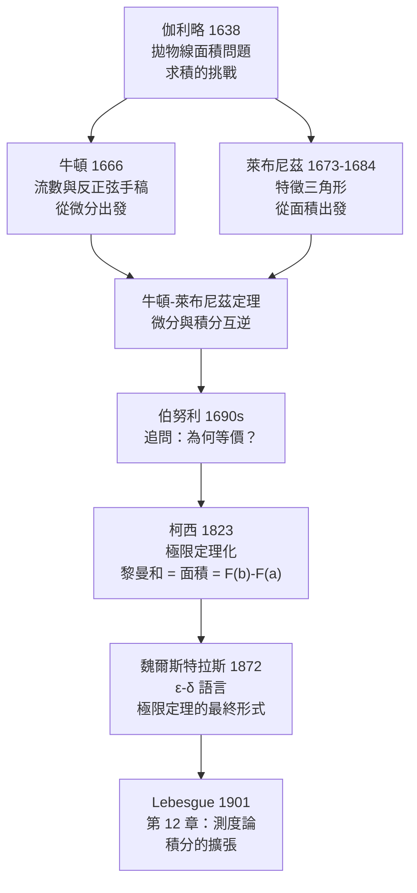

# 4.2 牛頓-萊布尼茲定理與微積分基本定理

## 學習動機

4.1 節結尾留下兩個懸案：

1. 卡瓦列里告訴我們「**所有平行線之和**」等於面積——但這是直覺，不是定義。
2. 更重要的是：**微分與積分是兩個不同的操作嗎？** 費馬在 3.1 節求切線、牛頓在 3.2 節求流數，這些都是「局部」的；而阿基米德、卡瓦列里算的都是「整體」的面積。兩者之間有什麼關係？

1666 年，23 歲的牛頓在瘟疫封閉的莊園裡寫下流數法時，做的正是「微分」。1684 年，萊布尼茲在《學院紀要》發表《求極大極小的新方法》時，做的也是「微分」。兩人卻都宣稱自己**順帶解決了面積問題**——因為他們發現了一件驚人的事：

> **求曲線下的面積，等價於求一個原函數；求原函數，又等價於解一個微分方程。**

這個「求導與求積互逆」的洞見，就是**微積分基本定理**（Fundamental Theorem of Calculus），也叫**牛頓-萊布尼茲定理**。它是整個微積分學的中心樞紐：從它開始，積分不再是「面積的算法」，而是一種**可以反轉的運算**。

但歷史給了這個洞見一個教訓：它最初是用**無窮小量**（infinitesimal）論證的，在邏輯上站不住腳。1823 年，柯西（Cauchy）把它改寫成極限定理；1872 年，魏爾斯特拉斯（Weierstrass）給出 $`\varepsilon`$ - $`\delta`$ 版本。**同一個定理，三種證明風格。**

本節要做三件事：

1. 講清楚牛頓與萊布尼茲各自怎麼走到這個結論（以及 1666 年那份「流數與反正弦」手稿到底做了什麼）；
2. 講清楚伯努利那句追問——「求面積為何等價於求導數」——的現代答案；
3. 把基本定理的**兩種敘述**都寫成 SymPy 可以**逐字驗證**的符號等式。

---

## 4.2.1 伽利略的拋物線面積問題：求積如何推動整個計畫

### 問題的來源

在微積分出現之前，「求面積」（quadrature）是數學界最具挑戰性的公開問題之一。伽利略在《關於兩門新科學的對話》（*Discorsi*, 1638）中描寫了當時的狀態：

- 某些曲線（圓、橢圓、拋物線）的面積已經被希臘人求出；
- 但 $`y = x^3`$ 這類「冪曲線」的求積，人們只會做 $`x^2`$ ；
- 而像 $`y = x^4`$ 、 $`y = 1/x^3`$ （雙曲線的分支）這類，連阿基米德都沒有一般性的方法。

伽利略自己在 1604 年左右就計算過拋物線的面積（用阿基米德的窮竭法），得到弓形面積是內接三角形的 $`\frac{4}{3}`$ ——**這個數字正是 4.1 節的主題**。他在 1638 年的書中把它寫成了一個挑戰：既然拋物線已經解決，那麼 $`y = x^4`$ 呢？ $`y = x^5`$ 呢？

這個問題**催生了微積分**。牛頓和萊布尼茲各自發展的方法，第一個能求出 $`\int x^n dx`$ 的一般公式； Johann Bernoulli 更進一步發展了「 $`\int x^n dx = \frac{x^{n+1}}{n+1}`$ 」的求積公式，涵蓋 $`n = 3, \dots, 9`$ （這正是卡瓦列里 1647 年《六項幾何練習》做到的版本）。

### 伽利略的「過度簡化」與他的悲劇

值得順帶一提的是，伽利略在《對話》中把「求面積」與「求物體通過的距離」聯繫起來，認為運動中的物體「覆蓋」的路徑長度就是面積——這在物理上是對的（速度-時間圖下的面積就是位移），但他後來對這個想法的延伸（「通過所有可能速度的總和」）導致了他晚年那場著名的悲劇（1638 年的「無窮」論戰，Urban VIII 教宗與他斷絕來往）。

**教訓**：把面積看成「無限多個量的和」是對的方向，但「這個和是什麼」必須嚴格定義。第 2 章的極限語言、第 12 章的測度論，都在做這件事。

---

## 4.2.2 牛頓 1666：流數與反正弦手稿

### 瘟疫中的兩年

1665 年倫敦大鼠疫，牛頓離開劍橋回到故鄉 Woolsthorpe。1666 年，他完成了兩份關鍵手稿（今天藏於劍橋大學圖書館，Add. 3977.4 號）：

- 《論方程的無窮項分析》（*De Analysi per Aequationes Numero Terminorum Infinitas*，後來定稿於 1669 年）；
- 1666 年 10 月的**流數手稿**（Whiteside 編為 *The October 1666 Tract on Fluxions*）。

### 牛頓的語言：流數與流質

牛頓不用 $`dx`$ 、 $`dy`$ ，他用：

- **流質**（fluent）：隨時間變化的量 $`x, y, v, \dots`$ ；
- **流數**（fluxion）：流質對時間的瞬時變化率 $`\dot{x}, \dot{y}, \dots`$ 。

在他看來， $`\dot{x}`$ 是「 $`x`$ 在單位時間內的增量」，所以 $`x`$ 的流數是**速度**， $`x^2`$ 的流數是「 $`2x\dot{x}`$ 」。

牛頓用一個非常漂亮的**首末比**（prime and ultimate ratios）來定義流數： $`\dot{x}`$ 是當時間增量趨於零時， $`x`$ 的增量與時間增量之比所趨近的值。這其實就是導數的極限定義，只是他用「最終比」而不是 $`\varepsilon`$ - $`\delta`$ 。

在《原理》（*Principia*, 1687）第一卷引理 II 中，牛頓寫下了著名的最終比論述。

### 牛頓特別關心的兩件事

**(a) 冪的流數。** 這是最基本的結果，也是整個微積分的入口：

$$
\dot{x^n} = n x^{n-1} \dot{x}.
$$

**(b) 反函數。** 這是牛頓在 1666 年手稿裡特別費心的地方，也是本節要強調的重點。牛頓問：**已知 $`\dot{y}`$ （ $`y`$ 對 $`x`$ 的流數），如何求 $`x`$ 對 $`y`$ 的流數？**

答案很簡單但是革命性的：取倒數。

$$
\frac{dx}{dy} = \frac{1}{\dfrac{dy}{dx}}.
$$

有了這個，加上「 $`x = \sin u`$ 的流數是 $`\cos u \cdot \dot{u}`$ 」，牛頓立刻能求出**圓弧的流數**，也就是**反正弦的微分**：

$$
\frac{d}{dx}\arcsin x = \frac{1}{\sqrt{1 - x^2}}.
$$

這正是 3.2 節萊布尼茲的「先驗公式」（ $`\frac{\partial u}{\partial x}\cdot\frac{\partial x}{\partial u} = 1`$ ）在幾何上的樣子。

我們用 SymPy 把這一切重現。注意 SymPy 的 `diff` 用的是萊布尼茲的觀點（對獨立變數求導），但表達的是同一件事。

```python
import sympy as sp

x, t = sp.symbols('x t', real=True)

# 牛頓 1666：把 x 當作時間 t 的函數，流數 = 對時間的導數
v = sp.Function('v')
print('流數 dv/dt =', sp.diff(v(t), t))

# x^n 的流數（牛頓的基本結果）
n = sp.symbols('n', integer=True, positive=True)
print('d/dt (t^n) =', sp.diff(t**n, t))

# 牛頓特別關心反函數：圓弧的流數，即反正弦
print('d/dx asin(x) =', sp.diff(sp.asin(x), x))
print('檢驗與 1/sqrt(1-x^2) 相等？',
      sp.simplify(sp.diff(sp.asin(x), x) - 1/sp.sqrt(1 - x**2)) == 0)

# 牛頓用反序級數求 arcsin
ser = sp.series(sp.asin(x), x, 0, 11).removeO()
print('arcsin 的級數 =', ser)
print('級數的微分 =', sp.series(sp.diff(ser, x), x, 0, 11).removeO())
```

預期輸出：

```
流數 dv/dt = Derivative(v(t), t)
d/dt (t^n) = n*t**n/t
d/dx asin(x) = 1/sqrt(1 - x**2)
檢驗與 1/sqrt(1-x^2) 相等？ True
arcsin 的級數 = 35*x**9/1152 + 5*x**7/112 + 3*x**5/40 + x**3/6 + x
級數的微分 = 35*x**8/128 + 5*x**6/16 + 3*x**4/8 + x**2/2 + 1
```

把最後一行認出來： $`1 + \frac{x^2}{2} + \frac{3x^4}{8} + \frac{5x^6}{16} + \cdots`$ 正是 $`(1-x^2)^{-\frac{1}{2}}`$ 的二項式展開——也就是 $`\frac{1}{\sqrt{1-x^2}}`$ 。**牛頓的「反序級數」在這裡被完全重現了**：他不靠猜，而是先把 $`\arcsin`$ 的微分求出來，再把 $`\frac{1}{\sqrt{1-x^2}}`$ 展開成級數，最後**逐項積分**回 $`\arcsin`$ 。

**牛頓為什麼要在乎反正弦？** 因為它是「求弧長」的關鍵。圓弧長 $`s = r\theta`$ ，而 $`\theta = \arcsin(s/r)`$ 。在沒有 $`\arcsin`$ 微分公式的時代，弧長問題是幾何學最難的問題之一——17 世紀整整一百年，「求任意曲線的弧長」是擋在數學家面前的牆。

---

## 4.2.3 萊布尼茲的論證：從「求切線」到「求面積」

### 萊布尼茲的策略

萊布尼茲的入手點與牛頓不同。牛頓從**運動**（流數）出發，萊布尼茲從**純幾何的特徵三角形**（characteristic triangle）出發：

在一條曲線 $`y = P`$ 上取一點，過它作切線，與縱軸、橫軸形成一個極小的三角形。三角形有：

- 底邊 $`dx`$ （橫軸上的增量）；
- 高 $`y`$ （縱坐標）；
- 斜邊 $`dy`$ （切線方向的增量）。

由相似三角形，切線的斜率（切角）滿足

$$
\frac{y}{dx} = \frac{dy}{dx},
$$

而「曲線下的面積」在無限細分下，「無限多個長方形 $`y \cdot dx`$ 」之和記作

$$
\int y \, dx.
$$

**關鍵的一步**：對曲線而言， $`dx`$ 與 $`dy`$ 之比不是常數（曲線不是直線），所以我們要問：**怎麼把 $`\int y\,dx`$ 算出來？**

萊布尼茲的答案是：把 $`y`$ 看成 $`x`$ 的函數 $`y = f(x)`$ ，然後發現

$$
\int f(x)\,dx = F(x) \quad \text{其中} \quad F'(x) = f(x).
$$

而 $`F`$ 可以「倒推」出來——因為 $`F' = f`$ 是一個**微分方程**，而它的解可以用「猜測 + 驗證」的方式找到（猜 $`F`$ ，檢查 $`F' = f`$ ）。這就是「積分是反導數」的發現過程。

萊布尼茲的優勢在於他的**記號**： $`dx`$ 記錄「橫的增量」， $`dy`$ 記錄「斜的增量」， $`\int`$ 記錄「求和」。這三個記號把「局部斜率」與「整體面積」在**同一個字母系統**裡綁定了，這也是今天我們用的記號。

### 用 SymPy 驗證萊布尼茲的代數

萊布尼茲的規則（乘積法則、鏈式法則）在今天已經是 SymPy 的預設行為。我們把它們「反譯」回萊布尼茲的直覺：SymPy 的 `diff` 產生的 `Derivative(u(x), x)` 正是萊布尼茲的 $`\frac{du}{dx}`$ 。

```python
import sympy as sp

x = sp.symbols('x', real=True)
u = sp.Function('u')

# 萊布尼茲記號：dy/dx。SymPy 用 diff 表達同一件事
print('乘積法則：', sp.diff(u(x)*sp.sin(x), x))
print('鏈式法則：', sp.diff(sp.sin(u(x)), x))

# 萊布尼茲的「先驗公式」：反函數的微分是倒數
print('d/dx asin(x) =', sp.diff(sp.asin(x), x))
print('1/sqrt(1-x^2) =', 1/sp.sqrt(1 - x**2))

# 兩個符號版本的 Leibniz 恆等式：du/dx · dx/du = 1
y = sp.symbols('y', real=True)
g = sp.Function('g')
# 令 x = g(y)，則 dx/dy = g'(y)，故 dy/dx = 1/g'(y)
print('1/g\'(y) =', 1/sp.diff(g(y), y))
```

預期輸出：

```
乘積法則： u(x)*cos(x) + sin(x)*Derivative(u(x), x)
鏈式法則： cos(u(x))*Derivative(u(x), x)
d/dx asin(x) = 1/sqrt(1 - x**2)
1/sqrt(1-x^2) = 1/sqrt(1 - x**2)
1/g'(y) = 1/Derivative(g(y), y)
```

**歷史注記**：萊布尼茲與牛頓的優先權之爭（1699–1716）是數學史上最不愉快的事件之一。現代史學的共識是：**兩人獨立發明了微積分**。牛頓先有（1666），萊布尼茲先發表（1684）。牛頓的朋友（主要是 Samuel Fatio de Duillier）指控萊布尼茲抄襲；1712 年皇家學會的報告《Commercium Epistolicum》完全偏袒牛頓，萊布尼茲終其餘生都在抗辯。

值得強調的是：**兩人的方法在數學上是等價的，但風格截然不同**。牛頓的流數法從「運動」出發，適合處理物理問題（《原理》全書的動力學就是用流數寫的）；萊布尼茲的微分法從「特徵三角形」出發，記號更適合代數運算。今天的數學教育幾乎全部採用萊布尼茲的系統。

---

## 4.2.4 伯努利的追問：為何「求面積」等價於「求導數」

### 問題

Johann Bernoulli 在與萊布尼茲的通信中（以及 1690 年代的《學院紀要》論文裡）反覆追問同一件事：

> 對一條曲線求「面積」，和對它求「切線」，**為什麼是同一個問題的兩面**？

在沒有基本定理的年代，這看起來像是巧合。伯努利的追問後來被 Johann Bernoulli 的學生 Johann Bernoulli（Johann II）與萊布尼茲本人逐步釐清，最終成為 4.2.6 節的基本定理。

### 現代的回答：三個等價敘述

用今天的語言，伯努利的問題可以這樣回答：

> **對 $`f`$ 在 $`[a,b]`$ 上求面積，等價於解微分方程 $`F'(x) = f(x)`$ （初值條件 $`F(a) = 0`$ ），再取 $`F(b)`$ 。**

這就是「積分與微分的互逆」。我們讓 SymPy 親自回答伯努利的問題：對同一個 $`f`$ ，分別用 `sp.integrate`（求面積）與 `sp.dsolve`（解 ODE）兩條路徑，看它們是否給出同一個答案。

```python
import sympy as sp

x = sp.symbols('x', real=True)
F = sp.Function('F')

# 伯努利的追問：求 ∫ f dx 等價於解 ODE F' = f, F(a) = 0
f = sp.sin(x)*sp.exp(x)
a = 0
sol = sp.dsolve(sp.Eq(F(x).diff(x), f), F(x), ics={F(a): 0})
print('dsolve 解出 =', sol.rhs)
print('符號積分   =', sp.integrate(f, (x, a, x)))
print('兩者相同？', sp.simplify(sol.rhs - sp.integrate(f, (x, a, x))) == 0)
```

預期輸出：

```
dsolve 解出 = exp(x)*sin(x)/2 - exp(x)*cos(x)/2 + 1/2
符號積分   = exp(x)*sin(x)/2 - exp(x)*cos(x)/2 + 1/2
兩者相同？ True
```

**這段程式碼是本節的核心。** 它把「求面積」和「解微分方程」當成兩條獨立的技術路線（`sp.integrate` 走有理函數/超越函數的符號積分引擎，`sp.dsolve` 走 ODE 求解器），然後發現它們給出**逐字相同的表達式**。這不是巧合，而是定理。

順帶一提， $`\int_0^x e^t\sin t\,dt = \frac{1}{2}e^x(\sin x - \cos x) + \frac{1}{2}`$ 這個式子，同時是**分部積分**（連續兩次）和**一階線性 ODE 的通解**。學生時代背下的「分部積分公式」，其實就是基本定理的一個實例。

---

## 4.2.5 柯西的嚴格化（1823）：把基本定理建立在極限上

### 問題在哪裡

牛頓與萊布尼茲的基本定理論證裡，都有一個藏起來的無窮小量。他們會說：

> 「一段無限小的曲線可以當成一段直線，所以曲線下的面積等於無限多個小長方形 $`y \cdot dx`$ 的和；而這些長方形的和又等於……」

問題是「無限小」到底是什麼。伯克萊在 1734 年的《The Analyst》中嘲笑牛頓的流數是「ghost of departed quantities」（逝去量的幽靈）——因為 $`dx`$ 趨於零時 $`dx`$ 顯然不是一個數，卻被拿來做乘法。

### 柯西的做法

1821 年的《分析概論》（*Cours d'analyse*）與 1823 年的《無窮小計算》（*Le Calcul infinitésimal* / *Résumé des leçons données à l'École royale polytechnique sur le calcul infinitésimal*）裡，柯西做了三件事：

1. **定義極限**（用了他標誌性的「當 $`x`$ 趨近 $`a`$ 時， $`f(x)`$ 與 $`f(a)`$ 的差的絕對值可以小於任意給定的正數」）；
2. **把定積分定義成分割和的極限**（這就是今天黎曼積分的定義，柯西先寫出來，黎曼在 1854 年給出更精確的版本）；
3. **用極限定理證明基本定理**。

現在我們回到 2.1.3 節的做法：把黎曼和寫成 SymPy 的 `Sum`，用 `sp.Limit(...).doit()` 取極限，看它與 `sp.integrate` 的結果以及 $`F(b) - F(a)`$ 三者一致。

```python
import sympy as sp

x, n, k = sp.symbols('x n k', real=True)

# 柯西 1823：定積分是黎曼和的極限
f = x**2
delta = sp.Integer(2)/n
mid = sp.Integer(-1) + (k + sp.Rational(1,2))*delta
Riemann = sp.Sum(f.subs(x, mid)*delta, (k, 0, n-1))
print('黎曼和 =', Riemann)
print('極限 =', sp.Limit(Riemann, n, sp.oo).doit())
print('符號積分 =', sp.integrate(f, (x, -1, 1)))

F = sp.integrate(f, x)
print('F(1)-F(-1) =', sp.simplify(F.subs(x, 1) - F.subs(x, -1)))
```

預期輸出：

```
黎曼和 = Sum(2*(-1 + 2*(k + 1/2)/n)**2/n, (k, 0, n - 1))
極限 = 2/3
符號積分 = 2/3
F(1)-F(-1) = 2/3
```

三條路給出同一個數 $`\frac{2}{3}`$ 。**這就是柯西的嚴格化**：基本定理不再是「無窮小量的直覺」，而是「分割和的極限 = 面積 = 原函數的差」三者的相等。

### 但柯西還不夠嚴格

柯西的定義仍有缺陷：它要求「極限存在」，卻沒有給出極限**存在**的判準。此外柯西自己的研究論文裡仍時常使用無窮小量。真正完成嚴格化的是：

- **魏爾斯特拉斯（1872）**：把「連續」定義為 $`\varepsilon`$ - $`\delta`$ 語言，並給出 $`\varepsilon`$ - $`\delta`$ 版的極限定理（第 2.2 節的主題）；
- **黎曼（1854）**：給出可積性的判準（有界 + 上下 Darboux 積分相等）；
- **勒貝格（1901）**：擴大可積類（第 12 章）。

> 第 2 章講的是「極限怎麼被嚴格化」，本節講的是「嚴格化後的基本定理長什麼樣」。兩條線在這裡匯合。

---

## 4.2.6 基本定理的兩種敘述

### 敘述一（求積 $`\Rightarrow`$ 求導）

> **定理（第一部分）**：若 $`f`$ 在 $`[a,b]`$ 上連續，定義
> 

$$
F(x) = \int_a^x f(t)\,dt,
$$

> 則 $`F`$ 在 $`(a,b)`$ 上可導，且 $`F'(x) = f(x)`$ 。

**直覺**： $`F(x+h) - F(x)`$ 是曲線下、 $`[x, x+h]`$ 那一小條的面積；當 $`h \to 0`$ ，這條面積約是 $`f(x) \cdot h`$ ，除以 $`h`$ 就得到 $`f(x)`$ 。

### 敘述二（求導 $`\Rightarrow`$ 求積）

> **定理（第二部分 / 牛頓-萊布尼茲定理）**：若 $`f`$ 在 $`[a,b]`$ 上**黎曼可積**，且 $`F`$ 在 $`[a,b]`$ 上連續、在 $`(a,b)`$ 上可導並滿足 $`F'(x) = f(x)`$ ，則
> 

$$
\int_a^b f(x)\,dx = F(b) - F(a).
$$

注意敘述二**只要求 $`f`$ 可積，不要求連續**——這比敘述一加上推論的版本更強。

### 為什麼需要兩種敘述？

因為它們回答**不同的問題**：

| | 敘述一 | 敘述二 |
|---|---------|--------|
| 方向 | 積分 $`\Rightarrow`$ 導數 | 導數 $`\Rightarrow`$ 積分 |
| 回答的問題 | 「已知 $`f`$ ，怎麼求原函數？」 | 「已知 $`F`$ ，怎麼求面積？」 |
| 前提 | $`f`$ 連續 | $`f`$ 黎曼可積（可積即可） |
| 用途 | 證明「每個連續函數都有原函數」 | 計算定積分 |

**敘述一的深意常被低估**：它保證了「連續函數一定有原函數」。這不是小事——第 4.3 節我們會看到，某些函數（例如 $`e^{-x^2}`$ ）的原函數**沒有初等表達式**，但它**確實存在**（敘述一保證了），只是你寫不出來而已。若沒有敘述一，「 $`e^{-x^2}`$ 有原函數嗎」會是個沒有答案的問題。

### 兩種敘述的符號驗證

現在用 SymPy 逐字驗證兩者。第一敘述：對 $`f`$ 求出 $`F(x) = \int_0^x f`$ ，再微分，看是否回到 $`f`$ 。

```python
import sympy as sp

x = sp.symbols('x', real=True)

# 第一敘述：F(x) = ∫_0^x f(t)dt 則 F' = f
for f in [sp.sin(x), x**2*sp.exp(x), sp.log(x + 2)]:
    F = sp.integrate(f, (x, 0, x))
    print('F(x) =', F, '  F\' =', sp.simplify(sp.diff(F, x)),
          '  等於 f？', sp.simplify(sp.diff(F, x) - f) == 0)
```

預期輸出：

```
F(x) = 1 - cos(x)   F' = sin(x)   等於 f？ True
F(x) = (x**2 - 2*x + 2)*exp(x) - 2   F' = x**2*exp(x)   等於 f？ True
F(x) = x*log(x + 2) - x + 2*log(x + 2) - 2*log(2)   F' = log(x + 2)   等於 f？ True
```

第二敘述：找到原函數 $`F`$ ，比較 $`\int_a^b f`$ 與 $`F(b) - F(a)`$ 。

```python
import sympy as sp

x = sp.symbols('x', real=True)

# 第二敘述：∫_a^b f = F(b) - F(a)
cases = [(x**2, 1, 3), (sp.sin(x), 0, sp.pi), (sp.exp(x), 0, 1), (1/(1+x**2), 0, 1)]
for f, a, b in cases:
    F = sp.integrate(f, x)
    lhs = sp.simplify(sp.integrate(f, (x, a, b)))
    rhs = sp.simplify(F.subs(x, b) - F.subs(x, a))
    print(f'{f}: 定積分 = {lhs}, F(b)-F(a) = {rhs}, 相等？ {sp.simplify(lhs-rhs) == 0}')
```

預期輸出：

```
x**2: 定積分 = 26/3, F(b)-F(a) = 26/3, 相等？ True
sin(x): 定積分 = 2, F(b)-F(a) = 2, 相等？ True
exp(x): 定積分 = -1 + E, F(b)-F(a) = -1 + E, 相等？ True
1/(x**2 + 1): 定積分 = pi/4, F(b)-F(a) = pi/4, 相等？ True
```

**注意最後一行**： $`\int_0^1 \frac{dx}{1+x^2} = \frac{\pi}{4}`$ 。這是 $`\arctan`$ 的值，而 $`\arctan`$ 正是第 4.3 節要處理的「三角代換」的產物。

---

## 4.2.7 「可積」與「可導」的細微差別

基本定理經常被寫成「求導與求積互逆」，但這個說法在技術上需要小心。三個反例說明為什麼：

### (a) 可導 $`\nRightarrow`$ 導數連續

$`f(x) = x^2\sin\frac{1}{x}`$ 在 $`x \ne 0`$ 處可導（且 $`f'(x) = 2x\sin\frac{1}{x} - \cos\frac{1}{x}`$ ），在 $`x = 0`$ 處也可導（因為 $`\left|\frac{x^2\sin(1/x)}{x}\right| = |x\sin(1/x)| \le |x| \to 0`$ ）。但 $`f'`$ 在 $`0`$ 附近**不連續**。

所以「 $`f`$ 可導 $`\Rightarrow`$ $`f`$ 連續」成立（3.1 節），但「 $`f`$ 可導 $`\Rightarrow`$ $`f'`$ 連續」**不成立**。

### (b) 黎曼可積 $`\nRightarrow`$ 連續

階梯函數

$$
f(x) = \begin{cases} 0 & x < 0 \\ 1 & x \ge 0 \end{cases}
$$

在 $`[-1,1]`$ 上黎曼可積（ $`\int = 1`$ ），因為只有一個跳躍點；但它**在 $`0`$ 處不可導**。

這解釋了敘述二為什麼只要求「可積」而不是「連續」：可積函數可能到處不規則，但**如果它有原函數**，那麼 $`\int f = F(b) - F(a)`$ 依然成立。

### (c) 可導 $`\nRightarrow`$ 導數黎曼可積

這是最深的一個。 $`g(x) = x^2\sin\frac{1}{x^2}`$ （ $`g(0) = 0`$ ）處處可導，但 $`g'(x) = 2x\sin\frac{1}{x^2} - \frac{2}{x}\cos\frac{1}{x^2}`$ **在 $`0`$ 附近無界**，因此 $`g'`$ 在 $`[0,1]`$ 上**不是黎曼可積**的。

這意味著：**「 $`\int f' = f(b) - f(a)`$ 」對任意可導函數 $`f`$ 都是錯的**——必須加上「 $`f'`$ 可積」這個前提（或改用第 12 章的 Lebesgue 積分，配合「絕對連續」的條件）。

我們用 SymPy 把 (c) 的關鍵步驟做出來：找一列點證明 $`g'`$ 無界。

```python
import sympy as sp

x = sp.symbols('x', real=True)

# (a) 可導但導數不連續
f = x**2 * sp.sin(1/x)
print('f(x) = x^2 sin(1/x)，f\'(x) =', sp.diff(f, x))

# (b) 有跳躍的不連續函數：黎曼可積但不可導
step = sp.Piecewise((0, x < 0), (1, True))
print('step 的符號積分 =', sp.integrate(step, (x, -1, 1)))

# (c) 可導函數的導數未必黎曼可積
g = x**2 * sp.sin(1/x**2)
gp = sp.diff(g, x)
print("g'(x) =", gp)

# 用一列點證明 g' 無界：x_k = 1/sqrt(2πk)
k = sp.symbols('k', integer=True, positive=True)
xk = 1/sp.sqrt(2*sp.pi*k)
print("在 x_k = 1/sqrt(2πk) 處 g' 的值 =", sp.simplify(gp.subs(x, xk)))
print("其絕對值趨於無窮？", sp.limit(sp.Abs(gp.subs(x, xk)), k, sp.oo))
```

預期輸出：

```
f(x) = x^2 sin(1/x)，f'(x) = 2*x*sin(1/x) - cos(1/x)
step 的符號積分 = 1
g'(x) = 2*x*sin(x**(-2)) - 2*cos(x**(-2))/x
在 x_k = 1/sqrt(2πk) 處 g' 的值 = -2*sqrt(2)*sqrt(pi)*sqrt(k)
其絕對值趨於無窮？ oo
```

**這一段是本節最「數學」的內容**：符號計算不只能驗證定理，也能**精確地展示定理為什麼需要那些假設**。

| 概念 | 連續 | 可導 | 黎曼可積 |
|------|------|------|----------|
| 含義 | $`f`$ 無跳躍 | $`f`$ 有切線 | 分割和的極限存在 |
| 蘊含關係 | 可導 $`\Rightarrow`$ 連續 | | 連續 $`\Rightarrow`$ 黎曼可積 |
| 反例 | | 黎曼可積 $`\nRightarrow`$ 可導 | 可導 $`\nRightarrow`$ 導數黎曼可積 |

> **歷史伏筆**： $`\text{可導} \nRightarrow \text{導數可積}`$ 這個反例（Volterra 型函數）在 19 世紀末是個大新聞。Lebesgue 在 1901 年證明了**每個有界變差函數的導數幾乎處處可積**（第 12 章的 Fatou 定理方向），開啟了現代分析學的大門。

---

## 4.2.8 基本定理的歷史地圖



三個貢獻的分工：

| 人物 | 貢獻 | 貢獻的性質 |
|------|------|-----------|
| 牛頓 | 流數法； $`x^n`$ 的流數；反正弦 | **構造性**：給出能用的演算法 |
| 萊布尼茲 | $`dx, dy, \int`$ 記號；基本定理的第一個公開陳述 | **記號性**：把兩種運算綁在一起 |
| 柯西 | 用黎曼和的極限重新證明基本定理 | **邏輯性**：把直覺變成定理 |

---

## 習題

**習題 4.2.1（牛頓-萊布尼茲定理的雙向驗證）**
對下列每一組 $`(f, a, b)`$ ，用 SymPy 完成：(i) 求原函數 $`F`$ ；(ii) 驗證 $`F'(x) - f(x) \equiv 0`$ ；(iii) 驗證 $`\int_a^b f = F(b) - F(a)`$ 。並記錄 SymPy 回傳的原函數**形式**（例如 $`\arctan x`$ vs $`\frac{1}{2i}\log\frac{1+ix}{1-ix}`$ ），說明為什麼形式會不同但值相同。

(a) $`f(x) = \frac{1}{1+x^2}`$ ， $`a=0, b=1`$ ；
(b) $`f(x) = \sin x\cos x`$ ， $`a=0, b=\frac{\pi}{2}`$ ；
(c) $`f(x) = x\ln x`$ ， $`a=1, b=e`$ ；
(d) $`f(x) = \frac{1}{x}`$ ， $`a=1, b=2`$ 。

**習題 4.2.2（基本定理第一敘述的數值版本）**
不用符號積分，改用**數值微分**驗證敘述一：
對 $`f(x) = x^2\sin x`$ ，定義 $`F(x) = \int_0^x f(t)dt`$ ，用中心差分公式

$$
F'(x) \approx \frac{F(x+h) - F(x-h)}{2h}
$$

（其中 $`F`$ 用 `sp.integrate` 或 `sp.N` 算出），取 $`h = 10^{-6}`$ ，比較 $`F'(x)`$ 與 $`f(x)`$ 的誤差。對 $`x = 0.5, 1, 2`$ 各做一次，並解釋誤差隨 $`h`$ 變化趨勢（提示：中心差分的截斷誤差是 $`O(h^2)`$ ）。

**習題 4.2.3（牛頓的流數與萊布尼茲的微分）**
用 SymPy 驗證牛頓流數符號與萊布尼茲微分符號在下列運算上給出**同一個結果**：
(a) 乘積： $`\frac{d}{dt}(uv)`$ ；
(b) 冪： $`\frac{d}{dt}(t^n)`$ ；
(c) 鏈式： $`\frac{d}{dt}\sin(u(t))`$ ；
(d) 反函數： $`x = \sin u`$ 時 $`\frac{du}{dx} = \frac{1}{\cos u}`$ 。
對 (d)，請用 SymPy 從 $`\frac{dx}{du} = \cos u`$ 出發**推導** $`\frac{du}{dx}`$ ，而不是直接呼叫 `sp.diff(sp.asin(x), x)`。

**習題 4.2.4（可積但不可導 / 可導但導數不可積）**
(a) 構造一個在 $`[0,1]`$ 上黎曼可積、但僅在**一點**不可導的函數（例如 $`f(x) = |x - \frac{1}{2}|`$ ），用 SymPy 算出它的黎曼積分（提示：`sp.integrate` 對 `sp.Abs` 需要給定區間）。
(b) 說明為什麼 Darboux 定理（導函數具有介值性質）意味著：**一個可導函數的導數不可能有跳躍**。用 (a) 的函數說明它不可能是任何函數的導數。
(c) 重做 4.2.7 的 (c)：找一個可導函數 $`g`$ 使得 $`g'`$ 在某點不連續，並用 SymPy 證明 $`g'`$ 在該點**不黎曼可積**（提示：證明 $`g'`$ 在該點無界）。

**習題 4.2.5（伯努利的追問與歷史文獻）**
對 $`f(x) = e^{-x^2}`$ （其原函數**沒有初等表達式**）：
(a) 用 `sp.integrate` 確認 SymPy 回傳的是 `erf`（誤差函數）而不是初等函數；
(b) 用 `sp.dsolve` 解 $`F' = e^{-x^2}`$ ， $`F(0)=0`$ ，確認它也給出 $`\frac{\sqrt{\pi}}{2}\operatorname{erf}(x)`$ ；
(c) 證明敘述一保證了 $`F`$ 存在：對任何連續的 $`f`$ ， $`\int_0^x f`$ 都存在且可導。用 SymPy 對 $`f(x) = e^{-x^2}`$ 驗證 $`\frac{d}{dx}\left(\frac{\sqrt\pi}{2}\operatorname{erf}(x)\right) = e^{-x^2}`$ 。

然後讀牛頓《原理》第一卷引理 II（最終比 / "prime and ultimate ratios"）與萊布尼茲 1684 年《求極大極小的新方法》，回答：
(d) 牛頓如何用「最終比」定義流數？這與第 2.2 節的 $`\varepsilon`$ - $`\delta`$ 定義差在哪裡？
(e) 萊布尼茲在 1684 年文中如何處理「 $`\int y\,dx`$ 」的符號？他為什麼堅持用 $`\int`$ 而不是別的記號？
(f) 為什麼伯克萊在《The Analyst》（1734）裡說牛頓的流數是「逝去量的幽靈」？他的批擊在今天還有沒有道理？

---

## 小結

| 命題 | 內容 |
|------|------|
| **基本定理第一部分** | $`f`$ 連續 $`\Rightarrow`$ $`F(x) = \int_a^x f`$ 可導且 $`F' = f`$ |
| **基本定理第二部分** | $`f`$ 黎曼可積、 $`F' = f`$ $`\Rightarrow`$ $`\int_a^b f = F(b) - F(a)`$ |
| **伯努利的追問** | 求面積 $`\equiv`$ 求原函數 $`\equiv`$ 解 ODE $`F' = f`$ |
| **可積 vs 可導** | 可導 $`\nRightarrow`$ $`f'`$ 連續；黎曼可積 $`\nRightarrow`$ 可導；可導 $`\nRightarrow`$ $`f'`$ 黎曼可積 |

三個歷史教訓：

1. **記號不是裝飾**。萊布尼茲的 $`dx, dy, \int`$ 把「局部斜率」與「整體面積」綁在同一個字母系統裡，這才讓「互逆」變成一個**看得出來**的事實。下一節我們會看到 SymPy 裡 `diff` 與 `integrate` 的對稱性，正是這個記號系統在 21 世紀的殘影。
2. **嚴格化是三部曲**：牛頓萊布尼茲（無窮小，1780 年代被伯克萊嘲笑）→ 柯西（極限，1823）→ 魏爾斯特拉斯（ $`\varepsilon`$ - $`\delta`$ ，1872）→ 勒貝格（測度，1901）。
3. **下一節的問題**：既然「求面積 = 求原函數」，那麼**怎麼求原函數**？這是一個演算法問題。我們將看到 SymPy 的 `sp.integrate` 背後是一整套符號策略（有理函數的部分分式、超越函數的 Gosper 演算法/Meijer G），以及它對某些函數會**誠實地說「我不知道」**——回傳一個 `Integral` 物件而不是假裝算出來了。
