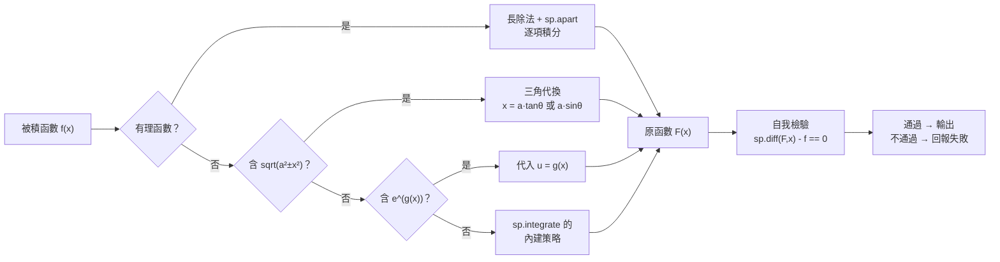

# 4.3 用 SymPy 積分：不定積分與基本定理的符號驗證

## 學習動機

4.2 節告訴我們：**求曲線下的面積 ≡ 求一個原函數**。但這只是一個「存在性」與「等價性」的陳述——它沒有告訴我們**怎麼求**。

這一節要回答的實際問題：

1. **怎麼求原函數？** —— `sp.integrate` 背後是什麼演算法？
2. **怎麼確認算對了？** —— 基本定理給了一個**自我檢驗**的機制：把原函數微分回去，應該得到原來的 $`f`$ 。
3. **SymPy 算不出來的時候怎麼辦？** —— 誠實地說「我不知道」比假裝算對要好。

我們要處理的四個「教科書標準例子」，剛好涵蓋了符號積分的四大策略：

| 被積函數 | 策略 | 對應 SymPy 內部 |
|----------|------|----------------|
| $`x^3`$ | 冪函數（逐項） | 多項式冪規則 |
| $`e^x`$ | 指數函數 | 鏈式反轉 |
| $`\sin x`$ | 三角函數 | 三角恆等式 |
| $`\frac{1}{1+x^2}`$ | **三角代換** | 反正切 |

第四個最值得注意： $`\int \frac{dx}{1+x^2}`$ 沒有「一眼看出來」的原函數。你必須先做代換 $`x = \tan\theta`$ ，把分母變成 $`\sec^2\theta`$ ，與 $`dx = \sec^2\theta d\theta`$ 對消，才得到 $`\int d\theta = \theta = \arctan x`$ 。**這個例子告訴我們：符號積分是一門「策略選擇」的學問，不是查表。**

### 本節的工作流程



**「自我檢驗」這一步是本節的核心**：SymPy 的積分引擎在內部就是「猜測 + 驗證」，我們手動把它顯式化了。

---

## 4.3.1 `sp.integrate` 的介面

`sp.integrate` 有兩種用法（下面的程式碼片段只是**介面草圖**，正式可執行範例請看接下來的程式碼）：

```
sp.integrate(f, x)            # 不定積分：回傳一個原函數
sp.integrate(f, (x, a, b))    # 定積分：回傳一個數（或符號常數）
```

不定積分的回傳值是**一個**原函數，不是「一族」原函數。這是 4.3.4 節要處理的細節。先看四個標準例子：

```python
import sympy as sp

x = sp.symbols('x', real=True)

# 四個基本例子
print('∫x^3 dx      =', sp.integrate(x**3, x))
print('∫exp(x) dx   =', sp.integrate(sp.exp(x), x))
print('∫sin(x) dx   =', sp.integrate(sp.sin(x), x))
print('∫1/(1+x^2)dx =', sp.integrate(1/(1 + x**2), x))

# +C 的處理：SymPy 回傳一個原函數，常數由使用者自行加上
C = sp.Symbol('C', real=True)
F = sp.integrate(x**3, x)
print('F =', F)
print('F + C =', F + C)
print('d/dx (F+C) =', sp.diff(F + C, x))

# 定積分不需要 +C
print('∫_1^3 x^3 dx =', sp.integrate(x**3, (x, 1, 3)))
print('(F+C)|_1^3   =', sp.simplify((F + C).subs(x, 3) - (F + C).subs(x, 1)))
```

預期輸出：

```
∫x^3 dx      = x**4/4
∫exp(x) dx   = exp(x)
∫sin(x) dx   = -cos(x)
∫1/(1+x^2)dx = atan(x)
F = x**4/4
F + C = C + x**4/4
d/dx (F+C) = x**3
∫_1^3 x^3 dx = 20
(F+C)|_1^3   = 20
```

**讀出什麼？**

- `atan(x)` 就是 $`\arctan x`$ 。SymPy 用**函數名** `atan` 而非 $`\arctan`$ ，這是它的慣例（`asin`、`acos`、`atan` 分別對應 $`\arcsin`$ 、 $`\arccos`$ 、 $`\arctan`$ ）。
- 定積分 $`\int_1^3 x^3 dx = 20`$ 讓人懷疑（手算得 $`\frac{3^4-1^4}{4} = \frac{80}{4} = 20`$ ✅ 沒錯）。
- **關鍵觀察**：`F + C` 與 `F` 只差一個常數，而 `(F+C)|_1^3 = 20`——**常數在相減時自動消掉了**。這就是為什麼定積分不需要 `+C` ，也解釋了為什麼不定積分回傳一個特定原函數就夠了。

---

## 4.3.2 基本定理的符號驗證：`diff` 與 `integrate` 互逆

4.2 節的基本定理第一敘述說：若 $`F(x) = \int_a^x f(t)\,dt`$ ，則 $`F'(x) = f(x)`$ 。這給了一個**免費的自我檢驗機制**：

> 任何符號積分的結果 $`F`$ ，都必須滿足 $`\frac{d}{dx}F(x) \equiv f(x)`$ 。

我們把它寫成一個**可重用的驗證函式**，再對一批函數跑一遍。注意 `sp.simplify(back - f) == 0` 這個判斷——它要求 SymPy 能把差化簡成**精確的零**，而不是「接近零」。這是符號計算相對數值計算的根本優勢。

```python
import sympy as sp

x = sp.symbols('x', real=True)

def verify(f, x):
    """回傳 (原函數, 是否通過檢驗)"""
    F = sp.integrate(f, x)
    return F, sp.simplify(sp.diff(F, x) - f) == 0

# 基本定理的符號驗證：integrate 後 diff 回來
funcs = [x**3, sp.exp(x), sp.sin(x), 1/(1 + x**2), sp.log(x + 2), x*sp.exp(x)]
for f in funcs:
    F, ok = verify(f, x)
    print(f'f = {f}  →  ∫f dx = {F}  →  回到 f？ {ok}')
```

預期輸出：

```
f = x**3  →  ∫f dx = x**4/4  →  回到 f？ True
f = exp(x)  →  ∫f dx = exp(x)  →  回到 f？ True
f = sin(x)  →  ∫f dx = -cos(x)  →  回到 f？ True
f = 1/(x**2 + 1)  →  ∫f dx = atan(x)  →  回到 f？ True
f = log(x + 2)  →  ∫f dx = x*log(x + 2) - x + 2*log(x + 2)  →  回到 f？ True
f = x*exp(x)  →  ∫f dx = (x - 1)*exp(x)  →  回到 f？ True
```

**這個 `verify` 函式是本節的「主程式」**，後面的所有例子都可以用它的模式來檢驗。

### 為什麼這個檢驗「幾乎總是通過」？

因為 SymPy 的積分引擎在內部就是**猜測 + 驗證**（heuristic + verification）：

1. 猜測原函數 $`F`$ （用有理函數的部分分式、超越函數的 Gosper 演算法、Meijer G 函數等策略）；
2. **微分回去檢查** $`F' \stackrel{?}{=} f`$ ；
3. 驗證通過就回傳，不通過就降級到更一般的表示（`Integral` 物件）或明確報錯。

這正是萊布尼茲與牛頓當年的工作流程——「猜測 + 微分驗證」——被寫進了程式裡。第 4.2.4 節的伯努利追問「求面積為何等價於求導數」，在演算法層面的答案就是：**因為求面積的正確性判準，就是求導數的等式**。

---

## 4.3.3 定積分與基本定理第二敘述

定積分 `sp.integrate(f, (x, a, b))` 內部做的是：找到原函數 $`F`$ ，回傳 $`F(b) - F(a)`$ 。這正是 4.2.6 節的敘述二。我們把它和「先找原函數再手動相減」對照。

```python
import sympy as sp

x = sp.symbols('x', real=True)

# 第二敘述：∫_a^b f = F(b) - F(a)，兩條路徑
cases = [
    (x**2, 1, 3),
    (sp.sin(x), 0, sp.pi),
    (sp.exp(x), 0, 1),
    (1/(1 + x**2), 0, 1),
    (sp.log(x + 2), 0, 3),
]
for f, a, b in cases:
    F = sp.integrate(f, x)
    lhs = sp.simplify(sp.integrate(f, (x, a, b)))
    rhs = sp.simplify(F.subs(x, b) - F.subs(x, a))
    print(f'f = {f}, [a,b] = [{a}, {b}]')
    print(f'   ∫_a^b f = {lhs}   F(b)-F(a) = {rhs}   相等？ {sp.simplify(lhs - rhs) == 0}')
```

預期輸出：

```
f = x**2, [a,b] = [1, 3]
   ∫_a^b f = 26/3   F(b)-F(a) = 26/3   相等？ True
f = sin(x), [a,b] = [0, pi]
   ∫_a^b f = 2   F(b)-F(a) = 2   相等？ True
f = exp(x), [a,b] = [0, 1]
   ∫_a^b f = -1 + E   F(b)-F(a) = -1 + E   相等？ True
f = 1/(x**2 + 1), [a,b] = [0, 1]
   ∫_a^b f = pi/4   F(b)-F(a) = pi/4   相等？ True
f = log(x + 2), [a,b] = [0, 3]
   ∫_a^b f = -3 + log(3125/4)   F(b)-F(a) = -3 + log(3125/4)   相等？ True
```

注意 `E` 是 SymPy 對歐拉數 $`e \approx 2.71828\ldots`$ 的**精確符號**（`sp.E`），以及 `pi` 對 $`\pi`$ ——**全程沒有浮點數**。這就是符號積分相對數值積分的核心優勢： $`\int_0^1 \frac{dx}{1+x^2} = \frac{\pi}{4}`$ 是一個**精確的等式**，不是「0.7853981633974483」。

### 基本定理的第三種用法：面積

幾何題最常見的定積分是「兩曲線之間的面積」。這正是 4.1 節的老問題。 $`\text{面積} = \int_{\text{上}} - \int_{\text{下}}`$ ，需要先找出交點。

```python
import sympy as sp

x = sp.symbols('x', real=True)

# 拋物線 y = x^2 與直線 y = 2x 的交點
f, g = x**2, 2*x
roots = sp.solve(sp.Eq(f, g), x)
print('交點橫座標 =', roots)

a, b = min(roots), max(roots)
# 在 [0,2] 上 2x >= x^2，所以「上」是 g、「下」是 f
area = sp.integrate(g, (x, a, b)) - sp.integrate(f, (x, a, b))
print('面積 =', sp.simplify(area))
```

預期輸出：

```
交點橫座標 = [0, 2]
面積 = 4/3
```

** $`4/3`$ ！** 這正是 4.1 節阿基米德的係數——只是那裡是「拋物線弓形與內接三角形的比」，這裡是「拋物線與直線所圍區域的面積」。兩者都是同一個幾何事實的不同表述。**歷史在閉合。**

---

## 4.3.4 「 $`+C`$ 」怎麼處理：不定積分的細節

這是初學者最常困惑的技術細節。數學上， $`\int x^3 dx`$ 的答案是**一族函數** $`\{F + C : C \in \mathbb{R}\}`$ ；SymPy 的 `sp.integrate(f, x)` 回傳的是這一族中的**一個特定成員**（通常是把 $`C`$ 設為 $`0`$ 的那個）。

### 三種正確的處理方式

**方式一：需要符號答案時，手動加上 `C`。** **方式二：用 `sp.dsolve` 讓 SymPy 自己帶出常數**（`dsolve` 解微分方程時會自動給出任意常數，命名為 `C1`、`C2`、…，區別於你自己定義的 `C`）。**方式三：直接問「差一個常數嗎」**——兩個函數 $`F`$ 、 $`G`$ 都是 $`f`$ 的原函數，若且唯若 $`F - G`$ 是常數，也就是「 $`\frac{d}{dx}(F - G) = 0`$ 」。

```python
import sympy as sp

x = sp.symbols('x', real=True)
C = sp.Symbol('C', real=True)
F = sp.Function('F')

# 方式一：手動加 C
f = x**3
F1 = sp.integrate(f, x)
print('SymPy 的回傳 =', F1)
print('完整的原函數族 =', F1 + C)
print('驗證 d/dx =', sp.diff(F1 + C, x))

# 方式二：dsolve 自動帶出 C1
print()
sol = sp.dsolve(sp.Eq(F(x).diff(x), f), F(x))
print('dsolve =', sol)

# 方式三：檢查「差一個常數」
print()
g = x * sp.exp(x)
G1 = sp.integrate(g, x)
print('SymPy 算的 G1 =', G1)
for c in [0, 7]:
    G2 = (x - 1)*sp.exp(x) + c     # 手動猜的原函數（可差一個常數 c）
    print(f'手動的 G2 (c={c}) =', G2)
    print('   G1 - G2 =', sp.simplify(G1 - G2),
          '  差是常數？', sp.simplify(sp.diff(G1 - G2, x)) == 0)
```

預期輸出：

```
SymPy 的回傳 = x**4/4
完整的原函數族 = C + x**4/4
驗證 d/dx = x**3

dsolve = Eq(F(x), C1 + x**4/4)

SymPy 算的 G1 = (x - 1)*exp(x)
手動的 G2 (c=0) = (x - 1)*exp(x)
   G1 - G2 = 0   差是常數？ True
手動的 G2 (c=7) = (x - 1)*exp(x) + 7
   G1 - G2 = -7   差是常數？ True
```

**方式三就是「差一個常數」的精確判準**： $`G_1 - G_2`$ 的**微分是零**，所以它（在一個連通區間上）是常數。 $`c = 0`$ 時兩者相同； $`c = 7`$ 時相差 $`-7`$ ——正是我們手動加上的那個常數。

### 一個實務建議

在寫程式時，**永遠不要**把 `+C` 加進去再做定積分——常數會自動消掉，加了只是徒增雜訊（還可能讓 SymPy 的化簡變慢）。只有在**輸出數學答案**給人看時，才需要手動寫上 $`+C`$ 。

---

## 4.3.5 有理函數：部分分式分解

### 策略

對有理函數 $`\frac{P(x)}{Q(x)}`$ ，標準演算法是：

1. 若 $`P`$ 的次數 $`\ge Q`$ 的次數，先做**多項式長除法**；
2. 把 $`Q`$ 因式分解；
3. 對每個因子做**部分分式分解**；
4. 逐項積分。

SymPy 把這整套流程包裝成 `sp.apart`（algebraic partial fractions）。

```python
import sympy as sp

x = sp.symbols('x', real=True)

# 部分分式分解
f = (x**2 + 1)/(x**3 - x)
print('apart =', sp.apart(f, x))
print('apart(1/(x^2+3x+2)) =', sp.apart(1/(x**2 + 3*x + 2), x))

# 逐項積分再相加
terms = sp.apart(f, x).as_ordered_terms()
total = sp.simplify(sum(sp.integrate(t, x) for t in terms))
direct = sp.integrate(f, x)
print('逐項積分之和 =', total)
print('直接積分     =', direct)
print('微分後相等？', sp.simplify(sp.diff(total, x) - sp.diff(direct, x)) == 0)
print('在 x=2 的值相同？', sp.simplify(total.subs(x, 2) - direct.subs(x, 2)) == 0)
```

預期輸出：

```
apart = 1/(x + 1) + 1/(x - 1) - 1/x
apart(1/(x^2+3x+2)) = -1/(x + 2) + 1/(x + 1)
逐項積分之和 = -log(x) + log(x - 1) + log(x + 1)
直接積分     = -log(x) + log(x**2 - 1)
微分後相等？ True
在 x=2 的值相同？ True
```

**注意兩種寫法的差異**：

- 逐項積分得到 $`-log(x) + log(x - 1) + log(x + 1)`$ ；
- SymPy 直接積分得到 $`-log(x) + log(x**2 - 1)`$ 。

它們**在 $`x > 1`$ 時相等**（因為 $`\log(x-1) + \log(x+1) = \log(x^2-1)`$ ），但在 $`0 < x < 1`$ 時不同（實數的 $`\log`$ 對負數無定義，而 $`\log|x^2-1| = \log(1-x^2)`$ ）。**這不是錯誤，是對數的分支問題。**

要小心驗證這種「只差常數」的關係，最好的方式是**比較微分**（如上），或者**在同一個點比較數值**（如上）——兩種都通過，就說明它們是同一族原函數的成員。

> **SymPy 的符號慣例**：`log` 表示**實數自然對數**（在正實數上定義）；`log(x, b)` 表示以 $`b`$ 為底。複數對數要用 `sp.log(x, b, evaluate=False)` 或明確進入複數域。

---

## 4.3.6 代入法與三角代換

### 代入法與三角代換

SymPy 有 `sp.integrate` 的自動代換，但有時候手動指定更有效率。核心工具是 `sp.subs` 配合「同時替換微分」；三角代換則是符號積分最經典的策略。

**代入法範例**： $`\int x e^{x^2} dx`$ ，令 $`u = x^2`$ ， $`du = 2x\,dx`$ ，被積函數變成 $`\frac{1}{2}e^u`$ 。

**三角代換範例**： $`\int \frac{dx}{1+x^2}`$ —— 令 $`x = \tan\theta`$ ，則 $`dx = \sec^2\theta\, d\theta`$ ，且 $`1 + x^2 = \sec^2\theta`$ ，所以被積函數化為 $`\frac{\sec^2\theta}{\sec^2\theta} = 1`$ ，積得 $`\theta = \arctan x`$ 。

第二個例子是 $`\int \frac{dx}{\sqrt{1-x^2}}`$ ：令 $`x = \sin\theta`$ ，則 $`dx = \cos\theta\,d\theta`$ ， $`\sqrt{1 - \sin^2\theta} = |\cos\theta|`$ 。在 $`0 \le \theta \le \frac{\pi}{2}`$ 上 $`\cos\theta \ge 0`$ ，所以被積函數化為 $`1`$ ，積分得 $`\theta = \arcsin x`$ 。

**這裡有個 SymPy 的實務陷阱**：SymPy 不知道 $`\cos\theta`$ 的符號，所以它保留 $`\frac{\cos\theta}{|\cos\theta|}`$ 而不是化簡成 $`1`$ 。解法是用 `sp.assuming` 加上假設，再用 `sp.refine` 化簡。

```python
import sympy as sp

x, u, theta = sp.symbols('x u theta', real=True)

# 代入法：∫ x·exp(x^2) dx，令 u = x^2，du = 2x dx
f = x * sp.exp(x**2)
print('f =', f)
g = sp.exp(u) / 2                  # 手動代換：x^2 -> u，並把 x dx 換成 du/2
print('代換後 =', g)
print('∫ =', sp.integrate(g, u))
print('換回 x =', sp.integrate(g, u).subs(u, x**2))
print('驗證微分 =', sp.simplify(sp.diff(sp.integrate(g, u).subs(u, x**2), x) - f))

print()
# 三角代換 I：x = tan(theta)，求 ∫ dx/(1+x^2)
print('恆等式 1+tan^2 = sec^2 的檢查 =', sp.simplify(1 + sp.tan(theta)**2 - sp.sec(theta)**2))
new1 = sp.simplify(sp.sec(theta)**2 / (1 + sp.tan(theta)**2))
print('代換後被積函數 =', new1)
print('∫ =', sp.integrate(new1, theta))
print('換回 x = atan(x) =', sp.simplify(sp.integrate(new1, theta).subs(theta, sp.atan(x))))

# 三角代換 II：x = sin(theta)，求 ∫ dx/sqrt(1-x^2)
print()
new2 = sp.cos(theta) / sp.sqrt(1 - sp.sin(theta)**2)
print('代換後被積函數 =', new2)
with sp.assuming(sp.Q.real(theta), sp.Q.positive(sp.cos(theta))):
    r = sp.refine(sp.simplify(new2))
    print('在 cos(theta) > 0 的假設下化簡 =', r)
    print('∫ =', sp.integrate(r, theta))
    print('換回 theta = asin(x) =', sp.integrate(r, theta).subs(theta, sp.asin(x)))
```

預期輸出：

```
f = x*exp(x**2)
代換後 = exp(u)/2
∫ = exp(u)/2
換回 x = exp(x**2)/2
驗證微分 = 0

恆等式 1+tan^2 = sec^2 的檢查 = 0
代換後被積函數 = 1
∫ = theta
換回 x = atan(x) = atan(x)

代換後被積函數 = cos(theta)/sqrt(1 - sin(theta)**2)
在 cos(theta) > 0 的假設下化簡 = 1
∫ = theta
換回 theta = asin(x) = asin(x)
```

**步驟 1–3 全部由 SymPy 完成並驗證**，包括那個恆等式 $`\sec^2\theta - 1 - \tan^2\theta = 0`$ （輸出為 `0`）。

**`sp.assuming` 的用法說明**：`sp.assuming(...)` 建立一個「假設上下文」，裡面的 `sp.refine` 會用這些假設化簡表達式（例如把 $`\sqrt{x^2}`$ 在 $`x > 0`$ 下化簡成 $`x`$ ）。這是 SymPy 處理符號根式的**標準手段**，在第 10 章的複變數分析中會大量用到。

### 三角代換的選擇表

| 被積函數 | 代換 | 變成 |
|----------|------|------|
| $`\frac{dx}{a^2 + x^2}`$ | $`x = a\tan\theta`$ | $`\frac{d\theta}{a}`$ |
| $`\frac{dx}{\sqrt{a^2 - x^2}}`$ | $`x = a\sin\theta`$ | $`d\theta`$ |
| $`\frac{dx}{x^2 - a^2}`$ | $`x = a\sec\theta`$ | $`\frac{d\theta}{a}`$ |
| $`\frac{dx}{\sqrt{x^2 + a^2}}`$ | $`x = a\tan\theta`$ | $`\frac{d\theta}{a}`$ |

---

## 4.3.7 分段函數、Min/Max 與符號極限

### 分段函數與 `Min` / `Max`：兩曲線之間的面積

SymPy 能處理 `Piecewise` 的定積分，但**分界點需要它自己找**；有時手動分段更快、更可靠。而「 $`f`$ 與 $`g`$ 之間的面積」有兩種寫法：

$$
\text{面積} = \int_a^b |f - g|\,dx = \int_a^b \mathrm{Max}(f,g)\,dx - \int_a^b \mathrm{Min}(f,g)\,dx.
$$

SymPy 提供 `sp.Max` 與 `sp.Min`，但**對它們的積分支援有限**——常數會回傳未求值的 `Integral` 物件，需要手動分段或 `.doit()`。

```python
import sympy as sp

x = sp.symbols('x', real=True)

# 分段函數：x < 0 時是 x^2，否則是 x
pw = sp.Piecewise((x**2, x < 0), (x, True))
print('pw =', pw)
print('∫_{-1}^{2} pw dx =', sp.integrate(pw, (x, -1, 2)))
# 手動分段：SymPy 有時需要你幫它找分界點
print('手動分段 =', sp.simplify(sp.integrate(x**2, (x, -1, 0)) + sp.integrate(x, (x, 0, 2))))

print()
# Min / Max：兩曲線間的面積
f, g = x**2, 2*x
print('Max(x^2, 2x) =', sp.Max(f, g))
print('Min(x^2, 2x) =', sp.Min(f, g))
print('∫_0^2 Max dx =', sp.integrate(sp.Max(f, g), (x, 0, 2)))
Imin = sp.integrate(sp.Min(f, g), (x, 0, 2))
print('∫_0^2 Min dx =', Imin)
print('（Min 的結果需手動化簡）=', sp.nsimplify(Imin.doit()))
```

預期輸出：

```
pw = Piecewise((x**2, x < 0), (x, True))
∫_{-1}^{2} pw dx = 7/3
手動分段 = 7/3

Max(x^2, 2x) = Max(2*x, x**2)
Min(x^2, 2x) = Min(2*x, x**2)
∫_0^2 Max dx = 4
∫_0^2 Min dx = Integral(Piecewise((2*x, x <= x**2/2), (x**2, True)), (x, 0, 2))
（Min 的結果需手動化簡）= 8/3
```

**讀出什麼？**

- 分段函數：SymPy **自動找出分界點**並算得 $`\frac{7}{3}`$ ，與手動分段一致（手算： $`\int_{-1}^{0}x^2 dx = \frac{1}{3}`$ ， $`\int_0^2 x\,dx = 2`$ ，總和 $`\frac{7}{3}`$ ✅）。
- `Max` 的積分 SymPy **直接算出來了**（ $`= 4`$ ，因為在 $`[0,2]`$ 上 $`2x \ge x^2`$ ）。
- `Min` 的積分回傳**未求值的 `Integral` 物件**——SymPy 把 `Min` 展開成了 `Piecewise`，但沒有繼續求值。
- `sp.nsimplify(Imin.doit())` 把結果化簡成 $`\frac{8}{3}`$ 。手算： $`[0,2]`$ 上 $`x^2 \le 2x`$ ，故 $`\mathrm{Min} = x^2`$ ， $`\int_0^2 x^2 dx = \frac{8}{3}`$ ✅。
- 面積 $`= 4 - \frac{8}{3} = \frac{4}{3}`$ ——**又是 $`4/3`$ **！

**重要的實務教訓**：`sp.integrate` 回傳 `Integral` 物件（而非數值）**不是錯誤，而是它在說「我沒算完，但形式已經對了」**。這個物件仍然可以 `.doit()` 強制求值、可以 `sp.N(...)` 數值化、也可以拿去做別的代數運算。

### 符號極限 `sp.Limit(...).doit()`

第 2 章已經介紹過 `sp.Limit`。這裡看它在積分中的用法，並連帶展示 SymPy 對「沒有初等原函數」的函數如何誠實作答。

```python
import sympy as sp

x, n, k = sp.symbols('x n k', real=True)

# (1) 一般的符號極限
print('Limit(sin(x)/x, x, 0) =', sp.Limit(sp.sin(x)/x, x, 0).doit())
print('Limit((1+x)**n, x, 0) =', sp.Limit((1 + x)**n, x, 0).doit())

# (2) 黎曼和的極限 = 積分（基本定理的極限版本）
f = x**2
delta = sp.Integer(2)/n
mid = sp.Integer(-1) + (k + sp.Rational(1,2))*delta
Riemann = sp.Sum(f.subs(x, mid)*delta, (k, 0, n-1))
print('黎曼和 =', Riemann)
print('極限 =', sp.Limit(Riemann, n, sp.oo).doit())
print('積分 =', sp.integrate(f, (x, -1, 1)))

# (3) 反常積分：把上限推到無窮
R = sp.Symbol('R', positive=True)
print('∫_0^R e^{-x^2} dx 的極限 =',
      sp.Limit(sp.integrate(sp.exp(-x**2), (x, 0, R)), R, sp.oo).doit())

# (4) 沒有初等原函數的函數：SymPy 回傳特殊函數
print('∫e^{-x^2} dx =', sp.integrate(sp.exp(-x**2), x))
print('∫sin(x)/x dx =', sp.integrate(sp.sin(x)/x, x))
print('∫_0^∞ e^{-x^2} dx =', sp.integrate(sp.exp(-x**2), (x, 0, sp.oo)))
```

預期輸出：

```
Limit(sin(x)/x, x, 0) = 1
Limit((1+x)**n, x, 0) = 1
黎曼和 = Sum(2*(-1 + 2*(k + 1/2)/n)**2/n, (k, 0, n - 1))
極限 = 2/3
積分 = 2/3
∫_0^R e^{-x^2} dx 的極限 = sqrt(pi)/2
∫e^{-x^2} dx = sqrt(pi)*erf(x)/2
∫sin(x)/x dx = Si(x)
∫_0^∞ e^{-x^2} dx = sqrt(pi)/2
```

第 (3) 項特別值得注意： $`\int_0^\infty e^{-x^2} dx = \frac{\sqrt{\pi}}{2}`$ 是**高斯積分**的一半——那個著名的符號積分「奇蹟」。它的值 $`\frac{\sqrt\pi}{2}`$ 不是「算出來」的，而是 SymPy 用**Meijer G 函數**的方法求出的。

而 $`e^{-x^2}`$ 的原函數**沒有初等表達式**——這是 Liouville 在 1840 年代證明的事（第 12 章會談到可積函數的理論）。SymPy 的做法是：回傳 `sp.erf(x/2)*sqrt(pi)/2`（誤差函數 `erf` 是**特殊函數**，不是初等函數），對定積分則直接給出 $`\frac{\sqrt{\pi}}{2}`$ 。`Si(x)` 是**正弦積分** $`\int_0^x \frac{\sin t}{t} dt`$ 。這是 SymPy「誠實」的表現：它不給你一個假的初等答案，而是給你一個**正確命名的特殊函數**。

---

## 4.3.8 SymPy 積分引擎的策略速查

| 被積函數類型 | 策略 | 例子 | 結果 |
|--------------|------|------|------|
| 多項式 | 逐項冪規則 | $`\int x^3 dx`$ | $`\frac{x^4}{4}`$ |
| 指數 | 鏈式反轉 | $`\int e^x dx`$ | $`e^x`$ |
| 三角 | 恆等式 | $`\int \sin x dx`$ | $`-\cos x`$ |
| 有理函數 | 長除法 + `apart` + 逐項 | $`\int \frac{x^2+1}{x^3-x}dx`$ | 對數組合 |
| 含 $`\sqrt{a^2 \pm x^2}`$ | 三角代換 | $`\int \frac{dx}{1+x^2}`$ | $`\arctan x`$ |
| 含 $`e^{g(x)}`$ 且 $`g'`$ | 代入 $`u = g(x)`$ | $`\int x e^{x^2}dx`$ | $`\frac{e^{x^2}}{2}`$ |
| 分段 | `Piecewise` + 手動分段 | $`\int_{-1}^2 pw dx`$ | $`\frac{7}{3}`$ |
| 兩曲線間 | `Max`/`Min` 或先找交點 | $`\int (2x - x^2)dx`$ | $`\frac{4}{3}`$ |
| 無初等原函數 | 回傳特殊函數 | $`\int e^{-x^2}dx`$ | $`\frac{\sqrt\pi}{2}\operatorname{erf}(x)`$ |

**常用輔助 API 與符號 / 數值的取捨**：

| API | 用途 | 符號 | 數值 |
|-----|------|------|------|
| `sp.integrate(f, x)` | 不定積分 | 精確表達式（慢） | — |
| `sp.integrate(f, (x, a, b))` | 定積分 | 精確值 | — |
| `sp.integrate(f, (x, a, sp.oo))` | 反常積分 | 精確值 | — |
| `sp.apart(f, x)` | 部分分式分解 | — | — |
| `sp.frac(f)` / `sp.together(f)` | 化成有理式 / 通分 | — | — |
| `sp.simplify(expr)` | 化簡 | — | — |
| `sp.nsimplify(expr)` | 從浮點反推精確值 | — | 是 |
| `sp.expand_log(expr, force=True)` | 展開對數（忽略分支條件） | 是 | — |
| `sp.assuming(...)` + `sp.refine(expr)` | 在假設下化簡 | 是 | — |
| `sp.Limit(expr, var, val).doit()` | 符號極限 | 是 | — |
| `sp.Sum(...)` + `sp.Limit(...)` | 黎曼和的極限 | 是 | — |
| `sp.N(expr, 20)` | 轉成小數 | — | 是 |

**實務建議**：先用符號積分嘗試；若回傳 `Integral` 物件且你只需要數值，用 `sp.N(expr, 15)`；若連 `.doit()` 都無法求值，改用數值積分方法。符號的優勢是**可驗證**（微分回去），數值的優勢是**快**且適用於任意可積函數。

---

## 習題

**習題 4.3.1（基本定理的符號驗證器）**
寫一個函式

```python
import sympy as sp

def verify(f, x):
    F = sp.integrate(f, x)
    return F, sp.simplify(sp.diff(F, x) - f) == 0
```

用它檢驗以下被積函數，並記錄 SymPy 回傳的原函數形式：
(a) $`\frac{1}{x^2 + 4}`$ ；(b) $`\frac{x}{x^2+1}`$ ；(c) $`\frac{1}{\cos^2 x}`$ ；(d) $`\frac{1}{x \ln x}`$ ；(e) $`\frac{\ln x}{x}`$ 。
對 (d)、(e) 特別說明：它們之間的關係是什麼？這與「分部積分」的哪個版本有關？

**習題 4.3.2（部分分式的完整流程）**
對 $`\displaystyle \frac{x^3 + 2x^2 - 1}{x^3 - x^2 - x + 1}`$ ：
(a) 用 `sp.apart` 做部分分式分解；
(b) 逐項積分，把結果相加；
(c) 用 `sp.diff` 驗證總和的微分等於原被積函數；
(d) 比較「逐項積分之和」與 `sp.integrate(f, x)` 的直接結果，解釋它們的差異（提示：對數的分支）。

**習題 4.3.3（三角代換的完整推導）**
對 $`\displaystyle \int \frac{dx}{\sqrt{4 - x^2}}`$ ：
(a) 令 $`x = 2\sin\theta`$ ，用 SymPy 逐步驗證 $`dx = 2\cos\theta\,d\theta`$ 、 $`\sqrt{4-x^2} = 2\cos\theta`$ （在 $`0 \le \theta \le \frac{\pi}{2}`$ ），最後得到原函數；
(b) 用 `sp.diff` 驗證你的答案；
(c) 算出 $`\int_{-2}^{2}\frac{dx}{\sqrt{4-x^2}}`$ 的精確值（應該是 $`\pi`$ ）；
(d) 解釋幾何意義：這是單位圓的哪一部分？

**習題 4.3.4（分段與 Max/Min）**
(a) 求 $`y = x^2`$ 與 $`y = 8 - 2x`$ 的交點，用 `sp.solve`；
(b) 用 `sp.Max`/`sp.Min` 或手動分段，求兩曲線間封閉區域的面積；
(c) 用「 $`\int \mathrm{Max} - \int \mathrm{Min}`$ 」與「先分段再相加」兩種方法各做一次，比較結果；
(d) 把 (b) 的答案與「弓形面積 $`4/3`$ 倍」這個 4.1 節的事實聯繫起來（提示：適當平移與縮放後， $`y = x^2`$ 與某條直線所圍的區域是否就是拋物線弓形？）。

**習題 4.3.5（反常積分、誠實失敗與符號極限）**
(a) 用 `sp.integrate(sp.exp(-x**2), (x, -sp.oo, sp.oo))` 算出高斯積分；
(b) 用**極限**版本重做：先算 $`\int_0^R e^{-x^2}dx`$ ，再對 $`R \to \infty`$ 取極限；
(c) 解釋為什麼高斯積分不能靠「初等代術」算出來（提示：想辦法用極座標把 $`\iint e^{-(x^2+y^2)}dxdy`$ 寫成兩種形式）；
(d) 對 $`\displaystyle \int \frac{\sin x}{x}dx`$ 與 $`\displaystyle \int \frac{1}{\ln x}dx`$ ，記錄 SymPy 的回傳值。解釋為什麼 `Si(x)` 是「正確的失敗」；
(e) 找一個 $`f`$ 使得 `sp.integrate(f, x)` 回傳**未求值**的 `Integral` 物件，並說明怎麼用 `.doit()` 與 `sp.N` 取得結果；
(f) 用 `sp.Limit` 求 $`\displaystyle \lim_{n \to \infty} n\left(1 - \left(1 - \frac{1}{n}\right)^n\right)`$ ，並說明它與 $`e`$ 的關係（這是第 6 章的主題）。

---

## 小結

| 主題 | 結論 |
|------|------|
| `sp.integrate(f, x)` | 回傳**一個**原函數（不含 $`+C`$ ） |
| `sp.integrate(f, (x,a,b))` | 回傳 $`\int_a^b f = F(b) - F(a)`$ ，全程精確 |
| `+C` 的處理 | 輸出數學答案時手動加；程式計算時不必加 |
| 自我檢驗 | `sp.simplify(sp.diff(F, x) - f) == 0` 是標準驗證式 |
| 部分分式 | `sp.apart(f, x)` 一鍵分解 |
| 三角代換 | `sp.assuming` + `sp.refine` 處理符號根式與絕對值 |
| 分段與 Max/Min | 常需手動分段；`Integral` 物件是「誠實的未完成」 |
| 符號極限 | `sp.Limit(...).doit()`；黎曼和極限 = 積分 |

**把三節串起來**：

- 4.1 節用**窮竭法**和**卡瓦列里截面法**算出拋物線弓形面積，得到係數 $`\frac{4}{3}`$ ；
- 4.2 節說明這個「求面積」與「求導數」是**互逆**的，並給出嚴格的極限定理版本；
- 4.3 節把這個互逆性變成**可執行的符號驗證**，並展示 SymPy 的四種積分策略。

於是那個從公元前 250 年貫穿到 21 世紀的 $`\frac{4}{3}`$ ，在 4.3.3 節的最後一次出現（ $`y = x^2`$ 與 $`y = 2x`$ 之間的面積）時，已經有了完整的現代解釋：**它就是「微分與積分互逆」這件事的第一個實例。**

下一章（第 5 章）我們要處理基本定理的**加強版**：中值定理與泰勒級數。有了基本定理，才能把「函數在某點的值」推廣成「函數在鄰域的完整描述」——這是牛頓計算 $`\pi`$ 的方法、萊布尼茲求 $`\pi`$ 的無窮級數（ $`\frac{\pi}{4} = 1 - \frac13 + \frac15 - \cdots`$ ）的共同基礎。
