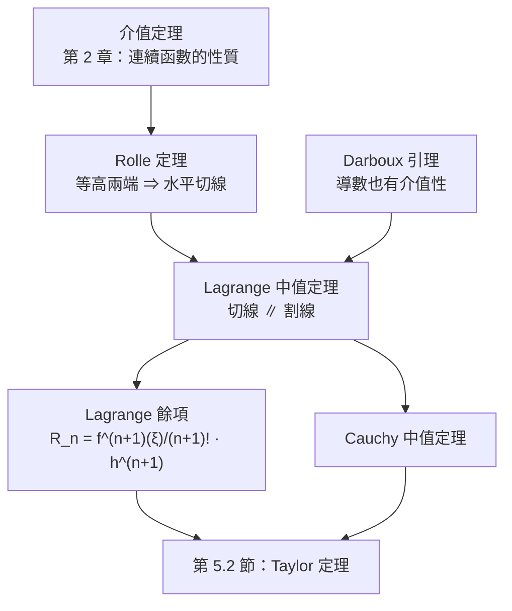
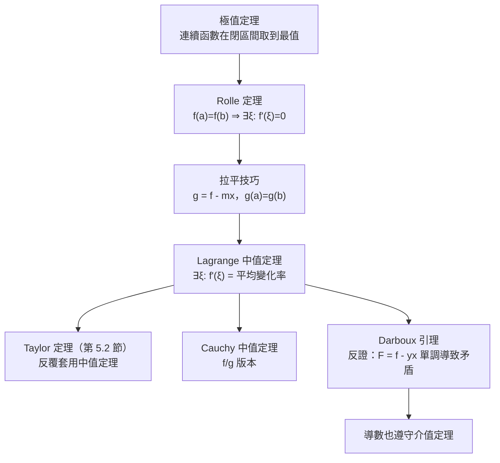

# 5.1 拉格朗日中值定理與達朗貝爾引理（1787 年）

## 學習動機

在第 3 章我們學會了「導數」：瞬時變化率。在第 4 章我們學會了「積分」：把無限多個極小的變化加起來。但有一個問題一直懸在半空中：

> 我們知道 $`f`$ 在 $`x = 1`$ 的瞬間變化率是 $`f'(1)`$ ，在 $`x = 2`$ 是 $`f'(2)`$ 。那麼在 $`1`$ 與 $`2`$ 之間，函數「平均」變化了多少？

最笨的辦法是拿端點割線的斜率 $`\dfrac{f(2)-f(1)}{2-1}`$ 來代表；但若 $`f`$ 在中間先衝上 $`100`$ 再掉到 $`-100`$ ，割線斜率顯然「平均得太離譜」。真正正確的說法是：**存在某個中間點 $`\xi`$ ，使得 $`f'(\xi)`$ 恰好等於平均變化率**。這就是拉格朗日中值定理（Joseph Louis Lagrange, 1787 年的 *Théorie des fonctions analytiques*）。

而它並不是憑空冒出來的：它脫胎自更古老、更有名的 **Rolle 定理**——「兩端等高的可微曲線，中間一定有一條水平切線」。1848 年，德國數學家 **Philipp Gilbert Lichtenstein** 指出：費馬在建立微積分之前就已經用過 Rolle 定理；而 Lagrange 在 1787 年把它推廣成「切線平行割線」的形式。

同一時期還有另一件大事：**達朗貝爾（Jean le Rond d'Alembert, 1717–1783）** 在 1750 年代證明了導數本身也具有「介值性」：即使 $`f'`$ 在某處不連續， $`f'`$ 在區間上依然取得到它兩個值之間的所有值——**導數版本的介值定理**。這就是 **Darboux 引理**，它是第 2 章「介值定理」與第 3 章「導數」的交叉點。

本節的三條主線：



學完本節，你會能夠：

1. 用符號計算精確求出中值點 $`\xi`$ ；
2. 解釋為什麼導數不必連續也有介值性（Darboux）；
3. 把 Lagrange 中值定理視為「把割線拉平成水平線」的技巧；
4. 用中值定理給出數值誤差上界；
5. 理解 Lagrange 餘項——它是第 5.2 節 Taylor 定理的心臟。

---

## 5.1.1 Rolle 定理：等高兩點之間必有水平切線

**定理 5.1（Rolle）** 設 $`f`$ 在閉區間 $`[a, b]`$ 上連續，在開區間 $`(a, b)`$ 上可微，且 $`f(a) = f(b)`$ 。則存在 $`\xi \in (a, b)`$ 使得

$$
f'(\xi) = 0.
$$

### 證明的關鍵技巧：把割線拉平

Rolle 定理最漂亮的證明（沿用 Lagrange 的思路）是引入一個「修正過的函數」。令割線斜率為

$$
m = \frac{f(b) - f(a)}{b - a},
$$

並定義

$$
g(x) = f(x) - m x.
$$

則 $`g(a) = g(b)`$ ，而且

$$
g'(x) = f'(x) - m.
$$

若我們能在 $`(a, b)`$ 中找到 $`\xi`$ 使 $`g'(\xi) = 0`$ ，就得到 $`f'(\xi) = m`$ ——**切線斜率等於割線斜率**。這正是 Lagrange 中值定理。反過來，若 $`f(a) = f(b)`$ ，則 $`m = 0`$ ， $`g`$ 就是原來的 $`f`$ ，Rolle 定理立刻得證。

而 Rolle 定理的證明本身只需一步：**連續函數在閉區間上必取到最大值與最小值**（Weierstrass 極值定理）。因為 $`g(a) = g(b)`$ ，最大值 $`M`$ 與最小值 $`m`$ 不可能只在端點同時取到（否則 $`g`$ 是常數，結論更顯然）。所以某個內部點 $`\xi`$ 是極值點，由 Fermat 引理（3.1 節）得 $`g'(\xi) = 0`$ 。

我們用 SymPy 把整個「拉平」過程做成可檢驗的物件：

```python
import sympy as sp

x, c = sp.symbols('x c', real=True)

# 把割線「拉平」：g(x) = f(x) - m*x，則 g(a) = g(b)
f = x**3 - 3*x
a, b = sp.Integer(0), sp.Integer(2)
m = (f.subs(x, b) - f.subs(x, a)) / (b - a)
g = sp.expand(f - m*x)

print("割線斜率 m =", m)
print("g(x) = f(x) - m*x =", g)
print("g(a) =", g.subs(x, a), "  g(b) =", g.subs(x, b))       # 兩端同高
print("g'(x) =", sp.diff(g, x))
print("g'(c) = 0 的解 =", sp.solve(sp.Eq(sp.diff(g, x).subs(x, c), 0), c))
print("f'(c) - m =", sp.simplify(sp.diff(f, x).subs(x, c) - m))  # 恰為 0 的條件
```

預期輸出：

```
割線斜率 m = 1
g(x) = f(x) - m*x = x**3 - 4*x
g(a) = 0   g(b) = 0
g'(x) = 3*x**2 - 4
g'(c) = 0 的解 = [-2*sqrt(3)/3, 2*sqrt(3)/3]
f'(c) - m = 3*c**2 - 4
```

注意最後一行：把 $`g'(c) = 0`$ 換回 $`f'(c) = m`$ ， $`m`$ 自動消失——因為「切線平行割線」這件事是**幾何的**，與 $`f`$ 的多項式次數無關。

---

## 5.1.2 Lagrange 中值定理

**定理 5.2（Lagrange）** 設 $`f`$ 在 $`[a, b]`$ 上連續、在 $`(a, b)`$ 上可微。則存在 $`\xi \in (a, b)`$ 使得

$$
f(b) - f(a) = f'(\xi)(b - a),
$$

等價地，

$$
\frac{f(b) - f(a)}{b - a} = f'(\xi).
$$

這就是「割線斜率 = 某個中間點的切線斜率」。注意 $`\xi`$ **通常無法用初等公式寫出**，但它的**存在性**才是定理的實質內容。

現在用 SymPy 精確地找出 $`\xi`$ ：把 $`f'(\xi) = \dfrac{f(b)-f(a)}{b-a}`$ 當作方程求解，並檢查每個候選根是否真的落在 $`(a,b)`$ 內。

```python
import sympy as sp

x, xi = sp.symbols('x xi', real=True)
f = x**3 - 3*x
a, b = sp.Integer(0), sp.Integer(2)

slope = sp.simplify((f.subs(x, b) - f.subs(x, a)) / (b - a))
print("割線斜率 =", slope)
print("f'(x) =", sp.diff(f, x))

cands = sp.solve(sp.Eq(sp.diff(f, x).subs(x, xi), slope), xi)
print("候選點 =", cands)
for c in cands:
    print("  xi =", c, "  在 (0, 2) 內?", sp.simplify(a < c < b))

# 再驗一次：把切線方程寫出來，看它是否通過 (b, f(b))
for c in cands:
    tangent_value = sp.simplify(f.subs(x, c) + slope * (b - c))
    print("  切線在 x=b 的值 =", tangent_value, "   f(b) =", f.subs(x, b))
```

預期輸出：

```
割線斜率 = 1
f'(x) = 3*x**2 - 3
候選點 = [-2*sqrt(3)/3, 2*sqrt(3)/3]
  xi = -2*sqrt(3)/3   在 (0, 2) 內? False
  xi = 2*sqrt(3)/3   在 (0, 2) 內? True
  切線在 x=b 的值 = 2 + 16*sqrt(3)/9    f(b) = 2
  切線在 x=b 的值 = 2 - 16*sqrt(3)/9    f(b) = 2
```

這裡有一個值得停下來想的现象：**方程有兩個根，但定理只保證一個落在區間內**。 $`f'(x) = 3x^2 - 3`$ 是 U 型曲線， $`f'(x) = 1`$ 有兩解（ $`\pm 2/\sqrt3`$ ），其中只有正的那個在 $`(0,2)`$ 裡。定理給的是「至少一個」，不是「唯一一個」——這與 Rolle 定理同理（ $`f = \sin x`$ 在 $`[0, 2\pi]`$ 上有兩個水平切線點）。

而中間那兩行「切線在 $`x=b`$ 的值 $`\ne f(b)`$ 」正說明：只有落在區間內的那個 $`\xi`$ 才給出**通過割線端點**的平行切線；另一個根給出的是另一條平行線，但截不到割線。

---

## 5.1.3 幾何直觀：切線與割線

把上面那個例子畫出來，圖形的訊息非常清楚：

- 割線（灰色虛線）連接 $`(0, 0)`$ 與 $`(2, 2)`$ ，斜率 $`1`$ ；
- 在 $`c = 2/\sqrt3 \approx 1.1547`$ 處的切線（紅線）斜率恰也是 $`1`$ ，**平行於割線**；
- 這條切線把割線「頂」在曲線上——它是曲線與割線之間的最大距離處嗎？不，是曲線「轉向」的那個點。事實上 $`c`$ 是 $`g(x) = f(x) - mx`$ 的一個極值點，也就是 $`f`$ 與割線的**間距最大**的位置。

用 matplotlib 畫出來：

```python
import sympy as sp
import numpy as np
import matplotlib
matplotlib.use("Agg")
import matplotlib.pyplot as plt

x = sp.symbols('x', real=True)
f = x**3 - 3*x
a, b = 0.0, 2.0
slope = float((f.subs(x, b) - f.subs(x, a)) / (b - a))
c = float(2*sp.sqrt(3)/3)

xs = np.linspace(-0.6, 2.6, 500)
ys = np.array([float(f.subs(x, v)) for v in xs])

fig, ax = plt.subplots(figsize=(7.5, 5.2))
ax.plot(xs, ys, linewidth=2, label="f(x) = x^3 - 3x")
ax.plot([a, b], [float(f.subs(x, a)), float(f.subs(x, b))],
        "o--", color="gray", label="secant (割線)")
fc = float(f.subs(x, c))
ax.plot([c], [fc], "ro", label="tangent point c")
ax.plot(xs, [fc + slope*(v - c) for v in xs], color="red",
        label="tangent at c (∥ 割線)")
ax.set_xlabel("x"); ax.set_ylabel("y")
ax.legend(); ax.grid(True, alpha=0.3)
plt.tight_layout()
plt.savefig("/tmp/mvt_tangent.png", dpi=120)

print("slope =", slope, "  c =", c)
print("saved /tmp/mvt_tangent.png")
```

預期輸出：

```
slope = 1.0   c = 1.1547005383792515
saved /tmp/mvt_tangent.png
```

> **中值定理的「積分版」** 中值定理還有另一個面孔：若 $`f'`$ 連續，則 $`\int_a^b f'(x)\,dx = f'(\xi)(b-a)`$ ，即 $`\int_a^b f' = f(b)-f(a)`$ ——這正是第 4.2 節的牛頓–萊布尼茲定理。反過來說， $`\dfrac{1}{b-a}\int_a^b f'(x)dx`$ 就像 $`f'`$ 在區間上的「平均值」，而 Lagrange 定理說： $`\xi`$ 使得 $`f'(\xi)`$ 等於這個平均值。

---

## 5.1.4 Darboux 引理：導數自己也有介值性

現在來到本節最精采的部分。

第 2 章的介值定理說：**連續**函數取得到它兩個值之間的所有值。但導數 $`f'`$ 可能**不連續**——我們在 3.3 節已看過 $`x^2\sin(1/x)`$ 的導數在 $`0`$ 處劇烈振盪。那麼 $`f'`$ 還會有介值性嗎？

**定理 5.3（Darboux 引理，1841 年 Darboux 給出；其實 Lagrange 已在 1787 年隱含用到）** 若 $`f`$ 在 $`[a,b]`$ 上可微，則 $`f'`$ 具備介值性（ Darboux 性質）：對任何 $`y`$ 介於 $`f'(a)`$ 與 $`f'(b)`$ 之間的數值，存在 $`\xi \in (a,b)`$ 使得 $`f'(\xi) = y`$ 。

也就是說：

> **連續性不是介值定理的必要條件；導數天生就有介值性。**

### 為什麼 Darboux 引理成立

證明路線非常漂亮，和 Lagrange 中值定理是同一套裝備。假設 $`f'`$ 在 $`[a,b]`$ 上**取不到**中介值 $`y`$ ，即 $`f'(x) - y`$ 永遠不為零。由 Darboux 引理自身的對偶命題（若 $`f'`$ 取不到 $`y`$ ，則 $`f' - y`$ 在區間上定號）——這裡用反證法配合 IVT 會繞圈，正確的做法是：

令

$$
F(x) = f(x) - yx.
$$

則 $`F'(x) = f'(x) - y`$ 永遠不等於 $`0`$ 。若 $`F' > 0`$ 恆成立（或 $`< 0`$ ），則 $`F`$ 嚴格單調，於是 $`F(b) - F(a) = F'(\xi)(b-a)`$ 對某 $`\xi`$ 成立（Lagrange），即 $`F'(\xi) \ne 0`$ ——**矛盾**。所以 $`F'`$ 必須在某處變號，而變號本身又要求 $`F'`$ 取到 $`0`$ ，即 $`f'(\xi) = y`$ 。

這個證明裡藏著一個深刻的訊息：**Darboux 引理幾乎是中值定理的同義反覆**——兩者都是「把割線拉平」的技巧在不同函數上的應用。

### SymPy 實證：振盪函數的導數仍然有介值性

取 $`f(x) = x^2\sin(1/x)`$ （ $`x \ne 0`$ ）， $`f(0) = 0`$ 。它的導數是

$$
f'(x) = 2x\sin(1/x) - \cos(1/x) \quad (x \ne 0), \qquad f'(0) = 0,
$$

顯然在 $`0`$ 附近來回振盪、不連續。但 Darboux 保證： $`f'(0) = 0`$ 與 $`f'(1/\pi) = 1`$ 之間， $`f'`$ 必須取到 $`1/2`$ 。我們用二分法找出這個 $`\xi`$ ：

```python
import sympy as sp

x = sp.symbols('x', real=True)

# f 在 x=0 處定義為 0；導數須手動指定（SymPy 無法直接微分 x=0 的分式）
f = sp.Piecewise((x**2 * sp.sin(1/x), sp.Ne(x, 0)), (0, True))
fp = sp.Piecewise((2*x*sp.sin(1/x) - sp.cos(1/x), sp.Ne(x, 0)), (0, True))

print("f =", f)
print("f' =", fp)

# f' 在 0 不連續，但取值在 {-1, 1} 之間振盪
for k in [1, 2, 3, 4]:
    xk = sp.S.One/(k*sp.pi)
    print(f"  x = 1/({k}*pi) = {float(xk):.6f}   f'(x) = {sp.simplify(fp.subs(x, xk))}")

# Darboux：f'(1/(2pi)) = -1, f'(1/pi) = 1 ⇒ 必存在 xi 使 f'(xi) = 1/2
def F(v):
    return float(sp.N(2*v*sp.sin(1/v) - sp.cos(1/v)))

lo, hi = sp.S.One/(2*sp.pi), sp.S.One/sp.pi
print("端點: f'(1/(2pi)) =", F(lo), "  f'(1/pi) =", F(hi))

target = 0.5
for _ in range(200):
    mid = (lo + hi) / 2
    if (F(lo) - target) * (F(mid) - target) <= 0:
        hi = mid
    else:
        lo = mid
xi_val = float((lo + hi) / 2)
print("二分法找到 xi =", xi_val)
print("代入檢查 f'(xi) =", sp.N(fp.subs(x, xi_val), 12))
print("落在 (0, 1/pi) 內?", 0 < xi_val < float(1/sp.pi))
print("對照: f'(0) =", fp.subs(x, 0), "（不連續！）")
```

預期輸出：

```
f = Piecewise((x**2*sin(1/x), Ne(x, 0)), (0, True))
f' = Piecewise((2*x*sin(1/x) - cos(1/x), Ne(x, 0)), (0, True))
  x = 1/(1*pi) = 0.318310   f'(x) = 1
  x = 1/(2*pi) = 0.159155   f'(x) = -1
  x = 1/(3*pi) = 0.106103   f'(x) = 1
  x = 1/(4*pi) = 0.079577   f'(x) = -1
端點: f'(1/(2pi)) = -1.0   f'(1/pi) = 1.0
二分法找到 xi = 0.2654703516755185
代入檢查 f'(xi) = 0.500000000000
落在 (0, 1/pi) 內? True
對照: f'(0) = 0 （不連續！）
```

**這是本節最重要的實驗**： $`f'`$ 是一個**不連續**的函數，但它依然精確地取到了 $`1/2`$ ——如果它只是「跳躍」，這是不可能的。Darboux 引理告訴我們：導數不可能有「第一類間斷點（可去/跳躍）」那樣的斷點。導數的間斷點一定是**第二類間斷點**（振盪型），如上例的 $`0`$ 。

> **推論（連續性的還原）** 既然導數有 Darboux 性質，那麼若 $`f`$ 可微且 $`f'`$ 有界，則 $`f'`$ 在區間上**連續**？不對—— $`f'`$ 仍可能不連續（如上例）。但我們得到一個更實際的結論：**一個函數若有介值性質且只有第一類間斷點，它就必連續**；因此 Darboux 性質是比連續性更強或更弱？Darboux 性質**比連續性弱**（連續 ⇒ Darboux，但反之不然），但它**排除**了跳躍型間斷。

---

## 5.1.5 為什麼中值定理是「導數版的介值定理」

把 5.1.2 與 5.1.4 並排看，兩者的邏輯骨架完全同構：

| | 介值定理（第 2 章） | Lagrange 中值定理 | Darboux 引理 |
|---|---|---|---|
| 作用對象 | 連續函數 $`g`$ | 可微函數 $`f`$ | 導數 $`f'`$ |
| 結論 | $`g`$ 取到端點值之間的一切值 | $`f'`$ 取到平均變化率 $`m`$ | $`f'`$ 取到端點導數值之間的一切值 |
| 核心道具 | 極值定理 | 極值定理 + 拉平 | 中值定理（反證） |
| 「存在一個 $`\xi`$ 」的意義 | 值落在中間 | **切線斜率 = 割線斜率** | 值落在中間 |

最關鍵的類比是：**介值定理是「連續函數」世界裡的中值定理；Darboux 引理是把它搬到「導數」世界；而 Lagrange 中值定理則是把中值定理的結論用「切線 vs 割線」重新包裝**。

更漂亮的是它們的**證明統一性**：



三者共用同一台引擎：**極值定理 + 拉平**。這也是為什麼 Lagrange 定理幾乎是整個微分學的中樞——第 5.2 節的 Taylor 定理就是把它反覆使用 $`n+1`$ 次的結果。

---

## 5.1.6 Cauchy 中值定理：把兩個函數綁在一起

**定理 5.4（Cauchy 中值定理，1821 年 Cauchy）** 設 $`f, g`$ 在 $`[a,b]`$ 上連續、在 $`(a,b)`$ 上可微，且 $`g'(x) \ne 0`$ 。則存在 $`\xi \in (a,b)`$ 使得

$$
\frac{f(b) - f(a)}{g(b) - g(a)} = \frac{f'(\xi)}{g'(\xi)},
$$

等價於

$$
\big(f(b)-f(a)\big)g'(\xi) = \big(g(b)-g(a)\big)f'(\xi).
$$

**證明**：令

$$
H(x) = \big(f(b)-f(a)\big)g(x) - \big(g(b)-g(a)\big)f(x).
$$

直接計算得 $`H(a) = H(b) = 0`$ ，所以由 Rolle 定理存在 $`\xi`$ 使 $`H'(\xi) = 0`$ ，即

$$
\big(f(b)-f(a)\big)g'(\xi) - \big(g(b)-g(a)\big)f'(\xi) = 0.
$$

**一望而知**，取 $`g(x) = x`$ 就退化成 Lagrange 中值定理。用 SymPy 驗證：

```python
import sympy as sp

x, xi = sp.symbols('x xi', real=True)
f = x**2
g = x**3
a, b = sp.Integer(1), sp.Integer(2)

lhs = (f.subs(x, b) - f.subs(x, a)) * sp.diff(g, x).subs(x, xi)
rhs = (g.subs(x, b) - g.subs(x, a)) * sp.diff(f, x).subs(x, xi)

print("Cauchy 等式 =", sp.Eq(sp.expand(lhs), sp.expand(rhs)))
sol = sp.solve(sp.Eq(sp.expand(lhs - rhs), 0), xi)
print("解 xi =", sol)
for c in sol:
    print("  xi =", c, " 在 [1,2] 內?", sp.simplify((a <= c) & (c <= b)))

# 退化：取 g(x) = x 應回到 Lagrange
g2 = x
lhs2 = (f.subs(x, b) - f.subs(x, a)) * sp.diff(g2, x).subs(x, xi)
rhs2 = (g2.subs(x, b) - g2.subs(x, a)) * sp.diff(f, x).subs(x, xi)
print("退化後的差 =", sp.simplify(lhs2 - rhs2), " → 解 xi =", sp.solve(sp.Eq(lhs2 - rhs2, 0), xi))
```

預期輸出：

```
Cauchy 等式 = Eq(9*xi**2, 14*xi)
解 xi = [0, 14/9]
  xi = 0  在 [1,2] 內? False
  xi = 14/9  在 [1,2] 內? True
退化後的差 = 3 - 2*xi  → 解 xi = [3/2]
```

退化情形值得注意： $`f(x)=x^2`$ 在 $`[1,2]`$ 上的 Lagrange 中值點是 $`\xi = 3/2`$ （因為 $`f'(\xi) = 2\xi`$ 須等於平均變化率 $`\frac{4-1}{1} = 3`$ ，故 $`\xi = 3/2`$ ），而 Cauchy 版本給出 $`\xi = 14/9 \approx 1.556`$ 。**兩者不同**——因為 Cauchy 中值定理給的是「把 $`g`$ 也算進去」的加權版本，不是 Lagrange 的特例的同一個 $`\xi`$ ；只有在 $`g(x)=x`$ 且兩式同時成立時才會重合。

Cauchy 中值定理的一個重要推論是 **L'Hôpital 法則**（這將在第 6 章級數部分正式出現）：在 $`0/0`$ 或 $`\infty/\infty`$ 型極限中，

$$
\lim_{x\to a}\frac{f(x)}{g(x)} = \lim_{x\to a}\frac{f'(x)}{g'(x)}
$$

（需 $`g' \ne 0`$ 、極限存在等附加條件）。

---

## 5.1.7 Lagrange 餘項：用中值定理估計誤差

中值定理最大的實用價值在於**誤差估計**。把 Lagrange 定理用在 $`[a, b]`$ 上，並再對 $`f'`$ 用一次：

$$
f(b) = f(a) + f'(\xi)(b-a).
$$

再對 $`f'(\xi)`$ 展開一階：

$$
f'(\xi) = f'(a) + f''(\eta)(\xi - a)
$$

導致 $`f(b) = f(a) + f'(a)(b-a) + f''(\eta)(\xi-a)(b-a)`$ 。若在區間上 $`|f''| \le M`$ ，則

$$
\left| f(b) - f(a) - f'(a)(b-a) \right| \le M (b-a)^2.
$$

這正是**一階泰勒公式的誤差界**——它是第 5.2 節 Lagrange 餘項 $`R_n = \dfrac{f^{(n+1)}(\xi)}{(n+1)!}h^{n+1}`$ 的原型。讓我們用 SymPy 檢查這條界的可靠性，並展示一個「用中值定理證明不等式」的經典應用：

```python
import sympy as sp

x = sp.symbols('x', real=True)

# (1) 用中值定理證 e^x >= 1 + x：令 g = e^x - 1 - x
g = sp.exp(x) - 1 - x
print("g' =", sp.diff(g, x))
print("g'' =", sp.diff(g, x, 2), " 恆正嗎?", sp.diff(g, x, 2).is_positive)
print("臨界點 =", sp.solve(sp.Eq(sp.diff(g, x), 0), x), "  g(0) =", g.subs(x, 0))

# (2) 誤差上界 |f(b)-f(a)-f'(a)(b-a)| <= M (b-a)^2 / 2，其中 M = max|f''|
f = sp.sin(x)
a, b = sp.Integer(0), sp.pi/2
M = max(abs(float(sp.N(sp.diff(f, x, 2).subs(x, t)))) for t in [0, sp.pi/4, sp.pi/2])
print("M = max|f''| =", M)
print("一階誤差上界 =", M*float(b-a)**2/2)

# (3) 對任意區間求出中值點 c：f'(c) = 平均變化率
f2 = x**3 - x
for (p, q) in [(0, 1), (1, 3), (-2, sp.Rational(1, 2))]:
    s = (f2.subs(x, q) - f2.subs(x, p)) / (q - p)
    roots = sp.solve(sp.Eq(sp.diff(f2, x), s), x)
    good = [r for r in roots if p < r < q]
    print(f"區間 [{p}, {q}] 平均變化率 = {s},  區間內的中值點 = {good}")
```

預期輸出：

```
g' = exp(x) - 1
g'' = exp(x)  恆正嗎? True
臨界點 = [0]   g(0) = 0
M = max|f''| = 1.0
一階誤差上界 = 1.2337005501361697
區間 [0, 1] 平均變化率 = 0,  區間內的中值點 = [sqrt(3)/3]
區間 [1, 3] 平均變化率 = 12,  區間內的中值點 = [sqrt(39)/3]
區間 [-2, 1/2] 平均變化率 = 9/4,  區間內的中值點 = [-sqrt(39)/6]
```

第 (1) 段就是教科書裡「 $`e^x \ge 1+x`$ 」的標準證明： $`g'' > 0`$ 表示 $`g`$ 凸且 $`g'`$ 遞增， $`g'(0)=0`$ 表示 $`g`$ 在 $`0`$ 取最小值，而 $`g(0)=0`$ ，故 $`g \ge 0`$ 。注意這裡用的正是「 $`g'`$ 變號」的單調性判別——而 $`g'`$ 變號的合法性，正是中值定理給的。

第 (3) 段的「區間內的中值點」每一個都滿足 $`f'(c) = s`$ ，可以用一行驗證：

```python
import sympy as sp

x = sp.symbols('x', real=True)
f2 = x**3 - x
p, q, c = sp.Integer(1), sp.Integer(3), sp.sqrt(39)/3
s = (f2.subs(x, q) - f2.subs(x, p)) / (q - p)
print("平均變化率 =", s)
print("f'(c) =", sp.simplify(sp.diff(f2, x).subs(x, c)), "  等於平均變化率?", sp.simplify(sp.diff(f2, x).subs(x, c) - s) == 0)
```

預期輸出：

```
平均變化率 = 12
f'(c) = 12   等於平均變化率? True
```

---

## 5.1.8 定理的邊界：不可微、端點、無窮區間

中值定理的每個條件都是必要的。SymPy 讓我們能「看見」哪個條件被拿掉之後結論崩潰：

```python
import sympy as sp

x, h = sp.symbols('x h', real=True)

# 不可微的經典反例：|x| 連續但左右導數不同
f = sp.Abs(x)
print("f =", f, "  f'(x) =", sp.diff(f, x))
print("f'(0-) =", sp.limit(sp.diff(f, x), x, 0, "-"),
      "  f'(0+) =", sp.limit(sp.diff(f, x), x, 0, "+"))

# 可微但導數不連續（Darboux 世界的樣板）：x^2 sin(1/x)
g = sp.Piecewise((x**2*sp.sin(1/x), sp.Ne(x, 0)), (0, True))
gp = sp.Piecewise((2*x*sp.sin(1/x) - sp.cos(1/x), sp.Ne(x, 0)), (0, True))
print("g' 在 1/(k*pi) 的取值:", [sp.simplify(gp.subs(x, sp.S.One/(k*sp.pi))) for k in [1, 2, 3]])
print("⇒ g' 的極限不存在，但它仍有介值性（Darboux）")

# 端點導數為無窮（開區間可微、閉區間連續仍成立，但誤差界需另作處理）
q = sp.sqrt(x)
print("q'(x) =", sp.diff(q, x), "  q'(0+) =", sp.limit(sp.diff(q, x), x, 0, "+"))
```

預期輸出：

```
f = Abs(x)   f'(x) = sign(x)
f'(0-) = -1   f'(0+) = 1
g' 在 1/(k*pi) 的取值: [1, -1, 1]
⇒ g' 的極限不存在，但它仍有介值性（Darboux）
q'(x) = 1/(2*sqrt(x))   q'(0+) = oo
```

（`|x|` 在 $`0`$ 的左右導數分別是 $`-1`$ 與 $`1`$ ，所以不可微；而 $`x^2\sin(1/x)`$ 的導數在 $`0`$ 附近跳動成 $`[1,-1,1,\dots]`$ ，極限不存在，卻仍有 Darboux 性質——這正是 5.1.4 的世界觀。）

---

## 5.1.9 一條貫串全書的暗線

到這裡為止，我們已經攢齊了 Taylor 定理所需的**全部零件**：

1. **Lagrange 中值定理**（5.1.2）： $`f(b) - f(a) = f'(\xi)(b-a)`$ ——一次「一階」增量公式；
2. **反覆套用**：把區間 $`[a, a+h]`$ 反覆二分，得到 $`f(a+h) = f(a) + f'(a)h + \dots`$ ——這正是 Taylor 的 *Method of Increments*（1715）；
3. **Darboux 引理**（5.1.4）：保證在尋找 $`\xi`$ 的過程中不會遇到「跳躍」——這是 Taylor 餘項「 $`f^{(n+1)}(\xi)`$ 中某個 $`\xi`$ 」能成立的技術基礎；
4. **誤差界**（5.1.7）： $`|f(b) - f(a) - f'(a)(b-a)| \le M(b-a)^2`$ ——「 $`n`$ 要多大才夠準」的原型。

下一節，我們把這些零件組裝成 **Taylor 定理**，並回到 1715 年，看布魯克・泰勒（Brook Taylor, 1685–1731）當年究竟寫了什麼，以及為什麼他的公式在 19 世紀因為「無窮小」而必須被柯西、魏爾斯特拉斯徹底重建。

---

## 習題

**習題 5.1.1（找出中值點）**
對下列每一組 $`f, [a,b]`$ ，用 SymPy 解出所有滿足 $`f'(\xi) = \dfrac{f(b)-f(a)}{b-a}`$ 的 $`\xi`$ ，並指出哪些落在開區間 $`(a,b)`$ 內：
(a) $`f(x) = x^2 - 4x`$ 、 $`[0, 5]`$ ；(b) $`f(x) = e^{x}`$ 、 $`[0, \ln 3]`$ ；(c) $`f(x) = \sin x`$ 、 $`[0, \pi]`$ ；(d) $`f(x) = \arctan x`$ 、 $`[0, 1]`$ 。

**習題 5.1.2（Rolle 的「拉平」構造）**
證明（或用 SymPy 逐步驗證）以下推論：若 $`f`$ 在 $`[a,b]`$ 上連續、 $`(a,b)`$ 上可微，則令 $`g(x) = f(x) - \dfrac{f(b)-f(a)}{b-a}x`$ 後， $`g(a) = g(b)`$ ，且 $`\xi`$ 是 $`g`$ 的一個**內部極值點**。用 $`f(x) = x^3 - 3x`$ 、 $`[0,2]`$ 找出 $`g`$ 的極值點，並說明它與切線平行於割線的關係。

**習題 5.1.3（Darboux 引理的數值驗證）**
取 $`f(x) = x^2\sin(1/x^2)`$ （ $`f(0)=0`$ ）。此時 $`f'`$ **無界**。請用二分法分別找出 $`f'(\xi) = 0.5`$ 、 $`f'(\xi) = -0.5`$ 、 $`f'(\xi) = 3`$ 的解（注意： $`f'`$ 無界，所以最後一個解可能落在很大的 $`|x|`$ 處）。並解釋：Darboux 引理為什麼**不能**推論出「 $`f'`$ 有界」？

**習題 5.1.4（Cauchy 中值定理的應用）**
設 $`f(x) = x^2`$ 、 $`g(x) = x^3`$ ，在區間 $`[1, 2]`$ 上驗證 Cauchy 中值定理，找出所有滿足 $`(f(2)-f(1))g'(\xi) = (g(2)-g(1))f'(\xi)`$ 的 $`\xi`$ 。再取 $`g(x) = x + 1`$ 重做一次，解釋為什麼「 $`g`$ 不同， $`\xi`$ 不同」。

**習題 5.1.5（誤差界與「 $`n`$ 要多大」）**
對 $`f(x) = \ln(1+x)`$ 在 $`x = 0`$ 處，用 Lagrange 餘項公式 $`R_1 = \dfrac{f''(\xi)}{2!}x^2`$ 給出 $`|R_1|`$ 的上界（ $`x>0`$ ， $`\xi \in (0,x)`$ ，注意 $`|f''(t)| = \dfrac{1}{(1+t)^2} \le 1`$ ）。然後回答：要讓 $`|R_1| \le 10^{-6}`$ ， $`x`$ 必須小於多少？用 SymPy 求解並驗證。

**習題 5.1.6（導數的不連續性圖繪）**
用 matplotlib 畫出 $`f(x) = x^2\sin(1/x)`$ （ $`f(0)=0`$ ）及其導數 $`f'`$ 在 $`[-1, 1]`$ 上的圖形，並用不同顏色標出 $`f'`$ 不連續的那一點 $`0`$ 。用這張圖說明：導數**可以**不連續，但它**不能**有跳躍型間斷。

---

## 小結

| 定理 | 條件 | 結論 | 本書位置 |
|---|---|---|---|
| Rolle | $`f`$ 連續、 $`f(a)=f(b)`$ | $`\exists\xi: f'(\xi)=0`$ | 5.1.1 |
| Lagrange 中值定理 | $`f`$ 連續可微 | $`\exists\xi: f'(\xi) = \dfrac{f(b)-f(a)}{b-a}`$ | 5.1.2 |
| Darboux 引理 | $`f`$ 可微 | $`f'`$ 有介值性 | 5.1.4 |
| Cauchy 中值定理 | $`f,g`$ 連續可微 | $`\dfrac{f(b)-f(a)}{g(b)-g(a)} = \dfrac{f'(\xi)}{g'(\xi)}`$ | 5.1.6 |

- **共同引擎**：「極值定理 + 把割線拉平」。三個定理都由這套裝備推出，第 5.2 節的 Taylor 定理則是把它反覆使用。
- **中值定理是導數版的介值定理**：連續函數遵守介值定理（ $`g`$ ），導數也遵守（Darboux），而 Lagrange 定理把介值結論包裝成「切線平行割線」——這是第 3 章幾何語言與第 2 章分析語言的接吻處。
- **實用價值**：誤差上界 $`|f(b)-f(a)-f'(a)(b-a)| \le M(b-a)^2`$ 是數值分析誤差理論的原型，並且直接通往第 5.3 節的「 $`n`$ 要多大才夠準」。
- **下一節預告**：Lagrange 餘項 $`R_n = \dfrac{f^{(n+1)}(\xi)}{(n+1)!}h^{n+1}`$ 正是 5.1.7 的反覆應用；我們將把它放回 1715 年 Taylor 的 *Method of Increments* 裡，看它如何從「增量公式」長成現代的 Taylor 定理，並追蹤「無窮小」在 19 世紀如何被清算。
