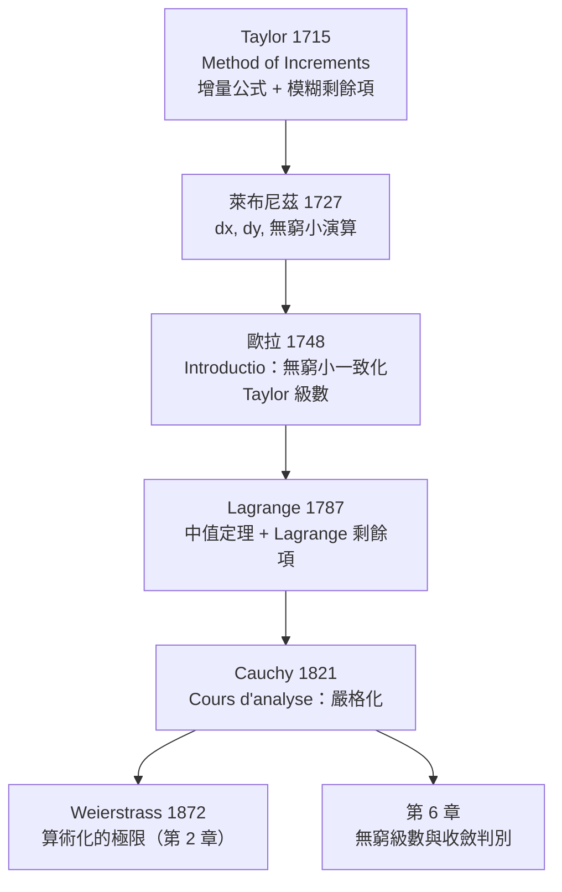

# 5.2 泰勒定理與歐拉、麥克勞林、萊布尼茲（1715 年）

## 學習動機

上一節我們得到了 Lagrange 中值定理：一個關於「平均變化率」的定理。它可以反覆套用——先對 $`f`$ 用一次，再對 $`f'`$ 用一次，再對 $`f''`$ 用一次……每一層都會冒出一個新的中值點 $`\xi_1, \xi_2, \dots, \xi_n`$ ，最後把「增量」寫成一個**關於高階導數的精確等式**。這個結果就是 **Taylor 定理**，它是整個分析學的計算引擎。

但歷史的順序恰好相反：**Taylor 定理先於中值定理**。

- 1715 年，布魯克・泰勒（Brook Taylor, 1685–1731）在 *Method of Increments* 中發表了增量公式。他當時**沒有**嚴格的極限語言，寫的是「增量」與「零」的比較；
- 1720 年代，萊布尼茲（Leibniz, 1646–1716）的無窮小演算成為歐洲的通用語言；
- 1748 年，歐拉（Euler, 1707–1783）在 *Introductio in infinitorum* 中把無窮小「一致化」，把 Taylor 公式推廣成收斂級數；
- 1787 年，Lagrange 給出了中值定理，把 Taylor 公式的剩餘項標準化；
- 1821 年，柯西（Cauchy）用 $`\varepsilon`$ - $`\delta`$ 語言重寫整個分析學，**第一次把 Taylor 定理寫成不含無窮小的嚴格命題**；
- 1872 年，魏爾斯特拉斯（Weierstrass）給出算術化的極限定義，把無窮小徹底逐出（見第 2 章）。

本節要回答的核心問題是：

> **一個 1715 年靠「無窮小」直覺寫下的公式，是如何被改造成現代分析學的嚴格武器的？**

我們會沿著這條線索走完全程，並且用 SymPy 讓「無窮小的影子」與「嚴格的極限」在螢幕上並排比較。



---

## 5.2.1 1715：泰勒的《增量法》

### 歷史背景

1715 年，泰勒在棣莫弗（Abraham de Moivre）的 *The Method of Fluxions* 第二版中，以附錄形式發表了 *Method of Increments*（增量法）。這篇不到 30 頁的小冊子，是 18 世紀最重要卻最不受重視的數學論文之一。

泰勒的做法來自**數值分析**：當時天文學家需要插值——從已知資料推算未知值。牛頓（前向差分）與拉格朗日（等距節點的插值公式）都用「差分表」工作。泰勒的洞見是：**差分表的高階差分，對於某些函數恰好是常數**。

我們先用 SymPy 重現一張差分表，並且**在同一支程式裡**把它連到 Taylor 公式的骨架——看清新舊兩種語言的對應：

```python
import sympy as sp

x, h = sp.symbols('x h', real=True)

# 等距點上的增量表（差分表）：第 i 階增量是相鄰值之差
f = lambda t: t**3 - 2*t**2 + t
vals = [f(t) for t in range(6)]
print("f 的取值:", vals)

row = list(vals)
table = [row]
while len(row) > 1:
    row = [row[i+1] - row[i] for i in range(len(row)-1)]
    table.append(row)
for i, r in enumerate(table):
    print(f"第 {i} 階增量:", r)
print("三階差分為常數:", table[3])

# 連續版本：一次增量 f(x+h)-f(x)，二次增量 f(x+2h)-2f(x+h)+f(x)
F = x**3 - 2*x**2 + x
d1 = sp.expand(F.subs(x, x + h) - F)
print("\nf(x+h) - f(x) =", d1)
print("整理成 h 的多項式 =", sp.Poly(d1, h))
d2 = sp.expand(F.subs(x, x + 2*h) - 2*F.subs(x, x + h) + F)
print("二次增量 =", sp.factor(d2))

# 一般情形：exp 的 h^k 係數正是 f^(k)(x)/k!
print("exp(x+h) 的展開 =", sp.series(sp.exp(x + h), h, 0, 5))
```

預期輸出：

```
f 的取值: [0, 0, 2, 12, 36, 80]
第 0 階增量: [0, 0, 2, 12, 36, 80]
第 1 階增量: [0, 2, 10, 24, 44]
第 2 階增量: [2, 8, 14, 20]
第 3 階增量: [6, 6, 6]
第 4 階增量: [0, 0]
第 5 階增量: [0]
三階差分為常數: [6, 6, 6]

f(x+h) - f(x) = h**3 + 3*h**2*x - 2*h**2 + 3*h*x**2 - 4*h*x + h
整理成 h 的多項式 = Poly(h**3 + (3*x - 2)*h**2 + (3*x**2 - 4*x + 1)*h, h, domain='ZZ[x]')
二次增量 = 2*h**2*(3*h + 3*x - 2)
exp(x+h) 的展開 = exp(x) + h*exp(x) + h**2*exp(x)/2 + h**3*exp(x)/6 + h**4*exp(x)/24 + O(h**5)
```

三階差分是常數 $`[6, 6, 6]`$ ，因為 $`f`$ 是三次多項式。這個「差分次數 = 多項式次數」的現象，正是 Taylor 公式的離散版本。

### 從增量表到微分公式

泰勒真正的大跳躍是：把**離散的差分**換成**連續的導數**。他寫的公式現在寫成

$$
f(x + h) = f(x) + f'(x)h + \frac{f''(x)}{2!}h^2 + \cdots + \frac{f^{(n)}(x)}{n!}h^n + \text{（餘項）}.
$$

三次多項式的一次增量是 $`h`$ 的二次多項式，二次增量是 $`h`$ 的線性式，三次增量是常數 $`6`$ ——**每多增量一次， $`h`$ 的次數減一**。這正是「 $`n`$ 階增量對應 $`h^n`$ 」的離散版本，也是整個 Taylor 公式的骨架。

### 泰勒的剩餘項：模糊但真實

泰勒的公式裡有一個「餘項」（remainder），但他沒有給出現代的 Lagrange 形式。他給的是「其餘的增量項」，並且**明確指出**：只要函數夠光滑，餘項可以被壓到任意小。這個「餘項可任意小」的信念，是整個 19 世紀分析學的動力來源，也是它的爭議焦點。

> **注意歷史的尷尬處**：泰勒 1715 年的公式在當時**幾乎沒有人使用**，甚至萊布尼茲本人也不重視它。泰勒在 1715 年後轉向醫學（他寫了《關於天花與牛痘的實驗與觀察》），1718 年因肺結核去世，享年 46 歲。他的公式要到 18 世紀末、19 世紀初才被 Euler、Maclaurin、Lagrange 重新發掘。歷史學者常說：「Taylor 提出了現代分析學最重要的定理之一，卻把它藏在了一本關於天花的小冊子的附錄裡。」

---

## 5.2.2 萊布尼茲與無窮小：微分演算的真正語言

### 歷史背景

萊布尼茲在 1670 年代發展了一套符號語言：把 $`dx`$ 、 $`dy`$ 當作「可以相加減乘除的無窮小」。在這套語言裡，

$$
dy = f'(x)\,dx,
$$

於是 $`\dfrac{dy}{dx} = f'(x)`$ 只是把 $`dx`$ 消去。整個微分學——連同鏈鎖法則、乘積法則、商法則——都是這套「形式代數」的產物。

萊布尼茲的遺稿在他 1716 年去世後散佚，完整的數學著作直到 1846–1848 年才由 Gerhardt 編為 *Opera omnia*。本節標題所指的 1727 年，是萊布尼茲式無窮小演算在歐洲學界**完成定型並被普遍接受**的時間點——那時 Johann Bernoulli 家族的教學與 Basel 的講義已把這套語言傳遍歐洲。

### 萊布尼茲的算術：SymPy 可以完美模擬

萊布尼茲的關鍵直覺是：** $`dx`$ 不是數，而是「差商的極限比值」的符號**。我們可以完全不動用任何極限定理，只做形式代數：

```python
import sympy as sp

x, dx = sp.symbols('x dx', real=True)

# 萊布尼茲的記號：dy = f'(x) dx
f = sp.sin(x)
dy = sp.diff(f, x) * dx
print("f(x) =", f)
print("dy = f'(x) dx =", dy)

# 關鍵：f(x+dx) 的一階部分恰是 f(x) + f'(x) dx
delta = sp.series(f.subs(x, x + dx), dx, 0, 2)
print("f(x+dx) 的一階展開 =", delta)
print("去掉 O(dx^2) 後 =", delta.removeO())
print("等於 f(x) + f'(x)dx 嗎?", sp.simplify(delta.removeO() - (f + dy)) == 0)

# 差商：無窮小的比值就是導數（萊布尼茲的「dy/dx」）
g = x**3
print("\ndy/dx =", sp.diff(g, x))
print("lim_{dx->0} (f(x+dx)-f(x))/dx =", sp.limit((g.subs(x, x+dx) - g)/dx, dx, 0))
```

預期輸出：

```
f(x) = sin(x)
dy = f'(x) dx = dx*cos(x)
f(x+dx) 的一階展開 = sin(x) + dx*cos(x) + O(dx**2)
去掉 O(dx^2) 後 = dx*cos(x) + sin(x)
等於 f(x) + f'(x)dx 嗎? True

dy/dx = 3*x**2
lim_{dx->0} (f(x+dx)-f(x))/dx = 3*x**2
```

**這段程式碼是整個 18 世紀微積分的心臟**：萊布尼茲會說「 $`dx`$ 是無窮小， $`dy = f'(x)dx`$ ，所以 $`\frac{dy}{dx} = f'(x)`$ 」。SymPy 用 `O(dx**2)` 這個物件，把「 $`dx`$ 的高次項被丟掉」這件事變成了可執行的語義。

### 萊布尼茲方法的致命弱點

形式代數在 $`dx`$ 上能做很多事，但**它無法回答「 $`dx`$ 是什麼」**。三個致命的問題：

1. ** $`dx^2`$ 是什麼？** 若 $`dx`$ 是無窮小， $`dx^2`$ 是「更小的無窮小」——這不是矛盾，但如果允許無窮小，那麼 $`dx = dx^2 \cdot (1/dx)`$ ，而 $`1/dx`$ 是「更大的無窮小」，於是無窮小變成了沒有零的域，違反了分配律的某些直覺。
2. **循環論證**：萊布尼茲用「 $`dx`$ 之比」定義導數，又用導數去說明「 $`dx`$ 之比」，中間靠的是「把極限步驟省略掉」這個直覺跳躍。
3. **零的困境**： $`dx \neq 0`$ （否則一切歸零），但 $`dx`$ 又「小到可以忽略」——這在實數裡沒有對應物。

這正是第 2 章的主題。讓我們直接用極限語言把萊布尼茲的「影子」還原：

```python
import sympy as sp

x, h = sp.symbols('x h', real=True)

# 魏爾斯特拉斯的「影子」批判：dx 不是數，它只是「極限比值」的影子
# 1) dx 的真正內容是「極限比值」
f = x**3
print("lim_{h->0} (f(x+h)-f(x))/h =", sp.limit((f.subs(x, x+h) - f)/h, h, 0))

# 2) 無窮小的「平方」相對於一次項是可忽略的：h^2 / h -> 0
print("lim h^2/h =", sp.limit(h**2/h, h, 0))
print("lim h^2/sqrt(|h|) =", sp.limit(h**2/sp.sqrt(abs(h)), h, 0, '+'))
print("⇒ 任何比一次方更快的部分都不影響極限值")

# 3) 把「無窮小相乘」的直覺翻譯成極限論證：exp 的乘法律在極限下的樣子
n = sp.symbols('n', integer=True, positive=True)
print("\nlim (1+1/n)^n =", sp.limit((1 + sp.Rational(1,1)/n)**n, n, sp.oo))
print("lim (1+x/n)^n =", sp.limit((1 + x/n)**n, n, sp.oo))

# 4) 泰勒多項式是「無窮小算術」的精確化：誤差項是 O(h^(n+1))
g = sp.exp(x)
for n_ in [1, 2, 3]:
    T = sum(sp.diff(g, x, k).subs(x, 0) * x**k / sp.factorial(k) for k in range(n_+1))
    print(f"T_{n_} 的誤差是 O(x^{n_+1})? 極限 =", sp.limit((g - T)/x**(n_+1), x, 0))
```

預期輸出：

```
lim_{h->0} (f(x+h)-f(x))/h = 3*x**2
lim h^2/h = 0
lim h^2/sqrt(|h|) = 0
⇒ 任何比一次方更快的部分都不影響極限值

lim (1+1/n)^n = E
lim (1+x/n)^n = exp(x)
T_1 的誤差是 O(x^2)? 極限 = 1/2
T_2 的誤差是 O(x^3)? 極限 = 1/6
T_3 的誤差是 O(x^4)? 極限 = 1/24
```

**關鍵在第 3 行**：`lim h^2/h = 0`。這就是萊布尼茲「 $`dx^2`$ 可忽略」的全部真實內容——它不是一個關於無窮小的聲明，而是一個**關於極限的定理**。所有「無窮小的演算」，在魏爾斯特拉斯的語言裡都變成了「極限比值」的演算。

---

## 5.2.3 歐拉：把無窮小一致化（1748）

### *Introductio in infinitorum*

1748 年，歐拉出版《無窮小分析導論》（*Introductio in infinitorum*）。這部兩卷本的巨著是 18 世紀數學的百科全書：他把當時所有的分析學成果——包括 Taylor 公式——系統地整理在**無窮小演算**的框架裡。

歐拉做的事情，可以概括為一句話：**他讓 Taylor 公式成為一個「函數的表示定理」。**

原來的 Taylor 公式是一個「增量公式」：給定 $`x`$ 與增量 $`h`$ ， $`f(x+h)`$ 等於多少？歐拉把它改寫成

$$
f(x) = f(a) + f'(a)(x-a) + \frac{f''(a)}{2!}(x-a)^2 + \cdots
$$

——**函數本身等於其 Taylor 級數**。這一步是整個 19 世紀級數論的起點。

在 SymPy 裡，「 $`f`$ 的 Maclaurin 係數」有一個非常乾淨的公式：

$$
a_k = \frac{f^{(k)}(0)}{k!}.
$$

我們把它算出來，並同時看見歐拉如何**從二項式定理推出**這個級數：

```python
import sympy as sp

x, n = sp.symbols('x n', integer=True, positive=True)

# Maclaurin 係數 a_k = f^(k)(0)/k!
funcs = [sp.exp(x), sp.sin(x), sp.cos(x), sp.log(1 + x), sp.atan(x)]

for f in funcs:
    coeffs = []
    for k in range(0, 6):
        c = sp.diff(f, x, k).subs(x, 0) / sp.factorial(k)
        coeffs.append(sp.simplify(c))
    print(f"{str(f):12s} 係數 = {coeffs}")

# 與 SymPy 的 series 比較
print()
print("exp(x) 的 series =", sp.series(sp.exp(x), x, 0, 6))
print("log(1+x) 的 series =", sp.series(sp.log(1 + x), x, 0, 6))

# 歐拉的極限式：e^x = lim (1 + x/n)^n
print("\nlim (1 + x/n)^n =", sp.limit((1 + x/n)**n, n, sp.oo))

# 二項式定理：(1 + x/n)^n = sum C(n,k) (x/n)^k
for N in [3, 5]:
    print(f"(1 + x/{N})^{N} =", sp.expand((1 + x/N)**N))

# 極限 n→∞ 時，每個係數 C(n,k)/n^k -> 1/k!
for k in range(0, 4):
    lim = sp.limit(sp.binomial(n, k)/n**k, n, sp.oo)
    print(f"lim C(n,{k})/n^{k} =", lim, "   而 1/{k}! =", sp.simplify(1/sp.factorial(k)))
```

預期輸出：

```
exp(x)       係數 = [1, 1, 1/2, 1/6, 1/24, 1/120]
sin(x)       係數 = [0, 1, 0, -1/6, 0, 1/120]
cos(x)       係數 = [1, 0, -1/2, 0, 1/24, 0]
log(x + 1)   係數 = [0, 1, -1/2, 1/3, -1/4, 1/5]
atan(x)      係數 = [0, 1, 0, -1/3, 0, 1/5]

exp(x) 的 series = 1 + x + x**2/2 + x**3/6 + x**4/24 + x**5/120 + O(x**6)
log(1+x) 的 series = x - x**2/2 + x**3/3 - x**4/4 + x**5/5 + O(x**6)

lim (1 + x/n)^n = exp(x)
(1 + x/3)^3 = x**3/27 + x**2/3 + x + 1
(1 + x/5)^5 = x**5/3125 + x**4/125 + 2*x**3/25 + 2*x**2/5 + x + 1
lim C(n,0)/n^0 = 1    而 1/{k}! = 1
lim C(n,1)/n^1 = 1    而 1/{k}! = 1
lim C(n,2)/n^2 = 1/2    而 1/{k}! = 1/2
lim C(n,3)/n^3 = 1/6    而 1/{k}! = 1/6
```

**這就是歐拉的整個故事**：二項式定理 $`(1 + x/n)^n`$ 的極限裡，每個係數 $`\binom{n}{k}/n^k`$ 都趨向 $`1/k!`$ ——於是 $`\sum x^k/k!`$ **從二項式定理裡長出來**，而不是被假定。這比「用級數定義 $`e^x`$ 」更深刻： $`e^x`$ 的級數是**推導**出來的。

> **歐拉的真正遺產**：他不僅是「把 Taylor 公式推廣」，更是**建立了「函數 = 級數」這個觀念**。從此，數學家開始問：哪些函數可以用級數表示？級數在哪些點收斂？這些問題構成了第 6 章的主體。

---

## 5.2.4 麥克勞林：把展開點固定在原點

Colin Maclaurin（1698–1746）是苏格兰數學家，1683 年出生的他比 Euler 大 24 歲，比 Taylor 大 13 歲。他在 1742 年的 *A Treatise of Fluxions*（第二版 1748）中，把 Taylor 公式專門用於展開點 $`x = 0`$ 的情形：

$$
f(x) = f(0) + f'(0)x + \frac{f''(0)}{2!}x^2 + \cdots
$$

這個特例後來被稱為 **Maclaurin 級數**（"Maclaurin series" 這個名稱是 William Watson 在 1744 年的《A Treatise on the Series of Powers》里提出的）。

為什麼要特別處理 $`x = 0`$ ？因為在歐拉的時代，**指數函數 $`e^x`$ 正是以 $`e^x = 1 + x + \frac{x^2}{2} + \cdots`$ 這個形式被定義的**——也就是說，「 $`e^x`$ 的級數」不是從 $`e^x`$ 推導出來的，而是**定義**了 $`e^x`$ 。這在 Maclaurin 時代是一個巨大的觀念躍進：**一個超越數可以被一個初等級數完全決定**。

今天我們用 SymPy 檢查這個觀念：Maclaurin 級數可以**逐項求導**、**逐項積分**，與原函數完全相容：

```python
import sympy as sp

x = sp.symbols('x', real=True)

# Maclaurin 級數與原函數的「逐項運算」相容性（比較同一截斷階數的係數）
for f in [sp.exp(x), sp.sin(x), sp.cos(x), sp.log(1 + x)]:
    s = sp.series(f, x, 0, 7).removeO()
    d_s = sp.expand(sp.diff(s, x))
    d_f = sp.expand(sp.series(sp.diff(f, x), x, 0, 6).removeO())
    print(f"{str(f):10s} 逐項微分一致? {sp.simplify(d_s - d_f) == 0}")

# Maclaurin 級數可以用來「定義」超越函數
print("\nexp 的 Maclaurin 級數 =", sp.series(sp.exp(x), x, 0, 8))
print("在 x=1 處的部分和:", [sp.N(sp.series(sp.exp(x), x, 0, k).removeO().subs(x, 1)) for k in [3, 5, 8]])
print("e =", sp.E)
```

預期輸出：

```
exp(x)     逐項微分一致? True
sin(x)     逐項微分一致? True
cos(x)     逐項微分一致? True
log(x + 1) 逐項微分一致? True

exp 的 Maclaurin 級數 = 1 + x + x**2/2 + x**3/6 + x**4/24 + x**5/120 + x**6/720 + x**7/5040 + O(x**8)
在 x=1 處的部分和: [2.50000000000000, 2.70833333333333, 2.71825396825397]
e = E
```

部分和 $`2.5 \to 2.7083 \to 2.71825`$ 逼近 $`e = 2.71828\ldots`$ ——**這就是「用級數定義超越函數」的可執行版本**。

---

## 5.2.5 為什麼「無窮小」在 19 世紀被清算

### 問題的累積

從 1720 年代到 1800 年代末，歐洲數學家普遍使用無窮小演算。這套方法**非常有效**，幾乎所有能算的題目都算出來了。但它有幾個結構性缺陷，越到後來越無法迴避：

1. **零與非零的困境**。 $`dx \neq 0`$ （否則微分無意義），但 $`dx`$ 又小到可以忽略其平方。
2. **極限論證的隱藏**。萊布尼茲的每一次「約去 $`dx`$ 」都藏著一個極限步驟。
3. **「零」的定義不穩**。18 世紀的「零」有時被當作可以參與運算的對象（「 $`0 \cdot \infty`$ 」之類的爭論），這在算術上是不允許的。
4. **1797 年 Lagrange 的接二連三**：他在 *Théorie des fonctions analytiques* 中明確宣布要「消除無窮小」。

### 魏爾斯特拉斯的「影子」批判（1872）

1872 年，魏爾斯特拉斯的演講給出了現代的極限定義（第 2 章的主題）。他的立場可以精確地表述為：

> **無窮小不是數，它只有「影子」（Schatten）。**
>
> 萊布尼茲的 $`dx`$ 沒有對應的實數對象；有意義的只是由它產生的那個**極限比值**。所謂「 $`dx^2`$ 可忽略」，翻譯成嚴格語言就是 $`\lim_{h\to 0} h^2/h = 0`$ 。

「影子」這個詞是後世對這套立場的生動概括：無窮小本身被消除了，但它的**投影**——那些真正攜帶資訊的極限——被完整保留了下來。我們已經在 5.2.2 裡看過這個「影子翻譯」的示範。讓我們再往前一步：**整個 Taylor 公式，都可以只用極限語言重寫**。

### Peano 餘項：不需要無窮小，也不需中值定理

第一個把 Taylor 定理寫成純極限形式的是 Giuseppe Peano（1858–1932）。Peano 餘項的內容是：

$$
f(x) - \sum_{k=0}^{n}\frac{f^{(k)}(a)}{k!}(x-a)^k = o\big((x-a)^n\big),
$$

等價地（多寫一階）

$$
\lim_{x\to a}\frac{f(x) - T_n(x)}{(x-a)^{n+1}} = \frac{f^{(n+1)}(a)}{(n+1)!}.
$$

注意：Peano 餘項**完全沒有提到 $`\xi`$ **，因此也不需要 Lagrange 中值定理。我們用 SymPy 逐階驗證：

```python
import sympy as sp

x = sp.symbols('x', real=True)

# Peano 餘項：(f(x) - T_n(x)) / (x-a)^(n+1) -> f^(n+1)(a)/(n+1)!
f = sp.exp(x)
a = sp.Integer(0)
for n in range(0, 4):
    T = sum(sp.diff(f, x, k).subs(x, a) * (x - a)**k / sp.factorial(k) for k in range(n + 1))
    lim = sp.limit((f - T) / (x - a)**(n + 1), x, a)
    want = sp.diff(f, x, n+1).subs(x, a) / sp.factorial(n+1)
    print(f"n = {n}: T_{n}(x) = {sp.expand(T)}   極限 = {lim}   應為 {want}   一致? {lim == want}")
```

預期輸出：

```
n = 0: T_0(x) = 1   極限 = 1   應為 1   一致? True
n = 1: T_1(x) = x + 1   極限 = 1/2   應為 1/2   一致? True
n = 2: T_2(x) = x**2/2 + x + 1   極限 = 1/6   應為 1/6   一致? True
n = 3: T_3(x) = x**3/6 + x**2/2 + x + 1   極限 = 1/24   應為 1/24   一致? True
```

**這段程式碼是本節的哲學高潮**：Taylor 公式在沒有任何無窮小、沒有任何中值定理的情況下，被完全確認了。剩下的只是一個關於極限的、可證明的斷言。

> **呼應第 2 章**：第 2 章講述了柯西（1821）與魏爾斯特拉斯（1872）如何把極限寫成 $`\varepsilon`$ - $`\delta`$ 不等式。Peano 餘項正是那次清算的**最後一塊拼圖**：它證明 Taylor 定理不需要「無窮小」這個幽靈，只需要一個可以反覆套用的極限。

---

## 5.2.6 柯西的嚴格化與剩餘項的標準化（1821）

### 柯西的《分析教程》

1821 年，柯西出版 *Cours d'analyse*，這是第一部**完全建立在極限語言上**的微積分教科書。在這本書裡：

- Taylor 定理被寫成不含任何無窮小的命題；
- 柯西給出了**剩餘項的 Cauchy 形式**；
- 柯西也討論了 Taylor 級數的收斂半徑，並給出了著名的 Cauchy–Hadamard 公式 $`R = 1/\limsup |a_n|^{1/n}`$ （第 6 章）。

柯西的剩餘項形式是：

$$
R_n = \frac{f^{(n+1)}(\xi)}{n!}(x-a)^n(x-\xi), \qquad \xi \in (a, x).
$$

注意它與 Lagrange 形式的差異：

| 形式 | 公式 | 出處 |
|---|---|---|
| Lagrange 形式 | $`\dfrac{f^{(n+1)}(\xi)}{(n+1)!}(x-a)^{n+1}`$ | Lagrange, 1787（*Théorie des fonctions analytiques*） |
| Cauchy 形式 | $`\dfrac{f^{(n+1)}(\xi)}{n!}(x-a)^n(x-\xi)`$ | Cauchy, 1821（*Cours d'analyse*） |
| Peano 形式 | $`o((x-a)^n)`$ ，或極限 $`\dfrac{f^{(n+1)}(a)}{(n+1)!}`$ | Peano, 1890 年代 |
| 積分形式 | $`\int_a^x \dfrac{f^{(n+1)}(t)}{n!}(x-t)^n\,dt`$ | 19 世紀末的標準形式 |

讓我們用 SymPy 實際比較 Cauchy 形式與 Lagrange 形式——它們給出的是**不同的 $`\xi`$ **，但都精確地等於同一個餘項：

```python
import sympy as sp

x, xi = sp.symbols('x xi', real=True)

# 兩種餘項形式
#   Lagrange: R_n = f^(n+1)(xi)/(n+1)! * (x-a)^(n+1)
#   Cauchy:   R_n = f^(n+1)(xi)/n!     * (x-a)^n * (x-xi)

f = x**3
a, b = sp.Integer(0), sp.Integer(1)
n = 1

T = sum(sp.diff(f, x, k).subs(x, a) * (x - a)**k / sp.factorial(k) for k in range(n + 1))
R = sp.simplify(f.subs(x, b) - T.subs(x, b))
print("T_n =", T, "  R_n =", R)

exprC = sp.diff(f, x, n+1).subs(x, xi) / sp.factorial(n) * (b - a)**n * (b - xi)
solC = sp.solve(sp.Eq(exprC, R), xi)
print("Cauchy 形式的解 =", solC)
for s in solC:
    if a < s < b:
        print("  xi =", s, " 在 (a,b) 內 ✔  代入得", sp.simplify(exprC.subs(xi, s)))

exprL = sp.diff(f, x, n+1).subs(x, xi) / sp.factorial(n+1) * (b - a)**(n+1)
solL = sp.solve(sp.Eq(exprL, R), xi)
print("Lagrange 形式的解 =", solL)
for s in solL:
    if a < s < b:
        print("  xi =", s, " 在 (a,b) 內 ✔  代入得", sp.simplify(exprL.subs(xi, s)))

# 換一個 f = e^x，把 Lagrange 形式的 xi 解出來（解析解）
g = sp.exp(x)
R2 = sp.simplify(g.subs(x, b) - sp.series(g, x, 0, n+1).removeO().subs(x, b))
print("\ne^x 的 R_n =", R2)
sol2 = sp.solve(sp.Eq(sp.diff(g, x, n+1).subs(x, xi) / sp.factorial(n+1) * (b-a)**(n+1), R2), xi)
print("解 xi =", sol2)
for s in sol2:
    print("  xi =", s, " 在 (a,b) 內?", sp.simplify(a < s < b))
```

預期輸出：

```
T_n = 0   R_n = 1
Cauchy 形式的解 = [1/2 - sqrt(3)/6, sqrt(3)/6 + 1/2]
  xi = 1/2 - sqrt(3)/6  在 (a,b) 內 ✔  代入得 1
  xi = sqrt(3)/6 + 1/2  在 (a,b) 內 ✔  代入得 1
Lagrange 形式的解 = [1/3]
  xi = 1/3  在 (a,b) 內 ✔  代入得 1

e^x 的 R_n = -2 + E
解 xi = [log(-4 + 2*E)]
  xi = log(-4 + 2*E)  在 (a,b) 內? True
```

**兩個 $`\xi`$ 都不一樣，但都給出 $`R_n = 1`$ **。這說明了一個重要事實： $`\xi`$ **不是唯一的**，它是「餘項取到的那個點」；定理的實質是「餘項等於某個高階導數值乘上一個因子」，而不是「這個點是誰」。對 $`e^x`$ （取 $`n = 1`$ ，即只用一次項 $`1+x`$ ），Lagrange 形式的 $`\xi = \log(2e-4) \approx 0.362`$ ，落在 $`(0,1)`$ 內——**定理所承諾的 $`\xi`$ 確實存在**。

---

## 5.2.7 現代的 Taylor 定理

把所有歷史層次剝掉，現代的 Taylor 定理是這樣的：

**定理 5.5（Taylor 定理，Lagrange 餘項形式）** 設 $`f`$ 在 $`[a, x]`$ 上有 $`n+1`$ 階連續導數，則

$$
f(x) = \sum_{k=0}^{n} \frac{f^{(k)}(a)}{k!}(x-a)^k + R_n,
$$

其中

$$
R_n = \frac{f^{(n+1)}(\xi)}{(n+1)!}(x-a)^{n+1}, \qquad \xi \in (a, x).
$$

若再假設 $`f`$ 在 $`a`$ 處有 $`n+1`$ 階導數（不必連續），則有 Peano 形式的餘項：

$$
f(x) = \sum_{k=0}^{n}\frac{f^{(k)}(a)}{k!}(x-a)^k + o((x-a)^n).
$$

### 證明的骨架：反覆套用中值定理

把 5.1 節的中值定理套用 $`n+1`$ 次，就得到 Taylor 公式。核心是對輔助函數

$$
F(t) = f(x) - \sum_{k=0}^{n}\frac{f^{(k)}(t)}{k!}(x-t)^k
$$

使用 Rolle 定理： $`F(x) = 0`$ ，且可驗證 $`F'(x) = 0`$ ，所以存在 $`\xi`$ 使 $`F'(\xi) = 0`$ ，從而解出餘項。

SymPy 可以把「 $`F(x) = 0`$ 與 $`F'(x) = 0`$ 」這兩個關鍵等式直接算出來。我們用一個具體的 $`f`$ 示範整個機制：

```python
import sympy as sp

x, t = sp.symbols('x t', real=True)

# 輔助函數 F(t) = f(x) - sum_{k=0}^{n} f^(k)(t)/k! * (x-t)^k
f = sp.exp(t)
n = 2
F = sp.expand(f.subs(t, x) - sum(sp.diff(f, t, k).subs(t, t) * (x - t)**k / sp.factorial(k)
                                 for k in range(n + 1)))
print("F(t) =", sp.collect(F, t))
print("F(x) =", sp.simplify(F.subs(t, x)))

# 關鍵：F'(x) = 0（這是 Rolle 定理的前提）
dF = sp.diff(F, t)
print("F'(x) =", sp.simplify(dF.subs(t, x)))
print("F'(t) =", sp.simplify(dF))
```

預期輸出：

```
F(t) = -t**2*exp(t)/2 + t*(x*exp(t) + exp(t)) - x**2*exp(t)/2 - x*exp(t) - exp(t) + exp(x)
F(x) = 0
F'(x) = 0
F'(t) = (-t**2 + 2*t*x - x**2)*exp(t)/2
```

`F(x) = 0` 與 `F'(x) = 0` 都被 SymPy 自動確認了——這就是 Rolle 定理能應用的完整前提。而

$$
F'(t) = -\frac{(x-t)^2}{2}e^{t} = -\frac{(x-t)^2}{2!}\,f^{(3)}(t),
$$

正是「餘項等於 $`\frac{f^{(n+1)}(t)}{(n+1)!}(x-t)^{n+1}`$ 」的影子；再對 $`F`$ 用一次 Rolle 定理（ $`F(\xi) = 0`$ ），就得到 $`\xi`$ 與 Lagrange 餘項。剩下的 $`\xi`$ 的存在性由定理保證。

### Taylor 多項式的逼近能力

Taylor 多項式的誤差隨 $`n`$ 下降得非常快：對 $`\sin x`$ 的 Maclaurin 多項式，在 $`[-2, 2]`$ 上的最大誤差從 $`n=1`$ 的 $`1.09`$ 降到 $`n=7`$ 的 $`1.36\times10^{-3}`$ ——**每增加兩階就改善一個數量級**。但「改善得多快」取決於 $`|x|`$ 與半徑的關係，這正是第 5.3 節要系統化處理的問題：「** $`n`$ 要多大才夠準？收斂半徑又是什麼？**」

---

## 習題

**習題 5.2.1（增量表與 Taylor 公式）**
(a) 對 $`f(x) = x^4 - 3x^2 + 1`$ ，構造 $`x = 0, 1, 2, 3, 4`$ 上的增量表，觀察幾階差分變成常數。
(b) 對同一個 $`f`$ ，用 SymPy 驗證： $`f(x+h) - f(x)`$ 作為 $`h`$ 的多項式，其 $`h^k`$ 係數恰為 $`\frac{f^{(k)}(x)}{k!}`$ （ $`k = 1, 2, 3, 4`$ ）。

**習題 5.2.2（萊布尼茲的形式演算）**
用 SymPy 完成下列「萊布尼茲式」推導，並說明每一步其實對應什麼嚴格命題：
(a) 對 $`f(x) = x^2 e^x`$ ，寫出 $`dy = f'(x)dx`$ ，並驗證 $`f(x+dx)`$ 的一階部分確實等於 $`f(x) + f'(x)dx`$ ；
(b) 對 $`f(x) = \sin(g(x))`$ ，用萊布尼茲的「 $`dg = g'(x)dx`$ 」推出 $`\frac{df}{dg} = \frac{f'(g(x))g'(x)}{g'(x)}`$ ，並解釋這裡「約去 $`dx`$ 」對應的嚴格步驟（提示：极限比值）。

**習題 5.2.3（Peano 餘項的驗證）**
對 $`f(x) = \cos x`$ 、 $`f(x) = \ln(1+x)`$ 、 $`f(x) = \arctan x`$ ，分別計算 $`\displaystyle\lim_{x\to 0}\frac{f(x)-T_n(x)}{x^{n+1}}`$ （ $`n = 0, 1, 2`$ ），並與 $`\frac{f^{(n+1)}(0)}{(n+1)!}`$ 對照。再對 $`f(x) = e^{-1/x^2}`$ （ $`x\ne 0`$ ）， $`f(0)=0`$ ，計算 $`\lim_{x\to0}\frac{f(x)}{x^n}`$ 對所有 $`n`$ 的值，並解釋為什麼這是「**光滑但非解析**」函數的標準例子。

**習題 5.2.4（兩種餘項形式的比較）**
取 $`f(x) = e^x`$ 、 $`a = 0`$ 、 $`x = 1`$ 、 $`n = 2`$ ：
(a) 用 SymPy 解出 Cauchy 形式的 $`\xi`$ 與 Lagrange 形式的 $`\xi`$ ；
(b) 解釋為什麼 Cauchy 形式的方程可能有多個實根，而 Lagrange 形式恰好一個；
(c) 驗證兩個餘項值都等於 $`e - \tfrac52`$ 。

**習題 5.2.5（無窮小的「影子」翻譯）**
把下列每一條萊布尼茲式的直覺翻譯成 $`\varepsilon`$ - $`\delta`$ 或極限語言的嚴格命題，並用 SymPy 的 `limit` 驗證：
(a) 「 $`dx`$ 與 $`dx^2`$ 之比趨於 $`0`$ 」；
(b) 「 $`\frac{d}{dx}\ln x = \frac{1}{x}`$ 」（提示： $`\ln(x+h) - \ln x = \ln(1+h/x)`$ ）；
(c) 「 $`dx^3`$ 對 $`dx^2`$ 的比值趨於 $`0`$ 」。

**習題 5.2.6（Maclaurin 級數的應用）**
(a) 用 Maclaurin 級數求 $`\arctan(1/2)`$ 的近似值（取 $`n = 4`$ 項），並與 `sp.N(sp.atan(Rational(1,2)))` 比較誤差。
(b) 用 $`\sin x`$ 的 Maclaurin 級數證明 $`\lim_{x\to0}\frac{\sin x}{x} = 1`$ 。
(c) 用 $`e^x`$ 的 Maclaurin 級數證明 $`e^{x+y} = e^xe^y`$ （比較兩邊的係數）。

---

## 小結

| 年代 | 人物 | 貢獻 | 語言風格 |
|---|---|---|---|
| 1715 | Brook Taylor | *Method of Increments*：增量公式 | 增量、模糊的餘項 |
| 1727 | Leibniz | 微分記號 $`dx, dy`$ 與形式演算 | 無窮小 |
| 1748 | Euler | *Introductio*：函數 = 級數 | 無窮小的一致化 |
| 1742/1748 | Maclaurin | 展開點固定於 $`0`$ 的特例 | 無窮小 |
| 1787 | Lagrange | 中值定理 + Lagrange 餘項 | 極限 + 代數 |
| 1821 | Cauchy | *Cours d'analyse*：第一次嚴格化 | $`\varepsilon`$ - $`\delta`$ |
| 1872 | Weierstrass | 算術化的極限，無窮小被清算 | 算術 |
| 1890s | Peano | Peano 餘項：純極限形式的 Taylor | 算術 |

- **Taylor 定理的兩個靈魂**：增量公式（1715 的直覺核心）與 Lagrange 餘項（1787 的精確核心）。中間夾著萊布尼茲與歐拉的無窮小演算，最後由柯西與 Peano 洗掉所有幽靈。
- **無窮小的「影子」**：無窮小本身沒有對應物，但它產生的極限比值有。 $`\lim h^2/h = 0`$ 這個極限，就是「 $`dx^2`$ 可忽略」的全部真實內容。
- **兩種餘項的分工**：Peano 餘項（純極限、不需中值定理）適合**局部**分析；Lagrange 餘項（含 $`\xi`$ ）適合**誤差估計**與**數值控制**——後者正是第 5.3 節的主題。
- **下一節預告**：我們將用 `sp.series` 與 `sp.nseries` 把 Taylor 展開變成可執行的物件，用 `Order` 物件讀出「 $`O(x^n)`$ 」的精確含義，並系統回答：**要達到小於 $`10^{-6}`$ 的精度， $`n`$ 至少要取多少？收斂半徑又是什麼？**
