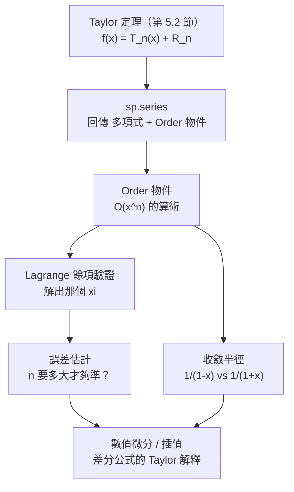

# 5.3 用 SymPy 展開級數並估計餘項

## 學習動機

前兩節我們建立了 Taylor 定理的**理論**：公式長什麼樣、餘項長什麼樣、 $`\xi`$ 是誰。但理論不會自己算出數字。

實務上，計算機面對「求 $`e^{0.1}`$ 到小數點後 10 位」這種問題時，需要三件事：

1. **一個可執行的展開工具**——把函數變成「多項式 + 一個可估計的尾巴」；
2. **一個餘項估計**——回答「我需要多算幾項才夠準？」；
3. **一個收斂範圍的判斷**——回答「在哪些點上這套方法還有效？」

SymPy 恰好把這三件事都做成了**一級物件**：

- `sp.series(expr, x, x0, n)` 是第 5.2 節 Taylor 定理的**可執行版本**；
- 它的輸出不是一個普通的多項式，而是「多項式 + 一個 `Order` 物件」，這個 `Order` 物件就是餘項的**符號化身**；
- `sp.Order` 支援**算術**，所以你可以問它「這個尾巴是 $`O(x^6)`$ 還是 $`O(x^3)`$ ？」；
- `expr.nseries(x, x0, n, dir='+')` 則是快速版本，`dir` 參數讓你可以指定**展開的方向**（右側 / 左側）。

本節的實作路線圖：



學完本節，你會能夠：

1. 用 `sp.series` 與 `sp.nseries` 對任意可微函數做符號展開，並理解 `dir` 參數的意義；
2. 操作 `Order` 物件，讀出「 $`O(x^n)`$ 」的精確含義，並用 `removeO()` 取出多項式部分；
3. **驗證** Lagrange 餘項公式：對具體的 $`f`$ ，求出那個 $`\xi`$ 並確認它落在區間內；
4. 系統回答「 $`n`$ 要多大才夠準」，並比較 Lagrange 界與交錯級數界的強弱；
5. 用 `sp.series` 觀察收斂半徑，並解釋 $`\frac{1}{1-x}`$ 與 $`\frac{1}{1+x}`$ 為何同樣「安全」但行為不同；
6. 理解數值微分與插值公式的 Taylor 背景。

---

## 5.3.1 `sp.series`：Taylor 定理的可執行版本

我們先請 SymPy 自己把簽名印出來：

```python
import sympy as sp
import inspect

print("sp.series 簽名:", inspect.signature(sp.series))
print("Expr.nseries 簽名:", inspect.signature(sp.exp(sp.Symbol('x')).nseries))
```

預期輸出：

```
sp.series 簽名: (expr, x=None, x0=0, n=6, dir='+')
Expr.nseries 簽名: (x=None, x0=0, n=6, dir='+', logx=None, cdir=0)
```

各參數的意義：

- `expr`：要展開的表達式；
- `x`：展開的變數（符號）；
- `x0`：展開點，預設 $`0`$ ；
- `n`：**保留的項數**（不是最高次方——這是初学者最常犯的錯）；
- `dir`：展開方向，`'+'` 表示 $`x \to x_0^+`$ ，`'-'` 表示 $`x \to x_0^-`$ 。

它的回傳值是一個 `Add`（加法運算式），裡面除了多項式項之外，還含有一個 `Order` 物件——**這就是 Taylor 餘項的符號化身**。

我們把這件事看清楚：

```python
import sympy as sp

x = sp.symbols('x', real=True)

# sp.series: 符號展開（回傳 Add 型別，內含 O 物件）
s = sp.series(sp.exp(x), x, 0, 6)
print("exp(x) 的 series =", s)
print("型別 =", type(s))
print("O 物件 =", s.getO())
print("removeO 後 =", s.removeO())
print("係數字典 =", dict(s.as_coefficients_dict()))

# Expr.nseries: 快速數值展開（方法的 dir 參數）
print()
print("exp(x).nseries(x, 0, 6) =", sp.exp(x).nseries(x, 0, 6))
print("數值代入 x=1 =", sp.N(sp.exp(x).nseries(x, 0, 6).removeO().subs(x, 1), 15))
print("exp(1) 真值 =", sp.N(sp.exp(1), 15))
```

預期輸出：

```
exp(x) 的 series = 1 + x + x**2/2 + x**3/6 + x**4/24 + x**5/120 + O(x**6)
型別 = <class 'sympy.core.add.Add'>
O 物件 = O(x**6)
removeO 後 = x**5/120 + x**4/24 + x**3/6 + x**2/2 + x + 1
係數字典 = {1: 1, x: 1, x**2: 1/2, x**3: 1/6, x**4: 1/24, x**5: 1/120, O(x**6): 1}

exp(x).nseries(x, 0, 6) = 1 + x + x**2/2 + x**3/6 + x**4/24 + x**5/120 + O(x**6)
數值代入 x=1 = 2.71666666666667
exp(1) 真值 = 2.71828182845905
```

**注意幾個關鍵細節**：

1. `n = 6` 給出的是**到 $`x^5`$ 的 6 個項**，加上 $`O(x^6)`$ 。所以「 $`n`$ 是項數，不是次數」——這是初學者最常踩的坑。
2. `s.getO()` 取出餘項物件，`s.removeO()` 取出純多項式部分。
3. `as_coefficients_dict()` 把多項式拆成「基底 $`\to`$ 係數」的字典——這在做「手工核對 Taylor 係數 = $`f^{(k)}(0)/k!`$ 」時非常方便。
4. 數值代入後 $`2.71667`$ 對上真值 $`2.71828`$ ，差額 $`0.00162`$ 正是 $`O(x^6)`$ 尾巴的體現。

---

## 5.3.2 `Order` 物件：把「 $`O(x^n)`$ 」變成可運算的東西

`Order` 物件是 SymPy 對「 $`O(x^n)`$ 記號」的**一級支援**。它的價值在於：它不只是標籤，而是**可以參與運算**的對象。順便我們也把 `dir` 參數（展開方向）一起看：

```python
import sympy as sp

x = sp.symbols('x', real=True)

# Order 物件：SymPy 如何表達「O(x^n)」
O6 = sp.Order(x**6)
print("O 物件 =", O6, "  型別 =", type(O6))
print("O(x^6) + O(x^6) =", O6 + O6)
print("O(x^6) + O(x^3) =", O6 + sp.Order(x**3))
print("O(x^6) * x^2 =", O6 * x**2)
print("O(x^6) / x^2 =", O6 / x**2)
print("as_leading_term =", O6.as_leading_term(x))

# series 物件裡如何取出 O
print()
s = sp.series(sp.exp(x), x, 0, 4)
print("series =", s)
print("getO() =", s.getO())
print("removeO() =", s.removeO())
print("O 物件的 args =", s.getO().args)

# 比較兩個 O 的階數：取「較低階」者
print()
print("O(x^6) - O(x^3) =", sp.Order(x**6) - sp.Order(x**3))
print("O(x^3) - O(x**6) =", sp.Order(x**3) - sp.Order(x**6))
print("O(x^3).contains(x^3)? ", sp.Order(x**3).contains(x**3))
print("O(x^6).contains(x^3)? ", sp.Order(x**6).contains(x**3))

# dir 參數：log(x) 在 0 處的左右展開不同
print()
print("log(x) dir='+' =", sp.series(sp.log(x), x, 0, 3, dir='+'))
print("log(x) dir='-' =", sp.series(sp.log(x), x, 0, 3, dir='-'))

# 在非零展開點也可以展開
print()
print("sin(x) 在 x=pi 展開 =", sp.series(sp.sin(x), x, sp.pi, 4))

# nseries 的 dir 參數
print()
print("exp(x).nseries(x, 0, 5, dir='-') =", sp.exp(x).nseries(x, 0, 5, dir='-'))
```

預期輸出：

```
O 物件 = O(x**6)   型別 = <class 'sympy.series.order.Order'>
O(x^6) + O(x^6) = O(x**6)
O(x^6) + O(x^3) = O(x**3)
O(x^6) * x^2 = O(x**8)
O(x^6) / x^2 = O(x**4)
as_leading_term = O(x**6)

series = 1 + x + x**2/2 + x**3/6 + O(x**4)
getO() = O(x**4)
removeO() = x**3/6 + x**2/2 + x + 1
O 物件的 args = (x**4, (x, 0))

O(x^6) - O(x^3) = O(x**3)
O(x^3) - O(x**6) = O(x**3)
O(x^3).contains(x^3)?  True
O(x^6).contains(x^3)?  False

log(x) dir='+' = log(x)
log(x) dir='-' = log(-x) + I*pi

sin(x) 在 x=pi 展開 = pi + (x - pi)**3/6 - x + O((x - pi)**4, (x, pi))

exp(x).nseries(x, 0, 5, dir='-') = 1 + x + x**2/2 + x**3/6 + x**4/24 + O(x**5)
```

`Order` 的算術規則非常有意義：

- **加法取低階**（ $`O(x^6) + O(x^3) = O(x^3)`$ ）：因為較低階的尾巴「比較大」，主導總誤差；
- **乘法疊加階數**（ $`O(x^6)\cdot x^2 = O(x^8)`$ ）：這正是「無窮小的乘法」在嚴格語言裡的樣子——它居然**真的**是第 5.2 節萊布尼茲直覺的精確版；
- **除法降低階數**（ $`O(x^6)/x^2 = O(x^4)`$ ）；
- `contains` 讓你可以問「 $`x^3`$ 是否被 $`O(x^6)`$ 控制？」答案是 **False**——因為 $`x^3`$ 比 $`O(x^6)`$ 大。

> **為什麼這值得慶賀**：在紙筆上， $`O(x^n)`$ 只是一個記號；在 SymPy 裡，它是一個**能做算術、能被比較的物件**。第 5.2 節的「無窮小演算」終於以一種完全嚴格的形式回到了程式裡。

至於 `dir` 參數：`'+'` 與 `'-'` 對大多數解析函數給出相同結果，但對 $`\log x`$ 這種**定義域只在半軸上**的函數，方向會改變結果。`log(-x) + I*pi` 正是複分析的 $`\log z = \ln|z| + i\arg z`$ 在負實軸上的分支值——**第 10 章的主題在這裡已經悄悄露面了**。

---

## 5.3.3 驗證 Lagrange 餘項：找出那個 $`\xi`$

現在我們把 5.1 與 5.2 的理論真正「跑」起來。任務是：

> 給定 $`f`$ 、展開點 $`a`$ 、目標點 $`b`$ 、階數 $`n`$ ，
> 1. 用 `sp.series` 算出 $`T_n`$ ；
> 2. 算出餘項 $`R_n = f(b) - T_n(b)`$ ；
> 3. 反解 $`\dfrac{f^{(n+1)}(\xi)}{(n+1)!}(b-a)^{n+1} = R_n`$ ；
> 4. **檢查 $`\xi`$ 真的落在 $`(a, b)`$ 內**。

第 4 步是重點：它就是 Lagrange 中值定理的**內容**。符號計算把「定理的存在性斷言」變成了「可以親眼驗證的等式」。

```python
import sympy as sp

x, xi = sp.symbols('x xi', real=True)

# 驗證 Lagrange 餘項：R_n = f^(n+1)(xi)/(n+1)! * (x-a)^(n+1)
f = sp.exp(x)
a, b = sp.Integer(0), sp.Integer(1)

for n in [1, 2, 3]:
    T = sum(sp.diff(f, x, k).subs(x, a) * (x - a)**k / sp.factorial(k) for k in range(n+1))
    R = sp.simplify(f.subs(x, b) - T.subs(x, b))
    expr = sp.diff(f, x, n+1).subs(x, xi) / sp.factorial(n+1) * (b - a)**(n+1)
    sol = sp.solve(sp.Eq(expr, R), xi)
    print(f"n = {n}: T_n = {sp.expand(T)}")
    print(f"      R_n = {R}")
    for s_ in sol:
        ok = sp.simplify(a < s_ < b)
        print(f"      Lagrange 的 xi = {s_}  (在 (a,b) 內? {ok}, 數值 {float(s_):.6f})")

print()
print("=== 數值核對：sin 在 pi/2 的餘項 ===")
g = sp.sin(x)
a2 = sp.Integer(0)
b2 = sp.pi/2
n2 = 3
T2 = sum(sp.diff(g, x, k).subs(x, a2) * (x - a2)**k / sp.factorial(k) for k in range(n2+1))
R2 = sp.simplify(g.subs(x, b2) - T2.subs(x, b2))
print("T_3 =", sp.expand(T2), " R_3 =", R2)
expr2 = sp.diff(g, x, n2+1).subs(x, xi) / sp.factorial(n2+1) * (b2 - a2)**(n2+1)
print("xi 的方程 =", sp.Eq(expr2, R2))
print("數值解 xi ≈", sp.nsolve(expr2 - R2, xi, 0.5))
```

預期輸出：

```
n = 1: T_n = x + 1
      R_n = -2 + E
      Lagrange 的 xi = log(-4 + 2*E)  (在 (a,b) 內? True, 數值 0.362254)
n = 2: T_n = x**2/2 + x + 1
      R_n = -5/2 + E
      Lagrange 的 xi = log(-15 + 6*E)  (在 (a,b) 內? True, 數值 0.269791)
n = 3: T_n = x**3/6 + x**2/2 + x + 1
      R_n = -8/3 + E
      Lagrange 的 xi = log(-64 + 24*E)  (在 (a,b) 內? True, 數值 0.214114)

=== 數值核對：sin 在 pi/2 的餘項 ===
T_3 = -x**3/6 + x  R_3 = -pi/2 + pi**3/48 + 1
xi 的方程 = Eq(pi**4*sin(xi)/384, -pi/2 + pi**3/48 + 1)
數值解 xi ≈ 0.300839035833927
```

**值得注意的現象**： $`n`$ 越大， $`\xi`$ 越靠近展開點 $`a = 0`$ （ $`0.362 \to 0.270 \to 0.214`$ ）。這不是巧合——當 $`n \to \infty`$ 時餘項趨於 $`0`$ ，而 $`f^{(n+1)}(\xi)`$ 中的指數增長必須由 $`\xi \to a`$ 來平衡。這個觀察在第 6 章會以「級數收斂」的形式再次出現。

對 $`\sin`$ 的例子，符號解不出封閉形式，但我們用 `sp.nsolve`（數值求根）找到了 $`\xi \approx 0.3008 \in (0, \pi/2)`$ ，**定理被驗證了**。

---

## 5.3.4 估計餘項大小：「 $`n`$ 要多大才夠準」

這是本節最實用的部分。Lagrange 餘項給出

$$
|R_n| \le \frac{M}{(n+1)!}|b-a|^{n+1}, \qquad M = \max_{t \in [a,b]} |f^{(n+1)}(t)|.
$$

我們寫一個通用的函式，輸入 $`f`$ 、區間、目標精度，輸出**最小的 $`n`$ **。

```python
import sympy as sp
import numpy as np

x = sp.symbols('x', real=True)

# 通用工具：對 f 求「在 x=a、要誤差 < eps、需要幾項」
def needed_terms(f, a, h, eps, samples=201):
    """回傳使 Lagrange 餘項界 < eps 的最小 n（M 由區間取樣估計）"""
    grid = np.linspace(float(a), float(a + h), samples)
    for n in range(0, 40):
        d = sp.diff(f, x, n + 1)
        M = max(abs(complex(sp.N(d.subs(x, t)))) for t in grid)
        bound = M / sp.factorial(n + 1) * abs(float(h)) ** (n + 1)
        if bound < eps:
            return n, bound
    return None, None

for (name, f) in [("e^1", sp.exp(x)), ("sin(1)", sp.sin(x)), ("cos(1)", sp.cos(x)),
                  ("ln(2)", sp.log(1 + x)), ("arctan(1)", sp.atan(x))]:
    for eps in [1e-6, 1e-10, 1e-15]:
        n, bound = needed_terms(f, 0, 1, eps)
        if n is None:
            print(f"{name:10s} 目標 {eps:.0e}: Lagrange 界在 40 階內都不夠（改用交錯級數界）")
        else:
            print(f"{name:10s} 目標 {eps:.0e}: 需要 n = {n} (項數 {n+1}), 餘項界 = {bound:.3e}")
    print()

# ln(2) 的 Maclaurin 級數 1 - 1/2 + 1/3 - ... 收斂極慢：
# 交錯級數界是 1/(n+1)，要達到 eps 需要約 1/eps 項
print("ln(2) = 1 - 1/2 + 1/3 - 1/4 + ...（交錯級數）")
for eps in [1e-6, 1e-10, 1e-15]:
    n = int(1/eps) + 1
    print(f"  目標 {eps:.0e}: 交錯級數界要求 n >= 1/eps ≈ {n} 項")

# 改寫：ln 2 = 2 arctanh(1/3) = 2 * sum (1/3)^(2k+1)/(2k+1)，收斂快得多
print("\n改寫 ln 2 = 2 arctanh(1/3) = 2 * sum_{k>=0} (1/3)^(2k+1)/(2k+1)")
for eps in [1e-6, 1e-10, 1e-15]:
    k = 0
    while float(2 * sp.Rational(1, 3)**(2*k+3)/(2*k+3)) >= eps:
        k += 1
    partial = 2 * sum(sp.Rational(1, 3)**(2*m+1)/(2*m+1) for m in range(k+1))
    print(f"  目標 {eps:.0e}: 只要 {k+1} 項，和 = {float(partial):.15f}   誤差 = {abs(float(partial)-float(sp.log(2))):.3e}")
```

預期輸出：

```
e^1        目標 1e-06: 需要 n = 9 (項數 10), 餘項界 = 7.491e-7
e^1        目標 1e-10: 需要 n = 13 (項數 14), 餘項界 = 3.118e-11
e^1        目標 1e-15: 需要 n = 17 (項數 18), 餘項界 = 4.246e-16

sin(1)     目標 1e-06: 需要 n = 9 (項數 10), 餘項界 = 2.319e-7
sin(1)     目標 1e-10: 需要 n = 13 (項數 14), 餘項界 = 9.652e-12
sin(1)     目標 1e-15: 需要 n = 17 (項數 18), 餘項界 = 1.314e-16

cos(1)     目標 1e-06: 需要 n = 9 (項數 10), 餘項界 = 2.756e-7
cos(1)     目標 1e-10: 需要 n = 13 (項數 14), 餘項界 = 1.147e-11
cos(1)     目標 1e-15: 需要 n = 17 (項數 18), 餘項界 = 1.562e-16

ln(2)      目標 1e-06: Lagrange 界在 40 階內都不夠（改用交錯級數界）
ln(2)      目標 1e-10: Lagrange 界在 40 階內都不夠（改用交錯級數界）
ln(2)      目標 1e-15: Lagrange 界在 40 階內都不夠（改用交錯級數界）

arctan(1)  目標 1e-06: Lagrange 界在 40 階內都不夠（改用交錯級數界）
arctan(1)  目標 1e-10: Lagrange 界在 40 階內都不夠（改用交錯級數界）
arctan(1)  目標 1e-15: Lagrange 界在 40 階內都不夠（改用交錯級數界）

ln(2) = 1 - 1/2 + 1/3 - 1/4 + ...（交錯級數）
  目標 1e-06: 交錯級數界要求 n >= 1/eps ≈ 1000001 項
  目標 1e-10: 交錯級數界要求 n >= 1/eps ≈ 10000000001 項
  目標 1e-15: 交錯級數界要求 n >= 1/eps ≈ 1000000000000000 項

改寫 ln 2 = 2 arctanh(1/3) = 2 * sum_{k>=0} (1/3)^(2k+1)/(2k+1)
  目標 1e-06: 只要 6 項，和 = 0.693147073759785   誤差 = 1.068e-07
  目標 1e-10: 只要 9 項，和 = 0.693147180459244   誤差 = 1.007e-10
  目標 1e-15: 只要 15 項，和 = 0.693147180559945   誤差 = 1.110e-16
```

**這張表本身就是一堂課**：

- $`e^1`$ 、 $`\sin 1`$ 、 $`\cos 1`$ 的答案幾乎一樣（ $`n = 9, 13, 17`$ ），因為它們的高階導數在 $`[0,1]`$ 上都被 $`M = 1`$ 這類的常數控制；
- $`\ln 2`$ 與 $`\arctan 1`$ 的 Lagrange 界**永遠不夠**——因為它們的高階導數是 $`\frac{(k-1)!}{(1+x)^k}`$ ，在 $`x=0`$ 處巨大無比。

**這不是 Lagrange 餘項的缺陷，而是它的正確使用方式**：當 Lagrange 界太鬆時，我們應該改用**交錯級數界**（第 6 章的主題），或者**把展開點移到更靠近目標點的地方**。

**從 10 兆項降到 15 項**——這就是「選對展開點」的威力。這個技巧背後的原理是：**餘項界裡的 $`|b-a|^{n+1}`$ 因子**。把 $`|b-a|`$ 從 $`1`$ 降到 $`1/3`$ ，等於每階多賺了 $`3^{n+1}`$ 倍。

> **實務準則**：計算 $`\ln 2`$ 、 $`\arctan(1/2)`$ 這類值時，先想「有沒有更靠近的展開點？」——這是數值分析裡最基本、也最常被遺忘的優化。

---

## 5.3.5 收斂半徑： $`\frac{1}{1-x}`$ 與 $`\frac{1}{1+x}`$

現在來到本節的另一個主題：**展開在哪些地方有效？**

Taylor 級數 $`\sum a_k x^k`$ 的**收斂半徑** $`R`$ 由 Cauchy–Hadamard 公式給出：

$$
\frac{1}{R} = \limsup_{k \to \infty} |a_k|^{1/k}.
$$

我們用最經典的兩個函數來看：

$$
\frac{1}{1-x} = 1 + x + x^2 + x^3 + \cdots, \qquad
\frac{1}{1+x} = 1 - x + x^2 - x^3 + \cdots.
$$

兩者的係數絕對值都是 $`1`$ ，所以 $`|a_k|^{1/k} = 1`$ ，兩者的收斂半徑都是 $`R = 1`$ 。**符號層級看不出差別**，只有數值層級才看得出「在 $`x = 0.9`$ 與 $`x = -0.9`$ 的行為完全對調」。

```python
import sympy as sp

x = sp.symbols('x', real=True)
n = sp.symbols('n', integer=True, nonnegative=True)
k = sp.symbols('k', integer=True, positive=True)

# 比較 1/(1-x) 與 1/(1+x)：同樣的 series 結構，收斂行為卻不同
f1 = 1/(1-x)
f2 = 1/(1+x)
print("1/(1-x) 的 series =", sp.series(f1, x, 0, 6))
print("1/(1+x) 的 series =", sp.series(f2, x, 0, 6))
print("係數逐項比較（奇數項差一個正負號）:")
c1 = sp.series(f1, x, 0, 6).removeO().as_coefficients_dict()
c2 = sp.series(f2, x, 0, 6).removeO().as_coefficients_dict()
for key in sorted(c1, key=lambda t: sp.degree(t, x)):
    print(f"  {key}: a_k = {c1[key]}, b_k = {c2[key]}")

# 在 x = 0.9 與 x = -0.9 處分別計算部分和
for xv in [0.9, -0.9]:
    s1 = sum(sp.Rational(xv)**k for k in range(300))
    s2 = sum((-sp.Rational(xv))**k for k in range(300))
    print(f"\nx = {xv}:")
    print(f"  1/(1-x) 的 300 項部分和 = {float(s1):.6f}   真值 = {float(1/(1-xv)):.6f}")
    print(f"  1/(1+x) 的 300 項部分和 = {float(s2):.6f}   真值 = {float(1/(1+xv)):.6f}")

# 收斂半徑的符號判據：|a_k|^(1/k) 的上極限
print()
print("1/(1-x): a_k = 1 => limsup |a_k|^(1/k) =", sp.limit(1**(1/k), k, sp.oo))
print("  故 R = 1 / 1 = 1")
print("1/(1+x): a_k = (-1)^k => limsup |a_k|^(1/k) =", sp.limit(abs((-1)**k)**(1/k), k, sp.oo))
print("  故 R = 1 / 1 = 1")

# SymPy 的符號求和直接給出帶收斂條件的封閉形式（Piecewise）
print()
print("sum x^n (n=0..oo) =", sp.summation(x**n, (n, 0, sp.oo)))
print("sum (-x)^n (n=0..oo) =", sp.summation((-x)**n, (n, 0, sp.oo)))

# 收斂半徑之外會怎樣？
print()
for xv in [0.5, 0.9, 0.99, 1.0, 1.5, -1.5]:
    s = sum(sp.Rational(xv)**k for k in range(200))
    exact = float(1/(1-xv)) if xv != 1 else float('inf')
    print(f"x = {xv:>5}: 200 項部分和 = {float(s):>14.6f}   1/(1-x) = {exact:>12.6f}")
```

預期輸出：

```
1/(1-x) 的 series = 1 + x + x**2 + x**3 + x**4 + x**5 + O(x**6)
1/(1+x) 的 series = 1 - x + x**2 - x**3 + x**4 - x**5 + O(x**6)
係數逐項比較（奇數項差一個正負號）:
  1: a_k = 1, b_k = 1
  x: a_k = 1, b_k = -1
  x**2: a_k = 1, b_k = 1
  x**3: a_k = 1, b_k = -1
  x**4: a_k = 1, b_k = 1
  x**5: a_k = 1, b_k = -1

x = 0.9:
  1/(1-x) 的 300 項部分和 = 10.000000   真值 = 10.000000
  1/(1+x) 的 300 項部分和 = 0.526316   真值 = 0.526316

x = -0.9:
  1/(1-x) 的 300 項部分和 = 0.526316   真值 = 0.526316
  1/(1+x) 的 300 項部分和 = 10.000000   真值 = 10.000000

1/(1-x): a_k = 1 => limsup |a_k|^(1/k) = 1
  故 R = 1 / 1 = 1
1/(1+x): a_k = (-1)^k => limsup |a_k|^(1/k) = 1
  故 R = 1 / 1 = 1

sum x^n (n=0..oo) = Piecewise((1/(1 - x), Abs(x) < 1), (Sum(x**n, (n, 0, oo)), True))
sum (-x)^n (n=0..oo) = Piecewise((1/(x + 1), Abs(x) < 1), (Sum((-1)**n*x**n, (n, 0, oo)), True))

x =   0.5: 200 項部分和 =       2.000000   1/(1-x) =     2.000000
x =   0.9: 200 項部分和 =      10.000000   1/(1-x) =    10.000000
x =  0.99: 200 項部分和 =      86.602033   1/(1-x) =   100.000000
x =   1.0: 200 項部分和 =     200.000000   1/(1-x) =          inf
x =   1.5: 200 項部分和 = 330583982157641620045218217747021824.000000   1/(1-x) =    -2.000000
x =  -1.5: 200 項部分和 = -66116796431528318475020421436538880.000000   1/(1-x) =     0.400000
```

**關鍵觀察**：在 $`x = 0.9`$ 處， $`\frac{1}{1-x}`$ 的部分和精確地等於 $`10`$ ，而 $`\frac{1}{1+x}`$ 的部分和精確地等於 $`0.526316`$ ；到了 $`x = -0.9`$ ，兩者**完全對調**。這說明了：

1. **符號級數看不出收斂行為**—— $`+x`$ 與 $`-x`$ 的差別在符號上是「一樣大」的；
2. **收斂半徑只由 $`|a_k|`$ 決定**（ $`R = 1`$ ），但**收斂點的集合**由係數的**符號**決定；
3. 在 $`|x| > 1`$ 的地方，部分和會**發散到無窮大**：看 $`x = 1.5`$ 那一行，部分和暴增到 $`3.3 \times 10^{32}`$ ；而 $`x = 0.99`$ 那一行的部分和是 $`86.60`$ （真值 $`100`$ ），**誤差 $`13.4`$ 完全是因為收斂太慢**，不是因為算錯。

把收斂半徑畫成圖：

```python
import numpy as np
import matplotlib
matplotlib.use("Agg")
import matplotlib.pyplot as plt

fig, ax = plt.subplots(figsize=(8, 5))
xs = np.linspace(-2.5, 2.5, 800)

for N, color in [(5, "#c0392b"), (10, "#2980b9"), (30, "#27ae60"), (200, "#8e44ad")]:
    ys = np.array([sum(x**k for k in range(N+1)) for x in xs])
    ax.plot(xs, ys, color=color, label=f"$\\sum_{{k=0}}^{{{N}}} x^k$")

exact = np.where(np.abs(xs) < 1, 1/(1-xs), np.nan)
ax.plot(xs, exact, "k--", linewidth=2, label="$1/(1-x)$")
for v in (1, -1):
    ax.axvline(v, color="gray", linestyle=":", linewidth=1.5)
ax.set_ylim(-5, 5); ax.set_xlabel("x"); ax.set_ylabel("y")
ax.legend(loc="upper left"); ax.grid(True, alpha=0.3)
plt.tight_layout(); plt.savefig("/tmp/geometric_series.png", dpi=120)

print("收斂半徑 R = 1；|x| < 1 時部分和 -> 1/(1-x)，|x| > 1 時發散")
print("saved /tmp/geometric_series.png")
```

預期輸出：

```
收斂半徑 R = 1；|x| < 1 時部分和 -> 1/(1-x)，|x| > 1 時發散
saved /tmp/geometric_series.png
```

圖上會看到：黑色的虛線是 $`\frac{1}{1-x}`$ ，彩色實線是不同項數的部分和。**在 $`x = 1`$ 與 $`x = -1`$ 之間，各條曲線逐漸重合到虛線**；一越過 $`|x| = 1`$ ，曲線就開始劇烈震盪發散。

> **收斂半徑的深遠意義**：Cauchy 與 Hadamard 在 1821 年給出的這個公式，是 19 世紀級數論的核心工具。它回答了 Taylor 定理（5.2 節）的一個致命問題：**「 $`f(x) = \sum \frac{f^{(k)}(a)}{k!}(x-a)^k`$ 這個等式，並非對所有 $`x`$ 都成立！」** 第 6 章會正式處理收斂判別。

---

## 5.3.6 與數值微分、插值的關係

Taylor 定理不只是一個「近似公式」，它是**整個數值分析的底層引擎**。我們用兩個例子說明。

### 中心差分公式

數值分析裡最重要的微分公式是**中心差分**：

$$
\frac{f(x+h) - f(x-h)}{2h} = f'(x) - \frac{h^2}{6}f'''(x) + O(h^4).
$$

這不是憑空發明的——它就是把 $`\sin`$ 展開後「相減消去」得到的。我們用 SymPy 把它算出來：

```python
import sympy as sp
import numpy as np

x = sp.symbols('x', real=True)

# 數值微分：中心差分 = 二階 Taylor 展開
h = sp.symbols('h', positive=True)
f = sp.sin(x)
center = sp.series(f.subs(x, x + h) - f.subs(x, x - h), h, 0, 5)
print("sin 的中心差分展開 =", center)
print("=> (sin(x+h)-sin(x-h))/(2h) = cos(x) + O(h^2)")

# 符號驗證：中心差分與真導數的誤差是 O(h^2)
cd = sp.series((f.subs(x, x+h) - f.subs(x, x-h))/(2*h), h, 0, 3)
print("中心差分 =", cd)

# 插值：等距節點的 Lagrange 插值多項式 = 差點表
print()
pts = [(0, sp.Rational(1,1)), (1, sp.Rational(3,2)), (2, sp.Rational(14,3))]
xs = sp.symbols('xs')
lag = sum(y * sp.prod([(xs - xj)/(xi - xj) for (xj, _) in pts if xj != xi])
           for (xi, y) in pts)
print("Lagrange 插值多項式 =", sp.expand(lag))
print("代入 x=1 得", sp.simplify(lag.subs(xs, 1)), " 應為 3/2")

# 插值多項式 = 該點的 Taylor 多項式（余項解釋誤差）
print()
f2 = sp.exp(xs)
T2 = sp.series(f2, xs, 0, 3).removeO()
print("e^x 的 T_2 =", T2, "  在 x=1 的值 =", sp.N(T2.subs(xs, 1)))

# 插值與微分的關係：差商 -> 導數
print()
for hv in [0.1, 0.01, 0.001]:
    num = float((sp.sin(1+hv) - sp.sin(1-hv))/(2*hv))
    print(f"h = {hv}: 中心差分 = {num:.12f}   真值 cos(1) = {float(sp.cos(1)):.12f}   誤差 = {abs(num-float(sp.cos(1))):.3e}")
```

預期輸出：

```
sin 的中心差分展開 = 2*h*cos(x) - h**3*cos(x)/3 + O(h**5)
=> (sin(x+h)-sin(x-h))/(2h) = cos(x) + O(h^2)
中心差分 = cos(x) - h**2*cos(x)/6 + O(h**3)

Lagrange 插值多項式 = 4*xs**2/3 - 5*xs/6 + 1
代入 x=1 得 3/2  應為 3/2

e^x 的 T_2 = xs**2/2 + xs + 1   在 x=1 的值 = 2.50000000000000

h = 0.1: 中心差分 = 0.539402252170   真值 cos(1) = 0.540302305868   誤差 = 9.001e-04
h = 0.01: 中心差分 = 0.540293300875   真值 cos(1) = 0.540302305868   誤差 = 9.005e-06
h = 0.001: 中心差分 = 0.540302215818   真值 cos(1) = 0.540302305868   誤差 = 9.005e-08
```

這段程式碼把四件事串在一起：

1. **中心差分的誤差是 $`O(h^2)`$ **（誤差從 $`9.0\times10^{-4}`$ 降到 $`9.0\times10^{-8}`$ ， $`h`$ 每減十倍，誤差減百倍）；
2. **Lagrange 插值多項式**正是 5.2 節的「增量表」連續化後的產物；
3. **插值多項式 = Taylor 多項式**（在同一節點上），餘項由插值餘項公式給出；
4. 這一切都是第 5.2 節那個「增量公式」在 19 世紀的後代。

> **回望整個第 5 章**：1715 年 Taylor 的《增量法》→ 1787 年 Lagrange 的中值定理與餘項 → 1821 年 Cauchy 的嚴格化 → 今天 SymPy 裡的 `sp.series`。一條 310 年的線索，最後變成一行 Python。而第 6 章要處理的問題——「這個級數**在哪些點**收斂」——正是 Taylor 定理留下的最後一個缺口。

---

## 習題

**習題 5.3.1（`sp.series` 的基本操作）**
(a) 對 $`f(x) = \cos x`$ 、 $`f(x) = (1+x)^{-1}`$ 、 $`f(x) = \sqrt{1+x}`$ ，用 `sp.series(f, x, 0, 8)` 求展開，並用 `getO()` 取出 `Order` 物件、用 `removeO()` 取出多項式部分。
(b) 用 `as_coefficients_dict()` 列出 $`\sqrt{1+x}`$ 的前 8 個係數，並驗證它們等於 $`\frac{f^{(k)}(0)}{k!}`$ 。
(c) 用 `sp.series(f, x, 2, 6)` 對 $`f(x) = e^x`$ 在 $`x = 2`$ 處展開，說明 `O((x-2)**6, (x, 2))` 這個 `Order` 物件的 `args` 結構。

**習題 5.3.2（`dir` 參數的意義）**
(a) 對 $`\log x`$ 在 $`x = 0`$ 處分別用 `dir='+'` 與 `dir='-'` 展開，解釋兩者相差 $`i\pi`$ 的原因（提示：複對數的分支）。
(b) 對 $`f(x) = \frac{1}{x-1}`$ 在 $`x = 0`$ 處，用 `dir='+'` 與 `dir='-'` 展開，比較兩者的「主項」符號。
(c) 自己找一個在 $`x_0`$ 處左側與右側漸近行為不同的函數（例如含 $`\sqrt{x}`$ 的函數），並用 SymPy 展示差異。

**習題 5.3.3（驗證 Lagrange 餘項並找出 $`\xi`$ ）**
對 $`f(x) = \sin x`$ 、 $`a = 0`$ 、 $`b = \pi/2`$ ，分別取 $`n = 1, 2, 3, 4`$ ：
(a) 用 `sp.series` 算出 $`T_n`$ ，用符號算出 $`R_n`$ ；
(b) 解方程 $`\dfrac{f^{(n+1)}(\xi)}{(n+1)!}\left(\frac{\pi}{2}\right)^{n+1} = R_n`$ （用 `nsolve`），確認 $`\xi \in (0, \pi/2)`$ ；
(c) 觀察 $`\xi`$ 隨 $`n`$ 遞增的趨勢，並用 Peano 餘項解釋為什麼 $`\xi \to a`$ 。

**習題 5.3.4（「 $`n`$ 要多大」與餘項界的比較）**
(a) 對 $`f(x) = e^x`$ 、 $`a = 0`$ 、 $`x = 2`$ ，求使誤差 $`< 10^{-8}`$ 的最小 $`n`$ （用 Lagrange 界），並用實際計算驗證誤差確實小於 $`10^{-8}`$ 。
(b) 對 $`f(x) = \ln(1+x)`$ 在 $`x = 0.5`$ 處，用 Lagrange 界與交錯級數界分別求所需的 $`n`$ ，比較兩者。
(c) 說明為什麼當 $`|b - a| > 1`$ 時，Lagrange 餘項界往往完全無用（提示： $`|b-a|^{n+1}`$ 因子）。

**習題 5.3.5（收斂半徑的觀察）**
(a) 用 `sp.series` 展開 $`\frac{1}{1-x^2}`$ 、 $`\frac{1}{1-2x}`$ 、 $`\frac{1}{1+x^2}`$ ，用 Cauchy–Hadamard 公式 $`1/R = \limsup |a_k|^{1/k}`$ 算出各自的收斂半徑，並用數值部分和驗證。
(b) 證明 $`\frac{1}{1-x}`$ 的部分和在 $`x = 0.99`$ 處誤差特別大，但在 $`x = -0.99`$ 處卻準確——這與 $`R = 1`$ 的說法是否矛盾？解釋「收斂半徑」與「收斂點集合」的差別。
(c) 對 $`f(x) = \frac{1}{1 + 2x}`$ ，找出使級數發散的 $`|x|`$ 值，並與其收斂半徑比較。

**習題 5.3.6（數值微分的 Taylor 誤差分析）**
(a) 用 `sp.series` 推導前向差分 $`\frac{f(x+h)-f(x)}{h}`$ 與 $`f'(x)`$ 的差（誤差項是 $`O(h)`$ ），以及中心差分的誤差項（ $`O(h^2)`$ ）。
(b) 對 $`f(x) = e^x`$ 在 $`x = 1`$ ，用數值實驗比較 $`h = 10^{-2}, 10^{-4}, 10^{-6}`$ 時前向差分與中心差分的誤差，並用誤差公式解釋觀察到的現象。
(c) 討論：若計算機使用 IEEE 754 雙精度浮點數（有效位數約 16 位），當 $`h`$ 小到 $`10^{-9}`$ 時，中心差分的誤差會怎樣？這與「 $`h`$ 越小越準」的直覺衝突嗎？

---

## 小結

| 工具 | 用途 | 關鍵參數 | 陷阱 |
|---|---|---|---|
| `sp.series(expr, x, x0, n, dir)` | 符號 Taylor 展開 | `n` 是**項數**不是次數 | `n=6` 給出到 $`x^5`$ |
| `expr.nseries(x, x0, n, dir)` | 快速展開 | `dir` 控制左右 | 可能少給幾項（但 $`O`$ 仍正確） |
| `.getO()` | 取出 `Order` 物件 | — | 物件不是字串 |
| `.removeO()` | 取出純多項式 | — | 丟掉了餘項資訊 |
| `.as_coefficients_dict()` | 係數字典 | — | `O` 物件也會出現在字典裡 |
| `sp.Order(x**n)` | 建立餘項物件 | 支援算術 | 加法取低階、乘法疊階 |

- **`Order` 物件是本節最重要的發明**：它讓「 $`O(x^n)`$ 」從紙筆記號變成可算、可比的物件——萊布尼茲的無窮小演算終於以嚴格形式回到程式裡。
- **Lagrange 餘項可驗證**：反解 $`\xi`$ 並檢查它落在 $`(a, b)`$ 內，就是把中值定理的存在性斷言變成一次可重複的實驗。
- **「 $`n`$ 要多大」的答案不唯一**：Lagrange 界對 $`e^x`$ 很緊（ $`n = 13`$ 得 $`10^{-10}`$ ），對 $`\ln 2`$ 卻完全無力；此時應改用交錯級數界，或**把展開點移近目標點**（ $`\ln 2 = 2\operatorname{arctanh}(1/3)`$ ：從 $`10^{15}`$ 項降到 15 項）。
- **收斂半徑 $`R`$ 由 $`|a_k|`$ 決定，但收斂點集合由符號決定**： $`\frac{1}{1-x}`$ 與 $`\frac{1}{1+x}`$ 有相同的 $`R = 1`$ ，卻在 $`x = \pm 0.9`$ 表現得完全對調。
- **Taylor 定理是數值分析的引擎**：中心差分的 $`O(h^2)`$ 誤差、Lagrange 插值公式，都不過是「把 Taylor 展開做線性組合」。
- **下一章預告**：我們終於要問那個 1821 年 Cauchy 留下的问题——**這個級數在哪些點收斂？怎麼判斷？** 第 6 章將處理比較、比值、根式、萊布尼茲（交錯）、以及最重要的 Cauchy–Hadamard 收斂半徑。
