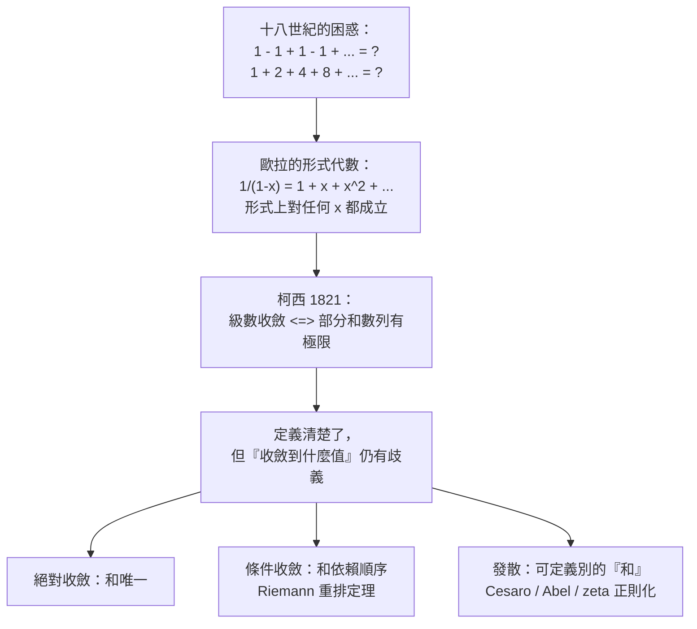
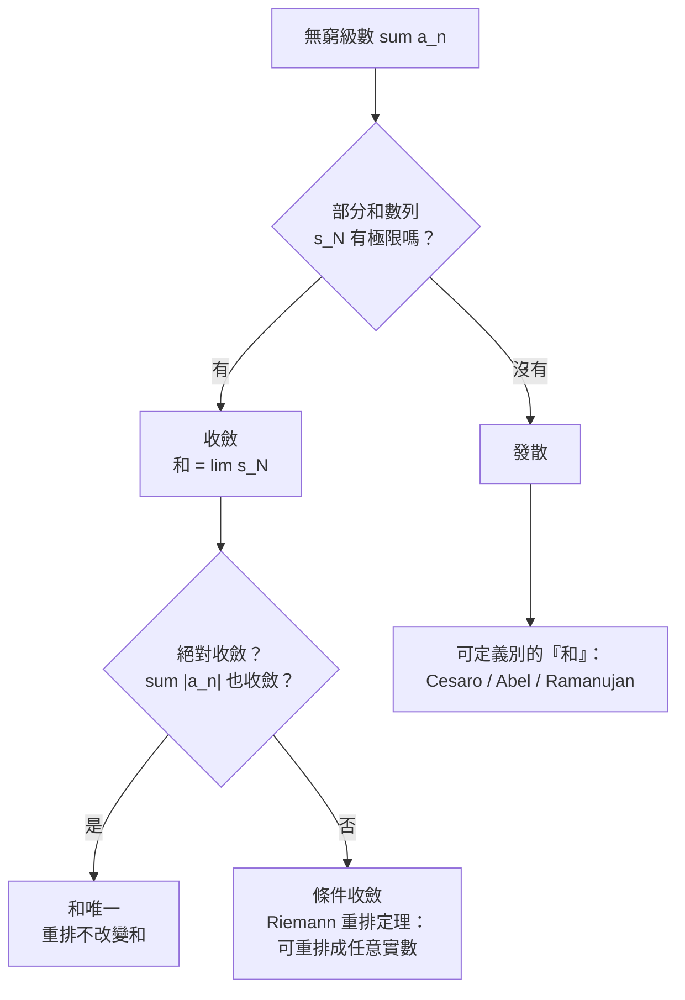

# 6.1 數列、級數與收斂的觀念

## 學習動機

前五章我們一路從窮竭法走到泰勒級數：牛頓與萊布尼茲給出「無窮小」的直覺，柯西把極限寫成不等式，魏爾斯特拉斯給了 $`\varepsilon`$ - $`\delta`$ 的算術，拉格朗日與達朗貝爾把中值定理變成工具，泰勒則把函數拆成無窮多項。到這裡，一個問題一直懸在半空：

> 我們把 $`f(x)`$ 寫成 $`a_0 + a_1 x + a_2 x^2 + \cdots`$ ，那麼「把這些項加起來」究竟是在做什麼？

對大多數函數（ $`e^x`$ 、 $`\sin x`$ 、 $`1/(1-x)`$ ），這個「加起來」在 $`|x|`$ 夠小時顯然良好。但對某些函數——例如 $`\tan x`$ 在 $`x=\pi/2`$ 、 $`1/(1-x)`$ 在 $`x=1`$ ——答案就不那麼簡單了。而更根本地，在 17 世紀，人們連「一個發散級數能不能等於某個數」這個問題都沒有共識。

本節的目標有三：

1. 重演 17 至 18 世紀那場關於「發散級數」的混亂：歐拉如何在沒有收斂定義的情況下，仍然算出 $`-\frac{1}{3}`$ 這種驚人的答案；
2. 引出柯西 1821 年的**收斂定義**——把「級數的和」重新定義為「部分和數列的極限」，從此一切都有憑據；
3. 說明「收斂到什麼值」這個問題，如何催生出一整族「和的定義」（Césaro 和、Abel 和、Riemann 重排定理），並預告第 12 章的極限交換。



---

## 6.1.1 歐拉的大膽：對發散級數動手

十八世紀的歐拉（Leonhard Euler, 1707–1783）有一項本領：只要一個級數「看起來像有規律」，他就敢用代數去操作它。最有名的例子是無窮等比級數

$$
1 + x + x^2 + x^3 + \cdots = \frac{1}{1-x}
$$

這個等式在 $`|x| < 1`$ 當然成立；但歐拉發現，只要在形式上做一次「移項」，就能讓它對**任何** $`x`$ 都給出一個有意義的答案：

$$
(1-x)(1 + x + x^2 + x^3 + \cdots) = 1
$$

因為 $`(1-x)\cdot 1 = 1-x`$ 、 $`(1-x)\cdot x = x - x^2`$ 、 $`(1-x)\cdot x^2 = x^2 - x^3`$ ……相鄰項兩兩抵消，只剩下開頭的 $`1`$ 。整個「推導」只用到形式代數，完全不需要級數收斂。

現在把 $`x`$ 代入收斂區之外。取 $`x = 2`$ ，得到

$$
1 + 2 + 4 + 8 + 16 + \cdots = \frac{1}{1-2} = -1
$$

取 $`x = 4`$ ，得到

$$
1 + 4 + 16 + 64 + \cdots = \frac{1}{1-4} = -\frac{1}{3}
$$

取 $`x = -2`$ ，得到

$$
1 - 2 + 4 - 8 + 16 - \cdots = \frac{1}{1+2} = \frac{1}{3}
$$

這些「答案」顯然不可能是真正的和： $`1+2+4+8+\cdots`$ 的部分和一路奔向 $`+\infty`$ ，怎麼會等於 $`-1`$ ？但歐拉的計算過程本身毫無瑕疵——他只是把一個**收斂的恆等式**延伸到了它不成立的地方。

讓我們用 SymPy 把這場「鬧劇」完整重演一遍。注意 `sp.summation` 對真正發散的級數會老老實實回報 `oo` ，而 `sp.series` 則給出形式展開——兩者之間的落差正是本節要說的故事。

```python
import sympy as sp

n = sp.symbols('n', integer=True, nonnegative=True)
x = sp.symbols('x')

# (1) Grandi 級數 1 - 1 + 1 - 1 + ... 的部分和永遠在 0 與 1 之間擺盪
partials = [sp.summation((-1)**n, (n, 0, N - 1)) for N in range(1, 9)]
print("Grandi 部分和序列 =", partials)

# (2) 歐拉的形式代數：1/(1-x) = 1 + x + x^2 + x^3 + ...
print("1/(1-x) 的形式展開 =", sp.series(1 / (1 - x), x, 0, 6))

# (3) 把 x 代入收斂區之外，歐拉仍然大膽地「算出」一個值
print("x=2  -> 1+2+4+8+...   =", sp.Rational(1, 1 - 2))
print("x=4  -> 1+4+16+64+... =", sp.Rational(1, 1 - 4))
print("x=-2 -> 1-2+4-8+...   =", sp.Rational(1, 1 + 2))

# (4) SymPy 對真正的數值級數給出的答案
print("sum 2^n =", sp.summation(2**n, (n, 0, sp.oo)))
print("sum 4^n =", sp.summation(4**n, (n, 0, sp.oo)))
```

預期輸出：

```
Grandi 部分和序列 = [1, 0, 1, 0, 1, 0, 1, 0]
1/(1-x) 的形式展開 = 1 + x + x**2 + x**3 + x**4 + x**5 + O(x**6)
x=2  -> 1+2+4+8+...   = -1
x=4  -> 1+4+16+64+... = -1/3
x=-2 -> 1-2+4-8+...   = 1/3
sum 2^n = oo
sum 4^n = oo
```

> **這段程式碼教會我們什麼？** `sp.series` 與 `sp.summation` 是兩個**不同的運算子**。`sp.series(1/(1-x), x, 0, 6)` 問的是「 $`1/(1-x)`$ 在 $`x=0`$ 的泰勒展開前六項是什麼」——這是一個純粹的**代數**問題，答案對所有 $`x`$ 都成立（只是誤差項 $`O(x^6)`$ 的估計需要 $`|x|`$ 小）。`sp.summation(2**n, (n, 0, oo))` 問的是「這串數字加起來等於多少」——這是一個**分析**問題，答案就是 `oo` 。歐拉做的事，正是在這兩者之間偷換概念。

---

## 6.1.2 Grandi 級數與「移項」的陷阱

Grandi 級數 $`1 - 1 + 1 - 1 + \cdots`$ 是十八世紀最著名的爭議對象。義大利數學家 Giovanni Domenico Grandi 在 1703 年就提出它，並且給出了「和等於 $`\frac{1}{2}`$ 」的主張。他的推理是：把級數寫成

$$
G = 1 - 1 + 1 - 1 + \cdots
$$

那麼

$$
G = 1 - G
$$

（把括號裡的內容往右移一位，得到的級數正是 $`-G`$ ），於是 $`G = \frac{1}{2}`$ 。

這裡的問題不在運算，而在**無窮個項的減法**。如果我們真的把部分和排成數列 $`1, 0, 1, 0, \ldots`$ ，它根本沒有極限。所謂「 $`G = 1 - G`$ 」只是把一個發散級數重新寫了一遍。

十八世紀的數學家為了讓「 $`G = \frac{1}{2}`$ 」站得住腳，發展出 **Césaro 和**（Césaro summation）：取部分和序列 $`s_1, s_2, \ldots`$ 的算術平均，再看這個平均序列的極限。對 Grandi 級數而言，部分和是 $`1, 0, 1, 0, \ldots`$ ，它們的 Cesàro 平均是 $`\frac{1}{2}, \frac{1}{2}, \frac{1}{2}, \ldots`$ ，於是

$$
G = \frac{1}{2} \quad \text{（Cesàro 意義下）}
$$

這是第一個**明確承認「和可以有好幾種意義」**的例子。讓我們用 SymPy 親手算一遍這個 Cesàro 平均。

```python
import sympy as sp

n = sp.symbols('n', integer=True, nonnegative=True)
m = sp.symbols('m', integer=True, positive=True)
k = sp.symbols('k', integer=True, positive=True)

# Grandi 級數的第 k 個部分和：k 為奇數時是 1，為偶數時是 0
s_k = (1 - (-1)**k) / 2
print("s_k =", s_k)

# Cesaro 平均 C_N = (s_1 + s_2 + ... + s_N)/N
C_N = sp.simplify(sp.summation(s_k, (k, 1, n)) / n)
print("Cesaro 平均 C_N =", C_N)

# 分奇偶討論即可看出極限是 1/2
print("C_2m =", sp.simplify(C_N.subs(n, 2 * m)))
print("C_{2m+1} =", sp.simplify(C_N.subs(n, 2 * m + 1)))
print("lim C_2m =", sp.limit(sp.simplify(C_N.subs(n, 2 * m)), m, sp.oo))
print("lim C_{2m+1} =", sp.limit(sp.simplify(C_N.subs(n, 2 * m + 1)), m, sp.oo))
```

預期輸出：

```
s_k = 1/2 - (-1)**k/2
Cesaro 平均 C_N = (-(-1)**n + 2*n + 1)/(4*n)
C_2m = 1/2
C_{2m+1} = (m + 1)/(2*m + 1)
lim C_2m = 1/2
lim C_{2m+1} = 1/2
```

---

## 6.1.3 柯西的收斂定義（1821）

十八世紀的混亂根源在於：**「無窮級數的和」從來沒有被定義過**。歐拉、萊布尼茲、格蘭迪各自的心算過程都可以自洽，卻彼此矛盾。要打破這個循環，必須先把「收斂」這件事講清楚。

奧古斯丁-路易 Cauchy（1789–1857）在 1821 年的《Cours d'analyse》中給出了第一個現代意義下的定義。他先定義數列收斂：

> 數列 $`(a_n)`$ 收斂，若存在實數 $`A`$ ，使得對每個 $`\varepsilon > 0`$ 都存在 $`N`$ ，使 $`n > N`$ 時 $`|a_n - A| < \varepsilon`$ 。

然後定義級數：

> 級數 $`\sum_{n=1}^{\infty} a_n`$ 收斂，若它的**部分和數列** $`s_N = a_1 + a_2 + \cdots + a_N`$ 收斂；此時級數的和就是 $`\lim_{N\to\infty} s_N`$ ，記作 $`\sum_{n=1}^{\infty} a_n`$ 。

這個定義的威力在於它把級數問題**完全化約**成數列（乃至數列的收斂）問題：只要能控制 $`s_N`$ 走多近某個極限，就得到級數的和。由此立刻推出柯西判別準則：

> 若對每個 $`\varepsilon > 0`$ 存在 $`N`$ ，使 $`m, n > N`$ 時 $`|s_m - s_n| < \varepsilon`$ ，則級數收斂。

也就是說：只要「尾巴夠小」就行，不必知道和是多少。

```python
import sympy as sp

n = sp.symbols('n', integer=True, positive=True)
N = sp.symbols('N', integer=True, positive=True)

# (1) 收斂級數：部分和數列有極限
s_N = sp.summation(1 / n**2, (n, 1, N))
print("S_N =", s_N)
print("lim S_N =", sp.limit(s_N, N, sp.oo))

# (2) 柯西判別準則的數值版本：尾巴 |S - S_N| 要能任意小
S = sp.pi**2 / 6
tails = [abs(sp.N(S - sp.summation(1 / n**2, (n, 1, M)))) for M in [10, 100, 1000]]
print("尾巴大小 =", tails)

# (3) 發散級數：部分和數列沒有有限極限
print("sum 1/n =", sp.summation(1 / n, (n, 1, sp.oo)))
```

預期輸出：

```
S_N = harmonic(N, 2)
lim S_N = pi**2/6
尾巴大小 = [0.0951663356816857, 0.00995016666333357, 0.000999500166666633]
sum 1/n = oo
```

> `harmonic(N, 2)` 是 SymPy 對**調和數** $`H_N^{(2)} = \sum_{n=1}^N \frac{1}{n^2}`$ 的專用符號；它的極限 $`\frac{\pi^2}{6}`$ 就是著名的 Basel 問題答案。我們在 6.3 節會用 `sp.summation` 重新算出來。

---

## 6.1.4 「收斂到什麼值」：和的多重定義與 Riemann 重排定理

定義了收斂之後，還剩一個惱人的問題。對**絕對收斂**的級數，「和」是唯一確定的：任何重排都給出同一個值。但對**條件收斂**的級數（例如交錯調和級數 $`\sum \frac{(-1)^{n+1}}{n} = \log 2`$ ），事情就大不一樣了。

德國數學家 Bernhard Riemann（1826–1866）在 1854 年的論文中證明了一個驚人的定理：

> **Riemann 重排定理**：若一個實數級數條件收斂（收斂但不絕對收斂），那麼對任意實數 $`L`$ ，都存在一種重排方式使重排後的級數收斂到 $`L`$ 。

換句話說，條件收斂級數的「和」可以變成你想要的任何數。這在直覺上非常反直覺：我們把同一堆數字，只是換個順序加起來，答案就變了？

讓我們親手構造一個重排。取交錯調和級數

$$
1 - \frac{1}{2} + \frac{1}{3} - \frac{1}{4} + \frac{1}{5} - \frac{1}{6} + \cdots
$$

改排成「取兩個正項、再取一個負項」：

$$
1 + \frac{1}{3} - \frac{1}{2} + \frac{1}{5} + \frac{1}{7} - \frac{1}{4} + \frac{1}{9} + \frac{1}{11} - \frac{1}{6} + \cdots
$$

其第 $`k`$ 組是 $`\frac{1}{4k-3} + \frac{1}{4k-1} - \frac{1}{2k}`$ 。用 SymPy 計算它的極限。

```python
import sympy as sp

n = sp.symbols('n', integer=True, positive=True)
N = sp.symbols('N', integer=True, positive=True)

# (1) 原序：交錯調和級數的和是 log(2)
print("原序 sum (-1)^(n+1)/n =", sp.summation((-1)**(n + 1) / n, (n, 1, sp.oo)))

# (2) 重排：兩個正項再一個負項，第 k 組 = 1/(4k-3) + 1/(4k-1) - 1/(2k)
#     這三個正負號的總和可用調和數寫成 H_(4N) - H_(2N)/2 - H_N/2
rearranged = sp.harmonic(4 * N) - sp.harmonic(2 * N) / 2 - sp.harmonic(N) / 2
print("重排後的極限 =", sp.limit(rearranged, N, sp.oo))

# (3) 數值驗證：前 2000 組的部分和已經很接近極限
s = sp.Integer(0)
for k in range(1, 2001):
    s += sp.Rational(1, 4 * k - 3) + sp.Rational(1, 4 * k - 1) - sp.Rational(1, 2 * k)
print("重排前 2000 組的部分和 =", sp.N(s, 12))
print("3*log(2)/2              =", sp.N(3 * sp.log(2) / 2, 12))
```

預期輸出：

```
原序 sum (-1)^(n+1)/n = log(2)
重排後的極限 = 3*log(2)/2
重排前 2000 組的部分和 = 1.03959578256
3*log(2)/2              = 1.03972077084
```

注意 $`\frac{3}{2}\log 2 \neq \log 2`$ ：同樣的數字，只是換了順序，和就從 $`0.6931`$ 變成 $`1.0397`$ 。這就是為什麼柯西的定義必須加上「部分和數列的極限」這個嚴格框定——它同時也告訴我們：**條件收斂級數的「和」依賴於排列順序**。

我們在第 12 章會再次遇到這個主題：當我們討論 Lebesgue 積分與「極限與求和的交換」時，Riemann 重排定理會以「非絕對收斂時，Tonelli 定理失效」的形式重新現身。



---

## 6.1.5 形式冪級數 vs 收斂級數：以 $`1/(1-x)`$ 為例

現在我們可以精確地說出歐拉在哪裡出錯了。關鍵是區分兩種完全不同的物件：

**（一）形式冪級數（formal power series）**。 $`1/(1-x)`$ 在形式冪級數環 $`\mathbb{R}[[x]]`$ 中有一個意義明確的意義：它是滿足 $`(1-x) F = 1`$ 的那個 $`F = \sum_{n\ge 0} x^n`$ 。這個定義**完全不涉及收斂**，只涉及係數的逐項運算。因此在形式意義下， $`1/(1-x)`$ 對任何 $`x`$ 都「存在」，把它代入 $`x = 2`$ 得到的 $`-1`$ 是一個**形式代數的推論**，而不是任何實數級數的和。

**（二）收斂級數（convergent series）**。 $`\sum_{n\ge 0} x^n`$ 作為一個實數級數，只在 $`|x| < 1`$ 時收斂，其和才是 $`1/(1-x)`$ 這個函數值。離開 $`|x| < 1`$ ，符號 $`\sum_{n \ge 0} x^n`$ 就**沒有意義**了。

SymPy 恰好把這個區分暴露在我們面前：`sp.summation(x**n, (n, 0, oo))` 回傳的是 `Piecewise` ，其中明確標示了收斂條件；而 `sp.series(1/(1-x), x, 0, 6)` 則是純形式操作，沒有任何條件。

```python
import sympy as sp

x = sp.symbols('x')
n = sp.symbols('n', integer=True, nonnegative=True)

# (1) 形式冪級數：sp.series 只問「前幾項係數是什麼」，不問收斂
F = sp.series(1 / (1 - x), x, 0, 8)
print("1/(1-x) 的形式展開 =", F)

# (2) 收斂級數：sp.summation 回傳 Piecewise，把收斂條件寫在答案裡
print("sum x^n =", sp.summation(x**n, (n, 0, sp.oo)))

# (3) 形式環性質：(1-x) * sum x^n = 1，恆成立，與 x 的大小無關
G = F.removeO()
print("(1-x) * G =", sp.series((1 - x) * G, x, 0, 8))

# (4) 逐項核對係數：形式冪級數的「定義」就是係數序列
print("G 的係數 =", [sp.expand(G).coeff(x, k) for k in range(8)])
```

預期輸出：

```
1/(1-x) 的形式展開 = 1 + x + x**2 + x**3 + x**4 + x**5 + x**6 + x**7 + O(x**8)
sum x^n = Piecewise((1/(1 - x), Abs(x) < 1), (Sum(x**n, (n, 0, oo)), True))
(1-x) * G = 1 + O(x**8)
G 的係數 = [1, 1, 1, 1, 1, 1, 1, 1]
```

> 請注意 `sum x^n` 的答案是 **`Piecewise`** ：第一個分支 `1/(1 - x)` 附帶條件 `Abs(x) < 1` ，第二個分支則是**未求值**的 `Sum(x**n, (n, 0, oo))` ，代表「SymPy 不知道其他 $`x`$ 的情況」。這就是「定義」的威力：當你用 `sp.summation` 問一個收斂級數時，收斂條件是答案的一部分，而不是需要你自己另外假設的東西。

---

## 6.1.6 小結

| 概念 | 定義 | 關鍵人物 / 年份 | SymPy 對應 |
|------|------|------------------|------------|
| 形式冪級數 | 係數序列， $`(1-x)F=1`$ 在 $`\mathbb{R}[[x]]`$ 中成立 | 歐拉 / 十九世紀代數 | `sp.series(1/(1-x), x, 0, 6)` |
| 收斂級數 | 部分和數列有極限 | Cauchy, 1821 | `sp.Sum(...).is_convergent()` |
| 部分和數列 | $`s_N = \sum_{n \le N} a_n`$ | Cauchy, 1821 | `sp.summation(a, (n, 1, N))` |
| 絕對收斂 | $`\sum \lvert a_n\rvert`$ 收斂 | Riemann, 1854 | `Sum.is_absolutely_convergent()` |
| 條件收斂 | 收斂但不絕對收斂 | Riemann, 1854 | `is_convergent()=True` 且 `is_absolutely_convergent()=False` |
| Riemann 重排定理 | 條件收斂級數可重排成任意實數 | Riemann, 1854 | 需自行構造（見 6.1.4） |
| Cesàro 和 | 部分和序列的算術平均的極限 | Cesàro, 1896 | 需自行構造（見 6.1.2） |

下一節我們把「怎麼判斷一個級數收不收斂」這件事做成一套工具箱：比較判別法、比值判別法、根式判別法、Raabe-Duhamel 判別、Bertrand 判別、Gauss 判別，以及萊布尼茲的交錯級數判別法。

---

## 習題

**習題 6.1.1（Grandi 與 Cesàro）**
用 SymPy 計算 Grandi 級數 $`\sum_{n\ge 0} (-1)^n`$ 的前 $`N`$ 項部分和，並驗證其 Cesàro 平均恆為 $`\frac{1}{2}`$ 。再計算級數 $`\sum_{n\ge 0} (-1)^n \cdot \frac{1}{2^n}`$ 的 Cesàro 平均，說明為什麼 Cesàro 和與普通和對這個級數給出相同答案。

**習題 6.1.2（Euler 的形式外推）**
用 `sp.series` 計算 $`1/(1-x^3)`$ 在 $`x=0`$ 的展開至 $`x^6`$ ，然後在形式意義下把它代入 $`x=2`$ ，得到 $`1+8+64+\cdots`$ 的「值」。對照 `sp.summation(2**(3*n), (n, 0, oo))` 的結果，解釋兩者為何不同。

**習題 6.1.3（Riemann 重排到指定的目標值）**
修改 6.1.4 的程式碼：構造一個「取三個正項再取兩個負項」的重排，用 `sp.harmonic` 寫出其部分和並求出極限。再用貪婪演算法（每次加正項直到超過目標值，然後加負項直到低於目標值）構造一個重排，使其極限接近 $`\frac{\pi}{4}`$ 。提示：不要用浮點數累加，用 `sp.Rational` 保持精確。

**習題 6.1.4（形式冪級數的乘法）**
證明（用 SymPy 核對）形式冪級數 $`\frac{1}{1-x} \cdot \frac{1}{1+x} = \frac{1}{1-x^2}`$ ，並分別比較兩邊係數的第 $`n`$ 項。再用 `sp.summation` 比較 $`\sum x^n`$ 與 $`\sum (-x)^n`$ 的 `Piecewise` 答案，說明為什麼後者的收斂條件寫成 `Abs(x) < 1` （對比第 5.3 節的 `1/(1+x)` 展開）。

**習題 6.1.5（ $`\zeta`$ 正則化的預習）**
用 SymPy 計算 $`\sum_{n=1}^{\infty} n^k`$ 對 $`k = 1, 2, 3`$ 的結果（皆為 `oo` ）。接著用 $`\frac{1}{(1-x)^2} = \sum_{n\ge 0} (n+1)x^n`$ 在形式意義下展開，並在 $`x = 1`$ 代入，觀察 $`\frac{1}{(1-1)^2}`$ 的形式結果與 $`\sum_{n\ge 0}(n+1) = \infty`$ 的矛盾。說明這個矛盾為何不能靠「把 $`\infty`$ 當成一個數來代數運算」解決。
