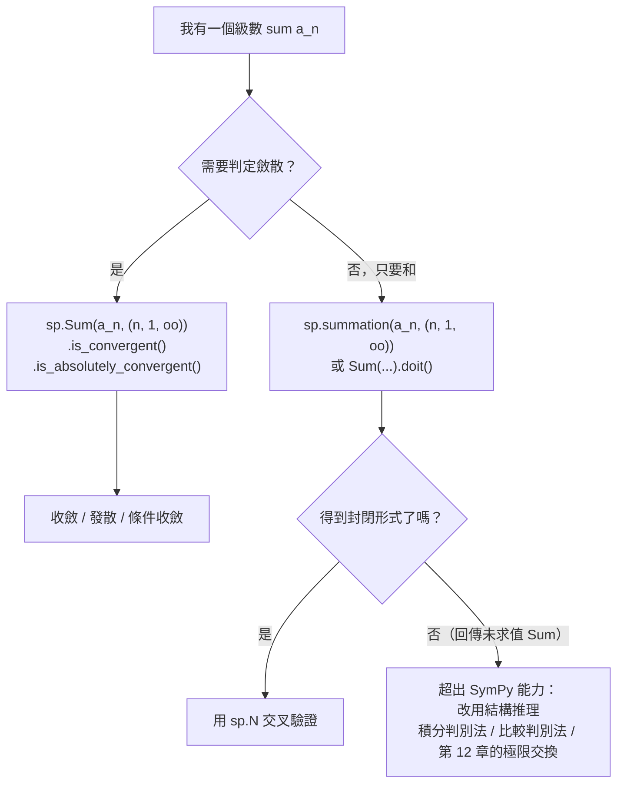
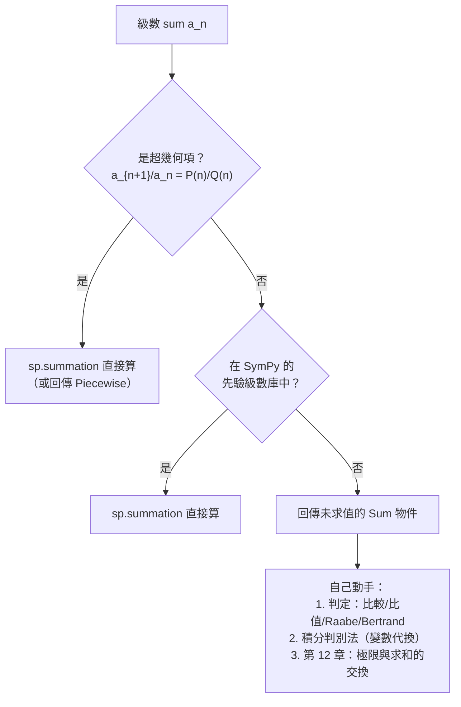

# 6.3 用 SymPy 做級數判定與符號求和

## 學習動機

前兩節是**理論**：什麼是收斂（6.1），以及怎麼判斷收斂（6.2）。本節是**工具**：SymPy 能不能直接幫我們判定一個級數收不收斂？能不能直接算出它的和？

SymPy 的答案是「大部分可以，而且比手算快得多」。但它的能力邊界同樣重要——知道 SymPy 什麼時候會失敗，才能知道什麼時候必須靠自己的結構推理。

本節要介紹四個武器：

1. **`sp.Sum` 物件與 `.doit()`**——「級數」在 SymPy 中是一種**可求值的物件**，而不只是一段文字；
2. **`sp.summation`**——對常見類型的級數直接給出封閉形式，包含 $`\sum n^k`$ 、 $`\sum r^n`$ 、 $`\sum \frac{1}{n^2}`$ 、 $`\sum \frac{1}{2^n}`$ 這些經典例子；
3. **收斂判定**——`Sum.is_convergent()` 與 `Sum.is_absolutely_convergent()` 兩個方法，它們回傳的布林值把 6.2 節的整張表變成一行程式碼；
4. **`sp.series` 與 `sp.summation` 的對照**——同一個對象的兩種意義（形式 vs 數值），以及用 `sp.N(Sum(...))` 做交叉驗證。

最後我們會說清楚 SymPy 的 `summation` 究竟支援哪些類型的級數（超幾何 / 先驗級數），以及**超越這個範圍時，該用什麼武器**——第 12 章的極限交換。



---

## 6.3.1 `sp.Sum` 物件：把級數變成可運算的東西

在 SymPy 裡，「級數」不是一段需要人解讀的文字，而是一個**物件**。`sp.Sum(function, (symbol, start, end))` 建造它，而 `.doit()` 負責「真的把它算出來」。

這與第 5.3 節的 `sp.series` 有相同的設計哲學：**物件化的數學對象**。`sp.Order` 是餘項的物件化，`sp.Sum` 是級數的物件化。兩者都支援進一步的查詢與運算。

讓我們把 `Sum` 物件的各種性質看清楚。

```python
import sympy as sp

n = sp.symbols('n', integer=True, positive=True)
k = sp.symbols('k', integer=True, nonnegative=True)

S = sp.Sum(1 / n**2, (n, 1, sp.oo))
print("S =", S, type(S))
print("doit =", S.doit())
print("Sum k^2, k=1..10 =", sp.Sum(k**2, (k, 1, 10)).doit())
print("Sum k^2, k=1..n =", sp.Sum(k**2, (k, 1, n)).doit())

S2 = sp.Sum(1 / n, (n, 1, sp.oo))
print("has_finite_limits =", S2.has_finite_limits)
print("is_convergent =", S2.is_convergent())
print("is_absolutely_convergent =", S2.is_absolutely_convergent())

S3 = sp.Sum((-1)**(n + 1) / n, (n, 1, sp.oo))
print("S3 is_conv =", S3.is_convergent(), "abs =", S3.is_absolutely_convergent())
```

預期輸出：

```
S = Sum(n**(-2), (n, 1, oo)) <class 'sympy.concrete.summations.Sum'>
doit = pi**2/6
Sum k^2, k=1..10 = 385
Sum k^2, k=1..n = n**3/3 + n**2/2 + n/6
has_finite_limits = False
is_convergent = False
is_absolutely_convergent = False
S3 is_conv = True abs = False
```

**三個值得注意的地方**：

1. `sp.Sum(k**2, (k, 1, 10)).doit()` 回傳 `385` —— 這是 **Faulhaber 公式** $`\sum_{k=1}^{n} k^2 = \frac{n^3}{3} + \frac{n^2}{2} + \frac{n}{6}`$ 在 $`n = 10`$ 的值，而 SymPy 先算出封閉形式再代入；
2. `has_finite_limits = False` —— SymPy 知道這個上限是無窮的；
3. `S3` 的兩個布林值分別是 `True` 與 `False` —— 這正是 6.2.7 節的「**條件收斂**」！

> **注意**：`sp.Sum` 物件在建立時**不做任何計算**（這是「惰性求值」）。`sp.Sum(1/n**2, (n,1,oo))` 只是把式子記錄下來；`.doit()` 才觸發實際運算。所以你可以放心地先建立物件、再問問題。

---

## 6.3.2 `sp.summation`：四個經典例子

`sp.summation(f, (n, a, b))` 是 `sp.Sum(...).doit()` 的快捷方式。讓我們用它處理四個教科書級的級數。

**（一） $`\sum n^k`$ **（ $`k \ge 0`$ 整數）——這是「多項式項的級數」，一律發散（項不趨近 0），SymPy 回報 `oo` 。

**（二） $`\sum r^n`$ **——這是等比級數。SymPy 回傳 **`Piecewise`** ，把收斂條件 $`\lvert r\rvert < 1`$ 寫在答案裡，這正是第 6.1.5 節強調的「定義是答案的一部分」。

**（三） $`\sum \frac{1}{n^2} = \frac{\pi^2}{6}`$ **——Basel 問題。這個答案是 1728 年歐拉用符號方法猜出來的，後來由傅立葉等人的工作嚴格證明。SymPy 直接給出 $`\frac{\pi^2}{6}`$ ，而且**不告訴你是怎麼算出來的**——這是符號系統的特色：它給答案，不給推導。

**（四） $`\sum \frac{1}{2^n} = 2`$ **——幾何級數。

```python
import sympy as sp

n = sp.symbols('n', integer=True, positive=True)
r = sp.symbols('r')

print("=== sum n^k（多項式項都發散） ===")
for p in [0, 1, 2, 3, 4]:
    print(f"sum n^{p} =", sp.summation(n**p, (n, 1, sp.oo)))

print()
print("=== sum r^n（幾何級數，Piecewise 帶收斂條件） ===")
print("sum r^n, n=0..oo =", sp.summation(r**n, (n, 0, sp.oo)))
print("sum r^n, n=1..oo =", sp.summation(r**n, (n, 1, sp.oo)))

print()
print("=== sum 1/n^2（Basel）與 sum (1/2)^n ===")
print("sum 1/n^2   =", sp.summation(1 / n**2, (n, 1, sp.oo)))
print("sum (1/2)^n =", sp.summation(sp.Rational(1, 2)**n, (n, 0, sp.oo)))
print("sum (1/2)^n, n=1.. =", sp.summation(sp.Rational(1, 2)**n, (n, 1, sp.oo)))
```

預期輸出：

```
=== sum n^k（多項式項都發散） ===
sum n^0 = oo
sum n^1 = oo
sum n^2 = oo
sum n^3 = oo
sum n^4 = oo

=== sum r^n（幾何級數，Piecewise 帶收斂條件） ===
sum r^n, n=0..oo = Piecewise((1/(1 - r), Abs(r) < 1), (Sum(r**n, (n, 0, oo)), True))
sum r^n, n=1..oo = Piecewise((r/(1 - r), Abs(r) < 1), (Sum(r**n, (n, 1, oo)), True))

=== sum 1/n^2（Basel）與 sum (1/2)^n ===
sum 1/n^2   = pi**2/6
sum (1/2)^n = 2
sum (1/2)^n, n=1.. = 1
```

**「 $`n`$ 從 0 開始」與「從 1 開始」的差別**： $`\sum_{n=0}^{\infty} \frac{1}{2^n} = 2`$ 而 $`\sum_{n=1}^{\infty} \frac{1}{2^n} = 1`$ ——差的就是 $`n = 0`$ 那一項 $`\frac{1}{2^0} = 1`$ 。在符號計算裡這個差異經常造成困惑，**永遠寫清楚上下限**是最基本的防禦。

**為什麼 $`\sum n^k`$ 對每個 $`k`$ 都發散？** 因為第 6.1.3 節柯西定義的直接推論：若 $`\sum a_n`$ 收斂則 $`a_n \to 0`$ 。但 $`n^k \to \infty`$ ，連趨近 0 都不可能，所以必發散。SymPy 的 `oo` 是這個推理的自動化版本。

---

## 6.3.3 收斂判定：一行程式碼完成 6.2 節的整張表

現在把 6.2 節的成果兌現。SymPy 的 `Sum` 物件有兩個關鍵方法：

- `is_convergent()` —— 回傳 `True` / `False` / `None`（`None` 表示無法判定）；
- `is_absolutely_convergent()` —— 回傳 `True` / `False` / `None` 。

把兩者組合，就得到教科書慣用的三分類：

| `is_convergent()` | `is_absolutely_convergent()` | 分類 |
|---|---|---|
| `False` | — | **發散** |
| `True` | `True` | **收斂（絕對）** |
| `True` | `False` | **條件收斂** |
| `None` | — | 無法判定 |

值得注意的是，SymPy 內部的 `is_convergent()` **內建了積分判別法**——這正是 6.2.8 節裡所有古典判別法都失敗的 $`\frac{1}{n(\log n)^p}`$ 型級數，SymPy 卻能判定的原因。

```python
import sympy as sp

n = sp.symbols('n', integer=True, positive=True)

def classify(term, limits=(n, 1, sp.oo)):
    """把級數分類成 收斂（絕對）/ 條件收斂 / 發散。"""
    S = sp.Sum(term, limits)
    conv = S.is_convergent()
    if conv is None:
        return "無法判定"
    if not bool(conv):
        return "發散"
    abs_conv = S.is_absolutely_convergent()
    if abs_conv is None:
        return "收斂（絕對性未知）"
    return "收斂（絕對）" if bool(abs_conv) else "條件收斂"

cases = [
    ("1/n**2", 1 / n**2),
    ("(-1)^(n+1)/n**2", (-1)**(n + 1) / n**2),
    ("(-1)^(n+1)/n", (-1)**(n + 1) / n),
    ("1/n", 1 / n),
    ("2**n", 2**n),
    ("1/(n*log(n))", 1 / (n * sp.log(n))),
    ("1/(n*log(n)**2)", 1 / (n * sp.log(n)**2)),
]
for label, term in cases:
    print(f"sum {label:20s} -> {classify(term)}")
```

預期輸出：

```
sum 1/n**2               -> 收斂（絕對）
sum (-1)^(n+1)/n**2      -> 收斂（絕對）
sum (-1)^(n+1)/n         -> 條件收斂
sum 1/n                  -> 發散
sum 2**n                 -> 發散
sum 1/(n*log(n))         -> 發散
sum 1/(n*log(n)**2)      -> 收斂（絕對）
```

最後兩行是本節最重要的對照：**SymPy 在 6.2.8 節宣告「古典判別法全部失效」的兩個級數上，依然給出了正確答案**。這是因為它換用了更大的網（積分判別法 + 比較判別法）。

> **實務建議**：拿到一個級數，**先問 `is_convergent()`**。如果它回傳 `True` 或 `False`，你就省掉了自己動手比較、比值、根式的一整套流程；只有在它回傳 `None` 時，才需要回到 6.2 節的手工判別法。

---

## 6.3.4 `sp.series` 與 `sp.summation`：同一對象的兩種意義

第 6.1.5 節已經用 `1/(1-x)` 說明了「形式冪級數」與「收斂級數」的區別。這裡我們把兩者並排，讓 `sp.series` 與 `sp.summation` 的分工一目了然：

| | `sp.series(1/(1-x), x, 0, 6)` | `sp.summation(x**n, (n, 0, oo))` |
|---|---|---|
| 問的問題 | 「前六項係數是什麼？」 | 「這串數字加起來等於多少？」 |
| 收斂條件 | 不需要 | 寫在答案的 `Piecewise` 裡 |
| 適用範圍 | 任何解析函數、任何 $`x`$ | 只有收斂的級數 |
| 回傳 | 多項式 + `Order` 物件 | 封閉形式或 `Piecewise` |

`sp.series` 的另一個用途是**驗證形式恆等式**： $`(1-x)\sum x^n = 1`$ 這個等式在形式環中恆成立，SymPy 可以逐項核對。

```python
import sympy as sp

x = sp.symbols('x')
n = sp.symbols('n', integer=True, nonnegative=True)

# (1) 用 series 檢查 1/(1-x) 的展開
print("1/(1-x) =", sp.series(1 / (1 - x), x, 0, 6))
print("1/(1+x) =", sp.series(1 / (1 + x), x, 0, 6))
print("log(1+x)=", sp.series(sp.log(1 + x), x, 0, 6))

# (2) 乘法驗證：(1-x) * sum x^n = 1（形式冪級數的環性質）
F = sp.series(1 / (1 - x), x, 0, 8).removeO()
print("(1-x) * F =", sp.series((1 - x) * F, x, 0, 8))

# (3) 逐項核對係數
coeffs = [sp.expand(F).coeff(x, k) for k in range(8)]
print("G 的係數 =", coeffs)

# (4) 與 summation 的 Piecewise 對照
print("sum x^n =", sp.summation(x**n, (n, 0, sp.oo)))
```

預期輸出：

```
1/(1-x) = 1 + x + x**2 + x**3 + x**4 + x**5 + O(x**6)
1/(1+x) = 1 - x + x**2 - x**3 + x**4 - x**5 + O(x**6)
log(1+x)= x - x**2/2 + x**3/3 - x**4/4 + x**5/5 + O(x**6)
(1-x) * F = 1 + O(x**8)
G 的係數 = [1, 1, 1, 1, 1, 1, 1, 1]
sum x^n = Piecewise((1/(1 - x), Abs(x) < 1), (Sum(x**n, (n, 0, oo)), True))
```

第 (2) 行的 `1 + O(x**8)` 是**形式恆等式的符號化證明**：相乘之後所有 $`x`$ 的正次項都消掉了，只剩下常數項 $`1`$ 與截斷誤差。這正是第 6.1.1 節歐拉「移項」那一步的**嚴格版本**——在形式環裡它是定理，在數值世界裡它只在 $`|x| < 1`$ 成立。

---

## 6.3.5 交叉驗證：`sp.summation` 與 `sp.N(Sum(...))`

符號系統有時會「自信地給出錯誤答案」。防禦的方法是**用兩條獨立的路徑算同一個東西**：

- **路徑 A（符號）**：`sp.summation(...)` 得到封閉形式 $`\frac{\pi^2}{6}`$ ；
- **路徑 B（數值）**：`sp.N(sp.Sum(...))` 直接對無窮和做數值求值。

兩者相符，就增加了一份信心；不相符，就要去查哪裡錯了。

第三種路徑是**有限和逼近**：取 $`M = 10, 100, 1000, 10000`$ 的部分和，看誤差如何隨 $`M`$ 衰減。對 $`\sum \frac{1}{n^2}`$ ，誤差應該是 $`O(1/M)`$ （因為 $`\frac{1}{n^2}`$ 的尾巴約為 $`\frac{1}{M}`$ ）。

```python
import sympy as sp

n = sp.symbols('n', integer=True, positive=True)

# (1) 符號求和 vs 數值求和：交叉驗證
cases = [
    ("sum 1/n**2", 1 / n**2),
    ("sum (1/2)^n", sp.Rational(1, 2)**n),
    ("sum (-1)^(n+1)/n", (-1)**(n + 1) / n),
]
for label, term in cases:
    sym = sp.summation(term, (n, 1, sp.oo))
    num = sp.N(sp.Sum(term, (n, 1, sp.oo)))
    print(f"{label}")
    print(f"   summation = {sym}    N(Sum) = {num}")

print()
print("=== 有限和逼近無窮和（誤差應為 O(1/M)） ===")
for M in [10, 100, 1000, 10000]:
    s = sp.N(sp.summation(1 / n**2, (n, 1, M)), 12)
    err = abs(s - float(sp.pi)**2 / 6)
    print(f"M={M:6d}  S_M = {s}   誤差 = {err:.3e}")
```

預期輸出：

```
sum 1/n**2
   summation = pi**2/6    N(Sum) = 1.64493406684823
sum (1/2)^n
   summation = 1    N(Sum) = 1.00000000000000
sum (-1)^(n+1)/n
   summation = log(2)    N(Sum) = 0.693147180559945

=== 有限和逼近無窮和（誤差應為 O(1/M)） ===
M=    10  S_M = 1.54976773117   誤差 = 9.517e-2
M=   100  S_M = 1.63498390018   誤差 = 9.950e-3
M=  1000  S_M = 1.64393456668   誤差 = 9.995e-4
M= 10000  S_M = 1.64483407185   誤差 = 1.000e-4
```

誤差每把 $`M`$ 乘以 $`10`$ 就縮成十分之一——正是 $`O(1/M)`$ 的行為。這與第 5.3 節的交錯級數界（ $`O(1/M)`$ 但常數是 $`1`$ ）形成對比，也再次說明為什麼 $`\sum \frac{1}{n^2}`$ 用部分和算很划算（ $`M = 10^4`$ 就有 4 位正確數字），而 $`\sum \frac{(-1)^{n+1}}{n}`$ 要 $`10^{15}`$ 項。

> **符號 vs 數值的取捨**：`sp.summation` 給你**精確**的 $`\frac{\pi^2}{6}`$ ，但可能很慢或不支援；`sp.N(sp.Sum(...))` 給你**近似**值，但對任何能收斂的級數都有效。實務上常常是「先用 `sp.summation` 試試，拿不到再用 `sp.N`」。

---

## 6.3.6 SymPy 的能力邊界：超幾何級數與「超越時的結構推理」

SymPy 的 `summation` 並不是萬能的。它的演算法核心是**超幾何求和**（hypergeometric summation）與**先驗級數**（a-priori series）：

- **超幾何項**：相鄰項的比值是 $`n`$ 的有理函數，即 $`\frac{a_{n+1}}{a_n} = \frac{P(n)}{Q(n)}`$ 。這涵蓋了 $`\frac{1}{n^k}`$ 、 $`r^n`$ 、 $`\frac{n!}{3^n}`$ 、 $`\binom{2n}{n}`$ 等等幾乎所有「常見」的級數。
- **先驗級數**：SymPy 內建的一批已知收斂的級數（ $`p`$ -級數、 $`q`$ -級數、Dirichlet 級數等等）。

SymPy 提供了 `is_hypergeometric()` 方法來檢查一個項是否落在第一類。讓我們看看：

```python
import sympy as sp

n = sp.symbols('n', integer=True, positive=True)

# (1) SymPy 的 summation 只支援有限類型：超幾何 / 先驗級數
hyper = [1 / n**2, 1 / n, sp.Rational(1, 2)**n, sp.factorial(n) / 3**n,
         (-1)**(n + 1) / n, sp.binomial(2 * n, n) / 4**n]
for t in hyper:
    print(f"is_hypergeometric({t}) = {t.is_hypergeometric(n)}")

print()
# (2) 超出能力時 summation 回傳未求值的 Sum 物件（不假裝會算）
hard = [1 / (n * sp.log(n)), 1 / (n * sp.log(n)**2), sp.tan(n), sp.sin(n) / n]
for t in hard:
    r = sp.summation(t, (n, 1, sp.oo))
    print(f"sum {t} -> {r}")

print()
# (3) 但收斂性仍然可以判定（內建積分判別法）
for t in [1 / (n * sp.log(n)), 1 / (n * sp.log(n)**2), sp.sin(n) / n]:
    print(f"sum {t} 收斂？ {sp.Sum(t, (n, 2, sp.oo)).is_convergent()}")
```

預期輸出：

```
is_hypergeometric(n**(-2)) = True
is_hypergeometric(1/n) = True
is_hypergeometric((1/2)**n) = True
is_hypergeometric(factorial(n)/3**n) = True
is_hypergeometric((-1)**(n + 1)/n) = True
is_hypergeometric(binomial(2*n, n)/4**n) = True

sum 1/(n*log(n)) -> Sum(1/(n*log(n)), (n, 1, oo))
sum 1/(n*log(n)**2) -> Sum(1/(n*log(n)**2), (n, 1, oo))
sum tan(n) -> Sum(tan(n), (n, 1, oo))
sum sin(n)/n -> Sum(sin(n)/n, (n, 1, oo))

sum 1/(n*log(n)) 收斂？ False
sum 1/(n*log(n)**2) 收斂？ True
sum sin(n)/n 收斂？ False
```

### 從「工具失敗」到「結構推理」

**SymPy 的 `summation` 失敗時，回傳的是一個未求值的 `Sum` 物件**——這是一個**誠實**的答案：它沒有假裝會算，而是把問題原封不動還給你。此時你有三條路：

**（一）自己動手做結構推理。** 例如 $`\sum \frac{1}{n(\log n)^p}`$ 沒有初等反導數（它是 $`u = \log n`$ 的積分 $`\int \frac{du}{u^p}`$ 的離散對應），所以根本沒有封閉形式；我們要的是**判定**，不是數值。用 6.2.4 節的 Bertrand 判別法抽取 $`\alpha, \beta`$ ，就足以定案。

**（二）用積分判別法把級數換成積分。** 這是第 12 章的主題。核心想法是： $`\sum a_n`$ 與 $`\int a(x)\,dx`$ 的斂散相同（當 $`a`$ 單調正）。對 $`\sum \frac{1}{n(\log n)^p}`$ 而言，

$$
\int_2^\infty \frac{dx}{x (\log x)^p} = \int_{\log 2}^\infty \frac{du}{u^p}
$$

（令 $`u = \log x`$ ），右邊是 $`p`$ -級數的積分，斂散一眼可辨。**把指數變成對數、把對數變成指數的代換**，是超越 SymPy 能力時最常用的結構技巧。

**（三）用第 12 章的極限交換。** 這是**通用武器**：當你需要 $`\lim_{N\to\infty} \sum_{n=1}^{N} f(n, N)`$ 這類「極限與求和互換」的問題時（出現在物理與機率的無窮和計算中），先交換極限與求和，再逐項算極限。這個操作只有在**絕對收斂**（或滿足一致收斂等條件）時才合法——而「怎麼確認絕對收斂」正是本節 6.3.3 的工具。



---

## 6.3.7 章末速查表

| 問題 | 工具 | 回傳 |
|------|------|------|
| 級數的封閉形式 | `sp.summation(f, (n, a, b))` | 封閉形式 / `Piecewise` / 未求值 `Sum` |
| 級數收斂嗎？ | `sp.Sum(f, (n, a, b)).is_convergent()` | `True` / `False` / `None` |
| 絕對收斂嗎？ | `...is_absolutely_convergent()` | `True` / `False` / `None` |
| 三分類（收斂/發散/條件收斂） | 上面兩個組合 | 見 6.3.3 的表 |
| 數值近似 | `sp.N(sp.Sum(f, (n, a, b)))` | 浮點數 |
| 部分和的極限 | `sp.limit(sp.summation(f, (n, a, N)), N, sp.oo)` | 極限值 |
| 形式冪級數 | `sp.series(f, x, 0, n)` | 多項式 + `Order` 物件 |
| 是不是超幾何項？ | `f.is_hypergeometric(n)` | `True` / `False` |
| 有限和 | `sp.Sum(f, (n, a, b)).doit()` | Faulhaber 等封閉形式 |
| 誤差估計 | `sp.summation(...).euler_maclaurin()` | (近似值, 誤差) |

> **第 6 章的完整地圖**：6.1 給了「收斂是什麼」；6.2 給了「怎麼判斷」；6.3 給了「怎麼用電腦算」。三者合起來，就是「把無窮級數變成可計算物件」的完整流程。下一章（第 7 章）我們轉向多變量微積分，那裡會出現**二維的無窮和**（多重級數）——收斂的問題會再次出現，而且更加兇險。

---

## 習題

**習題 6.3.1（`sp.Sum` 物件的探索）**
(a) 建立 `sp.Sum(1/n**2, (n, 1, sp.oo))` 並檢查它的 `args`、`free_symbols`、`is_commutative` 等屬性，說明為什麼 `Sum` 是一個**符號物件**而不是一個數值。
(b) 用 `sp.Sum(k**2, (k, 1, n)).doit()` 對 $`n = 1, 2, 3, 10`$ 代入，驗證 Faulhaber 公式 $`\sum k^2 = \frac{n^3}{3} + \frac{n^2}{2} + \frac{n}{6}`$ 。再對 $`\sum k^3`$ 做同樣的事，確認 $`\left(\frac{n(n+1)}{2}\right)^2`$ 的公式。
(c) 比較 `sp.Sum(...)` 與 `sp.summation(...)` 在「建立時是否計算」上的差異，用 `sp.Sum(1/n**2, (n,1,sp.oo))` 示範（比較建立物件的耗時與呼叫 `.doit()` 後的結果）。

**習題 6.3.2（`Piecewise` 裡的收斂條件）**
(a) 用 `sp.summation` 計算 $`\sum r^n`$ 、 $`\sum n r^n`$ 、 $`\sum n^2 r^n`$ 的 `Piecewise` 形式，並分別說明收斂條件。
(b) 對 $`\sum n r^n`$ ，驗證 $`\sum_{n=0}^{\infty} n r^n = \frac{r}{(1-r)^2}`$ ：先用 `sp.summation` 拿到結果，再用 `sp.series` 展開 $`\frac{1}{(1-r)^2}`$ 的係數來對照。
(c) 說明為什麼 SymPy 對 $`\sum r^n`$ 回傳 `Piecewise` 而不是直接假設 $`\lvert r\rvert < 1`$ ——這與第 6.1.5 節的「定義是答案的一部分」如何呼應？

**習題 6.3.3（收斂判定的交叉驗證）**
(a) 對 $`\sum \frac{1}{n^p}`$ 與 $`\sum \frac{(-1)^{n+1}}{n^p}`$ （ $`p = 0.5, 1, 2, 3`$ ）寫一個迴圈，用 `is_convergent()` 與 `is_absolutely_convergent()` 分類，並與 6.2 節的判別法結論對照。
(b) 找出至少一個 SymPy 回傳 `None`（無法判定）的級數，並說明為什麼「無法判定」不等於「不收斂」。
(c) 對 $`\sum \frac{\sin n}{n}`$ 說明 SymPy 的判定結果（發散）與數學事實（由 Dirichlet 判別法其實收斂）為何不符，並指出這是 SymPy 演算法的限制而非數學的問題。

**習題 6.3.4（形式 vs 數值）**
(a) 用 `sp.series` 展開 $`\frac{1}{1-x^2}`$ 、 $`\frac{1}{1+x^2}`$ 、 $`\frac{1}{1-2x}`$ 至 $`x^6`$ ，並用 `sp.summation` 求相應的收斂級數（記得寫出 `Piecewise` 的條件）。
(b) 證明（用 SymPy 核對） $`\frac{1}{1-x}\cdot\frac{1}{1+x} = \frac{1}{1-x^2}`$ 在形式冪級數層級成立，並比較三個級數的收斂半徑。
(c) 說明為什麼 `sp.series(1/(1-x), x, 0, 6).removeO().subs(x, 2)` 給出 `63` ，而這個數**不是** $`\sum_{n=0}^{\infty} 2^n`$ 的和。這個差別正是歐拉 1748 年的錯誤所在。

**習題 6.3.5（超越 SymPy 的結構推理）**
(a) 對 $`\sum \frac{1}{n (\log n)^p}`$ （ $`p = 1, 2`$ ），用 Bertrand 判別法抽取 $`\alpha, \beta`$ 並判定斂散；再用積分判別法（令 $`u = \log x`$ ）獨立驗證結論。
(b) 對 $`\sum \frac{1}{n^2 + 1}`$ 說明為什麼 SymPy 的 `summation` 給不出初等封閉形式（它不是超幾何項），但 `is_convergent()` 卻能判定收斂。比較兩種能力的差異。
(c) 設計一個「超級武器」的練習：把 $`\sum_{n=1}^{\infty} \frac{1}{n} \sum_{k=1}^{n} \frac{1}{k}`$ 改寫成 $`\sum_{n=1}^{\infty} \frac{H_n}{n}`$ ，並說明為什麼這個「發散級數的平方」其實等於 $`\frac{1}{2}\left(\sum \frac{1}{n}\right)^2`$ 是形式上成立但數值上無意義的。提示：第 12 章的極限交換會告訴你為什麼。
