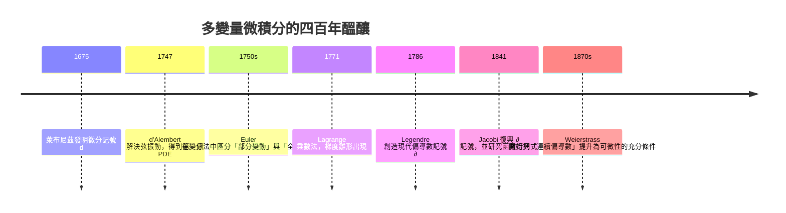

# 7.1 偏導數、全微分與方向導數（19 世紀）

## 學習動機

第 3 章到第 6 章，我們一直在**一個變數**的世界裡打轉：極限、導數、積分、級數。然而 19 世紀的物理學——尤其是拉格朗日與哈密頓的力學——立刻提出了這樣的問題：

> 一顆炮彈的初速 $`v_0`$ 與仰角 $`\alpha`$ 同時改變時，射程 $`R`$ 該怎麼「變」？

這是一個**兩個變數同時變動**的問題。萊布尼茲在 1675 年就為此發明微分記號，但「微分 $`\mathrm{d}f`$ 裡的 $`\mathrm{d}`$ 到底作用在哪個變數上」這個問題，卻整整懸了一百多年。

19 世紀的答案是：把「一次只動一個變數」的想法**正式化**。這就是**偏導數**：

$$
\frac{\partial f}{\partial x}(x,y) = \lim_{h \to 0} \frac{f(x+h, y) - f(x, y)}{h}
$$

但這裡立刻藏著一個陷阱，也是本章最重要的故事：**偏導數存在，甚至連偏導數連續，都不保證函數本身可微。** 我們將在 7.1.3 節用一個具體的反例 $`f(x,y) = \dfrac{xy}{x^2+y^2}`$ 把它徹底拆穿。

歷史動機之外，本節還有一個**計算動機**：多變量微積分的真正威力，在於它把「一個函數在兩個方向上的行為」壓縮成**一個向量**——梯度 $`\nabla f`$ 。而方向導數 $`D_{\mathbf{u}} f = \nabla f \cdot \mathbf{u}`$ 這個公式，正是第 8 章（向量分析與場論）格林定理、斯托克斯定理、高斯定理的真正源頭。

本章的 SymPy 目標是：用 `sp.diff(f, x)` 對多變量符號求偏導數；用**差商定義 + `sp.limit`** 檢驗偏導數的存在性而非只信任符號微分；用**餘項比值** $`\dfrac{R(h,k)}{\sqrt{h^2+k^2}}`$ 檢驗可微性；用**方向導數的參數化** $`D_{\mathbf{u}} f(\alpha) = \nabla f \cdot (\cos\alpha, \sin\alpha)`$ 做符號計算，並找出最大增長方向。

---

## 7.1.1 先驅者：Euler、d'Alembert、Lagrange 的多變量夢想

### Euler（1707–1783）與「部分微分」的誕生

Euler 在 1750 年代處理**變分法**（calculus of variations）時發現了關鍵的一步：當他讓一條曲線 $`y = y(x)`$ 變動時，若允許「只把某一點往上推一點，其他點不動」，變分的表達式就會出現**只作用於 $`x`$ 的微分**，而 $`y`$ 保持不變。

Euler 已經把「變分」 $`\delta f`$ 與「微分」 $`\mathrm{d}f`$ 區分開來，而「部分」這個概念正是從「部分地變動一條曲線」裡長出來的。更早一步的是 **Euler–Lagrange 方程**：

$$
\frac{\partial F}{\partial x} - \frac{\mathrm{d}}{\mathrm{d}x} \frac{\partial F}{\partial y} = 0
$$

其中 $`\partial F / \partial x`$ 與 $`\partial F / \partial y`$ 同時出現，但「地位」不同——一個是偏導數，一個是全導數。**多變量微積分的第一個真正的應用，就是這個方程。**

### d'Alembert（1717–1783）與「 vibrating string」的 PDE

1747 年，Jean le Rond d’Alembert 解決了**弦振動問題**：弦長 $`L`$ 、密度 $`\rho`$ 、張力 $`T`$ ，求振動方程

$$
\rho \frac{\partial^2 u}{\partial t^2} = T \frac{\partial^2 u}{\partial x^2}
$$

這是**偏微分方程史上第一個真正的 PDE**。它逼著數學家同時思考兩個獨立的變數 $`x`$ （空間）與 $`t`$ （時間），並區分「對 $`x`$ 微分兩次」與「對 $`t`$ 微分兩次」。

d’Alembert 的解法很有意思：他引入 $`x + ct`$ 與 $`x - ct`$ 兩個新變數，把 PDE 化為**常微分方程**。這個技巧在 7.1.5 節會以「方向導數」的形式再次出現——**沿某個方向做微分**，正是把多變量問題降維成單變量問題的原始想法。

### Lagrange（1736–1813）與「把極值點的問題變成代數問題」

Lagrange 的最大貢獻是 1771 年的**拉格朗日乘數法**：

$$
\nabla f = \lambda \nabla g
$$

這個式子裡已經**完整地**出現了梯度與偏導數：它說明在約束曲面 $`g = 0`$ 上的極值點， $`f`$ 的變化方向必須「投影」到約束曲面的切空間裡。但 Lagrange 時期還沒有「梯度」這個詞，也沒有把 $`\nabla f`$ 看成一個整體的向量——他的寫法更接近微分形式 $`p\,\mathrm{d}x + q\,\mathrm{d}y`$ ，其中 $`p, q`$ 是偏導數。

### 記號的演化： $`\partial`$ 的四百年流轉

| 年代 | 人物 | 事件 |
|------|------|------|
| 1770 | Marquis de Condorcet | 已知最早的印刷使用 $`\partial`$ 表示「部分差分」 |
| 1786 | Adrien-Marie Legendre | 創造**現代偏導數記號** $`\partial z / \partial x`$ （後來一度放棄） |
| 1841 | Carl Gustav Jacob Jacobi | 重新引入 $`\partial`$ 記號，成為此後的標準 |

這段歷史在 7.2 節會再次出現：**Jacobi 1841 年那篇處理「函數行列式」的論文，同時也正是 $`\partial`$ 記號復活的時刻。**

（順帶一提，Euler 在 1750 年代的著作裡已把「變分」 $`\delta f`$ 與「微分」 $`\mathrm{d}f`$ 區分開來，而「部分」這個概念正是從「部分地變動一條曲線」裡長出來的。）



---

## 7.1.2 偏導數的定義：把「動一個變數」寫成極限

設 $`f : \mathbb{R}^2 \to \mathbb{R}`$ 。所謂 $`f`$ 在點 $`(a, b)`$ 處**對 $`x`$ 的偏導數**，就是把 $`y`$ 固定在 $`b`$ ，只讓 $`x`$ 變動：

$$
\frac{\partial f}{\partial x}(a, b) = \lim_{h \to 0} \frac{f(a+h, b) - f(a, b)}{h}
$$

對 $`y`$ 的偏導數對稱地定義：

$$
\frac{\partial f}{\partial y}(a, b) = \lim_{k \to 0} \frac{f(a, b+k) - f(a, b)}{k}
$$

### 為什麼「先極限、後符號微分」很重要？

因為**符號微分（`sp.diff`）永遠假設偏導數存在**。如果反例函數的偏導數在某處不存在，`sp.diff` 要嘛給你一個錯誤的表達式，要嘛給你一堆看起來正常但其實不對的式子。

正確的做法是：**先用符號微分猜答案，再用差商 + `sp.limit` 驗證**。這正是本節所有程式碼的核心工作流程。

### 用 SymPy 進行多變量偏導數

`sp.diff(f, x)` 的語義是「對 $`x`$ 求導，**其餘變數視為常數**」。這與數學上的偏導數定義完全一致——SymPy 內部就是把其他符號當成 `Symbol`（而非函數）來對待。

```python
import sympy as sp

x, y = sp.symbols('x y', real=True)

# 多變量偏導數：diff(f, x) 對 x 求導，其餘變數視為常數
f = x**3 - 3*x*y**2 + y**3

print('f     =', f)
print('f_x   =', sp.diff(f, x))
print('f_y   =', sp.diff(f, y))
print('f_xx  =', sp.diff(f, x, 2))
print('f_xy  =', sp.diff(f, y, x))
print('f_yx  =', sp.diff(f, x, y))
print('f_yy  =', sp.diff(f, y, 2))
print('Laplace =', sp.simplify(sp.diff(f, x, 2) + sp.diff(f, y, 2)))

# Euler 齊次函數定理：f(tx, ty) = t^n f(x,y)  =>  x f_x + y f_y = n f
h = x**2*y + 3*x*y**2
n = 3
check = sp.simplify(x*sp.diff(h, x) + y*sp.diff(h, y) - n*h)
print('Euler 恆等式殘差 =', check)

# 用 t 做代換直接驗證齊次性
t = sp.symbols('t', positive=True, real=True)
print('h(tx,ty) =', sp.expand(h.subs({x: t*x, y: t*y})))
print('t^3 h(x,y) =', sp.expand(t**3*h))
print('差 =', sp.simplify(sp.expand(h.subs({x: t*x, y: t*y}) - t**3*h)))
```

> **預期輸出**：
> ```
> f     = x**3 - 3*x*y**2 + y**3
> f_x   = 3*x**2 - 3*y**2
> f_y   = -6*x*y + 3*y**2
> f_xx  = 6*x
> f_xy  = -6*y
> f_yx  = -6*y
> f_yy  = 6*(-x + y)
> Laplace = 6*y
> Euler 恆等式殘差 = 0
> h(tx,ty) = t**3*x**2*y + 3*t**3*x*y**2
> t^3 h(x,y) = t**3*x**2*y + 3*t**3*x*y**2
> 差 = 0
> ```

注意 `f_xy` 與 `f_yx` 在這裡相同——因為 $f$ 是**多項式**，偏導數連續。但這**不是普遍成立的**，我們稍後會給出反例。

順帶一提，**Euler 齊次函數定理** $f \text{ 為 } n \text{ 次齊次} \iff x \frac{\partial f}{\partial x} + y \frac{\partial f}{\partial y} = n f$ 是多變量微積分第一個真正有用的「一階算子恆等式」，證明只需一行的連鎖律：令 $g(t) = f(tx, ty)$ ，則 $g(t) = t^n f(x,y)$ 而 $g'(t) = x f_x + y f_y$ 。


## 7.1.3 陷阱：偏導數存在 $\nRightarrow$ 連續 $\nRightarrow$ 可微

這是本章的**核心議題**。讓我們把三個性質排成一條線：

$$
\text{可微} \;\Longrightarrow\; \text{連續} \;\Longrightarrow\; \text{偏導數存在}
$$

但**後面兩個箭頭都不能反過來**。我們用兩個反例說明。

### 反例一：偏導數存在，但函數不連續

沿 $x$ 軸（ $y=0$ ）與 $y$ 軸（ $x=0$ ），函數恆為 $0$ ，所以兩個偏導數在原點都存在且等於 $0$ 。但沿著斜線 $y = kx$ 逼近原點：

$$
f(x, kx) = \frac{k x^2}{x^2(1+k^2)} = \frac{k}{1+k^2}
$$

這是一個**與 $x$ 無關**的常數！取 $k = 1$ 得 $\tfrac12$ ，取 $k = 2$ 得 $\tfrac25$ ，取 $k = -1$ 得 $-\tfrac12$ 。**極限不存在**，所以 $f$ 在原點**不連續**，當然也**不可微**。

這是一個極其漂亮的反例：偏導數存在（因為它們只「看見」座標軸），但函數的行為在斜線方向完全失控。

```python
import sympy as sp
import numpy as np
import matplotlib.pyplot as plt

x, y, h = sp.symbols('x y h', real=True)

# 反例一：f(x,y) = xy/(x^2+y^2)，f(0,0)=0
# 偏導數在原點存在，但函數在原點不連續，因此不可微
g = x*y/(x**2 + y**2)
print('g_x =', sp.diff(g, x))
print('g_y =', sp.diff(g, y))

# 用差商定義算原點的偏導數（不信任 sp.diff 的結果）
print('f_x(0,0) =', sp.limit((g.subs({x: h, y: 0}) - 0)/h, h, 0))
print('f_y(0,0) =', sp.limit((g.subs({x: 0, y: h}) - 0)/h, h, 0))

# 但沿不同直線逼近原點，函數值趨近不同數
print('沿 y=x   的極限 =', sp.limit(g.subs({y: x}), x, 0))
print('沿 y=2x  的極限 =', sp.limit(g.subs({y: 2*x}), x, 0))
print('沿 y=-x  的極限 =', sp.limit(g.subs({y: -x}), x, 0))

# 反例二：p(x,y) = x^3/(x^2+y^2)，p(0,0)=0
# 連續，但不可微：偏導數存在，卻無法用線性式逼近
p = x**3/(x**2 + y**2)
print('p_x(0,0) =', sp.limit((p.subs({x: h, y: 0}) - 0)/h, h, 0))
print('p_y(0,0) =', sp.limit((p.subs({x: 0, y: h}) - 0)/h, h, 0))
print('p(h,0)/|h| =', sp.simplify(sp.limit(p.subs({x: h, y: 0})/sp.Abs(h), h, 0, dir='+')))
print('p(0,h)/|h| =', sp.simplify(sp.limit(p.subs({x: 0, y: h})/sp.Abs(h), h, 0, dir='+')))

# 反例 f(x,y) = xy/(x^2+y^2)：等高線在原點「打結」
x = np.linspace(-2, 2, 601)
y = np.linspace(-2, 2, 601)
X, Y = np.meshgrid(x, y)
den = X**2 + Y**2
with np.errstate(invalid='ignore', divide='ignore'):
    Z = np.where(den > 1e-12, X*Y/den, np.nan)

fig, ax = plt.subplots(figsize=(5.2, 5.0))
cs = ax.contourf(X, Y, Z, levels=40, cmap='RdBu_r')
ax.contour(X, Y, Z, levels=40, colors='k', linewidths=0.4)
ax.axhline(0, color='k', lw=0.8)
ax.axvline(0, color='k', lw=0.8)
ax.set_title('level curves of f(x,y) = xy/(x^2+y^2)')
ax.set_xlabel('x')
ax.set_ylabel('y')
fig.colorbar(cs, ax=ax)
fig.tight_layout()
plt.show()

# 沿不同直線逼近原點：極限各不相同
t = np.linspace(-2, 2, 2001)
fig, ax = plt.subplots(figsize=(5.6, 4.0))
for k, style in ((1.0, '-'), (2.0, '--'), (3.0, ':')):
    yy = k*t
    denom = t**2 + yy**2
    with np.errstate(invalid='ignore', divide='ignore'):
        val = np.where(denom > 1e-12, t*yy/denom, np.nan)
    ax.plot(t, val, style, label='y = %g x  (limit %s)' % (k, {1.0: '1/2', 2.0: '2/5', 3.0: '3/10'}[k]))

ax.axhline(0, color='k', lw=0.8)
ax.set_xlabel('x')
ax.set_ylabel('f(x, kx)')
ax.set_title('approaching the origin along different lines')
ax.legend()
fig.tight_layout()
plt.show()

print('f(x, x) -> 1/2, f(x, 2x) -> 2/5, f(x, 3x) -> 3/10 : the limit at (0,0) does not exist')
print('but f_x(0,0) = 0 and f_y(0,0) = 0 do exist')
```

> **預期輸出**：
> ```
> g_x = -2*x**2*y/(x**2 + y**2)**2 + y/(x**2 + y**2)
> g_y = -2*x*y**2/(x**2 + y**2)**2 + x/(x**2 + y**2)
> f_x(0,0) = 0
> f_y(0,0) = 0
> 沿 y=x   的極限 = 1/2
> 沿 y=2x  的極限 = 2/5
> 沿 y=-x  的極限 = -1/2
> p_x(0,0) = 1
> p_y(0,0) = 0
> p(h,0)/|h| = 1
> p(0,h)/|h| = 0
> f(x, x) -> 1/2, f(x, 2x) -> 2/5, f(x, 3x) -> 3/10 : the limit at (0,0) does not exist
> but f_x(0,0) = 0 and f_y(0,0) = 0 do exist
> ```

**反例二的意義**： $p(x,y) = \dfrac{x^3}{x^2+y^2}$ 在原點連續（因為 $|p(x,y)| = \dfrac{|x|^3}{x^2+y^2} \le |x| \to 0$ ），偏導數也存在，但 $p$ 在原點**不可微**。為什麼？

可微要求：存在**同一個**線性函數 $L(h,k) = ah + bk$ 使得 $\dfrac{p(h,k) - p(0,0) - L(h,k)}{\sqrt{h^2+k^2}} \to 0$ 。而偏導數只告訴我們： $L(h,0) = ah = p(h,0)$ ， $L(0,k) = bk = p(0,k)$ ，也就是**沿座標軸**的逼近是對的。斜方向的行為，偏導數完全沒有能力預測。這正是為什麼下一節要引入**全微分**——它要求逼近在**所有方向**同時成立。

**把反例畫出來**：等高線圖能直觀顯示 $f(x,y) = \dfrac{xy}{x^2+y^2}$ 在原點附近如何「打結」：極座標下 $f = \tfrac12 \sin 2\theta$ ，也就是說 ** $f$ 只依賴角度，不依賴半徑**！所以每一條通過原點的直線上， $f$ 是一個常數——這解釋了為什麼沿不同直線會得到不同的極限。

> f(x, x) -> 1/2, f(x, 2x) -> 2/5, f(x, 3x) -> 3/10 : the limit at (0,0) does not exist
> but f_x(0,0) = 0 and f_y(0,0) = 0 do exist
> ```
>
> （圖形由 `matplotlib` 顯示於螢幕；若在無 GUI 環境執行，請改用 `plt.savefig('out.png')` 。）

### 充分條件：連續偏導數 $\Rightarrow$ 可微

Weierstrass 時代（1870 年代）最重要的貢獻之一，是把「可微」的**充分條件**明確化：

> **定理（ $C^1$ 充分條件）**
> 若 $f_x$ 與 $f_y$ 在點 $(a,b)$ 的**某個鄰域**內存在且連續，則 $f$ 在 $(a,b)$ 可微，且 $f_x(a,b), f_y(a,b)$ 就是全微分的係數。

**證明思路（把中值定理用兩次）**：寫 $f(a+h, b+k) - f(a,b)$ 為 $\underbrace{[f(a+h, b+k) - f(a, b+k)]}_{\text{對 } x \text{ 用 MVT}} + \underbrace{[f(a, b+k) - f(a, b)]}_{\text{對 } y \text{ 用 MVT}}$ ，兩項分別 $= f_x(a + \theta h, b+k)\, h$ 與 $= f_y(a, b + \eta k)\, k$ ，其中 $\theta, \eta \in (0,1)$ 。

因為 $f_x, f_y$ 連續，當 $(h,k) \to (0,0)$ 時 $f_x(a+\theta h, b+k) \to f_x(a,b)$ 、 $f_y(a, b+\eta k) \to f_y(a,b)$ ，所以餘項 $R(h,k) = o(\sqrt{h^2+k^2})$ —— 這正是可微性的定義。

**關鍵洞見**：偏導數沿著**特定路徑**（座標軸）逼近時是準的；連續性讓我們能把它推廣到**所有路徑**。

---

## 7.1.4 全微分與可微性：一個可以完全用符號驗證的定義

### 定義

設 $f : \mathbb{R}^2 \to \mathbb{R}$ ， $f$ 在 $(a,b)$ **可微**，若存在 $A, B \in \mathbb{R}$ 使得

$$
f(a+h, b+k) = f(a,b) + A h + B k + R(h,k), \qquad \frac{R(h,k)}{\sqrt{h^2+k^2}} \to 0
$$

此時必有 $A = f_x(a,b)$ 、 $B = f_y(a,b)$ （因為令 $k = 0$ 再令 $h = 0$ 即可看出）。

**全微分**就是那個線性部分：

$$
\mathrm{d}f(a,b) = f_x(a,b)\,\mathrm{d}x + f_y(a,b)\,\mathrm{d}y
$$

它是「函數在該點的一階線性近似」。這正是 19 世紀 Lagrange 所想的「微分形式」 $p\,\mathrm{d}x + q\,\mathrm{d}y$ ，而 $p = f_x$ 、 $q = f_y$ 。

### 用 SymPy 逐字驗證可微性

這個檢查流程值得記成模板：① 算出 $f$ 、 $f_x$ 、 $f_y$ ；② 在 $(a,b)$ 代入得 $A = f_x(a,b)$ 、 $B = f_y(a,b)$ ；③ 構造餘項 $R(h,k) = f(a+h,b+k) - [f(a,b) + Ah + Bk]$ ；④ 檢查 $R / \sqrt{h^2+k^2} \to 0$ （**沿多條路徑**驗證，因為單一路徑不足為憑）。


```python
import sympy as sp

x, y, h, k = sp.symbols('x y h k', real=True)
a, b = sp.Integer(1), sp.Integer(2)

f = x**2*y + sp.sin(x*y)

fx = sp.diff(f, x)
fy = sp.diff(f, y)
print('f_x =', fx)
print('f_y =', fy)

f0 = f.subs({x: a, y: b})
fx0 = fx.subs({x: a, y: b})
fy0 = fy.subs({x: a, y: b})
print('f(1,2)   =', f0)
print('f_x(1,2) =', fx0)
print('f_y(1,2) =', fy0)

# 全微分 df = f_x dx + f_y dy
df = fx0*h + fy0*k
print('df =', df)

# 餘項 R(h,k) = f(a+h,b+k) - f(a,b) - df
R = sp.simplify(sp.expand(f.subs({x: a+h, y: b+k}) - (f0 + df)))
print('R =', R)

# 可微判準：R / ||(h,k)|| -> 0（沿任意路徑）
ratio = sp.simplify(R/sp.sqrt(h**2 + k**2))
print('R/||.|| (k = h) 極限 =', sp.limit(sp.simplify(ratio.subs({k: h})), h, 0, dir='+'))
print('R/||.|| (k = 2h) 極限 =', sp.limit(sp.simplify(ratio.subs({k: 2*h})), h, 0, dir='+'))

# 餘項的一次項為零：R 在原點的梯度為 0
print('R 對 h 的偏導在原點 =', sp.diff(R, h).subs({h: 0, k: 0}))
print('R 對 k 的偏導在原點 =', sp.diff(R, k).subs({h: 0, k: 0}))
```

> **預期輸出**：
> ```
> f_x = 2*x*y + y*cos(x*y)
> f_y = x**2 + x*cos(x*y)
> f(1,2)   = sin(2) + 2
> f_x(1,2) = 2*cos(2) + 4
> f_y(1,2) = cos(2) + 1
> df = h*(2*cos(2) + 4) + k*(cos(2) + 1)
> R = h**2*k + 2*h**2 + 2*h*k - 2*h*cos(2) - k*cos(2) + sin(h*k + 2*h + k + 2) - sin(2)
> R/||.|| (k = h) 極限 = 0
> R/||.|| (k = 2h) 極限 = 0
> R 對 h 的偏導在原點 = 0
> R 對 k 的偏導在原點 = 0
> ```

**注意最後兩行**：餘項 $R$ 在原點的梯度為零，這正好印證了「可微 $\Rightarrow$ 偏導數存在且等於全微分的係數」。

### 全微分的可加性

若 $f$ 在 $(a,b)$ 可微，則

$$
\mathrm{d}f = \mathrm{d}(f_1 + f_2) = \mathrm{d}f_1 + \mathrm{d}f_2, \qquad \mathrm{d}(f g) = f\,\mathrm{d}g + g\,\mathrm{d}f
$$

這與單變數情形完全一致——**因為全微分就是「一階的線性部分」**，而線性部分的運算規則只依賴 Leibniz 法則。

---

## 7.1.5 方向導數與梯度：把兩個偏導數壓成一個向量

### 方向導數與梯度

**定義**：設 $\mathbf{u}$ 是一個單位向量， $f$ 在 $\mathbf{p}$ 處沿 $\mathbf{u}$ 的方向導數為

$$
D_{\mathbf{u}} f(\mathbf{p}) = \lim_{t \to 0} \frac{f(\mathbf{p} + t\mathbf{u}) - f(\mathbf{p})}{t}
$$

**定理**：若 $f$ 在 $\mathbf{p}$ 可微，則 $D_{\mathbf{u}} f(\mathbf{p}) = \nabla f(\mathbf{p}) \cdot \mathbf{u}$ ，其中 $\nabla f(x,y) = \left( \frac{\partial f}{\partial x}, \frac{\partial f}{\partial y} \right)$ 是**梯度**。

**證明（一步）**：由可微性， $f(\mathbf{p} + t\mathbf{u}) = f(\mathbf{p}) + \nabla f(\mathbf{p}) \cdot (t\mathbf{u}) + o(t)$ ；兩邊減 $f(\mathbf{p})$ 再除以 $t$ 並令 $t \to 0$ ，得 $D_{\mathbf{u}} f = \nabla f \cdot \mathbf{u}$ 。這個證明的漂亮之處在於：**方向導數是「一階近似」的直接推論**，不需要任何額外假設。

**定理（梯度的意義）**：設 $\nabla f(\mathbf{p}) \neq \mathbf{0}$ 。則

1. **最大增長方向**是 $\mathbf{u} = \dfrac{\nabla f}{|\nabla f|}$ ，此時 $D_{\mathbf{u}} f = |\nabla f|$ （由 Cauchy–Schwarz 不等式）；
2. **最大下降方向**是 $-\dfrac{\nabla f}{|\nabla f|}$ ，此時 $D_{\mathbf{u}} f = -|\nabla f|$ ；
3. **切線方向**（等高線的切向量） $(-f_y, f_x)$ 的方向導數為 $0$ —— 因為 $\nabla f \cdot (-f_y, f_x) = -f_x f_y + f_y f_x = 0$ 。

第 3 條是幾何上的樞紐：**梯度永遠垂直於等高線**。

### 方向導數的符號計算

我們把方向 $\mathbf{u} = (\cos\alpha, \sin\alpha)$ 參數化，於是方向導數變成 $\alpha$ 的一個函數：

$$
D_\alpha f(x,y) = \frac{\partial f}{\partial x}\cos\alpha + \frac{\partial f}{\partial y}\sin\alpha
$$

這是一個「正弦型」函數，可以用 `sp.solve` 找出它為零的角度（切線方向）、或用 `sp.diff` 求極值。下面這個「方向導數計算器」能回答：沿任意方向的速率是多少？哪些方向**增加**、哪些**減少**、哪些**持平**？最大上升速率是多少？

```python
import sympy as sp

x, y = sp.symbols('x y', real=True)
t = sp.symbols('t', real=True)
alpha = sp.symbols('alpha', real=True)

f = x**2 + 3*x*y - y**2
P = {x: 1, y: 2}

print('f(1,2) =', f.subs(P))
gx = sp.diff(f, x).subs(P)
gy = sp.diff(f, y).subs(P)
print('f_x(1,2) =', gx, ' f_y(1,2) =', gy)
print('梯度長度 =', sp.sqrt(gx**2 + gy**2))

# 方向導數的一般公式（單位方向）
ux, uy = sp.cos(alpha), sp.sin(alpha)
D = sp.diff(f.subs({x: x + t*ux, y: y + t*uy}), t).subs(t, 0)
Dalpha = sp.simplify(sp.expand_trig(D.subs(P)))
print('D_u f(1,2) =', Dalpha)

# 符號分析：方向導數為 0 的角度（等高線切線方向）
print('為 0 的角度 =', sp.solve(sp.Eq(Dalpha, 0), alpha))
print('為正的區間（試探 alpha=0.2）= ', sp.N(Dalpha.subs(alpha, 0.2)))
print('為負的區間（試探 alpha=3.0）= ', sp.N(Dalpha.subs(alpha, 3.0)))

# 最大 / 最小方向導數
print('最大值 =', sp.simplify(sp.sqrt(gx**2 + gy**2)))
print('最小值 =', sp.simplify(-sp.sqrt(gx**2 + gy**2)))

# 最大方向所對應的角度：與梯度同向
print('梯度角度 =', sp.atan2(gy, gx))
print('對角 alpha = atan2(-1, 8) =', sp.N(sp.atan2(gy, gx)))

# 梯度垂直於等高線：等高線切線方向 (-f_y, f_x) 的方向導數為 0
print('等高線切線方向 =', (-gy, gx))
print('沿切線方向的方向導數 =', sp.simplify(gx*(-gy) + gy*gx))

# 非單位方向：方向導數會被長度放大
L = sp.Symbol('L', positive=True, real=True)
u = L*sp.cos(alpha)
v = L*sp.sin(alpha)
Dnon = sp.diff(f.subs({x: x + t*u, y: y + t*v}), t).subs(t, 0)
print('非單位方向的方向導數 =', sp.simplify(sp.expand_trig(Dnon.subs(P))))
print('（= L * D_unit，方向導數隨方向向量長度線性放大）')
```

> **預期輸出**：
> ```
> f(1,2) = 3
> f_x(1,2) = 8  f_y(1,2) = -1
> 梯度長度 = sqrt(65)
> D_u f(1,2) = -sin(alpha) + 8*cos(alpha)
> 為 0 的角度 = [atan(8)]
> 為正的區間（試探 alpha=0.2）=  7.64186329193487
> 為負的區間（試探 alpha=3.0）=  -8.06105998086343
> 最大值 = sqrt(65)
> 最小值 = -sqrt(65)
> 梯度角度 = -atan(1/8)
> 對角 alpha = atan2(-1, 8) = -0.124354994546761
> 等高線切線方向 = (1, 8)
> 沿切線方向的方向導數 = 0
> 非單位方向的方向導數 = L*(-sin(alpha) + 8*cos(alpha))
> （= L * D_unit，方向導數隨方向向量長度線性放大）
> ```

**符號解讀**：在 $(1,2)$ 處， $\nabla f = (8, -1)$ 。方向 $(\cos\alpha, \sin\alpha)$ 的方向導數是 $8\cos\alpha - \sin\alpha$ ；令其為零得 $\alpha = \arctan 8$ ，這是等高線 $f = 3$ 的切線方向；沿 $(8,-1)/|\nabla f|$ 方向上升最快，速率為 $\sqrt{65} \approx 8.062$ ；沿 $(-8,1)/|\nabla f|$ 方向下降最快。

注意 $\sqrt{65} > 8$ —— 因為**斜著走**比正對著走更快。這正是梯度不是「座標軸方向」的最好證據。

**重要慣例**：許多教科書定義方向導數時**要求 $\mathbf{u}$ 是單位向量**；若不要求，則 $D_{\mathbf{u}} f$ 會隨 $|\mathbf{u}|$ 線性放大。兩種定義都對，但**必須說清楚用的是哪一種**——否則「最大方向導數 = $|\nabla f|$ 」這個說法就只在單位方向約定下成立。

### 一個重要的歷史對照：d'Alembert 的降維法

回頭看 1747 年 d'Alembert 的弦振動解法：他引入 $u = x + ct$ 、 $v = x - ct$ 兩個新座標，把 PDE 變成 $\partial^2 w / \partial u \partial v = 0$ ，再積分兩次解出 $\varphi(u) + \psi(v)$ 。

用今天的語言說，他做的是**座標變換**，而座標變換對偏導數的作用由**連鎖律**給出：

$$
\frac{\partial f}{\partial u} = \frac{\partial f}{\partial x}\frac{\partial x}{\partial u} + \frac{\partial f}{\partial y}\frac{\partial y}{\partial u}
$$

這正是下一節與 7.2 節的主題。

---

## 7.1.6 用 SymPy 做符號計算：三個必備技巧

### 技巧一：用「差商 + 極限」檢驗偏導數的存在性

`sp.diff` 假設偏導數存在。要檢驗它，用**定義**重算。順便也演示 `sp.hessian` 與 `jacobian`——後者是全書的瑞士刀：偏導數矩陣、座標變換的雅可比行列式、隱函數定理的判別式，全部出自同一個方法。（SymPy 沒有 `sp.gradient` 這個頂層函式（1.14 版），但 `sp.Matrix([f]).jacobian([x, y]).T` 就是梯度；`sp.hessian` 則已內建。）

```python
import sympy as sp

x, y, h = sp.symbols('x y h', real=True)

# 一般公式：f_x(a,b) = limit (f(a+h,b) - f(a,b))/h
def partial_x(f, a, b, var=h):
    return sp.limit((f.subs({x: a + var, y: b}) - f.subs({x: a, y: b}))/var, var, 0)

def partial_y(f, a, b, var=h):
    return sp.limit((f.subs({x: a, y: b + var}) - f.subs({x: a, y: b}))/var, var, 0)

f = x**3*y + sp.sin(x*y)
print('f_x(0,0) =', partial_x(f, 0, 0))
print('f_y(0,0) =', partial_y(f, 0, 0))
print('符號微分 f_x(0,0) =', sp.diff(f, x).subs({x: 0, y: 0}))

# 梯度：把 f 放進 1 x 1 矩陣，取 Jacobian 再轉置
f = x**2*y - x*sp.sin(y) + sp.exp(x*y)
grad = sp.Matrix([f]).jacobian([x, y]).T
print('gradient =')
print(grad)

# Hessian：二階偏導數矩陣（恆為對稱，Clairaut 定理的矩陣版本）
H = sp.hessian(f, (x, y))
print('hessian =')
print(H)
print('H - H^T =')
print(H - H.T)

# Hessian 的特徵值：決定函數在該點的凹凸與極值型態
q = x**2 + 2*x*y + 3*y**2
Hq = sp.hessian(q, (x, y))
print('二次函數的 Hessian =')
print(Hq)
print('特徵值 =', Hq.eigenvals())
print('det =', Hq.det())
```

> **預期輸出**：
> ```
> f_x(0,0) = 0
> f_y(0,0) = 0
> 符號微分 f_x(0,0) = 0
> gradient =
> Matrix([[2*x*y + y*exp(x*y) - sin(y)], [x**2 + x*exp(x*y) - x*cos(y)]])
> hessian =
> Matrix([[y**2*exp(x*y) + 2*y, x*y*exp(x*y) + 2*x + exp(x*y) - cos(y)], [x*y*exp(x*y) + 2*x + exp(x*y) - cos(y), x**2*exp(x*y) + x*sin(y)]])
> H - H^T =
> Matrix([[0, 0], [0, 0]])
> 二次函數的 Hessian =
> Matrix([[2, 2], [2, 6]])
> 特徵值 = {4 - 2*sqrt(2): 1, 2*sqrt(2) + 4: 1}
> det = 8
> ```

**讀法**：對 $`q = x^2 + 2xy + 3y^2`$ ，Hessian 的特徵值 $`4 \pm 2\sqrt2`$ 都為正，所以 $`q`$ 在**所有點**都是嚴格凸函數； $`\det H = 8 > 0`$ 也印證了這點（對 $`2 \times 2`$ 對稱矩陣，正定 $`\iff`$ 首領元為正且行列式為正）。

---

## 習題

**習題 7.1.1（偏導數的符號計算）**
用 `sp.diff` 計算 $`f(x,y) = x^2 y \sin(xy) + e^{xy}`$ 的 $`f_x`$ 、 $`f_y`$ 、 $`f_{xx}`$ 、 $`f_{xy}`$ 、 $`f_{yy}`$ 。
(a) 驗證 Hessian 矩陣對稱；
(b) 用「差商 + `sp.limit`」在 $`(1,1)`$ 重新算出 $`f_x`$ 、 $`f_y`$ ，確認與符號微分一致；
(c) 用 Euler 齊次定理的思路，檢查 $`f`$ 中每一項的齊次次數，並驗證 $`\frac{\partial f}{\partial x} + \frac{\partial f}{\partial y}`$ 在 $`x = y`$ 時等於什麼。

**習題 7.1.2（找出反例）**
構造 $`f : \mathbb{R}^2 \to \mathbb{R}`$ 使得 (a) $`f_x(0,0)`$ 與 $`f_y(0,0)`$ 都存在；(b) $`f`$ 在原點不連續。
提示： $`f(x,y) = \dfrac{xy}{x^2+y^2}`$ 是標準答案，請用 SymPy 驗證 (a) 與 (b) ，並解釋為什麼沿 $`y = kx`$ 的極限是 $`\dfrac{k}{1+k^2}`$ 。

**習題 7.1.3（可微性的符號檢驗）**
令 $`f(x,y) = \dfrac{x^2 y}{x^2+y^2}`$ （ $`f(0,0) = 0`$ ）。
(a) 用 SymPy 求 $`f_x`$ 與 $`f_y`$ 的一般式，並求出它們在 $`(0,0)`$ 的值（用差商定義）；
(b) 判斷 $`f`$ 在原點是否連續；
(c) 判斷 $`f`$ 在原點是否可微，並用餘項比值 $`R/\sqrt{h^2+k^2}`$ 沿至少兩條路徑驗證你的結論；
(d) 對照 7.1.3 節的兩個反例，說明 $`f`$ 屬於哪一類。

**習題 7.1.4（方向導數與梯度）**
對 $`f(x,y) = x^2 y + 3xy^2 - y`$ ：
(a) 求 $`\nabla f`$ 與 $`|\nabla f|`$ ；
(b) 在點 $`(2,1)`$ 處，求沿方向 $`\mathbf{u} = (3,4)/5`$ 的方向導數；
(c) 求在 $`(2,1)`$ 處使方向導數為零的所有方向（等高線切線方向）；
(d) 求上升最快的方向與上升速率，並用 `sp.simplify` 驗證 $`D_{\nabla f/|\nabla f|} f = |\nabla f|`$ 。

**習題 7.1.5（偏導數的連續性與 Schwarz 定理）**
(a) 用 SymPy 計算 $`g(x,y) = \dfrac{xy(x^2-y^2)}{x^2+y^2}`$ 的 $`g_{xy}(0,0)`$ 與 $`g_{yx}(0,0)`$ （用差商定義），並說明為什麼它們不相等；
(b) 說明 $`g_x`$ 與 $`g_y`$ 在原點是否連續，並解釋這與 (a) 的關係；
(c) 對照多項式 $`p(x,y) = x^3 y - x y^3 + e^{xy}`$ ，用 SymPy 驗證 $`p_{xy} = p_{yx}`$ 恆成立，並解釋為什麼多項式一定滿足 Clairaut 定理。

---

## 小結

| 概念 | 定義 | SymPy 工具 | 常見陷阱 |
|------|------|-----------|---------|
| 偏導數 | $`\partial_x f = \lim_{h\to0}\dfrac{f(x+h,y)-f(x,y)}{h}`$ | `sp.diff(f, x)` | 符號微分**假設**偏導數存在 |
| 偏導數的存在性檢驗 | 差商極限 | `sp.limit` | 別只信 `sp.diff` |
| 可微性 | $`R(h,k) = o(\sqrt{h^2+k^2})`$ | 餘項比值 + `sp.limit` | 需沿**多條**路徑驗 |
| 連續偏導數 | $`C^1`$ 條件 | — | 是**充分**條件，非必要 |
| 全微分 | $`\mathrm{d}f = f_x\,\mathrm{d}x + f_y\,\mathrm{d}y`$ | `sp.diff` 兩次 | 只是**近似**，不是等式 |
| 方向導數 | $`D_{\mathbf{u}} f = \nabla f \cdot \mathbf{u}`$ | `sp.diff` + `subs` | 要說明 $`\mathbf{u}`$ 是否單位向量 |
| 梯度 | $`\nabla f = (f_x, f_y)`$ | `sp.Matrix([f]).jacobian(...)` | 垂直於等高線 |
| Hessian | $`[f_{ij}]`$ | `sp.hessian(f, (x, y))` | 恆對稱（ $`C^2`$ 時） |

**下一節的問題**：我們已經會處理「在一個點上、一個方向上」的變化率了。但物理與幾何真正關心的，往往是**整個區域上的累積**——「這張曲面下的體積是多少？」、「這個固體的質量是多少？」要回答這類問題，我們需要**二重積分**，以及一把能把複雜區域「拉平」的工具：**雅可比變換**。7.2 節就從 Cavalieri 的窮竭法講起，一路走到 Jacobi 1841 年的函數行列式。
