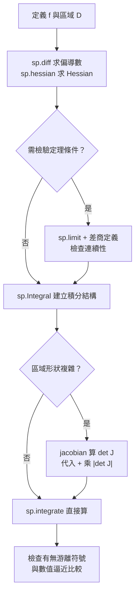

# 7.3 用 SymPy 做偏導數、重積分與座標變換

## 學習動機

前兩節給了兩把武器：**7.1 節**處理「局部變化率」（偏導數、全微分、方向導數、梯度）；**7.2 節**處理「整體累積量」（Fubini、雅可比行列式、變數變換定理）。本節把兩者合流，並**全部用 SymPy 實作**：

1. `sp.diff` 對多變量符號怎麼運作？`sp.diff(f, x, y)` 的引數順序代表什麼？
2. 怎麼用 `sp.hessian` 拿到 Hessian 矩陣？它為什麼恆對稱？
3. **Clairaut 定理**（混合偏導相等）的條件是什麼？什麼時候會失敗？如何用 SymPy 診斷？
4. `sp.integrate` 的**兩層 limits** 怎麼寫？`sp.Integral` 與 `sp.integrate` 有何不同？limits 順序代表什麼？
5. SymPy 沒有內建的「帶雅可比的座標變換」，那怎麼手動實作？
6. 用極座標算圓面積與 $`\iint_D e^{-(x^2+y^2)}\,\mathrm{d}A`$ ，並與數值逼近比較。

**本章的哲學**：SymPy 不是要取代你的思考，而是要**讓你的思考可被檢驗**。每一個「我認為答案是 $`X`$ 」的直覺，都該能被一段 5 行的程式碼**證偽**。這正是 19 世紀 Weierstrass 學派的精神——把直覺轉化為可驗證的陳述。

---

## 7.3.1 `sp.diff` 對多變量符號：語義與細節

### 符號的宣告、引數順序，以及 Hessian / 梯度工具

`real=True` 很重要：它讓 SymPy 知道 $`x, y \in \mathbb{R}`$ ，於是 `sp.Abs`、`sp.limit`、某些化簡規則才會正常工作。**不要**寫 `sp.symbols('x y')`（無假設），SymPy 會把 $`x`$ 當成複數。

`sp.diff(f, x, y)` 表示「**先對 $`y`$ 求導，再對 $`x`$ 求導**」（內部合成順序從右往左）。對大多數函數這不影響結果（Clairaut 定理），但**對反例函數會影響**，所以必須知道。

```python
import sympy as sp

x, y = sp.symbols('x y', real=True)

f = x**2*y - x*sp.sin(y) + sp.exp(x*y)

print('f_x =', sp.diff(f, x))
print('f_y =', sp.diff(f, y))

# 梯度（SymPy 1.x 沒有頂層的 sp.gradient；用 Jacobian 取轉置）
grad = sp.Matrix([f]).jacobian([x, y]).T
print('gradient =')
print(grad)

# Hessian：二階偏導數矩陣
H = sp.hessian(f, (x, y))
print('hessian =')
print(H)

# 混合偏導數相等（Schwarz / Clairaut 定理）
print('f_xy =', sp.simplify(sp.diff(f, x, y)))
print('f_yx =', sp.simplify(sp.diff(f, y, x)))
print('相等？', sp.simplify(sp.diff(f, x, y) - sp.diff(f, y, x)) == 0)

# Hessian 恆為對稱矩陣（Clairaut 定理的矩陣版本）
print('H - H^T =')
print(H - H.T)

# Hessian 的特徵值：決定函數在該點的凹凸與極值型態
q = x**2 + 2*x*y + 3*y**2
Hq = sp.hessian(q, (x, y))
print('二次函數的 Hessian =')
print(Hq)
print('特徵值 =', Hq.eigenvals())
print('det =', Hq.det())
x, y, z = sp.symbols('x y z', real=True)

def grad(f, vars_):
    """回傳 f 對 vars_ 的梯度（列向量 Matrix）。"""
    return sp.Matrix([f]).jacobian(list(vars_)).T

def hess(f, vars_):
    """回傳 f 的 Hessian 矩陣。"""
    return sp.hessian(f, tuple(vars_))

f = x**3*y - sp.sin(x*y)

# 傳入變數元組
print(sp.hessian(f, (x, y)))

# 舊版曾支援的字串寫法 'x,y' 在 SymPy 1.14 已被移除，會拋 ValueError
try:
    sp.hessian(f, 'x,y')
except ValueError as e:
    print('字串寫法已移除:', e)

# 手動取出所有二階偏導數（字典風格，適合程式化處理）
second = {(a, b): sp.diff(f, a, b) for a in (x, y) for b in (x, y)}
print('f_xx =', second[(x, x)])
print('f_xy =', second[(x, y)])
print('f_yx =', second[(y, x)])
print('f_yy =', second[(y, y)])
print('f_xy == f_yx ?', sp.simplify(second[(x, y)] - second[(y, x)]) == 0)

# 三變數版本的輔助函式
g = x**2*sp.sin(y) + y*z**2
print('grad =')
print(grad(g, (x, y, z)))
print('hess =')
print(hess(g, (x, y, z)))
print('grad.f =', sp.simplify((grad(g, (x, y, z)).T * grad(g, (x, y, z)))[0]))
```

> **預期輸出**：
> ```
> f_x = 2*x*y + y*exp(x*y) - sin(y)
> f_y = x**2 + x*exp(x*y) - x*cos(y)
> gradient =
> Matrix([[2*x*y + y*exp(x*y) - sin(y)], [x**2 + x*exp(x*y) - x*cos(y)]])
> hessian =
> Matrix([[y**2*exp(x*y) + 2*y, x*y*exp(x*y) + 2*x + exp(x*y) - cos(y)], [x*y*exp(x*y) + 2*x + exp(x*y) - cos(y), x**2*exp(x*y) + x*sin(y)]])
> f_xy = x*y*exp(x*y) + 2*x + exp(x*y) - cos(y)
> f_yx = x*y*exp(x*y) + 2*x + exp(x*y) - cos(y)
> 相等？ True
> H - H^T =
> Matrix([[0, 0], [0, 0]])
> 二次函數的 Hessian =
> Matrix([[2, 2], [2, 6]])
> 特徵值 = {4 - 2*sqrt(2): 1, 2*sqrt(2) + 4: 1}
> det = 8
> Matrix([[6*x*y + y**2*sin(x*y), 3*x**2 + x*y*sin(x*y) - cos(x*y)], [3*x**2 + x*y*sin(x*y) - cos(x*y), x**2*sin(x*y)]])
> 字串寫法已移除: Improper variable list in hessian function
> f_xx = y*(6*x + y*sin(x*y))
> f_xy = 3*x**2 + x*y*sin(x*y) - cos(x*y)
> f_yx = 3*x**2 + x*y*sin(x*y) - cos(x*y)
> f_yy = x**2*sin(x*y)
> f_xy == f_yx ? True
> grad =
> Matrix([[2*x*sin(y)], [x**2*cos(y) + z**2], [2*y*z]])
> hess =
> Matrix([[2*sin(y), 2*x*cos(y), 0], [2*x*cos(y), -x**2*sin(y), 2*z], [0, 2*z, 2*y]])
> grad.f = 4*x**2*sin(y)**2 + 4*y**2*z**2 + (x**2*cos(y) + z**2)**2
> ```

## 7.3.2 混合偏導相等：Schwarz 定理與 Clairaut 定理

> **定理（Clairaut / Schwarz）**
> 設 $f$ 在點 $p$ 的**某個鄰域**內有連續的二階偏導數，則在 $p$ 處
>
> $$
> \frac{\partial^2 f}{\partial x \partial y} = \frac{\partial^2 f}{\partial y \partial x}
> $$
>
> 更一般的說，若 $f \in C^k$ ，則任意 $k$ 階混合偏導數與求導順序無關。

**條件不可刪**。我們用 SymPy 構造並驗證經典反例

$$
g(x,y) = \begin{cases} \dfrac{xy(x^2-y^2)}{x^2+y^2}, & (x,y)\neq(0,0) \\ 0, & (x,y)=(0,0) \end{cases}
$$

這個函數的 $g_{xy}(0,0) = -1$ 而 $g_{yx}(0,0) = 1$ ——**兩個值不相等**！原因： $g_x$ 與 $g_y$ 在原點**不連續**。

```python
import sympy as sp

x, y, h = sp.symbols('x y h', real=True)

# 反例：f(x,y) = xy(x^2-y^2)/(x^2+y^2),  f(0,0)=0
f = x*y*(x**2 - y**2)/(x**2 + y**2)

fx = sp.diff(f, x)
fy = sp.diff(f, y)
print('f_x =', fx)
print('f_y =', fy)

# 原點的 f_xy 與 f_yx（用差商定義算，不信任 sp.diff）
fxy0 = sp.limit((fx.subs({y: h, x: 0}) - 0)/h, h, 0)
fyx0 = sp.limit((fy.subs({x: h, y: 0}) - 0)/h, h, 0)
print('f_xy(0,0) =', fxy0)
print('f_yx(0,0) =', fyx0)
print('兩者相等？', sp.simplify(fxy0 - fyx0) == 0)

# 偏導數在原點不連續：沿不同路徑的極限
print('lim_{y->0} f_xy(x,y) (y=0) =', sp.limit(sp.diff(f, x, y).subs({y: 0}), x, 0))
print('lim_{y->0} f_xy(x,y) (x=0) =', sp.limit(sp.diff(f, x, y).subs({x: 0}), y, 0))

# 對照：多項式的混合偏導數恆相等
g = x**3*y - x*y**3 + sp.exp(x*y)
print('g 的 f_xy - f_yx =', sp.simplify(sp.diff(g, x, y) - sp.diff(g, y, x)))
```

> **預期輸出**：
> ```
> f_x = -2*x**2*y*(x**2 - y**2)/(x**2 + y**2)**2 + 2*x**2*y/(x**2 + y**2) + y*(x**2 - y**2)/(x**2 + y**2)
> f_y = -2*x*y**2*(x**2 - y**2)/(x**2 + y**2)**2 - 2*x*y**2/(x**2 + y**2) + x*(x**2 - y**2)/(x**2 + y**2)
> f_xy(0,0) = -1
> f_yx(0,0) = 1
> 兩者相等？ False
> lim_{y->0} f_xy(x,y) (y=0) = 1
> lim_{y->0} f_xy(x,y) (x=0) = -1
> g 的 f_xy - f_yx = 0
> ```

**注意最後兩行**： $f_{xy}$ 沿 $y=0$ 逼近原點得 $1$ ，沿 $x=0$ 逼近得 $-1$ ——**極限不存在**，這正是 Clairaut 定理的假設被違反的地方。**用極限診斷定理條件**，是本節最值得帶走的技巧。

### 這個反例的幾何意義

$g(x,y)$ 在極座標下是 $g(r\cos\theta, r\sin\theta) = \tfrac{r^2}{2}\sin 4\theta$ ：它在**每個方向**上的行為都規矩（有明確的 $r^2$ 因子），但 $\sin 4\theta$ 對 $\theta$ 的依賴不對稱，於是「先對 $x$ 再對 $y$ 」與「先對 $y$ 再對 $x$ 」會走出不同的路徑順序，得到不同的值。

這提醒我們：**混合偏導數的交換，本質上是「交換極限順序」**——與 Fubini 定理是同一類的問題！

## 7.3.3 用 `sp.integrate` 做二重積分

### 兩層 limits 的語法、順序語意與變數捕捉

`sp.integrate` 的多層 limits 由**巢狀的 tuple** 表達，**最內層的變數寫在最前面**（第一個列出的 tuple 就是先被積分的那一層）。我們用一個**判別式例子**確認這條規則，並示範真正的陷阱：**外層界限裡出現了已被內層積掉的變數**。

| | `sp.Integral(...)` | `sp.integrate(...)` |
|---|---|---|
| 回傳 | 未求值的惰性物件 | 盡力求值，失敗則退回未求值物件 |
| 用途 | 描述積分結構、稍後 `.doit()` | 直接要答案 |
| 效能 | 快 | 可能觸發漫長的符號運算 |

```python
import sympy as sp

x, y = sp.symbols('x y', real=True)

# 直角座標下的二重積分：矩形區域
f = x**2 + 3*x*y - y**2
val = sp.integrate(f, (y, -2, 2), (x, -1, 1))
print('矩形上的二重積分 =', sp.simplify(val))

# 三角形區域：0 <= x <= 2, 0 <= y <= 2 - x
val2 = sp.integrate(f, (y, 0, 2 - x), (x, 0, 2))
print('三角形上的二重積分 =', sp.simplify(val2))

# 先用 Integral 描述（不積），再 doit()
I = sp.Integral(f, (y, 0, 2 - x), (x, 0, 2))
print('Integral 物件 =', I)
print('doit() =', sp.simplify(I.doit()))

# 圓盤上的二重積分：直角座標（用符號 sqrt 的上下限）
g = x**2 + y**2
disk = sp.integrate(g, (y, -sp.sqrt(1 - x**2), sp.sqrt(1 - x**2)), (x, -1, 1))
print('圓盤上 ∫∫(x^2+y^2) =', sp.simplify(disk))

# --- limits 列表的順序語意（判別式驗證）---
# 區域 0 <= x <= y <= 1：先對 x 積分（0 到 y），再對 y 積分（0 到 1）
h = x + y
v1 = sp.integrate(sp.integrate(h, (x, 0, y)), (y, 0, 1))
print('0<=x<=y<=1 =', sp.simplify(v1))

# 反序：先對 y 積分（x 到 1），再對 x 積分（0 到 1）
v2 = sp.integrate(sp.integrate(h, (y, x, 1)), (x, 0, 1))
print('反序（y 從 x 到 1）= ', sp.simplify(v2))
print('相等？', sp.simplify(v1 - v2) == 0)
print('手算核對 =', sp.Rational(3, 2) * sp.Rational(1, 3))

# 判別式：h2 = x*y，(x,0,y),(y,0,1) 給出 1/8 => x 是內層
h2 = x*y
print('(x,0,y),(y,0,1) =', sp.Integral(h2, (x, 0, y), (y, 0, 1)).doit())
print('(y,0,1),(x,0,y) =', sp.Integral(h2, (y, 0, 1), (x, 0, y)).doit())

# 四分之一圓盤：極座標 vs 直角座標
r, theta = sp.symbols('r theta', real=True)
v3 = sp.integrate(sp.integrate(h.subs({x: r*sp.cos(theta), y: r*sp.sin(theta)})*r, (r, 0, 1)), (theta, 0, sp.pi/2))
print('四分之一圓盤（極座標）= ', sp.simplify(v3))
v4 = sp.integrate(sp.integrate(h, (y, 0, sp.sqrt(1 - x**2))), (x, 0, 1))
print('四分之一圓盤（直角座標）= ', sp.simplify(v4))

x, y = sp.symbols('x y', real=True)
f = x + y

A = sp.simplify(sp.integrate(sp.integrate(f, (x, 0, y)), (y, 0, 1)))
B = sp.simplify(sp.Integral(f, (x, 0, y), (y, 0, 1)).doit())
print('寫法 A（巢狀）= ', A)
print('寫法 B（Integral）= ', B)
print('A == B ?', sp.simplify(A - B) == 0)

# 真正的陷阱：外層界限裡出現了已被內層積掉的變數
bad = sp.simplify(sp.integrate(sp.integrate(f, (y, 0, 1)), (x, 0, 2-y)))
print('錯誤寫法 =', bad)
print('  -> y 是游離的，這不是任何一個積分的值')

# 正確寫法：先對 x 積分（界限 0 到 2-y，y 還活著），再對 y 積分
good = sp.simplify(sp.integrate(sp.integrate(f, (x, 0, 2-y)), (y, 0, 1)))
print('正確寫法 =', good)

I = sp.Integral(f, (x, 0, 2-y), (y, 0, 1))
print('Integral 結構 =', I)
print('Integral.doit() =', sp.simplify(I.doit()))
```

> **預期輸出**：
> ```
> 矩形上的二重積分 = -8
> 三角形上的二重積分 = 2
> Integral 物件 = Integral(x**2 + 3*x*y - y**2, (y, 0, 2 - x), (x, 0, 2))
> doit() = 2
> 圓盤上 ∫∫(x^2+y^2) = pi/2
> 0<=x<=y<=1 = 1/2
> 反序（y 從 x 到 1）=  1/2
> 相等？ True
> 手算核對 = 1/2
> (x,0,y),(y,0,1) = 1/8
> (y,0,1),(x,0,y) = y**2/4
> 四分之一圓盤（極座標）=  2/3
> 四分之一圓盤（直角座標）=  2/3
> 寫法 A（巢狀）=  1/2
> 寫法 B（Integral）=  1/2
> A == B ? True
> 錯誤寫法 = -y/2 + (y - 2)**2/2 + 1
>   -> y 是游離的，這不是任何一個積分的值
> 正確寫法 = 11/6
> Integral 結構 = Integral(x + y, (x, 0, 2 - y), (y, 0, 1))
> Integral.doit() = 11/6
> ```

**手算核對**： $\int_0^1 \int_0^{2-y} (x+y)\,\mathrm{d}x\,\mathrm{d}y = \int_0^1 \left(2 - \tfrac{y^2}{2}\right)\mathrm{d}y = 2 - \tfrac16 = \tfrac{11}{6}$ 。✅

**「錯誤寫法」結果裡含有游離的 $y$ ** —— 這就是判斷「算錯了」的訊號： $y$ 在正確的積分裡應該被完全消掉。SymPy 不會報錯，只會安靜地給你一個無意義的式子，所以**務必自己檢查結果裡有沒有不該出現的游離符號**。

> **實務守則**：多變數積分一律用 `sp.Integral(...)` 建立結構、再 `.doit()`。理由不是巢狀寫法「一定算錯」，而是：
>
> 1. `sp.Integral` 把**結構**與**求值**分開，你可以先 `print(I)` 檢查界限順序；
> 2. 它讓**界限依賴外層變數**的結構（例如 `(x, 0, 2-y), (y, 0, 1)`）表達得毫無歧義；
> 3. 遇到 SymPy 算不出來的情況，`sp.Integral` 會**保留未求值形式**而不是丟棄資訊。

---

## 7.3.4 座標變換：SymPy 沒有內建，我們手動實作

SymPy 沒有「帶雅可比的座標變換」內建功能（不像 Mathematica 的 `ChangeVariables`），但手動實作只有三步：**① 代入**（把 $f(x,y)$ 中的 $x,y$ 換成新座標 $x = X(r,\theta)$ 、 $y = Y(r,\theta)$ ）→ **② 乘上雅可比行列式的絕對值** $|\det J|$ （用 `jacobian` 自動算出）→ **③ 對新變數積分**。

我們把整個流程寫成一個可重用的函式，這在實務上非常有用：

```python
import sympy as sp

def change_variables(f, new_x, new_y, old_vars, new_vars, region):
    """在區域 region（以 new_vars 表示的 limits 列表）上做座標變換。

    f        : 舊座標下的被積函數
    new_x    : 新座標第一個分量的表達式
    new_y    : 新座標第二個分量的表達式
    old_vars : 舊座標變數，例如 (x, y)
    new_vars : 新座標變數，例如 (r, theta)
    region   : 新座標下的積分極限，例如 [(r, 0, 1), (theta, 0, 2*pi)]
    """
    T = sp.Matrix([new_x, new_y])
    Jdet = sp.simplify(sp.det(T.jacobian(list(new_vars))))
    g = sp.simplify(f.subs(dict(zip(old_vars, [new_x, new_y]))) * sp.Abs(Jdet))
    I = sp.Integral(g, *region)          # 先建立結構，再 doit()
    return I, I.doit()

x, y = sp.symbols('x y', real=True)
r = sp.Symbol('r', positive=True, real=True)   # r > 0，讓 Abs(r) 化簡為 r
theta = sp.Symbol('theta', real=True)

# 1) 極座標變換與 Jacobian
T = sp.Matrix([r*sp.cos(theta), r*sp.sin(theta)])
J = T.jacobian([r, theta])
Jdet = sp.simplify(sp.det(J))
print('極座標 Jacobian =')
print(J)
print('det J =', Jdet)

# 2) 變數變換定理（用上面的函式實作）
# ∫∫_D f(x,y) dA = ∫∫_{T^-1(D)} f(T(r,theta)) * |det J| dr dtheta
f = x**2 + y**2
I, val = change_variables(f, r*sp.cos(theta), r*sp.sin(theta),
                          (x, y), (r, theta),
                          [(r, 0, 1), (theta, 0, 2*sp.pi)])
print('變換後的被積函數 =', I.function)
print('極座標下的積分 =', sp.simplify(val))

cart_val = sp.integrate(sp.integrate(f, (y, -sp.sqrt(1 - x**2), sp.sqrt(1 - x**2))), (x, -1, 1))
print('直角座標下的積分 =', sp.simplify(cart_val))
print('兩者相等？', sp.simplify(val - cart_val) == 0)

# 3) 圓面積：∫∫_D 1 dA（直角座標直接用對稱上下限，不需倍數因子）
area_polar = sp.integrate(sp.integrate(Jdet, (r, 0, 1)), (theta, 0, 2*sp.pi))
print('圓面積（極座標） =', area_polar)
area_cart = sp.integrate(sp.integrate(1, (y, -sp.sqrt(1 - x**2), sp.sqrt(1 - x**2))), (x, -1, 1))
print('圓面積（直角座標，對稱界限） =', area_cart)

# 對稱性的倍數要數清楚：四分之一圓盤乘 4，不是乘 2
quarter = sp.integrate(sp.integrate(1, (y, 0, sp.sqrt(1 - x**2))), (x, 0, 1))
print('四分之一圓盤 =', sp.simplify(quarter))
print('整個圓盤（乘 4）= ', sp.simplify(4*quarter))

# 4) 三重積分算球體積（極座標 det J = r^2 sin(theta)）
z = sp.Symbol('z', real=True)
phi = sp.Symbol('phi', real=True)
sph = sp.Matrix([r*sp.sin(theta)*sp.cos(phi), r*sp.sin(theta)*sp.sin(phi), r*sp.cos(theta)])
J3 = sp.simplify(sp.det(sph.jacobian([r, theta, phi])))
print('球座標 det J =', J3)
vol = sp.Integral(J3, (r, 0, 1), (theta, 0, sp.pi), (phi, 0, 2*sp.pi)).doit()
print('單位球體積 =', sp.simplify(vol))
print('對照 4/3 pi =', sp.simplify(sp.Rational(4,3)*sp.pi))

# 逐步核對 limits 順序（第一個列出者 = 內層）
s1 = sp.integrate(J3, (r, 0, 1))
s2 = sp.integrate(s1, (theta, 0, sp.pi))
s3 = sp.integrate(s2, (phi, 0, 2*sp.pi))
print('逐步 r->theta->phi =', sp.simplify(s1), sp.simplify(s2), sp.simplify(s3))
```

> **預期輸出**：
> ```
> 極座標 Jacobian =
> Matrix([[cos(theta), -r*sin(theta)], [sin(theta), r*cos(theta)]])
> det J = r
> 變換後的被積函數 = r**3
> 極座標下的積分 = pi/2
> 直角座標下的積分 = pi/2
> 兩者相等？ True
> 圓面積（極座標） = pi
> 圓面積（直角座標，對稱界限） = pi
> 四分之一圓盤 = pi/4
> 整個圓盤（乘 4）=  pi
> 球座標 det J = r**2*sin(theta)
> 單位球體積 = 4*pi/3
> 對照 4/3 pi = 4*pi/3
> 逐步 r->theta->phi = sin(theta)/3 2/3 4*pi/3
> ```

**兩種座標給出同一個 $\pi$ ** —— 這是變數變換定理最基本的一次檢驗。

**對稱性的倍數要數清楚**： $\int_0^1 \int_0^{\sqrt{1-x^2}} 1\,\mathrm{d}y\,\mathrm{d}x = \int_0^1 \sqrt{1-x^2}\,\mathrm{d}x = \frac{\pi}{4}$ ，這個內層積分只覆蓋圓盤的**四分之一**（ $x \ge 0$ 且 $y \ge 0$ ），不是一半！最安全的做法是像上面那樣**直接寫對稱的上下限**，完全不用倍數因子。

**三重積分的 limits 順序**：要表達 $\iiint_V f\,\mathrm{d}r\,\mathrm{d}\theta\,\mathrm{d}\phi$ ，列表順序應為 `(r, ...), (theta, ...), (phi, ...)` —— 對應數學寫法「微分符號由左到右、先寫的最後積」的慣例，也就是 **SymPy 裡由右到左列出**。

---


## 7.3.5 用極座標算兩個經典積分

### 案例一： $\iint_D e^{-(x^2+y^2)}\,\mathrm{d}A$

令 $D = \{x^2+y^2 \le 1\}$ 。極座標下 $e^{-(x^2+y^2)} = e^{-r^2}$ 且 $\mathrm{d}A = r\,\mathrm{d}r\,\mathrm{d}\theta$ ，所以

$$
\iint_D e^{-(x^2+y^2)}\,\mathrm{d}A = \int_0^{2\pi}\int_0^1 r e^{-r^2}\,\mathrm{d}r\,\mathrm{d}\theta = 2\pi \cdot \frac{1-e^{-1}}{2} = \pi(1-e^{-1})
$$

**這個積分的美妙之處**：在直角座標下它**幾乎不可能**用初等函數算出（會得到 $\operatorname{erf}$ 形式）；極座標下卻是**一行**。這是座標變換威力最直觀的展示。

**進階版**：若 $D = \mathbb{R}^2$ ，答案是 $\pi$ —— 這是二維的**高斯積分**，在統計物理（布朗運動、熱力學）與數值分析（高斯求積）裡都是基礎。

```python
import sympy as sp

x, y = sp.symbols('x y', real=True)
r, theta = sp.symbols('r theta', real=True)

f = sp.exp(-(x**2 + y**2))
polar = sp.simplify(f.subs({x: r*sp.cos(theta), y: r*sp.sin(theta)}) * r)
print('極座標下的被積函數 =', polar)

val = sp.integrate(sp.integrate(polar, (r, 0, 1)), (theta, 0, 2*sp.pi))
print('∫∫_D e^{-(x^2+y^2)} dA =', sp.simplify(val))
print('= pi(1 - e^{-1}) ?', sp.simplify(val - sp.pi*(1 - sp.exp(-1))) == 0)

# 對照：直角座標下 SymPy 只能停在 erf 形式
disc = sp.integrate(sp.integrate(f, (y, -sp.sqrt(1 - x**2), sp.sqrt(1 - x**2))), (x, -1, 1))
print('直角座標結果 =', disc)
r, theta = sp.symbols('r theta', real=True)

# 整個平面上的高斯積分
I = sp.Integral(r*sp.exp(-r**2), (r, 0, sp.oo), (theta, 0, 2*sp.pi)).doit()
print('整個平面上的高斯積分 =', sp.simplify(I))

# 分開算：半徑方向與角度方向
rad = sp.integrate(r*sp.exp(-r**2), (r, 0, sp.oo))
ang = sp.integrate(1, (theta, 0, 2*sp.pi))
print('半徑方向 =', rad)
print('角度方向 =', ang)
print('乘積 =', sp.simplify(rad*ang))

# 一維高斯積分與 π 的關係（用極座標推導）
x = sp.Symbol('x', real=True)
print('一維高斯積分 =', sp.integrate(sp.exp(-x**2), (x, -sp.oo, sp.oo)))
print('二維高斯積分 / 一維的平方 =', sp.simplify(sp.pi / (sp.sqrt(sp.pi))**2))
```

> **預期輸出**：
> ```
> 極座標下的被積函數 = r*exp(-r**2)
> ∫∫_D e^{-(x^2+y^2)} dA = -pi*exp(-1) + pi
> = pi(1 - e^{-1}) ? True
> 直角座標結果 = sqrt(pi)*Integral(exp(-x**2)*erf(sqrt(1 - x**2)), (x, -1, 1))
> 整個平面上的高斯積分 = pi
> 半徑方向 = 1/2
> 角度方向 = 2*pi
> 乘積 = pi
> 一維高斯積分 = sqrt(pi)
> 二維高斯積分 / 一維的平方 = 1
> ```
**漂亮的巧合**： $\left(\int_{-\infty}^{\infty} e^{-x^2}\,\mathrm{d}x\right)^2 = \iint_{\mathbb{R}^2} e^{-(x^2+y^2)}\,\mathrm{d}A = \pi$ —— 這正是**二維高斯積分與一維的平方相等**的定理，它的漂亮證明正是用極座標：左邊是 Fubini，右邊是極座標，兩邊都等於 $\pi$ 。

---

## 7.3.6 與極限逼近的數值積分比較

我們把「符號答案」與「數值逼近」放在同一張圖表上比較，並用**極限語言**（第 2 章的 $\varepsilon$ – $\delta$ 世界）理解逼近誤差。

```python
import sympy as sp
import numpy as np
import matplotlib.pyplot as plt

# 數值逼近比較：對 ∫∫_D e^{-(x^2+y^2)} dA
def cart_riemann(n):
    xs2 = (np.arange(n) + 0.5) * (2.0/n) - 1.0
    ys2 = (np.arange(n) + 0.5) * (2.0/n) - 1.0
    X, Y = np.meshgrid(xs2, ys2)
    inside = (X**2 + Y**2) <= 1.0
    return (np.exp(-(X**2 + Y**2)) * inside).sum() * (2.0/n)**2

def polar_riemann(n):
    rs = (np.arange(n) + 0.5)/n
    ts = (np.arange(2*n) + 0.5) * (np.pi/n)
    R, T = np.meshgrid(rs, ts, indexing='ij')
    return (R*np.exp(-R**2)).sum() * (1.0/n) * (np.pi/n)

ns = [10, 20, 40, 80, 160]
for n in ns:
    print('n = %3d   cartesian = %.8f   polar = %.8f' % (n, cart_riemann(n), polar_riemann(n)))

exact = float(sp.pi*(1-sp.exp(-1)))
print('exact pi(1-e^-1) =', exact)

fig, ax = plt.subplots(figsize=(5.6, 4.2))
ax.semilogy(ns, [abs(cart_riemann(n) - exact) for n in ns], 'o-', label='Cartesian Riemann sum')
ax.semilogy(ns, [abs(polar_riemann(n) - exact) for n in ns], 's-', label='Polar Riemann sum')
ax.set_xlabel('n')
ax.set_ylabel('absolute error')
ax.set_title('Riemann sum error vs n')
ax.legend()
fig.tight_layout()
plt.show()
```

> **預期輸出**：
> ```
> n =  10   cartesian = 2.00859485   polar = 1.98945381
> n =  20   cartesian = 1.99285024   polar = 1.98676104
> n =  40   cartesian = 1.99265541   polar = 1.98608915
> n =  80   cartesian = 1.98529447   polar = 1.98592126
> n = 160   cartesian = 1.98596946   polar = 1.98587929
> exact pi(1-e^-1) = 1.9858653037988716
> ```

**半對數圖的解讀**：縱軸是誤差的對數，兩條直線的**斜率**就是收斂階：

- 直角座標：誤差 $\sim O(1/n)$ （邊界不對齊，誤差主要來自邊界帶的面積 $\sim O(1/n)$ ）；
- 極座標：誤差 $\sim O(1/n^2)$ （被積函數 $r e^{-r^2}$ 在區域上解析，內部誤差是二階的，只有 $r=0$ 與 $\theta$ 接縫處有貢獻）。

這就是**「座標對齊」的威力**：同一個積分，換個座標，逼近階數就從 $O(n^{-1})$ 跳到 $O(n^{-2})$ 。這也是高斯求積（Gauss–Legendre）在實務中勝出的原因——它同樣是把「形狀不規則的區域」變成「一維的加權求和」。

### 極限語言的視角

用第 2 章的 $\varepsilon$ – $\delta$ 語言重述：黎曼和逼近的誤差估計是 $\left| \sum_{i} f(x_i^*) \Delta x_i \Delta y_i - \iint_D f\,\mathrm{d}A \right| < \varepsilon$ ，其中 $\varepsilon$ 依賴於網格尺寸 $h$ 與被積函數的**連續模量** $\omega_f(h) = \sup_{|x-y|\le h} |f(x)-f(y)|$ 。對連續 $f$ ， $\omega_f(h) \to 0$ ；而極座標的優越性正來自「邊界對齊後， $\omega_f$ 在網格內幾乎不變化」。

---

## 7.3.7 全章工作流速查



**八條實務規則**：① 符號先宣告 `real=True` ；② 偏導數用 `sp.limit` 依定義複核；③ 定理條件用極限診斷；④ 積分優先用 `sp.Integral` + `.doit()` ；⑤ **檢查結果有無游離符號**；⑥ 座標變換三步曲（代入 → 乘 `|det J|` → 對新變數積分）；⑦ 對稱性的倍數要數清楚；⑧ 永遠做一次數值對照。

---

## 習題

**習題 7.3.1（`sp.diff` 與 `sp.hessian`）**
對 $`f(x,y,z) = x^2 y z + \sin(xz)`$ ：
(a) 用 `sp.diff` 求出全部一階偏導數；
(b) 用 `sp.hessian` 求出 Hessian（注意它是 $`3\times3`$ 矩陣），驗證對稱；
(c) 用 `sp.Matrix([f]).jacobian([x,y,z]).T` 驗證梯度與 (a) 一致；
(d) 求 Hessian 的特徵值，並解釋它與函數在該點的局部幾何（凸／凹）的關係。

**習題 7.3.2（Clairaut 定理的條件）**
對 $`h(x,y) = \dfrac{xy(x^2-y^2)}{x^2+y^2}`$ （ $`h(0,0)=0`$ ）：
(a) 用 SymPy 求 $`h_x`$ 、 $`h_y`$ 的一般式；
(b) 用差商定義求 $`h_{xy}(0,0)`$ 與 $`h_{yx}(0,0)`$ ，說明它們為何不相等；
(c) 用 `sp.limit` 證明 $`h_{xy}`$ 在原點不連續；
(d) 說明「連續偏導數」這個條件在 (b) 中扮演什麼角色。

**習題 7.3.3（二重積分與 `sp.Integral`）**
對 $`f(x,y) = x^3 - 2xy^2`$ ：
(a) 用 `sp.Integral` 計算 $`\iint_{[-1,1]^2} f\,\mathrm{d}A`$ ；
(b) 用 `sp.integrate` 的巢狀寫法重做 (a)，並驗證兩者結果相同；
(c) 計算三角形區域 $`\{0 \le x \le 1,\ 0 \le y \le 1-x\}`$ 上的積分，**分別用** `sp.Integral` 與巢狀 `sp.integrate` 兩種寫法，驗證兩者一致；
(d) 改算區域 $`\{0 \le x \le 2-y,\ 0 \le y \le 1\}`$ 上的積分。故意先寫成 `sp.integrate(sp.integrate(f, (y, 0, 1)), (x, 0, 2-y))` ，觀察結果裡出現的**游離 $`y`$ **，並解釋為什麼這個結果是無意義的；最後給出正確的寫法與其值。

**習題 7.3.4（座標變換與雅可比）**
(a) 對 $`T(u,v) = (u^2 - v^2, 2uv)`$ ，計算 $`\det J_T`$ ，說明它是什麼熟悉的映射（提示：複數的平方）；
(b) 用它計算 $`\iint_{u^2+v^2 \le 1} (x^2+y^2)\,\mathrm{d}A`$ ，對照直接用極座標的結果；
(c) 對 $`T(r,\theta) = (r\cos\theta, r\sin\theta)`$ ，驗證 $`\det J_T = r`$ ，並用數值黎曼和檢查「極座標網格的面積確實是 $`r\,\mathrm{d}r\,\mathrm{d}\theta`$ 」；
(d) 說明為何 $`r = 0`$ 處的雅可比為零，並解釋這在變數變換定理中意味著什麼。

**習題 7.3.5（高斯積分與數值逼近）**
(a) 用極座標計算 $`\iint_{\mathbb{R}^2} e^{-(x^2+y^2)}\,\mathrm{d}A`$ ；
(b) 用 Fubini 計算它等於 $`\left(\int_{-\infty}^{\infty} e^{-x^2}\,\mathrm{d}x\right)^2`$ ，並由此推出 $`\int_{-\infty}^{\infty} e^{-x^2}\,\mathrm{d}x = \sqrt{\pi}`$ （假設已知該積分存在）；
(c) 推廣： $`\iint_{\mathbb{R}^n} e^{-|x|^2}\,\mathrm{d}x = \pi^{n/2}`$ ，並用 `sp.Integral` 的巢狀寫法在 $`n = 3`$ 時驗證；
(d) 對 $`\iint_{x^2+y^2\le1} e^{-(x^2+y^2)}\,\mathrm{d}A`$ ，寫出直角座標與極座標兩種黎曼和程式，並用 `matplotlib` 畫出誤差對 $`n`$ 的半對數圖，從斜率讀出兩種逼近的收斂階；
(e) 若把被積函數換成 $`\sin(x^2+y^2)`$ ，收斂階會改變嗎？請用數據說明。

---

## 小結

| 任務 | SymPy 做法 | 注意事項 |
|------|------------|---------|
| 一階偏導數 | `sp.diff(f, x)` | 其他變數自動視為常數 |
| 梯度 | `sp.Matrix([f]).jacobian([x,y]).T` | 1.x 版無頂層 `sp.gradient` |
| Hessian | `sp.hessian(f, (x, y))` | 恆對稱（ $`C^2`$ 時）；字串寫法已移除 |
| 混合偏導 | `sp.diff(f, x, y)` | **先對 $`y`$ 再對 $`x`$ ** |
| 偏導數存在性 | `sp.limit` + 差商 | 不要只信 `sp.diff` |
| 二重積分 | `sp.Integral(f, (x, ...), (y, ...))` | **第一個列出者是最內層** |
| 求值 | `.doit()` 或 `sp.integrate` | `doit()` 結構更可控 |
| 座標變換 | `jacobian` + 代入 + 乘 `|det J|` | SymPy 無內建功能 |
| 極座標面積元素 | `r` | 幾何來源：弧長 $`\times`$ 厚度 |
| 球座標體積元素 | `r**2*sin(theta)` | 幾何來源：緯圈半徑 $`\rho = r\sin\theta`$ |
| 數值對照 | NumPy 黎曼和 + `matplotlib` | 半對數圖讀收斂階 |

**第 7 章完成後，我們擁有了什麼？**

- **局部**：偏導數、全微分、可微性、方向導數、梯度、Hessian；
- **整體**：二重積分、Fubini、雅可比行列式、變數變換定理；
- **工具**：SymPy 完整實作了上述每一項，並且能與數值逼近互相驗證。

下一章（第 8 章）我們要把「梯度」這個**單一**概念推廣成**完整的向量微積分體系**：散度（divergence）與旋度（curl）描述向量場的局部行為，而格林定理、斯托克斯定理、高斯定理則告訴我們：**局部量與整體量之間存在怎樣的守恆關係**。那才是多變量微積分真正的巔峰。
