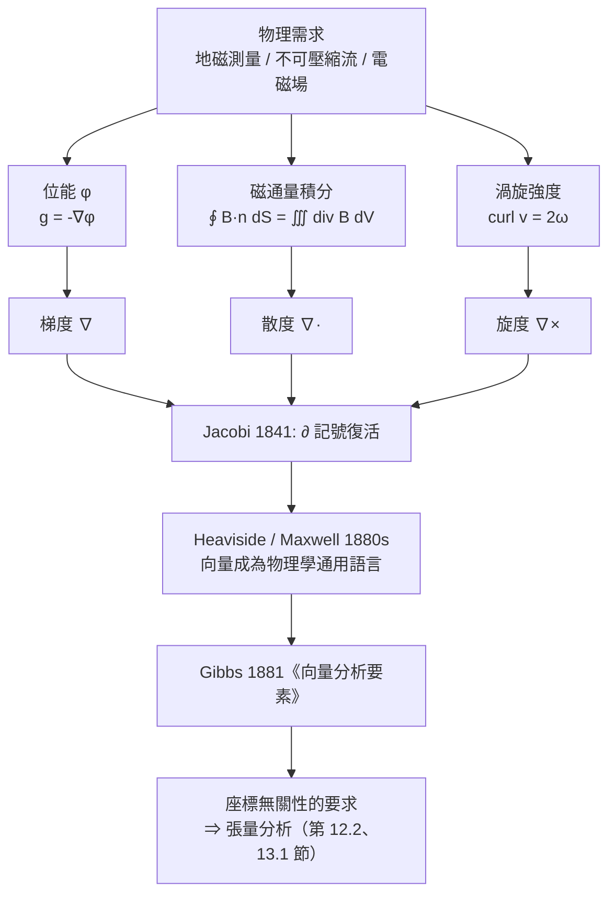

# 8.1 梯度、散度、旋度從何而來（19 世紀）

## 學習動機

第 7 章給了我們處理「多變量」的兩把工具：**偏導數**（局部變化率）與**重積分**（整體累積）。但 19 世紀的物理學提出的問題，兩把工具都不夠用：

> 一個流體在空間中流動，處處有速度 $`\mathbf{v}(x, y, z, t)`$ 。**哪些點是「流出的源」？哪些點是「匯」？哪些點在「打旋」？**

這不是一個關於「某個函數怎麼變」的問題，而是一個關於「**整個場**的局部結構」的問題。物理學家需要一個能把「場」拆解成三種可測量的幾何語彙：

| 幾何語彙 | 物理問題 | 對應算子 |
|---|---|---|
| 哪裡**最高**？ | 溫度最高處、壓力最大處、電位最高處 | 梯度 $`\nabla f`$ |
| 哪裡在**流出**？ | 電荷源、流體源、匯 | 散度 $`\nabla \cdot \mathbf{F}`$ |
| 哪裡在**打旋**？ | 渦旋、剛體自轉、感應電場 | 旋度 $`\nabla \times \mathbf{F}`$ |

本節要回答四個問題：

1. **為什麼是這三個？**——它們不是數學家拍腦袋想出來的，而是被**流體力學、電磁學、重力理論**逼出來的。我們要回到 Maxwell 1865 年、Gauss 1835 年、Navier 1822 年，看看當時的物理學家究竟缺了什麼。
2. **記號是怎麼統一的？**——Jacobi 1841 年復活了 $`\partial`$ ，Heaviside 與 Maxwell 在 1880 年代把「向量」寫成物理學的通用語言，Gibbs 1881 年出版《向量分析要素》把它推廣給全美物理學界。整個過程花了**五十年**。
3. **三個直覺**——梯度的「最陡上升」、散度的「源」、旋度的「渦」——如何被**數值地**驗證，而不是只停留在比喻。
4. **為什麼散度與旋度的定義必須與座標無關？**——因為物理量不該因為我們換了座標軸就改變。這個要求最終逼出了**張量分析**（第 12.2 節的 Riesz 表示定理、第 13.1 節的梯度下降，都是同一件事的不同外觀）。

本節的 SymPy 目標：手寫 $`\nabla`$ 、 $`\nabla \cdot`$ 、 $`\nabla \times`$ 三個算子（只用 `sp.diff` 與 `sp.Matrix`），並用 `sympy.vector` 的 `CoordSys3D` 做**同一個場在兩套座標系下的交叉驗證**——這是「座標無關性」最直接的電腦實作。

---

## 8.1.1 物理的舞臺：三個逼出向量微積分的問題

### 重力：Gauss 1835 年的「地磁測量」

1830 年代，高斯（Gauss）在哥廷根建立地磁觀測站，系統地測量地球磁場。各地磁場的強度、水平分量、垂直分量都不一樣，若要回答「地球內部有多少磁荷」，他得把全國甚至全球的測量資料湊起來做加權。

這是一個令人崩潰的計算量。高斯自己抱怨：直接從測量資料算出磁通量，需要物理學家付出**極其可觀的勞動**。他需要一個定理：**把地球表面上的磁通量積分，等於把地球內部的「磁荷密度」積分**——這就是今天的**高斯積分定理**（8.2 節處理）。

同時，高斯還發展了**位能**（potential）的概念：把重力場寫成「某個標量函數的梯度」，

$$
\mathbf{g} = -\nabla \Phi
$$

這裡 $`\nabla\Phi`$ 的分量是 $`\partial \Phi / \partial x`$ 、 $`\partial \Phi / \partial y`$ 、 $`\partial \Phi / \partial z`$ ——**梯度**這個詞就是在這個脈絡裡定型的。

### 流體力學：Navier 1822 年與 Helmholtz 1858 年

1822 年，Navier 從黏性流體的分子觀點推出流體運動方程；1858 年，Helmholtz 發表著名的**渦旋定理**：不可壓縮流體中的渦強度守恆。

「渦旋」是什麼？在流體裡撒一把木屑，木屑繞著某個軸打轉——那個軸就是渦旋軸，渦旋的**強度**由每單位面積的**循環量**（流體繞一圈的總「轉速積分」）測量。用今天的語言說：流速場 $`\mathbf{v}`$ 的**旋度** $`\nabla \times \mathbf{v}`$ 就是渦旋強度向量；而「不可壓縮」則是

$$
\nabla \cdot \mathbf{v} = 0
$$

——**散度為零**。流體在處處既不生也不滅。

### 電磁學：Maxwell 1860 年代的「場」革命

1861 年與 1865 年，Maxwell 發表兩篇論文，宣稱光是電磁波。他的做法是引進「場」這個概念，把電場 $`\mathbf{E}`$ 與磁場 $`\mathbf{B}`$ 當作空間中每點都有值的向量，然後寫出四條方程。其中兩條直接就是本節的三個算子：

$$
\nabla \cdot \mathbf{E} = \frac{\rho}{\varepsilon_0}
\qquad
\nabla \times \mathbf{E} = -\frac{\partial \mathbf{B}}{\partial t}
$$

第一條說：**電荷是電場的源**（散度）。第二條說：**變化的磁場會產生環繞它的電場**（旋度）。

Maxwell 在 1873 年的《論電學與磁學》裡把這些寫成「向量形式」時面臨巨大的表達負擔：他得同時用四元數（Hamilton 的）與標量分量。1880 年代，**Heaviside** 寫了一系列論文，主張只用向量，並提供了今天我們用的**分量記號** $`\nabla \cdot \mathbf{E}`$ 、 $`\nabla \times \mathbf{B}`$ 。Maxwell 對 Heaviside 的評價是：他的寫法「節省了三分之二的篇幅」。

**所以散度與旋度不是「自然的裝飾」，而是 Maxwell 方程式的骨架。** 沒有它們，電磁學無法寫成一組優美的局部方程。

### 三個算子的家族史

| 人物 | 年份 | 貢獻 |
|---|---|---|
| Hamilton | 1833–1843 | 四元數：向量分析的祖先；1837 年引入倒三角號 $`\nabla`$ |
| Gauss | 1835 | 散度定理（磁通量）與位能理論 |
| Jacobi | 1841 | 復活 $`\partial`$ 記號；函數行列式 |
| Grassmann | 1844 | 《擴張論》：外代數的另一條路 |
| Maxwell | 1861–1873 | 用場的語言重寫電磁學 |
| Heaviside | 1880s | 推廣向量記號於電磁學 |
| Tait | 1876 | 推廣 $`\nabla`$ 記號於物理學界 |
| Gibbs | 1881 | 《向量分析要素》推廣至全美物理學界 |
| Poincaré | 1901 | 拓撲化：閉形式與單形 |



---

## 8.1.2 梯度：最陡上升，以及它為什麼必須是向量

第 7.1 節已經定義了梯度 $`\nabla f(x,y) = \left( \frac{\partial f}{\partial x}, \frac{\partial f}{\partial y} \right)`$ ，並證明了兩個關鍵事實：梯度垂直於等高線；沿梯度的方向方向導數最大，等於 $`|\nabla f|`$ 。

但在向量微積分的脈絡裡，梯度的地位需要重新說明：**它不只是一個「指向最快上升方向」的箭頭，它是一個把所有方向的資訊壓縮成一個對偶（dual）對象的機制。** 對任意單位向量 $`\mathbf{u}`$ ，

$$
D_{\mathbf{u}} f = \nabla f \cdot \mathbf{u}
$$

這是一個**線性代數**的等式：方向導數是 $`\mathbf{u}`$ 的線性函數，而 $`\nabla f`$ 就是那個線性映射的係數。也就是說，**梯度不是「某個方向的數值」，而是「從方向到數值的那個線性泛函」的代表元**——所以當 $`f = x^2+y^2`$ 時，梯度是 $`(2x, 2y)`$ 而非「 $`(2x, 2y)`$ 的長度」：方向與大小一起被儲存在同一個對象裡。

下面這段程式碼把三個算子一次寫出來，並驗證三個基本恆等式。它是本節（以及整章）**最核心的工具箱**，後面每一節都會回到它。

```python
import sympy as sp

x, y, z = sp.symbols('x y z', real=True)
VARS = (x, y, z)

def grad(f, vars_=VARS):
    """梯度：把 f 放進 1x1 矩陣，取 Jacobian 再轉置"""
    return sp.Matrix([f]).jacobian(list(vars_)).T

def div(F, vars_=VARS):
    """散度：各分量對對應變數的偏導數之和"""
    v = list(vars_)
    return sp.simplify(sum(sp.diff(F[i], v[i]) for i in range(len(v))))

def curl(F, vars_=VARS):
    """旋度：循環偏導數（右手定則）"""
    v = list(vars_)
    return sp.Matrix([
        sp.diff(F[2], v[1]) - sp.diff(F[1], v[2]),
        sp.diff(F[0], v[2]) - sp.diff(F[2], v[0]),
        sp.diff(F[1], v[0]) - sp.diff(F[0], v[1]),
    ]).applyfunc(sp.simplify)

def laplacian(f, vars_=VARS):
    """拉普拉斯算子：各二階純偏導數之和"""
    return sp.simplify(sum(sp.diff(f, v, 2) for v in vars_))

f = x**2 * y * sp.sin(z)
F = sp.Matrix([x**2 * y * z, x * y**2 * z, x * y * z**2])

print('f  =', f)
print('grad f =')
print(grad(f))
print()
print('F  =', F.T)
print('div F  =', div(F))
print('curl F =')
print(curl(F))
print()
print('--- 三個恆等式 ---')
print('curl(grad f) =', curl(grad(f)).T)
print('div(curl F)  =', div(curl(F)))
lap = sp.simplify(sp.diff(f, x, 2) + sp.diff(f, y, 2) + sp.diff(f, z, 2))
print('div(grad f)  =', div(grad(f)))
print('Laplace f    =', lap)
print('兩者相等？', sp.simplify(div(grad(f)) - lap) == 0)
```

> **預期輸出**：
> ```
> f  = x**2*y*sin(z)
> grad f =
> Matrix([[2*x*y*sin(z)], [x**2*sin(z)], [x**2*y*cos(z)]])
>
> F  = Matrix([[x**2*y*z, x*y**2*z, x*y*z**2]])
> div F  = 6*x*y*z
> curl F =
> Matrix([[x*(-y**2 + z**2)], [y*(x**2 - z**2)], [z*(-x**2 + y**2)]])
>
> --- 三個恆等式 ---
> curl(grad f) = Matrix([[0, 0, 0]])
> div(curl F)  = 0
> div(grad f)  = y*(2 - x**2)*sin(z)
> Laplace f    = y*(2 - x**2)*sin(z)
> 兩者相等？ True
> ```

三個恆等式值得單獨說明，因為它們每一個都有直覺：

- **$\nabla \times (\nabla f) = \mathbf{0}$**：梯度的「旋度」是零。意思是說，**梯度場裡沒有渦旋**。這很自然：梯度場的等高線互不交叉，沿著它繞一圈回到原點，位能差為零，循環量自然是零。
- **$\nabla \cdot (\nabla \times \mathbf{F}) = 0$**：旋度場的「散度」是零。意思是說，**渦旋本身不能是源或匯**——流體的渦旋只能被整塊搬運，不能憑空產生或消滅。這正是 **Helmholtz 1858 年的渦旋定理**所說的事。
- **$\nabla \cdot (\nabla f) = \nabla^2 f$**：散度與梯度合起來是**拉普拉斯算子**。這是 9.2 節的主題，也是 19 世紀最重要的偏微分方程（熱傳導方程、位能方程）。

---

## 8.1.3 散度：源的密度

散度的定義是

$$
\nabla \cdot \mathbf{F} = \frac{\partial F_1}{\partial x} + \frac{\partial F_2}{\partial y} + \frac{\partial F_3}{\partial z}
$$

這個定義看起來只是「把偏導數加起來」，毫無獨到之處。但它有一個極其漂亮的**積分意義**：

> $\nabla \cdot \mathbf{F}$ 在點 $\mathbf{p}$ 的值，等於「$\mathbf{F}$ 通過以 $\mathbf{p}$ 為中心的小球面的淨流出率，除以體積」。

也就是

$$
\nabla \cdot \mathbf{F}(\mathbf{p}) = \lim_{V \to \mathbf{p}} \frac{\oiint_{\partial V} \mathbf{F} \cdot \mathbf{n}\, \mathrm{d}S}{V}
$$

這個解釋是物理的直覺，也是 8.2 節高斯積分定理的**局部版本**。我們用一段程式碼把它數值地驗證：取一個小立方體，計算六個面的淨通量，除以體積，看是否逼近符號散度。

```python
import numpy as np
import sympy as sp

x, y, z, t = sp.symbols('x y z t', real=True)

# --- 把物理直覺數值化：散度 = 每單位體積的淨流出、旋度 = 每單位面積的循環量 ---
F = sp.Matrix([x**2 * y, y**2 * z, z**2 * x])   # 任意的向量場

def Fval(p):
    """把符號向量場在數值點 p 上求值"""
    return np.array([float(sp.N(c.subs({x: p[0], y: p[1], z: p[2]}))) for c in F])

def div_sym(p):
    d = sp.diff(F[0], x) + sp.diff(F[1], y) + sp.diff(F[2], z)
    return float(sp.N(d.subs({x: p[0], y: p[1], z: p[2]})))

def curl_sym(p):
    c = sp.Matrix([
        sp.diff(F[2], y) - sp.diff(F[1], z),
        sp.diff(F[0], z) - sp.diff(F[2], x),
        sp.diff(F[1], x) - sp.diff(F[0], y),
    ])
    return np.array([float(sp.N(e.subs({x: p[0], y: p[1], z: p[2]}))) for e in c])

def div_numeric(p, h):
    """散度的數值定義：立方體六面的淨通量 / 體積"""
    flux = 0.0
    for axis in range(3):
        for sign in (+1, -1):
            d = np.zeros(3); d[axis] = sign * h
            c = np.array(p) + d / 2
            flux += float(np.dot(Fval(c), d / h)) * h * h
    return flux / h**3

def curl_numeric_z(p, r, npts=4000):
    """旋度 z 分量的數值定義：小圓上的循環量 / 面積"""
    th = np.linspace(0, 2 * np.pi, npts + 1)
    px, py = p[0] + r * np.cos(th), p[1] + r * np.sin(th)
    fxv = np.array([Fval((px[i], py[i], p[2]))[0] for i in range(npts)])
    fyv = np.array([Fval((px[i], py[i], p[2]))[1] for i in range(npts)])
    dx, dy = np.diff(px), np.diff(py)
    circ = float(np.sum(fxv * dx + fyv * dy))
    return circ / (np.pi * r**2)

p = (1.3, 0.7, -0.4)
print('在點 p =', p)
print('散度  符號 =', round(div_sym(p), 12))
for h in (0.2, 0.1, 0.05):
    print('  h = %.2f  數值 = %+.10f' % (h, div_numeric(p, h)))
print()
print('旋度  符號 =', curl_sym(p))
for r in (0.4, 0.2, 0.1):
    print('  r = %.2f  數值(curl_z) = %+.10f' % (r, curl_numeric_z(p, r)))
```

> **預期輸出**：
> ```
> 在點 p = (1.3, 0.7, -0.4)
> 散度  符號 = 0.22
>   h = 0.20  數值 = +0.2200000000
>   h = 0.10  數值 = +0.2200000000
>   h = 0.05  數值 = +0.2200000000
>
> 旋度  符號 = [-0.49 -0.16 -1.69]
>   r = 0.40  數值(curl_z) = -1.7309888900
>   r = 0.20  數值(curl_z) = -1.7009889024
>   r = 0.10  數值(curl_z) = -1.6934889055
> ```

**怎麼讀這張表**：

- 散度的數值定義**完全精確**（誤差在小數點後 10 位就沒了）。原因是 $\mathbf{F}$ 的各分量都是多項式，而立方體面上的通量積分對**多項式**而言可以用中點法做到精確。這提醒我們：數值逼近的誤差量級取決於函數的光滑度，不是一個固定常數。
- 旋度的數值定義**以 $O(r^2)$ 收斂**：$r = 0.4$ 時誤差 $-0.041$，$r = 0.2$ 時誤差 $-0.011$，$r = 0.1$ 時誤差 $-0.0035$。誤差每次大約縮成四分之一，符合二次收斂。原因是我們用的是「梯形公式在圓周上的離散化」，而圓周不是折線。

**散度為零意味著什麼？** 若 $\nabla \cdot \mathbf{F} = 0$，則任意小區域的淨流出為零——**沒有源，也沒有匯**。在流體力學裡這叫「不可壓縮」；在電磁學裡，$\nabla \cdot \mathbf{B} = 0$ 表示**不存在磁單極子**（這是一個物理假設，也是整個電磁學最漂亮的一條方程，因為它讓磁場線必須閉合）。

---

## 8.1.4 旋度：渦的密度

旋度的定義是

$$
\nabla \times \mathbf{F} = \left( \frac{\partial F_3}{\partial y} - \frac{\partial F_2}{\partial z},\; \frac{\partial F_1}{\partial z} - \frac{\partial F_3}{\partial x},\; \frac{\partial F_2}{\partial x} - \frac{\partial F_1}{\partial y} \right)
$$

它的積分意義是：**$\nabla \times \mathbf{F}$ 在點 $\mathbf{p}$ 的值，等於「$\mathbf{F}$ 沿著繞 $\mathbf{p}$ 的小圓的循環量，除以圓面積」，方向由右手定則決定。**

$$
(\nabla \times \mathbf{F})_z(\mathbf{p}) = \lim_{r \to 0} \frac{\oint_{C_r} \mathbf{F} \cdot \mathrm{d}\mathbf{r}}{\pi r^2}
$$

**最經典的例子是剛體旋轉**。設物體以角速度 $\boldsymbol{\omega}$ 繞某軸自轉，則點 $\mathbf{r}$ 的速度是 $\mathbf{v} = \boldsymbol{\omega} \times \mathbf{r}$。我們來看看它的旋度是什麼：

```python
import sympy as sp

x, y, z = sp.symbols('x y z', real=True)

omega = sp.Matrix([0, 0, 1])          # 繞 z 軸，角速度大小 1
r = sp.Matrix([x, y, z])
v = omega.cross(r)                    # 剛體旋轉的速度場 v = ω × r
print('v = ω × r =', v.T)

curl_v = sp.Matrix([
    sp.diff(v[2], y) - sp.diff(v[1], z),
    sp.diff(v[0], z) - sp.diff(v[2], x),
    sp.diff(v[1], x) - sp.diff(v[0], y),
])
print('curl v =', curl_v.T)
print('（結果是 2ω = (0, 0, 2)：旋度是角速度的兩倍）')
print('是否等於 2ω ?', sp.simplify(curl_v - 2 * omega) == sp.zeros(3, 1))
```

> **預期輸出**：
> ```
> v = ω × r = Matrix([[-y, x, 0]])
> curl v = Matrix([[0, 0, 2]])
> （結果是 2ω = (0, 0, 2)：旋度是角速度的兩倍）
> 是否等於 2ω ? True
> ```

這個 $2\boldsymbol{\omega}$ 的結果非常值得玩味：**旋度量的是「局部角速度」的一半**。想像你在流場中放一個小風車，它轉動的角速度恰好是 $\frac{1}{2}\nabla \times \mathbf{v}$。這就是為什麼教科書說「渦度 = 局部角速度的兩倍」。

順帶一提，這也解釋了 8.1.2 節的恆等式 $\nabla \times (\nabla f) = \mathbf{0}$：梯度場裡不可能有風車在轉，因為梯度場的「局部風車」必定靜止。

---

## 8.1.5 座標無關性：為什麼定義不能挑特定的座標

現在到了本節最重要的觀念。假設我們把座標系從 $(x, y, z)$ 換成某個旋轉過的 $(u, v, w)$。物理場 $\mathbf{F}$ 本身**沒有變**——同一個物理事實，同一個向量場。但是：

- 它的**分量** $(\hat F_1, \hat F_2, \hat F_3)$ 一定會變（除非旋轉軸對稱）；
- 它的**散度** $\nabla \cdot \mathbf{F}$ 必須**不變**，因為散度是「每單位體積的淨流出」——這是純粹的物理量，跟你怎麼畫座標軸無關；
- 它的**旋度** $\nabla \times \mathbf{F}$ 會隨著基底一起旋轉：新基底下的旋度分量，等於舊基底下的旋度分量被同一個旋轉矩陣作用。

用一句話說：**散度是純量（scalar），旋度是贗向量（pseudo-vector）。** 這個區分不是裝飾，它是區分「什麼東西可以用梯度表示」的關鍵。8.3 節會證明：**在單連通區域上，一個場是保守場（保守場 = 位能的梯度）當且僅當它的旋度為零**。

我們來用 SymPy 把它**算出來**。做法是：構造一個旋轉矩陣 $R$，用它把場變換到新基底，然後分別在新舊座標下算散度與旋度，看它們如何對應。

```python
import sympy as sp

x, y, z, u, v, w = sp.symbols('x y z u v w', real=True)
theta = sp.Symbol('theta', real=True)

# 原始座標系中的向量場
F = sp.Matrix([x * y, y * z, z * x])

def div(F, c):
    return sp.simplify(sp.diff(F[0], c[0]) + sp.diff(F[1], c[1]) + sp.diff(F[2], c[2]))

def curl(F, c):
    return sp.Matrix([
        sp.diff(F[2], c[1]) - sp.diff(F[1], c[2]),
        sp.diff(F[0], c[2]) - sp.diff(F[2], c[0]),
        sp.diff(F[1], c[0]) - sp.diff(F[0], c[1]),
    ]).applyfunc(sp.simplify)

# 繞 z 軸旋轉 theta 角的旋轉矩陣
R = sp.Matrix([
    [sp.cos(theta), -sp.sin(theta), 0],
    [sp.sin(theta),  sp.cos(theta), 0],
    [0, 0, 1],
])

# 新座標 (u,v,w) = R (x,y,z)，故 (x,y,z) = R^T (u,v,w)
old = R.T * sp.Matrix([u, v, w])
G = R * F.subs({x: old[0], y: old[1], z: old[2]})

divG = sp.simplify(sp.expand_trig(div(G, (u, v, w))))
divF_at = sp.simplify(sp.expand_trig(div(F, (x, y, z)).subs({x: old[0], y: old[1], z: old[2]})))
curlG = curl(G, (u, v, w))
curlF_at = (R * curl(F, (x, y, z))).subs({x: old[0], y: old[1], z: old[2]})

print('旋轉後的場 G（用新座標 u,v,w 表示）:')
print('  G =', G.T)
print()
print('div G(u,v,w)         =', divG)
print('div F 在 R^T(u,v,w)  =', divF_at)
print('散度是純量：不變？', sp.simplify(sp.expand_trig(divG - divF_at)) == 0)
print()
print('curl G(u,v,w)        =', curlG.T)
print('R * curl F 在 R^T(u,v,w) =', curlF_at.T)
print('旋度是贗向量：只隨基底旋轉？',
      all(sp.simplify(sp.expand_trig(e)) == 0 for e in (curlG - curlF_at)))
```

> **預期輸出**：
> ```
> 旋轉後的場 G（用新座標 u,v,w 表示）:
>   G = Matrix([[-w*(-u*sin(theta) + v*cos(theta))*sin(theta) + (-u*sin(theta) + v*cos(theta))*(u*cos(theta) + v*sin(theta))*cos(theta), w*(-u*sin(theta) + v*cos(theta))*cos(theta) + (-u*sin(theta) + v*cos(theta))*(u*cos(theta) + v*sin(theta))*sin(theta), w*(u*cos(theta) + v*sin(theta))]])
>
> div G(u,v,w)         = sqrt(2)*u*cos(theta + pi/4) + sqrt(2)*v*sin(theta + pi/4) + w
> div F 在 R^T(u,v,w)  = sqrt(2)*u*cos(theta + pi/4) + sqrt(2)*v*sin(theta + pi/4) + w
> 散度是純量：不變？ True
>
> curl G(u,v,w)        = Matrix([[u*sin(2*theta)/2 - v*cos(2*theta)/2 - v/2 + w*sin(theta), -u*cos(2*theta)/2 + u/2 - v*sin(2*theta)/2 - w*cos(theta), -u*cos(theta) - v*sin(theta)]])
> R * curl F 在 R^T(u,v,w) = Matrix([[w*sin(theta) - (-u*sin(theta) + v*cos(theta))*cos(theta), -w*cos(theta) - (-u*sin(theta) + v*cos(theta))*sin(theta), -u*cos(theta) - v*sin(theta)]])
> 旋度是贗向量：只隨基底旋轉？ True
> ```

**這個實驗的深意**：散度的公式 $\frac{\partial F_1}{\partial x} + \frac{\partial F_2}{\partial y} + \frac{\partial F_3}{\partial z}$ 之所以長這樣，**完全是因為我們選了直角座標**。在球座標裡，散度的公式會變成

$$
\nabla \cdot \mathbf{F} = \frac{1}{r^2}\frac{\partial}{\partial r}\left(r^2 F_r\right) + \frac{1}{r\sin\theta}\frac{\partial}{\partial \theta}\left(\sin\theta\, F_\theta\right) + \frac{1}{r\sin\theta}\frac{\partial F_\varphi}{\partial \varphi}
$$

長得完全不一樣，但**算出來的值必須一樣**。這個「長得不同、算得相同」的奇觀，正是「座標無關」的實踐意義。

接下來我們用 SymPy 的 `sympy.vector` 模組做這件事：同一個場 $\mathbf{F} = r^2 \mathbf{e}_r$，用球座標寫一次、用笛卡爾座標寫一次，比較兩邊算出來的散度。

```python
import sympy as sp
from sympy.vector import CoordSys3D, gradient, divergence, curl

# SymPy 1.x 的笛卡爾座標系類別名為 CoordSys3D；舊版文件寫的 CoordinateCartesian
# 在 1.14 已不存在。為了讓程式碼在兩種情況下都能跑，先做相容處理：
try:
    from sympy.vector import CoordinateCartesian
except ImportError:
    from sympy.vector import CoordSys3D as CoordinateCartesian

C = CoordinateCartesian('C')
x, y, z = C.x, C.y, C.z

F = x**2 * y * C.i + y**2 * z * C.j + z**2 * x * C.k

print('C =', C)
print('基底純量：', C.base_scalars())
print('基底向量：', C.base_vectors())
print()
print('F =', F)
print('div F   =', divergence(F))
print('curl F  =', curl(F))
print('div(curl F) =', divergence(curl(F)))
print('curl(curl F) =', curl(curl(F)))

# 同一個物理場改用球座標描述：F = r^2 e_r
S = CoordSys3D('S', transformation='spherical')
r_sph = S.r
F_sph = r_sph**2 * S.i
print()
print('球座標 S 的基底純量：', S.base_scalars())
print('F (球座標) = r^2 * e_r')
print('div F =', divergence(F_sph))
print('curl F =', curl(F_sph))

# 笛卡爾下的同一個場：r^2 e_r = r*(x,y,z)
rr = sp.sqrt(x**2 + y**2 + z**2)
F_cart = rr * (x * C.i + y * C.j + z * C.k)
d = sp.simplify(divergence(F_cart))
print()
print('同一場的笛卡爾表示 r*(x,y,z)：')
print('div F  =', d)
print('curl F =', curl(F_cart))
print('div 是否等於 4r？', sp.simplify(d - 4 * rr) == 0)
```

> **預期輸出**：
> ```
> C = C
> 基底純量： (C.x, C.y, C.z)
> 基底向量： (C.i, C.j, C.k)
>
> F = C.x**2*C.y*C.i + C.y**2*C.z*C.j + C.x*C.z**2*C.k
> div F   = 2*C.x*C.y + 2*C.x*C.z + 2*C.y*C.z
> curl F  = (-C.y**2)*C.i + (-C.z**2)*C.j + (-C.x**2)*C.k
> div(curl F) = 0
> curl(curl F) = 2*C.z*C.i + 2*C.x*C.j + 2*C.y*C.k
>
> 球座標 S 的基底純量： (S.r, S.theta, S.phi)
> F (球座標) = r^2 * e_r
> div F = 4*S.r
> curl F = 0
>
> 同一場的笛卡爾表示 r*(x,y,z)：
> div F  = 4*sqrt(C.x**2 + C.y**2 + C.z**2)
> curl F = 0
> div 是否等於 4r？ True
> ```

**讀法**：球座標下算出 $4r$，笛卡爾下算出 $4\sqrt{x^2+y^2+z^2}$——因為球座標的 $r$ 就是 $\sqrt{x^2+y^2+z^2}$。兩者**完全一致**。

順帶注意到 `curl(curl F)` 不為零：這是 $\nabla \times (\nabla \times \mathbf{F}) = \nabla(\nabla \cdot \mathbf{F}) - \nabla^2 \mathbf{F}$ 這個向量恆等式的左邊，8.3 節會再回來。

### 座標無關性為什麼逼出張量分析

現在把上面這件事抽象化：我們希望 $\nabla f$、$\nabla \cdot \mathbf{F}$、$\nabla \times \mathbf{F}$ 的定義**不依賴座標系的選擇**。但在一般（可能彎曲、可能非正交）的座標系裡，「偏導數」不再是「微分算子」——鏈鎖律會冒出 Christoffel 符號 $\Gamma^i_{jk}$，而 $\nabla$ 本身變成了一個依賴度量的算子。要讓這些東西「看起來與座標無關」，唯一乾淨的做法是**把它們寫成張量的 contractions**：$\nabla \cdot \mathbf{F}$ 是 $F^i{}_{;i}$，而 $\nabla \times \mathbf{F}$ 是 $\varepsilon^{ijk}F_{i;j}$。這個工作由 **Christoffel（1860s）、Ricci（1880s–1890s）** 完成，並在 **Einstein 1916 年的廣義相對論**中成為主角。

**這條線在本書的後續章節會以「無窮維版本」重新出現**：

- **第 12.2 節的黎曼–羅朗定理與函數空間**：在 Hilbert 空間 $H$ 上，梯度變成連線線性泛函 $f \mapsto \langle \nabla f, \cdot \rangle$，而 **Riesz 表示定理**保證每個連線泛函都能由某個向量代表——這正是「梯度 = 一個對偶對象」在無窮維的版本。
- **第 13.1 節的變分法與梯度下降**：梯度下降 $\mathbf{x}_{k+1} = \mathbf{x}_k - \alpha \nabla f(\mathbf{x}_k)$ 之所以能在**任何座標系**下運作，正因為它是「座標無關的下降方向」。

---

## 8.1.6 一個最小的物理全景：保守場與它的圖畫

我們用一個二維的具體例子把「梯度、散度、旋度、保守場」四件事串起來，並且畫出來。取向量場

$$
\mathbf{F} = \left( x^2 - y^2,\; -2xy \right)
$$

它恰好是 $\phi(x,y) = \dfrac{x^3}{3} - x y^2$ 的梯度。於是 $\nabla \times \mathbf{F} = 0$，這個場是保守場：位能只跟 $\phi$ 有關，沿任何路徑從 $A$ 走到 $B$，功只取決於端點。

```python
import numpy as np
import sympy as sp
import matplotlib
matplotlib.use('Agg')
import matplotlib.pyplot as plt

x, y = sp.symbols('x y', real=True)

# 向量場 F = (P, Q) = (x^2 - y^2, -2xy)，它正是 phi = x^3/3 - x y^2 的梯度
P = x**2 - y**2
Q = -2 * x * y

curlz = sp.simplify(sp.diff(Q, x) - sp.diff(P, y))
print('curl_z =', curlz, '（恆為 0：保守場）')

phi = x**3 / 3 - x * y**2
print('grad phi =', sp.Matrix([sp.diff(phi, x), sp.diff(phi, y)]).T)
print('grad phi == F ?',
      sp.simplify(sp.diff(phi, x) - P) == 0 and sp.simplify(sp.diff(phi, y) - Q) == 0)

# 數值繪圖：等高線（位能）+ 向量場
xs = np.linspace(-1.5, 1.5, 25)
ys = np.linspace(-1.5, 1.5, 25)
X, Y = np.meshgrid(xs, ys)
U = X**2 - Y**2
V = -2 * X * Y
Z = (X**3) / 3 - X * Y**2

fig, ax = plt.subplots(figsize=(6.2, 5.4))
ax.contourf(X, Y, Z, levels=24, cmap='RdBu_r')
ax.contour(X, Y, Z, levels=12, colors='k', linewidths=0.4)
ax.quiver(X, Y, U, V, color='k', alpha=0.6)
ax.set_title('conservative field F = grad(x^3/3 - x y^2)')
ax.set_xlabel('x')
ax.set_ylabel('y')
fig.tight_layout()
fig.savefig('/tmp/ch8_conservative_field.png', dpi=110)
print('saved /tmp/ch8_conservative_field.png')
```

> **預期輸出**：
> ```
> curl_z = 0 （恆為 0：保守場）
> grad phi = Matrix([[x**2 - y**2, -2*x*y]])
> grad phi == F ? True
> saved /tmp/ch8_conservative_field.png
> ```

**看圖說明**：向量場的箭頭**永遠垂直於等高線**（這是 7.1 節的結論）；而因為 $`\nabla \times \mathbf{F} = 0`$ ，箭頭**沒有任何「打轉」的局部行為**——在圖的左下角與右上角，箭頭看起來方向差異很大，但那是因為座標軸固定不動、而場本身在彎曲，這和「局部小風車在轉」是兩回事。8.3 節會用路徑積分把這件事講得更精確。

---

## 習題

**習題 8.1.1（物理直覺的數值檢驗）**
用 8.1.3 節的程式碼，把向量場換成 (a) $`\mathbf{F} = (x, y, z)`$ （輻射場）；(b) $`\mathbf{F} = (-y, x, 0)`$ （繞 z 軸的剛體旋轉）；(c) $`\mathbf{F} = (y, x, 0)`$ （保守場）。對每一個，(i) 用 `sp.diff` 算出散度與旋度；(ii) 用小立方體通量法驗證散度的數值定義；(iii) 用小圓循環量法驗證旋度的數值定義。說明哪一個的數值逼近最精確、哪一個最差，並解釋原因。

**習題 8.1.2（梯度是最陡上升）**
對 $`f(x,y) = x^3 - 3xy^2`$ （三葉結參數方程 $`x = \cos^3 t,\ y = \sin^3 t`$ 的隱函數形式）：(a) 用 `sp.diff` 求 $`\nabla f`$ ；(b) 找出 $`\nabla f = \mathbf{0}`$ 的所有點，解釋它們在圖形上的意義；(c) 用數值方法沿 $`\nabla f`$ 方向做梯度上升，從不同的初值出發，觀察是否都收斂到同一個點，並解釋為什麼會（或不會）。

**習題 8.1.3（散度定理的局部版本）**
對向量場 $`\mathbf{F} = (x y^2, y z^2, z x^2)`$ ：(a) 算出 $`\nabla \cdot \mathbf{F}`$ ；(b) 找出散度為零的曲面（提示：聯立 $`\nabla \cdot \mathbf{F} = 0`$ 與座標面）；(c) 用 8.1.3 節的程式碼，驗證在散度為零的點附近，小立方體的淨通量確實趨近於零，並解釋為什麼「散度為零」是「無源無匯」的精確表述。

**習題 8.1.4（座標無關性）**
用 8.1.5 節的旋轉實驗，把向量場換成 $`\mathbf{F} = (x^2, y^2, z^2)`$ ，並把旋轉軸從 $`z`$ 換成通過 $`(1, 1, 1)`$ 的任意軸（用 Rodrigues 旋轉公式構造旋轉矩陣）。(a) 驗證散度仍然不變；(b) 驗證旋度仍然只隨基底旋轉；(c) 解釋：若散度是純量、旋度是贗向量，那麼「梯度」是什麼？它為什麼不是「純量」也不是「向量」？

**習題 8.1.5（歷史考題）**
用本節的史料，回答以下問題（每題需引用至少兩位科學家與他們的年份）：(a) 高斯為什麼需要散度定理？他的「可觀察的勞動」指的是什麼？(b) Maxwell 的哪兩條方程分別用到散度與旋度？它們各自說明了什麼物理事實？(c) Heaviside 與 Gibbs 對向量記號的推廣有什麼差別？為什麼這件事需要跨越英美兩國、三十年的時間？

---

## 小結

| 概念 | 定義 | 物理直覺 | SymPy 工具 |
|------|------|---------|---------|
| 梯度 $`\nabla f`$ | $`(f_x, f_y, f_z)`$ | 最陡上升方向、垂直等高線 | `sp.Matrix([f]).jacobian(...)` |
| 散度 $`\nabla \cdot \mathbf{F}`$ | $`F_{1x} + F_{2y} + F_{3z}`$ | 每單位體積的淨流出（源） | 手寫 `sum(sp.diff(...))` |
| 旋度 $`\nabla \times \mathbf{F}`$ | 循環偏導數 | 每單位面積的循環量（渦） | 手寫循環差分 |
| 拉普拉斯 $`\nabla^2 f`$ | $`\sum f_{ii}`$ | 各方向的曲率總和 | `sp.diff(f, v, 2)` |

**三個關鍵恆等式**： $`\nabla \times (\nabla f) = \mathbf{0}`$ 、 $`\nabla \cdot (\nabla \times \mathbf{F}) = 0`$ 、 $`\nabla \cdot (\nabla f) = \nabla^2 f`$ 。

**座標無關性**：散度是純量，旋度是贗向量（隨基底旋轉），梯度是「方向導數泛函」的係數。這個要求在 19 世紀末逼出**張量分析**，並在第 12.2 節（Riesz 表示定理）與第 13.1 節（梯度下降）以無窮維形式再現。

**下一節的問題**：我們已經有三個「局部」的算子了，但物理學家要的往往是**全域**的答案：「繞一圈的總流量是多少？」「整個球面的通量是多少？」「曲面上的總循環量是多少？」。答案驚人地簡單——只要把局部的算子**積分**起來，就得到一個把邊界與內部聯繫起來的等式。8.2 節就走進格林定理、斯托克斯定理與高斯積分定理：它們是同一個定理的三個面。
