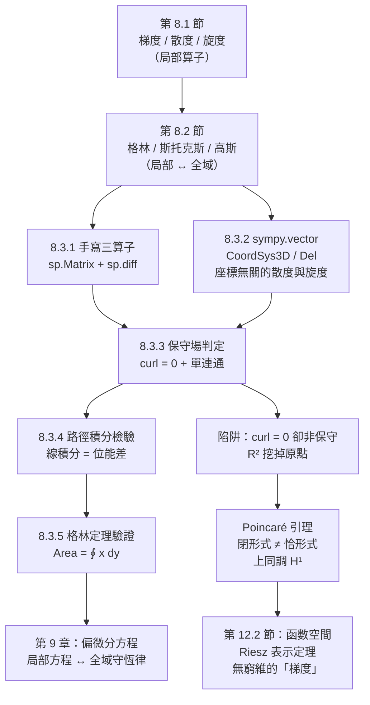

# 8.3 用 SymPy 做向量微積分與保守場判定

## 學習動機

前兩節給了武器：8.1 節的**三個局部算子**（梯度、散度、旋度）與 8.2 節的**三個積分定理**（格林、斯托克斯、高斯）。本節要做的是**把它們交給電腦**。

具體的問題清單：

1. **怎麼讓 SymPy 算梯度、散度、旋度？** SymPy 1.x 沒有頂層的 `sp.gradient`（7.1 節提過），但有兩條路：**(a)** 用 `sp.Matrix` 手寫（三行搞定，座標無關）；**(b)** 用 `sympy.vector` 模組，它會**自動處理座標系的旋轉、縮放、正交化**——這正是「座標無關」的電腦實作。
2. **怎麼判定一個場是否保守？** 判準是「旋度為零」——但這個判準**只在單連通區域上成立**。我們要看到那個著名的反例：在 $`\mathbb{R}^2\setminus\{0\}`$ 上， $`\mathbf{F} = \left( -\frac{y}{x^2+y^2}, \frac{x}{x^2+y^2} \right)`$ 的旋度**恆為零**，但它**不是**保守場。
3. **怎麼做線積分？** 用 `sp.Integral` 與參數化。而且線積分是「保守場路徑無關性」的**最佳檢驗工具**。
4. **怎麼用格林定理做數值/符號驗證？** 例如「區域面積 $`=\oint_C x\,\mathrm{d}y`$ 」。
5. **怎麼用 `sympy.vector` 的 `CoordSys3D`（笛卡爾座標系）做散度與旋度？**

本節的哲學延續 7.3 節：**每一個「我認為答案是 $`X`$ 」的直覺，都該能被一段 5 行的程式碼證偽。** 特別是本節最後那個「curl = 0 卻不保守」的反例——它是 SymPy 的 `is_conservative` **會給出錯誤答案**的場合（因為 `is_conservative` 只檢查旋度），所以我們必須自己補上「單連通性」的檢查。

---

## 8.3.1 手寫三個算子：只要 `sp.diff` 與 `sp.Matrix`

先把三個算子寫成三個函式。這是本章最重要的**基礎設施**，之後每一個例子都會用到它們。

```python
import sympy as sp

x, y, z = sp.symbols('x y z', real=True)

# ---- 手寫三個算子（只用 sp.diff 與 sp.Matrix）----
def grad(f, vars_=(x, y, z)):
    """梯度：Jacobian 取轉置"""
    return sp.Matrix([f]).jacobian(list(vars_)).T

def div(F, vars_=(x, y, z)):
    """散度：對角線偏導數之和"""
    v = list(vars_)
    return sp.simplify(sum(sp.diff(F[i], v[i]) for i in range(len(v))))

def curl(F, vars_=(x, y, z)):
    """旋度：循環偏導數，右手定則"""
    v = list(vars_)
    return sp.Matrix([
        sp.diff(F[2], v[1]) - sp.diff(F[1], v[2]),
        sp.diff(F[0], v[2]) - sp.diff(F[2], v[0]),
        sp.diff(F[1], v[0]) - sp.diff(F[0], v[1]),
    ]).applyfunc(sp.simplify)

f = x**2 * y * sp.sin(z)
F = sp.Matrix([x**2 * y * z, x * y**2 * z, x * y * z**2])

print('f  =', f)
print('grad f =')
print(grad(f))
print()
print('F  =', F.T)
print('div F  =', div(F))
print('curl F =')
print(curl(F))
print()
print('--- 恆等式 ---')
print('curl(grad f) =', curl(grad(f)).T)
print('div(curl F)  =', div(curl(F)))
lap = sp.simplify(sp.diff(f, x, 2) + sp.diff(f, y, 2) + sp.diff(f, z, 2))
print('div(grad f)  =', div(grad(f)))
print('Laplace f    =', lap)
print('兩者相等？', sp.simplify(div(grad(f)) - lap) == 0)

# ---- 二維版本 ----
print()
print('--- 二維版本（curl 只有 z 分量）---')
G = sp.Matrix([x**2 * y, y**2 * x])
print('div G    =', sp.simplify(sp.diff(G[0], x) + sp.diff(G[1], y)))
print('curl_z G =', sp.simplify(sp.diff(G[1], x) - sp.diff(G[0], y)))
print('grad(div G) 的旋度 =', curl(sp.Matrix([sp.diff(G[0], x) + sp.diff(G[1], y), 0, 0])).T)
```

> **預期輸出**：
> ```
> f  = x**2*y*sin(z)
> grad f =
> Matrix([[2*x*y*sin(z)], [x**2*sin(z)], [x**2*y*cos(z)]])
>
> F  = Matrix([[x**2*y*z, x*y**2*z, x*y*z**2]])
> div F  = 6*x*y*z
> curl F =
> Matrix([[x*(-y**2 + z**2)], [y*(x**2 - z**2)], [z*(-x**2 + y**2)]])
>
> --- 恆等式 ---
> curl(grad f) = Matrix([[0, 0, 0]])
> div(curl F)  = 0
> div(grad f)  = y*(2 - x**2)*sin(z)
> Laplace f    = y*(2 - x**2)*sin(z)
> 兩者相等？ True
>
> --- 二維版本（curl 只有 z 分量）---
> div G    = 4*x*y
> curl_z G = -x**2 + y**2
> grad(div G) 的旋度 = Matrix([[0, 0, -4*x]])
> ```

**幾個實作要點**：

- `sp.Matrix([f]).jacobian([x, y, z])` 得到的是 $1\times3$ 的矩陣（列向量），必須 `.T` 轉成 $3\times1$ 才是慣用的「梯度向量」。
- `curl` 的三個分量必須**按右手定則的循環順序**排列：$(z,y) - (y,z)$、$(x,z) - (z,x)$、$(y,x) - (x,y)$。寫錯順序會得到旋度的**負號**——這是最常見的錯誤。
- `.applyfunc(sp.simplify)` 對 `Matrix` 逐元素作用，是清理輸出最有效的一招。
- 最後那行 `grad(div G) 的旋度` 是 $\nabla\times(\nabla(\nabla\cdot\mathbf{G}))$，結果不為零——因為 $\nabla\cdot\mathbf{G}$ 本身還要再取一次旋度，$C^2$ 條件下 $\nabla\times\nabla(\nabla\cdot\mathbf{G}) = \nabla(\nabla^2(\nabla\cdot\mathbf{G}))$，這裡 $\nabla^2(\nabla\cdot\mathbf{G}) = -4$，所以旋度是 $(0,0,-4)$。**與 8.1.2 節的 $\nabla\times(\nabla f) = 0$ 並不矛盾**：那個恆等式要求「裡面只有一層梯度」，這裡有兩層。

---

## 8.3.2 `sympy.vector`：讓電腦處理座標系

手寫的版本有一個明顯的侷限：**它把直角座標寫死了**。如果我們要處理極座標、球座標，或者一個**旋轉過的**座標系，手寫版本會立刻失效——因為「散度 = 各分量對對應變數的偏導數之和」這個公式只在正交直角座標裡成立。

`sympy.vector` 模組正是為此而生。它提供：

- `CoordSys3D`：建立一個三維座標系（含基底向量 $\mathbf{i}, \mathbf{j}, \mathbf{k}$ 與基底純量 $x, y, z$）；
- `Del`：**nabla 算子** $\nabla$；
- `gradient` / `divergence` / `curl` / `laplacian`：直接作用在 `sympy.vector.Vector` 上；
- `is_conservative` / `scalar_potential` / `is_solenoidal`：保守場與位能的判定與構造；
- `express`：把向量在兩個座標系之間來回轉換；
- 內建**極座標、柱座標、球座標**，以及任意**旋轉／平移**的座標系（`orient_new`、`locate_new`）。

```python
import sympy as sp
from sympy.vector import CoordSys3D, Del, gradient, divergence, curl, laplacian, is_conservative, scalar_potential

# SymPy 1.x 的笛卡爾座標系類別是 CoordSys3D
try:
    from sympy.vector import CoordinateCartesian
except ImportError:
    from sympy.vector import CoordSys3D as CoordinateCartesian

C = CoordinateCartesian('C')
x, y, z = C.x, C.y, C.z

f = x**2 * y * sp.sin(z)
F = x**2 * y * z * C.i + x * y**2 * z * C.j + x * y * z**2 * C.k

print('--- Del 算子（nabla）---')
D = Del()
print('D(f)        =', D(f).doit())
print('gradient(f) =', gradient(f))
print()
print('--- 散度與旋度 ---')
print('div F       =', divergence(F))
print('curl F      =', curl(F))
print('div(curl F) =', divergence(curl(F)))
print('curl(grad f)=', curl(gradient(f)))
print('laplacian(f)=', laplacian(f))
print('laplacian(F)=', laplacian(F))
print()
print('--- 保守場 ---')
G = (2 * x * y) * C.i + (x**2) * C.j + 0 * C.k
print('G            =', G)
print('curl G       =', curl(G))
print('is_conservative(G)  =', is_conservative(G))
print('scalar_potential(G) =', scalar_potential(G, C))
```

> **預期輸出**：
> ```
> --- Del 算子（nabla）---
> D(f)        = (2*C.x*C.y*sin(C.z))*C.i + (C.x**2*sin(C.z))*C.j + (C.x**2*C.y*cos(C.z))*C.k
> gradient(f) = (2*C.x*C.y*sin(C.z))*C.i + (C.x**2*sin(C.z))*C.j + (C.x**2*C.y*cos(C.z))*C.k
>
> --- 散度與旋度 ---
> div F       = 6*C.x*C.y*C.z
> curl F      = (-C.x*C.y**2 + C.x*C.z**2)*C.i + (C.x**2*C.y - C.y*C.z**2)*C.j + (-C.x**2*C.z + C.y**2*C.z)*C.k
> div(curl F) = 0
> curl(grad f)= 0
> laplacian(f)= -C.x**2*C.y*sin(C.z) + 2*C.y*sin(C.z)
> laplacian(F)= 2*C.y*C.z*C.i + 2*C.x*C.z*C.j + 2*C.x*C.y*C.k
>
> --- 保守場 ---
> G            = 2*C.x*C.y*C.i + C.x**2*C.j
> curl G       = 0
> is_conservative(G)  = True
> scalar_potential(G) = C.x**2*C.y
> ```

**關於 `Del` 算子**：它是 $\nabla$ 的物件化版本。注意 `D(f)` 預設**不會**自動求導（回傳未求值的 `Derivative`），需要 `.doit()` 才會算出實際結果。而 `gradient(f)` 則預設就會求導。這是一個容易踩到的陷阱。

**關於 `laplacian`**：它有兩個用法——對標量函數給出 $\nabla^2 f$，對向量場給出**逐分量**的拉普拉斯 $\nabla^2 \mathbf{F}$（注意：這與 $\nabla(\nabla\cdot\mathbf{F}) - \nabla\times(\nabla\times\mathbf{F})$ **不是**同一個東西，後者是向量拉普拉斯算子，兩者只在無散場時相等）。SymPy 的 `laplacian(F)` 給的是**逐分量**版本。

**關於 `is_conservative` 與 `scalar_potential`**：`is_conservative` 的實作只有「檢查旋度是否為零」這一步——我們可以直接把它的原始碼印出來看：

```python
import inspect
from sympy.vector import is_conservative

print(inspect.getsource(is_conservative))
```

> **預期輸出**：
> ```
> def is_conservative(field):
>     """
>     Checks if a field is conservative.
>
>     Parameters
>     ==========
>
>     field : Vector
>         The field to check for conservative property
>
>     Examples
>     ========
>
>     >>> from sympy.vector import CoordSys3D
>     >>> from sympy.vector import is_conservative
>     >>> R = CoordSys3D('R')
>     >>> is_conservative(R.y*R.z*R.i + R.x*R.z*R.j + R.x*R.y*R.k)
>     True
>     >>> is_conservative(R.z*R.j)
>     False
>
>     """
>
>     # Field is conservative irrespective of system
>     # Take the first coordinate system in the result of the
>     # separate method of Vector
>     if not isinstance(field, Vector):
>         raise TypeError("field should be a Vector")
>     if field == Vector.zero:
>         return True
>     return curl(field).simplify() == Vector.zero
>
> ```

**注意：它完全沒有檢查單連通性！** 這是 8.3.4 節的陷阱所在。

`scalar_potential(G, C)` 則會**反向構造**位能：它先對 $x$ 積分得到 $\phi = x^2 y + g(y)$，再用 $y$ 分量的方程決定 $g$。這正是教科書上「求位能」的手工步驟，被電腦自動化了。

### 球座標：讓 `sympy.vector` 展示「座標無關」

我們來看一個具體的例子：`sympy.vector` 內建的球座標 `CoordSys3D('S', transformation='spherical')`，它的基底純量是 $(S.r, S.\theta, S.\varphi)$。用它算散度，會自動包含極座標特有的因子 $r^2\sin\theta$。

```python
import sympy as sp
from sympy.vector import CoordSys3D, divergence, curl

C = CoordSys3D('C')
S = CoordSys3D('S', transformation='spherical')
r, theta, phi = S.r, S.theta, S.phi

print('球座標 S 的基底純量：', S.base_scalars())
print('Lame 係數 h_r, h_theta, h_phi =', S.lame_coefficients())
print()

# 輻射場 F = r^k * e_r
for k in (0, 1, 2):
    Fs = r**k * S.i
    print('F = r^%d * e_r   ->  div F = %s,  curl F = %s' % (k, divergence(Fs), curl(Fs)))
print()

# 對照：球座標的散度公式 div F = (1/r^2) d/dr (r^2 F_r) + ...
k = 2
Fr = r**k
manual = sp.simplify(1 / r**2 * sp.diff(r**2 * Fr, r))
print('手動套公式 (1/r^2) d/dr (r^2 F_r) =', manual)
print('與 sympy.vector 的結果一致？', manual == divergence(r**k * S.i))
```

> **預期輸出**：
> ```
> 球座標 S 的基底純量： (S.r, S.theta, S.phi)
> Lame 係數 h_r, h_theta, h_phi = (1, S.r, S.r*sin(S.theta))
>
> F = r^0 * e_r   ->  div F = 2/S.r,  curl F = 0
> F = r^1 * e_r   ->  div F = 3,  curl F = 0
> F = r^2 * e_r   ->  div F = 4*S.r,  curl F = 0
>
> 手動套公式 (1/r^2) d/dr (r^2 F_r) = 4*S.r
> 與 sympy.vector 的結果一致？ True
> ```

**讀法**：在 $n$ 維空間裡，輻射場 $\mathbf{F} = r^k \mathbf{e}_r$ 的散度是 $(k + n - 1)\, r^{k-2}$。這裡 $n = 3$，所以：

- $k = 0$：$\mathbf{F} = \mathbf{e}_r$，散度為 $\dfrac{2}{r}$（**注意不是 0**！單位徑向場本身是有源的，源密度隨半徑衰減）；
- $k = 1$：$\mathbf{F} = r\mathbf{e}_r$，散度為 $3$（這就是 8.1.5 節的「位置向量場」，$\nabla\cdot\mathbf{r} = 3$）；
- $k = 2$：$\mathbf{F} = r^2\mathbf{e}_r$，散度為 $4r$。

**關鍵是**：SymPy **自動**得出這些結果，沒有讓我們手寫 $\frac{1}{r^2}\frac{\partial}{\partial r}(r^2 F_r)$ 這種帶座標因子的公式。這正是 `sympy.vector` 相對於手寫版本的價值——它把「Lame 係數」與「座標因子的倒數」藏在 `lame_coefficients()` 裡。

**一個必須注意的陷阱**：`S.r` 是 `sympy.vector` 的**基底純量**（`BaseScalar`），不是普通的 `Symbol`。如果你自己另外寫了一個同名的 `r = sp.Symbol('r')`，兩者會被 SymPy 視為不同的對象，於是 `divergence` 會算出 nonsense（例如 `2*r/S.r`）。**永遠用 `S.r` 而不是自己建立 `r`。**

---

## 8.3.3 保守場判定：旋度為零 **不夠**

> **定理（保守場的判準）**
> 設 $\mathbf{F}$ 在開集 $U \subseteq \mathbb{R}^n$ 上連續可微。
> (a) 若 $\mathbf{F}$ 是保守場（$\mathbf{F} = \nabla\phi$），則 $\nabla \times \mathbf{F} = \mathbf{0}$。
> (b) 若 $U$ **單連通**，則 $\mathbf{F}$ 是保守場 **當且僅當** $\nabla \times \mathbf{F} = \mathbf{0}$。

**單連通**（simply connected）直觀上就是「$U$ 裡沒有洞」。平面上：沒有被挖掉的點；空間裡：沒有被挖掉的線或面。

**為什麼需要單連通？** 因為「旋度為零」只告訴你：**在每一個小三角形上，循環量為零**。但要推導出「在**任何**閉合路徑上循環量為零」，你需要把區域用小三角形**填滿**——而這正是單連通性的作用。

用微分形式的語言說：$\nabla\times\mathbf{F} = 0$ 意味著 1-形式 $\omega$ 是**閉的**（$\mathrm{d}\omega = 0$）；$\mathbf{F}$ 保守意味著 $\omega$ 是**恰的**（$\omega = \mathrm{d}\phi$）。**Poincaré 引理**說：在**收縮的**（contractible，即單連通的）區域上，閉形式必為恰形式。這個「閉但不必恰」的可能性，就是**上同調群** $\check{H}^1$ 記錄的東西——它是 20 世紀數學最重要的一個發明之一。

### 手工求位能：SymPy 幫你做積分

假設 $\mathbf{F} = (P, Q)$ 且 $\nabla\times\mathbf{F} = 0$，也就是 $\partial Q/\partial x = \partial P/\partial y$。求位能 $\phi$ 使 $\nabla\phi = \mathbf{F}$ 的**標準手工流程**是：(1) 對 $\partial\phi/\partial x = P$ 積分（把 $y$ 視為常數），得到 $\phi = \phi_1(x,y) + g(y)$，其中 $g$ 是「只依賴 $y$」的任意函數；(2) 代入 $\partial\phi/\partial y = Q$，解出 $g$；(3) 最後加一個常數。我們把這個流程用 SymPy 跑一遍。

```python
import sympy as sp

x, y, z = sp.symbols('x y z', real=True)
g = sp.Function('g')

def grad(f, vars_=(x, y, z)):
    return sp.Matrix([f]).jacobian(list(vars_)).T

def curl(F, vars_=(x, y, z)):
    v = list(vars_)
    return sp.Matrix([
        sp.diff(F[2], v[1]) - sp.diff(F[1], v[2]),
        sp.diff(F[0], v[2]) - sp.diff(F[2], v[0]),
        sp.diff(F[1], v[0]) - sp.diff(F[0], v[1]),
    ]).applyfunc(sp.simplify)

F = sp.Matrix([2*x*y, x**2, 0])
c = curl(F)
print('F =', F.T)
print('curl F =', c.T)
print('curl 是否為零？', all(sp.simplify(e) == 0 for e in c))
print()

phi_guess = sp.integrate(F[0], x) + g(y)
print('第一步：對 x 積分得 phi =', phi_guess)
gy = sp.simplify(sp.diff(phi_guess, y) - F[1])
print('第二步：需要 ∂g/∂y =', gy)
sol = sp.dsolve(sp.Eq(sp.diff(g(y), y), 0), g(y))
print('解得 g(y) =', sol)
phi = sp.simplify(phi_guess.subs(g(y), sol.rhs))
print('位能 phi =', phi)
print('驗證 grad phi == F ?', all(sp.simplify(e) == 0 for e in (grad(phi) - F)))
```

> **預期輸出**：
> ```
> F = Matrix([[2*x*y, x**2, 0]])
> curl F = Matrix([[0, 0, 0]])
> curl 是否為零？ True
>
> 第一步：對 x 積分得 phi = x**2*y + g(y)
> 第二步：需要 ∂g/∂y = Derivative(g(y), y)
> 解得 g(y) = Eq(g(y), C1)
> 位能 phi = C1 + x**2*y
> 驗證 grad phi == F ? True
> ```

**注意 `sp.integrate(F[0], x)` 的行為**：它回傳 `x**2*y`（把 $y$ 當常數），**沒有** $+C$，所以我們手動加上 `g(y)` 來代表「積分常數可能是 $y$ 的函數」。這個細節是整個流程的關鍵：**先對一個變數積分時，積分常數必須允許依賴其他變數**，否則會漏掉解。

`sp.dsolve(sp.Eq(sp.diff(g(y), y), 0), g(y))` 給出 `Eq(g(y), C1)`——一個**常數**。這正是我們想要的：位能差一個常數無妨。

---

## 8.3.4 路徑積分：保守場最好的檢驗工具

「保守場」這個名字本身就暗示：**路徑積分只取決於端點**。所以最直接的檢驗方法是：**算兩條不同路徑的積分，看是否相等**。我們寫一個通用的二維線積分函式，然後做三個實驗：

1. 保守場 $\mathbf{F} = (2xy, x^2)$（位能 $\phi = x^2 y$）：兩條路徑應該相等，且等於位能差；
2. 非保守場 $\mathbf{F} = (-y/2, x/2)$（旋度 $= 1 \neq 0$）：兩條路徑應該**不等**；
3. **陷阱**：$\mathbf{F} = \left( -\frac{y}{x^2+y^2}, \frac{x}{x^2+y^2} \right)$，旋度恆為零（除了原點），但路徑積分**依賴路徑**。

```python
import sympy as sp

x, y, t = sp.symbols('x y t', real=True)

def line_integral_2d(P, Q, rx, ry, a, b):
    """參數化路徑 r(t) = (rx(t), ry(t)) 上的 ∫ (P dx + Q dy)"""
    drx, dry = sp.diff(rx, t), sp.diff(ry, t)
    integrand = (P * drx + Q * dry).subs({x: rx, y: ry})
    return sp.integrate(sp.simplify(integrand), (t, a, b))

# --- 保守場 F = (2xy, x^2)，位能 phi = x^2 y ---
P, Q = 2 * x * y, x**2
I1 = line_integral_2d(P, Q, 1 + t, 3 * t, 0, 1)          # (1,0) -> (2,3) 直線
I2 = line_integral_2d(P, Q, 1 + t, 0, 0, 1)              # (1,0) -> (2,0)
I3 = line_integral_2d(P, Q, 2, 3 * t, 0, 1)              # (2,0) -> (2,3)
print('保守場 F = (2xy, x^2)，位能 phi = x^2 y')
print('  路徑 1（直線 (1,0)->(2,3)）        =', sp.simplify(I1))
print('  路徑 2+3（折線 (1,0)->(2,0)->(2,3)） =', sp.simplify(I2 + I3))
print('  路徑無關？', sp.simplify(I1 - (I2 + I3)) == 0)
print('  位能差 phi(2,3) - phi(1,0) =',
      sp.simplify((x**2 * y).subs({x: 2, y: 3}) - (x**2 * y).subs({x: 1, y: 0})))
print()

# --- 非保守場 F = (-y/2, x/2)：curl_z = 1 ≠ 0 ---
P2, Q2 = -y / 2, x / 2
J1 = line_integral_2d(P2, Q2, 1 - t, t, 0, 1)
J2 = line_integral_2d(P2, Q2, 1 - t, 0, 0, 1) + line_integral_2d(P2, Q2, 0, t, 0, 1)
print('非保守場 F = (-y/2, x/2)')
print('  路徑 1 =', sp.simplify(J1))
print('  路徑 2 =', sp.simplify(J2))
print('  路徑無關？', sp.simplify(J1 - J2) == 0)
print('  curl_z = ∂Q/∂x - ∂P/∂y =', sp.simplify(sp.diff(Q2, x) - sp.diff(P2, y)))
```

> **預期輸出**：
> ```
> 保守場 F = (2xy, x^2)，位能 phi = x^2 y
>   路徑 1（直線 (1,0)->(2,3)）        = 12
>   路徑 2+3（折線 (1,0)->(2,0)->(2,3)） = 12
>   路徑無關？ True
>   位能差 phi(2,3) - phi(1,0) = 12
>
> 非保守場 F = (-y/2, x/2)
>   路徑 1 = 1/2
>   路徑 2 = 0
>   路徑無關？ False
>   curl_z = ∂Q/∂x - ∂P/∂y = 1
> ```

**讀法**：

- 保守場：兩條路徑都給 $12$，而且**恰好等於位能差** $\phi(2,3) - \phi(1,0) = 12$。
- 非保守場：直線路徑給 $\frac{1}{2}$，折線路徑給 $0$。**兩者不等**，這正是「旋度 $\neq 0$」的可觀測後果。

順帶注意非保守場那個 $\frac{1}{2}$：它正是**格林定理**的內容——沿直線（從 $(1,0)$ 到 $(0,1)$）的 $\oint = \iint_D 1\,\mathrm{d}A = $ 三角形面積 $= \frac{1}{2}$；而折線路徑圍成的區域面積為零，所以積分為零。**格林定理直接給出了兩條路徑的差！**

### 陷阱：旋度為零卻不是保守場

現在來看那個著名的反例。考慮

$$
\mathbf{F}(x, y) = \left( -\frac{y}{x^2+y^2},\; \frac{x}{x^2+y^2} \right), \qquad (x,y) \neq (0,0)
$$

它的旋度 $z$ 分量是 $\frac{\partial}{\partial x}\frac{x}{x^2+y^2} - \frac{\partial}{\partial y}\left(-\frac{y}{x^2+y^2}\right) = 0$，**在整個 $\mathbb{R}^2\setminus\{0\}$ 上恆為零**。若只憑這個判準，我們會說它是保守場。但它不是——因為 $\mathbb{R}^2\setminus\{0\}$ **不單連通**（原點是個洞）。

怎麼看出來？繞原點一圈，$\oint \mathbf{F}\cdot\mathrm{d}\mathbf{r} = 2\pi \neq 0$。這個場的旋度為零，意味著「局部沒有渦」；但繞原點一圈的循環量是 $2\pi$，意味著**原點藏著一個渦**。這正是 **Dirac δ 函數**的向量版本（$\nabla\times\mathbf{F} = 2\pi\,\delta(x)\delta(y)\mathbf{e}_z$）——它是 9.1 節會出現的「奇點」的教科書例子。

我們來算：**從 $(1,0)$ 到 $(-1,0)$，走上半圓與走下半圓**，看兩條路徑的積分。

```python
import sympy as sp
from sympy.vector import CoordSys3D, curl as vcurl, is_conservative

x, y, t = sp.symbols('x y t', real=True)

# 陷阱：F = (-y/(x^2+y^2), x/(x^2+y^2)) 在 R^2 \ {(0,0)} 上 curl = 0，但不是保守場
P = -y / (x**2 + y**2)
Q = x / (x**2 + y**2)

curlz = sp.simplify(sp.diff(Q, x) - sp.diff(P, y))
print('curl_z =', curlz, '   → 在 R^2\\{(0,0)} 上 curl 恆為零')

# sympy.vector 的 is_conservative 只檢查旋度，於是給出（錯誤的）True
C = CoordSys3D('C')
cx, cy = C.x, C.y
G = (-cy / (cx**2 + cy**2)) * C.i + (cx / (cx**2 + cy**2)) * C.j + 0 * C.k
print('sympy.vector 的 curl G =', vcurl(G).simplify())
print('sympy.vector 的 is_conservative(G) =', is_conservative(G), '（但它其實不是保守場！）')
print()

def li(rx, ry, a, b):
    return sp.integrate(sp.simplify((P * sp.diff(rx, t) + Q * sp.diff(ry, t)).subs({x: rx, y: ry})), (t, a, b))

# 從 (1,0) 到 (-1,0)：上半圓 vs 下半圓
upper = li(sp.cos(t), sp.sin(t), 0, sp.pi)
lower = li(sp.cos(t), -sp.sin(t), 0, sp.pi)
print('從 (1,0) 到 (-1,0) 的兩條路徑：')
print('  上半圓 =', sp.simplify(upper))
print('  下半圓 =', sp.simplify(lower))
print('  相同？', sp.simplify(upper - lower) == 0)
print('  差額 =', sp.simplify(upper - lower), '（正是繞原點一圈的循環量 2π）')
```

> **預期輸出**：
> ```
> curl_z = 0    → 在 R^2\{(0,0)} 上 curl 恆為零
> sympy.vector 的 curl G = 0
> sympy.vector 的 is_conservative(G) = True （但它其實不是保守場！）
>
> 從 (1,0) 到 (-1,0) 的兩條路徑：
>   上半圓 = pi
>   下半圓 = -pi
>   相同？ False
>   差額 = 2*pi （正是繞原點一圈的循環量 2π）
> ```

**這是本章最重要的一課**：

1. `sympy.vector.is_conservative` 對這個場會回報 **`True`**（因為它只檢查旋度）。
2. 但線積分告訴我們它是 **`False`**。
3. 所以：**把「單連通性」寫進你的檢查流程裡。** 一個實用的判準是：

> **保守場 $\Rightarrow$ 旋度為零**（必要條件，SymPy 可檢查）<br>
> **單連通 + 旋度為零 $\Rightarrow$ 保守場**（充分條件，需要人判斷域的拓撲）

---

## 8.3.5 用 SymPy 驗證格林定理：面積 = $\oint_C x\,\mathrm{d}y$

8.2.7 節我們用 numpy 做了數值驗證。這裡我們做**精確的符號驗證**，並且處理一個**更一般的區域**：讓邊界曲線由符號參數描述，區域由二重積分描述，然後證明兩者相等。

格林定理的面積推論：

$$
\mathrm{Area}(D) = \oint_C x\,\mathrm{d}y \quad (\text{逆時針})
$$

我們對**拋物線區域** $D = \{(x,y) : -1 \le x \le 1,\ 0 \le y \le 1 - x^2\}$ 做精確計算。邊界逆時針：先沿 $x$ 軸從 $(-1,0)$ 走到 $(1,0)$，再沿拋物線從 $(1,0)$ 走回 $(-1,0)$。

```python
import sympy as sp

x, y, t = sp.symbols('x y t', real=True)

# 拋物線區域 D = { (x,y) : -1 <= x <= 1, 0 <= y <= 1 - x^2 }
# 逆時針邊界：先沿 x 軸 (-1,0)->(1,0)，再沿拋物線 (1,0)->(-1,0)
rx1 = -1 + 2 * t
ry1 = sp.Integer(0)
I1 = sp.integrate(sp.simplify((x * sp.diff(ry1, t)).subs(x, rx1)), (t, 0, 1))
rx2 = 1 - 2 * t
ry2 = 1 - rx2**2
I2 = sp.integrate(sp.simplify((x * sp.diff(ry2, t)).subs(x, rx2)), (t, 0, 1))
area = sp.integrate(1 - x**2, (x, -1, 1))
print('拋物線區域 D')
print('  段 1（x 軸）∫ x dy =', sp.simplify(I1))
print('  段 2（拋物線）∫ x dy =', sp.simplify(I2))
print('  ∮_C x dy        =', sp.simplify(I1 + I2))
print('  區域面積 ∬_D dA =', area)
print('  Area = ∮ x dy ？', sp.simplify(I1 + I2 - area) == 0)
print()

# 更一般：邊界是 y = f(x) 的弧，弧段的 ∫ x dy 用分部積分化成端點項 + 加權積分
f = sp.Function('f')
a, b = sp.symbols('a b', real=True)
# 弧段：x 由 a 走到 b，y = f(x)，故 dy = f'(x) dx
I_arc = sp.integrate(x * sp.diff(f(x), x), (x, a, b))
print('弧段積分 ∫_a^b x f\'(x) dx =', I_arc)
# 用一個具體的 f 把它算出來，確認分部積分的關係
g = x**3
I_g = sp.integrate(x * sp.diff(g, x), (x, a, b))
print('取 f(x) = x^3 時，∫_a^b x f\'(x) dx =', I_g)
print('分部積分檢查：[x f(x)]_a^b - ∫_a^b f(x) dx =',
      sp.simplify(I_g - ((x * g).subs(x, b) - (x * g).subs(x, a)) + sp.integrate(g, (x, a, b))))
```

> **預期輸出**：
> ```
> 拋物線區域 D
>   段 1（x 軸）∫ x dy = 0
>   段 2（拋物線）∫ x dy = 4/3
>   ∮_C x dy        = 4/3
>   區域面積 ∬_D dA = 4/3
>   Area = ∮ x dy ？ True
>
> 弧段積分 ∫_a^b x f'(x) dx = Integral(x*Derivative(f(x), x), (x, a, b))
> 取 f(x) = x^3 時，∫_a^b x f'(x) dx = -3*a**4/4 + 3*b**4/4
> 分部積分檢查：[x f(x)]_a^b - ∫_a^b f(x) dx = 0
> ```

**符號驗證的價值**：對具體的 $f$，SymPy 給出**精確的** $\frac{4}{3}$（而非 8.2.7 節的 $1.3333333299\ldots$）。對一般的 $f(x)$，它把弧段積分保留成「帶權積分」的形式——這正是**分部積分** $\int x f'(x)\,\mathrm{d}x = [x f(x)] - \int f(x)\,\mathrm{d}x$ 的符號版；而格林定理的面積推論，本質上就是把「邊界上的積分」化約成「內部的面積分」。

**為什麼這件事值得做？** 因為 $\oint_C x\,\mathrm{d}y$ 是一個**只用邊界**就能算出面積的方法。在實際問題裡（例如用輪廓儀測量工件截面、用 GPS 軌跡估算圍閉面積、用 CT 切片重建器官體積），邊界資料比內部描述更容易取得。格林定理把「內部」的問題變成「邊界」的問題。

---

## 8.3.6 一張圖串起整章



---

## 習題

**習題 8.3.1（手寫 vs `sympy.vector`）**
對向量場 $`\mathbf{F} = (x y^2,\; y z^2,\; z x^2)`$ ：
(a) 用 8.3.1 節的手寫函式算出 $`\nabla\cdot\mathbf{F}`$ 與 $`\nabla\times\mathbf{F}`$ ；
(b) 用 `sympy.vector` 重做，並確認兩者一致；
(c) 用 `sympy.vector` 在**球座標**下表示同一個場，重算散度與旋度，確認結果相同（提示： $`x = r\sin\theta\cos\varphi`$ 等）；
(d) 用 `laplacian` 計算 $`\nabla^2\mathbf{F}`$ ，並用 $`\nabla(\nabla\cdot\mathbf{F}) - \nabla\times(\nabla\times\mathbf{F})`$ 驗證向量拉普拉斯算子的關係式。

**習題 8.3.2（保守場判定）**
對下列每一個場，回答：(i) 旋度是否為零？(ii) 是否保守？(iii) 若保守，求出位能。
(a) $`\mathbf{F} = (2xy,\; x^2)`$ ；(b) $`\mathbf{F} = (x^2 + y^2,\; 2xy)`$ ；(c) $`\mathbf{F} = (-y,\; x)`$ （限制在 $`\mathbb{R}^2\setminus\{0\}`$ ）；(d) $`\mathbf{F} = (e^x \cos y,\; e^x \sin y)`$ 。
**特別注意 (c)**：用 `sympy.vector.is_conservative` 會得到什麼答案？用線積分會得到什麼答案？解釋這個差異。

**習題 8.3.3（路徑積分與格林定理）**
對 $`\mathbf{F} = (-y/2,\; x/2)`$ ：(a) 計算從 $`(0,0)`$ 到 $`(1,1)`$ 的直線積分；(b) 計算從 $`(0,0)`$ 先到 $`(1,0)`$ 再到 $`(1,1)`$ 的折線積分；(c) 用格林定理解釋兩者之差等於多少，並指出它對應的區域；(d) 證明：對任何場，兩條有相同端點的路徑的積分差等於 $`\iint_D (\nabla\times\mathbf{F})\cdot\mathbf{k}\,\mathrm{d}A`$ （格林定理的循環量版本）。

**習題 8.3.4（奇點與上同調的影子）**
對 $`\mathbf{F} = \left( -\frac{y}{x^2+y^2}, \frac{x}{x^2+y^2} \right)`$ ：(a) 證明 $`\nabla\times\mathbf{F} = \mathbf{0}`$ 在 $`\mathbb{R}^2\setminus\{0\}`$ 上成立；(b) 計算 $`\oint_C \mathbf{F}\cdot\mathrm{d}\mathbf{r}`$ 對半徑 $`R`$ 的圓，證明它與 $`R`$ 無關且等於 $`2\pi`$ ；(c) 若順時針則為 $`-2\pi`$ ，說明原因；(d) 解釋：為什麼「 $`\nabla\cdot(\nabla\times\mathbf{F}) = 0`$ 」這個恆等式在這個例子裡「看起來失效」？正確的說法是什麼？

**習題 8.3.5（自製向量微積分工具箱）**
寫一個「向量微積分工具箱」，要求：(a) 包含 `grad`、`div`、`curl`、`laplacian`（支援 2D 與 3D）；(b) 加入 `is_conservative_2d(F)`：先檢查旋度是否為零，若為零則用 `sp.dsolve` 求位能並回傳；(c) 加入 `line_integral_2d(F, path)`：接受 $`\mathbf{F}`$ 與一個 $`\mathbf{r}(t)`$ 的參數化，回傳積分；(d) 用這個工具箱重做 8.3.4 節的所有實驗。
**挑戰題**：把 `is_conservative_2d` 改成能處理「域有洞」的情況——加上可選的「奇點清單」參數，若使用者的場在奇點附近有 $`1/r`$ 型奇點，則印出警告。

---

## 小結

| 任務 | 工具 | 注意事項 |
|------|------|---------|
| 梯度 | `sp.Matrix([f]).jacobian([x,y,z]).T` | SymPy 1.x 無頂層 `sp.gradient` |
| 散度 | 手寫 `sum(sp.diff(F[i], v[i]))` | 只對正交直角座標成立 |
| 旋度 | 手寫循環差分 | **分量順序**決定正負號（右手定則） |
| 座標無關的散度／旋度 | `sympy.vector.divergence/curl` | 需用 `CoordSys3D` 建立座標系 |
| 球座標／柱座標 | `CoordSys3D('S', transformation='spherical')` | 內建 Lame 係數 |
| 保守場判定 | `is_conservative` / `scalar_potential` | **只檢查旋度，不檢查單連通性！** |
| 求位能 | `sp.integrate` + `sp.dsolve` | 積分常數要允許依賴其他變數 |
| 線積分 | `sp.integrate` + 參數化 | 端點代入順序決定正負號 |
| 格林定理驗證 | `sp.integrate` + numpy 折線逼近 | 邊界必須**逆時針** |

**本節最重要的三個教訓**：

1. **手寫的 `$ \nabla \cdot $` 只在正交直角座標成立**；一旦要處理極座標、球座標或旋轉過的座標系，就必須用 `sympy.vector`（或自己推導座標因子）。
2. **「旋度為零」是保守場的必要條件，不是充分條件**；充分條件還需要「域單連通」。`sympy.vector.is_conservative` 只做前一半，所以路徑積分仍然是我們的最終裁判。
3. **符號與數值互相驗證**：格林定理的面積公式，符號算出精確的 $`\frac{4}{3}`$ ，數值折線逼近算出 $`1.3333333299\ldots`$ ，兩者一致——這比任何一個單獨的結果都更有說服力。

**下一章的問題**：我們有了場的三個局部算子、有了把局部與全域聯繫起來的定理。但物理世界裡最有趣的場是**會隨時間演化**的：溫度會擴散，弦會振動，波會傳播。這需要**偏微分方程**——而偏微分方程的解，正是 8.1 節那些局部算子的「非線性版本」。第 9 章就從 1807 年的 Fourier 熱方程講起。
