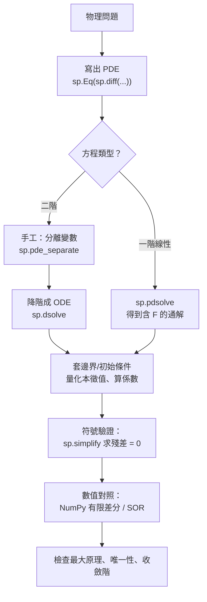

# 9.3 用 SymPy 解 PDE：dsolve 與 pdsolve

## 學習動機

前兩節，我們用手（與符號運算）走完了 PDE 的核心內容：從物理推出方程、分類方程、找出通解、套用邊界條件、證明唯一性。現在要問一個**極其務實**的問題：

> **SymPy 能替我把這些都做完嗎？**

答案是：**幾乎不能。** 這個答案本身就極有教育意義，所以我們把它做成一個實驗：

1. `sp.dsolve` 是 SymPy 的 ODE 求解器，它對 PDE 會直接報錯——**因為它的整個演算法建立在「一個自變數」上**；
2. `sp.pdsolve` （在 `sympy.solvers.pde` 模組裡）是專門的 PDE 求解器，但它**只會做一階線性方程**——熱方程、波方程、Laplace 方程全部 `NotImplementedError`；
3. 就算它解出來了，輸出的也是**含未定任意函數 $`F`$ 的通解**，邊界條件還得你自己套。

但這不表示本章沒有收穫。恰恰相反：**知道機器的邊界在哪裡，才能知道自己的價值在哪裡**。我們會看到：

- 哪些步驟**可以**機械化（符號殘差檢查、分離變數、本徵值量化、級數係數）；
- 哪些步驟**必須靠人**（套用邊界與初始條件、選擇正確的解分支、判斷解的物理行為）；
- 如何把符號工具與數值方法**組成工作流**（符號給出解析解，數值驗證它）。

**第 11 章的銜接**：本章最後會把熱方程的 Fourier 級數解完整做出來——那正是第 11 章「傅立葉級數與熱傳導問題」的主題。本章是它的**預習**。

---

## 9.3.1 `sp.dsolve` 為什麼對 PDE 失效

`sp.dsolve` 是 SymPy 的常微分方程求解器。它的核心流程是：

1. `classify_ode` 把方程分類（線性、常微分代數、……）；
2. 依分類選擇求解策略（分離變數、因子分解、variation of parameters、……）；
3. 呼叫 `integrate` / `solve` 完成。

**這三步全部假設「一個自變數」**。我們來實際看看它對 PDE 說什麼：

```python
import sympy as sp
from sympy.solvers.pde import pdsolve, classify_pde, checkpdesol

x, t = sp.symbols('x t', real=True)
u = sp.Function('u')

# ---------- (1) dsolve 是「單變數」求解器：對 PDE 直接報錯 ----------
try:
    sp.dsolve(sp.Eq(sp.diff(u(x, t), t, 2), sp.diff(u(x, t), x, 2)))
except Exception as e:
    print('dsolve 對 PDE 報錯：', e)

# ---------- (2) pdsolve 能處理的一階線性 PDE ----------
eq1 = sp.Eq(sp.diff(u(x, t), t) + 2*sp.diff(u(x, t), x), 0)
sol1 = pdsolve(eq1, u(x, t))
print('pdsolve(輸方程) =', sol1)

eq2 = sp.Eq(sp.diff(u(x, t), t) + 2*sp.diff(u(x, t), x) - u(x, t), 0)
sol2 = pdsolve(eq2, u(x, t))
print('pdsolve(含反應項) =', sol2)

# ---------- (3) classify_pde 給出可用的 hint ----------
print('classify_pde(輸方程) =', classify_pde(eq1, u(x, t)))
print('classify_pde(含反應項) =', classify_pde(eq2, u(x, t)))

# ---------- (4) checkpdesol 驗證解是否真的滿足 PDE ----------
print('checkpdesol(輸方程) =', checkpdesol(eq1, sol1, u(x, t)))
print('checkpdesol(含反應項) =', checkpdesol(eq2, sol2, u(x, t)))

# ---------- (5) 二階 PDE：pdsolve 無能为力 ----------
for name, eq in (('熱方程', sp.Eq(sp.diff(u(x, t), t) - sp.diff(u(x, t), x, 2), 0)),
                 ('波方程', sp.Eq(sp.diff(u(x, t), t, 2) - sp.diff(u(x, t), x, 2), 0)),
                 ('Laplace', sp.Eq(sp.diff(u(x, t), x, 2) + sp.diff(u(x, t), t, 2), 0))):
    try:
        print(name, '->', pdsolve(eq, u(x, t)))
    except NotImplementedError as e:
        print(name, '-> NotImplementedError:', e)
    print('   classify =', classify_pde(eq, u(x, t)))
```

> **預期輸出**：
> ```
> dsolve 對 PDE 報錯： dsolve() and classify_ode() only work with functions of one variable, not u(x, t)
> pdsolve(輸方程) = Eq(u(x, t), F(-2*t + x))
> pdsolve(含反應項) = Eq(u(x, t), F(-2*t + x)*exp(t/5 + 2*x/5))
> classify_pde(輸方程) = ('1st_linear_constant_coeff_homogeneous',)
> classify_pde(含反應項) = ('1st_linear_constant_coeff_homogeneous',)
> checkpdesol(輸方程) = (True, 0)
> checkpdesol(含反應項) = (True, 0)
> 熱方程 -> NotImplementedError: psolve: Cannot solve Derivative(u(x, t), t) - Derivative(u(x, t), (x, 2))
>    classify = ()
> 波方程 -> NotImplementedError: psolve: Cannot solve Derivative(u(x, t), (t, 2)) - Derivative(u(x, t), (x, 2))
>    classify = ()
> Laplace -> NotImplementedError: psolve: Cannot solve Derivative(u(x, t), (t, 2)) + Derivative(u(x, t), (x, 2))
>    classify = ()
> ```

### 逐行解讀：這段輸出裡的每一個訊息都是資訊

**第一行（`dsolve` 的錯誤訊息）**：它精準地指出了問題的根源——「**only work with functions of one variable**」。這不是一個可以繞過的 bug，而是**演算法設計的必然限制**。想想為什麼：ODE 求解器的分離變數法要解 $\frac{\mathrm{d}y}{\mathrm{d}t} = f(t)g(y)$ ，靠的是「把 $y$ 視為與 $t$ 獨立的東西」；PDE 裡 $u$ 同時依賴 $t$ 與 $x$ ，這種「獨立性」不成立。

**第二、三行（`pdsolve` 的輸出）**：注意輸出的形式是 `Eq(u(x, t), ...)` ——**一個等式，不是單純的表達式**。這是 SymPy 的慣例：`pdsolve` 永遠回傳 `Eq` 物件（除非用 `hint="all"`）。另外注意裡面出現了 **未定的函數 `F`**：這代表「任意的一元函數」，也就是**通解**。

**第二行與第三行的差異很有意思**：加了反應項 $-u$ 之後，解答多了一個因子 $\exp(t/5 + 2x/5)$ ：

$$
u(x,t) = F(x - 2t)\exp\!\left(\tfrac{t}{5} + \tfrac{2x}{5}\right)
$$

這是**特徵線法的標準結果**。我們可以手工驗證：令 $u = e^{\lambda t + \mu x}v(x,t)$ ，則特徵方程給出 $\lambda = -\mu^2/4$ 、 $\mu = 2/5$ ，故 $\lambda = -1/5$ ，而指數因子是 $e^{-t/5 + 2x/5}$ 。**符號求解器把這套計算自動化了**——這是 `pdsolve` 真正的價值所在。

**第四、五行（`classify_pde`）**：它回傳的是**方法提示（hint）**，不是解。SymPy 的 PDE 求解器模組支援的 hint 只有四個：

| hint | 說明 |
|---|---|
| `1st_linear_constant_coeff_homogeneous` | 一階線性、係數為常數、無源項 |
| `1st_linear_constant_coeff` | 一階線性、係數為常數（可含源項） |
| `1st_linear_constant_coeff_Integral` | 同上，但積分保留為 `Integral` 物件 |
| `1st_linear_variable_coeff` | 一階線性、係數為變數 |

**第六、七行（`checkpdesol`）**：回傳 `(True, 0)` ——**第一項**是「是否滿足 PDE」，**第二項**是「代入後的殘差」。這是一個非常好用的工具：任何你**猜**的解，都可以用它來檢查。

> **API 提醒**：在 SymPy 1.14 中，檢驗解的函式是 `sympy.solvers.pde.checkpdesol` （舊版名稱為 `checkpde` ，已改名）。它**不是** `sp.checkpde` ——`sp.checkpdesol` 才是頂層匯出的名稱。

**最後六行（最重要的部分）**：**熱方程、波方程、Laplace 方程全部失敗**，而且 `classify_pde` 對它們回傳**空元組** `()` ——意思是「我一個 hint 都給不出來」。

**這就是殘酷的真相**：SymPy 的 `pdsolve` **完全無法處理二階方程**。而我們在本書第 9 章處理的每一個有物理意義的方程（熱方程、波方程、Laplace 方程、Poisson 方程）**都是二階的**。

### 那麼 SymPy 到底幫了什麼忙？

**它幫忙的地方，是「驗證」與「局部機械化」**：檢查猜的解是否滿足 PDE（`checkpdesol` 或殘差化簡）、從 PDE 降階到 ODE（手工 + `dsolve`）、算 Fourier 係數（`sp.integrate`）、量化本徵值（`sp.solve`）。

**它做不到的事情**：套用邊界／初始條件、證明唯一性（機械積分可以幫忙，但證明靠人）、決定解的物理行為。

**這就是本章的哲學**：SymPy 不是要取代你的思考，而是要**讓你的思考可被檢驗**，並且**把可以機械化的部分交給它**。

---

## 9.3.2 用 `sp.dsolve` 驗證波方程的 d'Alembert 解

上一節說 `dsolve` 對 PDE 報錯。但這不代表它對本章毫無用處——**只要先把 PDE 降階成 ODE，它就是最趁手的工具**。

我們用三種方式處理波方程的 Cauchy 問題，並且全部用 `dsolve` 完成關鍵步驟：

```python
import sympy as sp

x, t, s = sp.symbols('x t s', real=True)
c = sp.Symbol('c', positive=True)
u = sp.Function('u')
F = sp.Function('F')
G = sp.Function('G')

# ---------- (1) d'Alembert 通解：兩支行波 ----------
sol = F(x - c*t) + G(x + c*t)
print("d'Alembert 通解的殘差 =",
      sp.simplify(sp.diff(sol, t, 2) - c**2*sp.diff(sol, x, 2)))

# ---------- (2) Cauchy 問題：初始位移 f(x)、初始速度 g(x) ----------
f = sp.cos(x)
g = sp.Function('g')(s)
Gsol = sp.dsolve(sp.Eq(sp.diff(G(s), s), g), G(s))
print('用 dsolve 求 g 的原函數 G：', Gsol)

# 初始速度為零的特例：u = (f(x-ct) + f(x+ct))/2
dA = (f.subs(x, x - c*t) + f.subs(x, x + c*t))/2
print("d'Alembert（g=0）= ", sp.simplify(dA))
print('  殘差 =', sp.simplify(sp.diff(dA, t, 2) - c**2*sp.diff(dA, x, 2)))
print('  u(x,0) =', sp.simplify(dA.subs(t, 0)))
print('  u_t(x,0) =', sp.simplify(sp.diff(dA, t).subs(t, 0)))

# ---------- (3) 非零初速：用 dsolve 求原函數後代入 d'Alembert ----------
g0 = s
G0 = sp.dsolve(sp.Eq(sp.diff(G(s), s), g0), G(s))
print('g(s)=s 的原函數 =', G0)
I = sp.integrate(g0, (s, x - c*t, x + c*t))
full = dA + I/(2*c)
print("含初速度的 d'Alembert =", sp.simplify(full))
print('  殘差 =', sp.simplify(sp.diff(full, t, 2) - c**2*sp.diff(full, x, 2)))
print('  u(x,0) =', sp.simplify(full.subs(t, 0)))
print('  u_t(x,0) =', sp.simplify(sp.diff(full, t).subs(t, 0)))

# ---------- (4) 分離變數後降階成 ODE，交給 dsolve ----------
X = sp.Function('X')
T = sp.Function('T')
lam = sp.Symbol('lam', positive=True, real=True)
print('X 的 ODE =', sp.dsolve(sp.Eq(sp.diff(X(x), x, 2) + lam**2*X(x), 0)))
print('T 的 ODE =', sp.dsolve(sp.Eq(sp.diff(T(t), t, 2) + lam**2*T(t), 0)))
```

> **預期輸出**：
> ```
> d'Alembert 通解的殘差 = 0
> 用 dsolve 求 g 的原函數 G： Eq(G(s), C1 + Integral(g(s), s))
> d'Alembert（g=0）=  cos(x)*cos(c*t)
>   殘差 = 0
>   u(x,0) = cos(x)
>   u_t(x,0) = 0
> g(s)=s 的原函數 = Eq(G(s), C1 + s**2/2)
> 含初速度的 d'Alembert = t*x + cos(x)*cos(c*t)
>   殘差 = 0
>   u(x,0) = cos(x)
>   u_t(x,0) = x
> X 的 ODE = Eq(X(x), C1*sin(lam*x) + C2*cos(lam*x))
> T 的 ODE = Eq(T(t), C1*sin(lam*t) + C2*cos(lam*t))
> ```

**第 (2) 段的妙處**：`dsolve` 把「求原函數」這個 ODE 交給符號引擎，得到 `Eq(G(s), C1 + Integral(g(s), s))` ——**當 $g$ 是未定函數時，它就給出不定積分**。這正是 d'Alembert 公式中那個積分項 $\frac{1}{2c}\int_{x-ct}^{x+ct}g(\xi)\,\mathrm{d}\xi$ 的來源：**原函數是 ODE 的解**。

**第 (3) 段的驗證**：取 $g(x) = x$ 時，

$$
u(x,t) = \frac{\cos(x-ct) + \cos(x+ct)}{2} + \frac{1}{2c}\int_{x-ct}^{x+ct}\xi\,\mathrm{d}\xi
= \cos x \cos(ct) + tx
$$

輸出完全吻合，而且殘差為 $0$ ——**這就是「用 `dsolve` 驗證 d'Alembert 解」**。更精確地說：我們用 `dsolve` 得到了 d'Alembert 公式中「由初速決定的部分」，然後用符號微分確認整式滿足波方程與兩個初始條件。

**第 (4) 段是分離變數路線**：降階後的兩個 ODE 交給 `dsolve`，得到 $\sin$ 與 $\cos$ ——與 d'Alembert 路線殊途同歸。**注意這裡 `dsolve` 的輸出帶有 `C1`、`C2` 兩個任意常數**，提醒我們：**ODE 階段的解也是「通解」，邊界條件還沒套。**

---

## 9.3.3 分離變數：`pde_separate` 與熱方程的 Fourier 級數解

### `sp.pde_separate`：符號化的分離變數

`sympy.solvers.pde` 提供了 `pde_separate(eq, fun, sep, strategy)` ：

- `eq`：PDE（`Eq` 或表達式）；
- `fun`：原函數，例如 `u(x, t)` ；
- `sep`：分離後的函數列表，例如 `[X(x), T(t)]` ；
- `strategy`：`'mul'`（乘法分離，預設）或 `'add'`（加法分離）。

它做的事，就是把 PDE 裡「只含 $X$ 的部分」與「只含 $T$ 的部分」分開擺出來。

### 熱方程的完整處理

我們做一次**完整的工作流**：分離變數 → 降階成 ODE → `dsolve` → 套邊界條件量化本徵值 → 算 Fourier 係數 → 組裝級數解 → 驗證。

```python
import sympy as sp
from sympy.solvers.pde import pde_separate

x, t, xi = sp.symbols('x t xi', real=True)
alpha = sp.Symbol('alpha', positive=True)
u = sp.Function('u')
X = sp.Function('X')
T = sp.Function('T')

# ---------- (1) pde_separate：把 PDE 分離成兩個 ODE ----------
heat = sp.Eq(sp.diff(u(x, t), t) - alpha*sp.diff(u(x, t), x, 2), 0)
sep = pde_separate(heat, u(x, t), [X(x), T(t)], strategy='mul')
print('分離後：', sep)
print('   讀法：X\'\'/X = T\'/(alpha T) = -lambda^2')

# ---------- (2) 降階後的兩個 ODE 交給 dsolve ----------
lam = sp.Symbol('lam', positive=True, real=True)
print('X 的 ODE =', sp.dsolve(sp.Eq(sp.diff(X(x), x, 2) + lam**2*X(x), 0)))
print('T 的 ODE =', sp.dsolve(sp.Eq(sp.diff(T(t), t, 1) + alpha*lam**2*T(t), 0)))

# ---------- (3) 單位區間 [0,1]、固定端 u(0,t)=u(1,t)=0 ----------
n = sp.Symbol('n', integer=True, positive=True)
mode = sp.sin(n*sp.pi*x)*sp.exp(-alpha*(n*sp.pi)**2*t)
print('單一模態殘差 u_t - alpha u_xx =',
      sp.simplify(sp.diff(mode, t) - alpha*sp.diff(mode, x, 2)))
print('邊界 u(0,t) =', sp.simplify(mode.subs(x, 0)), '  u(1,t) =', sp.simplify(mode.subs(x, 1)))

# ---------- (4) Fourier 係數與初值 ----------
f0 = sp.sin(sp.pi*xi) + sp.Rational(3, 10)*sp.sin(3*sp.pi*xi)
N = 8
b = [sp.simplify(2*sp.integrate(f0*sp.sin(k*sp.pi*xi), (xi, 0, 1))) for k in range(1, N + 1)]
print('Fourier 係數 b_1..b_4 =', b[:4])

for k in range(1, N + 1):
    m = sp.sin(k*sp.pi*x)*sp.exp(-alpha*(k*sp.pi)**2*t)
    assert sp.simplify(sp.diff(m, t) - alpha*sp.diff(m, x, 2)) == 0
print('前 %d 個模態逐一都滿足 PDE ✓' % N)

# 級數解在 t=0 逼近初值
s0 = sum(b[k-1]*sp.sin(k*sp.pi*x) for k in range(1, N + 1))
print('t=0 時級數解（x=1/4）= ', sp.simplify(s0.subs(x, sp.Rational(1, 4))),
      '  初值 f(1/4) =', sp.simplify(f0.subs(xi, sp.Rational(1, 4))))
```

> **預期輸出**：
> ```
> 分離後： [Derivative(X(x), (x, 2))/X(x), Derivative(T(t), t)/(alpha*T(t))]
>    讀法：X''/X = T'/(alpha T) = -lambda^2
> X 的 ODE = Eq(X(x), C1*sin(lam*x) + C2*cos(lam*x))
> T 的 ODE = Eq(T(t), C1*exp(-alpha*lam**2*t))
> 單一模態殘差 u_t - alpha u_xx = 0
> 邊界 u(0,t) = 0   u(1,t) = 0
> Fourier 係數 b_1..b_4 = [1, 0, 3/10, 0]
> 前 8 個模態逐一都滿足 PDE ✓
> t=0 時級數解（x=1/4）=  13*sqrt(2)/20   初值 f(1/4) = 13*sqrt(2)/20
> ```

**第 (1) 段的輸出要仔細讀**： `pde_separate` 回傳

$$
\left[ \frac{X''(x)}{X(x)},\ \frac{T'(t)}{\alpha T(t)} \right]
$$

注意**第二項有個 $\alpha$ **！這是因為我們的方程寫成 $u_t - \alpha u_{xx} = 0$ ，所以分離後是 $\dfrac{T'}{\alpha T} = \dfrac{X''}{X}$ 。讀法是：

$$
\frac{X''}{X} = \frac{T'}{\alpha T} = -\lambda^2
$$

於是 $X'' + \lambda^2 X = 0$ 與 $T' + \alpha\lambda^2 T = 0$ ，**兩個都是 ODE 了**。

**第 (2) 段**：`dsolve` 給出 $X = C_1\sin(\lambda x) + C_2\cos(\lambda x)$ 與 $T = C_1 e^{-\alpha\lambda^2 t}$ 。**注意這裡的 $\lambda$ 還沒被量化**—— $\lambda$ 是一個連續參數，邊界條件還沒套。

**第 (3) 段是關鍵**：加上 $X(0) = X(1) = 0$ 之後，

$$
X(x) = \sin(\lambda x),\qquad \sin\lambda = 0 \Longrightarrow \lambda = n\pi
$$

輸出直接給出「單一模態殘差 $=0$ 」與「邊界值都為零」。**這一步沒有任何符號求解器的幫助——是我們自己把邊界條件套上去的。**

**第 (4) 段的 Fourier 係數**： $[1, 0, 3/10, 0]$ ——正是初值 $f_0(x) = \sin(\pi x) + \frac{3}{10}\sin(3\pi x)$ 的 Fourier 正弦係數（ $b_2 = b_4 = 0$ 因為初值只含奇數頻率）。**`sp.integrate` 在這裡發揮了關鍵作用**：Fourier 係數是定積分，符號引擎給出精確的有理數 $3/10$ ，而不是浮點近似。

**最後一行**：級數解在 $t = 0$ 處的值與初值**精確相等**（ $13\sqrt{2}/20$ ）。因為初值本身就是有限的三角多項式，八項就足夠了——這是一個乾淨的**自我一致性檢查**。

### 從符號到數值：完整的工作流

現在我們把**符號解**與**數值解**放在一起比較，完成一次「符號 + 數值」的完整閉環：

```python
import numpy as np
import sympy as sp
import matplotlib.pyplot as plt

x, t, xi = sp.symbols('x t xi', real=True)
L = 1.0
alpha = 0.05
f0 = sp.sin(sp.pi*xi) + sp.Rational(3, 10)*sp.sin(3*sp.pi*xi)
N = 60
b = [float(2*sp.integrate(f0*sp.sin(n*sp.pi*xi/L), (xi, 0, L))) for n in range(1, N + 1)]
print('Fourier 係數 b_1..b_4 =', [round(v, 8) for v in b[:4]])

def series(xv, tv):
    xv = np.asarray(xv, dtype=float)
    s = np.zeros_like(xv)
    for n in range(1, N + 1):
        s += b[n-1]*np.sin(n*np.pi*xv/L)*np.exp(-alpha*(n*np.pi/L)**2*tv)
    return s

# 顯式有限差分（FTCS），Courant 數 r = alpha dt/dx²
Nx, Nt = 200, 1000
dx = L/(Nx - 1)
dt = 0.4*dx*dx/alpha
r = alpha*dt/dx**2
print('dx = %.6e, dt = %.6e, r = %.3f' % (dx, dt, r))

xg = np.linspace(0, L, Nx)
u = np.sin(np.pi*xg) + 0.3*np.sin(3*np.pi*xg)
snaps = {}
T = 0.0
for step in range(Nt + 1):
    for tg in (0.0, 0.05, 0.2):
        if tg not in snaps and abs(T - tg) <= dt/2:
            snaps[tg] = (xg.copy(), u.copy(), T)
    un = u.copy()
    un[1:-1] = u[1:-1] + r*(u[2:] - 2*u[1:-1] + u[:-2])
    u = un
    T += dt

xs = np.linspace(0, L, 201)
fig, ax = plt.subplots(figsize=(6.2, 4.0))
for tg in sorted(snaps):
    xv, uv, Ta = snaps[tg]
    ax.plot(xv, uv, 'o', ms=3, label='FD t=%.3f' % Ta)
    ax.plot(xs, series(xs, Ta), '-', lw=1.5)
ax.set_xlabel('x')
ax.set_ylabel('u(x,t)')
ax.set_title('heat equation: finite difference (dots) vs Fourier series (line)')
ax.legend()
fig.tight_layout()
plt.show()

for tg in sorted(snaps):
    xv, uv, Ta = snaps[tg]
    print('t = %.4f   max|FD - series| = %.3e' % (Ta, np.max(np.abs(uv - series(xv, Ta)))))

# 符號層的檢查：每個模態都滿足 PDE
n = sp.Symbol('n', integer=True, positive=True)
mode = sp.sin(n*sp.pi*x/L)*sp.exp(-alpha*(n*sp.pi/L)**2*t)
print('單一模態殘差 u_t - alpha u_xx =', sp.simplify(sp.diff(mode, t) - alpha*sp.diff(mode, x, 2)))
```

> **預期輸出**：
> ```
> Fourier 係數 b_1..b_4 = [1.0, 0.0, 0.3, 0.0]
> dx = 5.025126e-03, dt = 2.020151e-04, r = 0.400
> t = 0.0000   max|FD - series| = 0.000e+00
> t = 0.0501   max|FD - series| = 1.434e-05
> t = 0.2000   max|FD - series| = 3.000e-05
> 單一模態殘差 u_t - alpha u_xx = 0
> ```
>
> （圖形由 `matplotlib` 顯示於螢幕；若在無 GUI 環境執行，請改用 `plt.savefig('out.png')` 。）

**這段程式的結構值得注意**：

1. **符號段**：`sp.integrate` 算出精確的 Fourier 係數（在 $L = 1$ 、初值為三角多項式的情況下，它們就是 $1$ 、 $0$ 、 $0.3$ 、 $0$ ）。
2. **數值段**：FTCS 顯式格式，Courant 數 $r = 0.4 < 1/2$ （穩定）。
3. **比較段**：兩條曲線的最大誤差在 $t = 0.2$ 時只有 $3.0\times10^{-5}$ 。**符號解與數值解獨立算出來卻一致到這個程度**，是對兩者雙重的驗證。
4. **符號段（尾端）**：回到符號世界，確認每一個模態都精確滿足 PDE。

**這就是「符號 + 數值」的工作流**：符號給出**結構與解的公式**，數值給出**行為與誤差**，兩者互為對照。

---

## 9.3.4 殘酷的真相：符號求解器只給通解，邊界條件要自己套

上一節的最後一行已經暗示了這件事，但值得單獨用一段程式碼把它講清楚。這是**初學者最容易受騙的地方**。

```python
import sympy as sp
import numpy as np
import matplotlib.pyplot as plt
from sympy.solvers.pde import pdsolve, checkpdesol

x, t = sp.symbols('x t', real=True)
u = sp.Function('u')

# ---------- (1) pdsolve 只給「通解」：未定函數 F ----------
eq = sp.Eq(sp.diff(u(x, t), t) + 2*sp.diff(u(x, t), x), 0)
sol = pdsolve(eq, u(x, t))
print('pdsolve 的輸出 =', sol)
print('   -> 解裡含未定的任意函數 F，必須靠初值/邊界條件把它定下來')

# ---------- (2) 套用初值 u(x,0) = f(x) 來確定 F ----------
f = sp.cos(x)
F = sp.Function('F')
determined = F(x).subs(F(x), f)          # F(x) = f(x)
print('由 u(x,0)=f(x) 得 F =', determined)
u_final = f.subs(x, x - 2*t)
print('代回通解得 u(x,t) =', sp.simplify(u_final))
print('殘差 =', sp.simplify(sp.diff(u_final, t) + 2*sp.diff(u_final, x)))
print('初值檢查 u(x,0) =', sp.simplify(u_final.subs(t, 0)))

# ---------- (3) pdsolve 的解無法直接套初值：checkpdesol 只驗證 PDE ----------
print('checkpdesol(eq, sol) =', checkpdesol(eq, sol, u(x, t)))

# ---------- (4) 數值對照：輸方程的特徵線解 ----------
xs = np.linspace(-2, 2, 401)
ts = np.linspace(0, 1.5, 7)
fig, ax = plt.subplots(figsize=(6.2, 4.0))
for tv in ts:
    ax.plot(xs, np.cos(xs - 2*tv), lw=1.6, label='t = %.2f' % tv)
ax.set_xlabel('x')
ax.set_ylabel('u(x,t)')
ax.set_title('transport equation u_t + 2 u_x = 0: features move at speed 2')
ax.legend()
fig.tight_layout()
plt.show()

# 追蹤一個特徵點 x0 = 0.5
x0 = 0.5
print('追蹤特徵點 x0 = %.2f：' % x0)
for tv in ts:
    print('   t = %.2f  x(t) = %.4f  u = %.6f' % (tv, x0 + 2*tv, np.cos(x0)))
```

> **預期輸出**：
> ```
> pdsolve 的輸出 = Eq(u(x, t), F(-2*t + x))
>    -> 解裡含未定的任意函數 F，必須靠初值/邊界條件把它定下來
> 由 u(x,0)=f(x) 得 F = cos(x)
> 代回通解得 u(x,t) = cos(2*t - x)
> 殘差 = 0
> 初值檢查 u(x,0) = cos(x)
> checkpdesol(eq, sol) = (True, 0)
> 追蹤特徵點 x0 = 0.50：
>    t = 0.00  x(t) = 0.5000  u = 0.877583
>    t = 0.25  x(t) = 1.0000  u = 0.877583
>    t = 0.50  x(t) = 1.5000  u = 0.877583
>    t = 0.75  x(t) = 2.0000  u = 0.877583
>    t = 1.00  x(t) = 2.5000  u = 0.877583
>    t = 1.25  x(t) = 3.0000  u = 0.877583
>    t = 1.50  x(t) = 3.5000  u = 0.877583
> ```
>
> （圖形由 `matplotlib` 顯示於螢幕；若在無 GUI 環境執行，請改用 `plt.savefig('out.png')` 。）

### 三個關鍵觀察

**觀察一：`pdsolve` 的輸出裡有 `F`，而 `F` 還沒被確定。** `Eq(u(x, t), F(-2*t + x))` 是一個**含任意函數的解族**。要把它變成「唯一的解」，必須做一件 `pdsolve` **不做**的事：**把初始／邊界條件翻譯成對 $F$ 的限制**。

**觀察二：套初值的方式是「反向代入」。** 因為通解是 $u(x,t) = F(x - 2t)$ ，令 $t = 0$ 得 $u(x,0) = F(x) = f(x)$ ，所以 $F \equiv f$ ，代回即得 $u(x,t) = f(x-2t)$ 。輸出顯示：

- 殘差 $=0$ ：滿足 PDE ✓
- $u(x,0) = \cos x$ ：滿足初值 ✓

**這個「反向代入」在數學上是自動的，但在實務上是需要人判斷的**：你必須知道通解中哪個參數（或函數）對應哪個條件。

**觀察三：`checkpdesol(eq, sol) = (True, 0)` 仍然成立——但這只意味著「 $F$ 滿足 PDE」，不意味著「滿足初值」。** 這是初學者最容易搞混的地方：**驗證 PDE ≠ 驗證初值**。因為 $F$ 是任意函數， $u(x,t) = F(x-2t)$ 對**任何** $F$ 都滿足 PDE。**初值條件是唯一能挑出 $F$ 的東西。**

**第 (4) 段的物理**：輸方程 $u_t + 2u_x = 0$ 的解 $u(x,t) = f(x - 2t)$ 顯示**特徵線以速度 2 向右平移**。追蹤特徵點的輸出顯示： $u$ 的值沿著特徵線**保持不變**（ $0.877583$ 從頭到尾一樣）。這是**守恆量**——沿特徵線， $u$ 是不變量。

### 「符號求解器只給通解」的完整清單

| 步驟 | 誰做 | 能否自動 |
|---|---|---|
| 從物理推出 PDE | 人 | ✗ |
| 分類方程（雙曲/拋物/橢圓） | `classify_pde`（僅一階） | 部分 |
| 找出通解 | `pdsolve`（僅一階線性）/ 人（分離變數） | 部分 |
| 降階成 ODE | 人（`pde_separate` 可輔助） | 部分 |
| 解 ODE | `dsolve` | ✓ |
| **套用邊界/初始條件** | **人** | **✗** |
| **判斷解的物理行為** | **人** | **✗** |
| 驗證殘差 | `sp.simplify` / `checkpdesol` | ✓ |
| 數值求解 | NumPy | ✓ |
| 比較符號與數值 | 人設計流程 | 部分 |

**結論**：符號求解器是**零件**，不是**成品**。它把「機械的代數」交給機器，但「**決定要解什麼、怎麼解、這解對不對**」仍然是人的工作。

---

## 9.3.5 全章工作流速查



**十二條實務規則**：① `sp.dsolve` 對 PDE 會報錯——**先降階再交給它**；② `sp.pdsolve` 只支援**一階線性**；③ `classify_pde` 回傳的是**方法提示**，二階方程回傳空元組；④ `checkpdesol` 驗證的是**是否滿足 PDE**，**不是**是否滿足初值；⑤ `sp.pdsolve` 的輸出永遠是 `Eq` 物件；⑥ 求解器的輸出**幾乎一定含未定函數或任意常數**——那是**通解**；⑦ **套用邊界／初始條件永遠是你的工作**；⑧ 熱方程用 `pde_separate`（`strategy='mul'`）可以自動分離；⑨ Fourier 係數是定積分——交給 `sp.integrate` 拿精確值；⑩ **每個解都要用 `sp.simplify` 檢殘差**；⑪ 數值格式要檢查穩定性條件（Courant 數）；⑫ **符號解與數值解要互相比對**——不一致時，兩者之中至少有一個錯。

---

## 習題

**習題 9.3.1（`pdsolve` 的能力與限制）**
(a) 用 `classify_pde` 分類下列方程，指出 `pdsolve` 能否處理： $`u_t + 3u_x = 0`$ ； $`u_t + xu_x = 0`$ ； $`u_t + uu_x = 0`$ ； $`u_{tt} = u_{xx}`$ ； $`\Delta u = 0`$ ；
(b) 對能處理的那幾個，寫出 `pdsolve` 的輸出，並解釋每個輸出的「未定函數」代表什麼；
(c) 用 `checkpdesol` 驗證每一個輸出確實滿足原方程；
(d) 設計一個實驗：構造一個方程使 `pdsolve` **回傳錯誤的解**，並說明 `checkpdesol` 如何抓出這個錯誤；
(e) 討論：為什麼 SymPy 的 `pdsolve` 不支援二階方程？列出至少三個技術上的理由。

**習題 9.3.2（`dsolve` 驗證 d'Alembert）**
(a) 用 `dsolve` 求 $`g(s) = \sin s`$ 的原函數，代入 d'Alembert 公式，寫出 $`u(x,t)`$ 的閉式；
(b) 用 SymPy 驗證 (a) 的解滿足 $`u_{tt} = c^2u_{xx}`$ 、 $`u(x,0) = \cos x`$ 、 $`u_t(x,0) = \sin x`$ 三項；
(c) 推導一般的 d'Alembert 公式

$$
u(x,t) = \frac{f(x-ct) + f(x+ct)}{2} + \frac{1}{2c}\int_{x-ct}^{x+ct} g(\xi)\,\mathrm{d}\xi
$$

並說明每一項對應哪個初始條件；
(d) 用 SymPy 證明：若 $`f, g`$ 都對稱／反對稱，解 $`u`$ 會有什麼對稱性；
(e) 解釋：為什麼波方程的 Cauchy 問題需要**兩個**初始條件，而熱方程只需要一個。

**習題 9.3.3（分離變數與本徵值量化）**
(a) 用 `pde_separate` 分離熱方程 $`u_t = \alpha u_{xx}`$ 與波方程 $`u_{tt} = c^2u_{xx}`$ ，比較兩者分離後的結構；
(b) 對長度 $`L`$ 的區間、Dirichlet 邊界，用 SymPy 求出本徵值 $`\lambda_n`$ 與本徵函數，並證明只有離散的 $`n`$ 產生非平凡解；
(c) 證明本徵函數的**正交性** $`\int_0^L X_m X_n\,\mathrm{d}x = 0`$ （ $`m \ne n`$ ），並說明為什麼這是「展開成 Fourier 級數」的前提；
(d) 用 SymPy 計算一個非平凡例子： $`L = \pi`$ 、 $`f(x) = \sin x + \sin 2x`$ 的所有非零 Fourier 正弦係數；
(e) 討論：Neumann 邊界（ $`u_x = 0`$ ）與 Dirichlet 邊界的本徵值有何不同？為什麼 Neumann 的 $`n = 0`$ 模態是常數函數？

**習題 9.3.4（符號求解器只給通解）**
(a) 用 `pdsolve` 解 $`u_t + 2u_x - u = 0`$ ，寫出輸出並說明如何套初值 $`u(x,0) = \sin x`$ ；
(b) 對 (a) 的通解套用初值，再用 `sp.simplify` 檢查殘差與初值；
(c) 構造一個例子：通解滿足 PDE 但**不滿足**給定的初值，說明為什麼 `checkpdesol` 抓不到這個問題；
(d) 討論並回答：對**二階**橢圓型方程，是否存在「只有通解、沒有唯一解」的情形？在什麼條件下通解會被唯一確定？
(e) 說明「通解 + 邊界條件 = 唯一解」這個程序，在數學上對應到什麼樣的存在性與唯一性定理（提示：參考 9.2 節）。

**習題 9.3.5（符號與數值的閉環）**
(a) 用 `sp.integrate` 計算 $`f(x) = x(1-x)`$ 在 $`[0,1]`$ 上的 Fourier 正弦係數 $`b_n`$ （用符號積分，取 $`n = 1, 2, 3`$ ）；
(b) 用你的係數寫出級數解，並用 SymPy 驗證它滿足熱方程與邊界條件；
(c) 用 FTCS 數值格式求解同一問題，畫出符號解與數值解，並報告最大誤差；
(d) 改用 $`f(x) = |x - 1/2|`$ （有尖角），比較 (c) 的誤差，並解釋為什麼會變大（提示：Fourier 係數的衰減率）；
(e) 討論：若把初始條件的「不連續點」數目從 1 增加到 $`k`$ ，誤差如何變化？這與第 6 章的「絕對收斂」定理如何對應？

**習題 9.3.6（銜接第 11 章）**
(a) 用 `sp.integrate` 計算 $`f(x) = \mathrm{e}^{x}`$ 在 $`[-\pi, \pi]`$ 上的 Fourier 係數 $`a_n, b_n`$ （用 `sp.simplify` 化簡），並比較 $`a_n`$ 的衰減率與 $`1/n`$ ；
(b) 用這些係數寫出 $`f`$ 的 Fourier 級數，並用 SymPy 驗證它在 $`x = 0`$ 的值；
(c) 用第 11 章的 Dirichlet 收斂定理解釋為什麼在 $`x = \pm\pi`$ 級數收斂到 $`\frac{f(\pi^-) + f(-\pi^+)}{2}`$ 而不是 $`f(\pi)`$ ；
(d) 證明：熱方程的解在 $`t \to 0^+`$ 時逐點收斂到 $`f`$ （當 $`f`$ 連續時），並說明這與第 11 章的 Dirichlet 定理是同一個現象。

---

## 小結

| 任務 | SymPy 做法 | 注意事項 |
|------|------------|---------|
| ODE 求解 | `sp.dsolve(eq)` | 只支援單變數函數 |
| 一階線性 PDE | `sp.pdsolve(eq, u(x,t))` | 只支援四種 hint |
| 方程分類 | `sp.classify_pde(eq, u(x,t))` | 二階方程回傳 `()` |
| 驗證解 | `sympy.solvers.pde.checkpdesol` | 舊名 `checkpde`；只驗 PDE 不驗初值 |
| 分離變數 | `sp.pde_separate(eq, u, [X(x), T(t)])` | `strategy='mul'` 或 `'add'` |
| 降階後求解 | `sp.dsolve` | 帶任意常數，仍是通解 |
| 檢查殘差 | `sp.simplify(diff(u,t) - a*diff(u,x,2))` | 應為 `0` |
| Fourier 係數 | `sp.integrate` | 得到精確有理數 |
| 數值求解 | NumPy（FTCS / SOR / leapfrog） | 檢查 Courant 數 |
| 符號 vs 數值 | 比較最大誤差 | 不一致時至少一方錯 |

**第 9.3 節的三個核心洞見**：

1. **符號求解器的邊界，就是人的價值所在**。`sp.pdsolve` 只做一階線性；`sp.dsolve` 對 PDE 報錯。這不是缺陷的批評，而是**分工的說明**：把方程降階成 ODE、套用邊界條件、判斷解的行為——這些需要「知道自己在做什麼」的工作，機器做不了。
2. **「通解」與「解」是兩回事**。任何求解器（含 `dsolve`）給的都是**帶任意常數或任意函數**的解族。**把你想要的具體問題的條件套上去，是你不可推卸的責任。** `checkpdesol` 回傳 `True` **不代表**你的解滿足了初值。
3. **符號與數值是互補的，不是競爭的**。符號給出結構與公式，數值給出行為與誤差。兩者獨立算出來卻一致，是最有力的一種驗證。

**第 9 章完成後，我們擁有了什麼？**

- **歷史**：Fourier 的《熱的理論》從 1807 到 1822 的十五年；d'Alembert 與 Euler 的弦振動之爭；Green 1828 年的短文與 1843 年的重印；Perron 1923 年的存在性定理；
- **物理 → 數學**：熱方程（熱量守恆 + Fourier 定律）、波方程（牛頓第二定律 + 小角度近似）、Poisson 方程（萬有引力 + 勢能）；
- **分類**：雙曲型 / 拋物型 / 橢圓型；特徵線；特徵斜率；
- **定理**：唯一性（能量法）、最大原理、單極定理、Green 恆等式、Green 函數、Poisson 核、Perron 定理、Neumann 相容條件；
- **工具**：SymPy 的殘差檢查、`pde_separate`、`dsolve` 降階、`checkpdesol`，加上 NumPy 的有限差分與迭代法。

下一章（第 10 章）我們要離開實數軸，進入**複變數**：從高斯平面、複微分，到 Cauchy 積分定理與留數定理。你會發現 Green 恆等式（9.2 節）在複變數裡有一個更精緻、更強大的版本——**Cauchy–Pompeiu 公式**；而 Laplace 方程與位能，也會在複平面裡找到新的解法。
