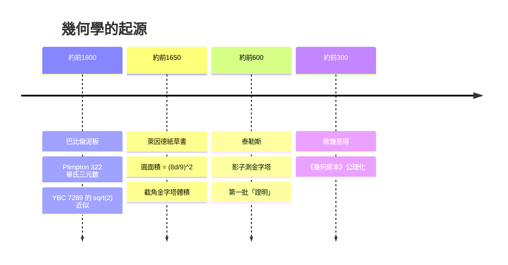

# 1.1 古埃及測地與巴比倫數學（約西元前 1800 年）

## 學習動機

幾何學並非誕生於哲學家的書房，而是誕生在尼羅河的淤泥與美索不達米亞的泥板上。在這一節中，我們要問一個根本問題：**人類為什麼需要幾何？** 答案非常務實——為了重新分配被洪水沖亂的土地、為了修建金字塔、為了公平課稅。當我們理解了幾何的「實用起源」，就能理解為什麼古代的幾何知識大多是**經驗法則**（像食譜一樣的步驟），而不是**演繹證明**。這個對比將為 1.2 節「演繹證明的誕生」鋪路。

同時，我們會用 SymPy 親手「驗證」古人的公式：哪些公式是精確正確的？哪些只是近似？近似誤差有多大？這種「用電腦檢驗歷史文獻中的數學」的做法，正是本書貫穿全書的方法論。

---

## 1.1.1 尼羅河氾濫與土地重測：幾何的第一個社會功能

古希臘歷史學家希羅多德（Herodotus，約西元前 484–425 年）在《歷史》第二卷中記載了一個關鍵故事：

> 塞索斯特里斯（Sesostris）王把土地分給國民，每人都分到一塊方形（矩形）土地，並據此繳納年貢。每當尼羅河氾濫沖走部分土地，國王就派人去**測量損失了多少**，再依比例減稅。據說這就是**幾何（geometry）一詞的來源**——「地球的測量」（geo = 地，metron = 測量），後來從埃及傳入希臘。

這段記載即使有傳說成分，也精準地揭示了幾何的第一個社會功能：**土地測量與稅收**。尼羅河每年氾濫（約 7–10 月），河水退去後，田界消失，必須重新丈量。這催生了一個職業階層——**「拉繩人」（harpedonaptai）**，他們手持打了結的繩子，在田間拉出直角與直線。

### 打結繩子如何產生直角？

拉繩人最重要的工具是一條分成 12 等分的繩圈。取 3、4、5 三段作為三角形的三邊（ $`3+4+5=12`$ ），因為

$$
3^2 + 4^2 = 9 + 16 = 25 = 5^2
$$

這個三角形**必然有直角**——這正是畢氏定理的特例（古人不知道定理本身，但知道這個「事實」）。矩形田地就是靠這種繩子定位的。

用 SymPy 驗證一下這個事實——我們可以檢查邊長為 3-4-5 的三角形，其兩條短邊的「點積」為零（向量互相垂直）：

```python
import sympy as sp

# 3-4-5 直角三角形的頂點（直角放在原點）
A = sp.Point(0, 0)   # 直角頂點
B = sp.Point(3, 0)
C = sp.Point(0, 4)

triangle = sp.Triangle(A, B, C)
print(triangle.angles[A])            # 預期輸出: pi/2（直角）
print(sp.cos(triangle.angles[A]))    # 預期輸出: 0
print(triangle.area)                 # 預期輸出: 6
print(triangle.is_right())           # 預期輸出: True
```

注意 `sp.Point(0, 0)` 建立了「點」物件——這是 SymPy 幾何模組最基本的積木，1.3 節會系統性介紹。現在只需要知道：**SymPy 可以把幾何直覺變成可以計算的物件**。

### 矩形、三角形的土地面積

對埃及的測量員來說，核心問題是：一塊田的面積是多少？《萊因德紙草書》（Rhind Papyrus，約西元前 1650 年，抄寫員 Ahmes 從更早的文獻抄錄）中記載了大量面積計算問題：

- 矩形田地：面積 = 長 × 寬 ✅（完全正確）
- 三角形田地：面積 = $`\dfrac{1}{2} \times`$ 底 $`\times`$ 高 ✅（在等腰或直角情形下正確）
- **圓形穀倉底面**：面積 = $`\dfrac{8}{9} d^2`$ ，其中 $`d`$ 是直徑 ⚠️（近似！）

圓面積公式值得深究。埃及人相當於說「圓的面積約等於邊長為 $`\frac{8}{9}d`$ 的正方形面積」。換算成今日的 $`\pi`$ 記號：

$$
\text{埃及公式：} A = \left(\frac{8d}{9}\right)^2 = \left(\frac{8 \cdot 2r}{9}\right)^2 = \frac{256}{81} r^2
$$

$$
\text{真值：} A = \pi r^2
$$

所以埃及人隱含使用的 $`\pi`$ 值是 $`\dfrac{32}{9} \approx 3.1605`$ 。誤差只有約 **0.6%**，在 4000 年前無疑是了不起的成就。

用 SymPy 精確計算這個誤差：

```python
import sympy as sp

# 埃及圓面積公式隱含的 pi 值（相當於取 pi ≈ 256/81）
egyptian_pi = sp.Rational(256, 81)
print(sp.N(egyptian_pi, 10))          # 預期輸出: 3.160493827
print(sp.N(sp.pi, 10))                # 預期輸出: 3.141592654

# 相對誤差
err = sp.Abs(egyptian_pi - sp.pi) / sp.pi
print(sp.N(err, 6))                   # 預期輸出: 0.00601643（約 0.6%）
```

注意我們用了 `sp.Rational(32, 9)` 而不是直接寫 `32/9`。這是 SymPy 的重要習慣：**SymPy 有自己的 有理數型別 `Rational`，能做精確的分數運算**；若用 Python 原生的 `32/9`，會得到浮點數，失去精確性。本書全程使用 `Rational` 與 `sqrt` 等符號物件。

---

## 1.1.2 《萊因德紙草書》與《莫斯科紙草書》：問題集的雛形

現存的兩份最重要埃及數學文獻：

| 文獻 | 年代 | 內容重點 |
|------|------|----------|
| 《萊因德紙草書》 | 約前 1650 年 | 84 個問題：分數運算、面積、體積、比例 |
| 《莫斯科紙草書》 | 約前 1890 年 | 25 個問題，含**截角金字塔體積**公式 |

兩份文獻的體裁非常一致：**「如何做」勝過「為什麼」**。以萊因德紙草書問題 50 為例，原文寫著：

> 「一塊圓形田地，直徑 9 khet，其面積是多少？你 subtract（減去）直徑的九分之一，即剩 8。再乘以 8 自乘，得到 64。這就是田地的面積。」

注意結構：**步驟 1、步驟 2、步驟 3……得答案**。沒有證明、沒有一般化的推理，只有針對特定數值的食譜。但有趣的細節是：抄寫員選了 $`d=9`$ ，因為 $`\frac{8}{9} \times 9 = 8`$ 是整數——**作者刻意挑選讓計算順利的數字**。這是數學教材史上最早的「精心設計的例題」之一，這個傳統一直延續到今天你我手中的課本！

### 截角金字塔：古埃及幾何的高峰

《莫斯科紙草書》問題 14 被譽為「埃及數學最偉大的成就」：求**正方截角金字塔**的體積。原文的口訣翻譯成現代公式：

$$
V = \frac{h}{3}\left(a^2 + ab + b^2\right)
$$

其中 $`h`$ 是高， $`a`$ 、 $`b`$ 是上下底邊長。這個公式**完全正確**且不平凡——它相當於知道「兩個相似錐台體積之差」。埃及人如何得到它至今成謎（有學者猜測是透過邊長為整數的實例歸納，例如警械式堆疊石塊）。

用 SymPy 驗證：把截角金字塔看成「大金字塔體積減去頂端小金字塔體積」，看看是否得到同一公式。

```python
import sympy as sp

h, a, b = sp.symbols('h a b', positive=True)

# 截角金字塔：大金字塔高 H，底 a；切掉的小金字塔高 H - h，底 b。
# 用相似比：H/h = a/(a-b) => H = h*a/(a-b)
H = h * a / (a - b)
h_small = (h * b / (a - b))

# 金字塔體積 = 底面積 × 高 / 3
V_big   = a**2 * H       / sp.Integer(3)
V_small = b**2 * h_small / sp.Integer(3)

V_frustum = sp.simplify(V_big - V_small)
print(V_frustum)   # 預期輸出: h*(a**2 + a*b + b**2)/3
```

最後一行輸出 `h*(a**2 + a*b + b**2)/3`，正是紙草書的公式 $`V = \frac{h}{3}(a^2+ab+b^2)`$ 。這裡的關鍵工具是 `sp.simplify`——SymPy 的符號化簡引擎，能把代數式化為最簡形式。我們用**現代演繹法**證明了古人的**經驗公式**，這正是本書反覆出現的手法。

---

## 1.1.3 巴比倫泥板：代數與幾何的結合

兩河流域（今伊拉克）的美索不達米亞文明用**楔形文字**在**濕泥板**上刻寫數學，曬乾或燒製後可以保存數千年。約西元前 1800 年（漢摩拉比時代），巴比倫數學達到高峰。

### 位置記數法：巴比倫的最大優勢

巴比倫使用**六十進位（base 60）位置記數法**。我們今天把 1 小時分成 60 分、1 分分成 60 秒，把一圓周分成 360 度，都是巴比倫遺產。位置記數法使複雜計算變得可行，巴比倫還備有**倒數表、平方表、立方表**供查表使用——這是史上最早的「數學資料庫」。

為什麼選 60？因為 $`60 = 2^2 \times 3 \times 5`$ 有很多因數， $`\frac{1}{2}, \frac{1}{3}, \frac{1}{4}, \frac{1}{5}, \frac{1}{6}, \dots`$ 都能寫成有限的六十進位小數。用 SymPy 檢查哪些 $`n`$ 使 $`\frac{1}{n}`$ 在六十進位下有限：

```python
import sympy as sp

# 1/n 在 base 60 下是有限小數，若且唯若 n 的所有質因數都是 60 的質因數（2, 3, 5）
def finite_in_base60(n):
    return set(sp.factorint(n).keys()) <= {2, 3, 5}

good = [n for n in range(2, 61) if finite_in_base60(n)]
print(good)
# 預期輸出: [2, 3, 4, 5, 6, 8, 9, 10, 12, 15, 16, 18, 20, 24, 25, 27, 30, 32, 36, 40, 45, 48, 50, 54, 60]
```

60 以內有一半以上的整數都有這個性質（10 進位只有 2 和 5 因數的數）。這就是 60 進位的工程性優勢。

### 普林顿 322 泥板（Plimpton 322）：畢氏三元數表

著名的 **Plimpton 322** 泥板（約前 1800 年，今藏哥倫比亞大學）列出了約 15 組「短邊、長邊、斜邊」的數值，例如：

| 短邊 $`b`$ | 斜邊 $`c`$ | 驗證 $`a^2+b^2=c^2`$ 的 $`a`$ |
|---|---|---|
| 119 | 169 | 120 |
| 3367 | 4825 | 3368 |
| 4601 | 6649 | 4800 |
| 12709 | 18541 | 13500 |

這些**全部**滿足 $`a^2 + b^2 = c^2`$ ，比畢達哥拉斯早了 1200 年。巴比倫人不會有「定理」的概念，但他們顯然掌握了**產生這些三元數的方法**——很可能是類似這樣的參數式：

$$
a = 2pq, \quad b = p^2 - q^2, \quad c = p^2 + q^2 \quad (p, q \text{ 為互質且一奇一偶的整數})
$$

用 SymPy 生成巴比倫風格的三元數表，並自動驗證：

```python
import sympy as sp

# 生成 (a, b, c) = (2pq, p^2-q^2, p^2+q^2)，模仿 Plimpton 322 的結構
tab = []
for p, q in [(2,1),(3,2),(4,1),(5,2),(5,4),(6,1),(9,2),(12,5)]:
    a, b, c = 2*p*q, p**2 - q**2, p**2 + q**2
    short, long_ = min(a, b), max(a, b)
    ok = short**2 + long_**2 == c**2
    tab.append((short, c, long_, ok))

print("短邊  斜邊  長邊  滿足畢氏?")
for row in tab:
    print(row)
# 預期輸出（節錄）:
# (3, 5, 4, True)
# (5, 13, 12, True)
# (8, 17, 15, True)
# (20, 29, 21, True)
# (9, 41, 40, True)
# (12, 37, 35, True)
# (36, 85, 77, True)
# (119, 169, 120, True)
```

最後一列 $`(119, 169, 120)`$ 正是 Plimpton 322 的第一列！4000 年前的一塊泥板，與我們今天的 Python 程式輸出完全吻合。

### 巴比倫的 √2 近似：YBC 7289 泥板

另一塊著名泥板 **YBC 7289**（耶魯大學編號 7289）上畫著一個正方形與其對角線，對角線上刻著數字：

$$
1 + \frac{24}{60} + \frac{51}{60^2} + \frac{10}{60^3} = \frac{30547}{21600} \approx 1.41421296
$$

這正是 $`\sqrt{2} = 1.41421356\ldots`$ 的近似，精確到**小數點後第 6 位**！古人如何得到它？最合理的解釋是他們知道（並使用）這個迭代技巧：

$$
x_{n+1} = \frac{x_n + \dfrac{2}{x_n}}{2}
$$

這個公式在今日被稱為**巴比倫法**（也稱海倫法、牛頓法開平方的特例）：如果 $`x`$ 高估了 $`\sqrt{2}`$ ，那 $`\frac{2}{x}`$ 就低估，兩者的平均就是更好的估計。用 SymPy 的**精確分數運算**重跑一次這個迭代：

```python
import sympy as sp

# YBC 7289 泥板上的數字（六十進位）1; 24, 51, 10
bab_sqrt2 = sp.Rational(1) + sp.Rational(24, 60) + sp.Rational(51, 3600) + sp.Rational(10, 216000)
print(sp.N(bab_sqrt2, 12))     # 預期輸出: 1.41421296296
print(sp.N(sp.sqrt(2), 12))    # 預期輸出: 1.41421356237
print(abs(sp.N(bab_sqrt2, 15) - sp.sqrt(2).evalf(15)))  # 預期輸出: 5.99409e-7（誤差 < 0.000001）

# 用巴比倫法從 x0 = 7/5（即六十進位的 1;24,00）開始迭代
x = sp.Rational(7, 5)
for i in range(1, 3):
    x = (x + 2 / x) / 2
    print(f"第 {i} 步: {sp.N(x, 12)}")
# 預期輸出:
# 第 1 步: 1.41428571429（六十進位約 1;24,51,25）
# 第 2 步: 1.41421356421（六十進位約 1;24,51,10）
```

第 2 步結果的六十進位表示正是 $`1;24,51,10`$ ——**與泥板完全一致**！史家推測：巴比倫書記就是用這類平均迭代（或其等價技巧）得到數值。泥板上其實同時刻著 $`\dfrac{1}{\sqrt{2}} \approx 0;42,25,35`$ ，而 $`(1;24,51,10) \times (0;42,25,35) = 2`$ ，顯示他們熟悉「平方根與其倒數配對」的相互校正法。

兩個驚人的結論：
1. 巴比倫泥板的 $`\sqrt{2}`$ 精確到約 $`6 \times 10^{-7}`$ ，比埃及的 $`\pi \approx 3.16`$ 還高一個量級的精度。
2. 巴比倫法這個迭代的**誤差平方級收斂**——每一步正確位數大約翻倍。用 SymPy 的精確分數繼續迭代，幾步之內誤差就小於 $`10^{-12}`$ 。
3. SymPy 的 `Rational` 讓我們全程保持**精確分數**，隨時可以與 $`\sqrt{2}`$ 的精確值比較——這正是符號計算相對於浮點計算的威力，也是本書選 SymPy 而非 NumPy 做驗證的原因。

---

## 1.1.4 對比與總結：經驗幾何 v.s. 演繹幾何

把古埃及與巴比倫的數學做一個整理：

| 面向 | 古埃及 | 巴比倫 |
|------|--------|--------|
| 文獻載體 | 紙草書（易腐） | 泥板（耐存） |
| 記數法 | 十進位非位置 | 六十進位位置 |
| 給出 $`\pi`$ | $`\approx \frac{32}{9} \approx 3.160`$ | $`\approx 3\frac{1}{8} = 3.125`$ |
| 特色 | 面積/體積公式、稅收測量 | 畢氏三元數表、開平方、代數方程 |
| 方法論 | 具體數值 + 食譜步驟 | 演算法 + 查表 |
| 有無證明 | 無 | 無（但系統性極強） |

**共同點**：兩者都是「**如果問題長這樣，就照這樣的步驟算**」——知識是**單例的**，每換一個數字就得重抄一遍。**沒有「一般命題」的意識，更沒有「這命題為何為真」的需求。**

用一個 mermaid 時間軸總結本章與下一步的歷史發展：



 SymPy 練習：古法今證

**練習 1.1.1（埃及圓面積）**
用 SymPy 以 `Rational` 計算：直徑 $`d=9`$ 的圓，用埃及公式與真公式分別求面積，求出相對誤差的精確分數並估成小數。
（提示：埃及面積 $`\frac{8}{9}d^2 = 64`$ ；真面積為 $`\frac{81\pi}{4}`$ ；誤差應約 $`0.6\%`$ 。）

**練習 1.1.2（3-4-5 繩圈）**
用 `sp.Triangle` 建立邊長 $`(5, 12, 13)`$ 的三角形，驗證它是直角三角形、計算三個內角、檢查內角和為 $`\pi`$ 。（對照 1.2 節的泰勒斯定理，這裡先練習用物件導向的方式思考三角形。）

**練習 1.1.3（巴比倫開平方）**
寫一個函數 `babylonian_sqrt(N, steps=4)`，用巴比倫法（初始值取 $`x_0 = N/2`$ 或任一合理值）計算 $`\sqrt{N}`$ 的精確分數近似，並與 `sp.sqrt(N)` 比較誤差。用 $`N=3, 5, 6, 7`$ 測試，觀察每步誤差的位數成長。

**練習 1.1.4（六十進位換算）**
把 $`\sqrt{2} = 1.414213\ldots`$ 的前 4 位有效數字轉成巴比倫的「 $`1;\ a, b, c`$ 」六十進位表示（用SymPy 的 `Rational` 與 `floor` 手動換算），然後計算這個表示與 $`\sqrt{2}`$ 的誤差，比對 YBC 7289 泥板。

**練習 1.1.5（Plimpton 322 產生器）**
用參數式 $`(2pq,\ p^2-q^2,\ p^2+q^2)`$ ，挑選 $`p, q`$ 使短邊遞增且斜邊 $`\le 200`$ ，印出你自己的「泥板」。共有多少列？與 Plimpton 322 的 15 列比較。

---

## 小結

- 幾何起源於**實用**：尼羅河氾濫後的土地重測（「geometry = 測地」的字源）與美索不達米亞的工程與貿易計算。
- 古埃及給出正確的矩形/三角形面積、驚人地準確（ $`\approx 3.16`$ ）的圓面積、以及完全正確的截角金字塔體積——但都以**食譜**形式呈現。
- 巴比倫以六十進位與查表文化，掌握了畢氏三元數（Plimpton 322）與高效開平方法（YBC 7289 的 $`\sqrt{2}`$ 精確到 $`10^{-6}`$ ）。
- 兩個文明都**沒有證明的概念**：知識是「這樣算就行」，而不是「這樣必然為真」。
- 我們示範了本書的基本工作流：**歷史公式 → SymPy 符號驗證 → 誤差分析**。

下一節（1.2）我們跟著泰勒斯跨越愛琴海，看人類如何第一次說出「**我證明給你看**」。

### 本節 SymPy 新工具清單

| 工具 | 用途 | 例 |
|------|------|-----|
| `sp.Rational(a, b)` | 精確分數 | `sp.Rational(24, 60)` |
| `sp.Point(x, y)` | 平面點 | `sp.Point(3, 0)` |
| `sp.Triangle(A, B, C)` | 三角形 | `.area` `.angles` `.is_right()` |
| `sp.sqrt(2)` | 精確平方根 | `sp.sqrt(2).evalf(12)` |
| `sp.simplify(expr)` | 符號化簡 | 化簡代數式 |
| `sp.factorint(n)` | 質因數分解 | 返回字典 |
| `sp.N(expr, digits)` | 估成小數 | `sp.N(sp.pi, 10)` |
