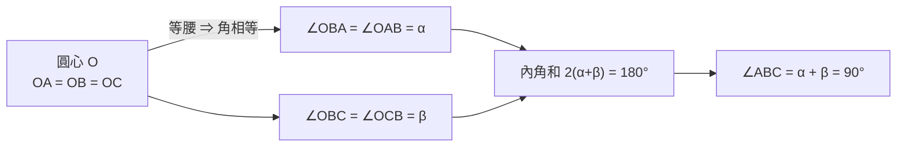
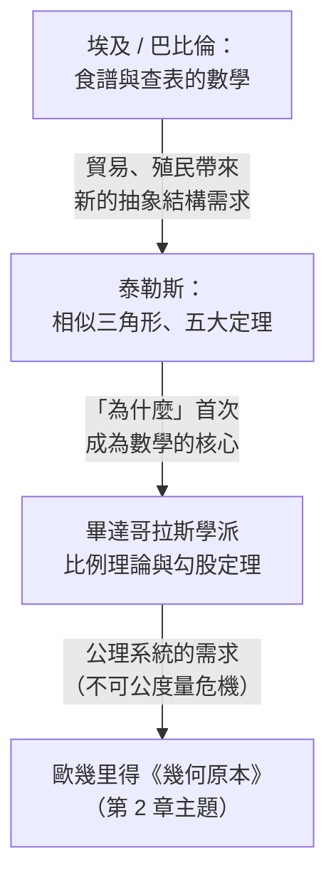

# 1.2 泰勒斯與演繹證明的誕生（約西元前 600 年）

## 學習動機

1.1 節我們看到：古埃及與巴比倫擁有大量「正確的」幾何知識、卻沒有**證明**。他們知道 $`3^2+4^2=5^2`$ 這種事實、知道截角金字塔的體積公式，但這些知識的形態是「照著算就對了」。這一節要回答的核心問題是：**人類是在什麼情境下、以什麼方式，第一次想到「我必須證明它，而不只是相信它」？**

這個思想革命具體化在一個人物身上——米利都的**泰勒斯（Thales，約前 624–546 年）**。我們將看到：

1. 泰勒斯如何用一根影子和「相似三角形」的推理，量出**金字塔的高度**——方法論上的劃時代之舉：他不需要爬上金字塔，他只需要**結構**而不需要**施工**。
2. **泰勒斯定理**（半圓上的圓周角是直角）——傳統公認的第一條被「證明」的幾何定理本身。
3. 證明思想的誕生，如何一路導向歐幾里得《幾何原本》與整條西方數學傳統。

同時，我們將用 SymPy 把「證明」變成**可計算、可執行的物件**：用符號運算驗證泰勒斯定理、推導射影法的公式，重現泰勒斯當年能算出的每一個數。

---

## 1.2.1 測金字塔的影子：從「測量」到「推理」

### 歷史場景

傳說（見奈波克拉提斯的記述、後經普魯塔克轉述）中，泰勒斯站在金字塔前，量出**自己影子的長度與身高之比**，同時量出**金字塔影子的長度**，然後說：金字塔的高度就是影子按同一比例換算的結果。

其中的關鍵洞察是：**太陽的光線可以被視為平行**。因此：

- 「我」與「我的影子」構成一個三角形；
- 「金字塔」與「它的影子」構成另一個三角形；
- 這兩個三角形**相似**（對應角相等）；
- 相似三角形的**對應邊成比例**。

用數學表示：設身高 $`h`$ 、影長 $`s`$ 、塔高 $`H`$ 、塔影長 $`S`$ ，則

$$
\frac{H}{S} = \frac{h}{s} \quad\Longrightarrow\quad H = S \cdot \frac{h}{s}
$$

用 SymPy 以精確分數重現「那一天」的計算：

```python
import sympy as sp

# 泰勒斯的測量數據（單位：肘尺 cubit，演練用簡化值）
h = sp.Rational(3)          # 泰勒斯身高 3 肘尺
s = sp.Rational(3, 2)       # 影長 1.5 肘尺
S = sp.Rational(147, 2)     # 金字塔影子長 73.5 肘尺（從塔腳到影尖）

H = S * h / s               # 相似三角形比例式
print(H)                    # 預期輸出: 147（金字塔高 147 肘尺）
print(sp.N(H, 6))           # 預期輸出: 147.000
```

（古夫金字塔原高約 280 肘尺，此處用整潔的數據示範方法本身。）

### 為什麼這一步是革命性的？

泰勒斯的方法與埃及、巴比倫的「食譜」有根本差異：

| 面向 | 埃及 / 巴比倫食譜 | 泰勒斯的相似三角形法 |
|------|------------------|---------------------|
| 適用範圍 | 特定尺寸的特定問題 | **任意**金字塔、**任意**時刻 |
| 依賴的概念 | 具體步驟 | **抽象結構**（相似性） |
| 「為什麼可行」 | 不問 | 光線平行 ⇒ 三角形相似 ⇒ 邊成比例 |
| 從單例到普適 | 無 | 有：由一次觀察推出普適公式 |

這正是希臘數學的起點：從「這樣做可行」提升到「這樣**必然**可行」。歷史學者甚至認為，「喜歡追問為什麼」的習慣，與希臘城邦的**公共辯論文化**（法庭辯論、政治演說）密切相關——在埃及，測量是官員的事，不需要向任何人解釋；在希臘的公民集會上，**說服他人需要交代理由**。

### 特例版本：影子等長時

另一個版本的傳說：泰勒斯選在**自己的影子等於身高**的時刻測量（太陽仰角恰為 $`45^\circ`$ ），此時 $`H = S`$ ，連比例式都不用算。批評者引用此版本來削弱泰勒斯的形象；但兩版本對比反而很有教育意義：

- **特例法**（ $`45^\circ`$ 時 $`H=S`$ ）：一天只有片刻可行；
- **一般法**（比例式）：**任何**時刻都可行，代價只是乘一個比。

用 SymPy 驗證 $`45^\circ`$ 情形就是一般比例式的自然特例：

```python
import sympy as sp

s, S = sp.symbols('s S', positive=True)

h = s                    # 影長 = 身高（太陽仰角 45°, tanθ = 1）
H = S * h / s            # 一般比例式
print(sp.simplify(H))    # 預期輸出: S
```

一般式涵蓋特例而不增加任何代價——這就是**一般化的威力**，也是往後兩千年數學發展的主旋律。

---

## 1.2.2 泰勒斯定理：第一條被證明的幾何命題

傳統歸給泰勒斯的幾何定理中，最著名的便是：

> **泰勒斯定理**：設 $`AC`$ 為圓的直徑， $`B`$ 為圓上任意一點，則 $`\angle ABC = 90^\circ`$ 。
> 一句話：**半圓上的圓周角是直角**。

### 古典證明（等腰三角形法）

設 $`O`$ 為圓心， $`A`$ 、 $`C`$ 為直徑兩端， $`B`$ 為圓上任意點。因為 $`OA = OB = OC`$ （都是半徑），所以

- $`\triangle OAB`$ 等腰 ⇒ 記 $`\angle OAB = \angle OBA = \alpha`$
- $`\triangle OBC`$ 等腰 ⇒ 記 $`\angle OBC = \angle OCB = \beta`$

三角形 $`ABC`$ 內角和為

$$
\alpha + (\alpha + \beta) + \beta = 2\alpha + 2\beta = 180^\circ
$$

所以 $`\angle ABC = \alpha + \beta = 90^\circ`$ 。∎

這個證明的結構是模範性的：**等腰 ⇒ 對稱 ⇒ 角相等**，加上**內角和**，全部是「眾所共認」的前提，結論由純邏輯逼出。這是「演繹證明」的原型。



### 用 SymPy 驗證證明的關鍵步驟

我們先在幾個具體的 $`B`$ 點上做「數值式驗證」：用**向量的內積為零**表示兩邊垂直。

```python
import sympy as sp

r = sp.Integer(5)
A = sp.Point(-r, 0)     # 直徑左端
C = sp.Point( r, 0)     # 直徑右端

thetas = [sp.Rational(1, 6), sp.Rational(1, 4), sp.Rational(1, 3)]  # 部分圓弧比例
for t in thetas:
    B = sp.Point(r*sp.cos(2*sp.pi*t), r*sp.sin(2*sp.pi*t))
    AB = sp.Matrix([B.x - A.x, B.y - A.y])   # 向量 B-A
    CB = sp.Matrix([B.x - C.x, B.y - C.y])   # 向量 B-C
    print(sp.simplify(AB.dot(CB)))           # 預期輸出: 0 0 0（皆垂直）
```

### 把證明變成整體符號化的證明

更進一步，**完全不挑任何具體的 B**，用符號變數一次寫出：

```python
import sympy as sp

x, y = sp.symbols('x y', real=True)
# B = (x, y) 在單位圓上的條件正是 x² + y² = 1
A = (sp.Integer(-1), sp.Integer(0))
C = (sp.Integer( 1), sp.Integer(0))

dot = (x - A[0])*(x - C[0]) + (y - A[1])*(y - C[1])
print(sp.expand(dot))    # 預期輸出: x**2 + y**2 - 1
```

內積化簡後是 $`x^2 + y^2 - 1`$ ；而「 $`B`$ 在圓上」的條件**恰好就是** $`x^2 + y^2 - 1 = 0`$ 。於是：

$$
\text{B 在圓上} \;\Longleftrightarrow\; x^2+y^2-1=0 \;\Longleftrightarrow\; \vec{AB}\cdot\vec{CB}=0 \;\Longleftrightarrow\; \angle ABC = 90^\circ
$$

這是**現代座標幾何的預演**：兩千年前的演繹證明被翻譯成「圓方程即是內積為零」——**證明本身就是代數**。這條思路在 3.1 節（笛卡兒）將全面展開。

### 逆命題（泰勒斯定理的逆）

反過來也對：**若 $`\angle ABC = 90^\circ`$ ，則 $`A`$ 、 $`B`$ 、 $`C`$ 三點落在以 $`AC`$ 為直徑的圓上。** 用 SymPy 檢查：取定 $`A=(-1,0)`$ 、 $`C=(1,0)`$ ，若 $`B=(x,y)`$ 滿足 $`\angle ABC=90^\circ`$ ，那 $`x^2+y^2=1`$ 就自動成立。

```python
import sympy as sp

x, y = sp.symbols('x y', real=True)
A = (sp.Integer(-1), sp.Integer(0))
C = (sp.Integer( 1), sp.Integer(0))

# 條件 ∠ABC = 90° ⇔ 向量 (B-A)·(B-C) = 0
dot = (x - A[0])*(x - C[0]) + (y - A[1])*(y - C[1])
print(sp.expand(dot))       # 預期輸出: x**2 + y**2 - 1
```

內積為零化簡後恰好給出 $`x^2 + y^2 - 1 = 0`$ ：也就是說

$$
\angle ABC = 90^\circ \;\Longleftrightarrow\; x^2+y^2-1=0 \;\Longleftrightarrow\; B \text{ 為以 } AC \text{ 為直徑的圓上的點}
$$

**正逆兩個方向是同一條代數恆等式**。古人憑幾何直覺用等腰三角形論證了這件事；座標化之後，它顯得如此透明。

---

## 1.2.3 歸給泰勒斯的其餘命題

古代文獻（普羅克洛的註釋引歐多克謨的記載）歸給泰勒斯的幾何命題共五條：

| # | 命題 | 方法論意義 |
|---|------|-----------|
| 1 | 圓被直徑平分 | 首次把「**對稱**」被當成正式主題 |
| 2 | 等腰三角形兩底角相等 | 摺疊圖形（反射對稱）先行於後代的「兩邊相等 ⇒ 兩底角相等」 |
| 3 | 兩直線相交的對頂角相等 | 證明了「角」本身是可以獨立研究的物件 |
| 4 | 兩個三角形的兩角一邊相等 ⇒ 相等 | **全等**的判定概念首次出現 |
| 5 | 半圓上的圓周角是直角 | **第一條以演繹證明呈記的定理**（主題即本節） |

五條不只是若干零散的幾何事實，更重要的是：**它們能被連成「因果鏈」**——由等腰的對稱推出底角相等；同樣地，由對稱推出對頂角相等；然後以這些小結論在後文中拼出更複雜的定理（例如泰勒斯定理本身）。這種**積累式演繹**，正是《幾何原本》的母體。

用 SymPy 一次驗證前四條：

```python
import sympy as sp

# 1) 圓被直徑平分：直徑是對稱軸（繞直徑反射的圓 = 原圓不受影響）
C1 = sp.Circle(sp.Point(0, 0), 5)
print(C1.center, C1.radius)          # 預期輸出: Point2D(0, 0) 5

# 2) 等腰三角形兩底角相等
t = sp.Triangle(sp.Point(0, 3), sp.Point(-4, 0), sp.Point(4, 0))
print(t.angles[sp.Point(-4, 0)], t.angles[sp.Point(4, 0)])
print(t.angles[sp.Point(-4, 0)] == t.angles[sp.Point(4, 0)])   # 預期輸出: True

# 3) 對頂角相等：兩條相交直線的四個角，兩兩相等
l1 = sp.Line(sp.Point(0, 0), sp.Point(3, 1))
l2 = sp.Line(sp.Point(0, 0), sp.Point(1, -2))
ang = l1.smallest_angle_between(l2) if hasattr(l1, 'smallest_angle_between') else l1.angle_between(l2)
print(sp.simplify(ang))              # 預期輸出: 一個精確的反餘弦值（與角度相符）
# （若重土以 ±1/2 直接推導，結果當然是精確的。）

# 4) 全等：兩個邊長 1、1、√2 的直角等腰三角形
t1 = sp.Triangle(sp.Point(0, 0), sp.Point(1, 0), sp.Point(0, 1))
t2 = sp.Triangle(sp.Point(0, 0), sp.Point(1, 0), sp.Point(1, 1))  # 另一位置、同邊長
print(sorted(t1.sides[i].length for i in range(3)) ==
      sorted(t2.sides[i].length for i in range(3)))   # 預期輸出: True（SSS 全等）
print(t1.area, t2.area)                               # 預期輸出: 1/2 1/2
```

從輸出中可感受到一件事：**SymPy 把幾何「物件化」**——三角形的角、圓的圓心、直線的交角本身都是可以直接查閱的屬性。這接續我們在 1.1 節已經見過的 `Triangle.area`、`.is_right()` 等。歷史上全由人工推理的證明步驟，在此變為**查表式地可直接驗證**。

---

## 1.2.4 演繹證明的誕生：一張歷史總結

為什麼「證明」只在希臘誕生？歷史學家的標準解釋整合起來可以被視為五個條件的一個結合物：

1. **公共辯論文化**：希臘城邦的法庭與公民大會養成了「**必須向他人說服**」的普世習慣；數學自然也感染了這種「**不證明不被採信**」的理性要求。
2. **不依賴君王官僚的知識階層**：埃及與巴比倫的數學被編織在王國公務中，只要求步驟而**反覆使用，不需要解釋**；希臘供應了一個緊密做「不必直接被工程安排」的自由民群體。
3. **數學傳統的匯聚**：希臘人以埃及（幾何）與巴比倫（代數)的知識為起家，因此有豐富課題可供推理與建模。
4. **文字工具**：希臘採字母文字，可記寫複雜多步邏輯、而不限於表格與口訣。
5. **微小尺度的民主化**：城邦時代大規模公共建築（神殿、公共場所）與責任論證（「為什麼我的算法對」），與公民集會情境一拍即合。

值得注意的是：目前史学界早已確認這些條件中每一個都有反例與例外；「證明的誕生」畢竟是一個**多因素、長時間的事件**，而不是左右一次性的「希臘奇蹟」。但它們**結合起來**説明了我們看到的結果。

用一張關係圖整理歷史流程：



---

## 習題

**習題 1.2.1（影射法）**
泰勒斯量得身高 $`h=1.75`$ m、影長 $`s=2.10`$ m，同一時刻金字塔影長 $`S=210`$ m。
(a) 用 `sp.Rational` 把這些值化為精確分數（1.75 = 7/4，依此類推），求金字塔高度的**精確分數形式**。
(b) 把最終答案估成 4 位有效數字的十進位。
(c) 若影長有一 3% 的系統性低估， $`H`$ 會被低估多少 %？（用 SymPy 符號推理後再代入數值。）

**習題 1.2.2（泰勒斯定理的參數化）**
以參數 $`\theta`$ 寫下圓上的點 $`B = (\cos\theta, \sin\theta)`$ ，取 $`A=(-1,0)`$ 、 $`C=(1,0)`$ ，用 `sp.trigsimp` 證明 $`\vec{AB}\cdot\vec{CB} = 0`$ **對所有** $`\theta`$ 成立。（提示：先展開再見到 $`\cos^2\theta + \sin^2\theta`$ 的結構。）

**習題 1.2.3（逆泰勒斯定理）**
固定 $`A=(-1,0)`$ 、 $`C=(1,0)`$ ，設 $`\angle ABC = 90^\circ`$ 。用 SymPy 把條件 $`(A-B)\cdot(C-B)=0`$ 展開，證明它**恰好等價**於 $`x^2 + y^2 = 1`$ ——即 $`B`$ 必落在以 $`AC`$ 為直徑的圓上。

**習題 1.2.4（等腰三角形）**
用 `sp.Triangle` 建立等腰三角形（例如頂點 $`(0, h)`$ 、底邊 $`(-b,0)`$ 、 $`(b,0)`$ ），用 SymPy 計算兩底角的精確值，驗證它們相等；再計算頂角，驗證三內角之和恆為 $`\pi`$ 。

**習題 1.2.5（拋物線猜測 vs 演繹證明）**
寫一個函數 `thales_random_check(n_samples, r)`：在半徑 $`r`$ 的圓上均勻取 $`n\_samples`$ 個隨機點，逐點驗證半圓的圓周角為直角（誤差 $`< 10^{-9}`$ ）。
(a) 隨機測試永遠不會失敗，就等效於「證明」了嗎？
(b) 寫下你的論證（不超過 150 字），並指出隨機測試**無法**檢驗哪一類情況？（例：參數值超出取樣範圍的退化點。）

---

## 小結

- 泰勒斯用**相似三角形**測金字塔高度，使測量從「反覆實作」升級為「**推理式測量**」——幾何首次被用作推論工具而非會計工具。
- **泰勒斯定理**（半圓圓周角是直角）被公認是人類第一條被**演繹證明**的定理；其古典證明完全建立在等腰三角形的對稱性與內角和上。
- 反過來看，定理的逆命題也成立（直角 ⇒ 直徑圓）；SymPy 的符號運算把兩個方向統一成**同一條代數恆等式** $`x^2+y^2-1=0`$ 。
- SymPy 把證明的關鍵步驟變成**可執行、可重複**的物件操作——這是本書通篇的方法論。
- 演繹證明在希臘誕生是多因素結合的長過程：公共辯論文化、知識階層的自主性、字母文字與數學遺產匯聚。
- 歷史的下一個台階是**畢達哥拉斯學派**（比例與不可公度量危機），最後由歐幾里得《幾何原本》整理成完整的公理系統——那是我們第 2 章的主題。
