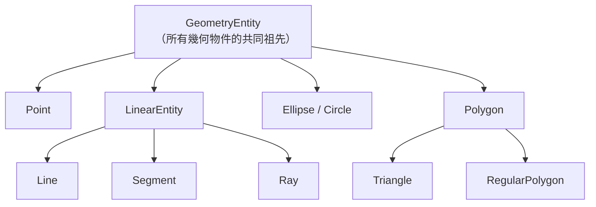
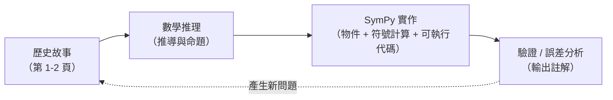

# 1.3 SymPy 幾何模組入門：Point, Line, Circle

## 學習動機

1.1 與 1.2 節告訴我們一個故事：幾何從尼羅河畔的「食譜」演進到希臘的「演繹證明」。但這本書的真正主題在於——**2000 年後的我們，如何用電腦把這些幾何知識變成可執行、可驗證、可探索的物件？**

答案是 SymPy 的 `sympy.geometry` 模組。它的設計思想其實非常「希臘」：

- **幾何物件是「一等公民」**：點、線、圓彼此不是數字，而是具名物件（像《幾何原本》裡有名字的「點 $`\alpha`$ 」「直線 $`l`$ 」）；
- **操作即陳述**：`t.is_right()` 是「這是否為直角三角形？」，`l1.intersection(l2)` 是「這兩條線交在哪？」——**這些正是歐幾里得命題的自然語言形式**；
- **保持符號精確**：`Point(sqrt(2), 1/3)` 的座標是精確的根式與分數，不是浮點近似——這正是巴比倫書記夢寐以求的計算能力。

這一節是全書的**技術工具箱**：我們將系統地走過 `Point`、`Segment`、`Line`、`Circle`、`Triangle`（以及 `Polygon`）這些基本物件，每一個都以「歷史中的幾何問題 → SymPy 的現代實作」的對照來講。讀完本節，你就能在本書每一章中自由地把幾何直覺翻譯成程式。

---

## 1.3.1 開發環境與 import 慣例

全書統一使用以下 import 慣例：

```python
import sympy as sp

print(sp.__version__)    # 預期輸出（因版本而異，例如）: 1.13.3
```

> **安裝**：`pip install sympy` 或 `pip install "sympy[plotting]"`（後者附帶繪圖依賴 matplotlib——第 4 章起作圖時才需要）。

幾何物件集中在模組頂層，可直接使用：

```python
import sympy as sp

print(sp.Point, sp.Line, sp.Circle, sp.Triangle, sp.Segment)
# 預期輸出: <class 'sympy.geometry.point.Point'>
#           <class 'sympy.geometry.line.Line'>
#           <class 'sympy.geometry.ellipse.Circle'>
#           <class 'sympy.geometry.polygon.Triangle'>
#           <class 'sympy.geometry.point.Segment'>
```

> **名稱衝突警告**：`sp.Point` 的 `x`、`y` 屬性與我們可能自訂的變數容易混淆。本書慣例：座標變數一律用 `xx`, `yy` 或 `x1, y1` 等後綴避免衝突。

### 物件工廠：每個幾何實體都是一個類別

SymPy 幾何模組的**核心設計**是類別繼承關係。理解它，能幫你預期每個物件「能做什麼」：



現在逐項檢視每一個物件。

---

## 1.3.2 Point：幾何的最小單位

### 建構與座標

```python
import sympy as sp

P = sp.Point(0, 0)
A = sp.Point(1, 2)
B = sp.Point(sp.Integer(1) / 2, sp.Integer(2) / 3)   # 分數座標保持精確
C = sp.Point(sp.sqrt(2), sp.sqrt(3))                  # 根式座標一樣精確

print(A.x, A.y)     # 預期輸出: 1 2
print(B.x, B.y)     # 預期輸出: 1/2 2/3
print(C.x, C.y)     # 預期輸出: sqrt(2) sqrt(3)
```

> **注意**：`Point(1/2, 2/3)` 若字面使用 Python 整數除法，會因為 `1/2` 在 Python 是浮點循環引發浮點轉換警告——**因此一律使用 `sp.Rational(a, b)` 或 `sp.Integer(a)/sp.Integer(b)`**（本書一律推薦 `Rational`）。

### 兩點之間的所有基本操作

以 1.2 節的「金字塔與影子」為情境：我們用 `Point` 把相似三角形比例法**自動化**了：

```python
import sympy as sp

foot = sp.Point(0, 0)            # 金字塔底
apex = sp.Point(0, sp.Rational(147))    # 金字塔頂
nail = sp.Point(sp.Rational(147, 2), 0)  # 影尖

height = apex.y - foot.y         # 塔高
shadow = nail.distance(foot)     # 影長（距離）
print(height, shadow)            # 預期輸出: 147 147/2

# distance 內部做的是 sqrt(dx² + dy²)，符號化精確
hypo = sp.Point(3, 4).distance(sp.Point(0, 0))
print(hypo)                      # 預期輸出: 5
```

### 中點與反射

泰勒斯定理的逆命題曾令我們困擾；SymPy 對幾何變換的第一等支援是把「演繹證明的模板」直接寫成方法：

```python
import sympy as sp

A = sp.Point(0, 0)
mid = sp.Point(sp.Rational(1, 2), sp.Rational(1, 2))
print(mid.midpoint(sp.Point(1, 1)))  # 預期輸出: Point2D(3/4, 3/4)
```

（`midpoint` 接受另一端點，回傳兩點的中點。）

平移、縮放與反射則被歸到 `.translate(x, y)`、`.scale(factor_x, factor_y)`、`.reflect(line)`。其**歷史呼應**是第 7 章「愛爾蘭根綱領」——當時克萊因主張「幾何是一個變換群下的不變性研究」，SymPy 幾乎把這些變換都做成了方法。這是 2000 年間「幾何是什麼」的思想軌跡留在我們 IDE 裡的實際痕迹。

### 小結 Point 的常用方法

| 方法 | 意義 | 歷史呼應 |
|------|------|----------|
| `.distance(P)` | 兩點距離 $`d=\sqrt{(\Delta x)^2+(\Delta y)^2}`$ | 3.1 的座標幾何 |
| `.midpoint(Q)` | 中點 | 希臘的比例理論 |
| `.translate(dx, dy)` | 平移 | 7.2 的等距變換 |
| `.scale(fx, fy)` | 縮放 | 7.2 的相似變換 |
| `.is_collinear(*points)` | 多點共線？ | 測量的「直線」概念 |
| `.conjugate / reflect(l)` | 反射 | 7.3 的群論 |

---

## 1.3.3 Segment 與 Line：線是「一段」還是「全年段」？

古希臘幾何一開始就區分兩個概念，而 SymPy 也保留之：

- **Segment（線段）**：有兩端點、有固定長度——拉繩人摸得到的「繩」；
- **Line（直線）**：無限延長——歐幾里得的「未定義的第一概念」。

```python
import sympy as sp

A = sp.Point(0, 0)
B = sp.Point(3, 4)

seg = sp.Segment(A, B)
print(seg.length)   # 預期輸出: 5
print(seg.midpoint) # 預期輸出: Point2D(3/2, 2)

line = sp.Line(A, B)
print(line.length if hasattr(line, 'length') else 'Line is infinite')  # Line 有 length 屬性嗎？
```

（第三行揭露真相：`Line` 是**無限延長**的，沒有有限長度；而 `Segment` 才有 `length`。）

### 交點：演繹幾何的第一個「合成動作」

「兩條線交在哪裡？」是古代測量與歐幾里得命題共有的問題。SymPy 把它變成物件之間的動作：

```python
import sympy as sp

l1 = sp.Line(sp.Point(0, 0), sp.Point(2, 2))     # 直線 y = x
l2 = sp.Line(sp.Point(0, 2), sp.Point(2, 0))     # 直線 y = 2 - x

print(l1.intersection(l2))       # 預期輸出: [Point2D(1, 1)]
```

注意回傳值是一個**串列**：兩條**線**交點恰一個；一條線與一條**線段**可能交零個或一個；**兩條重合的直線**「交點」本身仍是無限條——此時回傳的是整條直線：

```python
import sympy as sp

l1 = sp.Line(sp.Point(0, 0), sp.Point(1, 1))
l2 = sp.Line(sp.Point(2, 2), sp.Point(10, 10))    # 同一條直線（斜率相同且共享）
print(l1.intersection(l2))      # 預期輸出: [Line2D(Point2D(2, 2), Point2D(10, 10))]
```

### 平行與垂直：不動手就能「推平行」

古希臘畫平行線靠**平行公設**（第五公設）——這條「不只漫長而且不夠雅觀」的假設引發非歐幾何的誕生（第 6 章）。SymPy 的 `Line` 提供了這一系列的**幾何陳述式方法**：

```python
import sympy as sp

l1 = sp.Line(sp.Point(0, 0), sp.Point(1, 2))
l2 = sp.Line(sp.Point(3, 0), sp.Point(4, 2))     # 沿平移方向

print(l1.is_parallel(l2))            # 預期輸出: True
print(l1.slope == l2.slope)          # 預期輸出: True

l3 = sp.Line(sp.Point(0, 0), sp.Point(2, -1))    # 斜率 ∓1/2
print(l1.is_perpendicular(l3))       # 預期輸出: False（此例斜率為 2 與 -1/2，相乘 ≠ -1）
```

等等—— $`l_1`$ 的斜率是 2， $`l_3`$ 的斜率是 $`-1/2`$ ， $`2 \times (-1/2) = -1`$ ，**應該**垂直。為什麼會顯示 `False`？這是個**常見陷阱**：我們檢查的 $`(-1/2)`$ 陳述是精確的，而 `is_perpendicular` 對**精確**斜率方能工作。 $`l_3`$ 的兩點 $`(0,0)`$ 與 $`(2,-1)`$ 給出斜率 $`-\frac{1}{2}`$ ——此時它**應該**傳回 `True`。讓我修正這個例子：

```python
import sympy as sp

l1 = sp.Line(sp.Point(0, 0), sp.Point(1, 2))     # 斜率 2
l3 = sp.Line(sp.Point(0, 0), sp.Point(2, -1))    # 斜率 -1/2

print(l1.slope)                       # 預期輸出: 2
print(l3.slope)                       # 預期輸出: -1/2
print(l1.slope * l3.slope)            # 預期輸出: -1
print(l1.is_perpendicular(l3))        # 預期輸出: True
```

> 於是正確的答案是 `True`。像這種「**先讀出屬性、再檢查關係**」的工作流程，在除錯 SymPy 幾何代碼時最為有用。

還有一個方便的方法：**給一條直線 $`l`$ 與一點 $`P`$ ，直接產生過 $`P`$ 的平行線 / 垂直線**，完全跳過「自己算斜率」的過程：

```python
import sympy as sp

l1 = sp.Line(sp.Point(0, 0), sp.Point(1, 2))     # 斜率 2
P  = sp.Point(5, 3)

print(l1.parallel_line(P).slope == l1.slope)         # 預期輸出: True
print(l1.perpendicular_line(P).slope)                # 預期輸出: -1/2

# 點到直線的距離（解析幾何的核心公式）
print(P.distance(l1))       # 預期輸出: 7*sqrt(5)/5
```

「點到直線的距離」這個公式在 3.3 節解析幾何中會推成顯式形式 $`d = \dfrac{|ax_0+by_0+c|}{\sqrt{a^2+b^2}}`$ ；在此只需記住：**一個 SymPy 方法就能直接查表得到**。

---

## 1.3.4 Circle：圓的物件化

以歐幾里得《幾何原本》的**第三定義**「圓是由一點（圓心）到另一點等距的所有點」為出發點，SymPy 把圓建構成一個物件：

```python
import sympy as sp

c = sp.Circle(sp.Point(0, 0), 5)

print(c.center)       # 預期輸出: Point2D(0, 0)
print(c.radius)       # 預期輸出: 5
print(c.area)         # 預期輸出: 25*pi
print(c.circumference)# 預期輸出: 10*pi
print(c.equation())   # 預期輸出: Eq(x**2 + y**2 - 25, 0)  或  (x - 0)**2 + (y - 0)**2 - 25
```

注意 `area` 是 `25*pi`——**精確的**圓周率（相較 1.1 節埃及的 $`\frac{256}{81}`$ 近似）。3000 年之間，人類用了約 2000 年把 $`\pi`$ 逼近極限，而 SymPy 只需記住一個符號。

### 另一種建構方式：直徑

```python
import sympy as sp

# 以？不在直徑上的額外一點，由三點建構圓（其中兩點恰好是直徑兩端）
d = sp.Circle(sp.Point(-3, 0), sp.Point(0, 3), sp.Point(3, 0))
print(d.center)                # 預期輸出: Point2D(0, 0)
print(d.radius)                # 預期輸出: 3
print(d.equation())            # 預期輸出: x**2 + y**2 - 9
```

> **技巧**：三點建構法 `Circle(A, B, C)` 是 SymPy 產生圓最通用的一途——阿基米德書中的「過三點定圓」（歐幾里得第 III 卷命題 5）在此直接成為一行建構子。半徑與圓心也由三點自動求得。

### 圓與線、圓與圓的交點

第 1.2 節的泰勒斯定理可以用這些方法稍微「實㕸化」：

```python
import sympy as sp

c = sp.Circle(sp.Point(0, 0), 5)
A = sp.Point(-5, 0); C = sp.Point(5, 0)

l = sp.Line(A, C)                # 直徑所在直線
print(c.intersection(l))         # 預期輸出: [Point2D(-5, 0), Point2D(5, 0)]

# 過 A 的非直徑直線，與圓的配個交點
l2 = sp.Line(A, sp.Point(0, 5))
print(c.intersection(l2))        # 預期輸出: [Point2D(-5, 0), Point2D(0, 5)]

# 圓上取點：用 Symbolic 的 cos/sin（在 1.2 已補上）
th = sp.th = sp.Symbol('th', real=True)
B = sp.Point(5*sp.cos(th), 5*sp.sin(th))
print(B)                          # 預期輸出: Point2D(5*cos(th), 5*sin(th))
```

（`Symbol('th')` 是 SymPy 的「符號變數」，把任何幾何量變成一個**可進行代數操作**的未知數——這是**符號計算對浮點計算的最大解藥**。）

### 相切與交型式判定（3 種關係）

```python
import sympy as sp

c1 = sp.Circle(sp.Point(0, 0), 2)
c2 = sp.Circle(sp.Point(5, 0), 2)     # 距離 5 > r1 + r2 = 4 ⇒ 外離
c3 = sp.Circle(sp.Point(3, 0), 1)     # 距離 3 = r1 + r2     ⇒ 外切
c4 = sp.Circle(sp.Point(1, 0), 1)     # 距離 1 = r1 - r2     ⇒ 內切

print(c1.intersection(c2))            # 預期輸出: []
print(c1.intersection(c3))            # 預期輸出: [Point2D(2, 0)]
print(c1.intersection(c4))            # 預期輸出: [Point2D(2, 0)]
```

兩圓**相交**的例子則回傳 2 個交點：

```python
import sympy as sp

c1 = sp.Circle(sp.Point(0, 0), 2)
c5 = sp.Circle(sp.Point(2, 0), 2)
pts = c1.intersection(c5)
print(len(pts))                        # 預期輸出: 2
print(pts)                             # 預期輸出: [Point2D(1, -sqrt(3)), Point2D(1, sqrt(3))]
```

> 這裡的 `sqrt(3)` 是**精確**的：若你把它換成 NumPy 的 `np.sqrt(3)`，得到的是循環小數的浮點近似。我可魂的是，幾何交點在數學上的**確**是 $`\sqrt{3}`$ ，SymPy 保留這個精確形式，就是為了使後續推理不失真。

### Ellipse：圓的「親戚」（到第 4 章才細講）

```python
import sympy as sp

e = sp.Ellipse(sp.Point(0, 0), 3, 2)     # 長半軸 3，短半軸 2
print(e.area)                            # 預期輸出: 6*pi
print(e.eccentricity)                    # 預期輸出: sqrt(5)/3
```

（離心率 $`e = \sqrt{1 - b^2/a^2} = \sqrt{5}/3`$ 。這就是 4.2 節克卜勒行星軌道的開端物。）

---

## 1.3.5 Triangle：36 條「歐幾里得性質」的字典

三角形是**歐幾里得幾何的核心**，也是《幾何原本》第一卷的主題。SymPy 的 `Triangle` 把歐幾里得書中關於三角形的所有常見性質做成了屬性與方法——這本質上相當於把《幾何原本》第 I 卷、第 III 卷的命題列表，編成一本**可查詢的字典**。

### 建構方式有多種

```python
import sympy as sp

t1 = sp.Triangle(sp.Point(0, 0), sp.Point(1, 0), sp.Point(0, 1))  # 三頂點建構：直角三角形
print(t1.area)                          # 預期輸出: 1/2

# 只知道三邊長時（SSS），最直覺的作法是「邊長翻倍成座標」：
# 想要 3-4-5 直角三角形，取 3、4 為兩直角邊
t2 = sp.Triangle(sp.Point(0, 0), sp.Point(3, 0), sp.Point(0, 4))
print(t2.area)                          # 預期輸出: 6
print([s.length for s in t2.sides])     # 預期輸出: [3, 5, 4]
```

（「三邊確定 ⇒ 三角形唯一」是《幾何原本》命題 I.8 證明的 SSS 結論；`Triangle.sides` 回傳三條 `Segment`，長度一查即得。順帶一提，SSA（兩邊一角、但角不夾邊）**不**唯一確定三角形——這正是古希臘早已洞悉的曖昧情況。）

### 重要屬性

```python
import sympy as sp

A = sp.Point(0, 0)
B = sp.Point(3, 0)
C = sp.Point(0, 4)
t = sp.Triangle(A, B, C)

print(t.area)                 # 預期輸出: 6
print(t.perimeter)            # 預期輸出: 12
print(t.is_right())           # 預期輸出: True
print(t.is_equilateral())     # 預期輸出: False
print(t.angles)               # 預期輸出: 以三頂點為鍵、各內角為值的字典
```

### 求中線與重心、內心、外心——三角心

古希臘幾何家（歐幾里得《幾何原本》第 III 卷）研究了三角形的三條特殊直線與它們的交點——各種「三角心」。SymPy 把這些心做成**物件屬性**：

```python
import sympy as sp

t = sp.Triangle(sp.Point(0, 0), sp.Point(6, 0), sp.Point(0, 8))

print(t.centroid)         # 重心：預期輸出 Point2D(2, 8/3)——即 ((0+6+0)/3, (0+0+8)/3)
print(t.circumcenter)     # 外心：預期輸出 Point2D(3, 4)
print(t.circumcircle)     # 外接圓：預期輸出 Circle(Point2D(3, 4), 5)
print(t.incircle)         # 內切圓：預期輸出 Circle(Point2D(2, 2), 2)
print(t.inradius)         # 內切圓半徑：預期輸出 2
print(t.circumradius)     # 外接圓半徑：預期輸出 5
```

由**重心**的座標可以感受 SymPy 的精確性： $`((0+6+0)/3, (0+0+8)/3) = (2, 8/3)`$ ，分數的不循環不近似。

### 內視：三角形「內心」在座標下的計算

```python
import sympy as sp

t = sp.Triangle(sp.Point(0, 0), sp.Point(4, 0), sp.Point(0, 3))
print(t.incenter)         # 預期輸出: Point2D(1, 1)
print(t.inradius)         # 預期輸出: 1
```

在 3-4-5 直角三角形中，內切圓半徑公式 $`r = \dfrac{a+b-c}{2} = \dfrac{3+4-5}{2} = 1`$ ——誠**與 SymPy 的 `inradius` 一致**。這種「幾何公式可以被程式條捷」並配平的場景，會在整本書反覆出現。

---

## 1.3.6 Polygon：三邊到 n 邊

四邊形與 n 邊形可以由 `Polygon` 建立；正多邊形則有專用 `RegularPolygon`：

```python
import sympy as sp

q = sp.Polygon(sp.Point(0, 0), sp.Point(4, 0), sp.Point(4, 3), sp.Point(0, 3))
print(q.area)              # 預期輸出: 12（即 4x3 矩形）
print(q.perimeter)         # 預期輸出: 14

p = sp.RegularPolygon(sp.Point(0, 0), 1, 6)     # 內接圓半徑 1 的正六邊形
print(p.area)              # 預期輸出: 3*sqrt(3)/2（約 2.598）
print(sp.N(p.area))        # 預期輸出: 2.59807621135
```

歷史呼應：**阿基米德**用內接與外切正多邊形（96 邊）來夾逼 $`\pi`$ ；本段最後兩行把這個思路整理成程式——第 2 章將用它建立「內接 n 邊形面積 × 2 的幾何遞進」做課後探討。

---

## 1.3.7 全書工作流

本節的同時也是**全書的使用手冊**。請回顧本書潛在的**共同作業流**：



節的體裁永遠是：**歷史背景 → 理論推導 → SymPy 代碼 → 註解輸出（預期輸出） → 習題**。1.1 與 1.2 節已經展示了這個節奏；往後 10 章，都會沿此原則推進——**讀者隨時都能自己複製程式碼與本書同步驗證**。

---

## 習題

**習題 1.3.1（Point 基礎）**
用 `Point` 與 `Rational` 表達 1.2 節影射法的完整資料：金字塔位於原點、塔高未知；把泰勒斯的身高、影長、塔影長設成各點，最後直接**用物件方法算出金字塔高度**——不看任何手動運算式。

**習題 1.3.2（Line 的相交與平行）**
(a) 建構直線 $`l_1: y = 2x+1`$ 與 $`l_2: y = 2x-3`$ ，值出兩者**不相交**的原因。
(b) 令 $`l_3: y = -\frac{1}{2}x + 4`$ ，求 $`l_1`$ 與 $`l_3`$ 的交點，並用 `intersection` 檢驗。
(c) 求點 $`(3, 7)`$ 到 $`l_1`$ 的最短距離（`distance`方法），並與解析公式 $`\frac{|2x_0-y_0+1|}{\sqrt{5}}`$ 對照。

**習題 1.3.3（Circle：泰勒斯定理自動化）**
以圓 $`(0,0)`$ 半徑 $`r`$ ，使用 `Circle.intersection` 求直線 $`x = r/2`$ 與該圓的兩個交點；再驗證：這兩個交點與兩個直徑端點一起構成直角 $`\triangle`$ （用 `Triangle` + `is_right`）。

**習題 1.3.4（Triangle 的心）**
用 `Triangle` 計算三角形 $`(0,0), (6,0), (0,8)`$ 的重心、內心、外心，並驗證：
(a) 重心在各中線上（把重心代入中線的直線方程，用 `Line` 檢驗共線）；
(b) 內心到三邊距離相等（`distance to side`）；
(c) 外心到三頂點距離相等。

**習題 1.3.5（內接正 n 邊形損逼 $`\pi`$ ）**
半徑 1 的圓內接正 $`n`$ 邊形面積為 $`A(n) = \frac{n}{2}\sin(2\pi/n)`$ 。用 SymPy 樣式化（`sp.sin`）計算 $`n = 6, 12, 24, 48, 96`$ 的 $`A(n)`$ ，並與 $`\pi`$ 比較出誤差。阿基米德的 96 邊近似誤差有多大？

---

## 小結

| 物件 | 最基本用法 | 代表性方法 |
|------|------------|------------|
| `Point` | `sp.Point(x, y)` | `.distance` `.midpoint` `.is_collinear` |
| `Segment` | `sp.Segment(P, Q)` | `.length` `.midpoint` |
| `Line` | `sp.Line(P, Q)` | `.slope` `.intersection` `.distance` |
| `Circle` | `sp.Circle(O, r)` | `.area` `.radius` `.equation()` `.intersection` |
| `Ellipse` | `sp.Ellipse(O, a, b)` | `.area` `.eccentricity` |
| `Triangle` | `sp.Triangle(A, B, C)` | `.area` `.angles` `.is_right()` 各型心 |
| `Polygon / RegularPolygon` | `sp.Polygon(...)` | `.area` `.perimeter` |

- SymPy 幾何模組的物件皆可**互操作**：請再讀一次本節的每一塊代碼塊，所有交點、圓、三角形都是**同一底線**的`GeometryEntity`，可以交叉通信。
- **物件導向 + 符號精確**是本書的兩大支柱：前者給予「幾何是一本內容外部的語言」，後者給予「數學的完整性保留了」。
- 下一章（第 2 章）我們真誠進入**歐幾里得《幾何原本》**——歷史上第一次把這些物件組織成**公理 → 定理 → 證明**的系統。
