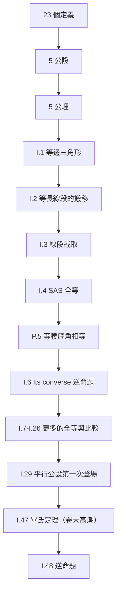
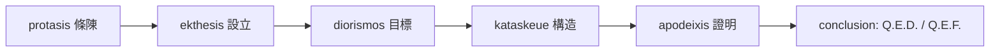

# 2.2 公理、定理與證明的結構

## 學習動機

上一節我們打開了《幾何原本》的大門：23 個定義、5 公設、5 公理、465 個命題。但**一本書長什麼樣**與**一本書怎麼運轉**是兩件事。命題 I.47（畢氏定理）為什麼要用命題 I.4、I.41、I.42？一個證明憑什麼算「證完了」？為什麼歐幾里得寧可用「疊合」也不引入一根尺？

本節解剖《幾何原本》的**組織架構**：定義、公設、命題如何排程，證明的邏輯結構如何運作（synthesis 與 analysis 兩種筆法），以及現代數學證明與它的血緣關係。最後把邏輯結構「程式化」：用 SymPy 的有限制斷言（simplify、solve、assume）實際演練一個「假設 → 推導 → 結論」的迴圈，學會在電腦上把證明當流程來寫。

讀完本節你將能：

1. 區分定義、公設、公理、命題、引理、系（corollary）、推論；
2. 分析一個證明的邏輯結構（前提、規則、結論）；
3. 說明公理化證明與現代數學證明的異同；
4. 接上 1931 年 Gödel 的驚人結果；
5. 用 SymPy 把「假設 → 代數推導 → 結論」寫成一段可執行的驗證腳本。

---

## 1. 建築藍圖：《幾何原本》的組織法

《幾何原本》第一卷像一座蓋房子的工地，工具按**依賴順序**排放：



這張圖有三個值得深思的設計選擇：

1. **工具最小化**：前 3 個命題 I.1–I.3 看起來像「無關痛癢的小步」（作等邊三角形、搬移線段、截取線段），但它們是後面所有全等證明的支撐。就像現代程式設計先寫工具函式，歐幾里得先證明「什麼操作是合法的」。
2. **第一次動用第五公設是在命題 I.29**：這告訴讀者，前 28 個命題都是**絕對幾何**（absolute geometry，不依賴平行公設）——它們在非歐幾何中也成立！這種「用到哪一條公理」 accounting，後來正是非歐幾何發現的方法論基礎。
3. **以逆向命題配對收尾**：I.47（畢氏定理）與 I.48（它的逆命題）成對出現，前者說「直角 → 邊平方關係」，後者說「邊平方關係 → 直角」。數學引理的前後照應是現代定理書的通用風格。

### 名詞位階

《幾何原本》中並沒有嚴格用「定理」「引理」這些字——凡是可證的敘述一律叫 proposition（命題）。後世數學家把命題細分：

| 名稱 | 內容 | 典範 |
|---|---|---|
| 定義 | 給新名詞一個由**已知名詞**構成的描述 | 「圓是…以中心…半徑…」 |
| 公設/公理 | 不證明就使用的敘述 | 五公設、五公理 |
| 引理 | 為證大定理鋪路的預備結果 | I.4（SAS）為 I.47 鋪路 |
| 命題/定理 | 系統的主角 | 畢氏定理 |
| 系（corollary） | 從定理直接推出的簡短附註 | I.19 從 I.18 |
| 逆命題（converse） | 把假設與結論對調 | I.48 vs I.47 |

逆向命題是證明研讀的大陷阱：**「真命題的逆命題不一定真」**。I.47 與 I.48 恰好都真，但 I.5（等腰三角底角相等）的逆命題「底角相等的三角形等腰」也真，可是 3.1 節將出現許多逆命題失敗的例子。

### 段落結構：六段式命題

一條命題的標準希臘格式分成六部分（見 2.1 節）。用圖示：



其中 **kataskeue（構造）** 與 **apodeixis（證明）** 的分離是希臘方法最精密處：構造可以動用直尺與圓規，但**證明 中每一步都必須合法引用**已有的定義、公設、命題。現代教科書把這兩步寫在同一個證明裡，然而內容上仍然不同：構造式提供**物件**，證明提供**意義**。

---

## 2. 證明的邏輯結構

### 2.1 演繹的基本模板

一個演繹論證由三件事組成：

1. **前提**（premises）：已知的定義、公設、已證命題；
2. **推理規則**（rules of inference）：允許的思考動作；
3. **結論**（conclusion）：推得的新敘述。

一個最基本的推理規則是 *modus ponens*（肯定前件）：

> 若 $`P \Rightarrow Q`$ 且 $`P`$ ，則 $`Q`$ 。

例：公設 4「所有直角相等」+ 命題 I.34「平行四邊形對邊定理（用於直角三角形）」+ 已知「 $`\triangle ABC`$ 有一個直角」→ 推出後續平方關係式（I.47 證明中的一步）。

亞里斯多德（Aristotle）在《分析前篇》就已系統化這種**三段論**（syllogism）。歐幾里得的證明是**實質推理**而非形式推理——他很少明寫邏輯規則，但每一步都可重建成有效的演繹。要等到 1950 年代，證明論（proof theory，Hilbert、Gentzen）才提供完全形式化的規則系統。這不是說歐氏證明「失敗」——只是它的推理可以在更嚴格的系統中被重建。

### 2.2 反證法與 I.6

歐幾里得第一次用 **reductio ad absurdum**（歸謬法）是在命題 I.6：證明 I.5 的逆命題「若等腰三角形兩底角相等，則兩腰相等」。他的論證模式：

1. 假設結論不真，即 $`AC \neq AB`$ ；
2. 不妨 $`AB > AC`$ 。在 $`AB`$ 上截取 $`AD = AC`$ ；
3. 三角形 $`ACD`$ 由兩邊相等（SAS，I.4），所以 $`\angle ACD = \angle ADC`$ ；
4. 但 $`\angle ADC > \angle BCD`$ （整體大於部分），又 $`\angle BCD = \angle DBC`$ （I.5）……推出 $`\angle BDC > \angle BCD > \angle DBC = \angle DCB`$ ，即一個三角形各有兩個大於它角的角，矛盾；
5. 所以 $`AC = AB`$ 。

注意步驟 4 使用了公理 5「整體大於部分」——3.3 節提到的集合論世界裡這不再成立，但有限量下的幾何中仍正確。歸謬法本身在證明論中對應到一句簡單的程式：**假設否定，推導矛盾，得結論**。現代化作為排中律的推論。

另一個希臘常用的證明模式是 **analysis（分析）**：先假設結論成立，一步一步**往回追溯**到已知條件；然後把路徑**反過來**寫成 synthesis（綜合）。這兩種筆法在古希臘的孤本中也被系統化。現代奧林匹亞風格的解法中，分析是草稿演算，綜合是成稿證明——其實就是大家在寫程式時 **REPL 與腳本** 的關係：互動探索 → 打磨成條理分明的腳本。

### 2.3 證明為什麼要「寫出來」？

希臘人發明的不僅是證明，更是**證明的公開性**：一個證明若不能被同行複檢，就不算證明。它帶來了：

- **可批評性**：錯誤可被指出（例如 I.1 兩圓相交的默認，可被 Proclus 稱為「赤裸的僭越」）；
- **可傳播**：證明不依賴師徒口傳，用文字就夠；
- **可積累**：後人厚積薄發於前人之作。

這些文字規範與今天軟體工程的 **code review、版本控制、開源共用** 完全同構——《幾何原本》是史上第一份「開源數學 repo」。

---

## 3. 公理化方法的現代迴響

### 3.1 Hilbert 的更新：理想公理系統的要求

1899 年德國數學家 Hilbert 出版《幾何基礎》，第 1 卷的開場就致敬 Euclid 精神。他給出一個「像樣」的公理系統必須具備的三性質：

1. **一致性**（consistency）：不能證出 $`P`$ 與 $`\neg P`$ ；
2. **獨立性**（independence）：沒有一條公理可由其他推出；
3. **完備性**（completeness）：系統內所有命題皆可證或可否證。

他花了十年巡演這三件事，1900 年再提出 23 個「世紀難題」。第二難題就是「連續一致性」：算術公理不能陷入矛盾。廣受討論 30 年後，這條問題在 1931 年被年輕的 Gödel 以兩條「不完備定理」摧毀：

- **Gödel 第一不完備定理**：任何包含基本算術的一致公理系統，都存在不可判定命題。
- **Gödel 第二不完備定理**：這樣的系統不能證明自身的一致性。

這兩條定理不是宣告公理化方法的**失**，而是替這方法**畫出邊界**：證明必須在系統內進行，且系統不能看透自己。計算機科學的 Turing 機器（1936）與停機問題，正是第二不完備定理在計算世界的轉世。

### 3.2 Formolization 今天：從 Lean 到 SAT

20 世紀後期的發展是把證明當**可編程的物件**：

| 工具 | 年代 | 特點 |
|---|---|---|
| Automath（de Bruijn） | 1967 | 全機器檢驗證明第一次 |
| Coq | 1989– | 法國 INRIA，使得四色定理形式化（2005） |
| Isabelle/HOL | 1990s– | Flyspeck 項目形式化 Kepler 猜想（Hales 2014） |
| Lean 4 | 2016– | Microsoft 投入的現代證明器；`mathlib` 社群大部分數學函式庫 |

Lean 在 2020 年代由 Terence Tao 等數學家推動著頂級研究成果的形式化，連菲爾茲獎等級的論證亦可機器檢查。公理化思想從**寫作風格**變成**可執行的程式**。

### 3.3 AI 時代的新興
2014 年起，自動定理證明（ATP）搭配強化學習（RL）開始自動生成證明：

- 2024 年 DeepMind 的 **AlphaProof** 在國際數學奧林匹亞風格的題目上達到金牌等級；
- Lean 社群開始大量使用 LLM 輔助證明搜索（`mathlib` 的月度程式碼量隨之劇增）。

SymPy 在這個世界裡位置很特殊：它不是定理證明器，但可在**符號層次做嚴格計算**：證明中的計算步驟——兩式是否相等、方程是否有解——都可以用 `simplify`、`solve` 等函式以**重寫（rewriting）** 方式完成。這是計算機代數系統的「有限證明模式」。

### 3.4 Newton 的物理式公理化

《自然哲學的數學原理》第 1 卷在「公理，即運動定律」之後立刻給出**系（corollary）1**：「兩力同時作用於一質點，其合成沿平行四邊形對角線」——完全沿用 Euclid 命題的結構寫物理。全書數百條命題、引理、系的推演，幾乎沒有一步不由公理支撐；微積分符號在文本中被刻意淡化。牛頓公理化的目的：**在當時科學界顯眼的幾何權威之下，把自己的結論寫成無懈可擊的演繹**。

---

## 4. SymPy 動手做：把證明寫成程式

### 4.1 演繹模板的 SymPy 版

現代風格的證明：假設 → 符號推導 → 結論。以**「兩直線斜率相乘為 $`-1`$ 則垂直」**為例，先把假設寫成符號式，推導，最後驗證：

```python
import sympy
from sympy import symbols, simplify
from sympy import Point, Line

x, y, m, b = symbols('x y m b', real=True)

# 兩條直線：l1: y = m*x，l2: y = (-1/m)*x（斜率相乘 = -1）
l1 = Line(Point(0, 0), Point(1, m))
l2 = Line(Point(0, 0), Point(1, -1/m))

# 假設下推導：兩直線夾角
print(l1.angle_between(l2))       # 預期輸出：pi/2（精確直角）
```

這裡的所謂「證明」被 SymPy 化簡為一個**判斷**：夾角真的是 `pi/2`。這是 SymPy 的典型做法——它不能「證明定理」，但能把結論化成**典範形式**（canonical form）。垂直的代數信號其實更乾淨：方向向量內積為零。下面用向量內積重證：

```python
from sympy import Matrix

u = Matrix([1, m])           # l1 的方向向量
v = Matrix([1, -1/m])        # l2 的方向向量
print(simplify(u.dot(v)))    # 預期輸出：0
# 內積為 0 ⟺ 垂直（在笛卡兒度量下），證畢。
```

輸出的 `0` 就是證明的**代數型結論**： $`\mathbf{u}\cdot\mathbf{v} = 1 + m\cdot(-1/m) = 1 - 1 = 0`$ ，每一步都是代數等式的重寫，可以被人類複檢。注意 $`m = 0`$ 時 `Line(Point(1, -1/m))` 會代數除零——這提示我們定理的「假設」必須排除 $`m=0`$ （垂直的一對水平線沒有這種斜率表示）。程式考驗假設的精確性，這正是形式化的好處。

### 4.2 定義為「條件」：以等腰三角為例

在歐幾里得的體系裡，一個物件若滿足某定義的條件，就具有該名稱。程式版：定義是**謂詞**（predicate），篩選物件：

```python
import sympy
from sympy import Point

def is_isosceles(A, B, C, eps=0):
    """定義判斷：三角形 ABC 是否等腰（至少兩邊相等）"""
    d1 = A.distance(B)
    d2 = B.distance(C)
    d3 = A.distance(C)
    equal = lambda a, b: sympy.simplify(a - b) == 0
    return equal(d1, d2) or equal(d2, d3) or equal(d1, d3)

print(is_isosceles(Point(0, 3), Point(-2, 0), Point(2, 0)))   # 預期輸出：True
print(is_isosceles(Point(0, 0), Point(2, 0), Point(2, 3)))    # 預期輸出：False
```

用**謂詞**理解定義有個非常大的好處：現代數學的「定義」幾乎都是隱藏的謂詞式——「 $`x`$ 是質數」定義為「 $`x > 1`$ 且沒有 1 與自身以外的因子」。程式判斷函式與數學定義一一對應，你以後犯的邏輯錯誤常可對應到這個階層。

### 4.3 歸謬法程式版

用 4.2 的 `is_isosceles`，把命題 I.6 的假設否定模擬一次：**假設 $`AB > AC`$ ，看會如何**：

```python
import sympy
from sympy import Point, symbols, simplify, Eq, solve

x = symbols('x', real=True, positive=True)
A = Point(0, x)                # 頂點
B = Point(-1, 0)
C = Point(1, 0)

# 角 B 與角 C 的餘弦：分別代表這兩個底角
from sympy import Matrix
def cos_angle(P, V, Q):
    u = Matrix([P.x - V.x, P.y - V.y])
    w = Matrix([Q.x - V.x, Q.y - V.y])
    return (u.dot(w) / (u.norm() * w.norm()))

# 在等腰的情況（AB = AC = sqrt(1 + x**2)），兩餘弦應相等
cB = cos_angle(A, B, C)     # 在 B 的角
cC = cos_angle(A, C, B)     # 在 C 的角
print(simplify(cB - cC))    # 預期輸出：0
```

真正「歸謬」在 SymPy 裡的另一個形態是：**解出矛盾方程**。比如要證明 " $`\sqrt{2}`$ 是無理數"（這是《幾何原本》第 X 卷的不可公度量思想），可寫：假設 $`\sqrt{2} = p/q`$ （ $`p, q`$ 整數）→ 兩邊平方 → $`2q^2 = p^2`$ → $`p`$ 為偶數 → 代回得 $`q`$ 也偶數 → 與最簡分式矛盾。用 `solve` 演一個數值層面的模擬：

```python
from sympy import sqrt, Rational

# 假設 p**2 = 2*q**2 有整數解 —— SymPy 找出的解 p = ±sqrt(2) q 不是整數（除非 p = q = 0）
p, q = sympy.symbols('p q', integer=True)
sol = sympy.solve(sympy.Eq(p**2, 2*q**2), p, dict=True)
print(sol)    # 預期輸出：[{p: -sqrt(2)*q}, {p: sqrt(2)*q}]
# p 是 sqrt(2) 倍的 q —— 對整數 p, q 而言唯一可能是 p = q = 0，矛盾。證畢。
```

`sqrt(2)` 無理（希臘語 *alogos*，「不可言說」）在《幾何原本》第 X 卷以長篇比例論嚴格處理——希臘人繞道幾何，是因為他們拒絕把無限過程當成數。SymPy 的選擇不同：它是**精確符號**，不是近似數——

```python
from sympy import Rational, sqrt
print(Rational(1, 2) + Rational(1, 3))   # 預期輸出：5/6（精確分數）
print(sqrt(2) + sqrt(3) - sqrt(3) - sqrt(2))    # 預期輸出：0（精確重寫）
```

### 4.4 推論鏈的「回溯」

程式化的證明也允許我們把「這個命題用到了哪些前置結果」做成**依賴鏈**。下面以畢氏定理的推導為例，列出三個台階（詳細見 2.3 節），並各配一小段 SymPy 驗證：

1. **I.4（SAS 全等）** → 2. **I.41（同底等高的三角形面積比）** → 3. **I.47（畢氏定理）**

```python
import sympy
from sympy import Point, Polygon

A = Point(0, 0); B = Point(4, 0); C = Point(0, 3)
tri = Polygon(A, B, C)

# I.4 的支架：SAS 決定三角形 → 第三邊由公式已知 = 5（3-4-5 直角三角形）
print(A.distance(B))         # 4
print(A.distance(C))         # 3
print(B.distance(C))         # 5

# I.47 的版圖：兩個小正方形面積之和 = 大正方形面積
a2 = A.distance(B) ** 2      # 16
b2 = A.distance(C) ** 2      # 9
c2 = B.distance(C) ** 2      # 25
print(a2, b2, c2, sympy.simplify(a2 + b2 - c2))  # 預期輸出：16 9 25 0
```

輸出 `0` 就是「I.47 成立」的機器驗證：計算總是可以代替部分演繹，因為代數等式不能亂編。

---

## 5. 命題邏輯與證明的「集體骨架」

### 5.1 命題邏輯四寶

現代證明的寫作中，命題邏輯的四種基本算子反覆出現：

| 算子 | 意義 | 證明中的用語 |
|---|---|---|
| $`P \Rightarrow Q`$ | 若 P 則 Q | 「假設 P，可得 Q」 |
| $`P \wedge Q`$ | P 且 Q | 「由 X 與 Y 兩條件」 |
| $`P \vee Q`$ | P 或 Q | 分類討論 |
| $`\neg P`$ | 非 P | 歸謬法 |

這些可在 SymPy 的 `sympy.logic` 模組中計算——例如把一個布爾式化成最簡等價形：

```python
from sympy.logic import simplify_logic, Implies
from sympy import symbols

P, Q, R = symbols('P Q R')
# modus ponens：前提 (P → Q) 與 P，蘊含 Q == P & Q 蘊含 Q
expr = simplify_logic((~P | Q) & P)
print(expr)              # 預期輸出：P & Q
print(simplify_logic(Implies(expr, Q)))      # 預期輸出：Q | ~(P & Q)
```

`simplify_logic((~P | Q) & P)` 傳回 `P & Q`——化簡器把「前件的與」收攏起來；再把 `P & Q ⇒ Q` 用一次化簡，得到的 `Q | ~(P & Q)` 在 `P & Q` 成立時就是真的 `Q`。把它想成一個重寫引擎：邏輯表達式輸入，等值最簡形輸出。證明的每一次「引用先前命題」其實都是這樣的重寫步驟。

### 5.2 中間手段：「當且僅當」

定理標題常見「if and only if」（當且僅當）。注意它**雙向**：要證 $`P \Leftrightarrow Q`$ ，必須分兩半分別推出 $`P \Rightarrow Q`$ 與 $`Q \Rightarrow P`$ 。歐幾里得就有這種習慣：I.48 就是 I.47 的另一半。I.47-I.48 的雙線結構成為這裡的「iff 版本」。

SymPy 的 `Iff` 也有：

```python
from sympy import symbols
from sympy.logic import Implies, satisfiable

X, Y = symbols('X Y')
phi = Implies(X, Y) & Implies(Y, X)   # (X → Y) 且 (Y → X) ≡ X ↔ Y
print(satisfiable(phi))               # 預期輸出：{X: False, Y: False}（一組滿足賦值）
```

`satisfiable()` 找出一組讓整個式子為真的賦值，這幾乎就是一個極小 SAT 求解器。現代硬體驗證、IC 設計、密碼分析大量使用 SAT 求解；8.4 節會再看它在計算幾何旁邊的位置。

---

## 6. 教學上的關鍵：證明的「層次」感

學幾何最重要的訓練是分辨「現在用的是哪一層的根據」：

- **定義層**：名詞之間的語義約定，撐不起數值結論。
- **公設層**：極少數——歐幾里得明文列出的**最底層表**。
- **命題層**：大多數論證的根據在這層——引用**前置命題**而非公設。
- **實證層（SymPy/視覺化）**：用計算與圖像建構直覺。

強調：**前三層屬於證明，第四層屬於證據**。動畫與計算可以支持直覺但不是演繹；反之，一條貌似嚴密的證明也可能藏着默默的預設（如 I.1 的兩圓相交）。理想是兩者並用——這是現代教科書的共識，也是本書每一節「歷史與理論 → 推導 → SymPy 驗證」的固定格式。

---

## 7. 小結

- 《幾何原本》的結構由**定義 → 公設 → 公理 → 命題**逐層推進：前三層是「地基」，命題是「建築」。
- 命題六段式（protasis → conclusion）是希臘式證明的固定格式，現代的「定理-引理-證明」只是換了名字。
- 證明的邏輯中心是演繹（modus ponens）與歸謬法；希臘人另外養成「分析/綜合」兩步走的工作流。
- Hilbert 的一致性/獨立性/完備性三要求、Gödel 的不完備定理、Turing 機器、Lean/Coq 定理證明器，都是公理化思想一路輾轉的當代身世。
- SymPy 不能取代證明，但能把證明中的**代數步驟**變成可複檢的計算；謂詞判斷、`solve`、`simplify`、`logic` 模組是本書後續章節反覆使用的武器。

---

## 習題

1. **謂詞版本定義**：寫一個 `is_equilateral(A, B, C)` 函式，傳回 `True`/`False`，測試 `(0,0), (1/2, sqrt(3)/2), (1,0)` 等邊三角形，預期輸出 `True`。

2. **modus ponens 自動化**：用 `simplify_logic` 化簡表達式 `(~(P & Q) | R) & (P & Q)`，觀察結果，預期輸出 `P & Q & R`。再寫一步：證明從 `P & Q & R` 可以**導出** `R`（提示：對 `Implies(P & Q & R, R)` 做 `satisfiable(Implies(..., R) == False)` 之類的檢查，或直接驗證它恆真）。

3. **逆命題陷阱**：構造兩個三角形（用 `Point`）：一個滿足 I.47 但不滿足 I.48 的前提？其實 I.47 與 I.48 互為充要，所以不可能。請改證：邊長 $`\{2, 3, 4\}`$ 的三角形**不是**直角三角形（ $`a^2 + b^2 \neq c^2`$ ），並用 SymPy 確認。

4. **歸謬法練習**：仿照 4.3 節，用 SymPy 說明：無論 $`p, q`$ 怎麼取（ $`p, q`$ 整數、 $`q \neq 0`$ ），方程 $`p^3 = 2 q^3`$ 無非平凡整數解——因此 $`\sqrt[3]{2}`$ 也是無理數（這是倍立方問題的代數面，古希臘三大難題之一）。

5. **證明依賴圖**：查閱《幾何原本》命題 I.47 證明中引用了哪些命題（至少三條）。畫一個 mermaid 圖，標出「命題 I.47 ← I.41 ← I.4 ← I.2/I.3 ← I.1」的鏈，並標註每條鏈使用的**公設號碼**為何。
