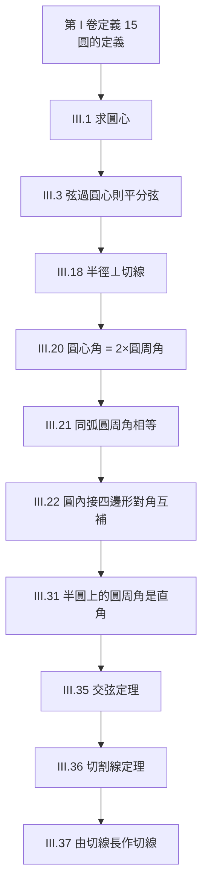
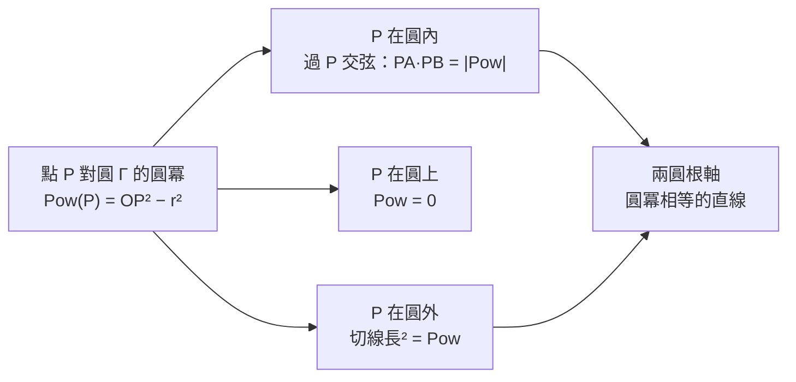

# 2.4 圓與角：SymPy 的圓幾何

## 學習動機

圓是古希臘幾何學家的「完美圖形」：同一條閉曲線上每一點到圓心等距，這個定義簡單到可以用一條公設式的語句說清楚，卻蘊含了極其豐富的定理。柏拉圖甚至認為天體的軌道必須是圓（或圓的組合）才配得上宇宙的完美；《幾何原本》用整整兩卷（第 III、IV 卷）處理圓：圓周角、弦、切線、內接與外切圖形。

為什麼「圓與角」值得單獨一章節？因為圓是**歐幾里得公理系統中第一個非平凡曲線**——直線的所有性質都寫在公設裡，而圓的性質必須**證明**出來。第 III 卷的圓周角定理（III.20–III.21）、切線性質（III.16–III.19）與後世整理的圓冪定理（III.35–III.36 的推廣），構成了一條環環相扣的推理鏈；這條鏈後來延伸到托勒密的弦表（三角學的源頭）、克卜勒的行星軌道（第 4 章），甚至現代電腦圖學中的圓與球的相交測試。讀完本節，你將能：

1. 敘述並證明**圓周角定理**：圓周角等於同弧圓心角的一半；
2. 推出它的系例：半圓上的圓周角是直角（泰勒斯定理，見 1.2 節）；
3. 理解**切線**的三大性質與「切線垂直於過切點半徑」的證明；
4. 認識**圓冪**（power of a point）：交弦積、切割線段的統一公式；
5. 用 SymPy 的 `Circle`、`tangent_lines`、`intersection` 在座標平面上**機器驗證**以上所有定理。

---

## 1. 《幾何原本》第三卷：圓的公理化

歐幾里得把圓的定義放在第 I 卷（定義 15：「圓是由一條線圍成的平面圖形，線上一點到圖形內某點的距離都相等」），但把圓的**定理**集中在第 III 卷（37 個命題）與第 IV 卷（16 個命題，處理內接、外切多邊形）。

第 III 卷的邏輯結構值得細看，因為它示範了公理化方法的「堆疊」特性：



這張依賴圖就是第 2.2 節講的「證明樹」的具體實例：每一個命題只依賴前面已證的命題與公設。托勒密在西元 150 年建立弦表時，用到的正是 III.20–III.21 這一組定理；兩千年後，計算機圖學判斷「射線是否擊中球」時，用的卻是 III.35–III.36 的代數化身。**同一條推理鏈，服務了天文台與顯示卡。**

---

## 2. 圓周角定理（III.20 / III.21）

> **定理（圓周角定理，Euclid III.20）**：在圓中，一條弦在圓周上張出的角（圓周角）等於它在圓心張出的角（圓心角）的**一半**。
>
> **系（III.21）**：同弧上的所有圓周角相等。

### 證明（歐幾里得的情形分析）

設 $`O`$ 為圓心， $`B`$ 為圓周上一點，弦為 $`AC`$ 。連 $`OB`$ 並延長交圓於 $`D`$ 。分三種情形：

**情形一：圓心 $`O`$ 在圓周角內部**（即 $`D`$ 落在角 $`ABC`$ 內部）。

因為 $`OA = OB`$ （都是半徑），三角形 $`OAB`$ 是等腰的，故

$$
\angle OAB = \angle OBA.
$$

由三角形外角定理（I.32），

$$
\angle AOD = \angle OAB + \angle OBA = 2\,\angle OAB.
$$

同理 $`\angle COD = 2\,\angle OBC`$ 。相加得

$$
\angle AOC = 2\,\angle ABC. \qquad\blacksquare
$$

**情形二：圓心在外部**——把上面的式子相**減**即可。
**情形三： $`OB`$ 與角的一邊重合**——只用一半的論證。

> **注意歐幾里得的嚴謹習慣**：他並不假設「圖形看起來怎樣」，而是逐一檢查所有情形。這正是 2.2 節所說「證明必須對所有情形成立」的古典示範。現代定理證明器（如 Coq、Lean）在做幾何題時同樣必須窮舉情形——這是自動化幾何證明最繁瑣的部分。

**圓周角定理的兩個著名系**：

1. **同弧圓周角相等**（III.21）：這就是「泰勒斯在船上量金字塔用不到、但航海定位用得到」的定理——見 1.2 節。
2. **半圓上的圓周角是直角**（III.31，即泰勒斯定理）：圓心角是平角 $`\pi`$ ，故圓周角為 $`\pi/2`$ 。

---

## 3. 切線：III.16–III.19

> **定義**：與圓恰交於一點的直線稱為**切線**，該點稱為**切點**。

歐幾里得用三個命題建立了切線理論：

- **III.16**：過切點的任何直線（除了切線本身）都會切進圓內部——切線與圓「沒有一點能塞進中間」。歐幾里得在此給出歷史上第一個「極限式」的論述，因此這命題被稱為「角的和諧」（*corollary of the linen*），十七世紀微積分的先驅者們喜歡引用它。
- **III.18**：**切線垂直於過切點的半徑**。
- **III.19**：反之，過半徑端點且垂直於半徑的直線是切線。

### III.18 的證明（歸謬法）

設直線 $`DE`$ 與圓切於 $`C`$ ， $`F`$ 為圓心。若 $`FC`$ 不垂直於 $`DE`$ ，則自 $`F`$ 作 $`FG \perp DE`$ 交 $`DE`$ 於 $`G \neq C`$ 。因為 $`\angle FGC`$ 是直角而 $`\angle FCG`$ 是銳角，故 $`FC > FG`$ 。但 $`G`$ 在圓內（因為 $`FG`$ 垂足在切線上且 $`FG < FC =`$ 半徑），這與 $`DE`$ 是切線、圓內不能有切線上的點矛盾。 $`\blacksquare`$

### 切線的三個實用性質

| 性質 | 內容 |
|---|---|
| 垂直性 | 切線 $`\perp`$ 過切點半徑 |
| 等長性 | 從圓外一點引兩條切線，兩切線段等長，且該點與圓心連線平分兩切線的夾角 |
| 唯一性 | 過圓上一點恰有一條切線；過圓外一點恰有兩條 |

等長性是判定「三角形的內切圓」的關鍵：三角形三頂點到內切圓的切線段長分別是 $`s-a`$ 、 $`s-b`$ 、 $`s-c`$ （ $`s`$ 為半周長）——這個事實讓我們能純用切線性質算出內切圓半徑。

---

## 4. 圓冪：交弦與切割線的統一

歐幾里得 III.35–III.36 證明了兩個看似不同的定理，後人（十八世紀起）發現它們是**同一件事**的兩面：

- **交弦定理（III.35）**：兩弦 $`AB`$ 、 $`CD`$ 交於圓內點 $`P`$ ，則 $`PA \cdot PB = PC \cdot PD`$ 。
- **切割線定理（III.36）**： $`P`$ 在圓外，割線交圓於 $`A`$ 、 $`B`$ ，切線切圓於 $`T`$ ，則 $`PA \cdot PB = PT^2`$ 。

**統一觀點（圓冪）**：對定圓 $`\Gamma`$ 與任意點 $`P`$ ，數值

$$
\mathrm{Pow}_\Gamma(P) = OP^2 - r^2
$$

（ $`O`$ 為圓心、 $`r`$ 為半徑）是一個只依賴 $`P`$ 的量，稱為 $`P`$ 對 $`\Gamma`$ 的**圓冪**。可以證明：過 $`P`$ 的任意割線交圓於 $`X`$ 、 $`Y`$ 時（有向長度），恆有

$$
\overline{PX} \cdot \overline{PY} = \mathrm{Pow}_\Gamma(P).
$$

- $`P`$ 在圓內：圓冪為負（兩段弦反向）；
- $`P`$ 在圓上：圓冪為 $`0`$ ；
- $`P`$ 在圓外：圓冪為正，等於切線長的平方（ $`PT^2 = OP^2 - r^2`$ ，正是 III.36 + 畢氏定理）。

在座標幾何（第 3 章）問世後，這件事變得幾乎透明：把圓寫成方程

$$
x^2 + y^2 - 2ax - 2by + c = 0,
$$

則點 $`P = (p, q)`$ 的圓冪就是把座標代入左式的值

$$
p^2 + q^2 - 2ap - 2bq + c,
$$

而這正是 SymPy 中 `Circle.equation()` 在 $`P`$ 的取值。**一個古典定理，在代數語言裡是一行代入。** 兩圓的「根軸」（圓冪相等的點的軌跡）就是兩圓方程相減所得的直線——這也是兩圓交點（若存在）所在的那條直線。

---

## 5. 用 SymPy 驗證圓周角定理

SymPy 的幾何物件是**符號精確**的：角度用 `acos` 的精確表達式表示，比較時用 `simplify`。我們選一個便於精確計算的例子：圓 $`x^2+y^2=25`$ ，取 $`A=(3,4)`$ 、 $`B=(-5,0)`$ 、 $`P=(5,0)`$ 。

```python
from sympy import *
from sympy.geometry import *

def angle_at(V, A, B):
    """在頂點 V 處、由 VA 與 VB 張出的角（0 到 pi）。"""
    v1 = Matrix([A.x - V.x, A.y - V.y])
    v2 = Matrix([B.x - V.x, B.y - V.y])
    return acos(simplify(v1.dot(v2) / (v1.norm() * v2.norm)))

O, A, B, P = Point(0, 0), Point(3, 4), Point(-5, 0), Point(5, 0)

inscribed = angle_at(P, A, B)      # 圓周角 ∠APB
central  = angle_at(O, A, B)       # 圓心角 ∠AOB

print(inscribed)                   # acos(sqrt(5)/5)
print(central)                     # acos(-3/5)
print(float(inscribed), float(central))
# 1.1071487177940904 2.214297435588181
print(float(2 * inscribed), float(central))
# 2.214297435588181 2.214297435588181
```

兩個角都是 `acos` 的精確表達式；要驗證「圓心角 = 2 × 圓周角」，最乾淨的方法是比較**餘弦**（利用二倍角公式 $`\cos 2\theta = 2\cos^2\theta - 1`$ ）：

```python
c_ins, c_cen = cos(inscribed), cos(central)
print(c_ins)                       # sqrt(5)/5
print(simplify(2 * c_ins**2 - 1))  # -3/5
print(simplify(c_cen - (2 * c_ins**2 - 1)))  # 0
```

`0` 就是機器給出的證明： $`\cos(\angle AOB) = 2\cos^2(\angle APB) - 1`$ 精確成立。

### 泰勒斯定理的驗證

直徑兩端取 $`B=(-5,0)`$ 、 $`C=(5,0)`$ ，圓周上任取 $`A=(3,4)`$ ：

```python
C = Point(5, 0)
print(simplify(angle_at(A, B, C)))         # pi/2
print(N(angle_at(A, B, C)))                # 1.57079632679490
```

半圓上的圓周角恆為 $`\pi/2`$ ——你也可以把 `A` 換成 `(0, 5)`、`(-3, 4)` 逐一測試，SymPy 都會回傳 $`\pi/2`$ 。

### 同弧圓周角相等（III.21）

在圓 $`x^2+y^2=1`$ 上取定弦的兩端 $`A=(1,0)`$ 、 $`B=(0,1)`$ ，再取兩個不同的圓周點 $`P=(\tfrac{3}{5}, -\tfrac{4}{5})`$ 、 $`Q=(-\tfrac{3}{5}, \tfrac{4}{5})`$ ：

```python
u = Circle(Point(0, 0), 1)
A, B = Point(1, 0), Point(0, 1)
P = Point(Rational(3, 5), Rational(-4, 5))
Q = Point(Rational(-3, 5), Rational(4, 5))

print(simplify(angle_at(P, A, B)))   # pi/4
print(simplify(angle_at(Q, A, B)))   # 3*pi/4
# P 與 Q 在弦 AB 的異側，故一角為 3*pi/4 的補角：
print(simplify(pi - angle_at(Q, A, B)))  # pi/4
```

同側的圓周角相等；異側的兩角互補——這正是 III.22「圓內接四邊形對角互補」的內容。 SymPy 精確回傳 $`\pi/4`$ 與 $`3\pi/4`$ ， $`\pi/4 + 3\pi/4 = \pi`$ 。

---

## 6. 用 SymPy 操作切線

### 6.1 `tangent_lines`：從外點引切線

```python
from sympy import *
from sympy.geometry import *

c = Circle(Point(0, 0), 1)
P = Point(2, 0)                    # 圓外一點

tls = c.tangent_lines(P)
print(tls)
# [Line2D(Point2D(2, 0), Point2D(1/2, -sqrt(3)/2)),
#  Line2D(Point2D(2, 0), Point2D(1/2, sqrt(3)/2))]
print(len(tls))                    # 2  ← 過圓外一點恰有兩條切線
print(tls[0].slope, tls[1].slope)  # -sqrt(3)/3 sqrt(3)/3
```

注意切點被 SymPy 直接算出來了：`Line2D(Point2D(2,0), Point2D(1/2, ±sqrt(3)/2))` 的第二個參數就是切點座標。

### 6.2 驗證「切線 ⊥ 過切點半徑」（III.18）

```python
Q = tls[0].intersection(c)[0]
print(Q)                           # Point2D(1/2, -sqrt(3)/2)

radius = Line(Point(0, 0), Q)
tangent = tls[0]
print(simplify(radius.slope * tangent.slope + 1))  # 0
```

兩斜率乘積為 $`-1`$ （乘積加 1 為 0），即垂直。這個驗證用了精確有理數與根號，不是浮點近似——SymPy 符號運算的好處正在於此。

### 6.3 驗證「兩切線段等長」

```python
Q1 = tls[0].intersection(c)[0]
Q2 = tls[1].intersection(c)[0]
print(simplify(P.distance(Q1) - P.distance(Q2)))   # 0
print(simplify(P.distance(Q1)**2))                 # 3
# 檢查圓冪公式：OP^2 - r^2 = 4 - 1 = 3 ✓
```

### 6.4 過圓上一點的切線

`tangent_lines` 也接受**圓上**的點，此時回傳唯一一條切線：

```python
c0 = Circle(Point(0, 0), 1)
P = Point(Rational(3, 5), Rational(4, 5))
t = c0.tangent_lines(P)
print(len(t))                      # 1
print(t[0].equation())             # 3*x/5 + 4*y/5 - 1
```

切線方程 $`3x + 4y = 5`$ ——請對照 2.3 節：這就是「點在圓上時，切線方程把 $`x^2, y^2`$ 換成 $`x_0 x, y_0 y`$ 」的極坐標式極化恆等式在座標上的體現。

### 6.5 內切圓：切線性質的應用

三角形三邊都與內切圓相切。SymPy 的 `Triangle` 直接提供 `incircle`：

```python
T = Triangle(Point(0, 0), Point(6, 0), Point(0, 8))
I, r = T.incircle.center, T.incircle.radius
print(I, r)                        # Point2D(2, 2) 2

# 驗證：內心到三邊的距離都等於半徑
print(T.sides[0].distance(I))      # 2
print(T.sides[1].distance(I))      # 2
print(T.sides[2].distance(I))      # 2

# 直角三角形內切圓半徑公式：r = (a + b - c) / 2
print(simplify((6 + 8 - 10) / 2))  # 2
```

$`6`$ - $`8`$ - $`10`$ 直角三角形的內切圓半徑為 $`r = \dfrac{a+b-c}{2} = \dfrac{6+8-10}{2} = 2`$ ，與 `incircle` 的結果一致。

---

## 7. 圓冪與根軸的 SymPy 實作

### 7.1 交弦定理（III.35）

圓 $`x^2+y^2=25`$ ，兩弦： $`x`$ 軸與直線 $`y = \tfrac{4}{3}(x-1)`$ ，交點 $`P=(1,0)`$ 。

```python
from sympy import *
from sympy.geometry import *

c = Circle(Point(0, 0), 5)
P = Point(1, 0)

# 弦一：x 軸交圓於 (-5,0) 與 (5,0)
A, B = Point(-5, 0), Point(5, 0)
# 弦二：過 P 的直線 y = 4(x-1)/3 交圓於兩點
L = Line(P, Point(4, 4))
C1, C2 = L.intersection(c)
print(C1, C2)
# Point2D(-7/5, -32/15) Point2D(13/5, 32/15)

s1 = P.distance(A) * P.distance(B)
s2 = P.distance(C1) * P.distance(C2)
print(simplify(s1))                # 24
print(simplify(s2))                # 24
print(simplify(s1 - s2))           # 0
```

$`PA \cdot PB = 6 \times 4 = 24`$ ，另一弦的乘積也精確等於 $`24`$ 。而且 $`24 = OP^2 - r^2 = 1 - 25 = -24`$ 的**絕對值**——點在圓內時有向乘積為負、長度乘積為正，兩種約定在這裡交會。

### 7.2 切割線定理（III.36）

```python
P = Point(8, 0)                    # 圓外一點
# 割線：x 軸交圓於 (-5,0), (5,0)
d1, d2 = P.distance(Point(-5, 0)), P.distance(Point(5, 0))
print(d1 * d2)                     # 39

# 切線長
tls = c.tangent_lines(P)
Q = tls[0].intersection(c)[0]
print(simplify(P.distance(Q)**2))  # 39

# 圓冪：把 P 代入圓方程
x, y = symbols('x y')
print(c.equation(x, y).subs({x: 8, y: 0}))  # 39
```

三個數完全一致：割線兩段乘積 $`13 \times 3 = 39`$ 、切線長平方 $`39`$ 、圓冪 $`8^2 - 5^2 = 39`$ 。**圓冪定理統一了 III.35 與 III.36。**

### 7.3 兩圓的根軸

```python
x, y = symbols('x y')
c1 = Circle(Point(0, 0), 5)        # x^2 + y^2 = 25
c2 = Circle(Point(8, 0), 3)        # (x-8)^2 + y^2 = 9

# 兩圓方程相減 = 根軸（圓冪相等的點集合）
diff = c1.equation(x, y) - c2.equation(x, y)
print(expand(diff))                # 16*x - 80
print(solve(diff, x))              # [5]

# 這兩圓外切（圓心距 8 = 5 + 3），切點恰在根軸上
print(c1.intersection(c2))         # [Point2D(5, 0)]
```

根軸 $`x = 5`$ 正好通過兩圓的切點 $`(5,0)`$ 。若兩圓相交，根軸就是**公共弦**所在直線；若兩圓相離，根軸仍存在（與兩圓等冪的直線），但不再碰到任何一個圓。



---

## 8. 公理化 → 座標化 → 機器驗證

回顧本節的驗證方式，其實經歷了三個歷史階段的壓縮：

1. **歐幾里得（前 300 年）**：用公設與已證命題做綜合推理（等腰三角形 + 外角定理 → 圓周角定理）。
2. **笛卡兒（1637 年）**：把圓變成方程 $`x^2+y^2=r^2`$ ，把點代入得圓冪，把定理變成恆等式。
3. **SymPy（今天）**：把第 2 步的代數操作交給計算機，用精確符號運算「執行」證明的計算部分。

要誠實地說：`simplify` 回傳 `0` **不替代**歐幾里得的證明——它驗證的是「這個定理在這個（符號參數化的）例子上成立」。但當我們像 2.3 節那樣用符號變數 $`u, v`$ 參數化一般情況時，一次 `simplify` 的成功就等價於對整個參數族的證明。這正是二十世紀**計算機代數系統（CAS）**進入數學的方式，也是吳文俊幾何定理機器證明（1977 年）的核心思想：把幾何命題化成多項式恆等式，交給代數去判定。SymPy 就是一台可以隨身攜帶的小型證明輔助機。

> **歷史插曲**：牛頓在《Principia》中刻意模仿歐幾里得——先寫「定義」與「公理（運動三定律）」，再一條條推出「命題」。書中處理行星軌道時最核心的引理，正是用「圓的切線與極限」的語言寫的。歐幾里得第 III 卷的切線理論，就這樣成為微積分與天體力學的共同祖先。

---

## 習題

1. **圓周角定理的另一例**：在圓 $`x^2+y^2=169`$ 上取 $`A=(5,12)`$ 、 $`B=(-12,5)`$ 、 $`P=(13,0)`$ 。仿 5.1 節驗證圓心角等於兩倍圓周角（比較餘弦，`simplify` 回傳 0）。

2. **切線長公式**：對圓 $`x^2+y^2=r^2`$ 與圓外點 $`P=(d,0)`$ （ $`d > r`$ ），用 `tangent_lines` 求切點座標（以 $`r, d`$ 的符號表達），並驗證切線長 $`= \sqrt{d^2 - r^2}`$ （提示：`sqrt(d**2 - r**2)` 與 `simplify`）。

3. **圓內接四邊形**（III.22）：在圓 $`x^2+y^2=25`$ 上取四點 $`A=(3,4)`$ 、 $`B=(5,0)`$ 、 $`C=(3,-4)`$ 、 $`D=(-5,0)`$ ，驗證 $`\angle A + \angle C = \pi`$ 、 $`\angle B + \angle D = \pi`$ （用 `angle_at` 函式）。

4. **兩圓的公共弦**：取相交兩圓 $`x^2+y^2=25`$ 與 $`(x-6)^2+y^2=13`$ 。用 `intersection` 求兩交點，再驗證：兩交點連線的方程，恰等於兩圓方程相減所得直線（根軸 = 公共弦）。

5. **費馬點的前奏——等長切線的應用**：三角形頂點 $`(0,0)`$ 、 $`(7,0)`$ 、 $`(1,5)`$ 。用 `incircle` 求內心與半徑，再用切線長性質驗證：三頂點沿兩邊到切點的切線段長分別為 $`s-a`$ 、 $`s-b`$ 、 $`s-c`$ （ $`s`$ 為半周長， $`a,b,c`$ 為對邊長）。
