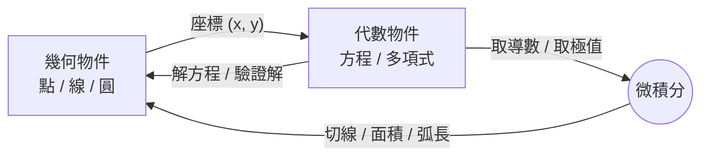

# 3.1 笛卡兒座標幾何（1637 年）

## 學習動機

在笛卡兒之前，幾何與代數是兩門近乎彼此隔絕的學問：幾何靠圖形與公理演繹，代數靠符號運算求解方程。1637 年，笛卡兒在《方法論》的附錄《幾何學》（*La Géométrie*）中做了一件改寫數學史的大事——**用一組「座標」把點化成數對，把曲線化成方程**。從此，幾何問題可以翻譯成代數問題，代數計算的結果又可以翻譯回幾何圖形。這座橋不只解決了當代的問題，更直接為半個世紀後牛頓與萊布尼茨的微積分鋪好了路基。本章將帶你走過這場革命。

## 一、1637 年之前的困境

### 1.1 希臘幾何的極限

歐幾里得的《幾何原本》（見 2.1 節）建立了公理化的演繹體系，但它有一個內在的天花板：**每一個結論都必須從圖形中「看」出來**。希臘數學家擅長處理可以用圓規與直尺構造的量——長度、角度、面積——但一旦問題變得複雜，例如三等分任意角、倍立方這些難題，尺規作圖的工具就顯得力不從心。

古希臘人其實已經知道某些曲線（如阿波羅尼奧斯的圓錐曲線）描述的是曲線上的特殊比例關係，但他們始終用「線段與面積」的語言來談曲線，而不是用「數」：

- 直徑為 $`d`$ 的圓，面積等於「直徑與四周長度的乘積的一半」這類語句。
- 沒有座標，談論「曲線上任意一點」只能是純粹語意上的，無法計算。

### 1.2 代數的成熟

另一方面，16 世紀的義大利代數學家（卡爾達諾、塔爾塔利亞、費拉里）已經會解三次、四次方程，韋達（François Viète）也建立了系統的符號代數。但當時的代數仍是「解特定問題的技巧收集」，與幾何沒有系統性的連結。

### 1.3 缺一座橋

當時最迫切的問題之一是**軌跡問題**（locus problems）：阿波羅尼奧斯問過——平面上到兩定點距離之和為定值的點的軌跡是什麼？到兩定點距離之比為定比呢？用純幾何方法，每種軌跡都要個別構造、個別證明。有沒有**一種統一的方法**，把「所有满足條件的點」一次寫成一個可以用符號操作物件？

## 二、方法的革命：《幾何學》（1637）

### 2.1 笛卡兒的方法論背景

《幾何學》是《談談方法》（*Discours de la méthode*）的三篇附錄之一。笛卡兒寫作的核心動機不只是數學，更是**方法論**：他在書中提出了著名的四條方法準則（直觀、分析、綜合、枚舉），並企圖證明這套方法在數學上同樣有效。《幾何學》正是這場方法論實驗的展示品：**如果連最古老的幾何都能被方法化、符號化，那所有知識皆可如此**。

### 2.2 核心觀念：座標

笛卡兒的想法可以用一句話概括：

> **平面上每一個點，都對應一組數；每一條曲線，都對應一個方程。**

給定一條主軸線與一個參考點，平面上任一點 $`P`$ 的位置就由兩個數 $`(x, y)`$ 決定。今天我們稱這兩個數為**橫座標**（abscissa）與**縱座標**（ordinate），合稱**笛卡兒座標**（Cartesian coordinates）。

一旦有了座標，過去抽象的「兩點間距離」就變成純代數運算。設 $`A(x_1, y_1)`$ 、 $`B(x_2, y_2)`$ ，由畢氏定理（我們在 2.3 節用 SymPy 驗證過）：

$$
|AB| = \sqrt{(x_2 - x_1)^2 + (y_2 - y_1)^2}
$$

**距離公式**——這是兩千多年前的畢氏定理在新座標語言下的第一個化身。

### 2.3 軌跡與方程：一個經典例子

阿波羅尼奧斯軌跡問題突然變得透明：

> 到兩定點 $`A(-a, 0)`$ 、 $`B(a, 0)`$ 距離之和為定值 $`2c`$ 的點的軌跡。

設動點為 $`(x, y)`$ ，寫下方程：

$$
\sqrt{(x+a)^2 + y^2} + \sqrt{(x-a)^2 + y^2} = 2c
$$

經過移項、平方、整理（這正是代數的威力——機械化的操作），可以化簡為：

$$
\frac{x^2}{c^2} + \frac{y^2}{c^2 - a^2} = 1
$$

這正是**橢圓**的標準方程。古人花了近百頁的構造與證明達到的結論，在座標語言下是一次平方化簡。

> **規則**：把兩定點設為 $`(-a, 0)`$ 與 $`(a, 0)`$ ，會使代數大幅簡化——這就是「選好座標系」的技巧，也是解析幾何思想的一部分：**座標系是自由設定的框架**。

````python
from sympy import symbols, sqrt, simplify, sin, cos, Rational, Eq

# 用參數驗證：橢圓標準式上的點，確實滿足「距離和 = 2c」
# 以具體數字為例：a = 3（半焦距），c = 5，則半短軸 = sqrt(c^2 - a^2) = 4
a, c = Rational(3), Rational(5)
b = sqrt(c**2 - a**2)

# 橢圓參數化：x = c*sin(t), y = b*cos(t)
t = symbols('t', real=True)
x_t = c*sin(t)
y_t = b*cos(t)

d1 = sqrt((x_t - a)**2 + y_t**2)      # 到 (a, 0) 的距離
d2 = sqrt((x_t + a)**2 + y_t**2)      # 到 (-a, 0) 的距離

# 對幾個參數值驗證 d1 + d2 == 2*c
for tau in [Rational(0), Rational(1, 6), Rational(1, 4), Rational(1, 3), Rational(1, 2)]:
    s = simplify((d1 + d2).subs(t, tau))
    print(Eq(s, 2*c))
# True   ← 五行全部輸出 True
````

> 這段程式「反向」驗證了：只要點在橢圓參數化上，它的兩焦距之和就是 $`2c`$ 。**座標讓「曲線的性質」成為「方程的恆等式」，而恆等式是可以用 SymPy 驗證的**。抽象化的代數消根號留待習題。

### 2.4 為什麼這是革命？

底下的 mermaid 總結了這座橋的雙向性：



它在四個層面上是革命性的：

1. **統一性**：一個方法解決所有「軌跡」問題——寫出條件方程，就成了。
2. **機械性**：證明與求解可以按符號規則進行，減少對「靈感看圖」的依賴。
3. **擴充性**：三維、四維、乃至 $`n`$ 維空間毫無障礙——只需要更多座標（後來的線性代數由此而生）。
4. **開福音書給微積分**：笛卡兒本人的求切線法（「圓法」）已經是在座標上操作的流數原形。牛頓的《流數術》分析運算完全在方程上進行。沒有座標，就沒有可操作的微積分。

### 2.5 費馬：同時期、同思想、不同命運

歷史上一個耐人尋味的故事：費馬（Pierre de Fermat）大約在 1629–1636 年就寫下了與笛卡兒幾乎等價的方法——他的《平面與立體軌跡引論》（*Ad locos planos et solidos isagoge*）晚於《幾何學》於 1679 年才出版（生前未發表）。也就是說**解析幾何其實是兩人各自獨立的發明**。

比較兩人風格，是一件很有教育意義的事：

| 比較項 | 笛卡兒 | 費馬 |
| --- | --- | --- |
| 出版 | 1637 年，附於《方法論》 | 死後 1679 年出版 |
| 起點 | 方法論關懷，企圖重建一切知識 | 純粹數學問題（阿波羅尼奧斯軌跡還原） |
| 座標處理 | 允許斜座標，偏重幾何構造 | 一貫用直角座標，更接近現代 |
| 曲線分類 | 試圖以方程次數機械分類 | 直接寫 $`ax^2+by^2+cxy+\cdots = d`$ 風格 |
| 後世影響 | 名氣大（《幾何學》廣傳） | 極小定理、光學、數論成就轉移了注意力 |

費馬還在通信中與笛卡兒就方法優劣、切線問題交鋒過，留下數學史上第一場（也是幾場經典之一）關於解析幾何方法的辯論。後世把這兩人的共同創新合稱 **Cartesian geometry**（笛卡兒幾何），實則是兩人共享的座標幾何。

## 三、座標幾何的基礎語法

### 3.1 點、距離、中點

有了座標，最基本的物件就是點。兩點中點公式：

$$
M = \left(\frac{x_1+x_2}{2},\; \frac{y_1+y_2}{2}\right)
$$

線段的 $`n`$ 等分點可由**參數化**取得：線段 $`\overline{AB}`$ 上分比為 $`t`$ 的點為

$$
P(t) = A + t\,(B - A), \qquad 0 \le t \le 1
$$

這個式子極其重要——它就是**參數曲線**的原形，也是 3.4 節線性變換作用對象的基礎。

### 3.2 直線的一些代數事實

- 過 $`A(x_1, y_1)`$ 、 $`B(x_2, y_2)`$ 的直線斜率為

$$
m = \frac{y_2 - y_1}{x_2 - x_1} \qquad (x_1 \neq x_2)
$$

- 過兩點的直線方程（點斜式與兩點式）：

$$
y - y_1 = m(x - x_1)
$$

- 兩直線 $`l_1: y = m_1 x + b_1`$ 、 $`l_2: y = m_2 x + b_2`$ ：
  - 平行 $`\iff m_1 = m_2`$ （且 $`b_1 \neq b_2`$ 時真正平行）
  - 垂直 $`\iff m_1 m_2 = -1`$

歷史上一個美妙的巧合：**斜率**這個詞的英文 *slope*，其代數本質 $`\frac{\Delta y}{\Delta x}`$ ，正是後來微分導數 $`\frac{dy}{dx}`$ 的「平均」，而導數是「瞬間」的斜率。**解析幾何把「斜率」變成第一級物件，微積分只是它的極限**——這正是它通往微積分的道路。

### 3.3 用 SymPy 建立座標運算

````python
from sympy import symbols, sqrt, Rational, simplify
from sympy.geometry import Point, Segment

# 定義三個點
A = Point(0, 0)
B = Point(4, 3)
C = Point(4, 0)

# 1. 距離（就是畢氏 3-4-5 三角形）
print(A.distance(B))
# 5

# 2. 中點
print(Segment(A, B).midpoint)
# Point2D(2, 3/2)

# 3. 分比點：把 A 到 B 分成 3:1 的點
ratio = Rational(3, 4)
AB = B - A                      # SymPy 允許 Point 相減，得到向量式位移
P = A + ratio * AB
print(P)
# Point2D(3, 9/4)

# 4. 任意參數點（Segment 的參數化）——這是解析幾何的精髓
t = symbols('t', real=True)
seg = Segment(A, B)
print(simplify(seg.arbitrary_point(t).subs(t, Rational(1, 2))))
# Point2D(2, 3/2)   與中點公式一致！
````

> **要點**：`Segment.arbitrary_point(t)` 回傳參數化的點。把 $`t`$ 代成任意 $`0 \sim 1`$ 的值，就能拿到線段上任何固定的點。這是「整條線段 = 一組方程」的典範。

### 3.4 圓方程的誘生

「到定點距離為定數 $`r`$ 的所有點」——這句純幾何定義，在座標語言下一次就寫成方程：

$$
(x - h)^2 + (y - k)^2 = r^2
$$

這裡 $`(h, k)`$ 是圓心。用 SymPy 一方面用純幾何方式建圓（三點定圓），一方面寫出它的解析方程：

````python
from sympy import symbols, Eq, simplify
from sympy.geometry import Circle, Point

x, y = symbols('x y', real=True)
h, k, r = 2, -1, 3

# 1. 由三點決定一圓（SymPy 內建，這是純幾何做不到的「機械操作」）
circ = Circle(Point(5, -1), Point(2, 2), Point(-1, -1))
print(circ.center, circ.radius)
# Point2D(2, -1) 3

# 2. 寫出圓方程（解析觀點）
eq = Eq((x - circ.center.x)**2 + (y - circ.center.y)**2, circ.radius**2)
print(eq)
# Eq((x - 2)**2 + (y + 1)**2, 9)

# 3. 反向驗證：任一滿足方程的點確實在圓上
sol = {x: 2 + 3, y: -1}     # (5, -1) 應滿足
print(eq.subs(sol))
# True
````

注意看 SymPy 的兩種身份——純幾何的 `Circle`（用三點定義）與解析的方程式 `Eq`——在這段程式裡互相溝通無礙。**SymPy 的 geometry 模組本身就是座標化時代精神的完成**。

## 四、解析幾何如何使微積分成為可能

這一小段值得放在本章黃金位置，也是本書的重點敘事之一。

### 4.1 切線問題的座標化

17 世紀初，切線問題是數學的前沿：給定一條曲線與曲線上一點，過該點的切線是什麼？古人（阿波羅尼奧斯、帕普斯）只有特殊幾何構造，每個曲線個別一套。

笛卡兒的《幾何學》裡給了一個「圓法」：找一個圓，使其在 $`P`$ 點與曲線有二重交點，該圓的半徑方向即法線方向。費馬則用「極大極小法」：先取 $`P`$ 附近的點 $`P(e)`$ ，當 $`e \to 0`$ ，割線斜率先取極值再極限化。兩人已經在**用代數操作**切線，只差最後一層「極限」的哲學因素。

牛頓說過一句話，代表了時代的總結：

> 「我把笛卡兒的方法當作踏腳石，足以知道一切他能解的問題，都能用我的方法更快解掉。」

牛頓的《流數術》、萊布尼茨的《微積分》表達式如 $`\frac{dy}{dx}`$ 、 $`\int f\,dx`$ ，全都是**在曲線方程上操作**。解析幾何把曲線化為方程之後，微積分的所有基本操作（取極限、微分、積分）才有了可以作用的物件。一句話：

> **解析幾何使曲線成為「可計算的符號」，微積分才成為可能。**

### 4.2 一個含義深遠的「定律」 問題

我們以最簡單的例子驗證：求拋物線 $`y = x^2`$ 在 $`x = 1`$ 處的切線。

方法一（微積分式）：斜率 $`\dfrac{dy}{dx}\Big|_{x=1} = 2`$ ，切線 $`y = 2x - 1`$ 。

方法二（割線極限法，無微積分、只靠座標與極限概念）：

$$
m(h) = \frac{(1+h)^2 - 1^2}{h} = \frac{h^2 + 2h}{h} = h + 2 \;\longrightarrow\; 2
$$

````python
from sympy import symbols, Limit, simplify
h = symbols('h', nonzero=True)
m_h = ((1 + h)**2 - 1**2) / h      # 割線斜率: (1+h)^2 - 1 over h
print(simplify(m_h))
# h + 2
print(Limit(m_h, h, 0).doit())
# 2
````

## 五、SymPy 的座標世界：更多練習

### 5.1 把幾何條件翻譯成方程、再翻譯回幾何

**翻譯練習 1**：「到兩定點 $`A(-3, 0)`$ 、 $`B(3, 0)`$ 距離之差為 $`4`$ 的點的軌跡」→ 雙曲線。

**翻譯練習 2**：「到點 $`(0,0)`$ 距離等於到直線 $`y=2`$ 的距離的點」→ 拋物線。我們已經在 4.3 節深論圓錐曲線，此處簡單展示座標方法的直接性。

````python
from sympy import symbols, sqrt, Eq, solve, simplify
x, y = symbols('x y', real=True)

# 到 (0,0) 的距離 = 到直線 y = 2 的距離（帶絕對值，因其在地平線之下）
# 幾何直覺：開口向上的拋物線
# |sqrt(x^2+y^2)| = |y - 2|   取 y < 2 的解
lhs = x**2 + y**2
rhs = (y - 2)**2
print(simplify(Eq(lhs, rhs)))
# Eq(x**2 + y**2, (y - 2)**2)
print(simplify(lhs - rhs))
# x**2 - 4*y + 4
# → 4y = x^2 + 4，即 y = x^2/4 + 1：拋物線，焦點 (0,0)，準線 y = 2
````

一次純代數化簡就得到拋物線方程 $`y = \frac{x^2}{4} + 1`$ ——完全不需要作圖或構造。**這就是解析方法的經濟性**。

### 5.2 面積的座標公式：通往行列式之門

用座標，三角形面積有一個純代數公式（鞋帶公式；3.3 節將用 `Polygon.area` 直接算）：

$$
[\,\triangle ABC\,] = \frac{1}{2}\left|\, x_A(y_B - y_C) + x_B(y_C - y_A) + x_C(y_A - y_B)\,\right|
$$

這個量，你將在 3.4 節看到它**就是行列式**——是線性代數幾何意義的起點。

````python
from sympy import Abs, Rational, simplify
from sympy.geometry import Point, Polygon

A, B, C = Point(0, 0), Point(5, 0), Point(1, 3)
print(Polygon(A, B, C).area)
# 15/2

# 驗證鞋帶公式
formula = Abs(A.x*(B.y - C.y) + B.x*(C.y - A.y) + C.x*(A.y - B.y)) / 2
print(simplify(formula))
# 15/2    ✓ 與 SymPy 內建一致
````

### 5.3 一個「假命題」的偵測：代數如何代替畫圖

純幾何時代有許多「看似顯然實則錯誤」的主張（如兩平行曲線等寬等），往往要靠反例才能推翻。有了座標反例可以「算出來」。

範例：誤解命題——「過三角形三中點的圓與三角形三邊中點圓為同一圓」？其實不是九點圓六點的區分……但更基礎的例子：

> 主張：平面上任三點必共圓。

這**是**真的（若不共線）。但「任四點必共圓」就錯了。用座標快速給反例：

````python
from sympy import symbols, Eq, solve
x, y, a, b, c = symbols('x y a b c')

# 圓方程的一般形式: x^2 + y^2 + a*x + b*y + c = 0
def through(p, q, r):
    sols = solve([p[0]**2 + p[1]**2 + a*p[0] + b*p[1] + c,
                  q[0]**2 + q[1]**2 + a*q[0] + b*q[1] + c,
                  r[0]**2 + r[1]**2 + a*r[0] + b*r[1] + c], [a, b, c])
    return sols

s1 = through((0, 0), (4, 0), (0, 3))
s2 = through((0, 0), (4, 0), (0, 3))
# 若第四點也在此圓上，應滿足同樣 a,b,c
print(s1)
# {a: -4, b: -3, c: 0}
ex = (4, 1)
val = ex[0]**2 + ex[1]**2 - 4*ex[0] - 3*ex[1] + 0
print(val)
# -2     不為 0 → (4, 1) 不在過 (0,0),(4,0),(0,3) 的圓上
````

一個小小計算就給出反例 $`(4, 3)`$ ——這正是解析方法的「民主性」：任何會算的人都能檢驗。

## 六、座標幾何到現代的餘波

1. **笛卡兒符號與詞源**：座標 *coordinate* 這個詞其實是後來（18 世紀萊布尼茨周遭的學派）才確立的，《幾何學》裡笛卡兒自己用 *appliquées* 這種講法；但座標思想的版權無可爭議屬於 1637 年那本小冊子。
2. **解析數論的旁支**：因為有了座標，後代（如拉格朗日、高斯）開始研究**格點**問題——如「座標都是整數的點中，哪些在圓 $`x^2 + y^2 = n`$ 上」，最後通達代數數論。這是座標帶來的新題材。
3. **從平面到高維**：4 維空間的點用 $`(x, y, z, w)`$ ，黎曼幾何、物理相空間、機器學習的 embedding 空間（見 10.3 節），本質全部是笛卡兒座標思想在高維的重演。
4. **SymPy 的座標精神**：本書其餘章節幾乎所有 SymPy 幾何程式碼，都在座標平面上操作。你此刻就在「解析幾何的世界」。

## 七、小結

| 主題 | 一句話 |
| --- | --- |
| 座標革命 | 點怎可以看成數對，曲線怎可以看成方程 |
| 費馬 | 同時期獨立發明，軌跡問題的還原者 |
| 距離公式 | 畢氏定理在座標語言下的化身 |
| 軌跡方法 | 把條件寫成方程，代數化簡得曲線 |
| 與微積分 | 切線問題座標化 → 導數；曲線方程 → 積分 |
| 與線性代數 | 面積行列式、 $`n`$ 維座標、變換矩陣（3.4 節） |

## 習題

> 以上 SymPy 程式碼可直接在你的 Python 環境執行。請在解答時附上可執行程式與其輸出。

**習題 3.1-1**（距離與中點）　給定 $`A(1, -2)`$ 、 $`B(7, 6)`$ ：
(1) 求 $`|AB|`$ ；(2) 求把 $`\overline{AB}`$ 分成 $`1:3`$ 的兩點 `$P$ 的座標；(3) 驗證中點公式與 `Segment(A,B).midpoint` 一致。

**習題 3.1-2**（軌跡方程）　求到兩定點 $`A(-2, 0)`$ 、 $`B(2, 0)`$ 距離**之積**為 $`4`$ 的點的軌跡方程，化為最簡形式，並猜出它是什麼曲線。（提示：平方化簡，討論 $`x \cdot`$ 項與 $`y^2`$ 項。）

**習題 3.1-3**（切線乘上解析方法）　用 `Limit` 方法，仿 4.2 節，求曲線 $`y = x^3`$ 在 $`x = 2`$ 處的割線斜率 $`m(h)`$ 與極限，進而寫出切線方程。並用 SymPy 驗證 $`(2, 8)`$ 同時滿足切線方程。

**習題 3.1-4**（面積鞋帶公式的一般式）　以變數點 $`A(x_1, y_1)`$ 、 $`B(x_2, y_2)`$ 、 $`C(x_3, y_3)`$ ，用 `Polygon(A,B,C).area` 與手寫鞋帶公式兩種方法計算，簡化為同一式；觀察它與行列式 $`\dfrac{1}{2}\left| \begin{vmatrix} x_1 & y_1 & 1 \\ x_2 & y_2 & 1 \\ x_3 & y_3 & 1 \end{vmatrix} \right|`$ 的關係（可用 `sympy.Matrix.det()` 驗證）。

**習題 3.1-5**（反例偵測）　某同學主張：「平面上任四點中，一定有三點共圓。」請用 SymPy 寫反例：找一組四點，其中任三點的圓都不含第四點，以 `Circle(Point, Point, Point)` 與點代入檢驗程式證明你的四點是反例。

---

*下一節：[3.2 向量與內積：從費馬到格拉斯曼（1844 年）](03.2-向量與內積.md)*