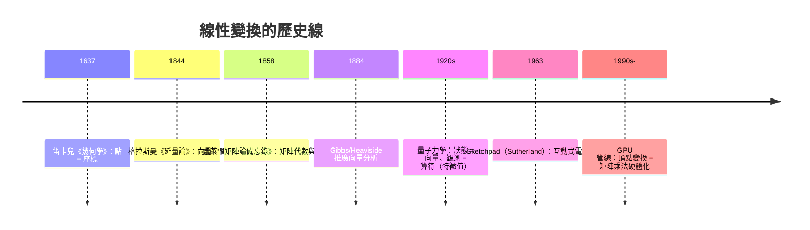

# 3.4 矩陣與線性變換：幾何的代數化

## 學習動機

前兩節我們把點變成數對（3.1）、把位移變成向量（3.2）。還剩最後一塊拼圖：**把「移動圖形」也變成代數**。旋轉、縮放、剪下、鏡射——這些幾何動作如果能寫成一個小表格（矩陣）乘上座標就能完成，那麼「連續做十個變換」就只是十個矩陣相乘、「把整個 3D 場景投影到螢幕」就只是一連串矩陣運算。這正是**線性代數**的幾何起源，也是今天電腦圖學（GPU 的核心工作就是瘋狂地做矩陣乘法）、機器人學、物理學中座標變換的共同基礎。

歷史上，矩陣這個「表格」在 19 世紀中葉由凱萊（Arthur Cayley, 1821–1895）在 1858 年的《矩陣論備忘錄》（*A Memoir on the Theory of Matrices*）中正式定義——注意這比格拉斯曼的向量空間（1844）晚了十幾年，比笛卡兒晚了兩百多年。凱萊明說他的動機之一就是研究**線性變換的複合**：兩個變換接連施行，等價於一個怎樣的變換？答案「矩陣相乘」的乘法規則，正是從這個幾何問題**逼**出來的。換句話說，矩陣乘法那套看似任意的「列乘行」規則，其實是「變換的複合」這個幾何操作的必然產物。本節你將學會：

1. 把旋轉、縮放、剪下、鏡射寫成 $`2\times 2`$ 矩陣，並用 SymPy 驗證其幾何效果；
2. 理解矩陣乘法 = 變換複合，並解釋為何乘法不可交換；
3. 用行列式讀出「面積縮放倍率」；
4. 用 `eigenvects` 找出變換下的**不動方向**（特徵向量），理解旋轉為何「沒有實的不動方向」；
5. 把整個多邊形用矩陣變換，連接到電腦圖學的頂點變換管線。

---

## 1. 線性變換：只保留「直線」與「原點」的變換

### 1.1 什麼樣的變換值得用矩陣？

在 3.1 節我們知道直線可以寫成 $`ax + by + c = 0`$ 。現在問：哪些座標變換 $`T: \mathbb{R}^2 \to \mathbb{R}^2`$ 會把直線映射到直線？如果進一步要求**原點不動**（ $`T(0,0) = (0,0)`$ ）且**保持向量加法與純量伸縮**：

$$
T(\mathbf{u} + \mathbf{v}) = T(\mathbf{u}) + T(\mathbf{v}), \qquad T(c\,\mathbf{u}) = c\,T(\mathbf{u}),
$$

這樣的 $`T`$ 就叫**線性變換**。線性變換有個驚人的性質：**它被兩個點完全決定**——只要知道 $`T`$ 把 $`(1,0)`$ 與 $`(0,1)`$ 送到哪裡， $`T`$ 對整個平面的作用就全部確定了。因為任意向量 $`(x, y) = x\,(1,0) + y\,(0,1)`$ ，而線性變換「保持加法與伸縮」，所以

$$
T(x, y) = x\,T(1,0) + y\,T(0,1).
$$

把 $`T(1,0)`$ 與 $`T(0,1)`$ 的像當成兩個**直行**排成一個 $`2\times 2`$ 表格，這個表格就是**矩陣**：

$$
A = \begin{pmatrix} T(1,0)\ \text{的第一座標} & T(0,1)\ \text{的第一座標} \\ T(1,0)\ \text{的第二座標} & T(0,1)\ \text{的第二座標} \end{pmatrix},
\qquad
T(x,y) = A \begin{pmatrix} x \\ y \end{pmatrix}.
$$

這就是「幾何的代數化」的最後一步：**變換 $`T`$ ≈ 矩陣 $`A`$ **。凱萊正是沿著這條思路，把「變換的複合」變成「矩陣的乘法」。

### 1.2 SymPy 中的矩陣

SymPy 的 `Matrix` 是精確符號矩陣：元素可以是整數、有理數、 $`\sqrt{3}`$ 、 $`\cos(\pi/3)`$ 、甚至未定符號。

```python
from sympy import Matrix, Rational, sqrt

A = Matrix([[2, 0], [0, 3]])          # 一個表格
v = Matrix([1, 1])                     # 一個直行向量
print(A * v)
# 預期輸出：Matrix([[2], [3]])
print(Matrix([[Rational(1, 2), -sqrt(3)/2], [sqrt(3)/2, Rational(1, 2)]]))
# 預期輸出：Matrix([[1/2, -sqrt(3)/2], [sqrt(3)/2, 1/2]])
```

注意 `Matrix([1, 1])` 是**直行向量**（ $`2\times 1`$ ），這與 3.2 節的向量約定一致：變換作用是「矩陣在左、向量在右」。

---

## 2. 四種基本變換

### 2.1 旋轉

把向量 $`(1,0)`$ 逆時針旋轉 $`\theta`$ 角，由 3.2 節的內積計算知它落在 $`(\cos\theta, \sin\theta)`$ ；把 $`(0,1)`$ 旋轉後落在 $`(-\sin\theta, \cos\theta)`$ 。因此旋轉矩陣為

$$
R_\theta = \begin{pmatrix} \cos\theta & -\sin\theta \\ \sin\theta & \cos\theta \end{pmatrix}.
$$

驗證：把單位向量 $`(1,0)`$ 旋轉 $`60°`$ ，應落在 $`(\tfrac12, \tfrac{\sqrt3}{2})`$ ；連轉三次共 $`180°`$ ，應把 $`(1,0)`$ 變成 $`(-1, 0)`$ ：

```python
from sympy import Matrix, pi, cos, sin, simplify

R = Matrix([[cos(pi/3), -sin(pi/3)], [sin(pi/3), cos(pi/3)]])
p = Matrix([1, 0])
print(R * p)
# 預期輸出：Matrix([[1/2], [sqrt(3)/2]])
print(simplify(R * R * R))
# 預期輸出：Matrix([[-1, 0], [0, -1]])   （60° x 3 = 180°，一切變號）
print(R.det())
# 預期輸出：1                             （旋轉不改變面積）
```

`R * R * R` 不需任何三角公式展開，SymPy 直接化簡成 $`-I`$ 。這正是「複合 = 矩陣乘法」的第一個證據。

### 2.2 縮放

沿 $`x`$ 軸伸縮 $`a`$ 倍、沿 $`y`$ 軸伸縮 $`b`$ 倍：

$$
S = \begin{pmatrix} a & 0 \\ 0 & b \end{pmatrix}.
$$

顯然 $`S`$ 把單位正方形面積變成 $`|ab|`$ 倍——這提示行列式 $`\det A = ab`$ 的幾何意義（見第 4 節）。

```python
from sympy import Matrix, Rational

S = Matrix([[2, 0], [0, Rational(1, 2)]])
print(S * Matrix([3, 4]))
# 預期輸出：Matrix([[6], [2]])    （x 變 2 倍，y 縮一半）
print(S.det())
# 預期輸出：1                      （一伸一縮，面積不變）
```

### 2.3 剪下（shear）

剪下變換「水平方向推擠」： $`y`$ 越大的點被推得越遠：

$$
K = \begin{pmatrix} 1 & k \\ 0 & 1 \end{pmatrix},
\qquad K(x, y) = (x + k\,y,\; y).
$$

它把正方形推成平行四邊形，但**底邊不動、高度不變**，所以面積不變—— $`\det K = 1`$ 。剪下的乘方有漂亮的形式： $`K^5`$ 相當於「剪五次」：

```python
from sympy import Matrix, Rational

K = Matrix([[1, Rational(1, 2)], [0, 1]])
print(K.det())
# 預期輸出：1
print(K**5)
# 預期輸出：Matrix([[1, 5/2], [0, 1]])    （k 從 1/2 變 5/2）
```

### 2.4 鏡射（反射）

對 $`x`$ 軸鏡射把 $`(x, y)`$ 映成 $`(x, -y)`$ ：

$$
F = \begin{pmatrix} 1 & 0 \\ 0 & -1 \end{pmatrix}.
$$

鏡射有兩個與旋轉截然不同的特徵： $`\det F = -1`$ （把平面「翻面」，定向反轉），以及 $`F^2 = I`$ （照兩次鏡子回到原樣）：

```python
from sympy import Matrix

F = Matrix([[1, 0], [0, -1]])
print(F.det(), F**2)
# 預期輸出：-1 Matrix([[1, 0], [0, 1]])
```

| 變換 | 矩陣 | 行列式 | 定向 |
| --- | --- | --- | --- |
| 旋轉 $`R_\theta`$ | $`\begin{pmatrix}\cos\theta & -\sin\theta\\ \sin\theta & \cos\theta\end{pmatrix}`$ | $`1`$ | 保持 |
| 縮放 $`S`$ | $`\begin{pmatrix}a & 0\\ 0 & b\end{pmatrix}`$ | $`ab`$ | 保持（ $`ab>0`$ ） |
| 剪下 $`K`$ | $`\begin{pmatrix}1 & k\\ 0 & 1\end{pmatrix}`$ | $`1`$ | 保持 |
| 鏡射 $`F`$ | $`\begin{pmatrix}1 & 0\\ 0 & -1\end{pmatrix}`$ | $`-1`$ | **反轉** |

---

## 3. 矩陣乘法 = 變換複合

### 3.1 為什麼「列乘行」不是任意規則

設先施行剪下 $`K`$ 、再施行縮放 $`S`$ ，合成變換是 $`T(\mathbf{v}) = S(K(\mathbf{v})) = (S\,K)\,\mathbf{v}`$ 。矩陣 $`SK`$ 的每個元素由「 $`S`$ 的列」配「 $`K`$ 的行」內積（3.2 節！）而來——**矩陣乘法的規則就是內積**。這解釋了兩件事：

1. 為什麼複合順序寫反（先 $`K`$ 後 $`S`$ 寫成 $`SK`$ ）：因為作用從右往左；
2. 為什麼矩陣乘法**不可交換**：先旋轉再縮放，與先縮放再旋轉，幾何結果不同！

```python
from sympy import Matrix, pi, cos, sin

R = Matrix([[cos(pi/2), -sin(pi/2)], [sin(pi/2), cos(pi/2)]])   # 轉 90°
S = Matrix([[2, 0], [0, 1]])                                     # x 伸 2 倍
print(R * S)
# 預期輸出：Matrix([[0, -1], [2, 0]])
print(S * R)
# 預期輸出：Matrix([[0, -2], [1, 0]])
print((R * S).equals(S * R))
# 預期輸出：False     （先轉再縮 ≠ 先縮再轉）
```

### 3.2 用矩陣搬動一個多邊形

電腦圖學的日常：物件儲存為一串頂點，顯示前對每個頂點左乘變換矩陣。用 SymPy 模擬「把一個 $`2\times 1`$ 矩形先剪下再縮放」：

```python
from sympy import Matrix, Rational
from sympy.geometry import Point, Polygon

M = Matrix([[2, 1], [0, Rational(1, 2)]])   # M = S * K，先剪下後縮放
poly = Polygon(Point(0, 0), Point(2, 0), Point(2, 1), Point(0, 1))
pts = [Matrix([p.x, p.y]) for p in poly.vertices]
new_poly = Polygon(*[Point(*(M * v)) for v in pts])
print(new_poly.vertices)
# 頂點 (0,0) (4,0) (5,1/2) (1,1/2) 的一個平行四邊形
print(new_poly.area, poly.area, M.det())
# 預期輸出：1 1 1    （det M = 1，面積不變）
```

這個「頂點列表 × 矩陣」的迴圈，就是 GPU 每秒執行數十億次的基本操作（頂點著色器）在符號世界裡的樣子。

---

## 4. 行列式：面積縮放因子

線性變換把單位正方形映成以 $`A`$ 的兩個直行為邊的平行四邊形，其面積為

$$
|\det A| = \left| ad - bc \right|
\quad\text{（對 } A = \begin{pmatrix} a & b \\ c & d \end{pmatrix}\text{）}.
$$

我們可以機器驗證這個定理對**符號矩陣**成立——變換一個面積為 2 的多邊形，比對面積與 $`|\det A|`$ ：

```python
from sympy import Matrix, symbols, simplify, Abs
from sympy.geometry import Point, Polygon

a, b, c, d = symbols('a b c d', real=True)
A = Matrix([[a, b], [c, d]])
poly = Polygon(Point(0, 0), Point(2, 0), Point(2, 1), Point(0, 1))
pts = [Matrix([p.x, p.y]) for p in poly.vertices]
new_poly = Polygon(*[Point(*(A * v)) for v in pts])
lhs = simplify(new_poly.area)
rhs = simplify(Abs(A.det()) * poly.area)
print(simplify(lhs - rhs))
# 預期輸出：0    （對任意 a, b, c, d，面積比 = |det A| 恆成立）
```

一條對**所有**矩陣成立的幾何定理，靠符號計算一次驗證——這是 2.3 節「符號畢氏定理」精神的延伸。由此立刻得到兩個推論：

- $`\det A = 0 \iff`$ 變換把平面壓扁成一直線（**不可逆**）；
- $`\det A < 0 \iff`$ 變換翻轉定向（含鏡射成分）。

---

## 5. 特徵向量：變換下的不動方向

### 5.1 不動方向是什麼

大多數向量被變換 $`A`$ 作用後，方向都會改變。但有些「幸運」的方向，被 $`A`$ 作用後**只在同一直線上伸縮、不改變方向**：

$$
A\mathbf{v} = \lambda \mathbf{v}.
$$

這樣的 $`\mathbf{v}`$ 稱為**特徵向量**（eigenvector）， $`\lambda`$ 稱為對應的**特徵值**（eigenvalue）。「特徵」二字取得極好：這些方向是變換的**骨架**——抓住它們，就抓住了變換的本性。

### 5.2 三種變換、三種命運

用 SymPy 的 `eigenvects`（回傳 `(特徵值, 重數, 特徵向量列表)` 三元組列表）檢查前面三種變換：

```python
from sympy import Matrix, Rational, pi, cos, sin

K = Matrix([[1, Rational(1, 2)], [0, 1]])       # 剪下
print(K.eigenvects())
# 預期輸出：
# [(1, 2, [Matrix([
# [1],
# [0]])])]
#   唯一不動方向：x 軸（特徵值 1），幾何上剪下正是沿 x 軸推擠

S = Matrix([[2, 0], [0, Rational(1, 2)]])       # 縮放
print(S.eigenvects())
# 預期輸出：
# [(1/2, 1, [Matrix([
# [0],
# [1]])]), (2, 1, [Matrix([
# [1],
# [0]])])]
#   兩個座標軸各是不動方向，特徵值就是伸縮倍率

R = Matrix([[cos(pi/3), -sin(pi/3)], [sin(pi/3), cos(pi/3)]])   # 轉 60°
print(R.eigenvects())
# 預期輸出：
# [(1/2 - sqrt(3)*I/2, 1, [Matrix([
# [-sqrt(3)/3 + 2*sqrt(3)*(1/2 - sqrt(3)*I/2)/3],
# [                                           1]])]),
#  (1/2 + sqrt(3)*I/2, 1, [Matrix([
# [-sqrt(3)/3 + 2*sqrt(3)*(1/2 + sqrt(3)*I/2)/3],
# [                                           1]])])]
#   特徵值是複數 e^{±i·π/3}！實平面上沒有不動方向——旋轉就是這個意思
```

剪下的不動方向是 $`x`$ 軸、縮放的不動方向是兩軸，這些都能從圖上「看出來」。最深刻的是旋轉：**平面上沒有任何一條直線轉 $`60°`$ 後還是自己**，SymPy 如實回報特徵值為複數 $`\tfrac12 \pm \tfrac{\sqrt3}{2}i = e^{\pm i\pi/3}`$ 。特徵值的模長為 $`1`$ （純旋轉不伸縮），輻角就是旋轉角——複數、旋轉、特徵值在此匯流。這也預告了一個更大的主題：要理解實平面上的旋轉，數學家被迫推廣數系；同樣的張力日後把線性代數推向了複向量空間與譜理論。

### 5.3 驗證特徵方程

特徵值來自**特徵方程** $`\det(A - \lambda I) = 0`$ 。手動驗證剪下矩陣：

```python
from sympy import Matrix, Rational, symbols, solve

lam = symbols('lambda')
K = Matrix([[1, Rational(1, 2)], [0, 1]])
char_eq = K - lam * Matrix.eye(2)
print(char_eq.det())
# 頂期輸出：lambda**2 - 2*lambda + 1
print(solve(char_eq.det(), lam))
# 預期輸出：[1]    （特徵值 1，二重根——剪下的唯一「骨架方向」）
```

（注意：輸出中的 `lambda` 是 SymPy 顯示的希臘字母 $`\lambda`$ 之名，與 Python 的 `lambda` 關鍵字無關。）

---

## 6. 來龍去脈：從凱萊到 GPU



三個值得記住的聯結：

1. **解析幾何 → 微積分**（3.1 節）：曲線 = 方程，才能對曲線做運算；
2. **向量空間 → 內積**（3.2 節）：幾何量（長度、角度、面積）進入代數；
3. **矩陣 → 線性代數與圖學**（本節）：幾何動作變成資料，變換複合變成矩陣乘法，於是「變換」可以被**編程**、被**硬體加速**。第 5 章的射影變換（齊次座標）與第 10 章的電腦圖學，都是本節的直接續集。

---

## 7. 綜合練習：把一棟「房子」變換

```python
from sympy import Matrix, Rational, pi, cos, sin
from sympy.geometry import Point, Polygon

# 一個簡筆房子：方形屋身 + 三角屋頂
body = Polygon(Point(0, 0), Point(2, 0), Point(2, 1), Point(0, 1))
roof = Polygon(Point(0, 1), Point(2, 1), Point(1, Rational(3, 2)))

# 變換：先逆時針轉 90°，再對 x 軸鏡射
R = Matrix([[0, -1], [1, 0]])
F = Matrix([[1, 0], [0, -1]])
M = F * R          # 先 R 後 F

def transform(poly, M):
    return Polygon(*[Point(*(M * Matrix([p.x, p.y]))) for p in poly.vertices])

new_body = transform(body, M)
new_roof = transform(roof, M)
print(new_body.vertices)
# 預期輸出：(0,0) (0,-2) (-1,-2) (-1,0) 的四邊形
print(new_roof.vertices)
# 頂點 (0,-1) (0,-2) (-3/2,-1) 的三角形
print(new_body.area, new_roof.area, abs(M.det()))
# 預期輸出：2 1/2 1    （面積不變，因為 |det M| = 1）
```

旋轉加鏡射把房子搬到第三象限並翻面；由於 $`|\det M| = 1`$ ，兩塊面積原封不動。若把 $`M`$ 換成 $`\begin{pmatrix}2&0\\0&2\end{pmatrix}`$ ，面積會變成 $`4`$ 倍——讀者可自行驗證。

---

## 習題

1. **旋轉矩陣**：寫出把平面逆時針旋轉 $`30°`$ 的矩陣 $`R_{30°}`$ ，用 SymPy 計算 $`R_{30°}^6`$ 並解釋結果為何是 $`-I`$ ；再計算 $`R_{30°}^{12}`$ ，你得到了什麼？這說明旋轉矩陣構成怎樣的結構？

2. **乘法不可交換**：令 $`R`$ 為轉 $`90°`$ 的矩陣、 $`F`$ 為對直線 $`y = x`$ 鏡射的矩陣（提示： $`F = \begin{pmatrix}0&1\\1&0\end{pmatrix}`$ ）。計算 $`RF`$ 與 $`FR`$ ，說明兩者各是什麼變換（提示：都是鏡射，但對稱軸不同）。

3. **行列式與面積**：對 $`A = \begin{pmatrix}3 & 1 \\ 0 & 2\end{pmatrix}`$ ，用第 4 節的多邊形方法驗證「面積縮放倍率 = $`|\det A|`$ = 6」。再問： $`A`$ 把單位圓 $`x^2 + y^2 = 1`$ 映成什麼曲線？（提示：把 $`\begin{pmatrix}\cos t\\ \sin t\end{pmatrix}`$ 代入 $`A`$ ，消去參數 $`t`$ 。）

4. **特徵向量**：求 $`A = \begin{pmatrix}2 & 1 \\ 1 & 2\end{pmatrix}`$ 的特徵值與特徵向量（可用 `eigenvects`）。這個變換在幾何上是「沿對角線 $`y = x`$ 伸縮、沿 $`y = -x`$ 壓縮」，請用兩個特徵向量方向的伸縮倍率解釋。

5. **矩陣的冪**： $`K = \begin{pmatrix}1 & 1/3 \\ 0 & 1\end{pmatrix}`$ 。計算 $`K^{10}`$ ，並歸納出 $`K^n`$ 的一般公式。再用 `eigenvects` 說明：為什麼剪下矩陣「永遠只有一個不動方向、且特徵值永遠是 1」？（這類只有一個特徵方向的重根矩陣，是第 7 章仿射變換分類的關鍵例子。）

---

*下一章：[4.1 阿波羅尼奧斯與圓錐曲線（約公元前 200 年）](04.1-阿波羅尼奧斯與圓錐曲線.md)*
