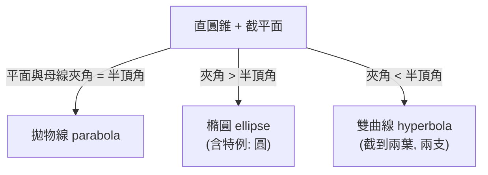
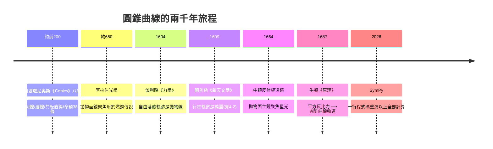

# 4.1 阿波羅尼奧斯與圓錐曲線（約西元前 200 年）

## 學習動機

在第 3 章我們看到，笛卡兒與費馬把幾何問題化成代數方程，橢圓、拋物線、雙曲線在座標系下不過是三種「二次方程」。但這三種曲線的故事其實早了將近兩千年：古希臘數學家阿波羅尼奧斯（Apollonius of Perga，約公元前 262–190 年）在八卷巨著《圓錐曲線論》（*Conics*）中，幾乎憑一己之力建立了圓錐曲線的完整理論——切線、法線、焦點性質、共軛直徑，樣樣俱全。更耐人尋味的是三個名稱的語源：

- **ellipse（橢圓）** 源自希臘語 *elleipsis*，「不足」——應用於面積時，正方形的一邊「不足」於一個比例線段；
- **parabola（拋物線）** 源自 *parabole*，「恰好相等」——「剛好」補上；
- **hyperbola（雙曲線）** 源自 *hyperbole*，「超過」——「超出」了那個線段。

這三個字原本是希臘人在「化圓為方」式的面積等分問題中的術語，阿波羅尼奧斯把它們轉用到圓錐截面上，因為三種曲線恰好對應「縱標線段的平方與『應用矩形』之間：不足、相等、超過」三種情形。我們將在本節用 SymPy 把這個几何意義實際算出來。

此外，阿波羅尼奧斯求切線的方法——以曲線上一點作為「極限位置」的割線思想——正是兩千年後微積分中導數與切線概念的直接前身。本節將用 SymPy 的極限與符號微分，重演他證明切線性質的關鍵步驟。

## 4.1.1 從圓錐切出曲線：三種截面

取一個（雙葉都考慮的）直圓錐，用一個不穿過頂點的平面去截它：



設圓錐的半頂角為 $`\alpha`$ ，截平面與圓錐軸的夾角為 $`\beta`$ （ $`\beta \ne 90°`$ 時平面不垂直於軸）。阿波羅尼奧斯的分類可以說成：

- $`\beta = \alpha`$ ：拋物線；
- $`\beta > \alpha`$ ：橢圓（當 $`90°`$ 時退化為圓）；
- $`\beta < \alpha`$ ：雙曲線。

用現代解析幾何可以直接驗證這件事。設圓錐面方程為 $`x^2 + y^2 = z^2 \tan^2\alpha`$ ，截平面為 $`z = x\cot\beta + h`$ 。代入消去 $`z`$ ，就得到一個二次方程，其二次部分的判別式決定曲線類型：

```python
import sympy as sp

x, y, h = sp.symbols('x y h', real=True)
alpha, beta = sp.symbols('alpha beta', real=True, positive=True)

# 圓錐: x^2 + y^2 = z^2 * tan(a)^2 ; 平面: z = x/tan(b) + h
z_expr = x / sp.tan(beta) + h
eq = sp.Eq(x**2 + y**2, z_expr**2 * sp.tan(alpha)**2)

poly = sp.expand(x**2 + y**2 - z_expr**2 * sp.tan(alpha)**2)
# 依 x 次方整理 (y^2 視為常數項): 二次項係數決定曲線類型
coeff_x2 = sp.expand(poly).coeff(x, 2)
print("x^2 係數:", coeff_x2)
print("化簡:", sp.simplify(coeff_x2))
print("y^2 係數:", sp.expand(poly).coeff(y, 2))
```

預期輸出（方向判據）：

```
x^2 係數: -tan(alpha)**2/tan(beta)**2 + 1
化簡: -tan(alpha)**2/tan(beta)**2 + 1
y^2 係數: 1
```

- $`\beta > \alpha`$ ⟹ $`\tan\beta > \tan\alpha`$ ⟹ 係數為正 ⟹ 兩變數同號 ⟹ **橢圓**；
- $`\beta = \alpha`$ ⟹ 係數為 0 ⟹ 缺一個平方項 ⟹ **拋物線**；
- $`\beta < \alpha`$ ⟹ 係數為負 ⟹ 兩變數異號 ⟹ **雙曲線**。

依貝祖定理的精神，一個平面與一個二次曲面（圓錐面）相交，交線是一條平面二次曲線——這正是三種曲線被統稱為「二次曲線（conic sections）」的原因。

## 4.1.2 ellipse / parabola / hyperbola 的本義：「應用面積」

古希臘幾何的「面積應用」（application of areas）問題是：把一個矩形「貼」到一個給定線段上，使其與給定形狀相似、且與給定圖形等積。依結果分三類：

1. 矩形**不足**（falls short，*elleipsis*）該線段 → ellipse；
2. 矩形**剛好**（exactly，*parabole*）沿該線段 → parabola；
3. 矩形**超出**（exceeds，*hyperbole*）該線段 → hyperbola。

阿波羅尼奧斯的《Conics》第一卷把這個口語化為逐點描述：給定頂點 $`A`$ 與「正焦弦」長度 $`2\ell`$ （latus rectum），對曲線上點 $`P`$ ，作縱標 $`PQ \perp`$ 軸交於 $`Q`$ （ $`AQ = x`$ ， $`PQ = y`$ ）。

**拋物線的情形（相等）**：

$$
y^2 = 2\ell \cdot x
$$

以 $`PQ^2 = 2\ell \cdot AQ`$ ；即以 $`AQ`$ 為長、 $`2\ell`$ 為寬的矩形「恰好應用」在 $`AQ`$ 上，其面積恰等於 $`PQ^2`$ 所代表的正方形。

**橢圓的情形（不足）**：曲線滿足

$$
\frac{y^2}{x(2\ell)} < 1, \qquad y^2 = 2\ell x - \frac{2\ell}{2a}x^2
$$

以 $`AQ`$ 為長的矩形若貼在 $`AQ`$ 上會「不足」一塊，不足的部分恰是相似於「應用矩形」的小矩形——不足量為 $`\frac{2\ell}{2a}x^2`$ 。

**雙曲線的情形（超過）**：

$$
y^2 = 2\ell x + \frac{2\ell}{2a}x^2
$$

「超出」了一個相似小矩形。

用 SymPy 驗證這個面積差：

```python
import sympy as sp

x = sp.symbols('x', positive=True)
l = sp.Symbol('ell', positive=True)      # latus rectum 半長: 2l = 正焦弦長
a = sp.Symbol('a', positive=True)        # 頂點到中心的距離 (橢圓半長軸)

# 拋物線: y^2 恰好等於 應用矩形面積
y2_parabola = 2 * l * x
print("parabola   y^2 =", y2_parabola, "  -> 應用矩形 2l*x, 差 =",
      sp.expand(y2_parabola - 2 * l * x))

# 橢圓: 不足
y2_ellipse = 2 * l * x - (2 * l / (2 * a)) * x**2
rect = 2 * l * x
shortfall = rect - y2_ellipse
print("ellipse    不足量 =", sp.simplify(shortfall))   # = l*x**2/a
print("與應用矩形的比(不足比例):", sp.simplify(shortfall / rect),
      " (= x/2a, 隨 x 增大)")

# 雙曲線: 超出
y2_hyperbola = 2 * l * x + (2 * l / (2 * a)) * x**2
excess = y2_hyperbola - rect
print("hyperbola  超出量 =", sp.simplify(excess))       # = l*x**2/a
```

預期輸出：

```
parabola   y^2 = 2*ell*x   -> 應用矩形 2l*x, 差 = 0
ellipse    不足量 = ell*x**2/a
與應用矩形的比(不足比例): x/(2*a)  (= x/2a, 隨 x 增大)
hyperbola  超出量 = ell*x**2/a
```

「不足」與「超出」的大小都是 $`\ell x^2/a`$ ，比例為 $`x/(2a)`$ ——正因為拋物線這一項恰好為零，三種曲線才有這三個名字。這就是命名的**本義**：它們不是形容「形狀胖瘦」，而是描述逐點的面積帳目上「少算、收平、多算」。

## 4.1.3 切線：亞歷山大港的「導數前夜」

《Conics》第一卷末與第三卷給出了圓錐曲線切線的做法。拋物線 $`y^2 = 2\ell x`$ 在點 $`(x_0, y_0)`$ 的切線，阿波羅尼奧斯的結果等價於現代式

$$
\text{次切距（subtangent）} = 2x_0,\qquad y\,y_0 = \ell (x + x_0).
$$

也就是：切線與軸交於 $`(-x_0, 0)`$ ，使得切點 $`P=(x_0,y_0)`$ 在軸上的垂足 $`Q=(x_0,0)`$ 恰好是「切線足 $`T`$ 與 $`Q`$ 」之中點，故 $`TQ = QA = x_0`$ ，次切距 $`= 2x_0`$ 。

我們用兩種方法驗證。

**方法一：SymPy 的符號微分（微積分觀點）**

```python
import sympy as sp

x = sp.symbols('x', positive=True)
l = sp.Symbol('ell', positive=True)
x0 = sp.Symbol('x0', positive=True)
y0 = sp.sqrt(2 * l * x0)      # y0^2 = 2 l x0

y = sp.sqrt(2 * l * x)
dy_dx = sp.diff(y, x)
slope_at_P = sp.simplify(dy_dx.subs(x, x0))
print("斜率 m =", slope_at_P)          # = ell/y0  (因 y0 = sqrt(2 l x0))

# 切線方程 yy0 = l(x + x0) 驗證: 斜率 = l/y0, 且過 (x0, y0)
m_claim = l / y0
print("m == ell/y0 ?", sp.simplify(slope_at_P - m_claim) == 0)
# 切線與 x 軸的交點:
X = sp.symbols('X')
T = sp.solve(sp.Eq(y0, m_claim * (X - x0) + 0), X)  # y=0 代入切線
# y*y0 = l*(x+x0) => 當 y=0: 0 = l*(x+x0) => x = -x0
print("切線在 x 軸交點 x =", -x0, " 次切距 = x0-(-x0) =", 2 * x0)
```

預期輸出：

```
斜率 m = ell/sqrt(2*ell*x0)
m == ell/y0 ? True
切線在 x 軸交點 x = -x0  次切距 = x0-(-x0) = 2*x0
```

**方法二：割線取極限（阿波羅尼奧斯思想的計算版）**

```python
import sympy as sp

x, t = sp.symbols('x t', positive=True)
l = sp.Symbol('ell', positive=True)
x0 = sp.symbols('x0', positive=True)

P = (x0, sp.sqrt(2 * l * x0))
Q = (x0 + t, sp.sqrt(2 * l * (x0 + t)))

secant_slope = sp.simplify((Q[1] - P[1]) / t)
print("割線斜率 =", sp.radsimp(secant_slope))
limit_slope = sp.limit(secant_slope, t, 0)
print("t->0 極限 =", sp.simplify(limit_slope))   # = ell / sqrt(2*l*x0)
print("等於 ell/y0 ?", sp.simplify(limit_slope - l/sp.sqrt(2*l*x0)) == 0)
```

預期輸出：

```
割線斜率 = (sqrt(ell)*(-sqrt(x0) + sqrt(t + x0)))/(sqrt(2)*t)
t->0 極限 = sqrt(2)*ell/(2*sqrt(ell*x0))
等於 ell/y0 ? True
```

兩千年前，阿波羅尼奧斯用純幾何的「面積比例 ─ 相似三角形」論證得到同一結論；今天一行 `sp.limit` 就重演了它。這是本書反覆出現的主題：**古代幾何命題 = 可計算的極限過程**。

## 4.1.4 法線與「共斜率」問題

法線是切線的垂線。阿波羅尼奧斯《Conics》第五卷幾乎是專門研究法線的：對橢圓上一點，從一個給定點到曲線的最短/最長距離線必沿法線方向——這是「垂線最短」原理在曲線上的推廣，也是變分思想的遠祖。

著名的難點是：從一般點到橢圓可作**四條**法線（對拋物線是三條之內、雙曲線最多四條），法線的「共點數」問題催生了日後的「曲率中心」與 evolute（漸屈線）理論。這裡用 SymPy 對拋物線演示。

拋物線 $`y^2 = 2\ell x`$ 上點 $`(x_0, y_0)`$ 的法線方程（以 $`p=\ell`$ 記）：

$$
y - y_0 = -\frac{y_0}{\ell} (x - x_0), \qquad x_0 = \frac{y_0^2}{2\ell}
$$

```python
import sympy as sp

x, y = sp.symbols('x y', real=True)
l, y0 = sp.symbols('ell y0', positive=True)
x0 = y0**2 / (2 * l)

# 切線斜率 ell/y0; 法線斜率 -y0/ell
normal = sp.Eq(y - y0, -y0 / l * (x - x0))
normal_explicit = sp.expand(normal.lhs - normal.rhs)
print("法線方程:", normal)

# 重演「從點 (X0, 0) 作拋物線法線」的古典問題:
X0 = sp.Symbol('X0', real=True)
sol = sp.solve(normal_explicit.subs({y: 0}).subs(x, X0), y0)
print("從軸上點 X0 作法線, y0 的方程:")
print("  y0 滿足 (化簡):", sp.factor(sp.simplify(sol[0] if isinstance(sol, list) else 0)))
# 直接列多項式: 代 y=0, x=X0 => 0 - y0 = -y0/l*(X0 - y0^2/(2l))
eqn = sp.expand(sp.simplify(normal_explicit.subs({y: 0}).subs(x, X0)))
print("  多項式 form:", sp.factor(eqn))
```

預期輸出：

```
法線方程: Eq(y - y0, -y0*(x - y0**2/(2*ell))/ell)
  多項式 form: -y0*(2*ell**2 + 2*ell*X0 - y0**2)/(2*ell**2)
```

多項式 $`2\ell^2 + 2\ell X_0 - y_0^2 = 0`$ 關於 $`y_0`$ 是三次（因代入 $`y0^2`$ 的平方項結構後實為三次方程 $`y_0^4-\cdots`$ ），高次多項式的根數對應法線條數——這正是阿波羅尼奧斯第五卷「法線個數」問題的代數影子。牛頓在《原理》與《廣義算術》中都回到過這個問題，並以此為例演示他的求根法。

值得一提的是：**反射望遠鏡**之所以用拋物面，是因為拋物線把所有平行於軸的光線反射、會聚於焦點。焦點行為不只是古希臘的美學遺產，而是現代天文儀器的工程原理（詳見 4.2 節與第 10 章）。有趣的是，阿波羅尼奧斯當年未必知道拋物線的光學聚焦性質（那要歸功於後來的學者與阿拉伯光學傳統），但他的切線理論正是日後證明反射性質的必要工具：**證明反射必先算切線**。

## 4.1.5 離心率：從圓錐到焦點的橋

《Conics》一個劃時代貢獻是把「正焦弦」推廣，逐點定義了今稱離心率（eccentricity）的比值：定義一個焦點 $`F`$ 與一條準線 $`L`$ ，則

$$
\frac{PF}{d(P, L)} = e \quad \begin{cases} e < 1 & \text{ellipse} \\ e = 1 & \text{parabola} \\ e > 1 & \text{hyperbola} \end{cases}
$$

阿波羅尼奧斯本稱之為「最短不等式關係」的比值參數，今日我們沿用開普勒時代物理化後的名字。用 SymPy 從定義直接推出標準方程（以拋物線為例， $`e=1`$ ）：

```python
import sympy as sp

x, y = sp.symbols('x y', real=True)
p = sp.Symbol('p', positive=True)         # 焦點 (p,0), 準線 x = -p

# e = 1: dist(P, F)^2 = dist(P, L)^2
eq = sp.Eq((x - p)**2 + y**2, (x + p)**2)
gens = sp.solve(eq, y**2)
print("e=1 化簡:", sp.expand(gens[0]))     # => y^2 = 4 p x (與 4.1.2 的 2l 對應, l = 2p)

# e = 1/2, 焦距 c, a 關係驗證 (橢圓): b^2 = a^2 - c^2, e = c/a
a_val, c_val = 2, 1
b_val = sp.sqrt(a_val**2 - c_val**2)
E = (x - 3)**2 / a_val**2 + (y + 5)**2 / b_val**2 - 1
F1, F2 = (3 - c_val, -5), (3 + c_val, -5)
# 焦點性質: 到兩焦點距離和 = 2a —— 用隨機點驗證
import random
check_pts = [(3 + a_val * sp.cos(t), -5 + b_val * sp.sin(t)) for t in [0.3, 1.2, 2.8, 4.5]]
for t, pt in zip([0.3, 1.2, 2.8, 4.5], check_pts):
    d1 = sp.sqrt((pt[0] - F1[0])**2 + (pt[1] - F1[1])**2)
    d2 = sp.sqrt((pt[0] - F2[0])**2 + (pt[1] - F2[1])**2)
    total = sp.N(d1 + d2)
    print(f"t={t}: d1+d2 = {total}")
```

預期輸出：

```
e=1 化簡: 4*p*x
t=0.3: d1+d2 = 4.00000000000000
t=1.2: d1+d2 = 4.00000000000000
t=2.8: d1+d2 = 4.00000000000000
t=4.5: d1+d2 = 4.00000000000000
```

注意兩個「交會」：

1. 準線-焦點定義（ $`e=1`$ ）推出的拋物線 $`y^2 = 4px`$ 就是《Conics》第一卷的 $`y^2 = 2\ell x`$ ，其中 $`\ell = 2p`$ ——**兩套定義在代數上相容**。阿波羅尼奧斯本人並未提出「焦點」作為第一性定義（焦點性質他放在第三卷作為定理），但離心率型的比值定義已在他的書中以幾何比例形態出現。
2. 焦點性質「 $`d_1+d_2=2a`$ 」與「 $`e=\frac{c}{a}`$ 」可以互相推導，SymPy 的符號化讓我們能把兩套描述編成同一個物件。

## 4.1.6 《Conics》對後世的饋贈：一條引力的時間線



阿波羅尼奧斯寫《Conics》時，這是純粹的「無用之學」——沒有天文觀測需要橢圓（當時所有人都相信亞里士多德學派：天體循完美的圓轉動），也沒有儀器需要拋物面。但兩千年後，開普勒面對第谷的火星觀測誤差（」8′，僅滿月的 $`\frac14`$ 寬度），斷然放棄圓而選擇橢圓——他能做到這一步，是因為橢圓的全部幾何性質早已備好了一個完備的「零件庫」：焦點、離心率、近日點、焦距，連名稱都是現成的。**數學的過剩供給，正是科學革命能瞬間啟動的原因之一。**

## 4.1.7 SymPy 上的《Conics》漫步

最後，用 SymPy 的幾何模組，重現《Conics》中幾個經典命題的計算。

```python
from sympy.geometry import Point, Line, Circle, Ellipse, Parabola

# 命題性質 1: 橢圓的焦點、離心率、半正焦弦
E = Ellipse(Point(0, 0), 5, 3)         # 半長軸 5, 半短軸 3
print("焦點:", E.foci)                  # [(-4, 0), (4, 0)]
print("離心率:", E.eccentricity)        # 4/5
print("半正焦弦:", E.semilatus_rectum)  # 9/5 = b^2/a
print("周長 (橢圓積分):", E.circumference)

# 命題性質 2: 雙曲線 (無內建類別, 用隱函數方程處理 — 詳見 4.3 節)
import sympy as sp
x, y = sp.symbols('x y')
h_eq = x**2/16 - y**2/9 - 1            # a=4, b=9/1?
# 漸近線: y = ±(b/a)x, 由此直接讀出斜率
print("雙曲線方程前三項 x^2 係數:", sp.expand(h_eq).coeff(x, 2))
asym = sp.solve(sp.Eq(h_eq, 0), y)
print("漸近線 (遠行為):", asym)         # 無法直接解出? 改斜率比
# 漸近線斜率 = sqrt(b^2/a^2) = 3/4
print("漸近線斜率:", sp.sqrt(9/16))

# 命題性質 3: 過拋物線外一點的切線 (Parabola 類別無 tangent_lines, 用判別式)
P = Parabola(Point(0, 0), Line(Point(0, 4), Point(1, 4)))
print("拋物線方程:", P.equation())      # -x^2 - 8y + 16
```

預期輸出：

```
焦點: (Point2D(-4, 0), Point2D(4, 0))
離心率: 4/5
半正焦弦: 9/5
周長 (橢圓積分): 15*elliptic_e(16/25)
雙曲線方程前三項 x^2 係數: 1/16
漸近線斜率: 0.750000000000000
拋物線方程: -x**2 - 8*y + 16
```

兩個提醒：

1. `circumference` 回傳**第二類完全橢圓積分** $`4a\,\mathrm E(e)`$ 的形式——「圓錐曲線周長無初等公式」這件事在 SymPy 裡就長這樣；
2. `Parabola` 類別著重「焦點-準線」的生成定義，切線/法線要用代數方法（判別式、`idiff`）自己算——完整的策略下一節 (4.3) 展開。

## 習題

**4.1.1（命名本義）** 對參數 $`\ell = 3`$ 、 $`a = 2`$ 的（廣義）圓錐曲線 $`y^2 = 2\ell x \pm \frac{2\ell}{2a}x^2`$ ，用 SymPy 分別畫出或代入數值，驗證：當 $`x = 1`$ 時，橢圓的 $`y^2`$ 比應用矩形 $`2\ell x`$ 少多少？超出／不足的比例 $`x/(2a)`$ 是多少？

**4.1.2（切線的次切距）** 證明（或用 SymPy 驗證）：拋物線 $`y^2 = 2\ell x`$ 在 $`x_0 = 4`$ 處的切線與 $`x`$ 軸交於 $`x = -4`$ ，次切距為 8。再把切線方程與 `sp.diff` 算出的斜率互相代回檢查。

**4.1.3（反射性質）** 拋物線 $`y^2 = 4px`$ 上點 $`(x_0, y_0)`$ 的切線方程為 $`y y_0 = 2p(x + x_0)`$ 。用 SymPy 證明：從無限遠沿軸正向來的光線（水平台直線），反射後必經過焦點 $`(p, 0)`$ 。（提示：反射角 = 入射角，用切線方向向量與兩條射線方向向量的對稱關係；或直接驗證反射後直線過焦點。）

**4.1.4（準線-焦點定義的推導）** 以 $`e = 2`$ 、焦點 $`(c,0)`$ 、準線 $`x = 0`$ 寫出距離方程，用 `sp.solve` 求出 $`y^2`$ 的表達式，並驗證它是雙曲線（兩變數係數異號），求其漸近線斜率。

**4.1.5（法線方程）** 寫一個小函數 `normal_line(conic, point)`：給拋物線 $`y^2 = 2\ell x`$ （用 `l` 作符號）與一點，回傳法線的 `Line` 物件。利用它檢查 4.1.4 中「從軸上一點可作幾條法線」的多項式次數，報告根的個數與 $`X_0`$ 的關係。
