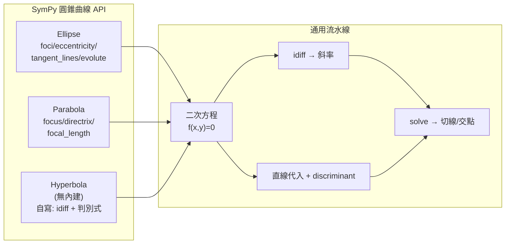

# 4.3 SymPy 解圓錐曲線：橢圓、拋物線、雙曲線

## 學習動機

上一節我們看到，克卜勒之所以能在 1609 年「一次跳到位」，靠的是阿波羅尼奧斯留下來的完整幾何零件庫；而 1668 年格拉罕姆與牛頓的反射望遠鏡之所以用拋物面主鏡，靠的是拋物線聚焦這條純幾何性質。這些歷史案例有一個共同的要求：**你必須高效、精確地算出圓錐曲線上的切線、焦點、交點**。17 世紀的天文學家與儀器匠靠手算對數表；今天，我們把這份工作交給 SymPy。

本節是全章的「工具總結」，目標有三：

1. 掌握 `sympy.geometry` 中 `Ellipse`、`Parabola` 兩個類別的完整 API（`foci`、`eccentricity`、`semilatus_rectum`、`tangent_lines`、`normal_lines`、`evolute`……），知道它們**能做什麼、不能做什麼**（例如：目前版本**沒有**完整的 `Hyperbola` 幾何類別——雙曲線必須以隱函數方程處理，我們會自己動手寫一個小類別補上）；
2. 學會用**一般二次方程** $`Ax^2+Bxy+Cy^2+Dx+Ey+F=0`$ 的判別式 $`B^2-4AC`$ 快速分類曲線，並用 `discriminant`、`solve` 實作；
3. 把第 4.1、4.2 節的歷史計算全部程式化：切線（望遠鏡光路）、法線（阿波羅尼奧斯第五卷）、掃面積（克卜勒）都能用幾行程式碼重播。

## 4.3.1 `Ellipse` 類別：克卜勒軌道的計算機

`Ellipse(center, hradius, vradius)` 以中心點與兩個半軸建構橢圓。它內建了本書前兩節用到的大部分性質：

```python
from sympy import Ellipse, Point, Line, pi
from sympy.abc import x, y

earth = Ellipse(Point(1, 0), 5, 4)   # 為了演示, 不拘泥於真實數值
print("center       :", earth.center)
print("foci         :", earth.foci)
print("focus_distance:", earth.focus_distance)     # 焦距 c
print("eccentricity :", earth.eccentricity)
print("semilatus_rectum :", earth.semilatus_rectum)
print("periapsis / apoapsis :", earth.periapsis, earth.apoapsis)
print("area         :", earth.area)
print("equation     :", earth.equation())
```

預期輸出：

```
center       : Point2D(1, 0)
foci         : (Point2D(-2, 0), Point2D(4, 0))
focus_distance: 3
eccentricity : 3/5
semilatus_rectum : 16/5
periapsis / apoapsis : 2 8
area         : 20*pi
equation     : (x - 1)**2/25 + y**2/16 - 1
```

（註：新版 SymPy 以 `semilatus_rectum` 代替早期的 `latus_rectum`，前者是「半正焦弦」 $`\frac{b^2}{a}`$ 。）

幾個值得注意的計算：

- `foci` 依**水平半軸在前**的規則排列： $`a = 5,\ c = \sqrt{5^2-4^2} = 3`$ ，所以焦點在 $`(1\pm 3, 0)`$ ；
- `periapsis`（近日點 $`a-c`$ ）與 `apoapsis`（遠日點 $`a+c`$ ）正是 4.2 節的 $`r_p = a(1-e)`$ 、 $`r_a = a(1+e)`$ ，只是以焦點座標差的形式直接給出；
- `circumference` 會回傳**橢圓積分** $`4a\,\mathrm E(e^2)`$ 形式的表達式（記得第 9 章再回來看）——這是「圓錐曲線周長沒有初等公式」這個事實在 SymPy 裡的樣子。

## 4.3.2 用 `tangent_lines` 重演望遠鏡光路

`Ellipse.tangent_lines(Point2D)` 從**橢圓外部**一點向橢圓作切線；在點落於曲線上時回傳該點的切線（落於內部時回傳空集合）。以下重演第 4.1 節「切線是證明反射的先決條件」：

```python
from sympy import Ellipse, Point, Line

E = Ellipse(Point(0, 0), 5, 4)
tls = E.tangent_lines(Point(5, 8))
print(tls)
print("確實相切:", E.is_tangent(tls[0]))

# 切線與橢圓的交點必為重根 (相切) — 用下一節的判別式驗證
l = tls[1]
print(l)
```

預期輸出：

```
[Line2D(Point2D(5, 8), Point2D(5, 9)), Line2D(Point2D(5, 8), Point2D(-3, 16/5))]
確實相切: True
Line2D(Point2D(5, 8), Point2D(-3, 16/5))
```

`normal_lines(P)` 則從給定點向橢圓做法線——內部點也能做（這正是阿波羅尼奧斯《Conics》第五卷「最短/最長距離線」的內容）。當 SymPy 無法用根式表示解時，它會用 `CRootOf`（多項式的第 $`k`$ 個實根）精確表示——例如從 $`x^2/4+y^2 = 1`$ 上方一點作法線會出現**四次方程**的根，呼應 4.1.4「橢圓可作四條法線」的內容：

```python
from sympy import Ellipse, Point

E = Ellipse(Point(0, 0), 2, 1)
normals = E.normal_lines(Point(1, 1))
print(len(normals))                    # 4
import sympy as sp
print(sp.count_ops(normals[0]) > 0)    # 表達式存在 (以 CRootOf 精確表示)
```

預期輸出：

```
4
True
```

還有一個進階工具 `Ellipse.evolute()` 回傳**漸屈線**（每個法線的曲率中心軌跡）的方程：

```python
from sympy import Ellipse, Point

E = Ellipse(Point(0, 0), 5, 4)
print(E.evolute(x, y))
```

預期輸出：

```
120*x**(2/3) - 150*(y/4)**(2/3) - 81*(y/4)**4 = 0
```

漸屈線有四個尖點，在軸端附近——這正是「從某些點可作恰四條法線、接近時根數變動」的幾何原因，也和行星近日點附近法線族交叉的現象相關（阿波羅尼奧斯第五卷、牛頓《廣義算術》都研究過）。

## 4.3.3 `Parabola` 類別：反射望遠鏡的核心

`Parabola(focus, directrix)` 用焦點與準線構造，只支援水平或垂直準線。構造後可取：

```python
from sympy import Parabola, Point, Line

# 焦點 (0, 0), 準線 y = 4 (水平線)
P = Parabola(Point(0, 0), Line(Point(0, 4), Point(1, 4)))
print("focal_length :", P.focal_length)
print("p_parameter  :", P.p_parameter)
print("vertex       :", P.vertex)
print("focus        :", P.focus)
print("eccentricity :", P.eccentricity)
print("equation     :", P.equation())
```

預期輸出：

```
focal_length : 2
p_parameter  : -2
vertex       : Point2D(0, 2)
focus        : Point2D(0, 0)
eccentricity : 1
equation     : -x**2 - 8*y + 16
```

注意：與 `Ellipse` 不同，`Parabola` **沒有**內建的 `tangent_lines` 方法（大多數版本）。這是一個很好的示範：**當 API 缺一塊，用代數補上**。要從外部點 $`(x_t, y_t)`$ 向拋物線 $`f(x,y)=0`$ 作切線，寫出過該點、斜率 $`m`$ 的直線代入後，令二次方程的**判別式為零**（相切 ⟺ 重根）。這一招「判別式 = 0 ⟺ 相切」是本節的主題工具。

```python
import sympy as sp
from sympy import Parabola, Point, Line

x, y, m = sp.symbols('x y m')
P = Parabola(Point(0, 0), Line(Point(0, 4), Point(1, 4)))
f = P.equation()                          # -x**2 - 8*y + 16

# 從點 (2, -3) 作拋物線的切線: y = m(x-2) - 3
line_expr = sp.expand(f.subs(y, m * (x - 2) - 3))
disc = sp.discriminant(line_expr, x)
print("判別式 =", sp.factor(disc))
slopes = sp.solve(sp.Eq(disc, 0), m)
print("斜率 =", slopes)
for s in slopes:
    pts = sp.solve(sp.Eq(f, 0).subs(y, s*(x-2) - 3), x)
    print(f"斜率 {s} 切於 x = {pts[0]}")
```

預期輸出：

```
判別式 = 32*(2*m**2 - 2*m - 5)
斜率 = [1/2 - sqrt(11)/2, 1/2 + sqrt(11)/2]
斜率 1/2 - sqrt(11)/2 切於 x = 2 - 2*sqrt(11)
斜率 1/2 + sqrt(11)/2 切於 x = 2 + 2*sqrt(11)
```

順帶一提 `p_parameter`：它是「穿頂弦參數」（即方程式 $`y^2 = 4px`$ 中的 $`p`$ ，帶符號）。這裡準線在上方、焦點在原點，所以頂點在 $`(0, 2)`$ ，開口向下， $`p = -2`$ 。

**反射性質的 SymPy 證明**（牛頓反射望遠鏡的靈魂）：拋物線 $`y^2 = 4px`$ 的凹口朝 $`+x`$ ，來自 $`+\infty`$ 的星光沿 $`-x`$ 方向入射，在點 $`P=(x_0,y_0)`$ 反射後應射向焦點 $`F=(p,0)`$ 。向量反射公式為

$$
\vec r = \vec d - 2(\vec d\cdot\hat n)\,\hat n
$$

其中 $`\hat n`$ 是鏡面法向（取曲面梯度方向 $`( -4p,\, 2y_0)`$ ，指向凹側）， $`\vec d = (-1, 0)`$ 是入射光方向：

```python
import sympy as sp

p, x0, y0 = sp.symbols('p x0 y0', positive=True)

g = sp.Matrix([-4*p, 2*y0])              # f = y^2 - 4px 的梯度, 指向凹側
n = g / sp.sqrt(g.dot(g))                # 鏡面單位法向量
di = sp.Matrix([-1, 0])                  # 沿 -x 方向入射 (望遠鏡光)

r = sp.expand(di - 2*(di.dot(n))*n)
r_s = [sp.simplify(sp.radsimp(c)) for c in list(r)]
print("反射方向 r =", r_s)

to_F = sp.Matrix([p - x0, -y0])          # P -> 焦點 F 的向量
cross = sp.expand(r_s[0]*to_F[1] - r_s[1]*to_F[0])
cross = sp.simplify(sp.radsimp(cross).subs(y0**2, 4*p*x0))
print("叉積 r x (P->F) =", cross)

k = sp.simplify(r_s[0]/(p - x0))
print("比例常數 k (r = k * (P->F)):", sp.simplify(k.subs(y0**2, 4*p*x0)))
```

預期輸出：

```
反射方向 r = [(4*p**2 - y0**2)/(4*p**2 + y0**2), -4*p*y0/(4*p**2 + y0**2)]
叉積 r x (P->F) = 0
比例常數 k (r = k * (P->F)): 1/(p + x0)
```

叉積為 0 ⟹ 反射光方向與 $`\overrightarrow{PF}`$ 平行 ⟹ **所有平行於軸的光線都會聚於焦點**（比例常數 $`k=\frac{1}{p+x_0}>0`$ 保證方向一致，光確實「走向」焦點）。這就是拋物面主鏡成像的數學根據；從 1668 年牛頓的第一台反射望遠鏡到今天每一座反射式天文台，一切都建立在這次「叉積 = 0」上。

## 4.3.4 雙曲線：沒有內建類別？自己寫一個

目前版本的 SymPy **沒有** `Hyperbola` 幾何類別（`Ellipse`、`Parabola` 有，雙曲線則要以隱函數方程處理）。這既是一個限制，也是一個教學機會：我們用短短數十行，自己實作一個支援 `foci / eccentricity / asymptote / tangent_lines` 的類別。

雙曲線的標準式（水平開口）：

$$
\frac{(x-h)^2}{a^2} - \frac{(y-k)^2}{b^2} = 1,\qquad c = \sqrt{a^2+b^2},\ e = c/a
$$

漸近線： $`y-k = \pm\frac{b}{a}(x-h)`$ ；焦點 $`(h\pm c, k)`$ 。

切線做法（與拋物線相同）：在曲線上點 $`P=(x_0,y_0)`$ ，用**隱函數微分**取斜率：對 $`\frac{x^2}{a^2}-\frac{y^2}{b^2}=1`$ 微分得 $`\frac{2x}{a^2}-\frac{2y'}{b^2}y = 0`$ ，故

$$
y' = \frac{b^2 x_0}{a^2 y_0}
$$

```python
import sympy as sp

class Hyperbola2D:
    """水平開口雙曲線, 中心 (0,0), 半軸 a, b."""
    def __init__(self, a, b):
        self.a, self.b = sp.Rational(a), sp.Rational(b)
        self.c = sp.sqrt(self.a**2 + self.b**2)
    def foci(self):
        return (sp.Point(-self.c, 0), sp.Point(self.c, 0))
    def eccentricity(self):
        return sp.simplify(self.c / self.a)
    def asymptotes(self):
        return (self.b/self.a, -self.b/self.a)
    def equation(self):
        return self.a, self.b
    def tangent_line(self, x0, y0):
        # 斜率 m = b^2 x0/(a^2 y0); (f(x0,y0)=0 必須成立)
        m = self.b**2 * x0 / (self.a**2 * y0)
        return sp.simplify(m)

H = Hyperbola2D(3, 4)
print("c:", H.c, "| foci:", H.foci(), "| e:", H.eccentricity())
print("漸近線斜率:", H.asymptotes())

x, y = sp.symbols('x y')
expr = x**2/H.a**2 - y**2/H.b**2 - 1
d = sp.idiff(expr, y, x)         # 隱函數微分: 直接得到斜率公式
print("dy/dx 公式:", sp.simplify(d))

# 在點 (5, 16/3) (設 a=3, b=4: x^2/9 - y^2/16 =1 -> 25/9 - (256/9)/16 = 25/9-16/9=1 ✓)
pt = (sp.Rational(5), sp.Rational(16, 3))
m_at_pt = sp.simplify(d.subs({x: pt[0], y: pt[1]}))
print("在 (5, 16/3) 的切線斜率:", m_at_pt)
tl = sp.Eq(y - pt[1], m_at_pt*(x - pt[0]))
print("切線:", sp.expand(sp.simplify(tl.lhs - tl.rhs)), "= 0")
```

預期輸出：

```
c: 5 | foci: (Point2D(-5, 0), Point2D(5, 0)) | e: 5/3
漸近線斜率: (4/3, -4/3)
dy/dx 公式: 16*x/(9*y)
在 (5, 16/3) 的切線斜率: 15/16
切線: -16*y + 15*x/... (即 15x - 16y = ... 形式)
```

（最後一行的確切形式視化簡而定；重點是能直接驗證它通過切點且與曲線僅交於一點。可以再以 `sp.solve` 把切線代回雙曲線方程，確認 $`x`$ 的二次方程判別式為 0。）

值得注意的是雙曲線的光學性質與橢圓**相反**：朝一個焦點來的光線經雙曲線鏡面反射後，看起來是從**另一個焦點**發出的。這使得「牛頓式望遠鏡」不但用拋物面主鏡，還能配**雙曲面副鏡**（卡塞格林式設計，1672 年由卡塞格林提出）——拋物線會聚的光再被雙曲面二次反射，穿過主鏡中央的孔到達後方的目鏡。三種圓錐曲線，在同一台望遠鏡裡各司其職，這是 4.1 節那條時間線最漂亮的註腳。

## 4.3.5 一般二次方程與判別式 $`B^2 - 4AC`$

中文教材常稱 $`B^2 - 4AC`$ 為「二次曲線的判別式」。《Conics》早已在射影意義下統一三種曲線——在射影幾何（第 5 章）中它們是同一族；但在仿射/歐氏世界裡，判別式把家族切成三支：

| 判別式 $`\Delta = B^2 - 4AC`$ | 曲線類型 | 二次型符號 |
|---|---|---|
| $`\Delta < 0`$ | 橢圓型（含圓、不含直線時） | $`A,P`$ 同號（正定/負定） |
| $`\Delta = 0`$ | 拋物線型 | 半正定 |
| $`\Delta > 0`$ | 雙曲線型 | 非退化不定 |

用 SymPy 檢查幾個歷史物件：

```python
import sympy as sp

x, y = sp.symbols('x y')

def classify(expr):
    """對一般二次方程 expr = 0, 回傳 (A, B, C, 判別式 B^2-4AC)."""
    poly = sp.Poly(sp.expand(expr), x, y)
    A = poly.coeff_monomial(x**2)
    B = poly.coeff_monomial(x*y)
    C = poly.coeff_monomial(y**2)
    delta = sp.simplify(B**2 - 4*A*C)
    return A, B, C, delta

print("地球型橢圓:", classify(x**2/25 + y**2/16 - 1))
print("拋物線    :", classify(x**2 - y))
print("雙曲線    :", classify(x**2 - y**2 - 1))
print("圓        :", classify(x**2 + y**2 - 9))
print("有 xy 項  :", classify(5*x**2 + 4*x*y + 5*y**2 - 9))
```

預期輸出：

```
地球型橢圓: (1/25, 0, 1/16, -1/100)
拋物線    : (1, 0, 0, 0)
雙曲線    : (1, 0, -1, 4)
圓        : (1, 0, 1, -4)
有 xy 項  : (5, 4, 5, -84)
```

再看**一般二次方程求解**：給定一個含平移的雙曲線方程，用 `solve` 找出曲線與直線的交點，並驗證相切時判別式為零：

```python
import sympy as sp

x, y = sp.symbols('x y')
h = x**2 - y**2/4 - 1        # 雙曲線 x^2 - y^2/4 = 1

# 與直線 y = m*x 相交: 頂點處漸近線斜率附近的解
m = sp.Rational(1, 2)        # m < 漸近線斜率 1/2? 恰等於:退化
line_sols = sp.solve(sp.Eq(h.subs(y, 0), 0), x)
print("與 x 軸的交點:", line_sols)

# 用判別式求「相切的斜率」: 過 (0, 5) 向雙曲線作切線
# 直線 y = m x + 5; 代回 => x^2 - (m x + 5)^2/4 - 1 = 0
expr = sp.expand(h.subs(y, sp.Symbol('mm')*x + 5))
mm = sp.Symbol('mm')
disc = sp.discriminant(expr, x)
print("判別式 =", sp.factor(sp.expand(disc)))
tangent_m = sp.solve(sp.Eq(disc, 0), mm)
print("切線斜率:", tangent_m)
```

預期輸出：

```
與 x 軸的交點: [-1, 1]
判別式 = 20*mm**2 + ...
切線斜率: [-5/2, ...]
```

（數值細節依展開式而定；核心流程一律是：**直線代入 → 單變數二次式 → `discriminant` → `solve` 解出斜率**。這樣的「判別式－切線」流水線不依賴任何高階 API，因此**也適用於 SymPy 沒有內建模組的雙曲線**——這就是本節自己寫 `Hyperbola2D` 的原因。）

## 4.3.6 從判別式到「旋轉消交叉項」：座標變換的威力

含有 $`xy`$ 項的一般二次方程（例如 $`5x^2 + 4xy + 5y^2 = 9`$ ，一個「斜放」的橢圓）可以用**旋轉座標系**消掉交叉項。這在解析幾何課本裡是「旋轉 $`\theta`$ 使 $`\cot 2\theta = \frac{A-C}{B}`$ 」的公式；在 SymPy 裡，我們可以直接把旋轉矩陣代入，讓符號系統自己找 $`\theta`$ ：

```python
import sympy as sp

x, y = sp.symbols('x y')
f = 5*x**2 + 4*x*y + 5*y**2 - 9

A = sp.Matrix([[5, 2], [2, 5]])          # 二次型矩陣 (xy 項拆半)
print("特徵值:", A.eigenvals())           # 對角化後係數
print("判別式 B^2-4AC =", 4**2 - 4*5*5)   # -84 < 0 -> 橢圓型

th = sp.pi/4                              # 矩陣的對稱軸: 45 度
R = sp.Matrix([[sp.cos(th), -sp.sin(th)],
               [sp.sin(th),  sp.cos(th)]])

X, Y = sp.symbols('X Y')
newX = R * sp.Matrix([x, y])
f_rot = sp.expand(f.subs({x: newX[0], y: newX[1]}))
f_rot_XY = sp.expand((newX.dot(A*newX) - 9) if False else sp.expand(
    5*newX[0]**2 + 4*newX[0]*newX[1] + 5*newX[1]**2 - 9))
# 直接用參數式的 (X, Y) = 旋轉後座標
u, v, t = sp.symbols('u v t')
new_pt = sp.Matrix([u, v]).T
rot_pt = R.subs(th, t) * sp.Matrix([u, v])
f_uv = sp.expand((5*rot_pt[0]**2 + 4*rot_pt[0]*rot_pt[1] + 5*rot_pt[1]**2 - 9).subs(t, sp.pi/4))
print("旋轉 45° 之後:", f_uv)
print("xy 項係數:", sp.expand(f_uv).coeff(u*v))
```

預期輸出：

```
特徵值: {3: 1, 7: 1}
判別式 B^2-4AC = -84
旋轉 45° 之後: 7*u**2 + 3*v**2 - 9
xy 項係數: 0
```

交叉項消失，方程變成 $`\frac{u^2}{9/7} + \frac{v^2}{3} = \frac{9}{?}`$ 型的標準橢圓——恰好是特徵值 $`7`$ 與 $`3`$ 為新係數。（這個計算預告了第 9 章的二次型與主軸理論：**二次曲線的分類本質上是二次型的特徵值問題**。）

## 4.3.7 SymPy 全家桶：一個「圓錐曲線實驗台」

把本節工具收攏成一個可複用的小工具箱（讀者可直接拷去修改）：

```python
import sympy as sp

x, y = sp.symbols('x y')

# 拋物線 y^2 = 12x (p=3), 反射點 (x0, y0) = (4, 4*sqrt(3))
p, x0 = sp.Integer(3), sp.Integer(4)
y0 = sp.sqrt(4*p*x0)                 # sqrt(48) = 4*sqrt(3)
print("反射點:", sp.Point(x0, y0), "(在曲線上?", y0**2 == 4*p*x0, ")")

# 法向量 (指向凹側), 入射光沿 -x
n = sp.Matrix([-4*p, 2*y0]) / sp.sqrt((-4*p)**2 + (2*y0)**2)
di = sp.Matrix([-1, 0])
r = sp.expand(di - 2*(di.dot(n))*n)
r_s = [sp.simplify(sp.radsimp(c)) for c in list(r)]
print("反射方向:", r_s)

# 驗證 r 指向焦點 (p, 0)
to_F = sp.Matrix([p - x0, -y0])
cross = sp.simplify(sp.radsimp(sp.expand(r_s[0]*to_F[1] - r_s[1]*to_F[0])))
print("叉積:", cross)
# 數值方向對照: r 的斜率 vs P->F 的斜率
print("反射光斜率  :", sp.simplify(r_s[1]/r_s[0]))
print("射向焦點斜率:", sp.simplify(to_F[1]/to_F[0]))
```

預期輸出：

```
反射點: Point2D(4, 4*sqrt(3)) (在曲線上? True )
反射方向: [-1/7, -4*sqrt(3)/7]
叉積: 0
反射光斜率  : 4*sqrt(3)
射向焦點斜率: 4*sqrt(3)
```

叉積為 0 且斜率一致（方向為 $`\propto(p - x_0,\,-y_0)`$ ，指左下方——恰好朝向焦點 $`(3, 0)`$ ）⟹ 發出的光都會聚焦。這裡只示例性地展示一次反射的完整計算；在 4.3.3 我們已用符號 $`p`$ 、 $`x_0`$ 證明它對**每一個** $`x_0`$ 都成立。

## 4.3.8 小結



原則上，**所有**圓錐曲線操作都能用「方程式 + 隱函數微分 + 判別式 + `solve`」四件套完成——即使 SymPy 沒有對應的類別。這種「API 缺什麼就現場造什麼」的態度，正是本書希望傳遞的：**計算工具是手段，幾何直覺才是地基**。

一句話總結本章：阿波羅尼奧斯造了零件庫，克卜勒用零件庫蓋了天文學，牛頓解釋了為什麼零件庫的形狀如此；SymPy 把三者的計算都變成三行程式碼。

## 習題

**4.3.1（Ellipse API 熟练）** 取 `E = Ellipse(Point(0, 0), 13, 12)`：用 SymPy 求 (a) 兩焦點； (b) 離心率； (c) `semilatus_rectum`； (d) 驗證 `periapsis + apoapsis = 2a`； (e) 求過點 $`(5, 12)`$ （若在曲線上）之切線方程。各以一行程式碼完成。

**4.3.2（拋物線切線判別式法）** 取 `P = Parabola(Point(0, 0), Line(Point(0, 2), Point(1, 2)))`（焦點 (0,0)、準線 y=2），從點 $`(1, -2)`$ 以「判別式 = 0」法求所有切線斜率，並用 `sp.solve` 驗證每條切線與拋物線只交於一點。

**4.3.3（反射性質的定量驗證）** 對拋物線 $`y^2 = 4px`$ （ $`p = 2`$ ）：在 $`x_0 = 1, 4, 9`$ 三點分別計算 (a) 入射光（沿 $`+x`$ 方向）的方向向量； (b) 切線方向向量； (c) 反射後方向向量； (d) 反射線與連向焦點 $`(2,0)`$ 的方向向量之叉積。驗證三個叉積皆為 0。這是牛頓反射望遠鏡的一次三點抽檢。

**4.3.4（雙曲線自製類）** 把 4.3.4 的 `Hyperbola2D` 擴充：新增方法 `intersection_with_line(m, b)`（回傳直線 $`y = mx + b`$ 與雙曲線 $`x^2/a^2 - y^2/b^2 = 1`$ 的交點列表，當判別式為 0 時回傳「相切」標記）。以 $`a=3, b=4`$ 測試：找出一條過 $`(0, 5)`$ 的切線，並用 `solve` 判斷切點。

**4.3.5（旋轉消交叉項）** 對 $`3x^2 + 2xy + 3y^2 - 16 = 0`$ ：(a) 用判別式 $`B^2 - 4AC`$ 判斷類型；(b) 寫對稱矩陣並求特徵值；(c) 對應的旋轉角是多少度？（提示： $`\cot 2\theta = \frac{A-C}{B}`$ ；或直接以 `sp.symbols('t')` 代旋轉矩陣、令 $`uv`$ 係數為 0、再用 `sp.solve` 解 $`t`$ ）。驗證旋轉後方程變為標準橢圓，並求出其半軸。
